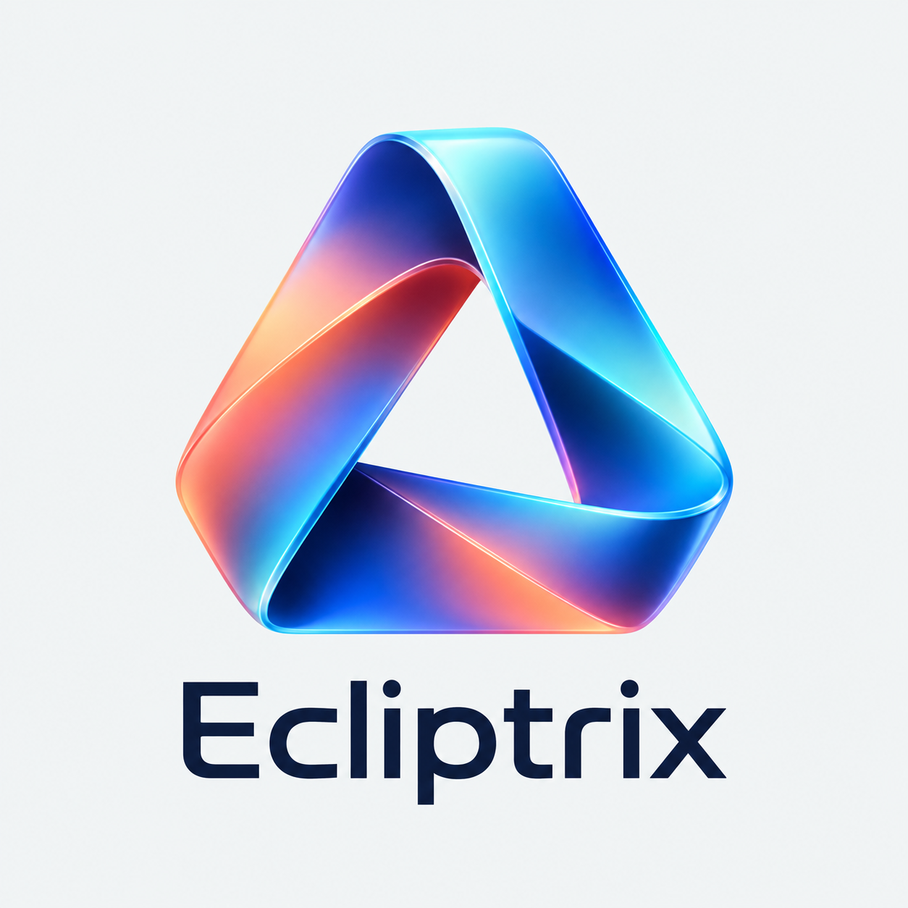

<div align="center">
  
</div>

# Ecliptrix

**Where light and shadow collide**

[中文文档](README.zh-CN.md)

An AI-powered content creation desktop app combining video editing, voice
synthesis and material management — an Electron shell around a Next.js 15
renderer and a local FastAPI backend.

Everything runs on your machine. The Electron main process starts a FastAPI
backend (SQLite) and a Next.js standalone server, both bound to `127.0.0.1`,
and loads the local page. There is no account, no login and no server to
deploy to — the app opens straight into the editing workspace.

## Features

- **AI Video Editing** — Automatic video search, mixing, cutting, and composition with subtitle overlay
- **Voice Synthesis** — Volcano TTS integration with 100+ voice types and batch processing
- **Video Analysis** — Vision-Language model powered frame-by-frame video understanding
- **Storyboards & AI Generation** — ByteDance ARK video and image generation
- **Content Chat** — Multi-turn AI chat with streaming responses
- **Multi-tab Interface** — Work on chat and video editing side by side
- **YouTube Integration** — Download and process YouTube videos with yt-dlp

## Quick Start

### Prerequisites

| Tool | Version | Required |
|------|---------|----------|
| Node.js | 18+ | Yes |
| Python | 3.10+ | Yes |
| FFmpeg | 4+ | For video features |

No database server is needed: the app uses SQLite.

### Run the desktop app in development

```bash
git clone https://github.com/xdrshjr/Ecliptrix.git
cd Ecliptrix
npm install

cd backend-services/basic-service
python3 -m venv venv
source venv/bin/activate        # Windows: source venv/Scripts/activate
pip install -r requirements.txt
cd ../..

cd desktop
npm install
npm run dev
```

`desktop/npm run dev` starts the backend, the Next.js dev server and Electron
together, wired to each other. The database file and storage directories are
created on first launch — there is no migration step.

### Build an installer

```bash
cd desktop
npm run build        # full installer
npm run build:dir    # unpacked build (what the smoke test runs against)
node scripts/smoke-test.js
```

### Browser-only debugging

The renderer is an ordinary Next.js app, so you can drive it in a browser
without Electron. This is a debugging path for the same product, not a second
supported form factor — the window controls simply do not render.

```bash
# Terminal 1 — backend
cd backend-services/basic-service
source venv/bin/activate        # Windows: source venv/Scripts/activate
uvicorn app.main:app --reload --host 127.0.0.1 --port 8000

# Terminal 2 — frontend
npm run dev
```

| Service | URL |
|---------|-----|
| Frontend | http://localhost:3000 |
| Backend API | http://localhost:8000 |
| API Docs | http://localhost:8000/docs |

### Configure your model credentials

On first launch the app prompts you to open **Settings → Model & credentials**
and enter an LLM key. You can also pre-fill `LLM_API_KEY` / `LLM_API_URL` in
the backend `.env` before starting.

## Tech Stack

### Desktop shell

- **Electron** main process — spawns and health-checks the backend and frontend child processes, owns the frameless window
- **Packaging:** electron-builder, with an embedded CPython and FFmpeg

### Frontend

- **Framework:** Next.js 15 (App Router, `output: 'standalone'`)
- **Language:** TypeScript 5
- **Styling:** Tailwind CSS 3
- **State:** React hooks + Context (Locale, Notifications)

### Backend

- **Framework:** FastAPI
- **Database:** SQLite + SQLAlchemy (async, aiosqlite); schema built by `create_all`
- **Storage:** Local filesystem
- **Video:** FFmpeg subprocess, OpenCV
- **TTS:** Volcano Engine TTS
- **LLM:** Multi-provider (OpenAI-compatible API, supports Qwen, Claude, GPT, etc.)

## Project Structure

```
Ecliptrix/
├── desktop/                          # Electron shell
│   ├── main/                         # Main process: window, child processes, env
│   ├── preload/                      # contextBridge surface (version, logs, window controls)
│   └── scripts/                      # dev / packaging / smoke-test scripts
├── src/                              # Next.js renderer
│   ├── app/                          # App Router + API proxy routes
│   ├── components/                   # Feature-organized React components
│   │   ├── video/                    # Video editing (30+ components)
│   │   ├── chat/                     # Chat interface
│   │   ├── settings/                 # Settings centre
│   │   ├── shell/                    # Title bar + action cluster
│   │   └── ui/                       # Shared UI components
│   ├── contexts/                     # Notification, Locale
│   ├── hooks/                        # useTasks, useLlmConfigStatus, ...
│   ├── lib/api/                      # Backend API service clients
│   └── types/                        # TypeScript type definitions
├── backend-services/basic-service/   # FastAPI backend
│   ├── app/
│   │   ├── main.py                   # App entry: 32 routers, middleware
│   │   ├── config.py                 # Settings loader (.env + YAML overrides)
│   │   ├── constants.py              # LOCAL_OWNER_ID / LOCAL_OWNER_NAME
│   │   ├── database.py               # Async SQLAlchemy engine + create_all
│   │   ├── models/                   # Pydantic + ORM models
│   │   ├── routers/                  # API route modules
│   │   └── services/                 # Service modules
│   ├── config/                       # YAML configs (TTS, upload, youtube, etc.)
│   └── tests/                        # Pytest suite
└── env.template                      # Frontend environment template
```

## Configuration

### Frontend `.env.local`

```bash
# LLM API (used by the direct-call chat routes)
LLM_API_URL=https://dashscope.aliyuncs.com/compatible-mode/v1
LLM_API_KEY=your_key_here
LLM_MODEL=qwen3-next-80b-a3b-instruct

# Backend connection (server-side only)
BACKEND_URL=http://localhost:8000

# App settings
NEXT_PUBLIC_APP_NAME=Ecliptrix
NEXT_PUBLIC_AI_MATERIAL_SERVICE=local
```

### Backend `.env`

```bash
# LLM APIs (general, video cut, vision-language)
LLM_API_KEY=your_key_here
VIDEO_CUT_LLM_API_KEY=your_key_here
VL_LLM_API_KEY=your_key_here

# Database — SQLite file, created on first run
DATABASE_URL=sqlite+aiosqlite:///./data/ecliptrix.db

# External APIs (optional)
PEXELS_API_KEY=your_key_here
VOLCANO_TTS_APPID=your_appid
```

In the packaged app, `DATABASE_URL`, `STORAGE_ROOT`, `HOST`, `PORT` and
`CORS_ALLOWED_ORIGINS` are injected by the Electron main process and cannot be
overridden from `.env`.

See `env.template` (frontend) and `backend-services/basic-service/env.template`
(backend) for all available options.

### Multi-LLM Strategy

The backend supports several independent LLM configurations:

| Config | Used For | Default Model |
|--------|----------|---------------|
| `LLM_*` | Chat, agent, intent detection | qwen3-next-80b |
| `FAST_LLM_*` | Quick operations (translation, search queries) | — |
| `VIDEO_CUT_LLM_*` | AI mixed editing | claude-sonnet-4 |
| `VL_LLM_*` | Video frame analysis | qwen-vl-plus |

All endpoints use the OpenAI-compatible API format.

## Commands

### Desktop

```bash
# From desktop/
npm run dev        # Electron + backend + frontend, wired together
npm run build      # Package the installer
npm run build:dir  # Unpacked build
node scripts/smoke-test.js      # End-to-end gate on the packaged app
node main/window-state.test.js  # Main-process unit tests
```

### Frontend

```bash
npm run dev          # Development server
npm run build        # Production build
npm start            # Production server
npm run lint         # ESLint
npm run type-check   # TypeScript check
npm test             # Vitest unit tests
```

### Backend

```bash
# From backend-services/basic-service/ with venv activated
uvicorn app.main:app --reload --host 127.0.0.1 --port 8000   # Dev server
pytest tests/ -v                                              # Run tests
pytest tests/ --cov=app --cov-report=html                     # Coverage
```

## Contributing

1. Fork the repository
2. Create a feature branch (`git checkout -b feature/amazing-feature`)
3. Commit your changes (`git commit -m 'Add amazing feature'`)
4. Push to the branch (`git push origin feature/amazing-feature`)
5. Open a Pull Request

## License

This project is licensed under the ISC License.

---

**Ecliptrix** — Transforming ideas into reality through the collision of light and shadow.
