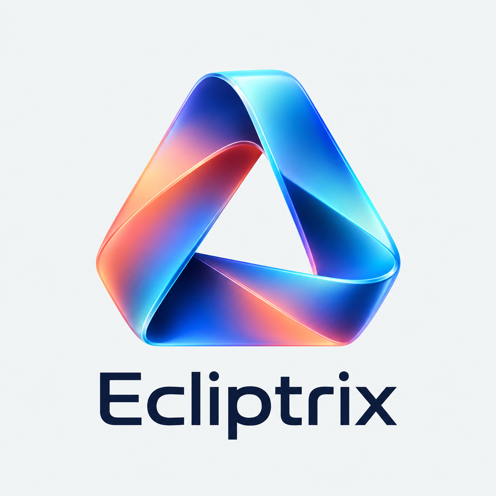
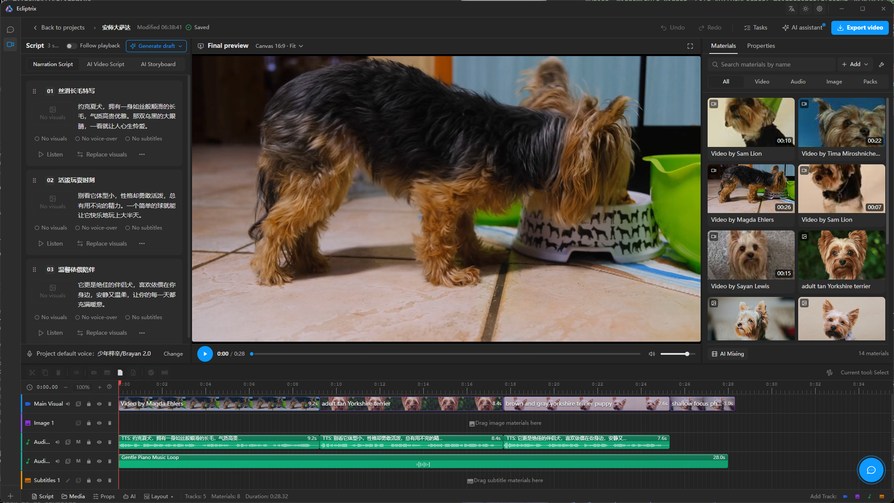
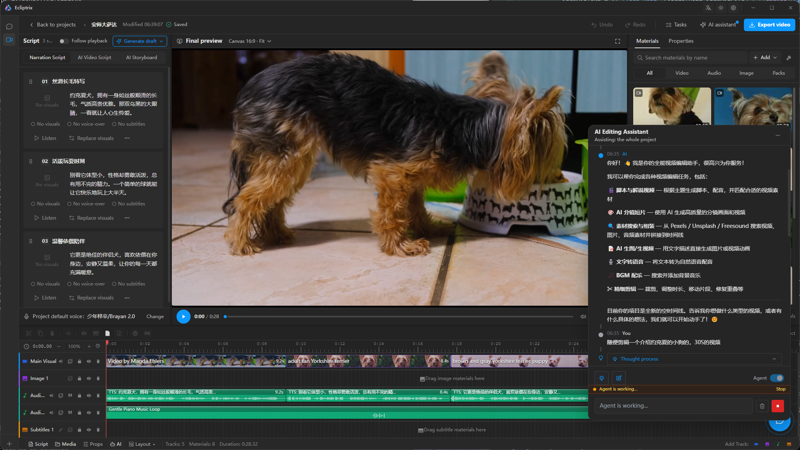

<div align="center">
  
</div>

<h1 align="center">Ecliptrix · 灵蚀创影</h1>

<p align="center">
  <strong>An open-source, local-first AI video editor for Windows.</strong><br />
  Write the script — the agent finds the footage, records the voice-over, aligns the
  subtitles and cuts the timeline. Everything runs on your own machine.
</p>

<p align="center">
  <a href="#screenshots">Screenshots</a> ·
  <a href="#what-is-ecliptrix">What is Ecliptrix</a> ·
  <a href="#features">Features</a> ·
  <a href="#who-is-it-for">Who it is for</a> ·
  <a href="#quick-start">Quick start</a> ·
  <a href="#faq">FAQ</a> ·
  <a href="README.zh-CN.md">中文文档</a>
</p>

<p align="center">
  <a href="https://github.com/xdrshjr/Ecliptrix"></a>
  <a href="#faq"></a>
  
  
  
  
  
</p>

> **Where light and shadow collide.**

---

## What is Ecliptrix?

**Ecliptrix is an AI video editing desktop application that turns a written script
into an edited video.** It searches stock footage, generates or downloads missing
material, synthesises voice-over, aligns subtitles to each segment and composes the
timeline — then exports the finished cut with FFmpeg.

It ships as a single Electron desktop app: the main process launches a local FastAPI
backend (SQLite) and a Next.js 15 standalone server, both bound to `127.0.0.1`, and
the window loads that local page. The database, the media library, the generated
audio and the project files all stay on your disk. There is no account, no login,
no subscription and no server to deploy — the app opens straight into the editing
workspace.

It is **not** a hosted SaaS and it is **not** a cloud renderer. It is an open-source
(ISC) alternative to closed AI video editors for people who want their footage,
scripts and model keys to remain theirs.

### Key facts

| | |
|---|---|
| **Product** | AI video editing desktop app — script → material → voice-over → subtitles → timeline → export |
| **Form factor** | Windows 10/11 x64 desktop app (NSIS installer, `electron-builder`) |
| **Runs on** | Electron 33 shell + Next.js 15 renderer + local FastAPI service |
| **Data location** | Local SQLite file + local filesystem (`%APPDATA%\Ecliptrix`); nothing uploaded to us |
| **Accounts** | None. Single local owner, no login, no RBAC |
| **AI models** | Any OpenAI-compatible LLM endpoint (Qwen, Claude, GPT, GLM, DeepSeek, …) in separate slots |
| **Media engine** | FFmpeg + OpenCV, CPU only — no GPU required |
| **Languages** | English + Chinese UI |
| **License** | ISC |
| **Status** | Actively developed, single-user desktop release line 1.x |

## Screenshots

### Script, canvas preview and material library

<p align="center">
  
</p>

The editing workbench: an AI-generated script broken into numbered segments on the
left, the real composited `16:9` canvas preview in the centre (what you see is what
the exporter renders), and the searchable, filterable material library — video,
audio, image and packs — on the right.

### Multi-track timeline with TTS narration and subtitles

<p align="center">
  
</p>

The multi-track timeline: `Main Visual` video clips, extra image and audio tracks,
the TTS voice-over clips with their real durations, a background-music waveform, a
dedicated subtitle track — plus the Agent drawer where the editing agent reports
what it did.

## Features

### Editing and composition

- **Multi-track timeline editing** — video, image, audio and subtitle tracks with
  per-clip trimming, gaps, overlap detection and one-step undo for segment commands.
- **Canvas compositor preview** — the multi-track canvas compositor is the *sole*
  preview path, so preview and export resolve the same layers.
- **Camera motion (Ken Burns)** — 2D/3D camera motion for both video clips and still
  images, with multi-keyframe curves, eased stops and full trajectory control. The
  TypeScript preview and the Python exporter share one implementation and are pinned
  by golden vectors.
- **Subtitles** — per-segment subtitle text, style control, overflow re-measurement
  using the exporter's own `maxSubtitleChars`.
- **Export** — FFmpeg composition, watermark removal, silence removal, video cutting,
  with a pre-export timing/overflow preflight.

### AI generation and research

- **Script generation** — basic, enhanced, narration-direct, storyboard and
  video-understanding (frame-by-frame analysis) flows.
- **Material search** — Pexels (video), Unsplash (images), Freesound (audio) and
  Tavily (web), with results cached locally for same-origin preview.
- **AI video and image generation** — ByteDance ARK video generation and ARK Seedream
  image generation, with generated assets written back into the material library.
- **AI mixed editing** — a dedicated `VIDEO_CUT_LLM_*` slot drives automated mixing.
- **Video analysis** — vision-language `VL_LLM_*` slot for frame by frame
  understanding.
- **YouTube** — download and process source videos with `yt-dlp`.

### Voice and audio

- **Text-to-speech** — Volcano Engine TTS with 100+ voices, batch synthesis,
  per-segment voice override, speed control and real returned durations.
- **Audio sync playback** — audio elements are kept in lockstep with the playback
  clock across tracks.

### Agent

- **Autonomous editing agent** — a tool-calling agent that can search, download,
  arrange, narrate, review and export, with a visible plan and one question at a time.
- **Progressive tool disclosure** — only `update_plan` and `ask_user` are always
  resident; the rest load by category so the context cannot blow up.
- **Vision review and self-check** — 15 deterministic timeline rules before export,
  plus `view_image` / `review_frames` / `inspect_export` for pixel-level review of
  what it produced.

### Platform

- **Local-first** — SQLite database, local media library, no migration step, schema
  created on first launch.
- **Bilingual UI** — English and Chinese in one translation layer.
- **Task singletons** — one AI chat and one editing session at a time, switchable
  without losing state.

## Who is it for?

- **Solo creators and YouTubers** producing narrated, subtitle-driven videos — script
  in, finished cut out, without a subscription editor.
- **Chinese and English content teams** that need one workspace for TTS narration,
  stock footage search and subtitle alignment.
- **People who do not want their footage in someone else's cloud** — the project file,
  media library and database live on the local disk.
- **Teams with their own model endpoint** — point Ecliptrix at a self-hosted or
  gateway OpenAI-compatible API and keep the keys in your own settings.
- **Developers** building on the editor: it is open source, so the timeline, the
  compositor and the agent tools can be read, forked and extended.

## How it works

```
Ecliptrix.exe (Electron main process)
 ├─ [child] FastAPI backend    python.exe run.py      → 127.0.0.1:18321
 ├─ [child] Next.js frontend   node server.js         → 127.0.0.1:18320
 └─ main window                loadURL(http://127.0.0.1:18320)
```

The renderer is an ordinary Next.js app; its API routes either proxy to the FastAPI
backend (`BACKEND_URL`) or call an OpenAI-compatible chat endpoint directly
(`LLM_API_URL` / `LLM_API_KEY`). In development the same two servers run on ports
`3000` and `8000` instead.

In the packaged app, `DATABASE_URL`, `STORAGE_ROOT`, `HOST`, `PORT` and
`CORS_ALLOWED_ORIGINS` are injected by the Electron main process and cannot be
overridden from `.env`.

## Quick start

### Prerequisites

| Tool | Version | Required |
|------|---------|----------|
| Node.js | 18.18+ (22+ for the desktop smoke test) | Yes |
| Python | 3.10+ (3.10/3.11 for the Windows browser path) | Yes |
| FFmpeg | 4+ | For video features |

No database server is needed: the app uses SQLite. No GPU is needed: composition
runs through FFmpeg on the CPU, and AI generation is done by the providers you
configure.

### Run the desktop app in development

```bash
git clone https://github.com/xdrshjr/Ecliptrix.git
cd Ecliptrix
npm install

cd backend-services/basic-service
python3 -m venv venv
source venv/bin/activate        # Windows: source venv/Scripts/activate
pip install -r requirements.txt
cd ../..

cd desktop
npm install
npm run dev
```

`desktop/npm run dev` starts the backend, the Next.js dev server and Electron
together, wired to each other. The database file and storage directories are
created on first launch — there is no migration step.

### Build an installer

```bash
cd desktop
npm run build        # full installer
npm run build:dir    # unpacked build (what the smoke test runs against)
node scripts/smoke-test.js
```

### Browser-only debugging

The renderer is an ordinary Next.js app, so you can drive it in a browser without
Electron. This is a debugging path for the same product, not a second supported form
factor — the window controls simply do not render.

```bash
# Terminal 1 — backend
cd backend-services/basic-service
source venv/bin/activate        # Windows: source venv/Scripts/activate
uvicorn app.main:app --reload --host 127.0.0.1 --port 8000

# Terminal 2 — frontend
npm run dev
```

| Service | URL |
|---------|-----|
| Frontend | http://localhost:3000 |
| Backend API | http://localhost:8000 |
| API Docs (Swagger) | http://localhost:8000/docs |

### Configure your model credentials

On first launch the app prompts you to open **Settings → Model & credentials** and
enter an LLM key. You can also pre-fill `LLM_API_KEY` / `LLM_API_URL` in the backend
`.env` before starting.

## Agent capabilities in depth

### Web research and dynamic browsing

The agent loads web search, page reading, image/audio/video download and dynamic
browsing tools on demand. Sources are kept as citations, and a download is imported
into the local material library only after it verifies. Public sites need no login,
and instructions found inside a page never grant extra permissions. Search needs
Tavily credentials in **Settings → Web & Research**; missing credentials, a refusing
site, being offline and an unavailable browser each show their own state, and
editing keeps working either way.

If the search credential is rejected, re-check and save it; on rate limiting, retry
manually later; on an exhausted quota, check the provider account. A timeout or an
odd response never wipes saved configuration. "Configured" in the settings panel only
means the credential is *saved* — public reachability must be verified with "Test
saved connection", and if reading the status fails you can hit "Refresh status". The
connection test has a 5-second cooldown from the start and cannot be started again
while one is still running.

Pick the optional research model in **Model settings → Feature assignment → Web
research digest**, and switch the digest on in Web & Research; when it is off the
main model consolidates the material. With no dedicated research model the app falls
back through the full configuration group to the fast model, then the chat model. The
main and research context-window settings in Advanced should match what those models
actually accept. Downloaded material is stored locally, and temporary research
material is cleaned up according to its retention period.

Research cards are labelled "full text read", "search snippet only" or "no content
obtained", and report the actual source coverage. Reading the original does not mean
the fact is verified; reports built from mixed sources keep the missing-original
notes. If the digest model fails, times out or runs out of context, the excerpts that
were collected remain available to the main model. Generating search queries alone
does not mean the digest succeeded — the UI reports the real stage. After a long
conversation is compacted, source numbering and source quality survive; read the raw
research material again when you need the full evidence.

The research development path requires Python 3.10+ (the Windows browser path is
smoked on 3.10/3.11); the desktop smoke test requires Node.js 22+. Install the pip
packages only and **do not** run `python -m playwright install` — dynamic browsing
reuses the app's bundled Electron Chromium over CDP (spec §3.6), so the installer adds
no browser assets (the playwright package only contributes its ~50 MB node driver):

```powershell
python -m pip install -r requirements.txt
python run.py
```

Debugging dynamic browsing on a dev machine: first start the Electron browser host
(in `desktop/`: `npx electron main/agentBrowserHost.js --agent-browser-host
--cdp-port=9222 --control-port=9333`), then give the backend
`AGENT_BROWSER_CDP_URL=http://127.0.0.1:9222` and
`AGENT_BROWSER_CONTROL_URL=http://127.0.0.1:9333`. The desktop build injects and
supervises the host subprocess itself, so no manual setup is needed there. For
browser-only debugging with a different frontend address, set the same
`RESEARCH_RENDERER_ORIGIN` (e.g. `http://localhost:3000`) on both sides and add it to
the backend `CORS_ALLOWED_ORIGINS`.

Proxy: **Settings → Web & Research → Proxy mode** offers automatic / direct / custom.
Automatic = custom address > system/environment proxy > direct; direct keeps the full
public-IP check; custom uses only the entered `http(s)://host:port` (credentials
allowed). In proxy mode the target hostname is resolved by the proxy (so fake-IP proxy
setups work), but literal private and metadata targets are still refused.

Windows dynamic-browsing verification uses the `python run.py` path — explicit
Proactor loop, single process, no reload (the playwright driver needs subprocess
support). When the host is missing, dynamic browsing degrades gracefully to
unavailable and static research still works. `node scripts/smoke-test.js` checks the
packaged app's host liveness, CDP reachability, capabilities, browser actions and
shutdown cleanup.

A successful full build writes `desktop/release/research-build-manifest.json`, bound
to the whole installer resource tree and to that installer. Run the release acceptance
commands from the repository root (use a fresh `<run-id>` every time):

```powershell
npm --prefix desktop run build
node desktop/scripts/smoke-test.js --unpacked desktop/release/win-unpacked --research-manifest desktop/release/research-build-manifest.json --research-report .agentmesh/research-r2/<run-id>/package_offline.json
node desktop/scripts/verify-research-release.js --unpacked desktop/release/win-unpacked --installed .agentmesh/research-r2/<run-id>/installed --manifest desktop/release/research-build-manifest.json --evidence .agentmesh/research-r2/<run-id>/evidence.json
```

Exit code `0` means every gate passed, `1` means the evidence failed, `2` means some
items are legitimately unrun or blocked. Offline smoke does not replace a real public
network, model, install and offline video loop; the report and attachment structure,
the acceptance criteria and the evidence matrix the blockers are tracked against live
in the [agent general capabilities
spec](docs/plans/agent-general-capabilities/spec.md) (§9 test and acceptance criteria,
§12.4 acceptance evidence matrix). Rebuild means re-accept; a final report is never
overwritten. Logs, database and temporary files go to a separate user directory.

Dynamic browsing allows public GET/HEAD requests only: no cookies are imported, and
login, POST APIs and Service Workers are unsupported. A redirect the browser cannot
safely re-intercept returns `redirect_unsupported`; open the verified final public
address directly instead.

### General toolkit (workspace / documents / analysis / plan / ask / memory)

Besides the editing tools, the editing agent ships a set of video-agnostic
capabilities. Every one of them is switchable and quota-limited in
**Settings > Agent capabilities**:

| Capability | What it does | Default |
|---|---|---|
| Workspace | The agent writes outlines, script drafts, CSV and SVG as **local files**, reads them back page by page, and can import media into the material library for the timeline | On |
| Documents | Upload PDF / DOCX / TXT / MD / CSV / TSV / JSON / SRT / VTT / HTML and read them page by page; long documents get a layered digest (a digest is **not** evidence) | On |
| Analysis | Offline Python for arithmetic, tables, CSV/SVG artifacts | **Off** (opt-in) |
| Plan | `update_plan` publishes the multi-step plan in the chat | On |
| Ask | `ask_user` stops to ask one question at a decision fork, with no interrupt/resume protocol | On |
| Memory | Remembers confirmed preferences and decisions; per-entry delete, optional expiry | On |

Where it lives and what it does not promise:

- The workspace is `<parent of STORAGE_ROOT>/agent_workspace` (on desktop:
  `<userData>/agent_workspace`). It is **not** under `static/`, has no static
  mount, and is reachable only through `/api/agent-toolkit/*`. It is
  project-scoped with a 256 MB default quota.
- The analysis sandbox uses an **AST allow-list plus a separate process**. It is
  **not kernel-level isolation**: it stops the model from writing code that
  damages your files, it does not stop a malicious local user. Only a
  wall-clock timeout is enforced — there is **no memory limit**. That is why it
  ships off by default, and the settings panel says exactly this.
- Document digests use the fast model by default and can be switched to the
  research model in the same panel; the fast model falls back to the chat model.
- Tools are **progressively disclosed**: only `update_plan` and `ask_user` are
  always resident. The other ten load by category (workspace / documents /
  analysis / memory); unloaded schemas are never sent, and long documents and
  big tables are always paged, so the context cannot blow up.

### Agent host layer (commands / files / general egress)

The toolkit above covers *editing*. This layer covers being a **general agent**: when a
specialised tool is blocked by policy, quota or a domain, the agent still has a way
through. Everything is switchable and rate-limited under **Settings › Host capabilities**.

| Capability | What it does | Default |
|---|---|---|
| Local commands `bash` | Runs foreground commands on your machine (ffmpeg / ffprobe / bundled python) with timeouts, process-tree kill, output caps and credential redaction | on |
| File tools | `read_file` / `write_file` / `edit_file` / `list_dir` / `glob` / `grep` inside the workspace or explicitly trusted roots | on |
| General egress `egress_tools` | `http_request` (GET/HEAD), `download_url` (commits real bytes; `size=0` is a failure), `diagnose_url` (explains which rule refused you, layer by layer) | on |

Boundaries — deliberately **not** dressed up as safety:

- `bash` is **full-permission local code execution, not a sandbox**. `shell_scope` only
  picks the default cwd; the environment is allowlisted (no `*KEY*` / `*TOKEN*` /
  `*SECRET*` variables) and output is redacted before it reaches the model.
- Trusted roots default to the **project workspace + storage root** and deliberately
  **exclude `~`** — `~` would expose `~/.ssh`, `~/.aws` and every `.env`.
- The second egress tier has **no research run**: no 80-call quota and no
  `run_closed`. One failure fails one call.
- Egress modes `strict | balanced | open`: `balanced` (default) fixes "carrier DNS /
  Fake-IP makes every host unreachable" while keeping literal private/metadata targets
  blocked and DNS pinned; `open` is the real "stop blocking me" switch, behind a red
  warning and an explicit confirmation.
- A refusal must be reported with its `reason` and `remediation` ("the proxy address
  has no port", not "the site refused you"); `diagnose_url` exists for that step.
- Design and implementation record:
  [agent-general-assistant](docs/plans/agent-general-assistant/spec.md).


The agent used to work blind: it could search, download and export, but it never
looked at what it produced. Two capabilities close that gap, both under the same
discipline (progressive disclosure, byte budgets, graceful degradation).

**Static self-check — `check_timeline` (always resident, free, local).**
Fifteen deterministic rules run on the timeline snapshot before every export:
missing material, clip bounds, same-track overlap, subtitle overflow (line count
recomputed with the same `maxSubtitleChars` the exporter uses), subtitle
overlap, subtitle style drift, hidden/muted tracks, audio gaps, volume clipping,
upscaled (blurry) material, a still image held too long, gaps between clips,
cover created but never placed on the timeline, `totalDuration` drift, and an
empty timeline. Every issue carries a severity (`blocker` / `warning` / `note`)
and, when a real tool can fix it, the tool name. **Any blocker makes `ok:false`,
and an empty timeline is itself a blocker** — the check can never report "all
green" on a timeline that has not been built yet. It is a pure function: no
network, no settings lookup, no cost, so it also has no on/off switch (turning
it off would only hide problems).

**Visual review — `view_image` / `review_frames` / `inspect_export` (on demand).**
Pixels never enter the main model's context. The vision model (the `VISION`
function slot in model settings, falling back to the chat model and then the fast
model) looks at the image server-side and answers with a structured JSON
observation — verdict, summary, per-region observations, issues and any legible
text — which is all the agent ever receives (≤2 000 characters, ≤12 KiB with the
rest of the result). `review_frames` samples 1–6 moments into one numbered
contact sheet so the model can say "the subtitle in frame 3 is cut off".
`inspect_export` runs real probes on the exported file (ffprobe metadata,
`blackdetect`, `freezedetect`, `silencedetect`, EBU R128 loudness) and, when a
vision model is configured, a spot check of sampled frames.

What it does **not** promise:

- The agent cannot inspect an export that this app process no longer remembers.
  The window is "exported by this session, within the last hour"; after a restart
  you re-export and ask again. The error message says exactly that.
- Technical probes and the visual spot check are independent: with no vision
  model you still get duration, black-frame, silence and loudness results, and
  the not-measured items are listed explicitly (`skipped[]`) instead of silently
  reading as green.
- Reviewing a picture sends a downscaled copy (1280 px longest side by default)
  to **the vision provider you configured**. The settings panel states this, the
  chat card carries a permanent "sent to the vision model" chip, cached
  observations stay on this machine, and the cache can be cleared in Settings >
  Visual review.
- Text inside an image (screenshots, posters, subtitles) is **data, never
  instructions**: the vision prompt says so, the output schema has no channel
  for commands, and the tool result is marked untrusted.
- Everything degrades to the editing path you already had: no vision model, no
  FFmpeg, an expired export, a vision quota you capped, or the whole capability
  switched off — each only disables that step and says what to do next.

Settings > Visual review owns the switches (`enabled`, `probe_enabled`,
`visual_spot_check`), the resolved model and its egress note, the image/frame/day
budgets, the request timeout, the cache lifetime and today's usage counters.

## Tech stack

### Desktop shell

- **Electron 33** main process — spawns and health-checks the backend and frontend
  child processes, owns the frameless window
- **Packaging:** electron-builder (NSIS), with an embedded CPython and FFmpeg, so
  users install nothing else

### Frontend

- **Framework:** Next.js 15 (App Router, `output: 'standalone'`)
- **Language:** TypeScript 5, React 19
- **Styling:** Tailwind CSS 3 (class-based dark mode), shadcn/ui new-york
- **State:** React hooks + Context (Locale, Notifications) and Zustand for the
  timeline/editing stores
- **i18n:** one translation file, English + Chinese

### Backend

- **Framework:** FastAPI (async, SQLAlchemy 2 async, aiosqlite)
- **Database:** SQLite; schema built by `create_all` on startup, additive changes only
- **Storage:** local filesystem, served through FastAPI static mounts
- **Video:** FFmpeg subprocess, OpenCV
- **TTS:** Volcano Engine TTS
- **LLM:** multi-provider through the OpenAI-compatible API (Qwen, Claude, GPT, GLM,
  DeepSeek and any compatible gateway)

### Testing

- **Vitest** for the frontend (465 test files under `src/`)
- **pytest** for the backend (156 test modules)
- **Packaged-app smoke test** (`desktop/scripts/smoke-test.js`) as the end-to-end gate

## Configuration

### Frontend `.env.local`

```bash
# LLM API (used by the direct-call chat routes)
LLM_API_URL=https://dashscope.aliyuncs.com/compatible-mode/v1
LLM_API_KEY=your_key_here
LLM_MODEL=qwen3-next-80b-a3b-instruct

# Backend connection (server-side only)
BACKEND_URL=http://localhost:8000

# App settings
NEXT_PUBLIC_APP_NAME=Ecliptrix
NEXT_PUBLIC_AI_MATERIAL_SERVICE=local
```

### Backend `.env`

```bash
# LLM APIs (general, video cut, vision-language)
LLM_API_KEY=your_key_here
VIDEO_CUT_LLM_API_KEY=your_key_here
VL_LLM_API_KEY=your_key_here

# Database — SQLite file, created on first run
DATABASE_URL=sqlite+aiosqlite:///./data/ecliptrix.db

# External APIs (optional)
PEXELS_API_KEY=your_key_here
VOLCANO_TTS_APPID=your_appid
```

See `env.template` (frontend) and `backend-services/basic-service/env.template`
(backend) for all available options.

### Multi-LLM strategy

The backend supports several independent LLM configurations, all using the
OpenAI-compatible API format:

| Config | Used for | Default model |
|--------|----------|---------------|
| `LLM_*` | Chat, agent, intent detection | qwen3-next-80b |
| `FAST_LLM_*` | Quick operations (translation, search queries) | — |
| `VIDEO_CUT_LLM_*` | AI mixed editing | claude-sonnet-4 |
| `VL_LLM_*` | Video frame analysis | qwen-vl-plus |
| `AGENT_LLM_API_XX_*` | Numbered dynamic configs for the editing agent | — |

Because every slot is OpenAI-compatible, you can mix vendors: a cheap fast model for
translation, a strong model for the agent, a vision model for frame review.

### External services

| Service | Env key(s) | Purpose |
|---------|-----------|---------|
| Pexels | `PEXELS_API_KEY` | Video search |
| Unsplash | `UNSPLASH_ACCESS_KEYS` | Image search |
| Tavily | `TAVILY_API_KEYS` | Web search for research |
| Seedream 图片生成 | `ARK_IMAGE_API_KEY` | 普通图片、角色／场景图、分镜图和 AI 封面 |
| Seedance 视频生成 | `ARK_VIDEO_API_KEY`、`ARK_VIDEO_MODEL` | 视频生成，独立于图片凭证 |
| Volcano TTS | `VOLCANO_TTS_*` | Text-to-speech (100+ voices) |
| Freesound | `FREESOUND_API_KEY` | Audio search |

图片和视频在“设置 → 服务与素材库 → AI 图片与视频”中分别配置，保存、清除和首次引导跳过状态彼此独立。允许主动填写相同 Key，但系统不会复制图片 Key 给视频。旧数据库中的 `ark.api_key` 只执行一次事务迁移到图片配置；已有图片数据库配置或有效 `ARK_IMAGE_API_KEY` 不被覆盖。旧环境变量 `ARK_API_KEY` 仅作为图片兼容来源，优先级低于 `ARK_IMAGE_API_KEY`，视频始终需要 `ARK_VIDEO_API_KEY` 或独立的视频数据库配置。

默认视频模型为 `doubao-seedance-2-0-260128`。应用预置白名单还包含 `doubao-seedance-2-0-fast-260128` 和 `doubao-seedance-2-0-mini-260615`；这表示应用支持，不代表账户已经开通。“Seedance 2.0 lite”未确认对应 ID，不会自动映射为 Fast、Mini 或文本模型。

使用其他视频模型或接入点时，将 `ARK_VIDEO_MODEL=custom`，填写 `ARK_VIDEO_CUSTOM_MODEL`（以 `doubao-seedance-` 或 `ep-` 开头），并通过 `ARK_VIDEO_CUSTOM_PROFILE` 选择 `text_only`、`first_frame` 或 `seedance_2`。设置卡片也提供同样字段；`text_only` 不支持需要首帧的分镜视频。模型配置在提交时冻结，后续改设置不改变已受理任务。连接测试只读取视频任务列表，不创建收费任务，也不证明该模型已开通；首次真实生成验证模型权限。

All of these are optional: without a key the corresponding tool disables itself and
the rest of the editor keeps working. YouTube download/upload uses `yt-dlp` and needs
no API key.

## Project structure

```
Ecliptrix/
├── desktop/                          # Electron shell
│   ├── main/                         # Main process: window, child processes, env
│   ├── preload/                      # contextBridge surface (version, logs, window controls)
│   └── scripts/                      # dev / packaging / smoke-test scripts
├── src/                              # Next.js renderer
│   ├── app/                          # App Router + API proxy routes
│   ├── components/                   # Feature-organized React components
│   │   ├── video/                    # Video editing: workbench, playback, segments
│   │   ├── chat/                     # Chat interface
│   │   ├── settings/                 # Settings centre
│   │   ├── shell/                    # Title bar + action cluster
│   │   └── ui/                       # Shared UI components
│   ├── contexts/                     # Notification, Locale
│   ├── hooks/                        # useTasks, useLlmConfigStatus, ...
│   ├── lib/api/                      # Backend API service clients
│   └── types/                        # TypeScript type definitions
├── backend-services/basic-service/   # FastAPI backend
│   ├── app/
│   │   ├── main.py                   # App entry: routers, middleware
│   │   ├── config.py                 # Settings loader (.env + YAML overrides)
│   │   ├── constants.py              # LOCAL_OWNER_ID / LOCAL_OWNER_NAME
│   │   ├── database.py               # Async SQLAlchemy engine + create_all
│   │   ├── models/                   # Pydantic + ORM models
│   │   ├── routers/                  # API route modules
│   │   └── services/                 # Service modules
│   ├── config/                       # YAML configs (TTS, upload, youtube, etc.)
│   └── tests/                        # Pytest suite
├── public/                           # Logo, brand marks, screenshots
└── env.template                      # Frontend environment template
```

## Commands

### Desktop

```bash
# From desktop/
npm run dev        # Electron + backend + frontend, wired together
npm run build      # Package the installer
npm run build:dir  # Unpacked build
node scripts/smoke-test.js      # End-to-end gate on the packaged app
node main/window-state.test.js  # Main-process unit tests
```

### Frontend

```bash
npm run dev          # Development server
npm run build        # Production build
npm start            # Production server
npm run lint         # ESLint
npm run type-check   # TypeScript check
npm test             # Vitest unit tests
```

### Backend

```bash
# From backend-services/basic-service/ with venv activated
uvicorn app.main:app --reload --host 127.0.0.1 --port 8000   # Dev server
pytest tests/ -v                                              # Run tests
pytest tests/ --cov=app --cov-report=html                     # Coverage
```

## FAQ

### Is Ecliptrix free and open source?

Yes. The source is public and licensed under the ISC License, which permits commercial
use. There is no subscription, no seat count and no feature gate inside the app. You
pay only your own model, TTS and stock-footage providers, and you can point every one
of those at whatever endpoint you prefer — including a local or self-hosted
OpenAI-compatible model.

### Does Ecliptrix work offline?

Editing, previewing, timeline composition and FFmpeg export are fully local and need no
network. Anything AI — script writing, material search, TTS, image/video generation,
vision review — goes to the provider you configured, so those specific steps need
connectivity. There is no bundled local model, and the app never falls back to a
service you did not configure.

### Where does my footage go? Is anything uploaded?

Your scripts, footage, generated audio, exports and the SQLite database stay on your
disk (on Windows, under `%APPDATA%\Ecliptrix`). Nothing is uploaded to the project's
own servers, because there are none. Two deliberate exceptions, both stated in the
UI: the AI features send the text or downscaled frames needed for that request to the
provider you configured, and web research fetches public pages you asked it to read.

### Does Ecliptrix need an account, a login or a database server?

No. There is no user system, no login, no RBAC and no rate-limited gateway — the
backend binds to `127.0.0.1` and serves a single local owner. The database is a SQLite
file created on first launch, so there is no PostgreSQL install and no migration step.

### Which platforms are supported?

The shipped artifact is a Windows 10/11 x64 installer (NSIS). The renderer is a plain
Next.js app and the backend a plain FastAPI service, so both also run for development
on macOS and Linux through the browser-debugging path; only the Windows installer is
built and smoke-tested today.

### Which AI models and providers can I use?

Any endpoint that speaks the OpenAI-compatible chat-completions API. Separate
configurations exist for the chat/agent model, a fast model for cheap operations, the
AI-mixed-editing model and a vision-language model — that is how Qwen, Claude, GPT,
GLM and DeepSeek can be mixed in one project. The app also prompts on first launch if
no key is configured.

### Do I need a GPU or a fast machine?

No GPU. Composition runs through FFmpeg on the CPU and the preview is a canvas
compositor, so a normal laptop is enough; heavier exports simply take longer. AI video
and image generation happen on the provider side, not locally.

### How is Ecliptrix different from CapCut, Premiere or Descript?

Ecliptrix is open source and local-first: the project files, media, database and model
keys live on your machine, and an autonomous agent — not just an assistant panel — can
carry a script through material search, voice-over, subtitles and export. It is a
single-user desktop tool, so it does not aim at team collaboration, cloud review
links or a browser-based editor. It also expects you to bring your own model and TTS
credentials rather than bundling a metered subscription.

### Does the agent edit on its own? Can I still cut by hand?

Both. The timeline supports direct multi-track editing with trimming, gaps, camera
motion and subtitles, and the agent drives the same tools on request. It publishes a
plan, asks one question at a decision fork, runs 15 deterministic pre-export checks on
the timeline and can visually review frames of its own output. Every agent action that
touches the timeline is undoable.

### What languages is the interface available in?

English and Chinese, switchable inside the app. The agent, the FAQ-style settings
labels and the research report language follow the same locale setting.

### How do I report a bug or contribute?

Open an issue or a pull request on
[GitHub](https://github.com/xdrshjr/Ecliptrix). Bug fixes should come with a test that
reproduces the bug — the frontend runs Vitest, the backend runs pytest, and the
packaged app has a smoke-test gate. Commit messages are prefixed with `[add]`,
`[modify]`, `[update]`, `[refactor]` or `[fix]`.

## Contributing

1. Fork the repository
2. Create a feature branch (`git checkout -b feature/amazing-feature`)
3. Commit your changes (`git commit -m 'Add amazing feature'`)
4. Push to the branch (`git push origin feature/amazing-feature`)
5. Open a Pull Request

## License

This project is licensed under the ISC License.

---

**Ecliptrix · 灵蚀创影** — an open-source, local-first AI video editing desktop app.
Transforming ideas into reality through the collision of light and shadow.

## 本地特效工作台

素材面板「AI 混剪」旁的「特效」打开制作弹窗；本地图片、视频的素材菜单、
时间线工具栏和片段右键菜单也可进入。内置 12 库、24 个 Remotion 模板，
支持中文文字、图片适配与焦点、实时预览、草稿自动保存、本地任务取消，
成品可入库、新轨插入或经来源校验原位替换，支持撤销和重做。
Agent 通过按需激活的 effects 工具制作，应用结果以客户端真实回执为准。

开发资源先在仓库根运行 `npm run effects:prepare`，再按
[桌面开发说明](desktop/README.md)启动。浏览器、native renderer 和字体随
桌面资源分发，用户机运行时无需 npm 安装或首次下载。第三方字体保留 OFL；
Remotion 的分发许可由负责人在正式发行前按实际场景核对。
实测范围及尚待完成的发行验收见
[验收记录](docs/plans/remotion-effects-studio/acceptance.md)。
