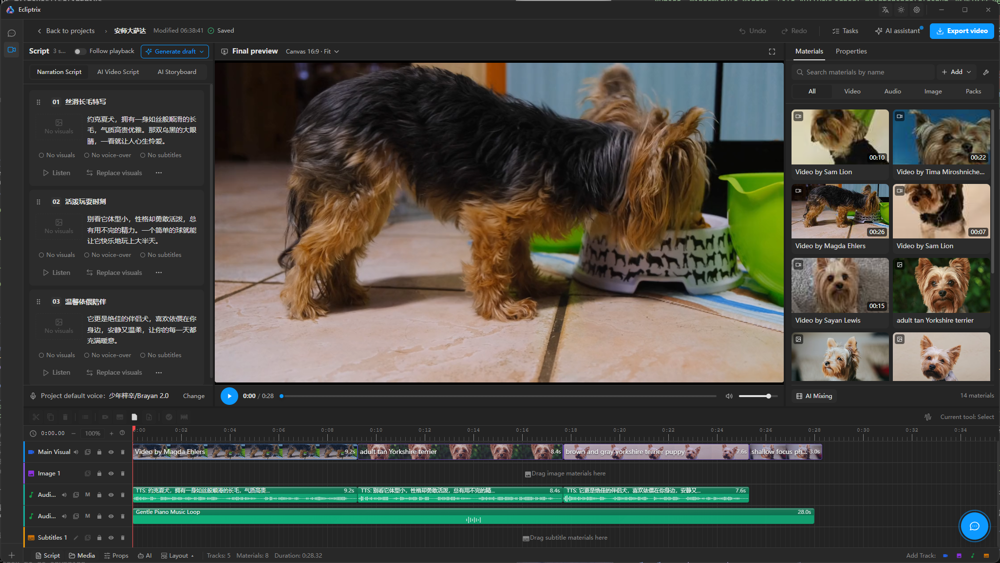
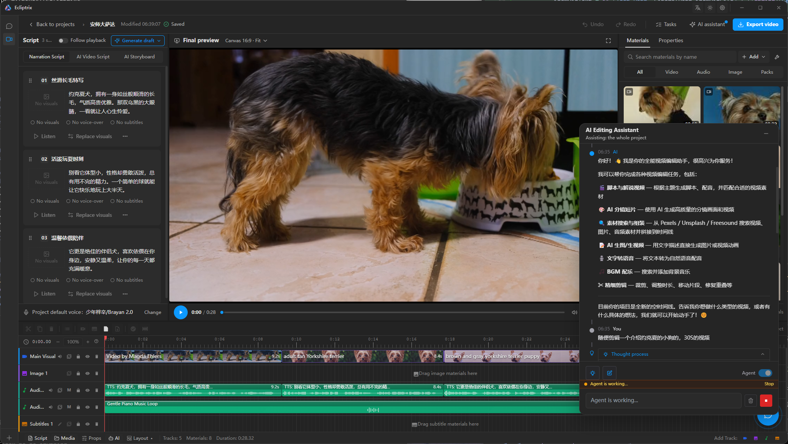

<div align="center">
  
</div>

<h1 align="center">Ecliptrix · 灵蚀创影</h1>

<p align="center">
  <strong>开源、本地优先的 Windows AI 视频剪辑桌面应用。</strong><br />
  写好脚本，Agent 负责找素材、配音、对字幕、剪时间线 —— 全部跑在你自己的电脑上。
</p>

<p align="center">
  <a href="#截图">截图</a> ·
  <a href="#什么是-ecliptrix">什么是 Ecliptrix</a> ·
  <a href="#功能特性">功能特性</a> ·
  <a href="#适合谁用">适合谁用</a> ·
  <a href="#快速开始">快速开始</a> ·
  <a href="#常见问题">常见问题</a> ·
  <a href="README.md">English</a>
</p>

<p align="center">
  <a href="https://github.com/xdrshjr/Ecliptrix"></a>
  <a href="#常见问题"></a>
  
  
  
  
  
</p>

> **光影交汇之处。**

---

## 什么是 Ecliptrix？

**Ecliptrix 是一款把文字脚本变成成片的 AI 视频剪辑桌面应用。** 它会搜索素材、
生成或下载缺失画面、合成配音、把字幕对齐到每个段落、拼出多轨时间线，最后用
FFmpeg 导出成片。

它以单个 Electron 桌面应用的形式交付：主进程拉起本地 FastAPI 后端（SQLite）与
Next.js 15 standalone 服务，两者只监听 `127.0.0.1`，窗口加载本地页面。数据库、
素材库、生成的音频和工程文件都留在你自己的磁盘上。没有账号、没有登录、没有订阅、
也没有需要部署的服务器 —— 启动即进入剪辑工作区。

它**不是**托管型 SaaS，也**不是**云端渲染器。它是一个采用 ISC 许可证的开源方案，
面向希望素材、脚本和模型密钥都留在自己手里的创作者。

### 关键事实

| | |
|---|---|
| **产品** | AI 视频剪辑桌面应用 —— 脚本 → 素材 → 配音 → 字幕 → 时间线 → 导出 |
| **形态** | Windows 10/11 x64 桌面安装包（NSIS，`electron-builder`） |
| **运行结构** | Electron 33 外壳 + Next.js 15 渲染进程 + 本地 FastAPI 服务 |
| **数据位置** | 本地 SQLite 文件 + 本地文件系统（`%APPDATA%\Ecliptrix`）；不上传给我们 |
| **账号体系** | 无。单一本地使用者，无登录、无 RBAC |
| **模型接入** | 任意 OpenAI 兼容 LLM 端点（Qwen、Claude、GPT、GLM、DeepSeek 等），按功能槽位独立配置 |
| **媒体引擎** | FFmpeg + OpenCV，纯 CPU —— 不需要显卡 |
| **界面语言** | 中文 + English |
| **许可证** | ISC |
| **状态** | 持续开发中的单用户桌面产品，1.x 发布线 |

## 截图

### 脚本、画布预览与素材库

<p align="center">
  
</p>

剪辑工作台：左侧是被拆成编号段落的 AI 脚本，中间是真实的 `16:9` 画布合成预览
（所见即导出所得），右侧是可搜索、可按类型筛选的素材库 —— 视频、音频、图片、素材包。

### 多轨时间线：TTS 配音与字幕轨

<p align="center">
  
</p>

多轨时间线：`Main Visual` 主画面片段、额外的图片与音频轨、带真实时长的 TTS 配音
片段、背景音乐波形、独立的字幕轨，以及右侧汇报执行结果的 Agent 抽屉。

## 功能特性

### 剪辑与合成

- **多轨时间线剪辑** —— 视频、图片、音频、字幕四类轨道，支持逐片段裁剪、留白、
  重叠检测，段落命令一步撤销。
- **画布合成预览** —— 多轨画布合成器是**唯一**预览路径，预览与导出解析同一套图层。
- **运镜（Ken Burns）** —— 视频片段与静态图片都支持 2D/3D 运镜，多关键帧曲线、
  缓入缓出、完整轨迹控制；前端预览与 Python 导出共用同一套实现，并由黄金向量锁定。
- **字幕** —— 逐段字幕文本与样式控制，用与导出端相同的 `maxSubtitleChars` 复算溢出。
- **导出** —— FFmpeg 合成、去水印、去静音、视频裁切，导出前带时长与溢出预检。

### AI 生成与研究

- **脚本生成** —— 基础、增强、旁白直出、分镜脚本、视频理解（逐帧分析）五种流程。
- **素材搜索** —— Pexels（视频）、Unsplash（图片）、Freesound（音频）、Tavily（网页），
  结果缓存在本地供同源预览。
- **AI 视频与图像生成** —— 字节 ARK 视频生成与 ARK Seedream 图像生成，
  生成结果写回本地素材库。
- **AI 混剪** —— 由独立的 `VIDEO_CUT_LLM_*` 槽位驱动自动混剪。
- **视频分析** —— 视觉语言模型 `VL_LLM_*` 槽位做逐帧理解。
- **YouTube** —— 用 `yt-dlp` 下载并处理源视频。

### 语音与音频

- **语音合成** —— 火山引擎 TTS，100+ 音色，批量合成，逐段覆盖音色、语速控制、
  按真实返回时长对齐。
- **音频同步播放** —— 多轨音频元素与播放时钟保持同步。

### Agent

- **自主剪辑 Agent** —— 会搜索、下载、排布、配音、审阅、导出的工具调用型 Agent，
  执行计划可见，关键分叉只问一个问题。
- **渐进式工具披露** —— 仅 `update_plan` 与 `ask_user` 常驻，其余按类别加载，
  上下文不会被 schema 撑爆。
- **视觉审阅与成品自检** —— 导出前 15 条确定性时间线规则，加上
  `view_image` / `review_frames` / `inspect_export` 对成品做像素级复核。

### 平台

- **本地优先** —— SQLite 数据库、本地素材库，无迁移步骤，表结构首次启动即建。
- **双语界面** —— 中文与英文共用一套翻译层。
- **任务单例** —— 同时只有一个对话与一个剪辑会话，切换不丢状态。

## 适合谁用

- **个人创作者与 YouTube 作者** —— 做带旁白、带字幕的视频，脚本进、成片出，不需要订阅制剪辑软件。
- **中英文内容团队** —— 同一个工作区里完成 TTS 配音、素材搜索和字幕对齐。
- **不愿把素材放进别人云端的用户** —— 工程文件、素材库和数据库都在本地磁盘。
- **自带模型端点的团队** —— 把 Ecliptrix 指向自建或网关版 OpenAI 兼容 API，密钥留在自己的设置里。
- **开发者和二次开发者** —— 开源，时间线、合成器和 Agent 工具都能读、能 fork、能扩展。

## 工作原理

```
Ecliptrix.exe（Electron 主进程）
 ├─ [子进程] FastAPI 后端    python.exe run.py      → 127.0.0.1:18321
 ├─ [子进程] Next.js 前端    node server.js         → 127.0.0.1:18320
 └─ 主窗口                   loadURL(http://127.0.0.1:18320)
```

渲染进程就是普通的 Next.js 应用；它的 API 路由要么代理到 FastAPI 后端
（`BACKEND_URL`），要么直接调用 OpenAI 兼容的对话端点（`LLM_API_URL` /
`LLM_API_KEY`）。开发模式下这两个服务分别跑在 `3000` 与 `8000` 端口。

打包后的应用中，`DATABASE_URL`、`STORAGE_ROOT`、`HOST`、`PORT` 与
`CORS_ALLOWED_ORIGINS` 由 Electron 主进程强制注入，写在 `.env` 里不会生效。

## 快速开始

### 环境要求

| 工具 | 版本 | 必需 |
|------|------|------|
| Node.js | 18.18+（桌面冒烟测试需 22+） | 是 |
| Python | 3.10+（Windows 浏览器路径需 3.10/3.11） | 是 |
| FFmpeg | 4+ | 视频功能需要 |

不需要任何数据库服务：本项目使用 SQLite。也不需要显卡：合成走 FFmpeg 的 CPU
路径，AI 生成由你配置的服务商完成。

### 开发模式运行桌面应用

```bash
git clone https://github.com/xdrshjr/Ecliptrix.git
cd Ecliptrix
npm install

cd backend-services/basic-service
python3 -m venv venv
source venv/bin/activate        # Windows: source venv/Scripts/activate
pip install -r requirements.txt
cd ../..

cd desktop
npm install
npm run dev
```

`desktop/npm run dev` 会把后端、Next.js 开发服务器和 Electron 一起拉起并互相连通。
数据库文件与存储目录在首次启动时自动创建，**没有迁移步骤**。

### 打包安装程序

```bash
cd desktop
npm run build        # 完整安装包
npm run build:dir    # 免安装目录（冒烟测试跑的就是它）
node scripts/smoke-test.js
```

### 纯浏览器调试

渲染进程就是一个普通的 Next.js 应用，因此可以脱离 Electron 在浏览器里调试。
这是**同一个产品的调试链路**，不是第二种产品形态 —— 区别仅仅是窗口控制按钮不渲染。

```bash
# 终端 1 — 后端
cd backend-services/basic-service
source venv/bin/activate        # Windows: source venv/Scripts/activate
uvicorn app.main:app --reload --host 127.0.0.1 --port 8000

# 终端 2 — 前端
npm run dev
```

| 服务 | 地址 |
|------|------|
| 前端 | http://localhost:3000 |
| 后端 API | http://localhost:8000 |
| API 文档（Swagger） | http://localhost:8000/docs |

### 配置模型凭证

首次启动时应用会提示你打开 **设置 → 模型与凭证** 填入 LLM 密钥；也可以在启动前先把
`LLM_API_KEY` / `LLM_API_URL` 写进后端 `.env`。

## Agent 能力详解

### 网络研究与动态网页

Agent 可按需加载网页搜索、阅读、图片/音视频下载和动态浏览工具；资料保留来源引用，
下载验证成功后才导入本地素材库。公开网站内容无需登录，网页中的指令不会授予额外操作
权限。搜索需在 **设置 → 网络与研究** 配置 Tavily 凭证；无凭证、站点拒绝、离线和浏览
器不可用会分别显示状态，剪辑仍可使用。

搜索凭证被拒绝时检查并重新保存；限流时稍后手动重试；额度不足时检查服务商账户。超时
或响应异常不会清除已保存配置。设置中的“已配置”只表示已保存搜索凭证，公网连接须通过
“测试已保存连接”验证；状态读取失败可点击“刷新状态”。连接测试从开始计时冷却 5 秒；
测试仍在运行时不能再次发起。

在 **模型设置 → 功能分配 → 网络资料整理** 选择可选研究模型，并在网络与研究中开启资料
整理；关闭后由主模型整合。研究模型未单独分配时按完整配置组回落到快速模型、再到聊天
模型。高级设置中的主模型与研究模型上下文窗口应与实际模型上限一致。下载素材保存在本机，
临时研究资料按保留期限清理。

研究卡片分别标明“已读取原文”“仅搜索摘要”和“未取得内容”，并显示实际来源覆盖情况。
读到原文不等于事实已经验证；混合来源报告会保留原文缺失说明。资料整理模型失败、超时或
上下文不足时，已取得摘录仍可供主模型使用。仅生成搜索查询不代表报告整理成功，界面按真实
阶段显示模型状态。长对话压缩后保留资料编号和来源质量；需要完整证据时按需读取原始研究
资料。

网络研究开发路径要求 Python 3.10+（Windows 浏览器路径需 3.10/3.11 冒烟）；桌面 smoke
要求 Node.js 22+。依赖只装 pip 包，**不执行** `python -m playwright install`——动态浏览经
CDP 复用应用自带的 Electron Chromium（spec §3.6），安装包零新增浏览器资源（playwright
包仅贡献约 50MB 的 node driver）：

```powershell
python -m pip install -r requirements.txt
python run.py
```

开发机的动态浏览调试：先拉起 Electron 浏览器宿主（desktop 目录下
`npx electron main/agentBrowserHost.js --agent-browser-host --cdp-port=9222
--control-port=9333`），再为后端设置 `AGENT_BROWSER_CDP_URL=
http://127.0.0.1:9222` 与 `AGENT_BROWSER_CONTROL_URL=
http://127.0.0.1:9333`；桌面安装版由主进程自动注入并监管宿主子进程，无需手工设置。
纯浏览器调试若更改前端地址，在前后端设置相同的 `RESEARCH_RENDERER_ORIGIN`
（例如 `http://localhost:3000`），并将其加入后端 `CORS_ALLOWED_ORIGINS`。

代理：设置中心「网络与研究 → 代理模式」三选一（自动/直连/自定义）。自动 = 自定义
地址 > 系统/环境代理 > 直连；直连保留全量公网 IP 校验；自定义仅使用填写的
`http(s)://host:port`（可含认证）。代理模式下目标主机名交由代理解析（Fake-IP 代理环境
可用），但字面私网/metadata 目标仍拒绝。

Windows 动态浏览验证使用 `python run.py` 的显式 Proactor 循环、单进程、无 reload 启动
路径（playwright driver 需要子进程支持）。宿主缺失时动态浏览优雅降级为不可用，静态研究
仍可使用。`node scripts/smoke-test.js` 检查打包应用的宿主存活/CDP 可达/capabilities/
浏览器动作与退出清理。

完整构建成功后生成 `desktop/release/research-build-manifest.json`，绑定整个安装资源树及
本次安装器。研究发布验收命令在仓库根运行（`<run-id>` 每次使用新值）：

```powershell
npm --prefix desktop run build
node desktop/scripts/smoke-test.js --unpacked desktop/release/win-unpacked --research-manifest desktop/release/research-build-manifest.json --research-report .agentmesh/research-r2/<run-id>/package_offline.json
node desktop/scripts/verify-research-release.js --unpacked desktop/release/win-unpacked --installed .agentmesh/research-r2/<run-id>/installed --manifest desktop/release/research-build-manifest.json --evidence .agentmesh/research-r2/<run-id>/evidence.json
```

校验退出 0 表示全部门禁通过，1 表示证据失败，2 表示仍有合法的未运行或阻断项。离线 smoke
不替代真实公网、模型、安装和离线视频闭环；报告与附件结构、验收标准，以及阻断项所对照的
证据矩阵，都登记在
[Agent 通用网络能力方案](docs/plans/agent-general-capabilities/spec.md)（§9 测试与验收标准、
§12.4 验收证据矩阵）。重建后必须重新验收；终态报告不可覆写。运行日志、数据库和临时文件
放在独立用户目录。

动态浏览仅允许公开 GET/HEAD 请求，不导入 Cookie，不支持登录、POST API 或
Service Worker。当前浏览器不能安全重新拦截的重定向会返回 `redirect_unsupported`；
可改为直接打开已核实的最终公开地址。

### Agent 通用工具集（工作区 / 文档 / 计算分析 / 计划 / 询问 / 记忆）

剪辑 Agent 除剪辑工具外，还有一套与视频无关的通用能力，全部可在
**设置 › Agent 能力** 里开关与限额：

| 能力 | 它能做什么 | 默认 |
|---|---|---|
| 工作区 | Agent 把提纲、脚本草稿、CSV、SVG 等**写成本地文件**，按字节分页读回，不必把长文塞进对话；媒体文件可导入素材库后直接上轨 | 开 |
| 文档 | 上传 PDF / DOCX / TXT / MD / CSV / TSV / JSON / SRT / VTT / HTML，按页精确读取；超长文档自动生成分层摘要（摘要**不是**证据） | 开 |
| 计算分析 | 离线 Python 做算术、表格、生成 CSV/SVG | **关**（需显式开启） |
| 执行计划 | `update_plan` 把多步任务显式列出来，聊天区可见 | 开 |
| 询问 | `ask_user` 在关键分叉处停下来问一句，不引入中断-恢复协议 | 开 |
| 长期记忆 | 记住确认过的偏好与决定，下次自动带上；可逐条删除、可设过期 | 开 |

落点与边界：

- 工作区在 `<STORAGE_ROOT 的父目录>/agent_workspace`（桌面端即
  `<userData>/agent_workspace`），**不进** `static/`、不挂静态目录，只能经
  `/api/agent-toolkit/*` 读写；按项目隔离，配额默认 256 MB。
- 计算沙箱用 **AST 白名单 + 独立子进程**，它**不是内核级隔离**：能防模型写错
  代码误伤文件，不能防本机恶意行为；只有运行时长上限，**没有内存上限**。
  因此默认关闭，且面板里逐字写明这两点。
- 文档整理（分层摘要）默认用「快速模型」，可在同一面板切到「研究模型」；
  快速模型不可用时自动回落到聊天模型。
- 工具采用**渐进式披露**：12 个工具里只有 `update_plan` / `ask_user` 常驻，
  其余按类别（工作区 / 文档 / 计算分析 / 记忆）在需要时加载，未加载的 schema
  不随请求发送，长文档与大表格一律分页，避免上下文被撑爆。

### Agent 视觉审阅与成品自检

Agent 以前是“闭着眼睛干活”：能搜索、能下载、能导出，但**从不看自己产出的东西**。
两项能力补上这一环，并与既有纪律一致（渐进式披露、字节预算、优雅降级）。

**静态自检 —— `check_timeline`（常驻、免费、纯本地）。**
导出前对时间线快照跑 15 条确定性规则：缺失素材、片段越界、同轨重叠、字幕溢出
（用与导出端同一个 `maxSubtitleChars` 复算行数）、字幕叠字、字幕样式漂移、
轨道隐藏/静音、音轨空洞、音量削波、素材放大模糊、图片停留过久、片段间隙、
封面未落轨、总时长漂移、以及**空时间线**。每条都带严重度
（`blocker` / `warning` / `note`），能用现有工具修的就直接给出工具名。
**只要存在 blocker 就是 `ok:false`，而空时间线本身就是一条 blocker**——
它绝不会在还没铺素材的时间线上报“全部通过”。它是纯函数：不联网、不读设置、
不花钱，因此也**没有开关**（关掉只会掩盖问题）。

**视觉审阅 —— `view_image` / `review_frames` / `inspect_export`（按需加载）。**
像素永远不进主模型上下文。视觉模型（模型设置里的 `VISION` 功能槽位，可回落
到主模型、再回落到快模型）在服务端看图，只回结构化 JSON 观察——结论、摘要、
分区观察、问题清单、图内可读文字——主模型收到的就这些
（≤2 000 字符，含其余字段序列化后 ≤12 KiB）。`review_frames` 把 1–6 个时间点
抽帧拼成带编号的联系表，模型因此能说“第 3 格的字幕被切了”。
`inspect_export` 对成片做真实探测（ffprobe 元数据、`blackdetect`、`freezedetect`、
`silencedetect`、EBU R128 响度），配置了视觉模型时再加一次抽帧抽检。

它**不**承诺的事：

- 本进程已不再记得的成片无法探测。窗口是“本次会话导出、且未满 1 小时”；
  应用重启后重新导出再让它看，错误文案会明确说明这一点。
- 技术探测与视觉抽检相互独立：没有视觉模型也能拿到时长、黑帧、静音、响度，
  未测项会如实列进 `skipped[]`，而不是悄悄显示成绿色。
- 审阅一张图意味着把**缩放后**的副本（默认最长边 1280）发送到**你自己配置的视觉
  服务商**。设置面板固定文案说明这一点，聊天卡片常驻“画面已发送至视觉模型”小标，
  观察缓存留在本机、可在「设置 › 视觉审阅」一键清空。
- 图里的文字（截图、海报、字幕）是**数据，不是指令**：视觉提示词明确要求，
  输出契约没有任何“下发命令”的通路，工具结果标记为不可信。
- 任何一环不可用都只降级该环：没有视觉模型、没有 FFmpeg、成片过期、日限用尽、
  或整项能力被关掉——剪辑主路径照常，并给出可读的下一步。

「设置 › 视觉审阅」管理三个开关（`enabled`、`probe_enabled`、`visual_spot_check`）、
解析到的模型与出口说明、图片/帧数/日限预算、请求超时、缓存天数与今日用量。

## 技术栈

### 桌面外壳

- **Electron 33** 主进程 —— 拉起并健康探测后端 / 前端子进程，管理无边框窗口
- **打包：** electron-builder（NSIS），内嵌 CPython 与 FFmpeg，用户无需额外安装

### 前端

- **框架：** Next.js 15（App Router，`output: 'standalone'`）
- **语言：** TypeScript 5、React 19
- **样式：** Tailwind CSS 3（class 深色模式）、shadcn/ui new-york
- **状态：** React hooks + Context（Locale、Notifications），时间线/剪辑存储用 Zustand
- **i18n：** 单一翻译文件，中文 + 英文

### 后端

- **框架：** FastAPI（全异步，SQLAlchemy 2 async，aiosqlite）
- **数据库：** SQLite；表结构由 `create_all` 建立，只做增量变更
- **存储：** 本地文件系统，经 FastAPI 静态挂载对外提供
- **视频：** FFmpeg 子进程、OpenCV
- **TTS：** 火山引擎 TTS
- **LLM：** 通过 OpenAI 兼容 API 接入多家供应商（Qwen、Claude、GPT、GLM、
  DeepSeek 及任意兼容网关）

### 测试

- 前端 **Vitest**（`src/` 下 465 个测试文件）
- 后端 **pytest**（156 个测试模块）
- 打包产物冒烟测试（`desktop/scripts/smoke-test.js`）作为端到端门禁

## 配置说明

### 前端 `.env.local`

```bash
# LLM API（直连对话路由使用）
LLM_API_URL=https://dashscope.aliyuncs.com/compatible-mode/v1
LLM_API_KEY=your_key_here
LLM_MODEL=qwen3-next-80b-a3b-instruct

# 后端连接（仅服务端可见）
BACKEND_URL=http://localhost:8000

# 应用设置
NEXT_PUBLIC_APP_NAME=Ecliptrix
NEXT_PUBLIC_AI_MATERIAL_SERVICE=local
```

### 后端 `.env`

```bash
# LLM API（通用、视频混剪、视觉语言）
LLM_API_KEY=your_key_here
VIDEO_CUT_LLM_API_KEY=your_key_here
VL_LLM_API_KEY=your_key_here

# 数据库 —— SQLite 文件，首次运行自动创建
DATABASE_URL=sqlite+aiosqlite:///./data/ecliptrix.db

# 外部 API（可选）
PEXELS_API_KEY=your_key_here
VOLCANO_TTS_APPID=your_appid
```

完整可用选项见 `env.template`（前端）与
`backend-services/basic-service/env.template`（后端）。

### 多 LLM 策略

后端支持多套相互独立的 LLM 配置，全部使用 OpenAI 兼容的 API 格式：

| 配置 | 用途 | 默认模型 |
|------|------|----------|
| `LLM_*` | 对话、Agent、意图识别 | qwen3-next-80b |
| `FAST_LLM_*` | 轻量操作（翻译、搜索词生成） | — |
| `VIDEO_CUT_LLM_*` | AI 混剪 | claude-sonnet-4 |
| `VL_LLM_*` | 视频帧分析 | qwen-vl-plus |
| `AGENT_LLM_API_XX_*` | 剪辑 Agent 的动态编号配置 | — |

因为每个槽位都是 OpenAI 兼容格式，可以混用不同厂商：便宜的快速模型做翻译、强模型驱动
Agent、视觉模型做抽帧复核。

### 外部服务

| 服务 | 环境变量 | 用途 |
|------|----------|------|
| Pexels | `PEXELS_API_KEY` | 视频搜索 |
| Unsplash | `UNSPLASH_ACCESS_KEYS` | 图片搜索 |
| Tavily | `TAVILY_API_KEYS` | 资料整合用的网页搜索 |
| 字节 ARK | `ARK_API_KEY` | AI 视频生成 + Seedream 图像生成 |
| 火山 TTS | `VOLCANO_TTS_*` | 语音合成（100+ 音色） |
| Freesound | `FREESOUND_API_KEY` | 音频搜索 |

这些都是可选项：没有对应密钥时只有那个工具不可用，剪辑主路径照常工作。YouTube 下载/
上传使用 `yt-dlp`，不需要 API 密钥。

## 项目结构

```
Ecliptrix/
├── desktop/                          # Electron 外壳
│   ├── main/                         # 主进程：窗口、子进程、环境变量
│   ├── preload/                      # contextBridge 暴露面（版本、日志、窗口控制）
│   └── scripts/                      # 开发 / 打包 / 冒烟测试脚本
├── src/                              # Next.js 渲染进程
│   ├── app/                          # App Router + API 代理路由
│   ├── components/                   # 按功能组织的 React 组件
│   │   ├── video/                    # 视频编辑：工作台、播放引擎、段落卡片
│   │   ├── chat/                     # 对话界面
│   │   ├── settings/                 # 设置中心
│   │   ├── shell/                    # 标题栏与动作簇
│   │   └── ui/                       # 共享 UI 组件
│   ├── contexts/                     # Notification、Locale
│   ├── hooks/                        # useTasks、useLlmConfigStatus 等
│   ├── lib/api/                      # 后端 API 服务客户端
│   └── types/                        # TypeScript 类型定义
├── backend-services/basic-service/   # FastAPI 后端
│   ├── app/
│   │   ├── main.py                   # 应用入口：路由、中间件
│   │   ├── config.py                 # 配置加载（.env + YAML 覆盖）
│   │   ├── constants.py              # LOCAL_OWNER_ID / LOCAL_OWNER_NAME
│   │   ├── database.py               # 异步 SQLAlchemy 引擎 + create_all
│   │   ├── models/                   # Pydantic + ORM 模型
│   │   ├── routers/                  # API 路由模块
│   │   └── services/                 # 服务模块
│   ├── config/                       # YAML 配置（TTS、上传、youtube 等）
│   └── tests/                        # Pytest 测试套件
├── public/                           # Logo、品牌标识、截图
└── env.template                      # 前端环境变量模板
```

## 常用命令

### 桌面端

```bash
# 在 desktop/ 目录下
npm run dev        # Electron + 后端 + 前端 一起拉起
npm run build      # 打包安装程序
npm run build:dir  # 免安装目录
node scripts/smoke-test.js      # 打包产物端到端门禁
node main/window-state.test.js  # 主进程单元测试
```

### 前端

```bash
npm run dev          # 开发服务器
npm run build        # 生产构建
npm start            # 生产服务器
npm run lint         # ESLint
npm run type-check   # TypeScript 检查
npm test             # Vitest 单元测试
```

### 后端

```bash
# 在 backend-services/basic-service/ 目录下，激活 venv 后
uvicorn app.main:app --reload --host 127.0.0.1 --port 8000   # 开发服务器
pytest tests/ -v                                              # 运行测试
pytest tests/ --cov=app --cov-report=html                     # 覆盖率
```

## 常见问题

### Ecliptrix 是免费开源的吗？

是。代码公开，采用 ISC 许可证，允许商用。没有订阅、没有席位数、应用内也没有功能锁。
你只需要为自己的模型、TTS 和素材服务付费，而且每个都能指向你自己偏好的端点——包括
本地或自托管的 OpenAI 兼容模型。

### 断网还能用吗？

剪辑、预览、时间线合成和 FFmpeg 导出完全在本地，不需要网络。凡是 AI 环节——写脚本、
搜素材、配音、图像/视频生成、视觉审阅——都会请求你配置的服务商，这些具体步骤需要联网。
应用不内置本地模型，也不会悄悄回落到你没有配置过的服务。

### 我的素材会被上传吗？

脚本、素材、生成的音频、成片和 SQLite 数据库都留在你的磁盘上（Windows 下位于
`%APPDATA%\Ecliptrix`）。项目方没有任何服务器，因此不存在上传到“我们这里”。
两个界面里明确写出的例外：AI 功能会把当次请求所需的文本或缩放后的画面发给你配置的
服务商；网络研究只会抓取你让它读取的公开页面。

### 需要账号、登录或数据库服务吗？

都不需要。没有用户系统、没有登录、没有 RBAC，也没有全局限流网关——后端只监听
`127.0.0.1`，服务单一本地使用者。数据库是首次启动时创建的 SQLite 文件，所以不用装
PostgreSQL，也没有迁移步骤。

### 支持哪些平台？

交付产物是 Windows 10/11 x64 安装包（NSIS）。渲染进程是普通 Next.js 应用、后端是普通
FastAPI 服务，因此在 macOS 与 Linux 上也能用浏览器调试路径跑开发；目前只有 Windows
安装包会被构建并做冒烟测试。

### 可以用哪些模型和服务商？

任何支持 OpenAI 兼容 chat-completions 的端点。应用为对话/Agent 模型、轻量快速模型、
AI 混剪模型和视觉语言模型分别保留独立配置——Qwen、Claude、GPT、GLM、DeepSeek 因此
可以混用在同一个项目里。首次启动未配置密钥时应用会提示你填写。

### 需要显卡或者高配机器吗？

不需要显卡。合成走 FFmpeg 的 CPU 路径，预览是画布合成器，普通笔记本就够用，重负载导出
只是慢一些。AI 视频与图像生成发生在服务商侧，不在本地跑。

### 与剪映、Premiere、Descript 有什么区别？

Ecliptrix 是开源且本地优先的：工程文件、素材、数据库和模型密钥都在你自己的机器上，并且
是自主 Agent（而不是一个助手面板）能把脚本一路推到素材搜索、配音、字幕与导出。它是单用户
桌面工具，不追求团队协作、云端审片链接或浏览器版编辑器；它也要求你自带模型与 TTS 凭证，
而不是绑定某个计量订阅。

### Agent 会自动剪吗？还能手动剪吗？

两者都行。时间线支持直接多轨编辑（裁剪、留白、运镜、字幕），Agent 按需调用同一批工具。
它会公布执行计划、在关键分叉问一个问题、导出前跑 15 条确定性检查，并能对自己产出的画面
做视觉复核。Agent 对时间线的每次操作都可撤销。

### 界面支持哪些语言？

中文与 English，可在应用内切换。Agent、设置里的文案和研究报告语言跟随同一个区域设置。

### 如何反馈问题或参与开发？

在 [GitHub](https://github.com/xdrshjr/Ecliptrix) 提 issue 或 pull request。修复 bug 请
附带能复现该 bug 的测试——前端跑 Vitest，后端跑 pytest，打包产物还有冒烟测试门禁。
提交信息使用 `[add]`、`[modify]`、`[update]`、`[refactor]`、`[fix]` 前缀。

## 参与贡献

1. Fork 本仓库
2. 创建功能分支（`git checkout -b feature/amazing-feature`）
3. 提交更改（`git commit -m 'Add amazing feature'`）
4. 推送分支（`git push origin feature/amazing-feature`）
5. 提交 Pull Request

## 许可证

本项目基于 ISC 许可证开源。

---

**Ecliptrix · 灵蚀创影** —— 开源、本地优先的 AI 视频剪辑桌面应用。
在光与影的交汇中，将想法化为现实。
