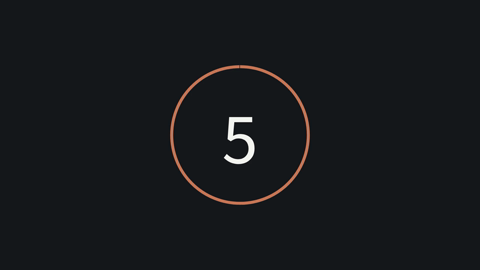

# 特效模板选择：封面首击丢失，重选覆盖已保存参数

## 问题描述

模板卡片有两种可以独立复现的故障。快速点击另一张卡片的封面时，工作台可能继续编辑原模板。点击当前卡片的名称，或者聚焦后按 Enter，则会把用户调好的模板参数恢复为默认值。第二种情况会触发自动保存，关闭再打开仍是默认值，生成的视频也会使用这个值。

实测基线为 `5adf60bf`，Windows 下使用当前工作区源码的 Next.js 开发界面、Chromium、独立 FastAPI/SQLite 和项目已有的本地 Remotion 渲染资源。测试从新建视频项目进入素材面板「特效」，经过预览、自动保存、重开、实际生成和新轨插入。桌面安装包和整条时间线的最终导出未在本轮验证。

## 复现步骤

使用一个测试项目，界面切到中文，窗口设为 1440 × 940，使模板库、预览和编辑区同时可见。两个用例均无需导入素材或配置模型。

### 1. 首次点击封面没有切换模板

1. 打开「素材 → 特效」，在左侧模板库选择「倒计时」。点击卡片底部的**文字**「圆环倒计时」建立起始状态。
2. 保持系统默认动画偏好。把鼠标移出模板库，等「翻牌倒计时」恢复静态封面。直接移到其**封面中央**并立即单击，无须等待悬停视频出现。
3. 检查「翻牌倒计时」的选中态。预期第一次点击就选中。实测三次从卡片外直接点击，三次仍未选中。保持指针在封面上再点一次，三次都选中了。

在已打开上述工作台的 Playwright Python 同步会话中，可用下面的片段重复相同手势。每次开始前用文字标签选中圆环模板。

```python
library = page.locator("[data-effects-studio] .effects-library")
target = library.get_by_role("button", name="翻牌倒计时", exact=True)
page.mouse.move(5, 400)
page.wait_for_timeout(400)
target.click()
print(target.get_attribute("aria-pressed"))  # 故障时为 false
```

### 2. 重选已选模板，12 被自动保存成 5

1. 点「圆环倒计时」卡片底部的文字。在右侧「动画 → 起始数字」中输入 `12`，按 Tab，等顶部出现「已保存」。
2. 聚焦预览进度条并按 Home，到第 0 帧。确认画面显示 **12**。
3. 单击**已经选中**的「圆环倒计时」文字。预期参数、预览帧和草稿版本均保持原值。实际起始数字和画面立即变为 **5**，随后再次出现「已保存」。
4. 使用「撤销草稿修改」可恢复 12。聚焦当前模板按钮再按 Enter，同样回到 5。等保存后关闭并从素材面板重开，读取到的仍为 5。
5. 点「生成视频」，展开「最近生成」。任务完成后点「在新视频轨插入」。本次产出 1920 × 1080、150 帧、5 秒的 H.264 视频，时间线新增了 0–5 秒片段。用 FFmpeg 抽取的成品首帧如下。



## 根因分析

**封面切换改变了鼠标命中元素。** `src/components/video/effects/EffectsLibrary.tsx:31` 在指针进入或获得焦点时改变活动卡片，`EffectsLibrary.tsx:38` 在同一位置把图片替换为视频；选择动作则在外层按钮的 `onClick` 中触发（同文件第 30 行）。下面是浏览器捕获阶段的事件，按下和松开均发生在「翻牌倒计时」卡片内。

| 操作 | 按下 | 松开 | click | 选中结果 |
|---|---|---|---|---|
| 从卡片外直接点封面 | IMG | VIDEO | 未派发 | 0/3 |
| 指针停在视频上，再点一次 | VIDEO | VIDEO | VIDEO | 3/3 |
| 仅在测试页面临时给封面的 img、video 加上 `pointer-events: none`，重复首次点击 | BUTTON | BUTTON | BUTTON | 3/3 |

**控制器将同一模板的选择当作一次模板切换。** `src/components/video/effects/EffectsLibrary.tsx:29` 用 `aria-pressed` 表示已选，但第 30 行对每次点击都调用选择回调。`src/components/video/effects/useEffectsController.ts:284` 的 `selectTemplate` 每次都递增素材绑定版本，随后执行 `params: structuredClone(template.defaults)`，并于第 292 行调用 `draft.edit`。「圆环倒计时」的目录默认值正是 5（`src/lib/effects/catalog.json:991`）。

`src/components/video/effects/useEffectsDraft.ts:130` 将旧文档加入撤销栈并标记本次编辑，约 500 毫秒后自动保存（同文件第 234–241 行）。更新时客户端把文档及预期版本发给后端（`src/lib/api/effects.ts:140`）。下表摘自同一草稿的真实响应；预览首帧按 `params.from` 计算（`src/lib/effects/compositions/Countdown.tsx:7`）。

| 操作 | 请求与响应 | 草稿版本 | 起始数字 |
|---|---|---:|---:|
| 修改为 12 并等候保存 | PUT 200 | 6 | 12 |
| 鼠标重选当前模板 | PUT 200 | 7 | 5 |
| 撤销 | PUT 200 | 8 | 12 |
| 键盘重选当前模板 | PUT 200 | 9 | 5 |
| 关闭并重开 | GET 200 | 9 | 5 |

重选前后该卡片的 `aria-pressed` 都是 `true`。渲染任务也显示「版本 9」。因此可以把首次错误写入定位在前端选择动作，排除后端在保存或渲染时自行改写数字。

### 评审核查记录

- **点击入口。** `EffectsStudioModal.tsx:178–186` 将工作草稿的模板 ID 传给模板库，将控制器的 `selectTemplate` 直接作为按钮回调，并把同一份文档传给预览。库内的分类下拉框只改变显示哪些卡片，卡片以模板 ID 为 React key，悬停或聚焦时被替换的是按钮里的媒体元素（`EffectsLibrary.tsx:21–41`）。诊断脚本 `mouse.py` 在 document 捕获阶段记录按下、松开和点击的目标及其所属按钮；`hit_test.py` 在同一手势前仅对两个媒体元素关闭指针命中。两组结果见上表。由此可将首击故障限定在媒体替换的时序窗口。点击文字或已稳定的视频均能触发选择；减少动态效果时组件始终渲染图片。
- **数值来源。** 圆环模板允许起始值 1–60（`src/lib/effects/catalog.json:990–998`）。`verify.py:44–73` 先让输入框失焦，等保存并断言值为 12，再将预览定位到第 0 帧，随后点击文字并同时检查输入框和画面。该步骤控制了两个变量：播放器默认从 30% 处预览（`EffectsPreview.tsx:32–37`），倒计时又会随帧递减。保存路径还会逐项比对返回的工作文档与发出的写入快照，匹配后才确认保存（`useEffectsDraft.ts:136–143、184–201`）。
- **持久化与成品。** 本次诊断资料位于 `.agentmesh/task-tge-446712a4-7641-4f55-9098-8957288fcff4/scratch/`。其中 `backend.log:653–674` 记录同一草稿连续更新、重开读取成功，随后生成请求返回 202。评审只读核查 `test.db` 的 `effect_render_jobs`：任务 `5089e901-c5c7-47d9-96e8-1b3fcd919186` 状态为 `succeeded`，草稿版本为 9，渲染快照的模板为 `countdown-ring`、`params.from` 为 5。对应 MP4 的 SHA-256 与结果素材记录一致。评审从该 MP4 重新解码第 0 帧并缩放至报告插图的 480 × 270，RGB 像素完全一致。该链路对应 `useEffectsController.ts:294–302` 的先保存、再按已保存版本生成。

## 影响面

- 两种故障都在共用的模板卡片上。封面首击问题要求动画预览正在替换图片，复现与点按时机有关。重选问题可通过鼠标或键盘触发。
- 控制器整体替换模板专属的 `params`。除实测的倒计时外，按代码可知用户设置的数值、单位、锚点等也受影响。当前编辑会话可撤销；重新加载草稿时会清空撤销历史（`src/components/video/effects/useEffectsDraft.ts:123`）。
- 同一处素材绑定版本也被递增。根据 `src/components/video/effects/useEffectsController.ts:331` 及第 351 行，已经发出的绑定请求可能在返回后被当作过期结果丢弃。这是代码推断，尚未做慢速上传实测。

## 候选修复方案

| 方案 | 改动与侵入范围 | 风险 | 预计工作量 |
|---|---|---|---|
| A．让按钮稳定接收点击，控制器跳过同模板选择 | 仅让卡片内的封面图片和演示视频不参与指针命中。控制器先读取当前模板 ID，相同时直接返回，再执行素材绑定版本递增、默认值初始化和草稿编辑 | 低。封面视频无独立播放控件；需验证悬停演示、键盘选择、真正换模板时取消旧绑定 | 小，两个前端组件及定向回归 |
| B．保留固定封面容器，在组件中拦截重复选择 | 用稳定的封面层处理点击，演示视频仅负责展示；按钮按当前选中态决定是否调用控制器 | 中。视图需要维护命中层，其他调用控制器的路径仍可触发重复选择 | 中，需要覆盖不同窗口宽度和键盘焦点 |

## 推荐修复与验收

推荐 **A**。浏览器对照已经验证了命中目标稳定后首击能选中；在控制器入口判定同一模板，也能同时保护参数、撤销历史、自动保存和待完成的素材绑定。真正切到另一个模板时仍应使用其目录默认值。

1. 用真实 Chromium 验证从卡片外直接点击封面一次就选中，悬停仍播放演示，减少动态效果偏好下仍可点击；用 Tab 和 Enter 验证键盘路径。
2. 将起始数字保存为 12 后，分别用鼠标和 Enter 重选。断言预览与重开后的数值均为 12、草稿版本不增加、没有新的 PUT 或撤销步骤；实际生成后检查 MP4 首帧。
3. 为待完成的素材绑定补一组对照：重选同模板时接受结果，真正换模板再切回时丢弃旧结果。后者已有基线测试（`src/components/video/effects/__tests__/EffectsStudioModal.test.tsx:456`）。

## 评审结论

**采纳方案 A。** 只给卡片的 `img` 和 `video` 设置 `pointer-events: none`，保留原生按钮的点击、焦点和键盘行为。媒体本身没有播放控件；上面的 Chromium 对照表明，这一处改动已使快速首击从 0/3 提升至 3/3。方案 B 增加固定容器仍需保证事件落在稳定节点上，且在视图中按选中态拦截，只能保护经过该视图的调用。

在 `selectTemplate` 入口用 `draft.getCurrent().document.templateId` 与目标 ID 比较，相同就立即返回。这个读取直接访问同步更新的工作草稿，连续选择时也能看到上一步编辑（`useEffectsDraft.ts:128–134、369–371`）。返回必须发生在递增 `attachmentRevision` 和调用 `draft.edit` 之前：前者会使排队或在途的绑定失效，后者会新增撤销步骤并清空重做记录。真正更换模板时继续校验目标、应用目标版本和默认参数，并按槽位及素材类型筛选已有输入（`useEffectsController.ts:284–292`）。

验收时区分三种边界：

- **已保存与保存中。** 对已保存的 12 重选后，跨过 500 毫秒自动保存窗口，再核对版本、PUT 数和撤销/重做记录。若原有编辑正在等待保存或已有 PUT 在途，应允许这次写入正常结束，重选本身产生的额外写入应为零。只读、失去编辑权、版本冲突和待恢复状态沿用现有写入保护（`useEffectsDraft.ts:128–135、164–170、228–243`）。
- **绑定成功与失败。** 重选当前模板后，先前绑定成功应落入对应槽位，失败应继续向当前编辑器报告。真正换模板再切回，旧回包仍应丢弃。两者由绑定开始时捕获的版本区分，即使回包时模板 ID 又相同也能判别（`useEffectsController.ts:327–358`）。现有测试第 456–476 行覆盖了切走再切回，重选当前模板是待补的对照。
- **输入方式。** 用真实浏览器从卡片外移入并立即点封面，核对第一次就切换；再验证点击文字、Tab 聚焦后用 Enter 或空格选择、指针移出后恢复静态图，以及减少动态效果模式下的首击。保留卡片的键盘焦点，便于用户继续浏览模板。

## 修复后验证

Chromium 连续三次从卡片外直接点击「翻牌倒计时」封面，第一次点击均选中。悬停时演示视频正常播放，移出后恢复静态图。开启减少动态效果后，鼠标、Enter 和空格均能选中模板。

将「圆环倒计时」从 5 改为 12，在自动保存前、写入途中和保存后重选，整个过程只有一次 PUT。一次撤销可回到 5，重选后仍能重做到 12。重开草稿后仍为 12，生成的片段成功插入新视频轨。最终评审重新解码了该 H.264 文件，确认首帧显示 12，分辨率为 1920 × 1080，时长 5 秒，共 150 帧。
