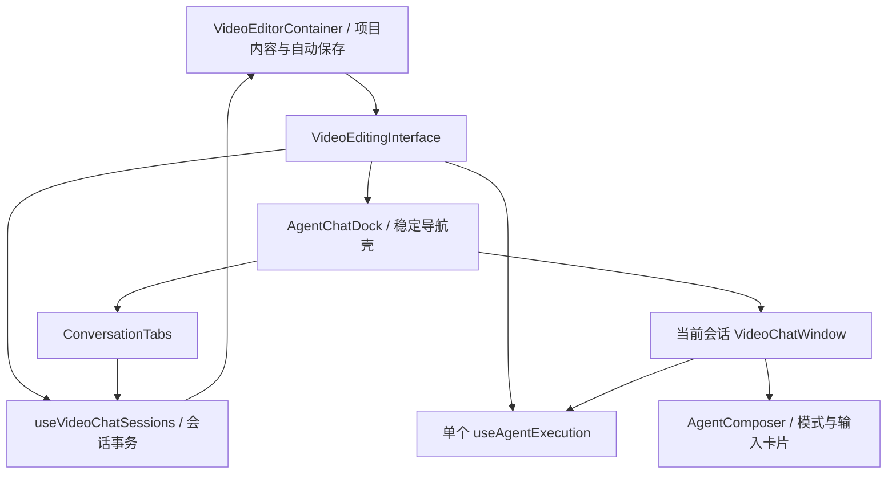

# AI 剪辑助手：多会话页签与输入区设计

版本：v2 · 日期：2026-11-05 · 节点：方案评审与修复

交付边界：本节点仅评审并修订设计；下述源码修改与测试由开发节点执行。
需求来源：本轮任务文件的 Task Requirements 与 Current Task。

## 评审记录

评审依据为当前代码、`CLAUDE.md` 和已有测试配置；逐节核查可行性、
完整性、一致性及范围。结论针对设计可实施性，不代表功能已经实现。
未发现 P0；以下 7 项 P1、2 项 P2 均已在正文修复，没有未决阻塞项。

| 编号 | 严重级别 | 原问题与证据 | 正文修复及验收 | 状态 |
|---|---|---|---|---|
| RV-01 | P1 | §4.1 只让会话 writer 更新 ref，挡不住编辑器 UI/playhead effect、脚本等路径用旧 content 整份写回；原 `contentRef.current = content` 还会覆盖乐观值。§4.2 的“数组版本”没有定义。 | §4.1/4.2 增加受控会话字段写入口、父级确认契约及同步读取；AC-23。 | 已修复 |
| RV-02 | P1 | §4.3 的 `agentIsExecutingRef` 只是 render 镜像；`sendAgentMessage` 在 startExecution 后立即释放 sendingRef，首个 render 前存在空档。原 `compact()` 也只看 Agent 状态，无法排斥普通聊天/上传；仅禁用页签不能避免相互覆盖。 | §4.3 定义同步执行状态、入口互斥、turn-end 交接及上传令牌；AC-24/25。 | 已修复 |
| RV-03 | P1 | §4.5 未定义“发送成功”；`useComposer.send` 调用 Promise<void> 后立即 reset，父级因初始化、忙碌等返回时仍丢失文本、技能和引用。 | §4.6/5.2 增加发送接纳结果、草稿修订号和拒绝恢复规则；AC-26。 | 已修复 |
| RV-04 | P1 | §4.4 只比 conversationId，未覆盖 A→B→A、卸载后重开同一项目、清空后旧回调落地；15 秒 finishing 看门狗允许晚写回。润色完成还从当前活动会话取 ID。 | §4.4 增加实例/选择代次、消息失效代次、运行绑定与润色来源；AC-27/28。 | 已修复 |
| RV-05 | P1 | §4.5 未规定缓存优先级、发送时清旧 v1 键和删除后的 cleanup；v2 删除后可能回退读出未删掉的 v1，定时器/卸载也可复活已删除草稿。 | §4.5 明确内存优先、空 v2 标记、键清理和失效写入防护；AC-29。 | 已修复 |
| RV-06 | P1 | §3.1 新增 tabpanel 后未约束其 flex 高度，现有 VideoChatWindow 的 h-full 会超出剩余高度；§3.3 从不明确的“聊天主体顶部”测量，未排除页签、6px 间隙及焦点被隐藏的问题。 | §3.1/3.3 明确剩余空间布局、坐标公式、可关闭最小高度与焦点恢复；AC-V2/V3/V6。 | 已修复 |
| RV-07 | P1 | §6 只列 TimelineChatPanel.tsx，实际 props 定义在 timeline/types.ts；运行同步状态及新写入边界也无对应实施文件，严格按原表无法完成接口。 | §5.2/6/8.3 补齐类型、桥接模块、执行状态文件与定向回归；AC-30。 | 已修复 |
| RV-08 | P2 | §3.4/3.5 未定义焦点在非活动页签时 F2 的目标，替换 tab 为输入还会破坏 aria-labelledby；Escape/Space 可能传播到工作台快捷键。 | §3.5 保留 tab 语义、限定 F2、重命名结束单次提交并明确事件边界；AC-16/14。 | 已修复 |
| RV-09 | P2 | §9 缺少上线与回退约束，v2 草稿仅前向迁移，旧版无法读取；大量已有会话的渲染成本也未给验收规模。 | §9 增加无迁移上线、代码回退数据边界及 50 会话检查，不新增归档/虚拟化系统。 | 已修复 |

逐节结论：§1/2 的产品范围及当前技术栈可行；§3 修复布局与可访问性；
§4 修复事务和异步生命周期；§5/6 对齐接口及真实文件；§7/8 增补实施顺序
与可执行验收；§9/10 补交接和回退。沿用本地 JSON 项目、单执行器及
既有 API，不新增数据库、依赖或跨项目会话系统。

## 1. 概述

本次改造覆盖 AI 剪辑助手的三个连续操作区域：会话导航、消息输入、
YOLO 首次开启说明。用户能够在同一个剪辑项目内创建多个独立会话，
通过顶部页签切换任务上下文；首次进入仍只有一个会话，直接可输入。
各会话分别保存消息、标题和草稿，共享当前项目的素材、脚本与时间轴。
页签不代表独立剪辑工程，也不启动多个同时修改时间轴的 Agent。

输入区采用一个统一的编辑卡片：上半部为可增长的文本区，下半部为
附件、清空、上下文用量和发送操作。按钮不再零散地挤在文本框右侧。
将“Super Base”解释为 Supabase 风格的简洁工具界面：中性色面板、
细边框、适度圆角、清晰的操作层级。沿用 Ecliptrix 的灰色主题、蓝色
主操作和琥珀色 YOLO 语义，不引入数据库服务或替换应用品牌。

YOLO 说明改成锚定在 Agent / YOLO 横条上方的非模态浮层，出现和消失
均不改变消息区、横条与输入卡片的布局尺寸。现有流式响应、插话、排队、
文档上传、技能选择、素材引用、上下文压缩、停止及撤销操作继续接入原有
执行链。多会话引入的生命周期边界必须显式处理，特别是快速切换时的草稿
保存、旧回合提示残留、压缩结果归属以及 YOLO 自动续跑。

## 2. 依据、现状与范围

### 2.1 已核实的项目事实

已阅读 `README.md`、`CLAUDE.md`、项目索引，并检查以下实际代码。
索引只用于导航，代码优先；没有在仓库内发现 `AGENTS.md`。

| 依据 | 当前事实及设计影响 |
|---|---|
| `src/components/video/VideoEditingInterface.tsx` | 负责默认会话、消息写回、普通聊天、Agent、YOLO 续跑与上下文记忆接线；约 1850 行的初始化只在挂载时运行。 |
| `src/types/index.ts` | `VideoEditingTaskContent` 已有 `conversations` 和 `activeConversationId`；`Conversation` 已有标题、消息和时间，无需新增会话表。 |
| `src/components/video/components/AgentChatDock/AgentChatDock.tsx` | 编辑器拥有执行器；浮窗内仅挂载当前会话的 `VideoChatWindow`，已有 `key={conversationKey}`。最小化后保留实例。 |
| `src/components/video/components/VideoChatWindow/VideoChatWindow.tsx` | 顺序是工具栏、YOLO 行内说明、忙碌条、队列、输入；输入框旁并列多个 32px 按钮。 |
| `src/components/video/components/VideoChatWindow/YoloNotice.tsx` | 当前提示高度 22px，参与 flex 排版，首次显示 8 秒后写已读标记。 |
| `src/styles/video-editing.css` | 浮窗宽度通常为 360–520px，外层 `overflow: hidden`，层级 860；已有紧凑模式。 |
| `src/styles/globals.css`、`src/styles/editor-workbench.css` | 应用默认深色，支持 `.light`；已有中性灰、蓝色主操作及语义色 token。 |
| `src/components/video/projects/VideoEditorContainer.tsx` | 从项目 JSON 恢复所有会话及 Date；按项目 key 重挂载编辑器。 |
| `src/components/video/projects/hooks/useProjectAutosave.ts` | 内容变化后 800ms 保存，连续编辑最多 10 秒刷新；失败重试与退出 flush 已存在。 |
| `src/lib/api/videoProjects.ts` | `normaliseProjectDataForSave` 保留顶层会话字段；通过项目 PUT 保存完整 `project_data`。 |
| `src/components/video/hooks/useAgentExecution.ts` | 只有一个执行器；活动会话改变会取消活跃流；切换会清除单步撤销的内存记录。 |
| `src/components/video/components/VideoChatWindow/useComposerStorage.ts` | 现有草稿是按项目和会话隔离的纯文本，300ms 防抖；卸载前不足 300ms 的输入可能未写入。 |
| `src/components/video/hooks/useAgentExecutionSteering.ts` | `DraftRestore` 只有 text / nonce，没有会话归属或消费确认；输入窗口重挂载可能重复接收。 |
| `src/components/video/hooks/useContextMemory.ts` | 压缩结果有会话校验，切换会取消请求；自动压缩刷新设置后仍需补充发起会话校验。 |

视觉参考已查看仓库 `public/screenshot-02.png`：用于确认灰色工作台、
悬浮助手及蓝色重点色，不视作本轮实现截图。

Supabase 官方品牌页给出了绿色与深浅灰参考色；本方案借鉴中性界面层次，
不复制其标识或全局绿色。具体尺寸和排版是本项目的设计决策。
来源：[Supabase 品牌资料](https://supabase.com/brand)。

### 2.2 需求追踪

| 编号 | 本轮要求 | 对应交付 |
|---|---|---|
| R1 | YOLO 提示贴附在模式横条上方，不挤压界面 | 绝对定位浮层、显示计时、遮挡优先级、几何验收 |
| R2 | 输入框与按钮统一、精致且符合现有界面 | 一体化输入卡片、尺寸 token、状态矩阵、深浅色 |
| R3 | 能创建多个会话，默认一个页签 | 项目内页签、新建、选择、重命名、删除及持久化 |
| R4 | 美观优雅、符合交互实践 | 键盘操作、焦点、滚动、窄屏与错误恢复 |
| R5 | 保持已有 Agent 工作能力 | 单执行器、运行互斥、草稿隔离及回归测试 |

不扩展应用顶层任务页签，不修改 `useTasks` 的单实例规则。会话消息互相
隔离，但编辑项目状态共享；新会话提示词仍可获取当前项目素材和时间轴。
本轮不做后台并行会话、会话拖拽排序、历史归档、搜索或跨项目复制。

### 2.3 方案比较与确定决策

| 方案 | 取舍 | 决策 |
|---|---|---|
| 项目内页签 + 一个执行器，忙碌时暂不可切换 | 复用全部执行、撤销和项目保存能力；运行时需先停止才能换会话 | 采用 |
| 每页签一个执行器并支持后台运行 | 需要时间轴写锁仲裁、后台流管理、撤销隔离及更多资源 | 本轮不采用 |
| 页签只换视觉，不持久化会话 | 改动小，但重启丢上下文，不能满足可用的多会话 | 不采用 |

## 3. 界面与交互设计

### 3.1 结构与层次

```text
AI 剪辑助手                           最小化
正在协助：整个项目 / 当前段落
────────────────────────────────────────
会话 1    会话 2    会话 3       ＋    ⋯
────────────────────────────────────────
当前会话的消息时间线                 可滚动
…
忙碌 / 收尾状态、插话队列             按需显示
      ┌ YOLO 说明，可关闭 ────────────┐  浮层
      └──────────────────────────────┘  不占位
创意  润色                  Agent ○ YOLO ○
┌──────────────────────────────────────┐
│ 描述你希望完成的剪辑任务…             │
│ 多行输入                             │
│ 附件  清空        上下文       发送 ↑ │
└──────────────────────────────────────┘
```

页签条位于浮窗现有标题下、消息区上，固定高度 36px。不复制项目级顶栏。
`AgentChatDock` 渲染不带会话 key 的 `ConversationTabs`，其下保留带 key
的活动 `VideoChatWindow`。每个会话有一个固定 ID 的 tabpanel 外壳；非活动
外壳 `hidden` 且不挂载聊天组件，避免重复窗口事件监听、上传和工具请求。
页签条为 `flex: none`；活动 tabpanel 为 `flex: 1 1 0%; min-height: 0;
min-width: 0; display: flex; flex-direction: column`，聊天根节点改为
`flex: 1; min-height: 0`，不再以 `h-full` 占据整个父级高度。非活动外壳
必须为 `display: none`，局部 flex 类不得覆盖 hidden。中间祖先不新增
overflow 裁剪；仅消息列表滚动，保留现有浮窗边界裁剪。

消息区 `flex: 1; min-height: 0`；忙碌条、队列仍在正常文档流；其后为
`AgentComposer`。后者以 `position: relative` 包住模式横条和输入卡片。
`YoloNotice` 为该容器子元素，以 `bottom: calc(100% + 6px)` 向上贴附。
浮窗总大小沿用既有规则；增加页签条只固定减少 36px 消息可用空间。
YOLO 开关、提示出现与消失均不得进一步改变几何。

### 3.2 视觉规格

在新增 `AgentComposer.module.css` 内定义局部样式，复用 CSS 变量，
不更改全局主题。页签样式单独放 `ConversationTabs.module.css`。

| 元素 | 确定规格 |
|---|---|
| 表面 | 底色 `var(--card)`；输入卡片 `var(--input)`；悬浮层 `var(--popover)` |
| 边框 | 1px `var(--border)`；不透明边界，不加渐变描边 |
| 文字 | 正文 `--foreground`；辅助文案 `--secondary-foreground`；占位 `--muted-foreground` |
| 字体 | 继承 `--font-sans`；正文 14px/20px；模式和页签 12px/16px |
| 卡片 | 圆角 10px；内边距 8px；textarea 无独立边框、背景透明 |
| 聚焦 | 卡片 `focus-within` 显示主色边框；可交互控件保留 2px 可见轮廓 |
| 文本区 | 最小 40px，常规最大 120px，紧凑最大 80px，超出后内部滚动 |
| 操作行 | 高 36px；左右两组，间隔 6px；按钮 32×32px，圆角 6px，图标 16px |
| 主操作 | 蓝色 `--primary` 与 `--primary-foreground`；发送用向上箭头，禁用态中性灰 |
| 停止 | 相同 32px 几何，方形停止图标，背景 `--destructive`；收尾时禁用 |
| 次操作 | 透明底色，hover 用 `--accent`；清空按钮离发送组保持至少 12px |
| 模式横条 | 高度至少 36px；左右 12px，底部 6px；Agent / YOLO 开关均 36×20px |
| YOLO | 开启维持琥珀色语义，移除开关大面积外发光，提示采用中性底与琥珀色小图标 |
| 页签 | 单项宽度 96–152px、固定 36px 高；标题单行省略；活动项中性浅一级背景和 2px 主色底线 |
| 间距 | 常规外侧 12px、卡片底部 12px；紧凑为 8px；不叠加旧 16px padding |
| 动画 | 仅颜色/透明度 120–150ms；遵守现有 reduced-motion；不动画高度 |

输入操作行：左侧附件与清空；右侧先上下文环，再主操作。运行中保留
“插话”按钮与“停止”按钮，两者同尺寸；普通输入时只有“发送”。
技能 chip 放在文本区上沿内侧，不挤占操作行。错误文案在卡片下方显示，
`role=alert`，保留输入；不以单独红色边框替代原因说明。

### 3.3 YOLO 说明浮层

继续使用 `YOLO_NOTICE_STORAGE_KEY = ecliptrix:yolo-notice-v1` 和
8 秒首次说明规则。读取失败沿用现有“视作已读”的降级行为。
提示展示条件是：YOLO 开启、Agent 模式开启、已完成偏好读取、首次未读、
浮窗可见、无运行或收尾、无上传、无技能/素材 picker、无待显示队列。
提示不能盖住停止按钮、队列操作或候选列表；这些状态优先，提示暂时隐藏。

浮层左右各 12px，内边距 10px，圆角 8px，最大宽度跟随 composer。
文案允许换行；关闭按钮 28×28px，使用已有“知道了”文案及可访问名称。
使用 `role=status`、`aria-live=polite`，不抢焦点，不把它做成确认弹窗。
父包装层 `pointer-events: none`，提示卡片自身 `pointer-events: auto`。

提示和 picker 位于同一浮窗内的 stacking context：正文 0，composer 1，
提示 10，picker 20；外层浮窗仍为 860，模态层维持现有 900/1000。
不 portal 到 body，避免逃出浮窗最小化时的 inert 和隐藏生命周期。

`AgentComposer` 的定位容器顶边与模式横条 border-box 顶边重合，外侧留白
放在祖先；浮层 `box-sizing: border-box`。在同一布局坐标系测量
`toolbar.top` 和活动 tabpanel 的内容顶边 `bodyTop`（页签以下），可用
高度为 `max(0, toolbar.top - 6 - bodyTop - 8)`，作为提示 max-height。
低于 50px 时不显示，确保 28px 关闭按钮、上下 padding 和边框能完整容纳；
关闭按钮固定在卡片顶行，只让文案区滚动。ResizeObserver 观察 panel、
tabpanel 和 toolbar；宽度/语言/文本区高度/可见性改变后重新测量，动画
尚未结束或尺寸为零时不显示、不累计时长。计算不写父元素尺寸或 padding。

计时只累计实际可见且鼠标未悬停、焦点未进入提示的时间。隐藏时清理 timer
并保留剩余毫秒；恢复后继续。达到 8 秒或主动关闭才写已读。按 Escape
关闭聚焦的提示并阻止事件传播，不触发浮窗最小化或 Agent 停止。
`document.visibilityState !== 'visible'` 时同样暂停。提示关闭时若焦点
在内部，优先回到可用的 YOLO 开关，否则回到输入框；若整个 Dock 正在
隐藏，交给其现有 FAB 焦点恢复，不聚焦隐藏子树。可读的完整说明持续
关联到 YOLO 开关的 aria-describedby，不仅依靠 title。
剩余时间保存在编辑器级 viewCache.notice 中，由各次 YoloNotice 挂载共享；
卸载前扣除本次实际可见时长。切换页签不重置 8 秒预算，重开项目但尚未
标记已读时允许重新展示；已读状态仍以既有 localStorage 标记为准。

### 3.4 页签操作与生命周期

| 动作 | 前提 | 结果、焦点及恢复 |
|---|---|---|
| 初次进入 | 项目加载并完成中断消息清理 | 无会话时创建“新会话 1”；已有会话完整保留 |
| 新建 | 空闲、无切换事务 | 末尾追加 UUID 会话并激活，滚动页签使其可见，聚焦新输入框 |
| 选择页签 | 空闲 | 同步保存离开会话草稿；选择目标 ID；焦点留在所选页签；恢复目标消息滚动和草稿 |
| 重命名 | 空闲，点击活动会话的 ⋯ 菜单或页签 F2 | 活动页签换为输入；Enter/失焦提交，Escape 取消；返回原页签焦点 |
| 删除空会话 | 消息与结构化草稿均为空 | 直接删除；若为最后一项，原子创建一个新默认会话 |
| 删除有内容会话 | 空闲 | 复用 ConfirmationDialog；确认后只删此会话及草稿；取消无变化 |
| 删除当前会话 | 删除已确认 | 激活右侧邻居，没有则左侧；聚焦新活动页签 |
| 清空消息 | 当前有消息且空闲 | 复用现有清空确认；保留 ID、标题、草稿，删除当前消息及压缩记录 |
| 运行中选择/新建/删除 | 执行、重试或 finishing | 不执行操作，显示“任务处理中，停止或完成后可切换会话”；停止仍可操作 |
| 普通聊天/上传/压缩中操作 | 对应请求尚未完成 | 暂时锁定会话操作，提供具体原因；失败后释放锁并保留草稿 |
| 最小化 | 任意状态 | 保留实例、执行和草稿；隐藏浮层，恢复时保持当前会话 |
| 重开项目 | 保存已落盘 | 恢复会话顺序、标题、消息、活动 ID；不恢复运行、旧错误浮条或自动续跑 |

新建标题使用 `新会话 {n}` / `New chat {n}`；n 从 1 开始取当前列表中
两种语言默认标题均未占用的最小正整数。已有标题不因切换语言被改写。
标题去除首尾空白，长度为 1–40 个 Unicode 码点；超限/空值不提交，
在输入旁提示错误；输入法合成中 Enter 不提交。允许不同会话使用相同自定义
标题，身份只依赖 ID。不自动调用模型改标题。

删除确认中文为：“删除会话‘{title}’及其聊天记录和草稿？项目素材与时间轴
会保留。”按钮“删除会话”“取消”。菜单动作固定为“重命名”“删除会话”。
会话菜单触发器放页签滚动区外，明确标为“当前会话操作”，避免嵌套按钮。

### 3.5 键盘、可访问性与响应式

页签采用 `role=tablist / tab / tabpanel`、`aria-selected`、成对唯一
`aria-controls` 与 `aria-labelledby`；DOM ID 由 useId 前缀加会话 UUID
派生。左右键、Home、End 只移动焦点，Enter/Space 激活，采用手动激活，
避免方向键意外保存草稿与切换上下文。活动页签为 roving tabindex 初始
落点。具体语义参照 [WAI-ARIA 页签模式](https://www.w3.org/WAI/ARIA/apg/patterns/tabs/)。

忙碌时页签保留可聚焦和可朗读能力，标 `aria-disabled=true`，处理器阻止
激活并关联禁用原因；新增和菜单使用原生 disabled，并在页签条状态说明
中告知原因。新建聚焦输入，普通切换保留页签焦点，重命名结束返回页签，
删除后返回替补页签。面板不是模态，不新增焦点陷阱。

页签条 `min-width: 0`，中间 `overflow-x: auto`，加号和菜单固定在右侧；
不换成两行，不压缩全部标题到不可辨认。活动或焦点页签使用
`scrollIntoView({block: 'nearest', inline: 'nearest'})`。
在 320px、360px、520px 面板宽度和 200% 缩放下均须可用。
模式横条窄时允许左右两组换行，但两个开关保持一组；只由宽度决定，
YOLO 开关值不能影响横条高度。操作按钮不缩小到 32px 以下。

保留 textarea 的 `data-agent-input`、普通 textbox 角色、picker 的
aria 关联及 IME 保护；现有 Enter 发送、Shift+Enter 换行、Alt+Enter 排队、
Escape 双击停止、↑ 历史回溯沿用 `useComposer`。重命名/菜单的 Escape
必须 preventDefault 并 stopPropagation，避免被 Dock 当作最小化。
页签的箭头、Home/End、Enter/Space、F2 由页签处理器消费并阻止冒泡。
F2 只在焦点位于活动页签时开始重命名，非活动页签不隐式激活或改名。
重命名输入放在保留 tab 按钮的同级覆盖层，不嵌入 button、不把 textbox
标为 tab；原 tab ID 与标题节点保留，输入编辑期间原 tab 为 tabindex=-1。
Enter 提交与随后 blur 共用一次提交标记；Escape 取消后 blur 不再提交。
IME 合成期间 blur 不提交，等待 compositionend 后再校验；失败保留编辑态。

## 4. 技术设计

### 4.1 状态所有权与组件关系



会话数组与 active ID 持久化在项目 content，不建立第二套 Zustand store。
`useVideoChatSessions` 抽出默认初始化、选择、新建、重命名、删除、清空
和消息 writer。父组件仍拥有项目及 autosave；编辑器只保留未确认写入。

新增 `useVideoChatContentBridge`，持有唯一最新 contentRef，并把父级回调
区分为以下两个入口。所有编辑器写入（包括传入其他 hooks 的回调）经过
该桥；禁止残留 `contentRef.current = content` 的无条件 render 赋值。

- `publishProjectContent(next)`：兼容现有非聊天整份更新，但强制从最新
  ref 保留 conversations 与 activeConversationId，不能带回旧会话快照；
  同步更新 ref 后再调用原始父级回调。它不做通用深合并，不改变非聊天
  字段的既有更新规则。
- `commitConversations(transform)`：对最新 ref 的会话切片执行纯变换，
  保留全部非聊天字段，同步更新 ref，再发布完整 content。只有初始化
  中断清理、sessions、消息 writer 可使用它；润色附带消息也改走 writer。

中断清理在会话导航启用前运行，通过专用适配将清理后的会话切片提交，
不把它错误交给丢弃会话字段的普通入口。UI 状态保存、播放头落盘、脚本
生成等原有调用继续接普通入口；检查所有调用点，不能有绕过桥的闭包。
Agent 请求、普通聊天、压缩和回合 writer 获取会话时调用桥提供的稳定
`getConversation(id)` / `getActiveConversationId()`，不依赖尚未 render
的 conversationsRef。这样同一批次的连续写入及紧接的自动续跑都读到末态。

### 4.2 初始化、事务与保存时序

1. `VideoEditorContainer` 加载项目，恢复 Date，按 projectId 挂载编辑器。
2. 现有 `useInterruptedConversationCleanup` 完成所有会话的中断状态清理。
3. `useVideoChatSessions` 等待 content 非空和清理 ready；无会话才创建
   默认项。已有数组且 active ID 无效时选择第一项，不生成新会话。
4. 将规范化后的数组和 active ID 一次写回；父级内容确认后 `isReady=true`。
   StrictMode effect 重放以及 locale 切换不得追加第二个默认会话。
5. 每次新建/切换/删除事务开始先检查最新 busy getter；锁住事务、刷新
   离开会话草稿，然后计算一次新 content，原子写回。
6. 等待父级确认预期会话切片后解除事务锁；此间发送和重复新建禁用。
   不新增持久化“数组版本”：桥中记录递增 commitSeq 及该次预期
   conversations 数组引用、active ID。当前父级保存包装保留数组引用，
   因此新 props 同时匹配这两个值才确认最新 commitSeq。旧 props 回显或
   编辑器自身重渲染不覆盖待确认切片；确认期间非聊天更新也携带最新切片。
   发布异常则撤回该次未发布变更并返回失败；卸载销毁 pending。无变化
   操作立即成功，不等待永远不会发生的 render。UUID 在事务进入时生成
   一次，不在 effect 重放或纯变换函数里重复生成。
   sessions.isMutating 只用于结构事务；普通流式消息等待父级回显不取得
   结构锁，否则即时跟进会被自己刚写入的末条消息阻塞。末态从桥同步读取。
7. content 走原有 autosave，不额外直接请求保存，也不对每次键盘输入发送
   项目 PUT。保存失败保留当前页面内容，沿用项目顶栏的保存错误和重试入口。

每个写消息调用必须携带 conversationId；不存在该 ID 时返回 false，
不得创建“幽灵会话”，不得退回 active ID。同样，删除确认回调捕获待删
ID，执行时重新检查忙碌状态和 ID 是否仍存在，绝不能删除“当前任意会话”。
清空确认遵守同一 ID 捕获规则；确认期间开始了运行则拒绝并保留全部数据。
删除只在提交成功后使缓存失效；错误返回不能提前清除草稿。

### 4.3 单执行器与忙碌边界

会话结构操作的忙碌条件统一为：初始化未完成、会话事务未完成、
Agent 正在发送/执行/重试/收尾、普通聊天请求处理中、文档上传与其发送
处理中、上下文压缩处理中、插话机器仍有 pending input。
按上述顺序选择显示原因。重命名也受同一锁约束，减少运行期状态分叉。
不能只检查 `executionState.status === 'executing'`。

给 `useAgentExecutionState` 增加 `getStatusNow()`：执行状态 ref 在每个
start/retry/finishing/terminal/reset 转换处同步更新，React state 只负责
展示；不在 React updater 函数内做副作用。`useAgentExecution` 的稳定
`isConversationBusy()` 读取 sendingRef、该同步状态、turn-end 未交接
标记、steering.hasPendingInput() 和未消费 draftRestore。不能只读 render
镜像 agentIsExecutingRef。发送进入先锁 sendingRef；startExecution 同步
进入 executing 后才释放 sendingRef，拒绝/异常路径 finally 释放。
结束时先同步设置 turn-end 待交接，再公开终态；steering drain、回填和
本轮 YOLO 判定完成后才解除待交接。是否续跑仍由原判定决定，续跑取得
下一轮发送锁后交接；不允许两个回合之间出现可操作页签的空档。

普通聊天用同步 chatBusyRef（网络结束 finally 清除）；压缩提供
`isCompactingNow()`，直接读 inFlight。所有外部入口都检查同一组同步守卫，
包括按钮、Enter、程序化预填、AskUser、/compact、上下文环及撤销压缩：
发送与普通聊天/上传/压缩互斥，压缩/撤销压缩与发送/运行/上传互斥，
Agent/YOLO 模式切换也不可穿过未接纳发送。忙碌时允许编辑草稿；Agent
运行中的 steer/queue 走既有状态机，不被“普通发送禁用”错误拦截。
canCompact 等展示值与入口守卫同源；不能只锁住页签或只靠 disabled。

上传进入前先取得 `{instanceToken, conversationId, requestId}`，用 ref
阻止同一帧重复选择；`onUploadBusyChange(token, busy)` 设置编辑器标记。
上传持锁直到文档引用消息被接纳；后续运行由聊天/Agent 锁接管。只有该
上传 token 的内部发送允许穿过自身上传锁，普通输入不能绕过。finally
和卸载仅释放匹配 token，不清除另一请求的锁。失效结果不得发送或抢焦点。

会话页签不在运行中隐式调用 cancel。用户点击现有停止后，等待 finishing
结束、队列完成回填，才解锁；停止后自动续跑继续受原有 reason 判定抑制。
如果 YOLO 或排队文本立即开始下一轮，最新 getter 持续返回忙碌。
不引入“延迟到执行完自动切换”的隐藏队列。
回填可在最小化时直接写 viewCache 并确认，不依赖 DOM 是否可见；若聊天
子组件尚未挂载，编辑器侧执行相同幂等消费，避免永久锁定页签。YOLO 与
自动压缩在轮次结束时按顺序仲裁：先排队/续跑，后压缩；压缩刷新设置
后的同步守卫仍须检查新的发送锁，不能因 render 尚未发生而同时启动。

### 4.4 会话切换后的运行态隔离

现有 `useAgentExecution` 的会话切换 effect 保留导航取消及撤销清理，
并在非活跃状态调用 resetState，避免 A 的 error 卡片显示在 B。
不清零单调 turnSeq，不把完成事件变成新的可消费事件。
`useYoloAutoContinue` 保持原有 conversationId 与 turnSeq 校验，增加
切换 A→B→A 不触发旧回合续跑的回归；不因页签重建该 hook。
向该 hook 增加本轮结束判定已处理的确认回调，包含 YOLO 关闭、未满足
续跑条件等不发送分支；此确认与 steering 交接共同释放 §4.3 的待交接锁。
内部跟进发送可凭匹配 turnSeq 穿过自身待交接锁，仍要检查其余守卫；
否则由“等待交接”阻止用于完成交接的发送会造成死锁。

`DraftRestore` 增加来源 conversationId、instanceToken 和消息代次，并新增
`consumeDraftRestore(nonce)`。回填只对来源会话生效：`useComposer`
通过缓存的幂等 applyRestore 先合并完整草稿，再更新输入 state 和确认
消费；不能读取 setText 后尚未更新的旧 text。缓存同时记已消费 nonce，
不能只放在组件 ref。确认函数仅清除 nonce 仍相同的待回填事件。
StrictMode 和重挂载都不得重复追加。未确认的回填
视为会话事务暂不可开始，确保先完成回填再切走。`SkillSkipNotice` 按
messageId 属于活动会话过滤；非运行时不显示上一会话的 SteerQueue。

执行状态、liveUsage、crew progress 以最后一次真正发起 Agent 请求的
会话为 owner。通过 `useAgentExecution` 的发送快照提供
`executionConversationId`，传 UI 前按 ID 比较；不匹配传 null/空 progress，
避免重挂载后的 B 认领 A 的上下文用量。清空活动会话同时清掉其瞬态展示。
同一过滤必须发生在传入 useContextMemory 之前；不能只过滤 ContextRing
渲染而让自动压缩读到 A 的 liveUsage。YOLO 关闭时也将已确认 turnSeq
标为处理过，稍后重新开启开关不得重播关闭期间结束的旧回合。
单步撤销保留既有“离开会话后清空内存记录”规则；整轮撤销仍由持久化
track patches 和现有轨道版本检查决定能否执行，不恢复过期操作器。

异步归属使用三个内存标识，不写入 project_data：编辑器实例 instanceToken
（卸载永久失效）、selectionEpoch（每次实际切换递增，A→B→A 也不同）、
每会话 messagesEpoch（清空/删除时递增并失效旧 writer）。发送在首个
await 前捕获实例、来源 ID 和消息代次，await 后读取桥的最新会话复核；
Agent、普通聊天、压缩、上传、回填都不得凭相同项目 ID 认领旧实例结果。

自动压缩在 await refresh 前还捕获 selectionEpoch、消息快照和回合序号，
await 后有任何变化即丢弃本次自动意图；相同 ID 不够。手动 compact 的
commit 额外检查 controller.signal.aborted、实例存活及 messagesEpoch，
再做原有 fold 有效性校验；取消即使返回成功也不得提交。清空/删除须退休
该会话旧 turn writer，所有迟到消息写回必须带原 messagesEpoch，不能让
看门狗释放锁后的晚回调把清空记录填回来。未清空、未删除的旧会话允许
既有终态补写到自身，保留现有时间轴收尾行为；这类补写不触发新的续跑。

润色入口打开时同样捕获来源会话及实例，完成时项目正文仍按原流程更新，
附带的聊天消息通过 writer 追加到来源会话的最新消息。若来源已删除或
清空，不补建会话、不写到当前页签，显示本地化说明。创意/润色模态期间
不增设后台会话运行；已有生成流程不重构。AskUser 监听仅接受活动会话
unresolvedQuestionIds 中的 questionId，避免旧卡片事件成为新会话输入。

### 4.5 草稿与阅读位置

新增编辑器生命周期内的 `ConversationViewCache`，用 Map 按会话 ID 保存
草稿和滚动快照，不放 project_data；另有不按会话拆分的 notice 状态，
保存 `{remainingMs, dismissed}`。它由 `useVideoChatSessions` 持有，
传给 Dock，再交给当前 VideoChatWindow。删除会话时清除对应缓存，
离开项目后释放整个 Map；存储不可用时会话之间切换仍能保留输入。

草稿升级为 v2：`{version:2, text, skill, mentions}`。保存完整选择的技能
及素材 ID，避免恢复了可见“@素材”文本却丢失实际引用。输入每次变化先更新
Map，localStorage 仍 300ms 防抖；切换、发送、卸载/pagehide 立即 flush。
effect cleanup 只写其捕获的 key 和最新对应值，不能把 A 写进 B。
发送是否清除按 §4.6 的接纳结果判定，不能在调用回调时立即清空。
恢复优先级为已有 Map 项（包含明确空草稿）→有效 v2→v1→空。每次文本、
skill、mentions 修改及回填都经单一 setDraft 同步更新 Map 和内存 revision，
随后才更新 React state；不要用依赖 effect 才同步缓存。

新键 `ecliptrix.agentDraft.v2.{projectKey}.{conversationId}`；保留现有
v1 文本键作为迁移来源。v2 不存在时读 v1，包装为结构化草稿，成功写入
v2 后才删除旧键；v2 损坏则尝试 v1，并保持会话可输入。存储访问仅在客户端，
校验字段类型；不执行存储内容，不清空其他会话的键。恢复后的素材引用按
当前素材 ID 过滤，失效项不发送，正文保留并显示“部分引用已失效”。
技能 ID 沿用发送时既有技能校验与降级逻辑。

发送接纳后取消该 key 的全部防抖任务，写入完整的空 v2 记录，并尝试删除
旧 v1 键；保留空 v2 作为“已清除”的标记，禁止因为空串而删掉 v2 再
回退读 v1。删除会话先标记缓存 entry 为 removed、取消任务，再清两个键；
其后旧组件 cleanup/flush 不得重建该 entry。无变化的 flush 也检查
entry generation。存储写入失败保留内存空标记和当前编辑内容，保证本次
项目实例内不复活；无法承诺被系统拒绝的磁盘写入在重启后仍生效。
v2 只允许 text 字符串、合法 skill、materialId/label 字符串数组；引用
去重并沿用既有 MAX_MENTIONS 上限。删除空会话前先按同一恢复规则检查
尚未进入 Map 的持久化草稿；技能或引用非空也视为有内容，必须确认。

`TimelineChatPanel` 的阅读快照提升到可选外部缓存接口：
`{top:number, follow:boolean}`，首次无缓存为 `{top:0, follow:true}`。
仅可见时更新；在 DOM 被隐藏前或卸载前写缓存。切换返回时 useLayoutEffect
按新 scrollHeight 夹取 top；follow=true 则到底部。页面重启不恢复滚动。
内容变化的自动滚动必须继续尊重 follow=false，不能在恢复后的下一 effect
又强制滚到最底。

### 4.6 输入卡片抽取

将 VideoChatWindow 中 textarea、picker、技能 chip、上传状态、清空、
发送/插话/停止、上下文环的展示抽为 `AgentComposer`；行为仍由
useComposer、现有上传处理器与父级回调拥有。将模式按钮独立为
`AgentModeToolbar`，作为 composer 顶部的一行；YoloToggle 仅调整视觉类。
不要移动 AskUser 的业务处理或重新实现输入快捷键。

接口采用分组 options，避免增长成几十个位置参数。所有按钮明确
type=button/submit；发送、清空等纯图标按钮同时有 title 与 aria-label。
保留已有自动化定位属性 `agent-stop-button`、`agent-steer-button`、
`data-agent-input`，新增稳定定位属性仅用于组件边界与几何验收。

发送回调返回 `SendMessageResult`，明确 accepted 或 rejected 及原因。
accepted 表示消息已交给对应会话的执行链，不表示模型成功；普通聊天
应在记用户消息并取得请求锁后返回 accepted，流读取继续由现有 catch/
finally 管理，不让输入框等待整轮流结束。Agent 在首个 await 前锁定来源，
创建用户消息、成功启动执行后返回 accepted。初始守卫拒绝或接纳前异常
返回 rejected，完整草稿保留并展示原因；接纳后网络错误沿用历史错误态。

composer 提交时保存 scope、revision、草稿快照，接纳返回前防重复提交，
允许继续编辑；只在同一 scope 且 revision 未变化时清除所提交草稿。
revision 已变化则保留当前完整草稿，不覆盖用户新输入。reject 不恢复旧
快照覆盖新文本。上传引用消息若未获接纳，在来源仍有效时写回该会话草稿
并提示；实例已失效则丢弃 UI 回调。回填和清除都不抢隐藏窗口的焦点。

| 输入状态 | 可编辑/主要操作 | 附件、清空、上下文操作 |
|---|---|---|
| 准备中或结构事务 | 可保留草稿，禁用发送并提示准备中 | 禁用 |
| 空闲 | 非空文本可发送，空白文本禁用 | 按能力、消息数及 canCompact 决定 |
| 等待发送接纳/普通聊天 | 可编辑，禁用重复发送 | 禁用 |
| Agent 执行/重试 | 可插话、Alt+Enter 排队及停止 | 禁用 |
| finishing | 可编辑并排队，停止禁用 | 禁用 |
| 上传/压缩 | 可编辑，发送禁用并显示具体原因 | 禁用，保留原有取消能力 |
| 错误终态且已交接 | 保留草稿，恢复空闲操作；展示错误 | 按空闲规则恢复 |

未提供 steering 的旧调用者运行期仍禁用文本区，维持兼容行为。所有禁用
分支以处理器的同步 guard 为最终依据，视觉状态只负责解释原因。

## 5. 数据模型与接口设计

### 5.1 持久化数据

复用现有 `Conversation`，不新增字段、不新增表、不执行数据库迁移。
内存 createdAt/updatedAt 为 Date，JSON 序列化为 ISO 字符串，读取继续由
VideoEditorContainer 恢复。数组顺序就是页签顺序，消息更新不重新排序。

```text
VideoEditingTaskContent
  conversations?: Conversation[]
  activeConversationId?: string | null

Conversation
  id: string                   // 新会话：video-chat-{UUID}
  title: string
  messages: ChatMessage[]
  createdAt: Date
  updatedAt: Date
  chatType?: 'chatbot' | 'agent' // 保持现有值；不控制共享 Agent 开关
```

默认新会话继续填 `chatType: 'chatbot'` 兼容现状，执行走当前 agentMode。
Agent 模式保持编辑器级偏好，YOLO 保持 system_settings 全局偏好，
切换页签不改变这两个开关。消息、压缩记录、未回答问题按会话独立。

### 5.2 新增内存接口

以下是接口契约，不是本节点提交的实现代码。

```text
ConversationActionResult
  ok: boolean
  reason?: 'not_ready' | 'busy' | 'not_found' | 'invalid_title'
           | 'publish_failed'
  conversationId?: string

SendMessageResult
  accepted: boolean
  reason?: 'not_ready' | 'busy' | 'stale_scope' | 'start_failed'

ConversationWriteScope
  instanceToken: object
  conversationId: string
  messagesEpoch: number

ConversationDraft
  version: 2
  text: string
  skill: { id: string; name: string } | null
  mentions: MaterialMention[]

ConversationViewState
  draft: ConversationDraft
  scroll: { top: number; follow: boolean }

useVideoChatSessions(options)
  options: { projectKey, contentBridge,
             isConversationReady, getBusyReason, labels }
  returns: { conversations, activeConversation, activeConversationId,
             isReady, isMutating, viewCache,
             createConversation(), selectConversation(id),
             renameConversation(id, title), deleteConversation(id),
             clearMessages(id), writeMessages(scope, messages),
             captureWriteScope(id), getSelectionEpoch() }

useVideoChatContentBridge(options)
  options: { projectKey, content, onUpdateContent }
  returns: { contentRef, publishProjectContent(next),
             commitConversations(transform), isCommitPending,
             getConversation(id), getActiveConversationId() }
```

新建、选择、重命名、删除、清空均返回 `ConversationActionResult`；UI 负责
清空/删除确认，hook 再次校验；消息 writer 返回 boolean。异步调用在
开始时 captureWriteScope，禁止完成时重新捕获来绕过失效代次。已有
`updateConversationMessages(id, messages)` 回调在每次 turn/request 创建
时绑定 scope 后适配，不能给所有旧回合共用一个重新捕获 scope 的 writer。
共享结果及 scope 类型放 videoChatSessionModel.ts，采用 type-only 导入。
`getBusyReason` 从编辑器最新 refs 读取，不能只传第一次 render 的 boolean。
`viewCache` 提供 get/setDraft、get/setScroll、flushDraft、applyRestore、
remove 与 notice 读写；内部 entry 保存 revision、removed、generation、
已消费 nonce，接口不把这些运行字段序列化进草稿或项目。

`AgentChatDockProps` 增加可选 `sessions` 对象，包含列表、active ID、
busyReason、上述 UI 回调及 viewCache；内部已有调用者未提供时维持单会话。
生产 VideoEditingInterface 必须提供。`VideoChatWindowProps` 增加
viewState 接口、onUploadBusyChange(token, busy)、onDraftRestoreConsumed，均可选，
以保证已有独立测试夹具和其他调用方兼容。生产路径完整接入。
onSendMessage 与 sendAgentMessage 的公开返回类型可保留兼容联合
`Promise<SendMessageResult | void>`；生产回调每条路径必须返回明确结果，
仅未提供 sessions 的旧独立调用者把 void 视为原有接纳行为。上传令牌及
内部跟进 turnSeq 是前端发送上下文，不序列化入 LLM/API 请求 options。

执行状态 hook 增加 getStatusNow 与终态发布前回调（包括取消、错误、
看门狗路径）；useAgentExecution 透传同源忙碌查询、读会话 getter、
executionConversationId 和交接确认；steering.beginTurn 接收来源 scope，
LastAgentTurnEnd 从该快照取 conversationId，不能在结束时取活动 ID。
useContextMemory 接收 getConversation、getSelectionEpoch、有效 scope 与
稳定的 canStartCompaction getter；对外返回 isCompactingNow。互相依赖的
查询通过稳定 ref 转发接线，未完成初始化时拒绝入口，避免 hooks 顺序循环。

`YoloNoticeProps` 扩为 yolo、enabled、isVisible、suppressed、availableHeight；
其中 enabled 已包含 agentMode/yoloReady，另传 viewCache.notice 的读写接口。
计时调度与已读写入仍在提示组件内部，剩余时长跨会话重挂载保留。
`AgentComposer` 接收 composer 模型、mode、actions、upload、context、
isVisible 分组对象；不调用新 API，不拥有会话列表。

### 5.3 REST / SSE

| 接口 | 本轮使用与约束 |
|---|---|
| `GET /api/video-projects/{projectId}` | 读取已有项目结构；response.data.project_data 内包含全部会话 |
| `PUT /api/video-projects/{projectId}` | body 为 `{project_data: normaliseProjectDataForSave(content)}`，沿用 autosave |
| `POST /api/video-editing-chat` | 普通聊天继续传 taskId 与活动会话 messages；不拼入其他页签历史 |
| 现有 Agent 聊天及 steer SSE 链 | 保持请求/SSE 协议；使用既有 conversationId 与 runId 归属 |
| 文档上传、技能读取、上下文压缩 | 端点不变，只补前端发起/完成时的会话校验 |

不新增会话 REST、WebSocket 或 CLI。BFF 和 FastAPI 的项目保存链不修改。
项目 API 客户端开头旧注释仍提到 auth，但实际产品按 CLAUDE.md 是本地单用户；
本轮不据此新增认证层。

### 5.4 国际化文案

在 `src/lib/i18n.ts` 的两种语言各新增 `agentConversations` 命名空间。
已有模式/上传/停止文案复用，不创建重复文案。

| key | 中文 | English |
|---|---|---|
| label | 助手会话 | Assistant conversations |
| newConversation | 新建会话 | New conversation |
| defaultTitle | 新会话 {n} | New chat {n} |
| actions | 当前会话操作 | Current conversation actions |
| rename | 重命名 | Rename |
| delete | 删除会话 | Delete conversation |
| invalidTitle | 请输入 1–40 个字符的会话名称 | Enter a name of 1–40 characters |
| busyAgent | 任务处理中，停止或完成后可切换会话 | Stop or finish the current task to switch conversations |
| busyChat | 正在回复，完成后可切换会话 | Wait for the reply to switch conversations |
| busyUpload | 正在添加文档，完成后可切换会话 | Wait for the document to finish uploading |
| busyCompaction | 正在整理上下文，请稍候 | Compacting context, please wait |
| preparing | 正在准备会话… | Preparing conversations… |
| deleteConfirm | 删除会话“{title}”及其聊天记录和草稿？项目素材与时间轴会保留。 | Delete “{title}”, its messages and draft? Project materials and the timeline will be kept. |
| invalidReferences | 部分引用已失效，发送时将忽略 | Some references are unavailable and will be omitted |
| sendRejected | 暂时无法发送，草稿已保留 | Cannot send yet. Your draft has been kept. |
| sourceUnavailable | 原会话已清空或删除，结果未写入聊天 | The original conversation was cleared or deleted. The result was not added to chat. |
| updateFailed | 会话更新失败，请重试 | Could not update the conversation. Try again. |

## 6. 文件 / 模块变更计划

路径缩写仅用于表格：`V = src/components/video`；
`C = src/components/video/components/VideoChatWindow`；
`D = src/components/video/components/AgentChatDock`。
下表列出后续开发必须创建或修改的文件；未列出的业务模块保持原样。

| 操作 | 文件 | 修改目的 |
|---|---|---|
| 新增 | `docs/plans/agent-chat-tabs-and-composer/spec.md` | 本方案及后续评审记录 |
| 修改 | `V/VideoEditingInterface.tsx` | 所有 content 写入口接桥；接入 sessions/同步守卫/接纳结果；中断清理适配；润色来源和 AskUser/上传接线；运行态过滤 |
| 新增 | `V/hooks/useVideoChatContentBridge.ts` | 会话切片写入权、同步最新读取、commitSeq 与父级回显确认；保护非聊天整份写入 |
| 新增 | `V/hooks/useVideoChatSessions.ts` | 初始化、原子会话事务、统一 writer、视图缓存所有权 |
| 新增 | `V/hooks/videoChatSessionModel.ts` | 纯函数：有效 active ID、默认名称、增删改、标题校验与结果类型 |
| 新增 | `C/conversationViewCache.ts` | 按会话缓存草稿、阅读位置，统一 flush/remove 与 v2 存储适配 |
| 修改 | `D/AgentChatDock.tsx` | 稳定页签壳、tabpanel 外壳、当前窗口 key 与焦点接线 |
| 新增 | `D/ConversationTabs.tsx` | 可访问页签、横向滚动、创建、重命名与活动会话菜单 |
| 新增 | `D/ConversationTabs.module.css` | 页签和重命名态的局部视觉样式 |
| 修改 | `C/VideoChatWindow.tsx` | 抽出布局；上传会话归属与忙碌通知；将缓存、回填消费接入 composer |
| 新增 | `C/AgentComposer.tsx` | 一体化输入卡片、浮层锚点、可用高度测量及展示状态 |
| 新增 | `C/AgentModeToolbar.tsx` | 创意、润色与模式开关同一横条 |
| 新增 | `C/AgentComposer.module.css` | 局部主题变量、布局、按钮、提示层级与紧凑模式 |
| 修改 | `C/YoloNotice.tsx` | 非占位浮层、可见计时、悬停/焦点暂停及可访问关闭 |
| 修改 | `C/YoloToggle.tsx` | 去除大面积光晕、使用同源尺寸，保留五种状态语义 |
| 修改 | `C/useComposer.ts` | 完整草稿恢复、同步缓存、回填来源检查与消费确认 |
| 修改 | `C/useComposerStorage.ts` | v2 结构化草稿、v1 迁移、同步 flush、损坏/禁用降级 |
| 修改 | `C/timeline/TimelineChatPanel.tsx` | 可选外部阅读快照，切换和隐藏时避免零尺寸污染 |
| 修改 | `C/timeline/types.ts` | 在真正的 TimelineChatPanelProps 定义处增加可选阅读缓存接口 |
| 修改 | `V/hooks/useAgentExecution.ts` | 忙碌 getter、请求前捕获会话、瞬态 owner、空闲切换 reset、消费回调透传 |
| 修改 | `V/hooks/useAgentExecutionState.ts` | 同步执行状态 getter、终态发布前交接标记，覆盖看门狗/取消/错误；保留现有收尾机制 |
| 修改 | `V/hooks/useAgentExecutionSteering.ts` | 回填绑定会话与 consume 接口，避免重挂载重复追加 |
| 修改 | `V/hooks/useYoloAutoContinue.ts` | 每个 turnSeq 的判定确认、同源最新会话读取和内部跟进交接，保持原有一次续跑上限 |
| 修改 | `V/hooks/useContextMemory.ts` | 同步忙碌查询、自动压缩 await 前后核对会话，阻止跨页签压缩 |
| 修改 | `src/styles/video-editing.css` | 删除旧输入区冲突 padding/textarea 规则；保留浮窗几何与生命周期样式 |
| 修改 | `src/lib/i18n.ts` | 中英文会话文案 |
| 新增 | `V/hooks/__tests__/videoChatSessionModel.test.ts` | 会话模型、默认标题、边界与原子替补 |
| 新增 | `V/hooks/__tests__/useVideoChatSessions.test.tsx` | 初始化、并发事务、最新内容合并、guard |
| 新增 | `V/hooks/__tests__/useVideoChatContentBridge.test.tsx` | 会话/非聊天更新两种顺序、旧 props 回显、父级确认、同 tick 连续写入 |
| 新增 | `D/__tests__/ConversationTabs.test.tsx` | 页签语义、键盘、重命名和删除焦点 |
| 修改 | `D/__tests__/AgentChatDock.lifecycle.test.tsx` | 仅活动聊天实例、切换与最小化生命周期 |
| 新增 | `C/__tests__/AgentComposer.test.tsx` | 操作行状态、按钮语义、picker 和上传 |
| 修改 | `C/__tests__/YoloNotice.test.tsx` | 可见计时、抑制、首次已读与关闭 |
| 修改 | `C/__tests__/useComposerStorage.test.tsx` | 结构化迁移、300ms 内切换、发送清理、存储失败 |
| 修改 | `C/__tests__/useComposer.test.tsx` | skill/mentions 恢复、回填恰一次、IME 快捷键 |
| 新增 | `C/__tests__/conversationViewCache.test.ts` | 按项目实例隔离、清除、阅读位置与内存降级 |
| 修改 | `C/timeline/__tests__/TimelineChatPanel.visibility.test.tsx` | 返回旧页签保留阅读位置与 follow 策略 |
| 新增 | `V/hooks/__tests__/useAgentExecution.sessions.test.tsx` | 发送窗口忙碌锁、会话 owner、错误 reset、回填消费 |
| 新增 | `V/hooks/__tests__/useAgentExecutionState.sessions.test.tsx` | 同步启动/终态查询与交接，未 render 窗口、异常释放和看门狗 |
| 修改 | `V/hooks/__tests__/useYoloAutoContinue.test.tsx` | 会话切换不重播旧 turnSeq 或跨会话续跑 |
| 新增 | `V/hooks/__tests__/useContextMemory.sessions.test.tsx` | 延迟设置响应、压缩完成/取消的来源校验 |
| 新增 | `V/__tests__/VideoEditingInterface.chatSessions.test.tsx` | Agent/普通聊天/上传/压缩切换锁及消息归属联调 |
| 修改 | `V/projects/__tests__/projectPersistence.integration.test.tsx` | 两会话保存、恢复、删除和失败重试 |
| 修改 | `src/lib/api/__tests__/videoProjects.normalise.test.ts` | normaliser 保留全部会话、顺序、active ID 和压缩数据 |

不修改 package.json、不增加依赖。不要让 VideoEditingInterface 继续增长：
抽出会话代码后净行数下降；useAgentExecution 新接线通过短方法组织。
新模块 ≤800 行、函数原则 ≤50 行；既有超限文件按棘轮约束不得因本轮
扩大主要复杂度，必要例外须写明原因。与功能无关的格式调整不纳入。

## 7. 实施顺序

1. 先落纯函数会话模型与测试，明确空列表、无效 active ID、最后删除的行为。
2. 落结构化草稿与视图缓存，先覆盖快速切换、发送清理、存储不可用的回归。
3. 先接 content bridge，再抽 sessions hook；替换初始化、清理适配和
   全部 writer，覆盖旧快照交错写入，验证项目保存链和父级确认。
4. 接入同步 busy、入口互斥、发送接纳、上传 token、回填消费、异步代次
   和结束交接；确保默认单会话时原执行/停止/续跑行为仍通过。
5. 添加稳定页签条，验证新建/切换/删除/重命名及键盘焦点，再做视觉样式。
6. 抽取 composer 与模式横条，移动 YOLO 说明，接入计时和遮挡优先级。
7. 完成中英文、深浅色、窄窗几何验证，运行下节检查并记录真实结果。

## 8. 测试与验收标准

### 8.1 自动化验收矩阵

| ID | 场景与可测断言 |
|---|---|
| AC-01 | 新项目首次加载与 StrictMode 双 effect 后恰有 1 个会话；重渲染和语言切换不新增。 |
| AC-02 | 两个历史会话保留原 ID/标题/消息/顺序；失效 active ID 修复为第一项；加载未完成不覆盖历史。 |
| AC-03 | 新建后原会话不变，active 指向新 UUID；快速双触发在同一未确认事务内只创建一次。 |
| AC-04 | A/B 分别发送，API 请求历史和最终消息各归原会话；后台较晚写回不得覆盖其他项目字段。 |
| AC-05 | 输入后不足 300ms 切换再回来，文本/技能/素材引用完整；另一会话为空时不继承旧文本。 |
| AC-06 | v1 文本迁移、损坏 v2、localStorage 抛错均可输入；发送后卸载不恢复已发草稿。 |
| AC-07 | 执行、发送首个 await 前、retrying、finishing 均不可切换/新建/删除；停止后收尾前仍锁定。 |
| AC-08 | 普通聊天、上传和压缩的成功/失败路径均正确释放锁；跨项目旧上传完成不发送消息。 |
| AC-09 | 停止后的排队回填只进入来源会话一次；StrictMode、最小化、A→B→A 不重复追加。 |
| AC-10 | A 的 error / liveUsage / crew / skillSkip 不出现在 B；切回旧会话不自动消费旧 turnSeq。 |
| AC-11 | 自动压缩等待 refresh 期间会话变更后不对新会话执行；取消结果不写入另一会话。 |
| AC-12 | 删除有内容会话先确认；取消不变；确认删指定 ID；最后一项删除与默认项创建原子完成。 |
| AC-13 | 清空只改当前消息，保留标题草稿和其他会话；删会话不修改素材与时间轴。 |
| AC-14 | 标题 1/40 字合法，0/41 字拒绝；emoji 按码点计数；IME Enter 不提交；语言切换不重命名。 |
| AC-15 | 保存再 GET 可恢复两个会话及 active ID；保存失败时当前内存不回滚，重试提交最新列表。 |
| AC-16 | 页签上下文具备关联的 tabpanel；箭头/Home/End 只移动焦点；Enter/Space 激活；删除焦点有去处。 |
| AC-17 | textarea 的 IME、/、@、Enter、Alt+Enter、Escape 双击停止和历史回溯原测试保持通过。 |
| AC-18 | 空文本禁用发送；运行有插话与停止；finishing 禁用停止；附件/清空原因和标签可读。 |
| AC-19 | YOLO 仅在首次 eligible 时出现；实际可见累计 8 秒关闭；悬停/焦点/隐藏暂停；已读不重播。 |
| AC-20 | picker 或忙碌/队列出现时说明不遮挡操作；说明关闭不影响 YOLO 开关值。 |
| AC-21 | A 上翻阅读后切 B 再回 A 保持 top 与 follow=false；最小化零尺寸不污染快照。 |
| AC-22 | 项目切换清理所有内存视图缓存；顶层任务单实例和助手最小化执行测试保持通过。 |
| AC-23 | 同一 tick 内“新增/选择/删除→旧 UI/playhead 写回”及相反顺序均保留新会话切片和新非聊天字段；父级延迟回显不回滚 ref；纯重渲染/无变化选择不死锁；跟进请求包含上一轮最后消息。 |
| AC-24 | startExecution 后首个 render 前 getter 已忙；终态已发布但 steering/YOLO 未确认时仍不能切换；关闭 YOLO、发送拒绝、取消、错误与看门狗路径交接后能解锁，无旧 turnSeq 重播。 |
| AC-25 | 普通聊天中 /compact、发送中自动压缩、压缩中 Enter/AskUser/上传、同帧双上传均被同步拒绝；finishing 的 steer 仍可排队；内部上传发送与跟进不被自身锁死，所有终态释放对应锁。 |
| AC-26 | 未 ready、切换事务或发送前异常返回 rejected 时文本/skill/mentions 完整；accepted 只清匹配 revision，等待接纳期间新输入不被抹掉；网络失败不会再次清草稿。 |
| AC-27 | 延迟 refresh 经 A→B→A 不再启动自动压缩；同项目卸载重开后旧上传/压缩回调无效；abort 后即使 mock 成功也不提交；清空/删除后旧 finishing writer 不复活消息。 |
| AC-28 | A 打开润色后切 B，结果只追加到仍有效的 A，项目正文正常更新；A 被清空/删除则不添聊天消息并提示；非活动会话的 AskUser 事件不启动请求。 |
| AC-29 | v2 空标记压过残留 v1；内存空标记压过存储旧值；删除后触发 timer/cleanup 不重建；未挂载会话在磁盘有草稿仍要确认删除；最小化回填恰一次且能解除锁。 |
| AC-30 | 新增 props 在实际定义/导出处一致，默认单会话夹具兼容；生产发送不返回 void；执行状态 ordering/thinking/yolo、上下文压缩既有测试继续通过。 |

单元测试用 Vitest/Testing Library，网络在边界 stub 并用可控 Promise
覆盖乱序；项目持久化沿用现有集成测试 fixture。无需真实 LLM 或付费调用。
jsdom 不提供真实布局，不能据 className 或内联 style 断言“没有挤压”。

### 8.2 浏览器几何与视觉验收

后续实现节点在本地应用或已有浏览器测试环境实际执行以下检查，记录截图、
浏览器尺寸与测量值；本设计节点不声称已运行这些测试。

| ID | 验收要求 |
|---|---|
| AC-V1 | 在相同消息、输入和窗口尺寸下记录 YOLO 说明显示前/中/后的 toolbar.top、composer.top、消息 clientHeight；各差值绝对值 ≤1 CSS px。 |
| AC-V2 | 说明下边界距模式横条上边界 6px（±1px），上边界至少低于 tabpanel 顶边 8px；可用高度不足 50px 时隐藏且不计时，关闭按钮完整可见。 |
| AC-V3 | 320/360/520px 面板、常规和紧凑高度下：活动 tabpanel 使用剩余高度，底部操作不被裁掉；页签单行滚动，加号可见，输入区不横向溢出；50 个会话仍只挂载一个聊天实例。 |
| AC-V4 | 单行与多行输入下操作按钮中心线一致，高宽 32px；卡片统一边框，不再出现 textarea 右侧独立竖排按钮。 |
| AC-V5 | 深色、浅色、中英文、200% 缩放：无截断的关键操作，禁用有原因，键盘焦点可见；普通正文对比度至少 4.5:1。 |
| AC-V6 | picker、说明、队列和确认弹窗叠加时，停止/关闭/菜单可操作；关闭提示恢复可见控件焦点；页面后台/浮窗隐藏不计时，没有残留浮层或 tab 停靠点。 |
| AC-V7 | reduced-motion 时无尺寸/位移动画；新建与切换保持规定焦点，没有触发外部工作台空格播放。 |

至少保存 6 个验收状态：默认单页签、三页签长标题、YOLO 说明、运行插话与
停止、多行输入及 picker、浅色紧凑模式。保存到本 feature 目录的
`verification/`，仅作为后续实现证据，不使用生成图代替真实截图。

### 8.3 后续实现检查命令

在仓库根目录逐条执行，Windows 不使用 && 链接；每条检查退出码。

```powershell
npm run type-check
npm run test -- src/components/video/components/VideoChatWindow
npm run test -- src/components/video/components/AgentChatDock
npm run test -- src/components/video/hooks
npm run test -- src/components/video/__tests__/VideoEditingInterface.chatSessions.test.tsx
npm run test -- src/components/video/projects/__tests__/projectPersistence.integration.test.tsx
npm run test -- src/lib/api/__tests__/videoProjects.normalise.test.ts
npm run lint
npm run build
```

项目 build 忽略部分 lint 错误，不能用 build 成功代替 type-check/lint。
hooks 目录命令须实际包含原有 useAgentExecution.ordering、
useAgentExecution.yolo、useAgentExecutionState.thinking、useContextMemory
及新增 sessions/bridge 用例；不可只跑新测试后声称无回归。
projectPersistence.integration.test.tsx 是 src 内的 mock 持久化链测试，
上述命令不会启动真实后端；AC-15 的真实 GET/PUT 往返须另在本地项目
验收并记录，或明确标记尚未执行，不能把 mock 当作真实服务器证据。
若既有全局检查失败，记录具体命令、原始失败位置与未改动基线；修复本轮
引入问题，不扩大到无关 desktop 或 backend 修改。仅文档阶段检查文件
存在、章节、引用路径、内容长度和 git 范围，无需运行应用构建。

## 9. 风险与缓解

| 风险 | 缓解与验证 |
|---|---|
| 在组件外观上加页签，但会话事件仍引用旧闭包 | 抽出统一 writer，所有异步写入携带原 ID，最新 contentRef 合并，AC-04/08 |
| 切换触发已有导航取消，用户误以为任务仍后台运行 | 忙碌时显式锁定会话操作，保留停止入口，AC-07 |
| 停止/续跑边界恰好暴露一个可切换窗口 | 查询同步执行状态与发送锁，等 turn-end 交接和回填消费才解锁，AC-24/25 |
| 回填 nonce 重挂载重复、A 的错误及 token 读数出现在 B | 来源 ID、确认消费、瞬态 owner 和 reset，AC-09/10 |
| 防抖草稿丢字或选择的技能丢失 | 内存先写、结构化草稿、切换/卸载同步 flush、v1 迁移，AC-05/06 |
| 多处 content 写回覆盖初始化修复 | 受控字段桥接隔离旧非聊天快照；清理专用入口；匹配预期切片才确认，AC-23 |
| 浮窗 overflow:hidden 截断向上提示 | composer 锚定、真实可用高度测量、低高度暂缓显示，AC-V1/V2 |
| 为仿视觉风格破坏深浅主题或产品主色 | 只改局部组件，全部表面使用既有 token，AC-V5 |
| 删除和清空误解为回滚剪辑 | 明确确认文案；保持项目素材/时间轴不变；撤销仍走既有安全检查 |
| 页签越来越多导致多份监听与大 DOM | 只挂载活动聊天组件；其他仅空 tabpanel 外壳，导航横向滚动 |
| 新 UI 导致单步撤销跨会话复用旧操作器 | 保留当前切换清理规则，不恢复旧操作器；整轮撤销仍校验轨道 |
| 工作区已有非本轮修改混入交付 | 评审只修改本 spec；状态工具不可用时按任务指令仅回退本节点看板；不操作已有 desktop 修改 |

上线无需数据迁移和功能开关；第一次打开即沿用旧会话，空项目才补默认项。
不遍历 localStorage 做全量迁移，仅在读取某会话时前向转换。50 个页签
只增加导航和空外壳，不增加后台监听；不为本轮加入分页、归档或虚拟化库。

回退代码时保留项目 JSON 与 v1/v2 草稿键，不批量删除缓存、不回滚 SQLite。
旧版可读取原有 conversations 数据，但只展示其活动会话且不能读取 v2
结构化草稿；若必须在旧版继续编辑，先在新版复制未发草稿，或接受旧版
暂不展示它们。再次升级可恢复仍在 v2 中的内容；旧版编辑不会自动合并
到已存在的 v2。本轮不实现双写/反向迁移，发布记录必须说明这一边界。

## 10. 完成定义与交接

设计评审交付：中文 spec v2，具备概述、现状依据、交互、技术设计、
数据及接口、逐文件计划、测试标准、风险，以及顶部评审记录和末尾结论。
仅修改本文；无源码修改、无数据库操作、无 git commit。

后续开发完成：R1–R5 及 AC-01–30、AC-V1–7 全部满足，检查结果和真实视觉
证据已记录；开发节点遇到实际方案缺陷在文末记录原因和处理，不静默
改变单执行器或会话持久化决策。

本轮未留待用户确认的产品决策。所有未展示的界面行为均由本规范确定；
运行锁、保存失败、低空间浮层和旧数据兼容是实现验收的一部分。

v1 的篇幅与路径检查属于上游记录。v2 已核验版本/章节、9 条评审记录、
24 个现有修改目标路径、37 个验收编号及 UTF-8/围栏；原有已跟踪文件
差异的 SHA-256 与评审前一致。本 feature 仅修改 spec.md。应用测试、
构建与视觉验收留给实现节点，未标记为已通过。

## 评审结论

**通过**。7 项 P1 和 2 项 P2 已在设计正文、接口、文件清单及验收标准中
闭环；P0 为 0，未解决 P0/P1 为 0。所需改动限于现有 React/TypeScript
客户端及本地项目保存链的接线，技术上可实施，范围与本轮三项界面诉求匹配。

本结论允许开发节点按 v2 开始实现；不等于已经通过应用测试或视觉验收。
开发节点须执行 §8 的检查、记录真实结果，并遵守 §9 的回退数据边界。

## 实施过程发现的方案缺陷

- 既有 `YoloToggle.test.tsx` 精确断言短说明；新增完整可访问说明后，
  应改为包含原状态文案。既有 `AgentResponseNode.undoDisabled.test.tsx`
  从 VideoChatWindow 源码检查停止按钮，抽取后目标应为 AgentComposer。
  两个回归夹具未列入 §6，现补入修改清单，业务行为不变。
  `AgentChatDock.test.tsx` 的源码结构断言也同步调整：仅禁止浮窗固定 ID
  使用 useId，允许页签生成关联 ID；输入样式断言指向新的 CSS module。
- `UseContextMemoryReturn.isCompactingNow` 对已有独立 UI 夹具保持可选，
  真实 hook 始终提供同步 getter；生产接线使用该 getter。
- 当前任务环境缺少 `TASK_SERVER_URL`，progress / wait_async 均无法注册；
  开发期间继续输出进展，完成后按任务提示进行三次上报和本节点看板回退。
- 真实紧凑布局发现旧浮球遮挡策略会把浮球提升到新的发送/停止按钮上方。
  在既有 stylesheet 内补局部规则：紧凑展开时浮球默认位于面板下层，
  仍保留外露拖拽区域，键盘焦点与拖拽时沿用原提升行为。
- `useAgentExecution` 增补同步交接、scope 与启动回滚后比原文件增长约
  130 行；本次保留该既有超长编排文件的顺序性例外，不新建方案外业务模块。
  新增边界通过短 getter、回合闭包和独立 sessions/bridge 模块约束；
  发送中的快照、回滚和执行启动必须保持同一有序事务。

## 最终代码审查补充

最终审查新增 `D/__tests__/AgentChatDock.sessions.test.tsx`，验证删除确认的
模态语义、Escape 取消、焦点恢复和捕获 ID；这是 §6 的测试清单补充。
同时修复输入框宽度变化重新测高、会话菜单焦点离开关闭、独立调用者的
草稿项目隔离和延迟发送归属，以及 YOLO 新用户回合的续跑计数重置。
两会话自动保存的 503 自动重试和 409 手动重试已加入现有持久化测试。
逐项覆盖、检查结果和未执行的真实服务验收见
[最终审查报告](verification/review.md)。
