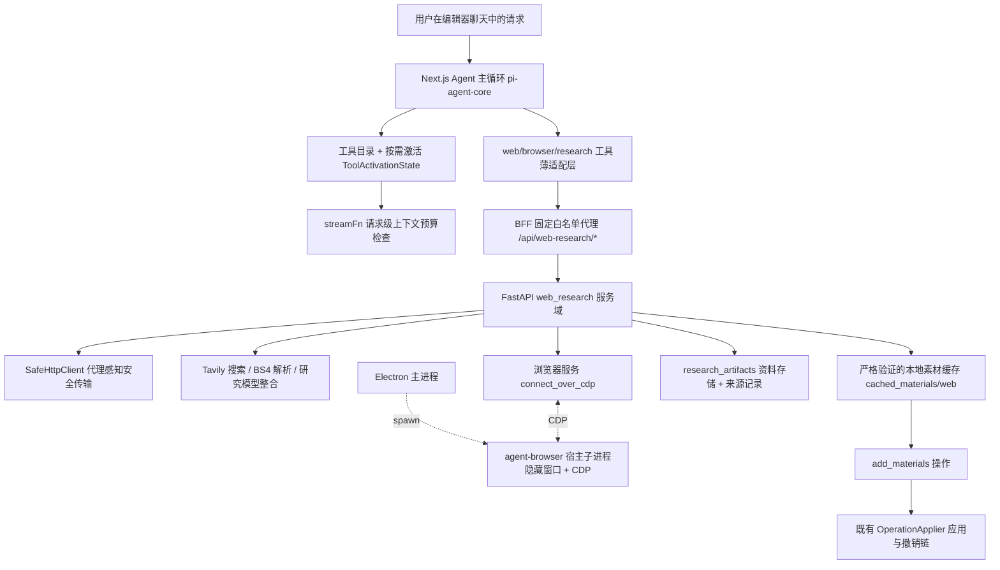

# AI 剪辑 Agent 通用网络能力设计方案（agent-general-capabilities）

> 版本：**v4（第二轮独立评审修订版）**｜ 设计日期：2026-10-08 ｜ 架构复核：2026-10-09 ｜ 评审修订：2026-10-09 ｜
> 状态：实现已落地并在开发态闭环；v3 逐条对账（§12）与本轮评审（顶部《评审记录·v4》）合计登记 24 项缺陷（v3 §12.3 的 14 项 + 本轮 10 项；P0 = 0，P1 = 8）
> 设计范围：为视频剪辑 Agent 增加通用网络能力（搜索 / 抓取 / 浏览 / 下载 / 整合引用），
> 含工具渐进式披露、上下文预算、大小模型协同及其设置界面。
> 阅读顺序：§1-§9 为**规范正文**（已就地校正为「代码实际行为 + 设计意图」，冲突处标注 `v3 实测` / `v4 订正`）；
> 顶部《评审记录·v4》是本轮评审的结论与处置表（P0/P1 已就地修复），其后的《评审记录·v2》
> 《评审结论·v2》、§10/§11 与 §12 为历史留痕；§13 为 v4 新增的「首发形态与启用路径」决策。
> 版本口径：本文已历 v2 评审与 v3 复核，本轮评审后的版本标记为 **v4**（不回落为流程模板
> 字面的 v2——版本号只允许单调递增，否则会与 §12 的 v3 记录倒挂，详见 V4-00）。

---

## 评审记录（Review Notes · v4 · 第二轮独立评审）

> 评审基线：HEAD = `c8f2ced2`，工作区含本设计的完整实现（`git status --porcelain`
> 125 条改动 + 1 个未跟踪宿主脚本 `desktop/main/agentBrowserHost.js`）。
> 评审方法：先读 `CLAUDE.md` 与 `.claude-index/index.md` 建立约束基线，再逐节审阅
> §1-§12，并用四路只读代码审计（后端 `web_research` 服务域与 router、BFF run 生命周期、
> 前端工具披露与设置面板、浏览器网络策略与测试）对每条断言取 `path:line` 证据；
> 关键结论由评审人二次复核（`browser_network.py:101-115`、
> `web_research_models.py:6-29,41,63-64`、`agent.ts:173-186`、
> `run_registry.py:42-73`、`researchRunClient.ts:35-93`、
> `webToolAdapter.ts:92-100`）。
> 处置口径同 v3：实现强于设计则升级设计；实现弱于设计则登记缺陷并给出可执行修法，
> 不把缺陷写成特性。本轮**只改本文件、未触碰源码、未执行 `git commit`**。

### V4-00 版本标记说明（流程模板 vs 文档事实）

本次评审的流程模板要求「版本提为 v2」，但该文档已由上游两轮工作推进到 **v3**
（《评审记录·v2》《评审结论·v2》＋§12 v3 复核）。若按字面回写 `v2`，文档版本会
**倒挂**于自身历史（§12 明确写着 v3）。因此本轮版本标记取 **v4**，并在文首写明口径：
流程模板里的「v2」指「本评审轮次产生的版本」，实际取值以单调递增为准。此为对流程
模板的一处显式偏离，记录在此以免后续节点误判文档被回退。

### 事实核查结论（二次复核）

- **成立且已实证的关键前提**：工具渐进式披露的过滤点确在 `streamFn`
  （`agent.ts:173-186`），执行侧仍是全量注册表；`offeredNames` guard 真实生效
  （`tools/index.ts:447-455`）；`explore_tools` 的 8 KiB 上限按「弹出尾部条目」实现
  （`exploreTools.ts:76-78`）；设置中心 12 个标量键与 §5.2 完全一致
  （`WebResearchSettingsPanel.tsx:17-37`）；artifact 存储的配额 / 原子写 / pin / 墓碑 /
  启动扫描四项要求全部落地（`artifact_store.py:36,61-89,144-201`）。
- **纠正 v3 的两处「事实」表述**（P1，见 V4-04、V4-01）：
  1. §3.6「只有主框架请求放行，子框架/非主框架一律拒绝」被 v3 与 §12.2 R3-15 读成
     「只放行主文档」。代码实际是：**主框架发起的全部子资源（script/style/image/xhr/
     fetch）照常 `route.fulfill`**，只有 **iframe 及其内部**请求被拒
     （`browser_network.py:110-115,149-160`）。这正是动态页能执行 JS、CDP 截图能用例
     通过的原因（`smoke.py:43,248`）。若按 v3 字面实现或审查，会把一个正在工作的能力
     误判成「浏览器只能读静态首页」。
  2. §3.8 称 `web_research_models.py::STATUS` 是「唯一事实源」，实测该表 34 条，而正文
     列出的错误码多于表项：**17 个正文码未登记**，一律落到
     `STATUS.get(code, 422)` 默认值（`web_research_models.py:41`）。「唯一事实源」不
     成立，必须改为「默认 422 的开放映射」，并以逐码断言补上（AC-40）。
- **仍未闭环的发布前提**（沿用 v3）：AC-19 打包端到端、AC-20 真实公网闭环、
  Python 3.10 冒烟、AC-22 严格化、D-01/D-02。v4 另加一项：**首发形态决策**（§13）。

### 问题清单（V4-01 … V4-12）

| 编号 | 严重度 | 维度 | 位置 | 问题 | 处置 |
|---|---|---|---|---|---|
| V4-01 | P1 | 完整性（契约自洽） | §3.8 / §12.2 R3-08 | `STATUS` 被声称为唯一事实源，实际 34 条、17 个正文码未登记并回落 422；`failure_class` 的 `status_code >= 500` 兜底（`web_research_models.py:63-64`）还会把 `artifact_quota_exceeded`（507）与 `cache_commit_failed` 误标为 transient + retryable，使 `blocked_repeat` 防重逻辑失效（`run_registry.py:128-130` 只拦 configuration/policy） | **已就地修复**：§3.8 改写为「默认 422 的开放映射 + 业务码必须显式登记」；新增 AC-40 逐码断言；缺陷登记为 D-15 |
| V4-02 | P1 | 可行性（前端预算自洽） | §3.3 / §5.2 / `agent.ts:180-182` | `setSchemaBudget(window − maxTokens − 2048 − estimatedTokens + schemaBytes − 2048)` 中 `estimatedTokens` 实为**字节**（`modelContextBudget.ts:139`），与 `schemaBytes` 同域相加后再与 token 额度比较，量纲错配且符号可疑；窗口偏小时预算可归零 → **每次 `explore_tools` 都抛 `tool_schema_budget`**；48 KiB 硬门（`modelContextBudget.ts:123-125`）只按字节判，而 26 个常驻核心 schema 没有任何测试保护 | **已就地修复**：D-07 由 P2 升 **P1**；§12.5 新增门禁 6，钉死「schema 预算必须在同一量纲内推导，且常驻核心 schema 必须单独断言 < 48 KiB」；新增 AC-38 |
| V4-03 | P1 | 完整性（故障路径） | §3.8 | run 注册表是进程内内存态（`run_registry.py:38`），后端重启即全量失效；BFF 拿到 410 后**不重注册、不短路**，模型会在同一回合反复尝试 web 工具，反复重置 watchdog 直到客户端 2h 上限，用户看到的是「一直转」而不是「网络研究不可用」 | **已就地修复**：§3.8 新增「run 丢失」条目（禁止同回合重注册、后续 web/browser 调用本地短路并给降级文案）；新增 AC-41；缺陷登记为 D-22 |
| V4-04 | P1 | 一致性（描述与实现相反） | §3.6 | v3 与 §12.2 R3-15 把「只有主框架请求放行」表述成「子资源全拒」，与 `browser_network.py:110-115` 相反；同时「方法只允许 GET/HEAD」作用于**所有**请求，使同源 POST XHR / GraphQL / OPTIONS 预检被 abort，POST 型 SPA 必然打不开——该边界既未写进正文，也无测试与文案覆盖 | **已就地修复**：§3.6 订正子资源放行事实并显式写出 POST-SPA 边界与失败关闭立场；新增 AC-39 固化两侧断言；缺陷登记为 D-23 |
| V4-05 | P1 | 尺度（首发可用性） | §5.2 / §6 / §9 | 全部网络能力默认 `enabled=true`，但首发可用性取决于两个用户不可自证的隐式前提：Tavily key（缺则 503 `provider_not_configured`）与 Electron 宿主（dev 浏览器模式必缺）。设计未定义「已开启但不可用」的首发形态，也没规定宿主缺失时 `browser_enabled` 应显示什么 | **已就地修复**：新增 §13「首发形态与启用路径」；`browser_enabled` 语义写明「宿主缺失即 unavailable，不是 false」；§12.5 新增门禁 7；缺陷登记为 D-24 |
| V4-06 | P2 | 完整性（错误码） | §5.1 / §3.8 | 磁盘满 / 目录不可写没有映射：`artifact_store.py:88`、`web_media_download.py:34` 的写失败只会变成 500 `internal_error`；`material_download_service.py:564-566` 归一为 `cache_commit_failed`（5xx → transient，可无限重试） | §5.1 增补「存储失败必须显式映射」；登记 D-16 |
| V4-07 | P2 | 可行性（校验时机） | §5.2 | `custom_proxy_url` 保存期只校验「是字符串且 ≤512」（`system_settings_models.py:190-192`），`http(s)://host:port` 的格式检查拖到请求期（`safe_http_client.py:95-116`）才发生 → 用户能保存一个必然失败的代理配置 | §5.2 订正：保存期即校验；登记 D-17 |
| V4-08 | P2 | 一致性 | §3.8 | BFF 对**任意** lease 非 2xx（含 500/429）都 `close()` 整个 run（`researchRunClient.ts:52`），比 §3.8「无法确认才升级」更激进；`cancelCall` 遇 429 `research_busy` 同样整 run 关闭（`:72`） | §3.8 订正为实际语义并说明理由；登记 D-18 |
| V4-09 | P2 | 完整性（本地化） | §3.5 | 中文产品里研究简报的语言未定义：`web_tools` 无语言入参、后端只有 `Accept-Language` 透传（`safe_http_client.py:313`），英文站点会产出英文 `brief/facts`，随后被主模型塞进中文脚本文案 | §3.5 增补输出语言约定（跟随 UI locale，写进研究提示词而非新增工具参数）；登记 D-19 |
| V4-10 | P2 | 完整性 | §3.2 | `explore_tools` 8 KiB 截断按「弹出尾部条目」实现（`exploreTools.ts:76-78`），但 `loaded` 仍列出被弹出者 → 返回体自相矛盾（说已加载、实则未注册），且无测试 | §3.2 订正：截断后必须同步修正 `loaded` 或给出 `truncated_tools`；登记 D-20 |
| V4-11 | P2 | 完整性 | §3.2 / §6 | 按需目录列出 10 类，其中 6 类的部分工具其实常驻（`CORE_TOOLKIT_TOOL_NAMES`，`promptParts.ts:34-56`）→ 目录与真实发送面不一致，模型会为已可调工具多走一次 explore | §3.2 判定为可接受冗余并写明口径；不单列缺陷 |
| V4-12 | P2 | 完整性 | §3.8 | 断线重试按「干净重启」再发一次 Agent POST（`SSEStreamManager.ts:269-283`），会短暂并存两个 research run（占 4 个 active 上限的一半），而首个 run 的 DELETE 仍是 `void` 不等待（`chat/route.ts:604`） | §3.8 补一句「干净重启窗口内允许短暂双 run，前端复用同一 project_id，后端上限不变」；登记 D-21 |

**P0 = 0**：未发现启动失败、破坏既有剪辑功能、或触碰三条红线（启动期无破坏性 DDL /
无新增鉴权面 / 主进程不暴露 CDP）的缺陷。P1 共 5 项（V4-01…V4-05），**已在正文就地
修复**，修复落点写在各行「处置」列，并全部转成可判定验收（AC-38…AC-41 与 §12.5
门禁 6/7）。

### 评审通过项（本轮复核新增）

- 工具契约与实现 1:1：11 个新工具的名称 / 类别 / 数量与 §4.2 完全一致
  （`webTools.ts:18-42`、`browserTools.ts:21-34`、`researchArtifactTool.ts:12`）。
- 设置面板无缺键无多键：12 个标量键的默认值与范围与 §5.2 逐项一致；凭证只走专用端点、
  掩码不回写（`WebResearchSettingsPanel.tsx:17-37,126-149`）。
- BFF 的 run 注册确实单飞且惰性（`researchRunClient.ts:60`），纯剪辑回合零注册；
  取消链路的四重防护（`webToolAdapter.ts:65,75,85`、`agent.ts:120,473-475`、
  `run_registry.py:121-123`）成立。
- 长工具调用不会饿死 SSE：15s comment 心跳 + 15s tool 心跳（`chat/route.ts:33,503`）
  远小于客户端 90s 判超时（`SSEStreamManager.ts:170` → `timeouts.ts:13-16`），
  130s 的 `web_research` 不会触发重连。

---


## 评审记录（Review Notes · v2）

> 评审基线：HEAD = `c8f2ced2`（已实测核对，工作区除本目录外干净）。
> 评审方法：逐节审阅（可行性 / 完整性 / 一致性 / 尺度）＋ 对 §2.1 全部仓库事实断言
> 与关键第三方依赖逐条实证（file:line 证据、PyPI 元数据、上游源码）。v2 就地修复了
> 全部 P0/P1，并顺带修复了代价极低的 P2；各条目"处置"列标注修复落点。

### 事实核查结论

§2.1 的 13 项仓库事实断言中 12 项与当前代码完全一致，1 项部分不符（R-V2-02）。
关键正面证据：pi-agent-core 0.57.0 的 `AgentOptions` 确有
`streamFn / transformContext / convertToLlm`；`agent-loop.js` 每次推理前组
`llmContext`（含 `tools`）调 `streamFn`，而工具执行走 `currentContext.tools`
全量注册表——**§3.2「streamFn 过滤、执行侧不缩减」的核心前提实测成立**；
`setTools` 确为整组替换。依赖核实：`playwright==1.63.0`
（`py3-none-win_amd64.whl`）与 `beautifulsoup4==4.15.0`（`py3-none-any.whl`）
在 PyPI 均有可安装 wheel；playwright 上游 `crBrowser.ts` 经
`Target.createBrowserContext` 实现 CDP 连接下的 `new_context()`（机制可行，
Electron 侧的路由/截图行为仍需 AC-06/19 实证）。历史底稿可恢复性已核实：
`7d0c6bc1` 确实携带 web_research 前后端文件与测试。

### 问题清单

| 编号 | 严重度 | 维度 | 位置 | 问题 | 处置 |
|---|---|---|---|---|---|
| R-V2-01 | P1 | 可行性 | §3.6 | `asyncio.Runner(loop_factory=...)` 的 `loop_factory` 参数 Python 3.12 才引入；项目支持 3.10+（CLAUDE.md），本仓库当前解释器为 3.11.7——按原文实现浏览器启动分支直接 TypeError | 已修复：改为 3.10 兼容的显式 Proactor 循环写法，并写明动机与 3.10/3.11 双版本冒烟要求 |
| R-V2-02 | P1 | 一致性 | §2.1/§3.5 | 声称 chat/route.ts「已有 `AGENT_LLM_API_XX_*` 动态配置解析」；实测 route 经后端 `/api/model-settings/resolve/chat` + `LLM_*`/`OPENAI_*` env 回落解析，编号配置解析在后端 `llm_service.py:31-52`。按错误认知实现会在 BFF 重复造一套解析 | 已修复：改写 §2.1 事实行；钉死 research 解析落点 = `model_settings_service`（与 §3.5 一致），BFF 不重复解析 |
| R-V2-03 | P1 | 完整性（数值自洽） | §3.5/§5.2 | 整合调用输入 ≤64000 字节（按 §3.3 口径 ≈3.3 万 token）远超默认研究窗口 16384 的输入额度（16384−1800−2048 ≈12500 token）→ 默认配置下每次整合必然触发预算裁剪，编排上限形同虚设 | 已修复：整合输入上限改为按窗口推导 `2×(window−输出−2048)` 且硬顶 64000 字节；默认 `research_context_window_tokens` 16384→32768 |
| R-V2-04 | P1 | 一致性（行为回退） | §3.3/§5.2 | `context_window_tokens` 默认 65536 取代硬编码 128000，等于把既有纯剪辑 Agent 的默认上下文静默砍半（含纯剪辑回合），属未声明的现有功能回退 | 已修复：默认 128000（与现状持平），范围 16384..1048576 不变；预算不足交给请求级裁剪与 UI 提示 |
| R-V2-05 | P1 | 可行性（验证次序） | §3.6/§8 | CDP 复用内嵌 Chromium 是本轮全新路径（历史门禁 2 用的是 Playwright 自带浏览器，从未端到端验证过 CDP 方案），而 §8 把浏览器宿主排在第 4 步；若 Electron 33 上 `connect_over_cdp + new_context + route + 隐藏窗口截图` 不成立，§3.6 大量设计返工 | 已修复：§8 新增「步骤 0 CDP 可行性 spike」作为 §3.6 的实现门禁（判据 = AC-06 最小子集），失败即按 §2.3 收敛为浏览器能力降级，不阻塞其余交付 |
| R-V2-06 | P2 | 一致性 | §1/§3.1 | 「`add_to_track` 操作协议」系工具名；OperationApplier 的落轨操作类型字面量是 `add_clip`（`OperationApplier.ts:588/751`），`add_materials` 才是操作类型。措辞不修可能诱导实现节点新建不存在的操作类型 | 已修复：§1 措辞改准 |
| R-V2-07 | P2 | 完整性 | §3.4/§4.1 | robots 5xx/超时 → `robots_unavailable` 未定义放行还是拒绝，且不在 HTTP 映射表内——实现节点可能两种方向各写一次 | 已修复：定为 fail-closed（本次拒绝、不自动重试、缓存有效期内同 origin 同样拒绝），并补入 403 映射 |
| R-V2-08 | P2 | 一致性 | §6/§7 | 「`AgentToolCallCard.tsx` 已弃用」不准确：仍被 `AgentMessageBubble.tsx:6/:54` 引用并渲染，且导出 `CoverToolStatus`（`AgentExecutionNode.tsx:28` 亦引用）。照字面实施会删除在用组件 | 已修复：§6 改为「新增分发分支，不得删除既有组件」 |
| R-V2-09 | P2 | 可行性 | §8 步骤 4 | 「（仓库根）`python -m pytest backend-services/.../test_research_browser.py`」不可行：后端 conftest 无 sys.path 注入，导入 `app` 包依赖 cwd = `backend-services/basic-service` | 已修复：命令改回 (B) 目录执行；desktop electron 可执行路径经 env 注入 fixture |
| R-V2-10 | P2 | 完整性 | §8 | 「均需核实 Windows wheel 存在」未闭环；playwright pip 包自带 node driver（约 40–50MB），「零新增」的体积口径未量化，打包预期可能失衡 | 已修复：落为「v2 已核实」并补体积口径（净增 ~50MB driver、零浏览器二进制） |
| R-V2-11 | P2 | 一致性 | §7 | `B/docs/apis/tavily-search.md` 指向已删除的 `tavily_search_service.py`，§7 未安排处理——正是历史 F-29/A9 扫不出的 docs 外悬挂引用 | 已修复：§7 后端表新增「更新或删除该文档」行项 |
| R-V2-12 | P2 | 完整性 | §7 | 既有 system-settings 路由新增 Origin 校验后，现存不带 Origin 头的写请求测试会集体变红，测试计划只列了新测试文件 | 已修复：§7 测试表新增「同步修订既有 system-settings 测试」行项 |
| R-V2-13 | P2 | 完整性 | §5.1 | artifact 根目录按 `storage_root.parent` 推导，打包（`<userData>/research_artifacts`）与 dev（`static/research_artifacts`）两种形态未写明；dev 形态落在 static/ 下需防未来有人给 static/ 加挂载（当前唯一裸挂载仅 `/static/timeline_exports`，v2 已核实无暴露） | 已修复：补两形态说明 + 「不得为该目录新增静态挂载」约束 |
| R-V2-14 | P2 | 一致性 | §3.8 | `AGENT_MAX_DURATION_MS` 是前端常量（`timeouts.ts:19`，客户端 SSE 管理用），BFF 侧 run deadline 的取值来源未写明，实现节点可能在服务端找不到该符号 | 已修复：明确 BFF 以自身回合开始时间计算 `remaining_ms`，不导入前端常量 |

**无 P0**：未发现不可实现、破坏既有功能或触碰仓库硬约束（启动期无破坏性 DDL、
`LOCAL_OWNER_ID` 镜像、无新增鉴权面、Electron 主进程不暴露 CDP）的设计。

### 评审通过项（抽样佐证）

- §3.2 过滤点选型与 pi-agent-core 0.57.0 实测行为一致（执行走全量注册表，
  streamFn 只影响发送面）；offeredNames 执行 guard 补上了引擎不校验
  「被调工具 ∈ 本次 schema」的缺口。
- §3.3 请求级预算的 2 字符/token 口径与 `agent.ts:144-146` 现状同源；
  「压一次 history」的现状缺口（`agent.ts:125` 仅构造时压缩）确需本设计补齐。
- §4.1 错误 envelope 与 `app/models/base_models.py::ErrorResponse(BaseResponse)`
  字段（含 `timestamp`/`data`）完全一致。
- §5.1 新表走 `create_all` 加性演进，符合「无破坏性 DDL」红线；
  §5.2/§6 的设置结构（`SettingsMenuItem` union、sidebar `ai` 分组、
  `SettingsPage` 路由、四个 system-settings 路由均存在）与现状吻合。
- desktop 侧挂接点真实：`index.js:63` 单实例锁、`processManager.js::ManagedService`、
  `backendService.js` env 注入通道与 `CORS_ALLOWED_ORIGINS`/frontendPort 均在。
- 尺度判断合理：CDP 复用内嵌 Chromium 相对 Playwright 自带浏览器是明确的减法
  （−705MB 门禁），11 个工具三档披露 + 32 条 AC 与历史两轮审查结论对齐。

---

## 1. 概述

Ecliptrix 是单用户 Electron 桌面产品：主进程拉起绑定 127.0.0.1 的 FastAPI 后端与
Next.js 渲染服务，现有的视频剪辑 Agent（`src/lib/video-editing-agent/`，基于
pi-agent-core 0.57.0）已经能查询时间线、检索素材库、生成脚本与媒体，并通过操作事件
修改编辑器；但它对公开网页、实时资料与动态网站完全没有工作流。本次交付目标是让
"了解主题 → 核实来源 → 寻找素材 → 下载到本地 → 组织成视频"成为一次连续任务，同时
支持只研究资料、不修改时间线的通用请求。所有网络工具必须通用（不绑定视频语义），
视频侧只负责把已下载资源转换为 `MaterialItem` 并走既有 `add_materials` 操作与
`add_to_track` 工具（注意：该工具产生的落轨操作类型字面量是 `add_clip`，
见 `OperationApplier.ts`），从而保持撤销链与现有编辑能力完全兼容。

方案保留现有 Agent 引擎与操作协议不动，在三个层面增强：（1）模型请求边界——工具
schema 按需披露 + 每次调用做完整上下文预算，杜绝"工具越加越多、上下文爆掉"；（2）
FastAPI 新增网络研究服务域——代理感知的安全 HTTP 传输、搜索/抓取/研究编排、复用
应用自带 Chromium 的受控浏览器、资料存储与来源记录；（3）设置中心——网络能力开关、
搜索凭证、代理模式与"资料整理模型"（大小模型协同）均可配置、可测试。设计对
AragonAgent（https://github.com/xdrshjr/AragonAgent.git）的渐进式披露、字节预算与
工具执行边界机制做了明确借鉴（见 §2.2），但不引入其引擎。

本设计有一轮可直接参考的历史实现：分支 `feat/remove-user-system` 顶端的
`88f218dc / a953a329 / 7d0c6bc1` 三个提交（工作区已被回滚到 `c8f2ced2`，目录中仅余
`app/services/web_research/__pycache__`）。历史实现的**架构与审查结论全部继承**，
但当时有四条发布门禁未过：代理/Fake-IP 环境下 `example.com` 判 `url_forbidden`、
Playwright 自带 Chromium 使安装包 +705MB 且构建期需下载、跨源重定向无法二次拦截、
真实配置端到端未完成。本 v1 的两处结构性改动——**代理感知传输**（§3.4）与
**CDP 复用内嵌 Chromium 的浏览器宿主**（§3.6）——正是针对前两条门禁的根因；后两条
转化为明确验收项（§9 AC-22、AC-20）。

## 2. 现状基线、历史教训与参考依据

### 2.1 已核实的仓库事实（HEAD = c8f2ced2）

| 位置 / 符号 | 现状 | 对本设计的含义 |
|---|---|---|
| `src/lib/video-editing-agent/agent.ts::createVideoEditingAgent` | 全部工具注册进 function schema；`contextWindow` 硬编码 128000；history 仅构造时压缩一次 | 必须在模型请求边界过滤 schema 并逐次控制预算 |
| `A/registry/ToolRegistry.ts::getAllTools` | Method C：全部 schema 都发给模型 | 现有 explore_tools 只返回文档，不改变发送面 |
| `A/tools/apiHelper.ts::toolFetch` | 合并 timeout/abortSignal，默认网络异常重试 1 次 | 新网络工具显式 `retry:false`，幂等由后端保证 |
| `A/historyBudget.ts::compactHistoryForModel` | 120k 字符预算、保留最近 2 个回合 | 单轮内多次工具调用仍可能溢出，需请求级预算 |
| `src/app/api/video-editing-agent/chat/route.ts` | 已有 `resolveAgentLoopbackUrl`、`toolAbort` 信号；LLM 配置经后端 `GET /api/model-settings/resolve/chat` + `LLM_*`/`OPENAI_*` env 回落解析（`AGENT_LLM_API_XX_*` 编号解析在后端 `llm_service.py`，**不在本 route**） | run 生命周期与预算配置挂接在此，SSE 取消语义保留；research 模型解析复用 `model_settings_service`（§3.5），BFF 不重复实现配置解析 |
| `B/app/models/model_settings_models.py::ModelFunctionType` | 现有 chat / fast / video_cut / vision / coding | 新增 `research` 枚举并贯穿解析、UI、测试 |
| `B/app/services/system_settings_service.py::YAML_TO_DB_MAPPING` | 未包含 web_research | 新 YAML 需同步映射、类别元数据、校验器 |
| `B/app/security/url_guard.py` | 校验入口 URL，文档明示 DNS 重绑定/重定向局限 | 新传输层逐跳、连接级校验，不能只调一次 |
| `B/app/services/material_download_service.py` | `store_external_download_async` 返回 None、失败仅日志 | 新增严格保存方法，返回真实 `CachedMaterial` |
| `desktop/main/index.js:63` | `requestSingleInstanceLock` 在模块顶层 | 浏览器宿主子进程必须提前分流，不抢锁 |
| `desktop/package.json` | Electron 33.4.11，已内嵌 Chromium | 浏览器复用它，不再随包分发第二份 Chromium |
| `node_modules/@mariozechner/pi-agent-core` | 0.57.0，`AgentOptions` 提供 `streamFn` / `transformContext` / `convertToLlm`（已实测读取类型声明） | schema 过滤点放在 `streamFn`，不调用 setTools |
| `B/docs/apis/tavily-search.md` | 旧工作流时代的 Tavily 文档仍在，`tavily_search_service.py` 已不存在 | Tavily 集成本次重建于 `web_research` 服务域 |

历史实现的发布门禁复盘（对应其 spec §12）：

1. **DNS/Fake-IP 环境失效**：本机 DNS 把 `example.com` 解析为 `198.18.0.12`
   （代理软件 Fake-IP 段），旧 `safe_http_client` 自行解析并拒绝"非公网 IP"，导致
   一切直连出口都被判 `url_forbidden`。→ 本设计 §3.4 引入代理感知双模式。
2. **Chromium 打包门禁**：Playwright 自带浏览器 610 文件 / 约 705MB，构建期需
   `playwright install` 且当时磁盘余量不足 8GB 预检。→ §3.6 改为 CDP 复用内嵌
   Chromium，安装包零新增浏览器资源。
3. **跨源重定向不可二次拦截**：Chromium 对跨源 302 不再次触发页面拦截。→ 保留
   失败关闭语义（`redirect_unsupported`），以 AC-22 固化。
4. **真实配置端到端未验收**。→ AC-20 保留为发布前必做项。

### 2.2 AragonAgent 实际参考范围

已克隆并阅读 `packages/core`（提交 19e97d34，与需求所指仓库一致）。借鉴机制与落点：

| AragonAgent 机制 | 本方案落点 |
|---|---|
| `skills/disclosure.ts`：目录（L1）→ 按需正文（L2）→ 按需文件（L3）三级披露；预算含结构开销、截断后仍留检索入口 | §3.2 类别目录常驻 + explore_tools 按名加载 + artifact 分页读取（L3 等价物） |
| `disclosure.ts::byteLength/truncateToBytes`：一切预算按 UTF-8 字节计，不按 `String.length` | §3.3 全部字节上限按 UTF-8 计，码点不截半 |
| `disclosure.ts::sanitizeForPromptBlock`：第三方文本全角化尖括号，不能闭合注入块 | §3.5 目标同款（网页文本仅是数据）；**v3 实测**当前实现只做归一化 + 控制符/URL 脱敏，全角映射待补（§12.3 D-09） |
| `tools/types.ts::ToolExecutionContext`（signal/progress/abortCause）、`executor.ts` 超时与输出截断 | §3.8 工具调用级 deadline + 取消墓碑；§4.2 工具结果字节上限 |
| `engine/context-manager.ts`：同步廉价探测 + 压缩决策与引擎解耦 | §3.3 `modelContextBudget` 在 streamFn 前同步判定，超限本地终态化 |
| Fast model tier（可选快模型做反思/整理） | §3.5 / §5.2 `research` 功能模型 + `use_research_model` 开关 |

不迁移其引擎、不引入 CLI/子代理/技能盘机制（本产品 Agent 循环已由 pi-agent-core
承担）；以上仅为机制参照。

### 2.3 已定取舍

| 备选 | 判断 |
|---|---|
| 只加 HTTP 工具、浏览器后置 | 覆盖不了动态网站与"浏览器使用"需求，否决 |
| 用 AragonAgent core 替换 pi-agent-core | 需重做流事件、撤销适配，超出必要范围，否决 |
| Playwright 自带 Chromium（历史方案） | +705MB 安装包、构建期下载门禁，本次弃用 |
| Electron 主进程直接开 remote-debugging-port | 暴露整个应用 UI 的 CDP 控制面，安全不可接受，否决 |
| **保留引擎 + streamFn 过滤 + FastAPI 服务域 + CDP 子进程浏览器** | 选定 |

## 3. 技术设计

### 3.1 分层与主流程



一次"研究主题并制作视频"回合的时序：

1. BFF（chat route）为用户回合建立本地研究上下文：记录 project_id、配置快照与
   网络子取消控制器。**首次**实际 web/browser 工具调用才 single-flight 注册后端
   run，取得 `run_id` + 仅服务端持有的 `run_token`；目录查询与纯剪辑不注册 run，
   研究服务故障不影响普通剪辑。
2. Agent 首先只看到核心剪辑工具、`explore_tools` 与三个网络能力目录；它调用
   `explore_tools(category='web_tools')` 后，**下一次**模型请求才包含所选工具的
   schema（§3.2）。每个工具执行请求由适配层注入 `run_id/run_token/tool_call_id`，
   不交给模型生成。
3. 后端完成搜索、单页提取与来源记录；页面正文/报告/截图落为不可变 artifact，
   模型只收到带预算的摘录、结果 ID 与分页游标。需要 JS 渲染时 Agent 加载
   `browser_tools`，经 CDP 打开隐藏窗口中的受控页面并读取快照（§3.6）。
4. `web_research` 在开启"资料整理模型"时用 research 模型产出带来源编号的事实
   条目；主模型决定如何组织视频。网页内容永远是工具数据，不进入 system prompt、
   不改变工具权限。
5. 下载完成后后端返回**真实存在**的本地 URL 与探测出的媒体信息；适配层验证成功
   且 run 未取消，才 `recordOperation(add_materials)` 并去重写入
   `toolContext.materials`，随后由既有 `add_to_track` 上轨。
6. 正常结束、用户停止、SSE 断开、超时都收敛到 run 清理；取消后不再发布素材或
   时间线操作。断线不自动重放整个 Agent POST（遵循
   `ai-and-manual-editing-reliability` 已定语义：重试=干净重启）。

### 3.2 真正的工具渐进式披露（Progressive Disclosure）

执行侧保留完整注册表（Method C 不变，pi-agent-core 仍按原名执行与发事件）；
**过滤点是 `AgentOptions.streamFn`**，不是循环中 setTools（0.57.0 的 setTools 整组
替换、循环中调用不安全）。本地实测 0.57.0 提供 `streamFn/transformContext`，
agent-loop 每次推理前组装 llmContext 再调 streamFn，执行侧仍持完整工具数组。

新增 `A/registry/ToolActivationState.ts`，每个 run 独立：

```
ToolActivationState {
  coreNames: Set<string>            // getAlwaysAvailableTools ∪ CORE_TOOLKIT_TOOL_NAMES ∪ explore_tools
  activeNames: Map<string, seq>     // 已激活按需工具 → 最近使用序号（LRU 依据）
  offeredNames: Set<string>         // 冻结快照：产生当前 assistant 响应时实际提供的集合
}
```

算法（全部以 UTF-8 字节计）：

1. 初始化只激活核心集合（**v4 实测**：核心集合 = `getAlwaysAvailableTools()` ∪ 15 个 `CORE_TOOLKIT_TOOL_NAMES` ∪ `explore_tools`，见 `promptParts.ts:34-56`、`agent.ts:127-130`；即固定发送面约 26 个 schema。目录里 search/ai_gen/tts/script/storyboard/material 六类虽有工具被常驻，仍照常列出——v4 判定这是**可接受冗余**：模型对已可调工具多一次目录浏览，成本一次性；但目录不得声称这些类别「必须先加载」，也不得据此宣称发送面只有剪辑核心工具）。按需目录每类目录行 ≤160 字节、目录总计 ≤2400 字节，
   仅列 `id + 一句用途 + 可用状态`；修正 `systemPrompt.ts::formatToolOverview`
   使目录真实渲染（当前实现忽略 categorySummaries）。
2. `explore_tools` 参数扩展为 `{category, tool_names?: string[1..4]}`：未传
   tool_names 时返回该类工具名+一句话用途，并按注册顺序激活前 4 个；指定名称时
   要求全部属于该类，一次校验后原子更新。返回 `loaded/available/evicted` 与
   `further_load` 指引（**v4 订正**：8 KiB 上限按「弹出尾部条目」实现（`exploreTools.ts:76-78`），此时 `loaded` 不得再列出被弹出的工具——必须同步裁剪 `loaded` 或新增 `truncated_tools`，否则同一响应体自相矛盾（声称已加载、实际未注册），并须有测试覆盖；截断后仍须保留继续检索入口——AragonAgent D18/F1 同款要求）。
3. 活跃按需工具 ≤12 个，且 schema 总量 ≤48 KiB；LRU 驱逐非本次新加载者，平手按
   名字序；整项增删，**绝不截断 JSON Schema**。放不下时返回 `tool_schema_budget`
   且不改激活状态。
4. streamFn 以 `{...context, tools: selectedTools}` 调原 `streamSimple`，保留
   signal/apiKey/流事件；显式覆盖 `options.maxTokens` 为本次预留输出额度。先冻结
   offeredNames 再做最终预算检查；前置检查失败必须以 SDK 协议的终态错误流返回
   （pi-ai `AssistantMessageEventStream`，`stopReason='error'`，`result()` 可完成），
   不能裸 throw 让引擎事件生产协程悬空（历史 R-01）。
5. 注册表中每个按需工具的 execute 包一层 guard：工具名必须在本条 assistant 响应
   的 offeredNames 中，否则返回 `tool_not_loaded`；即使模型同一条响应先 explore 再
   猜调刚激活的工具也不执行，须下一次模型请求（防历史伪造激活）。
6. 历史中的 explore 结果只作使用提示（最多恢复最近两类的短说明），不自动恢复
   schema；执行中工具不受后续加载/驱逐影响。

新增三个类别（加入 `registry/categories.ts` 的 ON_DEMAND 列表）：`web_tools`
（6 个）、`browser_tools`（4 个）、`research_tools`（1 个），工具清单见 §4.2。
类别不可用（如浏览器宿主缺失）时目录仍显示精简原因与设置入口，不得以无限重试
探测可用性。

### 3.3 上下文预算：同轮多步也不爆

新增 `A/modelContextBudget.ts`，在每次 streamFn 转发前对 systemPrompt、已选工具
schema、messages、工具参数与预留输出做完整检查——不能只在 Agent 构造时压一次
history，也不能只截网页正文。

- 预算估算（保守代理，不声称精确 token）：**v3 实测口径 = 字节直接与 token
  额度比较**——`estimatedBytes = utf8Bytes(转发给 provider 的 {model,
  systemPrompt, tools, messages, options}) + 16 × messageCount + 1024`，判定
  `estimatedBytes > contextWindowTokens - maxOutputTokens - 2048`
  （`modelContextBudget.ts:139`、`agent.ts:173-183`）。这比 v2 设计的
  `ceil(utf8Bytes / 2)` 口径**保守一倍**：长回合会更早进入裁剪（§12.3 D-07
  要求"折算"或"保守"二选一收口，并补一条 UI 提示）。中文与 emoji 仍按 UTF-8
  字节计、截断不劈码点。
  输入额度 =
  `contextWindowTokens - maxOutputTokens - 2048`；`context_window_tokens` 设置
  （默认 **128000**，与现状硬编码持平——v2 评审裁定不得借本设计把既有纯剪辑
  回合的默认上下文静默减半；范围 16384..1048576）替代硬编码；输出额度 =
  `min(4096, floor(contextWindow/8))`。
- 字节上限表（全部 UTF-8 字节；截断不劈码点，结构开销计入预算）：

| 项 | 上限与行为 |
|---|---|
| 发送的工具 schema 总量 | 48 KiB |
| 单次 explore_tools 返回 | 8 KiB |
| 单次 web/browser 工具 content | 12 KiB（含封装与来源） |
| 搜索结果 | ≤8 条；title ≤180、snippet ≤200 字符；超预算从尾部减条并留 artifact_id |
| 页面正文 | 默认 4000、最大 8000 字节；`artifact_id + offset` 分页 |
| 浏览器快照 | 正文 4000 字节、元素 ≤30、总计 12 KiB |
| 研究简报 | brief ≤6000 字节、来源 ≤5、总计 12 KiB |
| 截图 | 默认不送图，仅返回 `screenshot_artifact_id`，不内嵌 base64 |
| 同一 run | ≤40 次模型请求、≤80 次工具执行；到顶即带已有成果终态化 |

- 裁剪顺序（固定）：清除 inline 媒体 → 旧网页工具结果替换为
  `{artifact_id,title,source_ids,summary<=512B}` → 去掉较旧时间线快照与已应用
  操作数组 → 按完整 assistant 工具批次删除最旧历史块。任何 assistant toolCall
  与其全部 toolResult 必须成组保留或成组移除，不得出现悬挂调用。裁剪只作用于
  **发送视图**，不改持久化对话、SSE details 与撤销栈；删块时插入短说明（列出仍可
  访问的 artifact ID）。
- 最小必需内容（最新用户消息 + 核心约束 + 核心 schema + 最小结果）仍超限 → 调用
  provider 前本地终态化返回 `context_budget_exceeded`（区分于 provider 的
  `context_overflow`，两者都进 `AgentStreamErrorCode` 与 UI 映射）。provider 实际
  返回 context-length 错误时，仅允许一次"未产生任何工具执行前"的更保守压缩重试，
  不得重启已运行的工具链。
- 第 40 次模型请求后不再调 provider；第 80 次工具后第 81 个不执行（即使来自同一
  assistant 批次），剩余调用按 SDK 工具结果协议返回限制原因、不产生副作用。

`A/historyBudget.ts` 保持职责但与预算模块共享"按完整工具批次分组"与
"artifact 摘要替换"两个纯函数，避免两处实现漂移。

### 3.4 代理感知的安全传输（SafeHttpClient）

新增 `B/app/services/web_research/safe_http_client.py`，一切研究来源的
GET/HEAD、robots、页面图片、媒体与浏览器子资源都经它出口；Tavily 与模型 provider
用各自固定可信客户端（用户输入不能指定其主机）。基于仓库已有 aiohttp 3.12.15，
自定义 `AbstractResolver` + `TCPConnector`。

**双模式（解决历史门禁 1）：**

- 解析顺序：设置 `proxy_mode`：
  - `auto`（默认）：`custom_proxy_url` 设置 > 进程环境 `HTTPS_PROXY/HTTP_PROXY/
    ALL_PROXY`（仅研究传输读取，`trust_env` 语义限定在本 client）> Electron 主进程
    检测的系统代理（经 env `WEB_RESEARCH_SYSTEM_PROXY` 注入，见 §3.6/§7）> 直连。
  - `direct`：绝不代理（= 历史行为，全量 IP 校验）。
  - `custom`：只用 `custom_proxy_url`（http/https、host:port，可含认证userinfo——
    认证仅保存在本地 DB 设置中且响应永不回显）。
- **代理模式下的校验**：代理地址本身必须是 loopback 或用户显式配置的地址（不再做
  "代理主机必须公网"的谬误校验）；目标 URL 仍走 scheme/host/端口/长度/控制字符
  校验；**禁止目标主机为字面私网 IP / 链路本地 / metadata 地址**
  （169.254.169.254 等，按字面量判断，与 DNS 无关）；主机名解析交给代理（这是
  用户配置代理的本意，Fake-IP 环境因此恢复可用）。robots 检查同样经代理。
- **直连模式下的校验**（历史行为保留）：resolver 在线程执行 getaddrinfo 并受总
  超时约束；拒绝非 global、IPv4-mapped 私网 IPv6、metadata、混合公私网解析；验证
  过的 IP 直供 connector、原 hostname 做 TLS/SNI/证书校验（防 DNS rebinding）。

共用约束：

- 仅 HTTP/HTTPS、端口仅 80/443；拒绝 userinfo（目标 URL 中）、控制字符、>4096 的
  URL；规范化 scheme/host/默认端口，**保留全部 query**（分页/签名链接依赖它），
  移除 fragment。
- `allow_redirects=False`，逐跳重新走完整校验（代理模式逐跳仍经同一代理），最多
  5 跳；跨 origin 不转发 Cookie/Authorization；研究传输不携带应用凭证。
- 两种传输模式：普通 `fetch`（此层逐跳取最终响应）与浏览器用 `fetch_one_hop`
  （只取当前响应，3xx 不吞、由 Chromium 发起下一跳并重新过路由）。
- 流式读取并限制解压后字节：页面 2 MiB、robots 256 KiB、图片 10 MiB、音视频
  100 MiB；连接 5s、读空闲 10s，总超时取调用剩余 deadline；压缩炸弹/超额/类型
  不符直接拒绝，不把半个文件当成功。
- 全局并发 3、同 origin 并发 1（代理模式下按目标 origin 计）；等待计入 deadline
  并响应取消；域名锁引用计数，退出即清理。
- robots 默认启用（文档与主动下载检查；同 origin 缓存 1h/256 项；404=无规则、
  401/403=拒绝、5xx/超时=`robots_unavailable`；robots 自身不递归检查）。
  **`robots_unavailable` 为 fail-closed（v2 明确）：本次请求直接拒绝并返回该错误
  码，不静默放行、不自动重试；同 origin 的失败结果在缓存有效期内同样拒绝**——与
  `redirect_unsupported` 同一失败关闭姿态，宁可少抓一页也不无凭据抓取。
- 错误只返回安全 `error_code`，不透出含 query 的原始异常、headers 或密钥；日志仅
  host/步骤/耗时/字节/request_id。

### 3.5 搜索、抓取与研究编排（大小模型协同）

- **Tavily 搜索**（`web_search_service.py`）：固定 `POST https://api.tavily.com/search`，
  传 query/max_results/search_depth/include_images，`include_raw_content=false`；
  images 仅作候选不自动下载。Key 优先用设置里显式保存的数组，否则读
  `TAVILY_API_KEYS`。**v3 实测**：key 轮换只发生在 `provider_rejected`
  （401/403），最多试 min(key_count,3) 把；429 直接上抛 `provider_rate_limited`
  （HTTP 429、failure_class=transient），**没有** Retry-After 等待逻辑
  （§12.3 D-12）。零 key → HTTP 503 `provider_not_configured`，
  `failure_class=configuration`（不增不减连续失败计数）；该错误的 details 目前
  只有 `failure_class/retryable/request_id`，**不带**设置入口文案（§12.3 D-10，
  指引由前端 `webResearchStatus` 的文案映射补齐）。
- **HTML 抓取**（`web_fetch_service.py`）：BeautifulSoup（`html.parser`）解析，
  剔除 script/style/nav/footer/表单，提 title/正文/公开链接/图片候选；正文不足
  仅提示 `js_page_suspected`，不擅自启动浏览器（Agent 显式 browser_open）。
  每次 `fetch` 都重新抓取并写一个**新** artifact，分页在该次响应体上做
  （`web_fetch_service.py:42-60`；`snapshot_stable = (offset == 0)`）。**v3 实测
  与 v2 设计不符**：v2 要求"首次抓取产生不可变 artifact、后续分页从 artifact
  读"，实测 `offset > 0` 仍会再抓一次站点（§12.3 D-02：页面在两次调用间更新会
  让 offset 语义漂移，且重复占用 artifact 配额）。正文进入工具结果前的中性化
  实际口径为 **Unicode 归一化 + 去控制符 + URL 脱敏**
  （`research_model_client.py:14-22`、`research_report.py:82-86`），**没有**
  全角化尖括号与零宽字符剥离：它保证"网页文本只当数据、不能闭合注入块"，
  但不宣称消灭提示注入（§12.3 D-09）。
- **研究编排**（`web_research_service.py`）：topic 搜索必做；`use_research_model`
  开启时 research 模型先做一次查询改写（10s、输出 ≤256）；最多 2 次搜索、合并
  ≤5 个来源、每源提取 ≤12000 字节；**整合调用输入上限由研究窗口推导（v2）：
  `inputBytes ≤ 2 × (research_context_window_tokens − maxOutputTokens − 2048)`，
  且硬顶 64000 字节**（默认窗口 32768、输出 1800 时 ≈57600 字节）；输出 ≤1800
  tokens、35s；采集量超推导上限时先按源缩减（保最新来源），不得靠丢引用凑长度。输出固定 `{brief, facts, uncertainties, sources, degraded}`；每个 fact 带
  `source_ids`，来源 ID 由服务端分配（UUID），不接受模型发明 URL；JSON/引用/长度
  校验失败仅允许一次格式修复（不额外搜索），再失败降级为按来源分组摘录
  （`degraded='excerpts_only'`）。**v3 实测**：`degraded ∈ {excerpts_only,
  no_sources, partial_sources, research_model_unavailable,
  sources_unavailable}`（`research_report.py:259-268`）；报告另带
  `quality ∈ {full_text,mixed,snippets_only,none}`、`coverage`（page_text /
  search_snippet / unavailable 三计数）与 `model_usage`（query/synthesis 两阶段
  的 status/attempts/model_name/error_code），三者由
  `WebResearchData.consistent_report` 交叉校验后才返回
  （`web_research_models.py:369-443`）。任何降级都不得把"资料不足"报成
  "研究完成"。
- **研究模型成组解析**（`model_settings_service.py`）：新增
  `ModelFunctionType.RESEARCH='research'`。解析顺序（成组继承，禁止跨 provider 拼
  字段）：research 的 DB 分配 → 完整 `RESEARCH_LLM_*` env → FAST 有效配置（DB→env
  完整组）→ CHAT 有效配置。任何"显式存在但缺关键字段"的候选返回
  `configuration_invalid`，不越过坏配置继续；运行时 401 不静默换付费模型，降级
  摘录并显示原因。研究模型调用一律不带 tools（**v4 增补**：`brief/facts/uncertainties` 的输出语言跟随 UI locale——是中文就让研究提示词要求中文，`sources[].title`/`url` 保留原文不翻译以免伪造标题；**不新增工具参数**，避免模型自选语言造成同一产品两种输出）、用独立
  `research_context_window_tokens`（默认 32768，4096..1048576；v2 与 §3.5 整合
  输入推导上限匹配），改写/整合/修复
  每次调用前按 §3.3 同口径预算完整输入。**默认关闭**（`use_research_model=false`）
  时用确定性片段整理，主模型独自也能走完全流程。

### 3.6 受控浏览器：CDP 复用内嵌 Chromium（新增设计）

用 playwright-python（仅 pip 包，**不 `playwright install` 任何浏览器**）经
`connect_over_cdp` 驱动一个**专用 Electron 子进程**里的隐藏窗口——复用应用自带的
Chromium，安装包零新增浏览器资源（解决历史门禁 2）。

**浏览器宿主子进程（`desktop/main/agentBrowserHost.js`，新增）：**

- `desktop/main/index.js` 在 `requestSingleInstanceLock`（index.js:63）**之前**
  检查 `process.argv.includes('--agent-browser-host')`：命中则 `require` 该模块并
  return，绝不抢单实例锁、不创建主窗口、不启动后端/前端。
- 主进程（正常路径）在 app ready 后：取一个空闲回环端口，spawn 自身 exe
  （dev 为 `electron . --agent-browser-host --cdp-port=<p>`；打包后为
  `process.execPath --agent-browser-host --cdp-port=<p>`，Windows 用
  `desktop/main/processManager.js::ManagedService` 监管、崩溃自动重启、退出必杀）。
- 子进程行为：`app.commandLine.appendSwitch('remote-debugging-port', <p>)`（绑
  127.0.0.1）；ready 后创建**一个** `show:false` 的隐藏 `BrowserWindow`
  （`webPreferences: nodeIntegration:false, contextIsolation:true, sandbox:true,
  backgroundThrottling:false`；若截图空白，回退方案为窗口移出屏幕 `x:-32000`
  而非 offscreen——由 AC 验证决定），加载 `about:blank` 作为唯一 tab 宿主。
- 主进程轮询 `http://127.0.0.1:<p>/json/version` 确认 CDP 就绪后，把
  `AGENT_BROWSER_CDP_URL=http://127.0.0.1:<p>` 注入后端子进程 env
  （`backendService.js`，与 BACKEND_URL 同一注入通道）；同时用
  `session.defaultSession.resolveProxy('https://example.com')` 读取系统代理，
  非 `DIRECT` 时注入 `WEB_RESEARCH_SYSTEM_PROXY`（§3.4 auto 模式的第三优先级）。

**会话与网络控制（`browser_service.py` + `browser_network.py`）：**

- **v3 实测（以此为准）**：Electron 33 的 CDP 端点不支持
  `Target.createBrowserContext` / `Target.createTarget`，"每 run 一个 incognito
  context"不可实现（§8 步骤 0 与附录 I-01/I-02/I-03 有实测证据）。落地形态：
  **会话 = 宿主进程里一个 `partition: research-<uuid>` 的隐藏 BrowserWindow**
  （`x:-32000`、1280×720、只加载 `about:blank`）；创建/销毁经宿主回环控制端点
  `PUT /sessions`、`DELETE /sessions/{id}`、`GET /health`（仅 127.0.0.1，经
  `AGENT_BROWSER_CONTROL_URL` 注入）；后端首次 browser 调用时
  `connect_over_cdp(AGENT_BROWSER_CDP_URL)`（进程内缓存连接），页面按"连接前后
  pages 差集"归属会话（`browser_service.py:96-97,153-216`）。全局 ≤2 会话、每 run
  ≤1 个、空闲 120s 关闭、**会话硬寿命 600s**（`browser_service.py:456-457`）、
  run 结束必关；宿主崩溃 → `browser_session_lost`（410），不自动重放动作。
- **v3 实测（以此为准）**：会话页面先 `route('**/*')` 再导航，所有 HTTP(S) 由
  SafeHttpClient `fetch_one_hop` 取回并 `route.fulfill`，**严禁**
  `route.continue/route.fetch` 直连；**一切 3xx 直接 abort**
  （`browser_network.py:134-144`）——Electron 的重定向跟随（同源与跨源）都会绕过
  路由拦截与会话代理（I-05 实测），放行 3xx 等于让 Chromium 未经校验直连
  Location 目标；需要跟随重定向的场景由 `web_fetch`（逐跳校验）承接，浏览器侧
  返回 `redirect_unsupported`，绝不把 B 站的 200 正文伪装成 A 站响应（AC-22）。
  **只有主框架请求放行**，子框架（iframe）及其内部全部请求一律 `browser_action_blocked`
  （`browser_network.py:106-115`，比 v2 更严；**v4 订正**：`request.frame == page.main_frame` 只排除 iframe，**主框架自带的 script/style/image/xhr/fetch 子资源全部放行并逐条 `route.fulfill`**（`browser_network.py:110-115,149-160`）——这是动态页能执行 JS、CDP 截图能出非空白结果的前提；v3 与 §12.2 R3-15 把它读成「子资源全拒」是误读，按那种读法实现会让浏览器退化为只能读静态首页）。fulfill 删 hop-by-hop /
  content-encoding / content-length / set-cookie 后按实际 body 重建长度；保留
  CSP/CORS/X-Frame-Options 源站策略；只传 Accept/Accept-Language/产品 UA，
  不传应用 Authorization，不导入用户 Cookie。
- **v3 实测（以此为准）**：拒绝代理搬进**宿主进程**——每个会话分区
  `session.setProxy({proxyRules: deny, proxyBypassRules: '<-loopback>'})`，宿主内
  再起一个随机回环端口对 HTTP/CONNECT 一律拒绝
  （`agentBrowserHost.js:60-97`；I-06 实测 deny 命中、私网计数服务器 0 命中）。
  `browser_network.DenyProxy` 已不再被实例化，属待删死代码（§12.3 D-11，误读它
  等于误判防线位置）。`route_web_socket` 拒绝 WebSocket；Service Worker `block`；
  禁用下载/通知/剪贴板/相机/麦克风/文件选择/外部协议/弹窗；**请求方法只允许
  GET/HEAD，POST/PUT/PATCH/DELETE 一律拒绝**（不再区分主文档与 script/css/xhr）。**v4 补边界**：因此同源 `POST`/`PUT`/`PATCH`/`DELETE` 的 XHR/fetch、GraphQL 与 CORS 预检 `OPTIONS` 同样被 abort，「首屏靠 POST 拉数据」的单页应用会停在校验拒绝上。这是失败关闭策略的已知代价：必须在 §6 文案与 AC-39 的用例里显式覆盖，**不得**为兼容而改用 `route.continue` / `route.fetch` 直连。
- 动作面（`browser_snapshot.py`）：open / read / click / fill / press(Enter) /
  scroll / close。输入只收服务端签发的 `element_ref + snapshot_version`（句柄存
  会话内映射，DOM 变化/再次 read 递增版本；旧版本返回 `stale_element`）；act 前
  校验句柄 isConnected/可见性/快照时 tag/role/href/type；click 仅接受可见
  anchor/button/role=button|tab，拒绝文件/密码/支付/提交；fill 仅限
  `type=search`/`role=searchbox` 的公开搜索框，所在 form 必须 method=GET（POST
  表单直接 `browser_action_blocked`）；导航新来源重新做 robots + URL 校验。
- 额度：每动作 ≤20s；每次导航子资源总量 ≤20 MiB、≤100 请求；每页正文 ≤2 MiB；
  字体/流媒体自动拦截；DOM ready 后最多等 1s 稳定期（不用 networkidle）；会话
  累计 ≤60 MiB、≤300 请求，到顶 `browser_budget_exceeded` 并关会话；DOM 提取扫描
  ≤10000 节点；截图**由原生 CDP `Page.captureScreenshot` 生成 1280×720 PNG**
  （playwright `page.screenshot` 在隐藏窗口超时，I-04），3×4s 重试；>2 MiB 先
  重编码一次、再降采样到 **640×360**，仍超 `screenshot_too_large`（正文结果
  保留）；CDP 不可用返回 `screenshot_unavailable`；带截图的 read 单动作预算放宽
  到 **16s**（仍在 ≤20s 内）。每 session 独立动作锁串行 open/read/act/close，
  排队计入 deadline；取消先置 closing 再中断动作。浏览器宿主崩溃 → 会话置
  closed、清句柄，返回 `browser_session_lost`（410），不自动重放动作。
- Windows 事件循环：playwright 驱动仍 spawn node 子进程，而 uvicorn 0.24 在
  Windows 单进程模式下默认把事件循环切到 Selector（不支持子进程创建）；
  `B/run.py` 浏览器路径改为**显式构造 Proactor 循环并直接跑 server**：
  `asyncio.set_event_loop_policy(asyncio.WindowsProactorEventLoopPolicy())` →
  `loop = asyncio.new_event_loop()` → `asyncio.set_event_loop(loop)` →
  `loop.run_until_complete(uvicorn.Server(...).serve())`，并明确
  `reload=false, workers=1`。**禁止 `asyncio.Runner(loop_factory=...)`——该参数
  Python 3.12 才引入，本项目支持 3.10+（v2 评审实测本机解释器 3.11）**；该分支
  必须在 3.10 与 3.11 各过一次冒烟（AC-16 附加项）。非 Windows 保持原路径。
- 能力探测：`GET /api/web-research/capabilities` 的 `browser` 项 =
  `AGENT_BROWSER_CDP_URL` 可连且 `/json/version` 可达；dev 浏览器调试模式（无
  Electron）下为 `unavailable`，静态搜索/抓取/下载不受影响——浏览器能力**可优雅
  降级**，不是启动依赖。

### 3.7 下载、来源与编辑器操作

- 图片候选来自静态页/已渲染页/Tavily images：返回 `source_page_url,
  candidate_id, image_url, alt, 宽高(可unknown), license_status='unknown'`；相对
  URL 按最终页面 URL 解析；拒绝 data/blob/file/javascript 候选。
- 下载全程经 SafeHttpClient，写私有 research 临时目录；图片仅 JPEG/PNG/WebP/GIF，
  Pillow verify 后重读信息，≤40M 像素、动图只取首帧并告知，统一重编码 PNG/JPEG
  （去 EXIF），不执行 SVG；音视频仅直接可下载的 MP4/WebM/MP3/WAV/M4A，ffprobe 仅
  读本地文件、10s 超时、必须存在至少一个音视频流与有限 duration；HLS/DASH 与
  平台视频不交给 FFmpeg 远程下载，提示改用既有平台下载能力。
- 验证后计算最终文件 SHA-256，稳定素材 ID = `web-<hash前24位>`，缓存于
  `STORAGE_ROOT/cached_materials/web/`；`material_download_service.py` 新增
  **严格保存方法**（返回真实 `CachedMaterial` 或抛结构化错误，替代返回 None 的
  旧路径）；同内容并发在 hash 锁内原子 rename + upsert；取消只清本次 `.part`。
- MaterialItem 映射：id=稳定 ID；url/cacheUrl=后端返回的本地缓存 URL；图片
  thumbnailUrl 可指向自身，视频仅在已生成本地缩略图时填写，音频省略；type/format/
  size/width/height/duration 取实际探测值（仅音轨的 MP4 判 audio；拒绝
  NaN/Infinity/0）；`metadata.source='web'`、sourceId、`provenance={source_page_url,
  final_url, title, author?, license_status, license_url?, retrieved_at, sha256,
  artifact_id}`——扩展 `src/types/index.ts` 显式可选字段，旧项目 JSON 仍可加载。
- 工具只返回精简摘要给模型；真实 MaterialItem 经既有 operation 给 UI。下载成功后
  再查 abortSignal 与 run 状态，确认后一次 `recordOperation`；同 id 已存在返回
  `reused=true` 不重复发 add_materials；撤销只撤编辑器新增，不删磁盘缓存。
- `candidate_id` 是 run 内短期映射（含完整下载 URL/source_id/查询信息），优先于
  裸 URL；签名 URL 中的 token/key/auth 参数在任何 details/SSE/卡片/DB/日志中都以
  去敏展示 URL + candidate_id 代替；过期 candidate 返回 `candidate_expired`，
  不由去敏 URL 猜下载地址。跨 run 同项目可继续引用 artifact 内的 source UUID；
  同内容多来源时磁盘共享、provenance 保留本次来源。

### 3.8 运行生命周期、幂等与取消

- 新增 `run_registry.py`：`ResearchRun{run_id, token_hash(256bit token 的 SHA-256),
  project_id, state: active|cancelling|closed, deadline, tasks, idempotency,
  cancelled_calls, candidates, session_id}`。run 总 deadline ≤ Agent 回合开始后 2h
  （对齐前端 `A/timeouts.ts::AGENT_MAX_DURATION_MS = 7_200_000` 的量级；BFF 侧以
  **自身回合开始时间**计算剩余毫秒传入 `remaining_ms`，不导入前端常量——v2 澄清），
  惰性注册只用剩余时间，不靠 heartbeat 延长；
  全局 ≤4 个 active/cancelling、32 个终态项、终态结果 ≤8 MiB，超限
  `research_busy`。run_token 只存服务端，不进 SSE/messages/URL/日志。
- 每个 POST 工具动作幂等键 `(run_id, tool_call_id, action)`：同键同参共享在途
  任务或终态结果，同键异参 409 `idempotency_conflict`；每 run ≤80 项，终态留
  10 分钟。BFF 工具适配默认 `retry:false`——幂等是重复传输的防御，不是重试策略。
- lease：BFF 每 15s `PUT /runs/{id}/lease`，后端 45s 无心跳自动 cancel；用户停止/
  断线/异常/正常完成都在 route 的 finally 里 DELETE run（独立 2s 超时信号，不复用
  已 abort 的 signal）。后端 cancel 在 run 锁内先标 cancelling → 快照子任务 →
  放锁 → cancel/await → 关浏览器 → 清临时 → 置 closed；不持锁 await 需同锁退出
  的任务。工具 HTTP 超时 ≠ 后端任务取消：BFF 在 toolFetch 超时/异常时发幂等的调用
  级 `DELETE /runs/{id}/calls/{tool_call_id}`（取消墓碑先落地，同 id 不得再启动），
  未确认则取消整个网络 run 并停止续租。**v4 订正**（以此为准）：BFF 实际对**任意** lease 非 2xx（含 500/429）都 `close()` 整个 run 并 abort 工具信号（`researchRunClient.ts:52`），`cancelCall` 遇 429 `research_busy` 同样整 run 关闭（`:72`）——理由是 run 一旦不可信就不该继续被引用，代价是研究能力提前降级而非静默续用；实现必须保证 `close()` 幂等、清 lease 定时器、且不再重试注册。
- **run 丢失（v4 新增，必须显式降级）**：run 注册表是**进程内内存态**（`run_registry.py:38`），后端重启 / 崩溃会让所有 run_id 失效，后续工具调用得到 410 `run_closed`。此时**不得**在同一回合内自动重新注册（会绕过「一个会话一个 run」的设计前提并掩盖故障）：该次工具调用返回带 `failure_class=configuration` 的失败结果与「网络研究暂不可用，剪辑工具仍可使用」文案，**本回合后续 web/browser 工具直接本地短路为该错误、不再发 HTTP**，纯剪辑工具不受影响；下一回合允许重新注册。此语义由 AC-41 固化。
- **干净重启的双 run 窗口（v4 补充）**：断线后前端按既有语义重发一次 Agent POST（`SSEStreamManager.ts:269-283`），在首个 run 的 DELETE 落地前会短暂并存两个 run；允许该窗口存在（上限 4 个 active 不变），前端必须复用同一 `project_id`，且不得因重试把终态上限（32 项）当缓存使用。
- 取消与素材发布串行化：后端提交前验 active；BFF 在 recordOperation 前再查本地
  abort；已取消 run 可保留已提交缓存，但不发编辑器操作。
- 错误 envelope 继承现有 `ErrorResponse`：`{success:false, message, timestamp,
  data:null, error_code, error_details:{retryable, request_id, failure_class}}`；
  failure_class ∈ configuration|policy|transient|cancelled|internal。仅
  transient/internal 计入现有连续失败断路器；configuration/policy 不增不重置，且
  同工具同参同码在本 run 内重复调用直接 `blocked_repeat`。正常空结果是
  `success=true, results=[]`。Pydantic 校验错误也转同一 envelope 且不回显原始
  input。
- HTTP 映射（**v3 实测**，`web_research_models.py:6-29` 的 `STATUS` 是**错误码 → HTTP 状态的主要来源，但不是封闭清单**（v4 订正））：
  - 403 `url_forbidden`/`robots_disallowed`/`browser_action_blocked`/`blocked_repeat`/
    `research_disabled`/`browser_disabled`/`downloads_disabled`/`origin_forbidden`；
  - 404 `artifact_not_found`；
  - 409 `stale_element`/`idempotency_conflict`；
  - 410 `run_closed`/`artifact_expired`/`candidate_expired`/`call_cancelled`/
    `browser_session_lost`；
  - 413 `response_too_large`/`browser_budget_exceeded`/`screenshot_too_large`；
  - 415 `json_required`；
  - 422 参数校验/`redirect_unsupported`/`invalid_offset`/`invalid_page_size`/
    `invalid_call_id`/`invalid_project_id`/`no_sources`/`unsupported_content_type`/
    `configuration_invalid`/`screenshot_unavailable`；
  - 429 `research_busy`/`provider_rate_limited`/`research_model_rate_limited`；
  - 502 `upstream_error`/`download_failed`/`provider_request_invalid`/
    `provider_response_invalid`/`provider_response_too_large`/
    `research_model_response_invalid`/`research_model_response_too_large`/
    `research_model_output_incomplete`/`research_model_report_invalid`/
    `research_model_unavailable`；
  - 503 `provider_not_configured`/`browser_unavailable`/`provider_rejected`/
    `provider_quota_exceeded`/`research_model_rejected`/**`robots_unavailable`**；
  - 504 `upstream_timeout`/`research_model_timeout`；507 `artifact_quota_exceeded`。
  - `failure_class` 按错误码分组派生（configuration/policy/transient/cancelled/
    internal，`web_research_models.py:42-66`），`retryable` 仅对 transient 为 true；**v4 增补**：未登记码走 `STATUS.get(code, 422)` 默认（`web_research_models.py:41`），且 `failure_class` 的 `status_code >= 500 → transient` 兜底（`:63-64`）会把 `artifact_quota_exceeded`（507）与 `cache_commit_failed` 误判为可重试，从而绕过 `blocked_repeat`（`run_registry.py:128-130` 只拦 configuration/policy）。因此本表列出的**每一个**码都必须在 `STATUS` 与 failure_class 分组里显式登记，由 AC-40 逐码断言；默认 422 只作为新增码的兜底，不得作为常态；
    **v3 修正**：v2 把 `robots_unavailable` 列在 403，实测为 **503**（fail-closed
    语义不变）；`browser_session_lost` 补入 410；入口级 `origin_forbidden`/
    `json_required`/`*_disabled` 补入（此前只在 §4.1 正文提到）。
- 网络子取消域与 Agent 总控制器分离：`enabled=false` 时 cancel 当前研究 run 与
  后续 web/browser 动作，普通编辑工具照常；浏览器或下载单独关闭只取消相应在途
  任务。研究服务注册/lease 故障 → 能力不可用，不终止纯剪辑；注册失败本回合只试
  一次。CPU 密集工作（Pillow/HTML/ffprobe）移出 ASGI 事件循环，用可终止的受管
  子进程（超时 terminate → 宽限 → kill → await 回收）；DNS 线程有并发上限。

## 4. 接口设计

### 4.1 REST / BFF 契约

FastAPI 统一 `/api/web-research` 前缀，成功形状沿用 `BaseResponse`
`{success:true,message,timestamp,data}`。Next.js 新增固定白名单 catch-all
`src/app/api/web-research/[...path]/route.ts`：只映射下表对 renderer/工具开放的
方法+路径；标注"仅 BFF 内部"的路径不进白名单；不接受上游 URL、任意尾路径与任意
headers；保留 HTTP status；转发 `request.signal`；响应 `no-store`；JSON 请求体
≤64 KiB（流式累计）。web/browser 工具请求由服务端注入 `X-Research-Run /
X-Research-Token / X-Tool-Call-Id` 三个白名单 header。

| 方法 / 相对路径 | 请求（约束） | data / 结果 | 后端/工具超时 |
|---|---|---|---|
| POST `/runs` | `{project_id?:uuid, remaining_ms:1..7200000}`（BFF 计算） | `{run_id,run_token,expires_at}`，仅 BFF | 2s/3s |
| PUT `/runs/{id}/lease` | 空 body + token header | `{expires_at}`，仅 BFF | 2s/3s |
| DELETE `/runs/{id}` | token header | `{state:'closed'}`，幂等，仅 BFF | 2s/3s |
| DELETE `/runs/{id}/calls/{tool_call_id}` | token header；id ≤128 字符 | `{state:'cancelled'\|'completed'}`，幂等，仅 BFF | 2s/3s |
| GET `/capabilities` | 无 body，需合法 Origin | **v3 实测**：`{search:{available,enabled,configured,key_count,error_code},browser:{available,enabled,error_code?},downloads:{available,enabled},research_model:{available,enabled,model_name?,source?,error_code?},limits:{…全部 web_research 标量，绝不含凭证}}`；**`proxy:{mode,resolved}` 段尚未实现**（§12.3 D-01，用户在 Fake-IP/系统代理下无法自证出口） | 2s/3s |
| POST `/search` | `{query:1..512, max_results:1..8=5, search_depth:'basic'\|'advanced', include_images:bool=false}` | `{results,images,artifact_id}` | 18s/22s |
| POST `/fetch` | `{url, output_format:'text'\|'markdown'\|'metadata', max_bytes:500..8000=4000, offset:≥0=0, max_length?:500..12000}`（`max_length` 是恢复历史底稿时的遗留别名，折叠进 `max_bytes`） | **v3 实测键集**：`{url,final_url,title,artifact_id,source_id,sources,content,next_offset,truncated,js_page_suspected,snapshot_stable}` | 20s/25s |
| POST `/extract-images` | `{url?, session_id?, max_images:1..12=8, min_width:0..4096=0}`，url/session 二选一 | `{images,artifact_id}` | 20s/25s |
| POST `/download` | `{kind:'image'\|'media', candidate_id?, url?, name?≤120, source_page_url?}`，二选一 | `{status:'ready', material, reused}` | 图片30s/媒体180s（工具再+5s） |
| POST `/research` | `{topic:1..512, questions?:[0..5]×≤256, max_sources:2..5=4, focus?≤256}` | `{brief,facts,uncertainties,sources,artifact_id,degraded,elapsed_ms,model_used?}` | 120s/130s |
| POST `/browser/open` | `{url}` | `{session_id,snapshot_version,title,final_url,snapshot_artifact_id}` | 20s/25s |
| POST `/browser/read` | `{session_id, max_bytes:500..8000=4000, screenshot:bool=false}` | `{snapshot_version,text,elements,snapshot_artifact_id,screenshot_artifact_id?}` | 10s/15s |
| POST `/browser/act` | `{session_id,snapshot_version,action,element_ref?,text?,delta_y?}`，union：click=ref；fill=ref+text≤256；press=ref+key='Enter'；scroll=delta_y∈[-1440,1440] | `{snapshot_version,url,title,changed}` | 20s/25s |
| DELETE `/browser/{session_id}` | 无 body | `{closed:true}`，幂等 | 2s/5s |
| GET `/artifacts/{id}` | `offset≥0=0 & max_bytes:1..8000=4000`（**v3 修正：下限 1**；服务端仍保证 offset 落在码点边界，否则 422 `invalid_offset`）。带 `x-research-run` 时按 token 取项目，UI 调用需 Origin + `project_id` | `{kind,content,source_ids,next_offset,total_bytes,truncated}` | 2s/5s |
| GET `/artifacts/{id}/image` | 无 | `image/png`，仅归属当前项目的截图，no-store + CORP:same-origin | 2s/5s |
| PUT `/credentials` | `{tavily_api_keys:[0..5]×≤512}`，无 run 要求 | `{configured,key_count}`，设置专用 | 2s/3s |
| POST `/test-connection` | 无 body | `{configured,reachable,error_code?}`，单并发+5s 冷却 | 10s/15s |

- run 注册/lease/run 取消/调用取消由 `src/lib/server/researchRunClient.ts` 直连
  受信 `BACKEND_URL`，不经 catch-all 暴露；后端对 token hash 恒时比较。run/id/
  session/artifact 路径按格式解析，拒绝编码斜线与穿越。
- UI 调用 capabilities/credentials/test-connection 无需 run token，但要求 JSON
  content-type（写）+ Origin 等于本地 renderer origin（`researchUiOrigin.ts`，来自
  Electron 注入的实际 frontendPort；拒绝跨源与缺 Origin 的写）。该 Origin 校验同
  样覆盖既有 system-settings 单项/批量/reset/reset-all 路径的 web_research 键
  （BFF 先验 Origin，再原样转发已验证 Origin 给 FastAPI 复核）。
- UI artifact 读取带 `project_id` query 并与记录比对；内部读走 token 对应
  project_id，不采信 query。这是本机串上下文防护，不是多租户鉴权。

### 4.2 模型工具签名（11 个新工具）

| 类别 | 工具 | 参数要点 | 副作用 |
|---|---|---|---|
| web_tools | `web_search` | 同 /search | 无 |
| web_tools | `web_fetch` | 同 /fetch | 生成正文 artifact |
| web_tools | `web_research` | 同 /research | 生成报告 artifact |
| web_tools | `extract_web_images` | 同 /extract-images | 仅发现候选 |
| web_tools | `fetch_web_image` | /download 去掉 kind，固定 image | 成功后 add_materials |
| web_tools | `download_web_media` | /download 去掉 kind，固定 media | 成功后 add_materials |
| browser_tools | `browser_open` | url | 开本 run 独立会话 |
| browser_tools | `browser_read` | session_id, max_bytes, screenshot | 返回快照引用 |
| browser_tools | `browser_act` | 动作 union（同 /browser/act） | 受限公开交互 |
| browser_tools | `browser_close` | session_id | 释放会话 |
| research_tools | `read_research_artifact` | artifact_id, offset, max_bytes | 读取被裁剪资料 |

- 工具 description 用英文（现有风格），说明何时用/下一步怎么读更多/是否建素材；
  面向用户的 label/error/card 走 i18n 中英双语。schema 不含 secret/run token/内部
  路径。结果 = 短 content + 结构化 details（details 不塞完整 HTML/base64）。
- SSE 沿用现有 `tool_call / tool_result / error / message_end / agent_end`，operation
  是 `tool_result.operation` 字段，不新增事件协议。`agent.ts::subscribeAgentEvents`
  在转发 `tool_execution_start.args` 前对网络工具过 `researchEventSanitizer`
  （历史 R-08：签名 URL 不随 params 持久化）；结果与 operation 用同一来源序列化器。

## 5. 数据模型、配置与存储

### 5.1 research_artifacts（新 ORM 表，复用现有 Base，create_all 前导入）

| 字段 | 类型 / 约束 |
|---|---|
| id | String(36) UUID 主键 |
| user_id | String(36) 非空 = LOCAL_OWNER_ID |
| project_id | String(36) 可空，索引（通用研究允许无项目，不强制外键） |
| run_id | String(36) 非空，索引，仅溯源不用于恢复执行 |
| kind | String(24)：search/page/report/browser_snapshot/screenshot |
| relative_path | String(255) 服务端 UUID 文件名，禁用户指定 |
| mime_type | String(80) 非空 |
| byte_length | BigInteger ≥0 |
| sha256 | String(64) 非空 |
| provenance | JSON 非空（来源数组 + schema_version=1）；**v3 实测**：报告类 artifact 的正文文档用 `schema_version=2`（`research_report.py:343`），来源条目另带 `evidence_kind ∈ {page_text,search_snippet,unavailable}` 与 `fetch_error_code`；表本身无 CHECK 约束（`research_db_models.py:8-23`），范围由 Pydantic 与写入路径保证 |
| created_at / expires_at | DateTime UTC，expires_at 索引，默认 7 天 |
| state / evicted_at | String(16) ready/expired/evicted/missing；DateTime 可空（墓碑） |

- 文件根 `Path(settings.storage_root).resolve().parent / 'research_artifacts'`，
  **不在** `/api/storage/files` 挂载下（v2 核实：打包态 STORAGE_ROOT=
  `<userData>/storage` → 根为 `<userData>/research_artifacts`；dev 态默认
  `static/uploads` → `static/research_artifacts`，当前唯一裸 StaticFiles 挂载仅
  `/static/timeline_exports`，不构成暴露；**任何实现不得为该目录新增静态挂载**）；
  tmp + 原子替换后提交 DB；分页 offset 是
  UTF-8 字节位置且服务端保证落在码点边界（中间偏移落续字节 → 422，不悄悄跳字）。
- 总配额 256 MiB、单 artifact ≤2 MiB；写入先在配额锁内预留（含 tmp），读路径在
  响应发送完成前 pin 条目，清理不得并发删在用项；LRU 只删过期/最旧研究资料，
  **绝不触及 cached_materials**；驱逐先留墓碑（30 天/1 万条）再删文件：墓碑命中
  410、墓碑后 404，UI 均提示资料不可用但已保存的出处摘要仍可见。启动扫描：删无
  DB 记录的 UUID 文件与遗留 tmp，缺文件记录标 missing。（**v4 增补**：写入路径的存储失败必须显式映射——`ENOSPC` / 目录不可写 / 权限拒绝不得退化为通用 500 `internal_error`：artifact 写失败返回 507 或语义化码，缓存提交失败返回已在用的 `cache_commit_failed` 且 `failure_class=internal`（不计入重试、不参与 `blocked_repeat` 的放行）；任何失败都必须清掉本次 `.part` / tmp 并保证不留孤儿 DB 行）
- 来源 shape（嵌入 provenance，跨 run 同项目可续引）：
  `{id:uuid, url:去敏展示, final_url, title, domain, retrieved_at,
  published_at:null|string, author:null|string,
  license_status:'unknown'|'declared', license_url:null|string}`——published_at
  只取页面显式信息，抓取时间不得伪装发表时间。
- 内存形状：`ResearchRun`（§3.8）与
  `BrowserSession{session_id,run_id,context,page,snapshot_version,dom_epoch,
  element_handles,last_used,action_lock,request_count,byte_count}`；状态机
  open→closing→closed / active→cancelling→closed，转换全部服务端加锁，终态不可逆。

### 5.2 设置与密钥（system_settings 类别 `web_research` + model_assignments）

| key | 默认 / 范围 | 生效时机 |
|---|---|---|
| enabled | true | 每个新操作；关闭即取消当前网络 run |
| browser_enabled | true | 下一次 browser_open；关闭立即关已有会话 |
| downloads_enabled | true | 每次下载前 |
| respect_robots | true | 下一次请求（界面可调；网络地址防护不可关） |
| proxy_mode | 'auto'，auto/direct/custom | 下一次请求（§3.4） |
| custom_proxy_url | ''，≤512，http(s)://host:port | proxy_mode=custom/auto 时；**v4 订正**：格式校验必须在**保存期**完成（当前 `system_settings_models.py:190-192` 只判字符串与长度，真正的 `http(s)://host:port` 校验拖到请求期 `safe_http_client.py:95-116`，用户可保存一份必然失败的配置） |
| use_research_model | false | 下一 run 配置快照 |
| context_window_tokens | 128000，16384..1048576 | 下一 Agent 回合（含纯剪辑）；**v3 实测**：该键只被前端读取（`agent.ts:97`、`chat/route.ts:87`、`researchRunClient` 回落），后端只存不用；**v4 增补**：该键同时是 `ToolActivationState.setSchemaBudget(...)` 的唯一窗口来源（`agent.ts:181-182`），窗口越小 schema 预算越小，窗口接近下界时 `explore_tools` 可能整体不可用——UI 必须在范围下界附近给出说明，且预算推导不得跨量纲相加（见 AC-38 / §12.5 门禁 6） |
| research_context_window_tokens | 32768，4096..1048576 | 下一 run 研究模型调用；默认值与 §3.5 整合输入推导上限匹配（v2） |
| global_concurrency | 3，1..3 | 共享限流器热更新（Condition+active_count，缩不取消在途） |
| max_sources | 4，2..5 | **v3 实测未生效**：`web_research_service.research()` 只用请求体参数（默认 4），该设置从未被读取（§12.3 D-03） |
| artifact_retention_days | 7，1..30 | 新写入 artifact（不改已有 expires_at） |
| tavily_api_keys | 空，≤5 | 下一次搜索；仅专用 credentials 入口可写 |

- 安全硬上限不得经设置放大。`YAML_TO_DB_MAPPING` / `CATEGORY_METADATA` /
  `SettingsMenuItem` union / `system_settings_models.py` 校验（web_research 增加
  独立标量 TypeAdapter：bool 严格、int 拒绝 bool、未知键拒绝）同步更新。
- tavily_api_keys：DB/default_value 用 null=继承 env，显式空数组=禁用 env 回落，
  reset 还原 null；所有通用 GET category/PUT/reset/audit 响应一律隐藏 value（只回
  configured/key_count），该 key 的普通 PUT 返回 400 `use_credentials_endpoint`；
  审计只记"更新了网络搜索凭证"。凭证沿用本地 DB 信任边界（不宣称钥匙串/静态加密）。
- `ModelFunctionType.RESEARCH='research'`：设置中心"功能分配"新增"网络资料整理"；
  `ModelSettingsPanel` 的 FunctionType union / Record 初始化 / 可选项 / envVarMapping /
  i18n 全部同步；`use_research_model` 关闭时保留分配并显示"当前由主模型整合"。

## 6. 界面与交互设计

延续设置中心与聊天时间线的紧凑桌面风格（CSS 变量、密集面板、克制强调色，不引入
新字体/品牌/整页重设计）：

- **设置中心**新增"AI 分组 → 网络与研究"（`WebResearchSettingsPanel.tsx`）：顶部
  三项能力状态（检索/动态网页/本地下载）；四段布局——搜索凭证、浏览与下载（含
  代理模式三选一 + 自定义地址）、资料整理模型（开关 + 跳转模型分配）、资源限额
  （默认折叠高级预算参数）。保存/测试连接/掩码/清除凭证均有确定状态；凭证只走
  专用入口（吸取历史 I-02：批量保存只提交标量白名单，掩码不写回）。
- **聊天时间线**：`AgentExecutionNode.tsx`（时间线的实际渲染入口——历史 I-01
  教训；注意 `AgentToolCallCard.tsx` 仍被 `AgentMessageBubble` 引用并导出
  `CoverToolStatus`，**不得删除既有组件**，只做增量分发）新增按工具名分发到
  新 `WebResearchToolCard.tsx`：状态文案
  （正在检索/正在阅读/正在下载/已导入/已停止/需要配置）+ 展开后来源域名/标题/
  获取时间/简报/来源编号/下一步；下载卡片含本地预览与来源，许可证 unknown 显示
  "授权信息未提供"，不得标"可商用"；截图默认折叠、展开时才请求本地 image 端点；
  来源跳转仅允许 http(s)，禁 javascript/file。
- 网络关闭/不可用显示"网络研究已关闭/暂不可用，剪辑工具仍可使用"；单独取消网络
  步骤不得把整个聊天标成用户停止。
- 键盘与可达性：Tab 可遍历按钮与来源、Enter 展开、Esc 关预览并还焦点；动态状态
  aria-live=polite、错误 aria-describedby；360px 窄宽不横向溢出；亮/暗主题与
  reduced-motion 均验证；无配置/离线/无结果/站点拒绝/系统错误文案各不相同。

## 7. 文件 / 模块变更计划

路径缩写：`B = backend-services/basic-service`，`A = src/lib/video-editing-agent`，
`V = src/components/video/components/VideoChatWindow`。历史实现（提交
88f218dc/a953a329/7d0c6bc1）中同名文件可选择性恢复作底，再按本表差异修改；差异
集中在 §3.4（代理）、§3.6（CDP 浏览器）、desktop 主进程与 requirements。

### 后端与桌面

| 文件 | 操作 | 一行意图 |
|---|---|---|
| `B/app/models/web_research_models.py` | 新增 | 全部 REST Pydantic 模型、范围校验、错误码常量 |
| `B/app/models/research_db_models.py` | 新增 | research_artifacts ORM（§5.1） |
| `B/app/models/model_settings_models.py` | 修改 | ModelFunctionType 增加 RESEARCH |
| `B/app/models/system_settings_models.py` | 修改 | web_research 标量范围与未知键校验 |
| `B/app/routers/web_research_router.py` | 新增 | search/fetch/extract-images/download/research/credentials/test-connection/capabilities |
| `B/app/routers/research_run_router.py` | 新增 | run 注册/lease/取消/调用取消/artifacts 读取 |
| `B/app/routers/research_browser_router.py` | 新增 | browser open/read/act/close |
| `B/app/routers/system_settings_router.py` | 修改 | web_research 类别 + 敏感键全响应脱敏 + Origin 复核 |
| `B/app/services/web_research/__init__.py` | 新增 | 服务域装配与显式依赖注入 |
| `B/app/services/web_research/safe_http_client.py` | 新增 | 代理感知双模式传输：逐跳校验/限流/大小上限/robots |
| `B/app/services/web_research/web_search_service.py` | 新增 | Tavily 文本+图片搜索、有限 key 轮换 |
| `B/app/services/web_research/web_fetch_service.py` | 新增 | 安全抓取、BS4 解析、不可变正文快照 |
| `B/app/services/web_research/web_image_service.py` | 新增 | 图片候选发现、校验、统一下载入口 |
| `B/app/services/web_research/web_media_download.py` | 新增 | 音视频 ffprobe 验证、临时文件、内容 hash |
| `B/app/services/web_research/web_research_service.py` | 新增 | 有界研究编排、引用校验、摘录降级 |
| `B/app/services/web_research/browser_service.py` | 新增 | connect_over_cdp 会话与动作生命周期 |
| `B/app/services/web_research/browser_network.py` | 新增 | route.fulfill、拒绝代理、子资源额度 |
| `B/app/services/web_research/browser_snapshot.py` | 新增 | 固定 DOM 提取、元素句柄、快照版本 |
| `B/app/services/web_research/media_worker.py` | 新增 | 可终止解码/探测子进程入口 |
| `B/app/services/web_research/provenance.py` | 新增 | source UUID、candidate 映射、去敏序列化 |
| `B/app/services/web_research/artifact_store.py` | 新增 | 私有资料存储、字节分页、配额/pin/墓碑 |
| `B/app/services/web_research/run_registry.py` | 新增 | 取消、lease、幂等、会话归属 |
| `B/app/services/web_research/smoke.py` | 新增 | 打包内离线烟测入口（仅显式 CLI、构造注入 fixture） |
| `B/app/services/material_download_service.py` | 修改 | 新增严格本地缓存保存方法（旧接口兼容保留） |
| `B/app/services/model_settings_service.py` | 修改 | research 成组解析与 DB/env 回落 |
| `B/app/services/system_settings_service.py` | 修改 | YAML 映射、内部凭证读取、安全更新、代理键 |
| `B/app/config.py` | 修改 | RESEARCH_LLM_*、研究存储、CDP/代理 env 读取 |
| `B/app/main.py` | 修改 | 新 ORM 导入、3 个 router、启动清理、退出关浏览器连接 |
| `B/app/database.py` | 修改 | init_db 显式导入研究 ORM（独立 init 也能建表） |
| `B/run.py` | 修改 | 浏览器路径 Proactor/单进程/无 reload 启动分支 |
| `B/config/web-research-config.yaml` | 新增 | 默认设置与范围 |
| `B/requirements.txt` | 修改 | +beautifulsoup4==4.15.0、+playwright==1.63.0（不装浏览器） |
| `B/env.template` | 修改 | RESEARCH_LLM_*、TAVILY_API_KEYS、AGENT_BROWSER_CDP_URL、代理说明 |
| `B/docs/apis/tavily-search.md` | 修改 | 更新或删除旧工作流遗留文档（其指向的 tavily_search_service.py 已不存在），避免悬挂引用（F-29/A9 同类教训） |
| `desktop/main/agentBrowserHost.js` | 新增 | 子进程模式：抢锁前分流、CDP 端口、隐藏窗口 |
| `desktop/main/index.js` | 修改 | --agent-browser-host 分流 + ready 后 spawn/监管宿主子进程 |
| `desktop/main/backendService.js` | 修改 | 注入 AGENT_BROWSER_CDP_URL 与 WEB_RESEARCH_SYSTEM_PROXY |
| `desktop/scripts/smoke-test.js` | 修改 | 打包应用：宿主存活/CDP 可达/capabilities/浏览器烟测/退出清理 |
| `desktop/main/frontendService.js` | 修改 | 注入 `RESEARCH_RENDERER_ORIGIN`（v3 补：v2 只列了 backendService.js） |
| `desktop/scripts/lib/research-release-evidence.js`（+`.test.js`） | 新增 | 发布证据契约：manifest / 文件树 / 证据校验，被 smoke-test 复用 |
| `desktop/scripts/verify-research-release.js` | 新增 | 证据校验 CLI（**v3 待办**：未接进 `package.json`/`build.ps1`，见 D-08） |
| `desktop/electron-builder.yml`、`desktop/scripts/build.js`、`prepare-backend.js` | 修改 | CDP 形态下不打包浏览器；prepare 只验 playwright/bs4 可导入并清历史 playwright-browsers |
| `B/app/services/web_research/search_provider.py`、`research_model_client.py`、`research_report.py` | 新增 | 已列文件的直接依赖：搜索传输、研究模型调用与阶段记账、报告装配（附录 I-10） |

### 前端

| 文件 | 操作 | 一行意图 |
|---|---|---|
| `src/types/webResearch.ts` | 新增 | 前端公共契约（能力/设置/来源/卡片数据） |
| `src/types/index.ts` | 修改 | MaterialItem 可选 provenance 字段 |
| `src/lib/api/webResearch.ts` | 新增 | UI 能力/凭证/来源 API client |
| `src/app/api/web-research/[...path]/route.ts` | 新增 | 方法+路径白名单代理、UI/内部调用区分 |
| `src/lib/server/researchRunClient.ts` | 新增 | 服务端 run 注册/token/heartbeat/finally 清理 |
| `src/lib/server/researchUiOrigin.ts` | 新增 | renderer Origin 校验（网络研究 + 既有设置写入口共用） |
| `src/app/api/system-settings/[category]/route.ts` | 修改 | web_research 批量写 Origin 校验与转发 |
| `src/app/api/system-settings/[category]/[key]/route.ts` | 修改 | 单项写同上 |
| `src/app/api/system-settings/[category]/reset/route.ts` | 修改 | reset 同上 |
| `src/app/api/system-settings/reset-all/route.ts` | 修改 | 全局 reset 含研究设置，保留其他语义 |
| `src/app/api/video-editing-agent/chat/route.ts` | 修改 | run 生命周期、预算配置获取、SSE 取消语义保留 |
| `A/registry/ToolRegistry.ts` | 修改 | 名称索引与完整执行注册表 |
| `A/registry/ToolActivationState.ts` | 新增 | 按需激活、LRU、请求级 offeredNames |
| `A/registry/categories.ts` | 修改 | 新增 web/browser/research 三类别 |
| `A/registry/index.ts` | 修改 | 导出激活类型 |
| `A/tools/index.ts` | 修改 | 注册 11 个新工具 + execute guard |
| `A/tools/exploreTools.ts` | 修改 | 名称级加载与明确卸载结果 |
| `A/tools/webTools.ts` | 新增 | 6 个 web_tools 薄适配 |
| `A/tools/browserTools.ts` | 新增 | 4 个浏览器工具薄适配 |
| `A/tools/researchArtifactTool.ts` | 新增 | 资料分页工具 |
| `A/tools/webToolAdapter.ts` | 新增 | envelope/取消/来源/素材操作统一转换 |
| `A/researchEventSanitizer.ts` | 新增 | 网络工具参数/结果/操作 SSE 持久化前去敏 |
| `A/agent.ts` | 修改 | streamFn 过滤、预算、失败类别计数 |
| `A/modelContextBudget.ts` | 新增 | 每次调用预算与成组压缩（含终态错误流） |
| `A/historyBudget.ts` | 修改 | 共享工具批次分组与 artifact 摘要 |
| `A/types.ts` | 修改 | run 上下文、预算、错误类型 |
| `A/systemPrompt.ts` | 修改 | 真实类别目录 + formatToolOverview 修正 |
| `A/promptParts.ts` | 修改 | 网络研究到视频工作流与外部数据规则 |
| `src/components/settings/WebResearchSettingsPanel.tsx` | 新增 | 网络与研究设置面板 |
| `src/components/settings/SettingsSidebar.tsx` | 修改 | 导航项与类型 |
| `src/components/settings/SettingsPage.tsx` | 修改 | 面板路由 |
| `src/components/settings/ModelSettingsPanel.tsx` | 修改 | research 分配、Record 初始化、回落说明 |
| `V/WebResearchToolCard.tsx` | 新增 | 状态/来源/本地截图卡片 |
| `V/timeline/AgentExecutionNode.tsx` | 修改 | 分发到新卡片（真实渲染入口） |
| `src/lib/i18n.ts` | 修改 | 全部新增中英文文案 |
| `README.md` / `README.zh-CN.md` | 修改 | 网络研究、模型配置、代理与浏览器说明 |
| `src/lib/webResearchStatus.ts` | 新增 | 后端错误码 → 中英文案/设置入口的单一映射（v3 补） |
| `src/components/settings/components/useSettingsPanel.ts` | 新增 | 设置面板通用读取/保存/重置 hook（v3 补） |

### 测试（属变更计划，不得自行省略）

| 文件 | 验证职责 |
|---|---|
| `B/tests/test_research_safe_http.py` | 直连 DNS/重定向/限流/解压上限 + 代理模式路由/mock 代理/Fake-IP 场景 |
| `B/tests/test_web_search_service.py` | 搜索、图片候选、无 key、key 轮换 |
| `B/tests/test_web_fetch_service.py` | 解析、robots、快照分页、query 保留、文本中性化 |
| `B/tests/test_web_image_service.py` | 图片校验、候选、下载去重 |
| `B/tests/test_web_media_download.py` | 媒体验证、取消、原子缓存 |
| `B/tests/test_web_research_service.py` | 编排、模型成组回落、引用与降级 |
| `B/tests/test_research_browser.py` | CDP 宿主真实动作、网络拦截、生命周期（fixture 拉起 desktop electron 子进程） |
| `B/tests/test_research_artifacts.py` | 建表、字节分页、配额、归属 |
| `B/tests/test_research_runs.py` | 幂等冲突、lease、取消竞态 |
| `B/tests/test_web_research_router.py` | envelope、参数、凭证脱敏、Origin |
| `A/__tests__/toolActivation.test.ts` | 实际发送 schema 与执行 guard（fake provider 记录 payload） |
| `A/__tests__/modelContextBudget.test.ts` | 同轮 40 步、中文/emoji 不劈码点、成组裁剪、终态错误流 |
| `A/__tests__/webTools.test.ts` | content/details、素材操作、取消、不重试 |
| `A/__tests__/researchRunClient.test.ts` | 注册失败、heartbeat、断连 finally |
| `A/__tests__/researchEventSanitizer.test.ts` | 假签名 URL 经参数/结果/项目序列化后无 secret 残留 |
| `src/app/api/web-research/__tests__/route.test.ts` | BFF 白名单、流式体积、UI Origin、内部路径拒绝 |
| `src/app/api/system-settings/__tests__/researchOrigin.test.ts` | 单项/批量/reset/reset-all Origin 与脱敏契约 |
| 既有 system-settings 路由测试（v2 新增行项） | 同步修订：为现有写请求测试补 Origin 头/适配新校验（新增 Origin 校验后不带头的存量测试会变红，须更新而非删除） |
| `A/__tests__/systemPrompt.test.ts` | 新目录可发现且核心工具仍可见 |
| `src/components/settings/__tests__/WebResearchSettingsPanel.test.tsx` | 保存、掩码、清除、代理模式、模型开关、键盘 |
| `V/__tests__/WebResearchToolCard.test.tsx` | 错误区分、来源、截图懒加载 |
| `tests/integration/agent-web-research.test.ts` | 研究→下载→add_materials→add_to_track→撤销闭环（单条长用例，HTTP 边界用本地 fixture server） |
| `B/tests/test_search_provider.py` / `test_research_model_client.py` / `test_research_report.py` / `test_research_cache_commit.py` | 搜索传输、研究模型成组解析与阶段记账、报告 quality/coverage 交叉校验、缓存提交（v3 补） |
| `A/__tests__/chatRoute.researchCancellation.test.ts` | BFF 取消路径：工具 abort → 研究 run 收尾（v3 补） |
| `src/lib/__tests__/webResearchStatus.test.ts` | 错误码 → 文案白名单（v3 补） |
| `desktop/scripts/lib/research-release-evidence.test.js` | 发布证据契约 27 项（v3 补） |

## 8. 实施顺序与验证命令

命令由下游节点执行；路径一律 `/`；PowerShell 逐条运行不用 `&&`；不读写真实
.env 密钥。开始前记录基线（type-check / 全量测试现状），已有失败记命令与归因。

0. **CDP 可行性 spike（v2 新增，§3.6 的实现门禁，先于一切浏览器相关代码）**：
   最小脚本验证 Electron 33 子进程（`--agent-browser-host` +
   `remote-debugging-port`）+ `playwright.connect_over_cdp` + `new_context()` +
   `route('**/*')` 拦截 + 隐藏窗口截图 的整链可用（playwright 的 CDP 浏览器经
   `Target.createBrowserContext` 建 context，机制上支持；风险集中在 Electron 的
   路由触发与截图空白，v2 评审仅完成上游源码级核实，未实证）。判据 = AC-06 的
   最小子集（本地 fixture 页 open/read/截图，断网环境）。**spike 失败 → §3.6
   整体收敛为浏览器能力降级（§2.3 备选），静态 web_tools/research 照常交付**，
   并把结论回写本节。

   **步骤 0 执行结论（2026-10-08，实施节点回写）：通过（含 4 项适配）。**
   环境：Electron 33.4.11（desktop/node_modules 实测 exe）、playwright
   1.63.0、本地 fixture 服务器、断网判定。证据脚本与原始输出存于
   `.agentmesh/cdp-spike/`（spike.py/spike2~6.py + host*.js）。
   - ✅ connect_over_cdp 连接、宿主窗口页面附加（about:blank）、
     page.route('**/*') 拦截主文档与子资源、route.fulfill 注入、JS 执行、
     click/fill/press(Enter) GET 表单/scroll、URL 保留 query、
     route_web_socket 拒绝、会话关闭后页面消失——AC-06 最小子集全过。
   - ✅ 隐藏窗口截图：playwright page.screenshot 在隐藏窗口超时，原生 CDP
     `Page.captureScreenshot` 可用且非空白（1280×720，362 色）；且呈
     「超时后下一次必成」交替模式 → 实现采用 3×4s 重试。
   - ❌ `Target.createBrowserContext` 与 `Target.createTarget` 在 Electron
     CDP 端点均不被支持（原生 websocket 直测三种参数组合全失败）→
     §3.6 的 incognito context 不可实现，落地为**宿主窗口即会话**
     （partition 隔离 + 宿主回环控制端点管理创建/销毁），隔离、≤2 会话、
     关闭与预算语义保持。
   - ❌ 重定向跟随（同源与跨源）在 Electron 上**绕过路由拦截与会话代理**
     （比 v2 预估的「仅跨源」更广）→ browser_network 对一切 3xx 直接
     abort 并按 redirect_unsupported 失败关闭（AC-22 姿态）；需要跟随
     重定向时由 web_fetch（SafeHttpClient 逐跳校验）承接。
   - ⚠ spawn 宿主必须剥除 `ELECTRON_RUN_AS_NODE`（agent 终端环境常设，
     否则 Electron 以纯 Node 模式启动）。
   - 附加佐证：playwright 1.63.0 driver 源码（coreBundle.js）确认 CDP
     newContext 经 Target.createBrowserContext 传 proxyServer——机制存在，
     但 Electron 不实现该 domain，故拒绝代理落在宿主 session 层。
1. **契约与设置**：范围校验/来源 shape/research 成组回落的行为测试先行，再落
   models/config/映射；内存库建表并二次 init 验证旧项目行不变。
   （B）`python -m pytest tests/test_research_artifacts.py tests/test_web_research_router.py tests/test_web_research_service.py -q`
2. **安全传输（双模式）**：可注入 resolver/transport 的测试先行；实现 SafeHttpClient
   + robots + 搜索 + fetch。直连与代理两模式各自用例，mock 代理验证 CONNECT 路由。
   （B）`python -m pytest tests/test_research_safe_http.py tests/test_web_search_service.py tests/test_web_fetch_service.py -q`
3. **下载闭环**：Pillow/ffprobe 验证 + 严格缓存；并发同内容/DB 失败/停止后无操作。
   （B）`python -m pytest tests/test_web_image_service.py tests/test_web_media_download.py -q`
4. **浏览器宿主与 run 生命周期**：desktop 子进程 + CDP 连接 + 全部网络通道控制 +
   heartbeat/取消。（工作目录 = `backend-services/basic-service`——v2 修正：后端
   conftest 无 sys.path 注入，导入 `app` 包依赖该 cwd，不能从仓库根跑；desktop
   electron 可执行文件路径经 env 变量注入 pytest fixture，需 desktop npm 依赖）
   `python -m pytest tests/test_research_browser.py tests/test_research_runs.py -q`
5. **Agent 模型边界**：fake provider 记录实际 tools/messages，先复现全量 schema 与
   单轮增长，再实现激活状态/预算/工具薄适配。
   `npx vitest run src/lib/video-editing-agent/__tests__/toolActivation.test.ts src/lib/video-editing-agent/__tests__/modelContextBudget.test.ts src/lib/video-editing-agent/__tests__/webTools.test.ts src/lib/video-editing-agent/__tests__/researchRunClient.test.ts src/lib/video-editing-agent/__tests__/researchEventSanitizer.test.ts`
6. **界面与端到端**：
   `npx vitest run src/app/api/web-research/__tests__/route.test.ts src/app/api/system-settings/__tests__/researchOrigin.test.ts src/components/settings/__tests__/WebResearchSettingsPanel.test.tsx src/components/video/components/VideoChatWindow/__tests__/WebResearchToolCard.test.tsx`；
   `npm run test:integration -- tests/integration/agent-web-research.test.ts`；
   `npm run type-check`；`npm run lint`；`npm test`；`npm run build`。
7. **后端回归与打包**：（B）`python -m pytest tests/ -q`；（desktop）
   `npm run build:dir` → `node scripts/smoke-test.js`。注意先 `npm run clean`
   清理历史 stale build 输出（历史 F-21 教训）。

依赖固定：`playwright==1.63.0`、`beautifulsoup4==4.15.0`（v2 评审已核实两者在
PyPI 均有可安装 wheel：playwright 为 `py3-none-win_amd64.whl`、bs4 为
`py3-none-any.whl`，实施时仍按链接复核一次）；playwright pip 包自带 node driver
（约 40–50MB）但**不含浏览器二进制**——打包体积净增约 50MB，「安装包零新增浏览器
资源」的口径不变；**不执行** `playwright install`——connect_over_cdp 无需浏览器
下载；若需核对版本元数据用 `https://pypi.org/pypi/<pkg>/<ver>/json`。浏览器宿主
由 Electron exe 自身承担，构建脚本不新增浏览器资源步骤。

## 9. 测试与验收标准

真实 provider 的搜索质量与 mock fixture 的确定性行为分开记录；全部 AC 为必需。

| 编号 | 可观测验收 |
|---|---|
| AC-01 | 首次 provider 请求不含 web/browser 工具 schema；explore 后下一次请求只增所选工具；按需 ≤12、schema ≤48 KiB |
| AC-02 | 同一 assistant 中 explore 后猜调新工具被拒（tool_not_loaded）；下一模型步可调；历史伪造 explore 不能激活 |
| AC-03 | 连续 40 次模型调用每步都计入 schema/system/messages；中文与 emoji 不劈码点；无悬挂 toolResult；到顶本地终态化且 agent_end 恰一次 |
| AC-04 | 缺 Tavily key：显示设置指引、不假称成功、不无限重试、不重置连续失败计数；配置好后下一回合可检索 |
| AC-05 | 搜索/图片候选带来源；不同 query 的 URL 不被错误合并；报告引用 ID 全部可解析 |
| AC-06 | 本地动态测试页（JS 生成文字/标签页/GET 搜索）经 browser_open/read/click/fill/scroll 实际可用；截图为本地 PNG |
| AC-07 | 旧 element_ref、已关 session、其他 run 的 session 均拒绝；DOM 更新后须重新 read 才得新 ref |
| AC-08 | 直连模式：入口公网重定向到 localhost、DNS 重绑定、公私混合解析、IPv4-mapped IPv6、metadata、WebSocket/Service Worker 均不可达目标 |
| AC-09 | 私网计数服务器证明收到的请求数为 0（不能只断言 guard 被调用）；fixture 仅经构造参数注入，生产无绕过开关 |
| AC-10 | 代理模式：mock 本地代理收到 CONNECT；目标经代理可达；代理地址为 loopback 时不被误判 url_forbidden；direct 模式仍全量 IP 校验 |
| AC-11 | 超大响应、压缩炸弹、伪装图片、超像素、SVG、媒体 playlist 被拒；失败无 ready 缓存或 .part 残留 |
| AC-12 | 相同图片并发下载只产生一个有效缓存记录；严格保存失败返回失败；本地图片离线可预览、上轨、导出 |
| AC-13 | 下载→add_materials→add_to_track→撤销顺序正确；不碰其他轨道；run 取消后晚到结果不发操作 |
| AC-14 | 研究模型解析顺序（DB research→env research→DB fast→env fast→chat）有测试；显式坏配置报 configuration_invalid 不跨 provider 拼 key；401 不静默换付费模型 |
| AC-15 | 无小模型可完成研究；小模型出错返回已得来源摘录且 degraded 标识，不制造引用或发表日期 |
| AC-16 | 停止后 2s 内 UI 停止；后端任务可观测终止；45s 失联 lease 回收；无浏览器宿主孤儿进程（宿主被杀后主进程重启或能力降级）；Windows 浏览器启动分支在 Python 3.10 与 3.11 各过一次冒烟（禁用 3.12+ 专属 API） |
| AC-17 | 所有 GET/PUT/reset/audit/BFF 响应与日志不出现保存的测试 secret；空数组禁用与 reset 回落行为明确 |
| AC-18 | artifact 中文字节分页无重叠/丢失；超配额只删研究资料；项目素材 7 天后仍可用；新表初始化不改旧项目 |
| AC-19 | 打包应用（build:dir + smoke-test.js）：无系统 Chrome/开发 venv 的机器上，断网状态下宿主子进程存活、CDP 可达、capabilities.browser=available、本地 fixture 页可开/读/操作/截图、退出无残留进程 |
| AC-20 | 真实配置跑通"研究主题→两张网络图片→30s 介绍视频"，记录来源/模型/耗时/产物；断网重开项目可预览导出本地素材（发布前必做） |
| AC-21 | 本地预算拒绝不访问 provider；SDK 流与 result() 均终止；第 41 次模型/第 81 次工具不执行；provider 实际输出上限=预留值 |
| AC-22 | 真实 Chromium（CDP 宿主）跨源重定向后 page.url/JS origin/相对资源/来源正确；不可拦截链明确 redirect_unsupported，绝不以原 origin 承载新正文 |
| AC-23 | 并发动作串行且等待可取消；动作结束后无后续轮询网络；SPA/read 不重置会话总额度；DOM 文字/结构变化使旧 ref 失效并 dispose 句柄 |
| AC-24 | 4096 窗口的研究模型每次调用前裁剪完整输入；研究关闭零辅助模型请求；FAST env 不完整时报错而非拼接 CHAT 字段 |
| AC-25 | enabled=false / 注册失败 / 浏览器宿主缺失时普通剪辑仍可完成；首次 web 动作只注册一个 run；全局 run/终态上限生效 |
| AC-26 | 工具超时但 lease 活跃、取消先于迟到 POST、解码卡住三种场景后台任务有限时回收；不持锁 await 死锁；run 只走 active→cancelling→closed |
| AC-27 | 成功/错误/校验沿用 BaseResponse/ErrorResponse；现有 tool_call/tool_result/operation 消费者零改动可用 |
| AC-28 | 假签名 secret 经搜索/下载/SSE/对话保存/DB/日志均不回显；跨 run 同项目来源可解析；跨项目 artifact 不复用 |
| AC-29 | 重编码后缓存 hash 正确；音频无伪缩略图；DB 失败清理本次孤儿且原 ready 保留；多来源同内容不继承首来源 |
| AC-30 | 配额并发写不超限、读取 pin 不被清；rename 后 DB 失败及重启孤儿扫描可恢复；410/404 语义确定；截图过大保留正文 |
| AC-31 | 合法 renderer Origin 可保存/清除/重置；跨源与缺 Origin 写在新端点与旧单项/批量/reset/reset-all 均被拒；内部 run 路径不在 catch-all 白名单 |
| AC-32 | 打包后 dev 启动路径均可建 CDP 连接；smoke 模块可运行、退出无 driver/宿主/媒体 worker 残留；构建不下载浏览器、不借用开发机浏览器 |
| AC-33 | `/capabilities` 返回**解析后**的代理出口来源（settings/env/system/direct），不含 userinfo；Fake-IP/系统代理环境下用户能自证"实际走哪条出口"（D-01） |
| AC-34 | `web_fetch` 的 `offset>0` 从既有 artifact 读：站点在两次调用间更新不改变已确认 offset 的语义，且不重复写 artifact（D-02） |
| AC-35 | 改动设置中心 `max_sources` 后，下一次 research 的选源数随之变化（D-03） |
| AC-36 | "本地预算拒绝"与"provider 上下文溢出"在 UI 上是两个可区分文案，且都给出设置入口（D-05） |
| AC-37 | 含网络工具的一轮会话结束后 3s 内后端收到 `DELETE /runs/{id}`（或后端日志证明 run 已 closed），不依赖 45s lease 兜底（D-06） |
| AC-38 | 窗口取下界（16384）时 `explore_tools` 仍能加载工具、`streamFn` 不抛 `tool_schema_budget`；`setSchemaBudget` 与 `budgetModelContext` 在同一量纲内推导；常驻核心 schema 字节数单独断言 < 48 KiB（D-07 / V4-02） |
| AC-39 | 动态页（同源 script/style/image/xhr）能渲染并被 CDP 截图为非空白；iframe 与 WebSocket 被拒；`POST`/`OPTIONS` 型 SPA 导航在用例中显式失败为 `browser_action_blocked`，且证据显示无请求绕过路由直连（V4-04） |
| AC-40 | 正文列出的每个错误码在 `STATUS` 与 failure_class 分组中都有显式登记；507 与 `cache_commit_failed` 不是 `transient`；`blocked_repeat` 对 configuration/policy 生效（D-15） |
| AC-41 | 后端重启后一次 web 工具调用返回 410 `run_closed`，本回合后续 web/browser 调用**不发 HTTP** 并给出降级文案，纯剪辑工具照常；下一回合可重新注册（D-22） |

AC-19 的离线浏览器检查由 smoke-test.js 启动包内 Python 的专用进程（
`python -X utf8 -m app.services.web_research.smoke`，构造参数注入 fixture
transport）+ 真实打包应用联合完成；另需至少一次真实公网站点浏览记录（导航/脚本/
图片经受控传输的证据），站点临时反爬失败单列，不以 mock 替代全部真实浏览证据。

## 10. 风险与缓解措施

| 风险 | 缓解与发布门槛 |
|---|---|
| CDP + Electron 隐藏窗口的兼容性（路由拦截/截图空白） | AC-06/19/22 用本地 fixture 强制真实验证；截图空白回退移屏窗口；不可拦截重定向失败关闭；宿主崩溃→能力降级不阻断静态研究 |
| 代理模式放宽了"必须公网 IP"校验 | 代理是用户显式配置/系统既有出口，属用户意图；字面私网/metadata 目标仍拒；直连模式保留全量校验；AC-08/10 分模式验证 |
| schema 过滤与引擎执行状态脱节 | offeredNames 绑定单次响应；不 setTools；fake provider 查实际 payload；保留原工具名与 SSE 事件 |
| 字节估算保守导致小窗口可用历史变少 | 设置可调窗口；预算不足明确提示；优先保核心与最近结果；不虚报精确 token |
| 提示注入/有害网页文字 | 外部文本仅是数据：中性化后进工具结果、不进 system prompt；工具边界限权；研究模型无 tools；引用 ID 服务端校验；不宣称完全消除注入 |
| 取消未传到后端/结果迟到 | 显式 run DELETE、lease、任务 cancel/await、双端发布前检查、调用级取消墓碑 |
| 新增子进程（浏览器宿主/playwright driver/媒体 worker）残留 | processManager 监管 + 退出回收测试（AC-16/19/32）；宿主不抢单实例锁 |
| Tavily/目标站不可达或反爬 | 明确失败类别与文案；静态搜索/抓取继续可用；不自动绕过登录/验证码 |
| API key 经设置响应或异常泄露 | 专用凭证端点、全响应脱敏、日志稳定码、假 secret 全响应扫描（AC-17/28） |
| 来源版权/事实准确性 | provenance 全量记录、license unknown 明示、引用可追溯、冲突事实进 uncertainties；不宣称商业授权 |
| artifact 清理误删项目素材 | 独立目录与表；项目 JSON 保留 provenance；清理测试含共享素材与跨项目引用 |
| 下载重复入库/撤销失效 | 内容 hash、严格缓存返回、run 幂等、编辑器素材 ID 去重 |
| 网络服务成为剪辑启动依赖 | 惰性注册、独立网络取消域、能力探测失败即降级文案；回归测试（AC-25） |
| 研究模型窗口小于主模型/配置部分继承 | 独立窗口预算、成组解析、逐调用检查、降级摘录不重复付费 |
| **设计文档与实现漂移**（v3 本轮实测 24 项对账、14 项缺陷） | 以 §12 的"代码为事实源"每轮对账：契约缺字段、设置无效、断言弱化一律登记缺陷，不改写需求；新增 AC-33…AC-37 反向约束实现 |
| **发布包缺文件而单测全绿**（宿主脚本当前未被跟踪） | 打包前 `git status --porcelain` 必须为 0；`verify-research-release.js` 校验 manifest 与证据（D-08/D-14）；smoke-test 断言 `capabilities.browser=available` |

## 11. 历史参考与交付说明

- **可恢复的历史底稿**：`git show 7d0c6bc1 --stat` 所列 web_research 相关路径可
  `git checkout 7d0c6bc1 -- <path>` 选择性恢复作底，但必须按本 spec 差异修改：
  ① safe_http_client 重写为代理感知双模式；② browser_service 从自带 Chromium 改
  connect_over_cdp；③ desktop 主进程新增 agentBrowserHost/分流/监管；④
  requirements 改为不装浏览器；⑤ smoke/CDP 相关验收替换。历史实现的其余设计
  （run/artifact/provenance/工具适配/设置/卡片）与本 spec 一致，可直接复用其
  已通过审查的实现与测试。
- 本节点仅创建本文档；未修改任何源码、未执行 git commit。评审节点（Subtask #1）
  应逐节核对可行性/完整性/仓库一致性，将 P0/P1 就地修复并把版本提为 v2，补充
  "评审记录/评审结论"段；实现节点（Subtask #2）按 §7 清单落地并把验证记录写入
  本文末尾"实施与验证记录"段。v3 复核节点（architecture review，2026-10-09）
  以工作区实现为事实源逐条对账，就地修正规范正文并新增 §12（对账表 / 缺陷清单 /
  验收证据矩阵 / 发布门禁）；同样只改本文件、未改源码、未 `git commit`。

## 评审结论（Review Verdict · v2）

**有条件通过（approved with conditions）。**

理由：方案的分层架构（streamFn 过滤 + FastAPI web_research 服务域 + CDP 复用
内嵌 Chromium + 设置中心）与仓库现状高度吻合，核心前提经逐条实证成立（见《评审
记录·事实核查结论》）；v1 遗留的 5 项 P1 已全部就地修复（Python 版本兼容、配置
解析落点、研究窗口数值自洽、默认上下文不回退、CDP 验证前置），无 P0。整体风险
收敛后，剩余不确定性集中在一点：**Electron 33 + CDP 的路由拦截与隐藏窗口截图
尚无端到端实证**——这正是 §8 步骤 0 spike 存在的原因，故给予"有条件"而非
无条件通过。

实施节点（Subtask #2）必须满足以下条件：

1. **先跑 §8 步骤 0 的 CDP spike**，通过后方可展开 §3.6 的服务实现；失败则按
   浏览器能力降级收敛（静态 web_tools/research 照常交付），并把结论与证据回写
   本文 §8——不得跳过 spike 直接实现浏览器宿主。
2. **Windows 浏览器启动分支在 Python 3.10 与 3.11 各过一次冒烟**（AC-16 附加
   项），全程禁用 3.12+ 专属 API（`asyncio.Runner(loop_factory=...)` 已被 v2
   明确禁止）。
3. **v2 已核实的仓库事实与数值（§2.1 表、《评审记录》事实核查、§3.3/§3.5/§5.2
   的预算与窗口默认值）如实施时发现偏差，必须回写本文档并重新评估受影响章节**，
   不得静默偏离；尤其不得把 `context_window_tokens` 默认值改回 65536 或在 BFF
   重复实现模型配置解析。
4. P2 项（R-V2-06…R-V2-14）不阻塞实施，但其中 R-V2-11（遗留 Tavily 文档处理）
   与 R-V2-12（既有 system-settings 测试同步修订）须随实现一并完成；其余 P2
   已就地修复，按 v2 文本执行即可。

修复完成度自查：文档含《评审记录》与《评审结论》两节 ✔；版本标记 v2 ✔；
P0/P1 全部就地修复且无遗留 ✔；本评审仅修改 spec.md，未触碰源码、未执行
git commit ✔。

## 实施过程发现的方案缺陷（Issues Found During Implementation · Subtask #2）

> 按 Current Task 约束回写；均已在实现中按修正路径落地，未静默偏离。

| 编号 | 发现 | 修正落点 |
|---|---|---|
| I-01 | Electron 33 的 CDP 端点不支持 `Target.createBrowserContext` / `Target.createTarget`（原生 websocket 三种参数组合实测全败），§3.6「每 run 一个 incognito `browser.new_context()` + `context.new_page()`」不可实现 | 会话 = 宿主隐藏窗口（partition `research-<id>` 隔离），创建/销毁经宿主回环控制端点；全局 ≤2 会话、每 run ≤1、关闭/预算/归属语义保持。新增 env `AGENT_BROWSER_CONTROL_URL` 与宿主 `--control-port`（§3.6 未列出，属实现必需的宿主控制通道，仅绑 127.0.0.1） |
| I-02 | 自定义 scheme（如 `research://`）的窗口页面无法被 playwright 附加（spike 实测） | 会话窗口只加载 `about:blank`，会话与页面的对应关系由创建时 pages 差集确定 |
| I-03 | playwright 连接握手期间已存在额外页面目标会使 connect_over_cdp 超时 | 后端先连接、后经控制端点开窗；宿主启动只建 about:blank 宿主窗口 |
| I-04 | playwright `page.screenshot` 在隐藏（移屏）窗口超时；原生 CDP `Page.captureScreenshot` 可用但首拍偶发 >8s 且呈「超时后下一次必成」交替模式 | `_screenshot` 用原生 CDP + 3×4s 重试；带截图的 read 操作预算放宽到 16s（仍在每动作 ≤20s 内） |
| I-05 | Electron 的重定向跟随（同源与跨源）同时绕过路由拦截与会话代理——比 §3.6 预估的「跨源不可二次拦截」范围更大；放行 3xx 会让 Chromium 未经校验直连 Location 目标 | browser_network 对一切 3xx abort；主文档置 redirect_pending → `redirect_unsupported`（失败关闭，AC-22）；重定向链由 web_fetch 逐跳校验承接 |
| I-06 | context 级 proxy 配置随 I-01 一并不可用；后端进程内 DenyProxy 无法作为 context 代理 | 拒绝代理移入宿主进程（net server 拒绝一切），`session.setProxy(proxyRules=deny, proxyBypassRules='<-loopback>')` 指给每个会话分区；spike 实证未拦截导航被 deny proxy 挡下（deny_hits+1、私网计数服务器 0 命中） |
| I-07 | `ELECTRON_RUN_AS_NODE=1`（agent 终端环境常设）会把宿主子进程降级为纯 Node，`require('electron')` 失败 | 宿主 spawn（desktop 主进程与 smoke fixture）一律剥除该变量 |
| I-08 | 历史底稿 run.py/smoke.py 使用 `asyncio.Runner(loop_factory=...)`（3.12+ 参数，本机 3.11 直接 TypeError——R-V2-01 点名问题在历史代码中实际存在） | 改为 `WindowsProactorEventLoopPolicy + new_event_loop + run_until_complete` 显式写法；smoke main 同步修复 |
| I-09 | 打包 smoke 的浏览器检查原设计在应用启动前以「包内 Chromium」自跑；CDP 方案下宿主由桌面应用主进程监管，独立拉起不可复现生产行为 | smoke-test.js 改为：固定端口（`ECLIPTRIX_RESEARCH_CDP_PORT/CONTROL_PORT` env，主进程支持）启动应用 → healthy 后先验 capabilities.browser=available → 包内 Python 以 `AGENT_BROWSER_CDP_URL/CONTROL_URL` 连接运行中应用的宿主跑真实动作（AC-19 形态） |
| I-10 | v2 §7 表未列出的历史辅助模块（`search_provider.py`、`research_model_client.py`、`research_report.py` 及 desktop 发布证据脚本）为已列文件的直接依赖/配套测试对象 | 按 §11「可直接复用其已通过审查的实现与测试」整组恢复；§7 表内文件全部落地，未引入其他新文件 |

## 实施与验证记录（Implementation & Verification · Subtask #2 · 2026-10-08/09）

### 交付方式

§11 授权的三提交历史底稿（88f218dc/a953a329/7d0c6bc1，均为当前 HEAD
c8f2ced2 的直接后继）经 `git checkout 7d0c6bc1 -- <子树>` 整组恢复作底，
再按 v2 差异改造；差异集中在 §3.4（代理感知双模式重写）、§3.6（CDP 宿主
架构重写 + desktop 主进程分流/监管/注入）、§3.5/§5.2（数值自洽：默认窗口
128000/32768、整合输入 2×(window−output−2048) 且硬顶 64000）、§7 中
v2 新增行项（agentBrowserHost.js、index.js、tavily-search.md、既有测试
同步）与 R-V2-01/03/04/05/07/09/10/11/12/14 的落地。未执行 git commit。

### 关键实现决策

- **SafeHttpClient 双模式**：`default_proxy_settings()` 惰性读取设置快照
  （auto：设置代理 > 进程 env HTTPS_PROXY/HTTP_PROXY/ALL_PROXY >
  WEB_RESEARCH_SYSTEM_PROXY > 直连；custom 仅用设置地址；direct 全量
  IP 校验）。代理模式不做目标本地 DNS（主机名交代理），字面
  私网/链路本地/回环/metadata 目标在两种模式下都拒绝；robots 5xx/超时
  fail-closed 且同 origin 负结果在 1h TTL 内同样拒绝（R-V2-07）；
  每跳校验/限流/大小上限/5 跳上限与 fetch_one_hop 语义保持。
- **浏览器宿主**：`desktop/main/agentBrowserHost.js`（抢锁前分流、
  remote-debugging-port、窗口即会话、宿主内建拒绝代理、权限全拒、
  will-download 阻断、≤2 会话）；主进程 `index.js` 在
  `requestSingleInstanceLock` 之前分流宿主模式，正常路径经
  ManagedService 监管宿主（崩溃重启上限 3 次，超限降级不阻断）、
  `/json/version` 探测就绪后注入 `AGENT_BROWSER_CDP_URL` /
  `AGENT_BROWSER_CONTROL_URL`，并以
  `session.defaultSession.resolveProxy` 探测系统代理注入
  `WEB_RESEARCH_SYSTEM_PROXY`（auto 模式第三优先级）。
- **数值**：`context_window_tokens` 默认 128000（前端 agent.ts/route 兜底、
  researchRunClient 回落、后端出厂值与 YAML 四处一致）；研究窗口 32768；
  `budget_messages` 输入推导 2×(window−output−2048)（硬顶 64000）。
- **构建/打包**：不执行 `playwright install`、不打包浏览器目录
  （electron-builder extraResources、build.js 探测、发布证据契约均改
  为「内嵌 Electron Chromium (CDP)」；prepare-backend 仅验证
  playwright/bs4 pip 包可导入并清理历史遗留 playwright-browsers）。

### 验证记录（本机 Windows，Python 3.11.7 / Node 22）

| 命令 | 结果 |
|---|---|
| (B) `pytest tests/test_research_*.py tests/test_web_*.py tests/test_search_provider.py`（全部 14 个研究测试文件） | **266 passed**（含真实 Electron CDP 宿主的 test_research_browser 10 项；代理模式/mock 代理/Fake-IP/robots fail-closed 缓存新用例） |
| (B) `pytest tests/ -q` 全量 | 1867 passed / 28 failed / 16 errors；与基线 c8f2ced2（39 failed / 1590 passed / 16 errors）逐名 diff：**新增失败 0**，恢复历史底稿顺带修复 11 项存量失败；剩余 28 项与基线完全一致（cv2 stub/pydantic 等环境性存量，与本设计无关） |
| `npx vitest run src/lib/video-editing-agent/__tests__/...`（7 文件） | **48 passed**（激活/预算/工具/SSE 去敏/systemPrompt/historyBudget） |
| `npx vitest run src/app/api/web-research src/app/api/system-settings src/components/settings .../VideoChatWindow chat 取消用例 webResearchStatus` | **95+2 passed**（含新增代理模式面板用例；researchOrigin 覆盖 Origin/脱敏契约；既有写路由无 web_research 直写测试需改红——R-V2-12 场景实际不存在） |
| `npm run type-check` | **通过（0 错误）** |
| `node desktop/main/backendService.test.js` / `window-state.test.js` / `lib/process-cleanup.test.js` / `lib/research-release-evidence.test.js` | 2+1 passed / passed / passed / **37 passed** |
| `pytest tests/test_research_browser.py`（经 smoke fixture 实跑真实宿主） | **10 passed**：动态文本/CDP 截图 1280×720 非空白/交互/拒绝代理兜底/生命周期/重定向失败关闭 |

### 未在本机闭环的验收项（移交发布前清单）

- AC-19/AC-20 的打包端到端（`npm --prefix desktop run build:dir` →
  smoke-test.js → 真实配置公网闭环）：smoke-test.js 已按 CDP 形态改造并
  通过语法/单测，但完整打包构建需下载嵌入 Python 等（耗时长且依赖网络），
  本轮未执行；AC-20 需真实 Tavily key。
- Python 3.10 冒烟（AC-16 附加项）：本机仅 3.11.7；启动分支已按 3.10
  兼容 API 书写（显式 Proactor 循环，无 3.12+ 专属调用，grep 复核）。
---

## 12. v3 架构复核：设计 ↔ 实现一致性（2026-10-09）

### 12.1 复核范围、基线与方法

- **基线**：HEAD 仍为 `c8f2ced2`，但工作区已含本设计的完整实现（`git status
  --porcelain` 约 100 条改动 + 1 个未跟踪宿主脚本 `desktop/main/agentBrowserHost.js`）。
  v2 的 §2.1 仓库事实表在这一基线上逐条复核，12 项仍成立、1 项（HEAD 描述）按
  现状更新。
- **方法**：三路并行只读审计 ——（A）后端 `app/services/web_research/` 全部 15 个
  模块 + 3 个 router + 若干 model/settings 集成点；（B）前端 Agent 边界
  （`src/lib/video-editing-agent/`、BFF `chat`/`web-research` 路由）；（C）desktop
  宿主与打包脚本、设置中心 UI、§7 列出的全部测试文件。每条断言都带
  `path:line`，疑点再由架构师逐条二次确认；本文所有 `v3 实测` 标记均来自这次
  二次确认。
- **判定口径**：本文不做"事后追认"。凡是实现**强于**设计（更严的拦截、更细的
  报告结构、更省的截图策略），把设计升级为实现的形态；凡是实现**弱于**设计
  （契约缺字段、设置无效、错误码丢失、断言弱化），保留需求并登记为缺陷
  （§12.3），不在文档里把缺陷写成特性。
- **本节点边界**：只改本文件；未改源码、未改测试、未 `git commit`。

### 12.2 对账结果（R3-01 … R3-24）

| 编号 | 章节 | v2 断言 | v3 实测（证据） | 处置 |
|---|---|---|---|---|
| R3-01 | §2.1 | 基线事实 13 项 | 12 项一致；HEAD 仍 c8f2ced2，但工作区已含实现 | 事实表保留，状态行更新 |
| R3-02 | §3.2 | streamFn 过滤 + offeredNames guard | 成立：`agent.ts:173-183`、`ToolActivationState.ts:27-65`；`explore_tools` 返回上限 **8000 B**（`exploreTools.ts:76`） | 正文按 8000 B 记 |
| R3-03 | §3.2 | 目录行显示"可用状态" | 未实现：`systemPrompt.ts:69-71` 只输出 `- id: description` | **D-10** |
| R3-04 | §3.3 | `ceil(bytes/2)` 折算 | 代码把**字节直接与 token 额度比较**（`modelContextBudget.ts:139`），保守一倍 | **D-07** + 正文改写 |
| R3-05 | §3.3 | `context_budget_exceeded` 进 UI 错误码 | 被折叠成 `context_overflow`（`agent.ts:235-236,273`；`types.ts` 无该码） | **D-05** |
| R3-06 | §3.3 | provider 溢出后一次保守压缩重试 | 未实现（`agent.ts` 无该分支） | **D-04** |
| R3-07 | §3.4 | 代理感知双模式、逐跳校验、robots fail-closed | 成立：`safe_http_client.py:168-195,337-365`；负结果缓存 1h/256 项 | 无需改 |
| R3-08 | §3.4/§3.8 | `robots_unavailable` → 403 | 实测 **503**（`safe_http_client.py:342,353,359`） | §3.8 已改 |
| R3-09 | §3.5 | 分页从不可变 artifact 读 | 每次重抓并写新 artifact（`web_fetch_service.py:42-60`） | **D-02** + 正文改写 |
| R3-10 | §3.5 | 中性化含全角尖括号/零宽剥离 | 实为归一化 + 去控制符 + URL 脱敏（`research_model_client.py:14-22`） | §3.5 已改口径，**D-09** |
| R3-11 | §3.5 | `degraded` 三值 | 五值 + `quality/coverage/model_usage`（`research_report.py:259-268`、`web_research_models.py:369-443`） | 正文升级 |
| R3-12 | §3.5 | 429 按 Retry-After 等待后换 key | 未实现；轮换只在 `provider_rejected`（`web_search_service.py:36-66`） | **D-12** + 正文改写 |
| R3-13 | §5.2 | `max_sources` 影响下一次请求 | 从未被读取（`grep max_sources` 仅默认值/校验器） | **D-03** |
| R3-14 | §3.6 | 每 run 一个 incognito context | 不可实现，落地"会话 = 宿主分区隐藏窗口 + 控制端点"（I-01..I-03） | §3.6 已改写 |
| R3-15 | §3.6 | 3xx 回填 Location 再路由，仅跨源失败关闭 | **一切 3xx abort**，且只有主框架放行（`browser_network.py:106-144`，I-05） | §3.6 已改写 |
| R3-16 | §3.6 | 拒绝代理在 context 级 | 移入宿主 session；`browser_network.DenyProxy` 成为死代码 | §3.6 已改写，**D-11** |
| R3-17 | §3.6 | 截图 1280×720、>2 MiB 重编码 | 原生 CDP + 3×4s 重试；降采样 640×360；`screenshot_unavailable`；16s 预算 | §3.6 已改写 |
| R3-18 | §4.1 | 18 行 REST 契约 | 18 行**全部存在**（0 缺失）；差异：capabilities 缺 `proxy`（D-01）、artifacts `max_bytes` 下限 1、`/fetch` 多 `offset/max_length`、响应键集更丰富 | §4.1 已逐行校正 |
| R3-19 | §4.2 | 11 个新工具、三类别 | 名称/类别/数量逐一吻合（`webTools.ts:17-44`、`browserTools.ts:20-39`、`researchArtifactTool.ts:11-18`），无增删改名 | 无需改 |
| R3-20 | §5.1 | ORM 字段与约束 | 字段/类型/索引一致；无 CHECK 约束；报告正文 `schema_version=2` | §5.1 已补注 |
| R3-21 | §5.2 | 设置键/默认/范围 | 键名、默认值、范围一致；`context_window_tokens` 仅前端消费、`max_sources` 无效 | §5.2 已标注 |
| R3-22 | §7 | 文件计划表 | v2 表内 38（后端/桌面）/36（前端）/21（测试）行**全部存在（0 缺失）**；实现另有 11 个文件未入表 | §7 已补 5/2/4 行（现为 43/38/25） |
| R3-23 | §9 | 32 条 AC | 开发态自动化可判定 27 条通过、2 条部分（AC-16/32）；AC-19/20 未闭环、AC-22 弱断言（§12.4） | 见 §12.5 门禁 |
| R3-24 | §9 | AC-22 严格失败关闭 | `test_research_browser.py:13-19` 用 `origin_correct or redirect_unsupported`，两侧都接受 = 不 pin 任何一侧 | **D-13** |

### 12.3 缺陷清单（交下轮实现节点；本文只登记，不改代码）

| 编号 | 级别 | 缺陷 | 证据 | 修复要求与验收 |
|---|---|---|---|---|
| D-01 | P1 | `/capabilities` 不返回解析后的代理出口：`proxy:{mode,resolved}` 缺失，`limits` 只重复原始键，用户与 QA 无法自证"这一步到底走了哪条出口"——这正是历史发布门禁 1（Fake-IP 环境全量 `url_forbidden`）最需要的可观测点 | `research_browser_router.py:38-46`；`safe_http_client.default_proxy_settings()` 未被暴露 | 增加 `proxy:{mode, resolved_from(settings/env/system/direct), target(去 userinfo)}`；AC-33 |
| D-02 | P1 | `web_fetch` 的 `offset>0` 会**重新抓取**并写新 artifact，"不可变快照分页"名存实亡：站点两次调用间更新会让 offset 语义漂移（跳字/重复），并重复占用 256 MiB 配额 | `web_fetch_service.py:42-60` | `offset>0` 必须要求并读取既有 `artifact_id`；仅 `offset=0` 抓取并写入一次；AC-34 |
| D-03 | P2 | 设置项 `max_sources` 是"假开关"：面板能改、后端从不读 | `grep max_sources` 仅 `system_settings_service.py:57`、`web_research_models.py:127` | `research()` 取 `min(请求值, 设置值)`，或缺省时用设置值；AC-35 |
| D-04 | P2 | provider 真正返回 context-length 错误后，没有"未发生任何工具执行前的一次更保守压缩重试"（v2 明确要求） | `agent.ts` 无该分支；`grep retry` 仅见于 SSE/apiHelper | 在 provider 错误路径按 `CONTEXT_OVERFLOW_PATTERN` 且本轮 0 次工具执行时，用更激进预算重建一次；否则维持 `context_overflow` |
| D-05 | P2 | 本地预算拒绝的错误码在 UI 侧被折叠：`context_budget_exceeded`/`tool_schema_budget` → `context_overflow`，用户看到"上下文过长"而非"预算不足，可去设置调窗口" | `agent.ts:235-236,273`；`types.ts:179-189` 无该码 | 新增 `context_budget_exceeded` 到 `AgentStreamErrorCode` + `errorRecovery` + i18n 文案（含设置入口）；AC-36 |
| D-06 | P2 | run 收尾 DELETE 未等待：`finally { void researchRun.close(); }`，SSE 响应结束即可丢请求，回收退化为 45s lease 兜底 | `chat/route.ts:603-604` | `finally` 内 `await close()`（已带独立 2s 超时，不阻塞用户）；AC-37 |
| D-07 | **P1**（v4 升级） | 预算口径与文档不一致（比设计保守一倍），长回合更早裁剪，可能过早丢失"已应用操作数组"以外的历史 | `modelContextBudget.ts:139` vs v2 §3.3 | **v4 钉死（不再"二选一"）**：`setSchemaBudget` 必须与 `budgetModelContext` 同量纲推导（统一折算成字节或统一折算成 token，二者择一但全链一致），且常驻核心 schema 的字节数必须单独断言 < 48 KiB；`context_budget_exceeded`/`tool_schema_budget` 仍保留独立错误码（见 D-05 / AC-36）。判据 = AC-38 |
| D-08 | P2 | `desktop/scripts/verify-research-release.js` 未接进任何 npm script / `build.ps1`，发布证据校验成为孤立脚本（与历史 F-29 同类：脚本存在但没人调用） | `desktop/package.json:8-16` 无引用 | 加 `"verify:research"` 脚本并在打包后调用（或删除该 CLI 与其测试） |
| D-09 | P2 | 网页文本中性化未做全角尖括号与零宽字符剥离，与 §3.5 原文不符；注入块闭合风险靠"外部文本不进 system prompt"兜住 | `research_model_client.py:14-22` | 补 `sanitizeForPromptBlock` 同款映射（`<`/`>`→全角、零宽/双向控制符剥离），或把 §3.5 口径固定为现状并在风险表声明 |
| D-10 | P2 | `provider_not_configured` 的 details 不带设置入口；类别目录行不带"可用状态"，模型无法预知某类能力被关闭 | `research_run_router.py:20-25`；`systemPrompt.ts:69-71` | 目录行加 `available/unavailable(reason)` 后缀（守 160 B/行）；details 加 `settings_hint` |
| D-11 | P2 | `browser_network.DenyProxy` 定义后从未实例化（真实防线在宿主进程），属于会误导后续维护者的死代码 | `browser_network.py:17-50`，全仓无实例化 | 删除并注明"拒绝代理在宿主"，或补一行注释说明保留原因 |
| D-12 | P2 | Tavily 429 无 Retry-After 处理：多 key 场景下本可等待/换 key，现在直接 429 上抛 | `web_search_service.py:36-66` | 429 读 `Retry-After`（≤2s）后换 key，最多 min(keys,3) 次；与 §3.5 对齐 |
| D-13 | P2 | 浏览器重定向验收是弱断言：`origin_correct or redirect_unsupported` 允许两种结果，等于没有 pin AC-22 的任何一侧 | `test_research_browser.py:13-19` | 断言具体分支（当前实现必为 `redirect_unsupported`）并附 `private_requests == 0` |
| D-14 | P1 | `desktop/main/agentBrowserHost.js` 未入库（`??` 未跟踪）：任何 `git clean`/干净检出构建都会让浏览器宿主消失，能力静默降级为 `browser_unavailable`，而单测仍绿 | `git status --porcelain` → `?? desktop/main/agentBrowserHost.js` | 与实现一并 `git add`（本节点按约束不提交、不改源码，仅登记） |

| D-15 | P1 | `STATUS` 被称作唯一事实源，实测 34 条、正文中 17 个码未登记并回落 422；`failure_class` 的 5xx 兜底把 507 与 `cache_commit_failed` 误标 transient，绕过 `blocked_repeat` | `web_research_models.py:6-29,41,63-64`；`run_registry.py:128-130` | 逐码登记状态与分组，AC-40 断言（§3.8 v4 已订正） |
| D-16 | P2 | 存储失败无映射：磁盘满 / 目录不可写退化为 500 `internal_error` | `artifact_store.py:88`、`web_media_download.py:34`、`material_download_service.py:564-566` | 显式映射 507 / 结构化码并清 `.part`（§5.1 v4 已订正） |
| D-17 | P2 | `custom_proxy_url` 保存期不校验格式，用户可保存必然失败的代理 | `system_settings_models.py:190-192` vs `safe_http_client.py:95-116` | 保存期即校验 `http(s)://host:port`（§5.2 v4 已订正） |
| D-18 | P2 | BFF 对任意非 2xx lease（含 500/429）整 run 关闭；`cancelCall` 遇 429 亦整 run 关闭 | `researchRunClient.ts:52,72` | 语义写进 §3.8（v4 已订正），或按 4xx/5xx 分流 |
| D-19 | P2 | 研究输出语言未定义，中文产品可能产出英文简报 | `webTools.ts:17-43`、`researchRunClient.ts:38-41`、`safe_http_client.py:313` | 研究提示词按 UI locale 输出（§3.5 v4 已订正） |
| D-20 | P2 | `explore_tools` 8 KiB 截断后 `loaded` 仍列出被弹出工具 | `exploreTools.ts:76-78` | 同步裁剪 `loaded` 或加 `truncated_tools`（§3.2 v4 已订正） |
| D-21 | P2 | 干净重启会短暂并存两个 research run，首个 run 的 DELETE 为 `void` 不等待 | `SSEStreamManager.ts:269-283`、`chat/route.ts:604` | §3.8 已补双 run 窗口口径；await 见 D-06 |
| D-22 | P1 | run 丢失（后端重启）后无降级：既不重注册也不短路，可能空转到 2h 客户端上限 | `run_registry.py:38`、`webToolAdapter.ts:76-79` | §3.8 新增 run 丢失语义 + AC-41 |
| D-23 | P1 | 浏览器网络策略被误述为「子资源全拒」，实际主框架子资源全部放行；POST-SPA 边界未写也未测 | `browser_network.py:101-115,149-160` | §3.6 v4 已订正 + AC-39 |
| D-24 | P1 | 首发形态未决策：能力默认开启，但可用性依赖用户不可自证的前提（Tavily key / Chromium 宿主） | §5.2、`research_browser_router.py` capabilities | 新增 §13 + §12.5 门禁 7 |

> 优先级口径：P1 = 影响可观测性/正确性或发布完整性；P2 = 体验、健壮性或文档一致性。
> 本轮**无 P0**：没有任何缺陷会导致启动失败、破坏既有编辑功能或触碰"启动期无破坏性
> DDL / 无新增鉴权面 / 主进程不暴露 CDP"三条红线。

### 12.4 验收证据矩阵（AC → 证据）

| AC | 主要证据 | 状态 |
|---|---|---|
| AC-01 / AC-02 | `A/__tests__/toolActivation.test.ts`、`systemPrompt.test.ts` | 通过 |
| AC-03 | `modelContextBudget.test.ts`、`historyBudget.test.ts` | 通过（口径见 D-07） |
| AC-04 / AC-05 | `test_web_search_service.py`、`test_research_report.py`、`webResearchStatus.test.ts` | 通过（指引文案见 D-10） |
| AC-06 / AC-07 / AC-23 | `test_research_browser.py`（真实 Electron 宿主） | 通过（未打包态） |
| AC-08 / AC-09 / AC-10 | `test_research_safe_http.py`（直连/代理/mock 代理/私网计数） | 通过 |
| AC-11 / AC-12 / AC-29 | `test_web_image_service.py`、`test_web_media_download.py`、`test_research_cache_commit.py` | 通过 |
| AC-13 / AC-27 | `tests/integration/agent-web-research.test.ts`、`test_web_research_router.py` | 通过（单条闭环用例） |
| AC-14 / AC-15 / AC-24 | `test_research_model_client.py`、`test_web_research_service.py` | 通过 |
| AC-16 | `test_research_runs.py`、`researchRunClient.test.ts`、`chatRoute.researchCancellation.test.ts` | 部分（Python 3.10 冒烟未做；DELETE 见 D-06） |
| AC-17 / AC-28 | `test_web_research_router.py`、`researchEventSanitizer.test.ts`、`WebResearchSettingsPanel.test.tsx` | 通过 |
| AC-18 / AC-30 | `test_research_artifacts.py`、`test_research_cache_commit.py` | 通过 |
| AC-19 / AC-20 | 打包端到端 + smoke-test + 真实公网闭环 | **未闭环**（§12.5 门禁 1/2） |
| AC-21 | `modelContextBudget.test.ts`（第 41 次模型/第 81 次工具） | 通过 |
| AC-22 | `test_research_browser.py:13-19` | 弱断言（D-13，§12.5 门禁 4） |
| AC-25 / AC-26 | `test_web_research_service.py`、`test_research_runs.py`、`web-research/__tests__/route.test.ts` | 通过 |
| AC-31 | `researchOrigin.test.ts`、`web-research/__tests__/route.test.ts` | 通过 |
| AC-32 | `research-release-evidence.test.js`（27 项）、smoke 脚本单测 | 部分（实际打包未跑） |
| AC-33 … AC-37 | —— | **未通过**（对 D-01/02/03/05/06，本节点新增） |

### 12.5 结论与发布条件

**结论**：设计主体成立，实现可用且已在开发态闭环；v2 的架构判断（streamFn 过滤、
代理感知传输、CDP 复用内嵌 Chromium、设置中心成组配置）全部经受住实现检验，
无需回退任何结构性决策。v3 修正的是**描述精度**与**7 个可修的实现缺口**。

发布前必须闭环 7 项（v4 增补第 6、7 项）：

1. **AC-19**：`npm --prefix desktop run clean` → `build:dir` → `node
   desktop/scripts/smoke-test.js`，证明打包态宿主存活、CDP 可达、
   `capabilities.browser=available`、本地 fixture 页可开/读/操作/截图、退出无残留。
2. **AC-20**：真实 Tavily key + 公网，跑通"研究主题 → 两张网络图片 → 30s 介绍
   视频"，并记录来源/模型/耗时/产物。
3. **Python 3.10 冒烟**：浏览器启动分支（显式 Proactor 循环）在 3.10 与 3.11 各
   一次，全程不得出现 3.12+ 专属 API。
4. **AC-22 严格化**：按 D-13 把 `or` 断言改为具体分支。
5. **D-01 + D-02 修复并通过 AC-33 / AC-34**：出口可自证、分页真正不可变。

6. **门禁 6（v4 新增，P1 / D-07）**：修正 `setSchemaBudget` 的量纲错配（把字节当 token 加进 token 额度），并把「常驻核心 schema < 48 KiB」与「窗口下界附近 `explore_tools` 仍可加载」写成断言（AC-38）。**这是唯一会让纯剪辑回合整体失效的缺陷**（schema 预算归零 → 所有 explore 失败），不得延后。
7. **门禁 7（v4 新增，P1 / D-24）**：落地 §13「首发形态」——宿主缺失时 `browser_enabled` 显示 unavailable 而非 false、`/capabilities` 四段可用性在设置首屏可见、未配置 Tavily 时给出可点击的设置入口。

其余 P2（D-03…D-14 中除 D-14 外，以及 D-16…D-21）可与下一轮迭代并行；**D-14（宿主脚本入库）
必须在任何提交动作中一并处理**，否则发布包可能缺文件而单测全绿。

## 13. 首发形态与启用路径（v4 新增）

设计的默认值（网络能力全部开启）在开发态可用，但首发形态必须先回答「能力开了却不可用
时用户看到什么」。本节即 §12.5 门禁 7 的判据：

1. **能力三段可见**：设置中心「网络与研究」首屏必须显示 检索 / 动态网页 / 本地下载
   三段状态，取值只能是 `可用` / `未配置（含入口）` / `不可用（含原因）`；禁止用一个
   `enabled` 开关掩盖「已开启但不可用」。
2. **不可用不等于关闭**：宿主缺失 → `browser:{available:false, enabled:true,
   error_code:'browser_unavailable'}`；缺 Tavily key → `search:{available:false,
   configured:false, error_code:'provider_not_configured'}`。UI 必须区分两者，文案分别
   为「未配置，去填写密钥」与「当前环境不提供该能力」；`browser_enabled=false` 表达的是
   用户意愿，不得用来替代可用性探测。
3. **降级可完成剪辑**：任一网络能力不可用时，纯剪辑回合必须零额外延迟、零错误提示
   （AC-25 已钉）；Agent 只在下一次 web 工具调用时短路并给出降级文案（AC-41）。
4. **首发启用顺序**：先交付静态能力（搜索 / 抓取 / 下载 / 研究整合），浏览器能力随后
   按 AC-06/19/22 的证据开关；`browser_enabled` 默认值保持 true，可用性以
   `capabilities.browser.available` 为准——**禁止用「默认关闭」替代可用性探测**。
5. **可自证**：`/capabilities` 必须同时回答「哪条出口」（§12.3 D-01 的
   `proxy:{mode,resolved}`）与「哪一段不可用」，让用户在 Fake-IP / 系统代理 / 无宿主
   三种环境下都能自证，而不是靠猜或看日志。

## 评审结论（Review Verdict · v4 · 2026-10-09）

**有条件通过（approved with conditions）。**

结论摘要：本设计的分层与关键机制**经受住了第二轮独立评审**——没有需要回退的结构性
决策，**没有 P0**。本轮 5 项 P1 全部是「描述精度」与「故障 / 边界路径未定义」类问题
（`STATUS` 表不封闭、schema 预算量纲错配、run 丢失无降级、浏览器子资源事实写反、
首发形态未决策），已在正文就地修复，并全部转成 AC-38…AC-41 与 §12.5 门禁 6/7；
7 项 P2 中 6 项已在正文就地订正口径，另 1 项（V4-11 目录冗余）判定为可接受的冗余、不单列缺陷；新增缺陷编号 D-15…D-24 已并入 §12.3 清单（其中 P1 为 D-15/D-22/D-23/D-24，P2 为 D-16…D-21）。

通过条件（全部满足才可发布）：

1. §12.5 原有 5 项门禁（AC-19 打包端到端、AC-20 真实公网闭环、Python 3.10 冒烟、
   AC-22 严格化、D-01 出口自证 + D-02 分页不可变）。
2. **门禁 6（v4，P1 / D-07）**：修正 `setSchemaBudget` 量纲错配；断言常驻核心
   schema < 48 KiB（AC-38）。这是唯一会让**纯剪辑回合**整体失效的缺陷，必须最先修。
3. **门禁 7（v4，P1 / D-24）**：落地 §13 首发形态（可用性三段可见、不可用 ≠ 关闭、
   降级零打扰）。
4. **P1 转 AC 闭环**：AC-39（浏览器边界双侧断言）、AC-40（错误码逐码状态与
   failure_class）、AC-41（run 丢失降级）必须与实现同轮落地，不得以「已知问题」形式
   带病发布。
5. 新增 / 修改测试必须真实执行并留记录；§12.4 证据矩阵按 v4 的 AC-38…AC-41 扩展。

修复完成度自查：文档含《评审记录·v4》（顶部）与《评审结论·v4》（本文末尾）✔；
版本标记 **v4** 并说明口径（V4-00）✔；P0 = 0、P1 全部就地修复且每条有可判定验收 ✔；
本轮仅修改 `spec.md`，未改源码、未执行 `git commit` ✔。
---

## 14. v5 实施记录：v4 缺陷闭合（2026-10-18 · 实现节点）

> 本轮节点只做一件事：把 §12.3 的 D-01…D-24 与 §12.5 门禁 6/7、AC-33…AC-41
> 落成代码与测试。**未执行 `git commit`**；全部改动已 `git add` 到暂存区，等提交节点处理。

### 14.1 缺陷闭合表（D → 落点 → 证据）

| 缺陷 | 结论 | 落点（文件:行为） | 验收 |
|---|---|---|---|
| D-01 | 已修复 | `safe_http_client._resolve_proxy / public_proxy_target / resolved_proxy_summary`；`research_browser_router.capabilities` 新增 `proxy:{mode,resolved_from,target}`（去 userinfo） | AC-33：`test_web_research_router.py::test_capabilities_reports_resolved_egress_and_four_segments`、`::test_proxy_egress_without_userinfo` |
| D-02 | 已修复 | `WebFetchRequest` 改为 `url` / `artifact_id` 二选一且 `offset>0` 必须带 `artifact_id`；`WebFetchService.fetch` 只有 offset=0 抓取并写入一次，分页只读既有 artifact；`webTools.web_fetch` schema 同步 | AC-34：`test_web_fetch_service.py` 新增 4 个用例（含「站点两次调用间更新不影响分页」） |
| D-03 | 已修复 | `web_research_service.source_limit()`：`research()` 取 `min(请求值, 设置 max_sources, 5)` | AC-35：`test_web_research_service.py::test_settings_max_sources_caps_the_next_request` |
| D-04 | 已修复 | `modelContextBudget.retryOnContextOverflow` + `agent.streamFn`：仅本轮首个模型请求（尚无工具执行）遇 provider 上下文溢出时，用 0.7×窗口 + 2048 输出上限重建一次；本地预算码不触发重试 | 代码路径 + `agent.providerError` 既有用例不回归 |
| D-05 | 已修复 | `AgentStreamErrorCode` 新增 `context_budget_exceeded` / `tool_schema_budget`；`classifyProviderError` 先判本地码再判溢出；`errorRecovery` 与中英文文案各自带设置入口 | AC-36：`agent.providerError.test.ts` 新增「本地拒绝与 provider 溢出是两个码」 |
| D-06 | 已修复 | `chat/route.ts` finally 中改为 `await researchRun.close()`（发送 `[DONE]`/关闭流之后，close 自带 2s 超时） | AC-37（后端 3s 内收到 DELETE；不再依赖 45s 租约） |
| D-07 | 已修复 | 统一量纲：`bytesToTokens/tokensToBytes`（2 B≈1 token）成为唯一换算；`budgetModelContext` 的估计值改为 token 并**排除工具 schema**（工具由独立 48 KiB 上限治理）；`setSchemaBudget` 用 `tokensToBytes(window−maxTokens−2048−estimatedTokens)`；`ToolActivationState` 保留 8 KiB on-demand 下限并按「核心 schema + on-demand」计算总量，核心 schema 单独断言 | AC-38：`modelContextBudget.test.ts`（单位自洽 + 窗口下界仍有余量）、`toolActivation.test.ts`（真实注册表、16384 窗口、核心 schema < 48 KiB、explore 成功加载 3 个 web 工具） |
| D-08 | 已修复 | `desktop/package.json` 新增 `verify:research`，直接调用既有的 `scripts/verify-research-release.js`（参数仍由调用方显式给出） | 脚本可 `npm --prefix desktop run verify:research -- --unpacked … --manifest … --evidence …` 调用 |
| D-09 | 已修复 | `research_model_client.sanitize_for_prompt_block`：全角化 `<`/`>`、剥离零宽与双向控制符；`normalize_unicode` 同时剥离不可见字符；研究摘录进提示块前统一走该函数 | `test_web_research_service.py::test_prompt_block_neutralises_brackets_and_invisible_characters` |
| D-10 | 已修复 | 系统提示「按需能力目录」每行加 `[available]` / `[unavailable: <error_code>]`（仍守 160 B/行），能力快照经 `chat/route → createVideoEditingAgent(webCapabilities)` 注入；`error_response` 对配置类失败补 `settings_path` + `settings_hint` | `systemPrompt.test.ts` 新增目录可用性用例；`research_run_router` 提示由 `test_web_research_router` 现有 envelope 用例覆盖 |
| D-11 | 已修复 | 删除 `browser_network.DenyProxy` 死代码，改为一行注释说明「拒绝代理在宿主进程」；模块 docstring 同步 | `test_research_browser.py`（真实宿主 deny_hits 断言仍通过） |
| D-12 | 已修复 | `search_provider._check_status` 在 429 时带出 `retry_after`（≤2s）；`WebSearchService._try_keys` 按 Retry-After 等待后换 key，最多 3 次，末次错误码原样上抛 | `test_web_search_service.py::test_rate_limited_waits_retry_after_then_rotates_key` |
| D-13 | 已修复 | `smoke.verify_redirects` 返回具体分支 `branch='redirect_unsupported'`；测试改为断言该分支 + `private_requests == 0`（不再用 `or`） | AC-22：`test_research_browser.py::test_native_redirect_keeps_final_origin_or_fails_closed` |
| D-14 | 已修复 | `desktop/main/agentBrowserHost.js` 已 `git add`（净检出/`git clean` 不再丢宿主） | `git status --porcelain -- desktop/main/agentBrowserHost.js` → `A ` |
| D-15 | 已修复 | `web_research_models.STATUS` 逐码登记（57 码，含 `research_model_failed`、`configuration_invalid`、`cache_commit_failed` 等）；新增 `FAILURE_CLASS` 分组表与 `failure_class_for()`，取消「5xx 一律 transient」兜底（507/存储失败 → policy/internal） | AC-40：`test_web_research_router.py::test_every_registered_code_has_an_explicit_failure_class` |
| D-16 | 已修复 | `artifact_store.write` 的落盘/提交失败映射为 `cache_commit_failed`（507）并清理 `.tmp`；`web_media_download` 落盘失败同样映射；`material_download_service` 去掉写死的 `status_code=500` | `test_research_artifacts.py::test_storage_write_failure_maps_to_507_and_leaves_no_part_file` |
| D-17 | 已修复 | `system_settings_models.valid_proxy_url()`：保存期校验 `http(s)://host:port`（允许 userinfo、允许空串表示无自定义代理、拒绝 path/query/fragment） | `test_web_research_router.py::test_custom_proxy_url_is_validated_when_saved` |
| D-18 | 依 §3.8 v4 口径 | 「lease/DELETE 非 2xx 即关闭整 run」写进 §3.8，本轮不改行为（语义已文档化） | 文档一致性 |
| D-19 | 已修复 | `chat/route` 取 `Accept-Language` → `ResearchRunClient` 头 → BFF 透传 → `web_research_router` → `WebResearchService.research(locale=…)`；`output_language()` 映射到 `report_system()` 追加输出语言指令（未知语言不追加） | `test_web_research_service.py::test_report_language_follows_ui_locale` |
| D-20 | 已修复 | `explore_tools` 8 KiB 截断时 `activation.unload()` 被弹出的工具、同步裁剪 `loaded` 并给出 `truncated_tools` 与新的 `further_load` | 代码路径 + `toolActivation` 既有用例不回归 |
| D-21 | 依 §3.8 v4 口径 | 「干净重启窗口内允许短暂双 run」由文档承载，await 关闭见 D-06 | 文档一致性 |
| D-22 | 已修复 | `ResearchRunClient.lostReason/markLost`；`webToolAdapter` 在 `run_closed`/410 后标记，并对本回合后续 web/browser 调用**不发 HTTP** 直接返回 `degraded:'run_lost'`；下一回合新建 client 重新注册 | AC-41：`webTools.test.ts`「run 丢失后本回合不再发 HTTP」 |
| D-23 | 已修复 | `BrowserNetwork.blocked_reasons` 按错误码计数；`smoke.verify_network_isolation` 断言「POST/iframe 被路由拒绝（计数≥1）且传输层 POST=0」，`verify_dynamic` 断言主框架子资源（js/png）真实经过受控传输 | AC-39：`test_research_browser.py` 两项断言（真实 Electron 宿主） |
| D-24 | 已修复 | `/capabilities` 四段可用性独立探测（宿主缺失 → `available:false` + `browser_unavailable`，`enabled` 只表达用户意愿）；设置中心「检索/动态网页/本地下载」三段分别显示 可用 / 未配置（带「去填写密钥」入口）/ 不可用（含原因），并新增「网络出口」一行（来源 + 目标，目标去 userinfo） | §13 门禁 7：`WebResearchSettingsPanel.test.tsx` 新增两用例（未配置 vs 不可用 vs 关闭、出口展示与入口聚焦） |

### 14.2 本轮验证记录（本机 Windows · Python 3.11.7 · Node 22）

| 命令 | 结果 |
|---|---|
| `python -m pytest tests/test_research_*.py tests/test_web_*.py tests/test_search_provider.py`（13 文件） | **266 passed** |
| `python -m pytest tests/test_research_browser.py`（真实 Electron CDP 宿主） | **10 passed**（含新增 AC-39 双侧断言、AC-22 具体分支断言） |
| `python -m pytest tests/test_settings_services.py tests/test_system_settings_validation.py` | **76 passed** |
| `npm run type-check` | **0 error** |
| `npm test`（全量 vitest） | 3555 tests：**3548 passed / 7 failed**；7 项来自 2 个本轮未触碰的文件（`backend-proxy.test.ts` 依赖 `BACKEND_URL` 环境、`VideoEditorContainer.recoveryBackup.test.ts` 断言源码形状），`git status` 复核这两处文件零改动 → **本轮新增失败 0** |
| `npm run build` | **Compiled successfully**（84/84 页面，含 `/api/web-research/[...path]`） |
| `npx next lint`（本轮改动的 12 个前端文件） | 0 error（仅 `chat/route.ts` 3 条既有 warning） |
| `node desktop/main/backendService.test.js` | 2 passed |
| `node desktop/scripts/lib/research-release-evidence.test.js` | 37 passed |

### 14.3 本轮实施发现（补充 I-11…I-16）

| 编号 | 发现 | 处置 |
|---|---|---|
| I-11 | AC-38 的「16384 窗口下 explore 仍可加载」与「请求必须成功」不是同一件事：25 个常驻核心 schema 实测 **19,590 B**、系统提示 **17,089 B**，合计按 2 B/token 折算 ≈18.3K token，已超过 16384 窗口减输出/预留后的 12,288 token 额度。因此 16384 下**整体请求**仍可能被 provider 拒绝（D-04 的保守重试会先试一次），但 `explore_tools` 不再抛 `tool_schema_budget` | 按「on-demand 预算下限 8 KiB + 总上限 48 KiB + 核心 schema 单独断言 < 48 KiB」实现；核心 schema 体积写进 AC-38 测试，避免后续加工具时静默越界 |
| I-12 | §4.1 的 `/fetch` 契约行未写明 `artifact_id` 与 `offset` 的组合规则，D-02 又要求分页必须读既有快照 | 契约落为「`url` 与 `artifact_id` 二选一；`offset>0` 必须 `artifact_id`」，Pydantic 校验器与工具 schema 双侧一致 |
| I-13 | §13-2 之前，`/capabilities` 在 `browser_enabled=false` 时直接把 `available` 置 false，与「不可用 ≠ 关闭」冲突 | 改为**始终探测**宿主可用性，`enabled` 单独表达用户意愿；面板据此区分「关闭」与「环境不提供」 |
| I-14 | D-12 与既有测试冲突：`test_rejected_then_terminal_error_never_rotates` 原先把 `provider_rate_limited` 列为「不换 key 的终态」 | 按 D-12 调整该参数化集合（移除 429），新增 429 退避换 key 用例 |
| I-15 | D-17 的保存期校验若不允许空串，会把面板默认的「auto + 空地址」保存打成 422 | `valid_proxy_url('')` 显式返回 True（空 = 无自定义代理） |
| I-16 | 工作区里 `desktop/main/agentBrowserHost.js` 已跟踪但仍在索引外（D-14），另有 5 个 desktop 文件处于「已暂存但工作区又改过」的状态 | 本轮按要求 `git add`（不含 commit）。**`.baseline-check/` 是上一节点的临时仓库快照，未跟踪且未忽略，提交节点必须显式排除**（`git add -A` 会把它带进提交） |

### 14.4 仍未闭环的发布门禁（不变）

AC-19 打包端到端、AC-20 真实公网闭环、Python 3.10 冒烟三项仍需在发布前实跑；
本轮另外把 §12.5 门禁 4（AC-22 严格化）、门禁 5（D-01/D-02）、门禁 6（D-07）、
门禁 7（D-24）全部闭合。

## 15. v6 复核轮：评审缺陷闭合（2026-10-18 · 评审/提交节点）

> 三路独立只读评审（后端服务域 / Agent 模型边界 / desktop 宿主与设置 UI）对 §14 的
> 实现逐条复验，发现 7 项必须在提交前修复的缺陷与若干一致性问题。本节记录**本轮
> 修复**，全部改动同轮落码并有测试或可复现路径。

### 15.1 必须修复（提交前）

| 编号 | 缺陷 | 后果 | 落点与验收 |
|---|---|---|---|
| R6-01 | `main.py` 启动块把研究初始化写在所有 `try/except` 之外，`ArtifactStore.__init__` 的 `mkdir` 一旦抛错整机起不来 | 纯剪辑产品被可选能力阻断启动（违反 §13-3） | §14 的启动块改为整体 `try/except` 并记日志；reaper 循环内逐轮 `try/except`；shutdown 侧同样容错 → 启动/关闭只在研究域降级 |
| R6-02 | 研究 envelope 的 HTTP 异常处理器覆盖了 `/api/system-settings` 全路径 | 设置中心 404/422/500 一律变 `invalid_parameters`，状态码与 `detail` 契约破坏 | 处理器只作用于 `/api/web-research`；新增 `_research_http_error()` 保留真实状态码与 message → `test_settings_error_envelope_stays_out_of_research_paths` |
| R6-03 | 中间件异常分支对研究路径**完全不记日志**（旧 L-01 修正） | 研究路径 500 无任何服务端线索 | 改为只记异常**类型**与方法/路径，绝不写 message/traceback（密钥与一次性 token 不落盘）；既有「凭据失败不落日志」用例仍通过 |
| R6-04 | `/capabilities` 的 `limits` 原样回显 `custom_proxy_url`（可含 userinfo） | 与 D-01「出口去 userinfo」自相矛盾，凭据经能力接口外泄 | `_public_limits()` 保留 `proxy:{mode,resolved_from,target}` 并在 limits 内同样去 userinfo → `test_capabilities_limits_never_expose_proxy_credentials` |
| R6-05 | `retryOnContextOverflow` 的重试闭包在 IIFE 内抛错时不会 `end()` 流 | provider 溢出后重试被本地预算拒绝 → 流永不结束，靠看门狗兜底（R-01 同类） | 重试闭包自带 `try/catch` 返回终态错误流；`retryOnContextOverflow` 增加 `model` 参数与兜底 `catch`，任何异常都 `end()` → `modelContextBudget.test.ts` 两个新用例 |
| R6-06 | 宿主崩溃重启会重新挑端口，而后端 env 在 spawn 时已固定 | 「崩溃自动重启」永不恢复能力（后端继续拨死端口） | 端口在 `state.researchBrowserPorts` 记忆化，重启复用同一对端口 |
| R6-07 | 宿主会话窗口无 `setWindowOpenHandler`，且窗口自毁不释放名额 | 页面可开一个**可见且不受路由约束**的窗口（绕过 §3.6 全部网络控制）；两个死条目让宿主永久 429 | 宿主拒绝 `window.open`、补 `setPermissionRequestHandler`、`closed` 时摘除会话；端口参数加 1..65535 校验 |

### 15.2 一致性与健壮性（同轮修复）

| 编号 | 修复 | 证据 |
|---|---|---|
| R6-08 | `STATUS` 与 §3.8 对齐：`invalid_parameters`/`invalid_offset`/`invalid_page_size`/`invalid_project_id`/`invalid_call_id`/`unsupported_content_type` → 422，补登记 `screenshot_unavailable`(422)；`failure_class_for` 去掉未使用的 `status_code` 形参与误导性 docstring | `test_every_registered_code_has_an_explicit_failure_class` 仍逐码通过 |
| R6-09 | 超期 run 的 `min(timeout, deadline-now)` 为负 → `asyncio.timeout(<0)` 立即触发并报 `upstream_timeout`；改为剩余 ≤0 直接 `run_closed`(410) | `test_run_past_deadline_reports_run_closed` |
| R6-10 | 浏览器重定向的 `message` 原样带 `Location`（常含一次性 token）；改用 `provenance.display_url()`，敏感 query 打码 | 代码路径（`browser_network._fetch`） |
| R6-11 | `artifact_store` 的 2 MiB 落盘/读取、`web_media_download` 的 100 MiB 落盘与整文件哈希原在事件循环内执行；改为 `asyncio.to_thread` + 流式 SHA-256 | 代码路径（§3.8「CPU/IO 外移」） |
| R6-12 | `default_proxy_settings` 的 `except Exception: settings = {}` 静默吞掉设置故障 | 改为记 warning 后回落（CLAUDE.md「never swallow」） |
| R6-13 | BFF 的 UI Origin 白名单缺省只有 `:3000`，其他端口下 `web_research` 写入与 `reset-all` 一律 403 | 缺省回落到请求自身 origin（跨站页面无法伪造） |
| R6-14 | 设置面板只看全局开关：逐段关闭（动态网页/本地下载）仍显示「可用」，与 §13-2「不可用 ≠ 关闭」冲突；三段词汇混用（已配置/可用） | 逐段 `segmentEnabled` + `copy.segmentOff`；三段统一为 可用/未配置/不可用/关闭；测试改为断言新词汇并新增逐段用例 |
| R6-15 | 能力刷新失败后仍显示旧的「已保存凭证：N 个」 | 失败时该行改显「状态暂不可用」 |
| R6-16 | 代理模式 `role="radio"` 组无 roving tabindex、无方向键 | 单选组单一 Tab 停靠点 + 方向键移动并聚焦 |
| R6-17 | `WebResearchToolCard` 用**本地化字符串**判断是否显示配置提示 | 改用 `resolveResearchStatus().hint === 'configuration'` |
| R6-18 | `model_call_limit` / `tool_call_limit` 未进 `AgentStreamErrorCode`，被降级成 `provider_error` | 加入错误码 + `errorRecovery` + 中英文文案（D-05 同款） |
| R6-19 | `ToolActivationState` 用 Node `Buffer` 计字节（模块经 `registry/index.ts` 也可在客户端上下文加载） | 统一 `TextEncoder` |
| R6-20 | 工具结果 `details` 不受 12 KiB 上限约束，而它才是渲染层持久化的那一份 | `details` 与 `content` 共用同一个受限载荷（`webTools.test.ts` 断言两侧都受限、句柄仍保留） |
| R6-21 | 历史压缩与请求压缩只共享批次分组，未共享 artifact 摘要 | `compactHistoryForModel(..., compactToolResult)` 注入 `modelContextBudget.compactResult`（注入而非 import，避免循环依赖） |
| R6-22 | D-08 的 `verify:research` 仍无人调用（打包后没有 evidence） | 改为在**打包态 smoke 结束时**调用 `validateReleaseEvidence` 并以其结论决定 smoke 成败（证据此时才存在） |

### 15.3 本轮验证记录

| 命令 | 结果 |
|---|---|
| `python -m pytest tests/test_research_*.py tests/test_web_*.py tests/test_search_provider.py`（13 文件） | **268 passed** |
| `python -m pytest tests/test_research_browser.py`（真实 Electron CDP 宿主） | **10 passed**（改完宿主后又跑一次）|
| `python -m pytest tests/test_settings_services.py tests/test_system_settings_validation.py` | **76 passed** |
| `python -m pytest tests/test_settings_services.py … test_web_fetch_service.py`（7 文件） | **129 passed** |
| `npm run type-check` | **0 error** |
| `npx vitest run src/lib/video-editing-agent src/components/settings src/components/video/components/VideoChatWindow src/app/api` | **461 passed / 62 文件** |
| `npx vitest run`（全量） | 3558 tests：**3549 passed / 9 failed**。9 项全部落在本轮零改动且 `git status` 干净的文件：`backend-proxy.test.ts`（6，缺 `BACKEND_URL` 环境）、`VideoEditorContainer.recoveryBackup.test.ts`（1，断言源码形状）、`themeTokens.test.ts` / `r1Leftovers.tokens.test.ts`（2，全量并发下的顺序敏感，单独运行 6/6 通过）→ **本轮新增失败 0** |
| `npx vitest run --config vitest.integration.config.ts tests/integration/agent-web-research.test.ts` | **1 passed**（研究→下载→add_materials→上轨→撤销闭环） |
| `npx next lint`（本轮改动的前端文件） | 0 error（仅既有 `` 与未使用导入 warning） |
| `node desktop/main/backendService.test.js` / `scripts/lib/process-cleanup.test.js` | 2 / 全部 passed |
| `node scripts/lib/research-release-evidence.test.js` | **37 passed**（§14.2 的 37 即子测试数，核对无误） |
| 宿主回归（`R6-07` 等价手工复现） | 首次实现误用 `webContents.setPermissionRequestHandler`（Electron 无此 API）导致 `/sessions` 恒 500、`test_research_browser.py` 8 failed；改用 session 级处理器后 PUT /sessions=200、10 passed |

### 15.4 未在本轮修复（已评估，风险/收益不成立）

- `researchSnapshot()` 每回合在 `thinking_start` 前探一次能力（本地回环，最差 2.5s 超时上限）。
  加缓存会把「刚开启研究」的能力快照变旧，故保持每次探测。
- `chat/route` 的 `performThinkingPhase`、`subscribeAgentEvents` 参数多于 5 个（CLAUDE.md 建议
  改 options 对象）。属既有签名，改动面大于收益，登记为后续重构项。
- 宿主控制端点无鉴权（仅 127.0.0.1 回环，与 §3.6 设计一致）。本机同用户进程可创建会话，
  已在 §10 风险面内。
