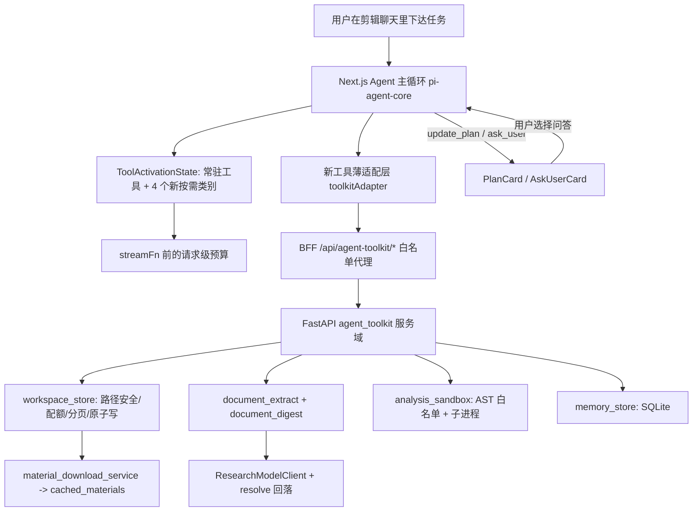

# 剪辑 Agent 通用工具集设计方案（agent-general-toolkit）

- **文档版本**：**v2**（Subtask #1 设计评审后修订，2026-10-08；v1 为 Subtask #0 方案设计）
- **基线**：`HEAD = b0753fd5`（feat: 为剪辑 Agent 补齐通用网络能力），工作区干净（仅 `.baseline-check/`、本目录未跟踪）
- **前置交付**：`docs/plans/agent-general-capabilities/spec.md`（网络/浏览器/研究，已实现并提交）
- **交付边界**：本文件为唯一交付物，**不修改任何源码**，不执行 `git commit`
- **下游节点**：Subtask #1 评审（本次）→ Subtask #2 实现 → Subtask #3 Review 与提交

---

## 评审记录（Review Notes）

评审基线 `b0753fd5`。下表每条都在源码中**实测**过（给出 `file:line` 或命令证据），不是纸面判断。
级别：**P0** = 照方案实施必然失败或造成数据损坏；**P1** = 缺失/冲突，实施中必然返工；**P2** = 表述失准或可接受风险。
本版（v2）已就地修复全部 P0 与 P1（正文已改写，修复落点见末列），P2 已就地修正措辞或明确接受理由。

### 一、P0（2 条，均已修复）

| ID | 维度 | 问题与证据 | 修复落点 |
|---|---|---|---|
| R-01 | 可行性 | §4.1 规定「所有写请求（POST/PUT/DELETE）先过 `validate_ui_origin(request, write=True)`」，而该函数在 `write=True` 时**强制要求 JSON**：`research_run_router.py:62-63` `if write and content-type != application/json: raise WebResearchError("json_required", 415)`。`POST /documents/upload` 是 multipart → **永远 415**，文档摄取整条链路不可用。 | §4.1 拆出 `validate_toolkit_origin(request, *, write, require_json)`，给出端点 × 闸门矩阵；multipart 端点 `require_json=False`（§4.1.1） |
| R-02 | 一致性/正确性 | §5.2 启动清理写「删除 `state != 'active'` 的文档文本/摘要文件」，但 `AgentDocument.state` 的正常值是 **`ready`**（§5.1 定义 `ready|expired|deleted`），只有记忆表用 `active`。照此实现，每次启动都会把**全部正常文档**的 `extracted/`、`digest/` 文件删光，而行仍是 `ready` → `read_document` 立刻 404，且不可恢复。 | §5.2 改为两张表各自的墓碑语义（文档 `ready` 为活体、记忆 `active` 为活体），并新增 AC-27 启动清理单测 |

### 二、P1（21 条，均已修复）

| ID | 维度 | 问题与证据 | 修复落点 |
|---|---|---|---|
| R-03 | 完整性 | 新设置类别缺少登记点：`system_settings_router.py:42-72` 的 `CATEGORY_METADATA` + `_VALID_CATEGORIES` 是静态表，`_validate_category` 对未登记类别直接 404。只改 `system_settings_service.py` + 模型 + YAML（v1 §7.1 的清单）→ 面板 `GET/PUT /system-settings/agent_toolkit` **全部 404**，设置面板打不开、保存不了。 | §2.1 新增基线行；§7.1 增 `system_settings_router.py`（含 label/description 文案） |
| R-04 | 一致性 | 错误信封与仓库既有约定冲突：`ErrorResponse`（`models/base_models.py:33-37`）只有 `success/message/timestamp/data/error_code/error_details`；`failure_class`/`retryable`/`request_id` 是**塞进 `error_details`** 的（`research_run_router.py:37-44`）。v1 §4.1 把 `failure_class`/`retryable` 放在**顶层** → 与 `ErrorResponse` 不兼容，前端既有的 `webResearchStatus.ts` 式解析也会失配。 | §4.1 顶层严格用 `ErrorResponse`，三个字段进 `error_details`（与 research 完全同构） |
| R-05 | 可行性 | v1 暗示复用 `research_run_router.tool_action`（§2.1 同构）。实际该函数第一件事是 `request_run()` → 要求 `x-research-run` + `x-research-token`（`:66-69, :73`），而本方案 §3.8 明确「无 run token」→ 直接复用会让**所有**工具调用 401。 | §3.8 定义本域自己的 `toolkit_tool_guard(request, action)`：设置闸 + `x-tool-call-id`（≤128，`research_run_router.py:81-83` 同判据）+ 幂等，不含 run/lease |
| R-06 | 完整性 | §3.8 错误表不是闭集：`unknown_toolkit_setting`（§5.4 提到）、`setting_out_of_range`（既有惯例，`system_settings_models.py:208/211/215`）、`invalid_offset`/`invalid_page_size`（§3.3.3 声明与 `artifact_store.byte_page` 同源，`:22/24/29`）、`documents_unavailable`、`page_out_of_range`、`binary_file`、`tool_not_loaded` 都没进表 → AC 无法逐条证伪，`agentToolkitStatus.ts` 映射必然漏项。 | §3.8 错误表补全为闭集（标注「复用既有码」） |
| R-07 | 完整性 | `workspace_read` 没有二进制判定。§3.3.1 允许用户上传原件（含 PDF/图片/音视频）进工作区 → 用 UTF-8 读 PDF 会返回满屏乱码并烧掉上下文预算。 | §3.3.3 新增 `binary_file`(415) + `next_step`，并给出判定式 |
| R-08 | 完整性 | 上传原件与文档条目重复：§3.3.1 写 `files/` 收「Agent 写入 + 用户上传原件」，AC-26 又要求 `workspace_list` 给出带 `document_id` 的 `kind:'document'` 条目 → 同一份 PDF 在列表里出现两条、语义冲突，且 `workspace_read` 会读到 PDF 原文（见 R-07）。 | §3.3.1 改为 `files/` 只收 Agent 产物、上传原件落 `uploads/<document_id>.<ext>`；§3.3.3 列表只列 `files/`，文档走独立 `documents` 数组（AC-26 同步改写） |
| R-09 | 完整性 | 配额计量范围未定义：§3.3.3 只写「`sum(file.stat().st_size)`」，没说是哪棵树 → `extracted/`（最大 2M 字符）、`digest/`、`out/` 是否计入不明。不计入则配额可被文档绕过。 | §3.3.3 明确配额 = 项目根下全部文件（四棵树合计），`/usage` 返回 `used_by_kind` |
| R-10 | 完整性 | 长页无续读语义：PDF 单页正文 > `max_chars`（上限 8000）时，§4.1 只回 `next_page` → 该页剩余正文**永久不可达**。 | §4.1/§3.3.4 返回 `next_page` + `next_offset`（页内续读），页越界 → `page_out_of_range` |
| R-11 | 一致性/数值 | 两个上限互相矛盾：文本类页 = 3000 字符/块（§3.3.4），`document_max_chars = 2 000 000` → 667 页，而 `document_max_pages = 200` → 60 万字符以上的文本直接被 `document_too_large` 拒绝，`document_max_chars` 形同虚设。 | §5.4 `document_max_pages` 默认 **800**（范围 1–5000），并注明 800×3000 ≥ 2M |
| R-12 | 一致性/数值 | §3.7 把 L0 prompt 上限从 14 000 上调到 15 500，**算术不够**：本轮新增 `## 当前计划`(≤600) + `## 长期记忆`(≤800) + 2 个常驻工具的完整描述段（`formatCoreToolkit` 逐工具输出 `### name` + description + `formatParamSignature`，实测每条 ≥150 字符）+ `AGENT_TOOLKIT_GUIDANCE` + 4 条 `CATEGORY_USAGE_HINTS` ≈ 2 400–2 600 字符。且 14 000 这个数是**被测试钉住的**：`systemPrompt.ts:345`、`:476` 两处注释 + `__tests__/systemPrompt.test.ts:154,162,186,197` + `__tests__/agent.systemPrompt.test.ts:91,122` 共 6 处，v1 §7.2/§8 只提到「更新该注释」→ 实施后 AC-24 必红。 | §3.7 上调至 **17 000** 并给出逐项预算表；§7.3/§8 列出 6 处待改点（新增 AC-28 实测断言） |
| R-13 | 可行性 | 素材入库「复用 `_store_research` 提交路径」不成立：`material_download_service.py:497-501` 的扩展白名单只有 `png,jpg,mp4,webm,mp3,wav,m4a`，而 §3.3.3 的导入白名单含 `mov/mkv/aac/jpeg/webp/gif/svg` → 必抛 `unsupported_media_type`；`_commit_research`（`:527-556`）硬编码 `source="web"`、`source_id="web-"+digest`、`source_url=url`，工作区文件**没有 url**。 | §3.3.3 改为参数化 `_commit_research(..., source, source_id)`（默认值保持 web 行为不变）+ `store_workspace_file_async` 传 `source='workspace'`、`source_url=None`，`local_url` 按 CLAUDE.md 规则拼 |
| R-14 | 可行性 | 验收命令会「静默通过」：`npx vitest run tests/integration/agent-toolkit.test.ts` 用的是 `vitest.config.ts`，其 `include` 只有 `src/**/*.test.ts(x)` 且 `exclude` 含 `tests/integration/**`（`vitest.config.ts:36,40`）→ **0 个用例执行、退出码 0**。 | §8 改为 `npx vitest run --config vitest.integration.config.ts …`（或 `npm run test:integration`），并加 AC-29「集成用例数 > 0」 |
| R-15 | 完整性/幂等 | `ask_user.question_id` 用随机 `q-<8hex>`：本仓库已知类风险是 SSE 自动重试重跑同一轮（历史发现 R1-AG-01）。重跑产生**新的** id → 旧卡片永远停在 `awaiting`，`[[ask:<id>]]` 指向已消失的问题。 | §3.5.2 改为确定性 id：`'q-' + sha256(question + options.join('\|'))[:8]`；`plan_id` 同理由 steps 哈希 |
| R-16 | 完整性 | `ask_user` 可能产生无法回答的问题：`options`（可选）与 `allow_free_text`（可选）都缺省时用户无路可答。 | §3.5.2 强制「二者至少一个」，否则 `invalid_argument` |
| R-17 | 安全/正确性 | `memory_search` 用 `LIKE '%q%'` 未转义 → 查 `%` 命中全部记忆、查 `_` 语义漂移，且可被用来低成本枚举全库。 | §3.6 增加 `%`/`_`/`\` 转义 + `ESCAPE '\'` + 控制字符拒绝 |
| R-18 | 完整性 | `scope='global'` 的记忆没有 `project_id`，而容量、去重、淘汰全部按「项目」定义（§3.6）→ 全局记忆无上限增长。 | §3.6 定义全局桶：独立计数、同额度、去重键 `(scope, text_hash)` |
| R-19 | 完整性 | `/capabilities` 未暴露任何 limit 值，但 §6.3 前端预检需要 `max_file_mb`、`accept` 需要 `documents.formats` → 预检无从实现。 | §4.1 `/capabilities` 增加 `limits` 子对象（仅前端所需项） |
| R-20 | 完整性 | `x-tool-call-id` 的必带范围自相矛盾：§4.1「工具来源请求必须带」，AC-19「工具端点缺 header 时 400」，但没说是哪些端点、也没说用户动作端点（上传/下载）是否要。 | §4.1.1 给出端点 × 闸门矩阵 |
| R-21 | 可行性 | §4.4 的 multipart「流式直通」缺实现契约：Node/undici 的 `fetch` 传流式请求体必须 `duplex:'half'`，否则直接抛错；且 `content-length` 可能缺失（chunked）→「`content-length > 128 MiB` 时 413」可被绕过。 | §4.4 写明 `duplex:'half'` + 流式计数超限中断（不依赖 header） |
| R-22 | 一致性 | 工具短名映射与既有惯例不符：网络工具走独立映射 `webResearch.tools`（`i18n.ts` 接口 :132 / en :3430 / zh-CN :6816），`agentTimeline.toolNames`（:1287 / :4369 / :7755，28 项）只覆盖剪辑工具。v1 要求往 `agentTimeline.toolNames` 加 12 项。 | §6.2/§7.2 改为新增 `agentToolkit.tools`（12 项），`toolNames` 不动 |
| R-23 | 完整性 | `AskUserCard` 的 `answered` 态需要「该问题之后是否存在对应回答」的信息，v1 只说「由 `VideoChatWindow` 计算并作为 prop 传入」，但分发点在 `AgentToolCallCard.tsx:104` 与 `timeline/AgentExecutionNode.tsx:134-136` 两级，两者都只吃 `toolCall` → 实现时无 prop 可用。 | §6.2 明确 `answeredQuestionIds` 的 prop 链路（含两处分发点签名） |

### 三、P2（10 条，已就地修正措辞或明确接受）

| ID | 维度 | 说明与处置 |
|---|---|---|
| R-24 | 一致性 | §2.1 若干 `file:line` 失准，已按实测改正：`agent.ts:129-134`→**130-133** 且实参是 `registry.getAlwaysAvailableTools().map(...)`；`src/types/index.ts:63-106`→**63-92**（`ChatMessage`）+ **94-106**（`AgentToolCallRecord`）；`VideoChatWindow.tsx` 表单实际 **322-390**（非 296-392）；`main.py` 实为 **35** 个 `include_router`（非 31，`CLAUDE.md:81` 亦旧）；`artifact_store` 的 2 MiB 在 **80-81**；`validate_setting_payload` 签名 `(category, key, value)`；`resolve_research_config` 缺配置抛 **`provider_not_configured`**（非 `configuration_invalid`）；`YAML_TO_DB_MAPPING` 有 **7** 个文件条目（非「单条映射」）。 |
| R-25 | 一致性 | v1「新类别描述必须 ≤160 字节，否则目录被截断」不成立：`ToolCategory.description` 无任何长度钳制（`ToolRegistry.ts:58-60` 原样存储）。180 字节是 `exploreTools.ts:76` 对**工具描述**的 `utf8Slice`，8 000 字节结果上限的做法是把工具**弹出**到 `truncated_tools` 并 `activation.unload()`（`:78-88`）。§3.2 已改写为真实机制。 |
| R-26 | 一致性 | 「复用同一策略常量」不成立：`webToolAdapter.ts:28` 的 12 KiB 是内联字面量，没有导出常量。§3.7/§7.2 改为「从 `webToolAdapter` 导出 `RESULT_BYTE_CAP`，两处共用」，避免第三份拷贝。 |
| R-27 | 一致性 | 语言标识实为 `en` / **`zh-CN`**（`i18n.ts:3299/6686`，非 `zh`）；且**不存在** en/zh 键集合一致性测试（现有 a11y 测试只按 key 做正则断言）→ AC-22 需要**新增**测试，§7.3 的 `i18nAgentToolkit.test.ts` 保留并明确其职责。 |
| R-28 | 完整性 | `workspace_write` 另有 2 MiB 硬上限（与 `artifact_store.py:80-81` 同口径），而 `max_file_mb=32` → 已在 §5.4 注明「写入类受 2 MiB 上限约束，上传类受 `max_file_mb`」。 |
| R-29 | 完整性 | 总开关语义补全：`enabled=false` 关闭的是 4 个**后端**能力；`update_plan`/`ask_user` 是纯前端工具，不随之关闭（§5.4 已注明）。 |
| R-30 | 完整性 | `toolkit_calls` 幂等表是**进程内** TTL 字典，不是表（§5.2 无对应表）→ 重启后同一次调用可能重放。已在 §3.8 明示：写操作因此必须自身安全（`overwrite=false` 的重放返回 `invalid_argument`；`analysis/run` 重放只是重算）。 |
| R-31 | 可行性 | 沙箱运行时的三处修正（实测打包运行时）：① `sys.executable` 指向 `resources/python/python.exe`（CPython 3.11.9 embeddable，`desktop/main/backendService.js:34-35`），可执行 → 方案可行；② `-I` 隐含 `-E -s`，会**忽略** `PYTHONIOENCODING`，且脚本目录不入 `sys.path` → 前导必须**内联拼接**进同一脚本，不能 `import` 相邻文件；桌面端 spawner 用的是 `-X utf8`，故改为 `-X utf8`；③ 只有墙钟超时，无内存/rlimit → 风险写入面板（§3.4/§10 R14）。 |
| R-32 | 完整性 | 沙箱产物（`out/<call_id>/`）不会自动进素材库，必须显式 `workspace_import_material` → §3.4 补一句。 |
| R-33 | 完整性 | AC-05 的数字口径混用「≈6.4 KiB 估算」与「≤12 KiB 断言」→ 改为一条实测断言（≤8 KiB）+ 一条 explore_tools 结果断言（≤8 000 字节且 `truncated_tools` 为空）。 |

### 四、按维度的小结

| 维度 | 结论 | 依据 |
|---|---|---|
| 可行性 | **通过（修正 2 条 P0 后）** | 所有落点都挂在既有管道上（registry/activation/budget/settings/ErrorResponse）；两条 P0 都是「按现有函数签名照抄会失败」，不是方向错误 |
| 完整性 | **通过（补 21 条 P1 后）** | 边界补齐：二进制读、长页续读、配额范围、上传原件与文档条目去重、全局记忆容量、幂等重放、multipart 体积、端点闸门矩阵、错误码闭集、L0 预算算术 |
| 一致性 | **通过** | 与 `CLAUDE.md` 的 ErrorResponse/无 auth/无破坏性 DDL/无新枚举约定全部对齐；与 `web-research` 域的服务形态、i18n 结构、测试组织对齐（修正 4 处惯例偏差：错误信封、工具短名映射、`validate_ui_origin` 复用、`_commit_research` 复用） |
| 规模适当性 | **通过，但要求分批** | 6 能力/18 端点/12 工具/21 后端 + 31 前端文件属于「一轮做完风险偏高」，建议按 §8.1 四个可独立提交的批次落地；不建议删减能力（删任何一项都会让 §2.2 的缺口重新出现） |

---

## 1. 概述

上一轮把"检索信息"补齐了：Agent 现在能搜索、抓取、用受控浏览器读动态页、下载网络图片与音视频，并把结果整合成带来源的研究报告。但补完"获取"之后，Agent 的**通用工作能力**仍是空的：它不能在本地留下任何中间产物（写提纲、存数据集、生成图表、保存拆解出的文案），不能读用户手里的 PDF/剧本文档，不能做任何计算或表格处理，不能把多步任务显式规划出来，不能在关键分叉处停下来问一句，也不记得上一轮已经确认过的风格偏好。结果是：所有需要"先整理、再落成、后剪辑"的任务，都退化成把大段文本塞进对话，既撑爆上下文，也无法复用。

本轮交付一个**通用工具集（Agent Toolkit）**，把 Agent 从"会调剪辑 API 的机器人"升级为"有工作台的通用助手"：一个按项目隔离的本地工作区（读/写/列/删/导入素材）、一个文档摄取通道（PDF/DOCX/纯文本/CSV/字幕 → 分页文本 + 分层摘要）、一个可选的离线计算沙箱（纯 Python 计算与表格/图表产物）、一个显式执行计划（`update_plan`，界面可见）、一个人工确认点（`ask_user`，不引入恢复协议）、一份可检索可删除的长期记忆。所有能力都沿用上一轮已验证的三条边界纪律：**渐进式披露**（新类别默认不可调用，须 `explore_tools` 加载）、**字节级预算**（工具结果、注入块、历史压缩三层都有硬上限）、**优雅降级**（任何一项不可用只影响该工具，剪辑主路径照常）。

设计同时刻意回避上一轮踩过的坑：不新增 Chromium、不新增引擎、不引入需要前后端状态同步的中断-恢复协议、不把"计划"和"记忆"写成第二套持久化真相。计划与询问都只基于已有的 `AgentToolCallRecord` 与 `ChatMessage` 派生，记忆与文档落 SQLite + 工作区文件，重启后仍可用，且用户可在设置中心逐条删除。大模型/小模型的分工不新增枚举：文档摘要复用 `web_research` 已有的成组回落解析（fast → chat），设置面板只暴露"文档整理用哪个档位"。

---

## 2. 现状基线、缺口与取舍

### 2.1 已核实事实（HEAD = b0753fd5）

| 位置 / 符号 | 现状（实测） | 对本设计的含义 |
|---|---|---|
| `src/lib/video-editing-agent/agent.ts:82` `createVideoEditingAgent` | 构造 Model → 克隆时间线 → `ToolContext` → `createToolRegistry` → `ToolActivationState` → `buildAllAgentTools` → history 压缩 → system prompt → `new Agent` | 新工具只需进 registry 与 prompt，不改引擎 |
| `agent.ts:130-133` | `new ToolActivationState(registry, [...registry.getAlwaysAvailableTools().map(tool => tool.name), ...CORE_TOOLKIT_TOOL_NAMES, 'explore_tools'])` | 常驻工具 = 常驻类别工具 ∪ `CORE_TOOLKIT_TOOL_NAMES`；后者是**唯一**能把按需类别里的单个工具提成常驻的机制 |
| `promptParts.ts:34-56` `CORE_TOOLKIT_TOOL_NAMES` | 15 个工具名，被 `agent.ts:132`（执行授权）与 `systemPrompt.ts:303`（`formatCoreToolkit` 逐工具渲染 `### name` + description + 参数签名）双消费 | 加 2 个常驻工具 = L0 prompt 增加 2 段 `### name` 段落（这是 §3.7 预算上调的真实来源） |
| `agent.ts:179` / `tools/index.ts:453` | 模型调用上限 40、工具调用上限 80（均为内联字面量，无命名常量） | 新工具不额外加循环；`ask_user` 需自己的单轮限一次 |
| `agent.ts:140` `compactHistoryForModel` + `historyBudget.ts:21,37,40-45` | `HISTORY_CHAR_BUDGET = 120_000`、`RECENT_TURNS_KEPT_VERBATIM = 2`、`STALE_SNAPSHOT_TOOLS`（4 个快照工具）省略旧结果 | 计划/记忆注入与旧计划结果需纳入同一预算体系 |
| `tools/index.ts:353` `createToolRegistry` | 12 个类别（`createDefaultCategories()` 全量注册），其中 `alwaysAvailable` 的只有 `query_tools` 4 个 + `editing_tools` 6 个 = 10 个工具 | 新增 5 个类别照此模式；常驻类别会与 `CORE_TOOLKIT_TOOL_NAMES` 合并去重 |
| `registry/ToolActivationState.ts:4,9,47` | `SCHEMA_LIMIT = 48 * 1024`（只管**按需** schema）、`ON_DEMAND_MIN_BYTES = 8 * 1024`；`agent.ts:187-197` 每请求用 `activation.offer()` 过滤 `context.tools` | 「未加载类别不发送 schema」成立（v1 判断正确）；额度按 tokens→bytes 现算，不要写成固定 48 KiB 预留 |
| `registry/categories.ts:39-50` `ON_DEMAND_CATEGORY_IDS` | 10 个按需类别 | 新类别必须列入，否则 `explore_tools` 参数枚举不认 |
| `tools/exploreTools.ts:9-19,66-95` | `{category, tool_names(1..4)}`；工具**描述**按 `utf8Slice(…,180)` 截断（`:76`），结果 JSON 超 8 000 字节时把工具**弹出**到 `truncated_tools` 并 `activation.unload()`（`:78-88`） | 类别 `description` 本身**无**长度钳制（`ToolRegistry.ts:58-60`）；8 000 字节上限的后果是「工具消失」而不是「目录被截断」 |
| `tools/webToolAdapter.ts:25-41` | 12 KiB 上限是**内联字面量**（`:28`），无命名常量；超限转 `compactResearchReference(…,4000)` + `next_step` | 新适配层要「同口径」必须先把 12 KiB 提成导出常量（否则是第二份魔数） |
| `modelContextBudget.ts:137` `budgetModelContext` / `:54` `utf8Slice` / `:75` `BYTES_PER_TOKEN = 2` | 每次请求前同步判定预算，超限本地终态 | 工具结果字节上限必须与它同口径 |
| `src/lib/video-editing-agent/types.ts:9-43` `ToolContext` | `researchRun? / timelineState / materials / apiBaseUrl / projectId / abortSignal / operations / updateTimeline / recordOperation` | 需加「本轮状态」（计划、已问过的提问） |
| `types.ts:199-232` `SSEEvent` | `agent_end` **无载荷**（`:204`）；`tool_result` 带 `details` | 不改协议也能承载计划与提问（见 §3.5） |
| `src/types/index.ts:63-92` `ChatMessage` / `:94-106` `AgentToolCallRecord` | 工具记录 `{id, name, params: Record<string,unknown>, status: 'executing'\|'completed'\|'error'\|'undone'\|'cancelled', result?, changedTimeline?}` 已持久化 | 计划与提问**不新增字段**，从记录派生；`id` 可作确定性 id 的种子 |
| `B/app/services/system_settings_service.py:49-75,70-183,234,507` | `RESEARCH_DEFAULTS`、`research_settings()`、`YAML_TO_DB_MAPPING`（**7** 个文件条目，web 在 `:71-75` → `web-research-config.yaml` / 根键 `web_research`）、`get_category()`、`sync_to_settings_key()` | 新增 `AGENT_TOOLKIT_DEFAULTS` 同构；YAML 文件名照 `web-research-config.yaml`  hyphen 风格 |
| `B/app/models/system_settings_models.py:186-231` | `validate_setting_payload(category: str, key: str, value: Any) -> None`；`web_research` 分支逐键校验，未知键 `unknown_research_setting`（`:219`）、越界/枚举非法统一 `setting_out_of_range`（`:208/211/215`） | `agent_toolkit` 复制同一形状，**并复用** `setting_out_of_range` |
| `B/app/routers/system_settings_router.py:42-72,75-82` | 静态 `CATEGORY_METADATA` + `_VALID_CATEGORIES`；`_validate_category` 未登记即 404 | **新增类别必须在此登记**，否则面板 404（v1 漏项 R-03） |
| `B/app/routers/research_run_router.py:37-50,53-63,66-88` | `error_details()` 把 `failure_class`/`retryable`/`request_id` 放进 `error_details`；`validate_ui_origin(write=True)` 额外强制 `application/json`（`:62-63`）；`tool_action()` 先 `request_run()` 要 run token（`:66-69,73`），再校验 `x-tool-call-id` ≤128（`:81-83`） | 三处都不能照抄：信封按 `ErrorResponse`、multipart 端点要放开 JSON 断言、本域无 run token（§3.8 / §4.1） |
| `B/app/models/base_models.py:10-37` | `BaseResponse{success,message,timestamp,data}`；`ErrorResponse` **只多** `error_code` / `error_details` | 不得给错误体加顶层字段（R-04） |
| `B/app/services/web_research/artifact_store.py:20-32,:37-39,:80-81` | `byte_page(body, offset, max_bytes)`（`invalid_offset`/`invalid_page_size`）、根目录 `Path(settings.storage.root).resolve().parent / "research_artifacts"`、内联 2 MiB 上限 | 工作区读/写直接对齐（工作区根同为 storage 父目录） |
| `B/app/services/material_download_service.py:465-467,497-509,527-556` | `store_research_download_async(path, digest, extension, url)`；`_store_research` 白名单仅 `png,jpg,mp4,webm,mp3,wav,m4a`（`:500`）；`_commit_research` 硬编码 `source="web"`、`source_id="web-"+digest`、`source_url=url` | 「复用提交路径」必须先把它参数化（R-13） |
| `B/app/services/model_settings_service.py:700-726` | `async def resolve_research_config(self)`；stages `research_llm → fast_llm → llm`；缺配置抛 `provider_not_configured`，组内缺项/类型错抛 `configuration_invalid` | 文档摘要模型直接复用；`fast` 档需要一个平行的 `resolve_toolkit_digest_config()` |
| `B/app/models/model_settings_models.py:14-21` | `ModelFunctionType = CHAT\|FAST\|RESEARCH\|VIDEO_CUT\|VISION\|CODING`（6 个，与前端 `FunctionType` 一一对应） | 不新增枚举（§2.4） |
| `B/app/database.py:180-191` `init_db` | `create_all` 前只有 `research_db_models` 一行显式 import（`:182-183`）；其他模型模块**不在**此处 import | 两张新表要加 import |
| `B/requirements.txt`（60 行，`==` 为主、尾部混用 `>=`/裸名） | 已有 bs4/playwright/numpy/Pillow/yt-dlp；**没有** PDF/DOCX 解析库 | 需 +`pypdf`、+`python-docx`（打包由 `prepare-backend.js:137-140` 全量 `pip install -r` 覆盖，无需改打包脚本） |
| `B/app/main.py` | **35** 个 `include_router`（`:529…:750`）；research 系列 `prefix="/api"`（`:680,683,684`）；`@app.exception_handler(WebResearchError)`（`:687-689`）→ `error_response(exc)` | 新域照此注册 router + 异常处理器 |
| `B/config/` | 12 个 yaml；web 研究是 `web-research-config.yaml`（根键 `web_research`） | 新文件 `agent-toolkit-config.yaml` 命名一致 |
| `src/components/settings/SettingsSidebar.tsx:6-14,39-137` | 菜单联合类型 8 个 id；分组 id `app` / **`ai`**（`:58`）/ `media`；`ai` 组首项是 `webResearch`（`:61-66`） | 新面板 3 处改动（联合类型、分组条目、页面分发） |
| `src/components/settings/SettingsPage.tsx:47-68` | `switch (activeItem)`；`webResearch` 分支在 `:54` 传 `onOpenModels={() => setActiveItem('model')}` | 新面板照此注入 `onOpenModels` |
| `src/components/settings/ModelSettingsPanel.tsx:48,118,224-231,603` | `FunctionType = 'chat'\|'fast'\|'video_cut'\|'vision'\|'coding'\|'research'`；标签为穷尽 `Record`；`:603` 派发 `ecliptrix-llm-config-updated` | **本轮不新增枚举**，避免 9 处联动改动 |
| `src/lib/i18n.ts:5,3298-3299,6686,10077` | `Translations` 接口 + `en` / **`zh-CN`** 两份记录，共 **10 077** 行 | 新命名空间 `agentToolkit` 双语同批提交 |
| `src/lib/video-editing-agent/systemPrompt.ts:345,476` + `__tests__/systemPrompt.test.ts:154,162,186,197` + `__tests__/agent.systemPrompt.test.ts:91,122` | L0 prompt 的 14 000 字符上限**只写在注释与 6 处测试断言里**，运行时并不强制（`buildSystemPrompt` 原样 `join`） | 调上限必须同时改注释与 6 处断言（R-12） |
| `src/lib/video-editing-agent/systemPrompt.ts:348,354` | `APPENDIX_BLOCK_CHAR_CEILING = 2400`、`APPENDIX_TOTAL_CHAR_CEILING = 3200` | §3.7 的「附录 ≤3200」口径正确 |
| `vitest.config.ts:36,40` / `vitest.integration.config.ts:24` | 单测 `include: ['src/**/*.test.ts','src/**/*.test.tsx']` 且 `exclude` 含 `tests/integration/**`；集成测试另用 `vitest.integration.config.ts` | 集成用例必须用 `--config vitest.integration.config.ts`，否则 0 用例静默通过（R-14） |
| `desktop/main/backendService.js:34-35,44,78-79` | 后端由 `resources/python/python.exe`（CPython 3.11.9 embeddable）以 `-B -X utf8` 启动，`STORAGE_ROOT=<userData>/storage`，`cwd=<userData>` | 沙箱 `sys.executable` 可用；`-I` 会忽略 `PYTHONIOENCODING`（R-31） |
| `desktop/preload/preload.js:14-21` | 仅暴露窗口控制，无 `shell.openPath` | 工作区**不做**"在资源管理器打开"；改为展示路径 + 单文件下载 |


### 2.2 缺口分析（为什么是这六项）

| 需求原话 | 现状 | 本方案的落点 |
|---|---|---|
| "检索信息、下载信息、整合信息" | 检索/下载已有；"整合"只能发生在对话里 | 工作区（落盘中间产物）+ 文档摄取 + 计算沙箱 |
| "不要让 Agent 后续的上下文爆掉" | schema 与单条工具结果有上限，但**大文档**与**大表格**没有分页纪律 | 文档分页 + 分层摘要 + 工作区字节分页 + 计划/记忆注入上限 |
| "Agent 的常规能力" | 无计划、无澄清、无记忆、无文件 | `update_plan` / `ask_user` / 长期记忆 / 工作区 |
| "大小模型结合要能配置" | 已有 `research` 功能分配 | 文档摘要档位 `fast|research` 设置项，复用现有 功能分配 槽位 |
| "要具有通用性" | 工具全部绑定视频语义 | 工作区/文档/分析/计划/询问/记忆六类均与视频无关；视频只通过 `workspace_import_material` 单向接入 |

### 2.3 AragonAgent 参考范围（只借机制）

| 机制 | 本方案落点 |
|---|---|
| 工具目录 → 按名加载 → 按需文件（三级披露） | 类别目录（L0）+ `explore_tools`（L1）+ 工作区/文档分页（L2/L3） |
| 一切预算按 UTF-8 字节 | `workspace_read.max_bytes`、`TOOLKIT_RESULT_BYTE_CAP`、注入块字符上限均按字节/显式字符计 |
| 工具执行上下文（signal / 进度 / 超时 / 输出截断） | 分析沙箱：`asyncio.wait_for` + `kill()` + stdout/stderr 双截断 |
| 上下文管理器与引擎解耦 | 计划摘要、记忆摘要、历史压缩都发生在 `streamFn` 之前的同步判定里 |
| 快模型档（小模型做整理） | 文档分层摘要走 `fast`（可切 `research`），主模型只读摘要 + 按页精读 |

不迁移：引擎、CLI、子代理、技能盘。**明确不引入子代理**——pi-agent-core 单循环 + 80 次工具上限已足够，子代理会让撤销/取消语义复杂化，收益不成立。

### 2.4 取舍表

| 备选 | 判断 |
|---|---|
| 让 Agent 直接读写用户磁盘任意路径 | 危险且无法验收 → 否决；只允许项目工作区 + 上传文档 |
| 用向量库做记忆检索 | 无 embedding 配置、无收益（单项目记忆 ≤200 条）→ 否决；SQL `LIKE` + 时间/命中排序 |
| `ask_user` 用"中断-恢复"协议（挂起 SSE、服务端保留 run） | 需新协议 + 重启恢复 + 超时语义，风险高 → 否决；见 §3.5 的确定性两阶段语义 |
| 计划落 DB 表 | 与 `ChatMessage` 重复真相 → 否决；从工具记录派生 |
| 分析沙箱安装在 Docker/WSL | 桌面产品不能要求用户装 Docker → 否决；进程级隔离 + AST 白名单 + 默认关闭 |
| 新增 `analysis`/`planner` 模型枚举 | 9 处联动 + 迁移风险，用户收益仅"多一个下拉框"→ 否决；复用 fast/research |
| **工作区 + 文档 + 可选沙箱 + 计划 + 询问 + 记忆，全部挂在既有 registry/预算/设置管道** | 选定 |

---

## 3. 技术设计

### 3.1 分层与主流程



一次典型任务（"做个 60 秒AI资讯视频"）的操作序列：

1. 主模型判断步骤 ≥3，调用 `update_plan`（常驻，无需 explore）。
2. `explore_tools({category:'workspace_tools'})` → `workspace_write` / `workspace_list` 可用（下一响应起）；需要文档时再 `explore_tools({category:'document_tools'})`。
3. 用户点输入区「添加文档」选一份 PDF 新闻稿 → 前端调 `POST /api/agent-toolkit/documents/upload`（用户动作，不经模型）→ 得 `document_id` 并自动发送 `[[doc:<id>]] <name>`。
4. `read_document({document_id, page:1})` → 4000 字符页 + `next_page`；若文档 > 60k 字符，服务端已生成分层摘要，首页返回 `digest` 片段。
5. `workspace_write({name:'script/outline.md', content})` 落盘；长文不再进对话。
6. 需要估算时长/配比 → `run_analysis({code})`（若用户在设置里开启）→ 得 stdout + `out/table.csv`。
7. `workspace_import_material({name:'out/chart.svg'})` 之类媒体文件入素材库 → `add_to_track` 照旧。
8. 关键分叉（"要不要真人配音"）→ `ask_user` → 本回合结束，用户点选后作为普通用户消息继续。
9. 收尾 `update_plan` 全部 completed；`memory_write` 记住"资讯视频默认 16:9 + 男声解说"。

### 3.2 工具渐进式披露 v2

**常驻 2 个**（进 `CORE_TOOLKIT_TOOL_NAMES`，schema 直接进 L0 prompt；两者参数合计约 14 行）：

- `update_plan`：任何多步任务都需要，按需加载会浪费整整一个回合。
- `ask_user`：澄清必须是零延迟的，否则模型宁可猜。

**新增 1 个常驻类别 + 4 个按需类别**（合计 5 个类别、12 个工具；类别总数 12 → 17）。

常驻类别 `workflow_tools`（`alwaysAvailable: true`）承载 `update_plan` 与 `ask_user`，与既有 `query_tools` / `editing_tools` 同级——常驻类别不进 `ON_DEMAND_CATEGORY_IDS`，因此也不会出现在 `explore_tools` 的 `category` 枚举里。

**4 个按需类别**（`alwaysAvailable: false`，必须 `explore_tools` 加载）：

| 类别 id | 名称 | 工具 | 目录描述（≤160 字节） |
|---|---|---|---|
| `workspace_tools` | 工作区 | `workspace_list` `workspace_read` `workspace_write` `workspace_delete` `workspace_import_material` | Save/read project files; import local media into the material library. |
| `document_tools` | 文档 | `read_document` | Read uploaded PDF/DOCX/text/CSV/subtitle documents page by page. |
| `analysis_tools` | 计算分析 | `run_analysis` | Run offline Python for arithmetic, tables and generated files. Requires opt-in. |
| `memory_tools` | 长期记忆 | `memory_write` `memory_search` `memory_forget` | Store and retrieve durable notes for this project. |

`update_plan` 与 `ask_user` 不再单独建 `plan_tools`/`interaction_tools` 两个类别：两者同属常驻类别 `workflow_tools`，一个类别一次加载、一段 prompt 描述，减少类别目录条目。

**schema 预算**：按需类别未加载时其 schema 不随请求发送（`agent.ts:187-197` 每请求用 `activation.offer()` 过滤 `context.tools`，v1 判断经实测成立）。`ToolActivationState.setSchemaBudget` 的 48 KiB 只约束**按需**额度（`SCHEMA_LIMIT = 48 * 1024`，`:4`），另保底 `ON_DEMAND_MIN_BYTES = 8 * 1024`。新增 12 个工具即使全部加载，schema 合计 ≈ 6.4 KiB（实现时以 `toolActivation.test.ts` 实测为准），不触碰上限。

**常驻类别与 `CORE_TOOLKIT_TOOL_NAMES` 的关系**：`workflow_tools` 若设 `alwaysAvailable: true`，其 2 个工具会经 `registry.getAlwaysAvailableTools()` 自动进入常驻集合；同时把两个名字加进 `CORE_TOOLKIT_TOOL_NAMES` 的目的是让 `formatCoreToolkit`（`systemPrompt.ts:303`）为它们渲染完整描述段与参数签名（否则模型只知道「有这个类别」而不知道参数）。两者不冲突（集合去重），但**必须加一条测试断言**：`update_plan` / `ask_user` 的 `### name` 段在 L0 prompt 中各出现**恰好一次**。

**`explore_tools` 结果上限**（8 000 字节）的真实机制：工具**描述**先被 `utf8Slice(…, 180)` 截断（`exploreTools.ts:76`），若结果 JSON 仍超 8 000 字节，则把末尾工具**弹出**到 `truncated_tools` 并 `activation.unload()`（`:78-88`）——后果是「工具消失」而不是「目录被截断」。类别 `description` 本身没有长度钳制，但为让 L0 类别目录保持一行可读，本方案仍要求 ≤160 字节（这是**风格约束**，不是运行时限制）。实现必须按 `JSON.stringify` 实测校验（AC-05）。

### 3.3 工作区与文档

#### 3.3.1 存储布局

```
<STORAGE_ROOT 的父目录>/agent_workspace/          # 与 research_artifacts 同级，绝不落在 static/ 下
  global/                                        # 无项目上下文时（结构同上）
  project-<sha256(project_id)[:12]>/
    files/<relative name>                        # 只放 Agent 写入的产物（write 白名单）
    uploads/<document_id>.<ext>                  # 用户上传的文档原件（保真，供重解析/审计）
    extracted/<document_id>.txt                  # 抽取后的纯文本（UTF-8）
    digest/<document_id>.json                    # 分层摘要
    out/<call_id>/<file>                         # 一次分析的产物目录
```

- 根目录由 `workspace_root()` 计算：`Path(settings.storage.root).resolve().parent / "agent_workspace"`（与 `artifact_store.py:37-39` 完全同构；桌面端 `settings.storage.root = <userData>/storage`，故工作区落在 `<userData>/agent_workspace`）。
- `<project_id>` 先做 `^[A-Za-z0-9_-]{1,64}$` 校验，再哈希成目录名；**目录名不含用户输入**。`project_id` 为空/缺省 → `global`。
- 工作区根**不做静态挂载**，只能通过 `/api/agent-toolkit/*` 读取（与 `research_artifacts` 同级隐私策略）。
- **上传原件与 `files/` 分离**（v2 修正 R-08）：`files/` 只承载 Agent 经 `workspace_write` 写入的文本类产物，扩展名受 §3.3.2 白名单约束；用户上传的 PDF/DOCX 等原件落 `uploads/`，**不参与** `workspace_list` 的文件列表（它以 `documents` 数组出现，带 `document_id`）。这样既避免同一文件在列表里出现两次，也避免 `workspace_read` 读到 PDF 二进制。


#### 3.3.2 路径安全（`workspace_store.safe_relative_name`）

必须按顺序完成，任一不通过抛 `invalid_workspace_name`：

1. 类型 `str`，长度 1..180，禁止 `\x00-\x1f`、`<>:"\\|?*`。
2. 统一 `/`，禁止以 `/` 开头、结尾或以 `//` 出现空段。
3. 段数 ≤ 5，每段匹配 `^[A-Za-z0-9][A-Za-z0-9._-]{0,60}$`。
4. 段名不得为 `.`/`..`，不得以 `.` 结尾（Windows），不得是保留名（CON PRN AUX NUL COM1-9 LPT1-9，含带扩展名形式）。
5. 拼接后用 `Path.resolve()` 复核 `is_relative_to(root)`；再复核 `os.path.realpath` 结果同样在根内（防符号链接/junction 逃逸）。
6. 拒绝 `\\?\`、`\\.\`、`//server/share` 形式的 UNC/设备路径，以及含 `~` 的 8.3 短名段（`progra~1` 类）；判据：段匹配 `^[A-Za-z0-9][A-Za-z0-9._-]{0,60}$` 已同时排除 `\` 与 `~`，但**仍须**在解析后再比对一次 `realpath`，因为 Windows 8.3 别名可能由文件系统生成。
7. 扩展名白名单（写入）：`.md .txt .csv .tsv .json .srt .vtt .svg .html .py .yaml .yml .xml`；媒体扩展名只允许**导入**不允许写入（避免 Agent 手写伪造 mp4）。

#### 3.3.3 配额、原子写与分页

**配额计量范围**（v2 修正 R-09）：`used_bytes` = 项目根下 **全部** 普通文件之和（`files/` + `uploads/` + `extracted/` + `digest/` + `out/`）。只统计某一棵树会让文档抽取文本（单文档上限 2 M 字符）与沙箱产物绕过配额。`/usage` 与 `/capabilities` 额外返回 `used_by_kind`（五棵树分项），面板据此显示。

- 写前统计 `used_bytes + len(body)`，超过 `workspace_quota_mb` → `workspace_quota_exceeded`（507），**且不写入任何字节**。
- 单文件上限 `max_file_mb` → `workspace_file_too_large`（413）；`workspace_write` 另有 `MAX_WRITE_BODY_BYTES = 2 MiB` 硬上限（与 `artifact_store.py:80-81` 同口径）——这是**写入类**的实际上限，`max_file_mb` 主要约束上传类。
- 写入流程：`<name>.tmp-<uuid>` → `os.replace()`；`overwrite=false` 且已存在 → `invalid_argument`（不静默覆盖）；`os.replace` 抛错时删除临时文件（不留 `.tmp-*` 残留）。
- 读：分页函数在 `workspace_store.py` 内实现 `byte_page(body, offset, max_bytes)`，行为与 `web_research/artifact_store.py:20-32` 完全一致（UTF-8 边界安全、`invalid_offset` / `invalid_page_size`），并在 docstring 注明"与 artifact_store.byte_page 同源，测试用同一组向量"——**不跨域 import**（避免工作区模块连带加载研究域的 DB 单例），这是该纯函数的第二份拷贝，第三份出现时必须抽公共模块。默认 4000、上限 8000 字节；返回 `{content, next_offset, total_bytes, truncated, encoding}`。
- **二进制拒绝**（v2 修正 R-07）：`workspace_read` 在解码前先判定二进制——命中任一条件即返回 `binary_file`（415）+ `next_step`：① 前 8 KiB 含 `\x00`；② 严格 UTF-8 解码失败且 `errors='strict'` 抛错；③ 扩展名 ∈ 媒体集合。`next_step` 按扩展名分流：文档类 → `'Use read_document with a document_id.'`，媒体类 → `'Use workspace_import_material to put it in the material library.'`。响应里**不返回**任何二进制片段。
- 导入素材（`workspace_import_material`）：仅接受媒体扩展名 `.mp4 .mov .webm .mkv .mp3 .wav .m4a .aac .png .jpg .jpeg .webp .gif .svg`；其他扩展名 → `invalid_argument`（400）并列出 `supported`。**不得**直接复用 `store_research_download_async`：`_store_research` 的扩展白名单只有 `png,jpg,mp4,webm,mp3,wav,m4a`（`material_download_service.py:500`），且 `_commit_research`（`:527-556`）硬编码 `source="web"`、`source_id="web-"+digest`、`source_url=url`（v2 修正 R-13）。落地方式：
  1. 把 `_commit_research(path, digest, extension, url)` 参数化为 `_commit_research(path, digest, extension, url, source="web", source_id=None, allowed_extensions=None)`，默认值保持既有 web 行为**逐字节不变**（既有 research 用例必须原样通过）；
  2. 新增 `material_download_service.store_workspace_file_async(path, digest, extension)` → `source='workspace'`、`source_id='workspace-' + digest[:24]`、`source_url=None`、扩展名白名单用上面的 14 项；
  3. `local_url` 由同一条规则拼出：`"/api/storage/files/cached_materials/" + source + "/" + basename(local_path)`（CLAUDE.md 已固化该规则），因此无需新增静态挂载；
  4. 返回 `{id, local_url, ...}` 后由工具发 `add_materials` 操作（与 `webToolAdapter.ts:99` 的 `context.recordOperation(callId, { type: 'add_materials', materials: [material] })` 完全同构）。
  SVG 没有 EXIF/ffprobe 元数据：`width/height` 取根元素 `width`/`height`（无单位数值），缺失则回退 `1920×1080`，`format:'svg'`，`type:'image'`；实现必须在单测里断言 SVG 能被 `MaterialItem` 消费（不依赖 PIL）。


#### 3.3.4 文档摄取

`POST /documents/upload`（multipart，用户动作）：

| 格式 | 解析 | 页概念 |
|---|---|---|
| `.pdf` | `pypdf` 逐页 `extract_text()` | 物理页 |
| `.docx` | `python-docx` 段落 + 表格（表格转 `\|` 分隔文本） | 每 3000 字符一块 |
| `.txt/.md/.csv/.tsv/.json/.srt/.vtt/.html` | 直接解码（html 用已装 bs4 取正文） | 每 3000 字符一块 |
| 其他 | `document_unsupported_format`（415），错误体带 `supported` 列表 |

- 上限：`max_file_mb`；**页数口径按格式区分**（v2 修正 R-11）：PDF 取物理页数，其他格式取 `ceil(chars / DOCUMENT_PAGE_CHARS)`（`DOCUMENT_PAGE_CHARS = 3000`）；超过 `document_max_pages` → `document_too_large`（413，带 `pages` 与 `limit`）。默认值 800（见 §5.4），保证 800 × 3000 = 2.4 M ≥ `document_max_chars = 2 M`，两个上限不会互相否决。
- 文本总量 > `document_max_chars` → 截断并置 `truncated:true`（不报错，保留前 N 字符 + 明确提示）。`page_offsets` **只为实际落盘的那部分页生成**，`pages` 也返回实际页数，另返回 `source_pages`（原件页数）与 `dropped_chars`，避免模型拿到指向不存在页的页码。
- 抽取结果写 `extracted/<id>.txt`，页偏移写 `agent_documents.page_offsets`（JSON 数组，每项 `{page, start, end}`），`read_document` 按页切片，**永不**整篇返回。单页正文超过一次返回的 `max_chars`（上限 8000）时，响应带 `next_offset`（页内续读），不能只给 `next_page`（否则长页剩余正文不可达，v2 修正 R-10）；`page` 超出 `pages` → `page_out_of_range`（400，带 `pages`）。
- 解析异常统一 `document_parse_failed`（422），`error_details.reason` 只放解析器异常类名（不回显文件内容）；`pypdf`/`python-docx` 未能导入 → `documents_unavailable`（503，`capabilities.documents.available=false`）。

**文档如何进入对话（唯一入口，无需模型参与）**：聊天输入区右侧新增"添加文档"按钮（见 §6.3），选中文件后前端 `POST /documents/upload`。上传成功即把消息 `[[doc:<document_id>]] <原始文件名>` 通过既有 `onSendMessage` 发出；模型收到该用户消息即可用 `read_document({document_id})` 精读。若模型没看见该消息（历史被压缩），`workspace_list` 返回的 `documents` 数组每条都带 `document_id`（见 §4.1），模型可自行发现。上传失败时**不发送**任何消息，只在输入区显示错误（`role="alert"`），避免模型看到一条指向不存在文档的引用。

#### 3.3.5 分层摘要（大小模型协同的唯一落点）

- 触发阈值：`chars > 60_000`（常量 `DOCUMENT_DIGEST_THRESHOLD_CHARS`）。
- 算法：按页切成 ≤ 12 个批次，每批 ≤ 12k 字符 → 用配置档位模型生成 ≤400 字摘要（带页区间）→ 汇总成 `{digest, chunks:[{pages, summary}]}` 写 `digest/<id>.json`。
- 模型解析：`document_digest_model = 'fast'`（默认）→ 新增 `model_settings_service.resolve_toolkit_digest_config()`（stages `[(FAST,'fast_llm'), (CHAT,'llm')]`，与 `resolve_research_config` 同构）；`'research'` → 直接调用 `resolve_research_config()`。
- 失败/超时/上下文不足：**不影响读取**——`read_document` 首页返回 `digest_status:'failed'` + `error_code`，文本分页照常。摘要未完成时不阻塞上传响应（后台任务，`asyncio.create_task` + 单文档单任务锁）。
- 摘要不是证据：`read_document` 结果始终带 `digest_is_summary:true`，prompt 里要求"引用必须来自页文本"。

### 3.4 分析沙箱（默认关闭）

`app/services/agent_toolkit/analysis_sandbox.py`：

**静态校验**（`validate_code(code) -> None`，抛 `analysis_rejected`）：

1. `ast.parse(code, mode='exec')`；语法错误即拒绝（`analysis_rejected`，附 `reason:'syntax'`）。
2. 遍历 `Import`/`ImportFrom`：根模块必须 ∈ `ALLOWED_MODULES`（`math statistics json csv re datetime decimal fractions itertools collections functools string textwrap random unicodedata base64 hashlib`）。
3. 禁止的名字：`eval exec compile open input __import__ globals locals vars getattr setattr delattr breakpoint exit quit memoryview help`。
4. 禁止任何 `Attribute.attr` 以 `_` 开头的属性访问（含 `__class__`）。
5. 禁止 `await`/`yield from`/`async with`（不支持异步）；代码长度 ≤ 6000 字符。

**运行时**：

- 子进程：`asyncio.create_subprocess_exec(sys.executable, '-I', '-B', '-X', 'utf8', script_path, cwd=out_dir, stdout=PIPE, stderr=PIPE, env=<最小环境>, creationflags=CREATE_NO_WINDOW)`（仅 Windows 传 flags）。`sys.executable` 在桌面端指向 `resources/python/python.exe`（CPython 3.11.9 embeddable，`desktop/main/backendService.js:34-35`），实测可用；`-X utf8` 必须显式给，因为 `-I` 隐含 `-E`，会**忽略** `PYTHONIOENCODING`（桌面端 spawner 正是用 `-B -X utf8`）。
- **前导必须内联拼接**：`-I` 模式与 embeddable 的 `python311._pth` 都不保证脚本目录在 `sys.path` 里，因此 `analysis_prelude.py` 的源码字符串要**拼在用户代码之前**写进同一个临时脚本，不能 `import analysis_prelude`（v2 修正 R-31）。
- 最小环境：`PATH`、`SYSTEMROOT`（Windows）、`PYTHONDONTWRITEBYTECODE=1`；**不继承** 代理/密钥/`STORAGE_ROOT`（阻断环境变量泄露与顺手出网）。
- 超时：`asyncio.wait_for(proc.communicate(), timeout=analysis_timeout_seconds)`；超时 `kill()` → `analysis_timeout`（504），返回已捕获的部分输出。
- 输出上限：stdout / stderr 各 ≤ `analysis_max_output_kb`（默认 64 KiB），超出截断加 `…[truncated]`；产物文件 ≤20 个、单个 ≤5 MiB、合计 ≤20 MiB。
- **没有内存上限**：只有墙钟超时，不设 `resource.setrlimit`（Windows 无对应语义）与 job object。这一点必须写进设置面板的风险说明（§6.1 第 1 段），不能用"沙箱"这个词暗示内核级隔离。
- 注入前导（`analysis_prelude.py` 中的源码字符串，**先于**用户代码执行）：`OUT`（产物目录绝对路径）、`IN`（工作区 `files/` 只读路径）、`write_text(name, text)`、`write_json(name, obj)`、`write_csv(name, rows)`、`write_svg(name, body)`、`read_text(name, limit=4MiB)`。helper 内部校验文件名 `^[A-Za-z0-9][A-Za-z0-9._-]{0,63}$` 并断言落在 `OUT`/`IN` 内。
- 图表：不装 matplotlib。前导提供 `write_svg(name, body)`，模型直接产出 SVG 字符串；SVG 可被 `workspace_import_material` 当作图片素材（`kind=image`，MIME `image/svg+xml`）用于封面/角标。
- **产物不会自动进素材库**（v2 补充 R-32）：`out/<call_id>/` 里的文件只出现在 `run_analysis` 的结果列表里；要变成素材必须再调 `workspace_import_material`（因为素材入库要写 `cached_materials` 行，不能隐式写入）。
- 返回：`{status:'ok'|'error'|'timeout', stdout, stderr, exit_code, duration_ms, files:[{name,bytes,kind}], truncated}`；`status` 与 HTTP 解耦（沙箱内非零退出是**工具结果**，不是 HTTP 错误）。

**残余风险（必须写进设置面板）**：AST 白名单不是内核级隔离，它防的是"模型写错代码/误伤文件"，不防"本机恶意用户"。因此默认关闭、需要显式开启，且 `analysis_tools` 未启用时 `run_analysis` 返回 `analysis_disabled` + `next_step:'Ask the user to enable Analysis in Settings → Agent capabilities.'`。

### 3.5 计划与询问（无中断-恢复协议）

#### 3.5.1 `update_plan`

- 入参：`{steps:[{title(1..90), status?}](1..plan_max_steps), note?(≤200)}`，`status` 缺省 `pending`。
- 服务端（工具内，无后端调用）校验：标题去首尾空白后非空；`in_progress` 最多 1 个（多个则取第一个，其余降级 `pending` 并在结果里 `normalized:true`）；顺序即展示顺序。
- 结果 `details`：`{success, plan_id:'plan-<8hex>', steps:[{index,title,status}], active_step, done_count, total, note}`。`plan_id` 由步骤标题与状态确定性哈希得出（同 R-15 理由，重试后同一个计划保持同一 id），不用随机值。
- 状态派生：`ToolContext.turnState.plan` 存本轮最新计划；**跨轮**由 `src/lib/video-editing-agent/planScan.ts::scanLatestPlan(conversationHistory)` 从最后一条 `update_plan` 记录读取（同 `scanExploredCategories` 模式）。**取数规则（v2 补充）**：只认 `status === 'completed'` 且 `result` 是计划信封的记录；最后一次调用是 `cancelled` / `error` 时继续向前找；全都没有则视为无计划（不注入 `## 当前计划`，也不要用 `params` 猜状态——那会把未生效的计划显示成已生效）。
- prompt：`formatPlanDigest(plan)` 渲染 `## 当前计划`（≤600 字符，超出按步截断并保留 active step 全文）；历史里旧的 `update_plan` 结果被 `historyBudget.ts` 新集合 `LATEST_ONLY_TOOLS` 替换为 `{omitted:'superseded plan'}`。
- UI：`PlanCard` 在 `AgentExecutionNode` 与 `AgentToolCallCard` 中按工具名分发；只读，不可在卡片里改状态（避免与工具记录形成第二真相）。

#### 3.5.2 `ask_user`

- 入参：`{question(1..300), options?:[{label(1..60), description?(≤120)}](2..4), allow_free_text?:true, reason?(≤120)}`。**`options` 与 `allow_free_text` 必须至少给一个**（否则用户无路可答）→ 两者都缺省时返回 `invalid_argument` + `next_step:'Pass 2-4 options or allow_free_text=true.'`（v2 修正 R-16）。
- 单轮约束：`ToolContext.turnState.askedQuestionId !== undefined` 时第二次调用直接返回 `{success:false, error:'already_asked', next_step:'Wait for the user answer; do not ask twice in one turn.'}`。
- **`question_id` 必须确定性**（v2 修正 R-15）：`'q-' + sha256(question.trim() + '\x1f' + options.map(o => o.label).join('\x1f'))[:8]`。不能用随机 hex——SSE 自动重试会重跑同一轮（本仓库已知类缺陷 R1-AG-01），随机 id 会让旧卡片的 `answered` 匹配失效、用户点答后产生一条指向不存在问题的消息。
- 结果 `details`：`{success:true, status:'awaiting_user', question_id:'q-<8hex(确定性)>', question, options, allow_free_text, instruction:'Stop the turn now. The user answer arrives as the next user message.'}`。
- **不挂起流**：工具立即返回，提示词要求模型随后停止工具调用并简述"已提问"。SSE 协议不变；`agent_end` 不加字段（客户端从 `tool_result` 即可判定）。若模型继续调用其它工具，不回滚——真实产品里"边问边做"可接受，且避免了协议复杂度。
- 用户回答：`AskUserCard` 的选项按钮 dispatch `window` 自定义事件 `ecliptrix:agent-ask-answer`，`detail = {questionId, answer}`；`VideoChatWindow.tsx` 的监听器用现有 prop `onSendMessage(message: string)`（`VideoChatWindow.tsx:31`）发送固定格式：
  `[[ask:<questionId>]] <answer>`（自由文本同格式）。
  服务端无需解析该前缀；它只是让模型与历史压缩能识别"这是某次提问的回答"。`messageConverter` 无需改动。
- 卡片在被回答后置为 `answered`（灰色勾选、按钮禁用），刷新后仍从 `ChatMessage.agentToolCalls` 还原为 `answered`（判定：该消息之后存在带同 `questionId` 的用户消息——由 `VideoChatWindow` 计算并作为 prop 传入）。
- **未回答态（v2 补充）**：本轮已结束（`agent_end` 已到、且该问题之后**没有**对应用户消息）时，卡片显示为灰态「未回答」并禁用按钮，文案附 `next_step` 提示"直接输入你的答案即可，或继续追问"。不要停留在 `awaiting`（否则用户会以为还在等一个已经不存在的挂起态）——这不引入任何服务端状态，纯由「历史里有没有回答 + 当前是否在跑」两个既知量派生。

### 3.6 长期记忆

- 写入：`memory_write({text(1..1000), kind:'fact'|'preference'|'decision', tags?[≤6]每个≤24, scope?:'project'|'global'='project', expires_in_days?(1..365)})`。
- 去重：`text_hash = sha256(normalize(text))`（`normalize` = 去首尾、折叠空白、小写化 ASCII）；同 `(project_id, scope, text_hash)` 已存在且未过期 → 更新 `updated_at` 返回 `{deduplicated:true, memory_id}`，不新增行。`project_id IS NULL` + `scope='global'` 的行按 `(scope, text_hash)` 去重（SQL 唯一索引对 NULL 不去重，去重是**应用层查询**，§5.1 的索引仅供检索）。
- 容量：`memory_max_entries`（默认 200）**按桶计**（v2 修正 R-18）：`project-<id>` 桶与 `global` 桶各自独立计数、共用同一额度上限；超限时先软删该桶内 `hit_count` 最小且 `updated_at` 最旧、且 `kind != 'decision'` 的记录；仍超则 `memory_limit_reached`（409）+ `next_step:'Forget an old memory first.'`（淘汰顺序：`kind!='decision'` → `hit_count ASC` → `updated_at ASC`，三级排序写进实现与 AC-17）。
- 检索：`memory_search({query(1..200), limit?(1..5), scope?:'project'|'global'|'all'})` → `text LIKE ? ESCAPE '\'`（**必须转义** `%`、`_`、`\` 并与 `tags LIKE` 做同样的转义，v2 修正 R-17），拒绝含 `\x00-\x1f` 的 query（`invalid_argument`）；按 `updated_at DESC, hit_count DESC` 排序，命中后 `hit_count += 1`；返回文本总字节 ≤1600（超出按条截断并置 `truncated`）。
- 自动注入：`GET /memory/digest?project_id=` 返回 ≤5 条（project 优先、decision 优先）合计 ≤800 字符；`route.ts` 在创建 Agent 前拉取（1.5s 超时，进程内 60s 缓存，失败即空），经 `VideoEditingAgentConfig.memoryDigest` 注入 `formatMemoryDigest()`。缓存按 `project_id` 分键；`memory_write` / `memory_forget` 的工具结果在当轮即权威，下一轮最多 60 秒后与库一致（可接受，换来每轮零额外延迟）。
- 过期：`memory_retention_days`（默认 180，0 = 不过期）；过期行在 `GET /memory` 与检索时过滤，启动时 `purge_expired()` 软删（`state='expired'`）。
- 安全：`text` 禁止包含 32 位以上疑似密钥串（`sk-`、`Bearer `、`AKIA`、`ghp_`）——命中即 `policy_blocked`，避免模型把凭据写进长期记忆。

### 3.7 上下文预算（四层，全部为硬上限）

| 层 | 机制 | 上限 | 落点 |
|---|---|---|---|
| L1 schema | 未加载类别不发送；`explore_tools` 结果按字节裁剪 | 48 KiB（既有）/ 8 KiB 单次 | `ToolActivationState`（不改） |
| L2 单条工具结果 | `toolkitAdapter.toolResult` 统一裁剪 | 12 KiB（复用 `webToolAdapter` 导出的 `RESULT_BYTE_CAP`，先把内联字面量提成常量） | 新适配层 |
| L3 大对象分页 | 工作区/文档按字节或页切片 | 4000 默认 / 8000 上限 | 服务端 + 工具参数 |
| L4 注入与历史 | 计划 ≤600 字符、记忆 ≤800 字符、附录 ≤3200 字符（既有 `APPENDIX_TOTAL_CHAR_CEILING`，单块 2400）、历史 120k 字符、L0 prompt ≤**17 000** 字符、旧计划/旧快照省略 | 各见常量 | `systemPrompt.ts` / `historyBudget.ts` |

**L0 prompt 预算的算术**（v2 修正 R-12，这是本次唯一上调的数字，必须显式记账）：

| 组成 | 上限/估算（字符） |
|---|---|
| 既有上限（注释 `systemPrompt.ts:476`，测试 `systemPrompt.test.ts:162`） | 14 000 |
| `## 当前计划`（`formatPlanDigest`） | ≤600 |
| `## 长期记忆`（`formatMemoryDigest`） | ≤800 |
| `update_plan` / `ask_user` 的 `### name` + description + 参数签名（`formatCoreToolkit` 逐工具渲染） | 2 × 150–200 ≈ 300–400 |
| `AGENT_TOOLKIT_GUIDANCE` | ≈250 |
| 4 条新增 `CATEGORY_USAGE_HINTS` | ≈400 |
| 余量 | ≈250 |
| **合计上限** | **≈16 700 → 取整 17 000** |

因此 v1 的 15 500 不够。改上限时必须**同批**更新 6 处：`systemPrompt.ts:345`、`:476` 两处注释 + `__tests__/systemPrompt.test.ts:154,162,186,197` + `__tests__/agent.systemPrompt.test.ts:91,122`（只改注释会导致 AC-24 必红）。实现后用 AC-28 记录实测值。

超限时**一律给下一步**（`next_step` / `next_page` / `next_offset`），不允许"结果被截断但模型不知道"。

### 3.8 生命周期、幂等、取消与错误码

- 工具调用 100% 走 `x-tool-call-id`（≤128 字符，由 `toolkitAdapter` 在每次请求头写入；**无 run token**——工作区没有网络出口，不需要 run 注册与 lease）。本域自己实现 `toolkit_tool_guard(request, action)`：`validate_toolkit_origin(write=True, require_json=True)` → 能力开关闸 → `x-tool-call-id` 非空且 ≤128（判据照 `research_run_router.py:81-83`，错误码 `invalid_call_id`）→ 幂等。**不要**直接调用 `research_run_router.tool_action`：它的第一步是 `request_run()`，会要求 `x-research-run` / `x-research-token`，本域没有（v2 修正 R-05）。
- 幂等表 `toolkit_calls.py`：`(call_id, action) -> result` 的**进程内** TTL 600 秒字典，与 `run_registry` 的幂等键同思路，但**不是**数据库表（v2 修正 R-30）。因此后端重启后同一次调用可能重放，写操作必须自身安全：`workspace_write` 的 `overwrite=false` 重放返回 `invalid_argument`（不会覆盖），`analysis/run` 重放只是重算一次，`documents/upload` 是用户动作、不走工具幂等。TTL 到期与进程退出都不做补偿。
- 取消：所有等待都用 `context.abortSignal`（工具已注入）。工作区写是原子的（临时文件 + `replace`），取消不会留下半个文件；沙箱取消即 `kill()` 并清理 `out/<call_id>/`。
- 前端 `sanitizeError` 与 `sanitizeResearchValue` 同样作用于工具结果（复用 `src/lib/video-editing-agent/researchEventSanitizer.ts`，其中已处理 `data:`/`blob:`/密钥串）。
- 错误表（`AgentToolkitError`，`STATUS` / `FAILURE_CLASS` 两张表与 `web_research_models.py:8-102` 同构，`error_details` 里带 `failure_class`/`retryable`/`request_id`）。**这是闭集**：实现里出现的每个 `error_code` 必须在此表内，`agentToolkitStatus.ts` 必须为每行提供文案（v2 修正 R-06）：

| error_code | HTTP | failure_class | 备注 |
|---|---|---|---|
| `invalid_argument` | 400 | user_input | 通用参数错误（含 `ask_user` 无可答路径） |
| `invalid_workspace_name` | 400 | user_input | §3.3.2 |
| `invalid_offset` / `invalid_page_size` | 400 | user_input | **复用既有码**（同 `artifact_store.byte_page`） |
| `page_out_of_range` | 400 | user_input | 文档页码越界 |
| `analysis_rejected` | 400 | user_input | AST 白名单/长度 |
| `invalid_call_id` | 400 | user_input | 缺 `x-tool-call-id` 或 >128 |
| `unknown_toolkit_setting` | 400 | user_input | 设置写入未知键（同 `unknown_research_setting` 形状） |
| `setting_out_of_range` | 400 | user_input | **复用既有码**（同 `system_settings_models.py:208/211/215`） |
| `origin_forbidden` / `json_required` / `request_too_large` | 400 / 415 / 413 | user_input | **复用既有码**（BFF 与后端同判据） |
| `toolkit_disabled` / `workspace_disabled` / `documents_disabled` / `analysis_disabled` / `memory_disabled` | 403 | configuration | 设置闸（`enabled` 与 4 个子开关） |
| `policy_blocked` | 403 | policy | 记忆拒写密钥 |
| `workspace_not_found` / `memory_not_found` / `document_not_found` / `not_found` | 404 | user_input | `not_found` 供 BFF 路由未命中；`document_not_found` 由 v3 补登（D-19） |
| `workspace_file_too_large` / `document_too_large` | 413 | user_input | 单文件/页数超限 |
| `binary_file` | 415 | user_input | `workspace_read` 命中二进制 |
| `document_unsupported_format` | 415 | user_input | 带 `supported` |
| `document_parse_failed` | 422 | user_input | `error_details.reason` 只放异常类名 |
| `memory_limit_reached` | 409 | policy | 容量上限 |
| `storage_unavailable` | 503 | transient | 磁盘不可写 |
| `documents_unavailable` | 503 | configuration | `pypdf`/`python-docx` 缺失 |
| `upstream_timeout` / `analysis_timeout` | 504 | transient | 沙箱/上游超时 |
| `workspace_quota_exceeded` | 507 | policy | 配额 |
| `cache_commit_failed` / `cache_integrity_error` / `unsupported_media_type` | 500 / 500 / 400 | internal / internal / user_input | **复用既有码**（`_commit_research` 抛出，导入素材路径会遇到） |

### 3.9 设置与模型协同

新增设置类别 `agent_toolkit`（YAML 根 `agent_toolkit`），键与默认值见 §5.4。模型分工不做新枚举：

| 工作 | 用哪个模型 | 配置入口 |
|---|---|---|
| 工具选择、计划、代码、最终答复 | 主模型（chat） | 模型设置 → 功能分配 → 聊天 |
| 文档分层摘要 | `fast`（默认）/ `research` | 本面板"文档整理模型"单选 + 功能分配 |
| 记忆/计划压缩 | 无 LLM（纯规则，字节截断） | — |

面板底部固定一行说明 + "打开模型设置"按钮（复用 `WebResearchSettingsPanel` 已有的 `onOpenModels` 注入方式，`SettingsPage.tsx:53-54`）。

---

## 4. 接口设计

### 4.1 REST（前缀 `/api/agent-toolkit`，`APIRouter(prefix="/agent-toolkit", tags=["Agent Toolkit"])`）

**闸门（v2 修正 R-01 / R-04 / R-20）**：

1. 所有端点都过 Origin 校验，但**不能照抄** `validate_ui_origin`：它在 `write=True` 时额外强制 `content-type: application/json`（`research_run_router.py:62-63`），而 `documents/upload` 是 multipart。因此本域新增一个薄包装：

   ```python
   def validate_toolkit_origin(request, *, write: bool, require_json: bool = True) -> None
   ```

   `require_json=False` 只跳过 JSON 断言，其余（Origin 白名单 / `sec-fetch-site`）完全复用 `validate_ui_origin` 的实现。
2. 成功统一 `BaseResponse(success, message, timestamp, data)`。
3. 失败统一 `ErrorResponse`（`models/base_models.py:33-37`）——**顶层不新增字段**；`failure_class`、`retryable`、`request_id`、`settings_path`/`settings_hint` 一律放进 `error_details`，与 `research_run_router.error_details()`（`:37-44`）逐字段同构。

#### 4.1.1 端点 × 闸门矩阵

实现与测试都以此为准：

| 端点 | Origin | JSON 断言 | `x-tool-call-id` | 幂等 | 能力开关 |
|---|---|---|---|---|---|
| `GET /capabilities`、`/usage` | 是（`write=False`） | — | 否 | — | — |
| `GET /workspace/list`、`/workspace/read`、`/documents`、`/documents/read`、`/memory*` | 是 | — | **是** | 否（只读） | 对应子开关 |
| `GET /workspace/download` | 是 | — | 否（设置面板用户动作） | — | `workspace_enabled` |
| `POST /workspace/write`、`/workspace/import`、`/analysis/run`、`/memory` | 是（`write=True`） | 是 | **是** | **是** | 对应子开关 |
| `DELETE /workspace/file`、`/documents/{id}`、`/memory/{id}` | 是（`write=True`） | 否（无请求体） | **是**（工具来源）/ 否（面板用户动作，二者可区分：带 header 即工具来源） | **是**（带 header 时） | 对应子开关 |
| `POST /documents/upload` | 是（`write=True`, `require_json=False`） | **否** | 否（用户动作） | 否（每次上传生成新 `document_id`） | `documents_enabled` |

#### 4.1.2 端点清单

| 方法 | 路径 | 请求 | 响应 data |
|---|---|---|---|
| GET | `/capabilities` | `?project_id=` | `{workspace:{available,enabled,root_label,used_bytes,quota_bytes,used_by_kind}, documents:{available,enabled,formats:[…]}, analysis:{available,enabled}, memory:{enabled,entries}, limits:{max_file_mb,document_max_pages,document_max_chars,analysis_timeout_seconds}}`（`limits` 为 v2 新增，供前端预检与 `accept` 拼接，见 R-19） |
| POST | `/workspace/write` | `{project_id?, name, content, encoding:'utf8'\|'base64', overwrite}` | `{name, bytes, sha256, overwritten}` |
| GET | `/workspace/list` | `?project_id&prefix&limit` | `{files:[{name,bytes,mtime,kind}], documents:[{document_id,name,pages,chars,created_at}], total_files, total_bytes, quota_bytes, truncated}`。`files` **只**来自 `files/`（Agent 产物）；文档在独立 `documents` 数组里并带 `document_id`（v2 修正 R-08） |
| GET | `/workspace/read` | `?project_id&name&offset&max_bytes` | `{name, content, next_offset, total_bytes, truncated, encoding}`；二进制 → `binary_file`（415，见 §3.3.3） |
| DELETE | `/workspace/file` | `?project_id&name` | `{deleted:true, name}` |
| GET | `/workspace/download` | `?project_id&name` | 文件流（`FileResponse`，`Content-Disposition: attachment`；设置面板用） |
| POST | `/workspace/import` | `{project_id, name, material_name?, material_type?}` | 素材对象（`{id,name,type,format,size,width,height,duration,local_url,url,cacheUrl,thumbnailUrl?,created_at,metadata}`） |
| POST | `/documents/upload` | multipart：`file`、`project_id?` | `{document_id, name, kind, pages, chars, truncated, digest_status}` |
| GET | `/documents` | `?project_id&limit` | `{documents:[{id,name,kind,pages,chars,created_at}]}` |
| GET | `/documents/read` | `?project_id&document_id&page&max_chars` | `{document_id, page, pages, source_pages, content, next_page, next_offset, digest?, digest_status, digest_is_summary, truncated, dropped_chars}`（`next_offset` 用于单页超长时页内续读，v2 修正 R-10） |
| DELETE | `/documents/{document_id}` | — | `{deleted:true}` |
| POST | `/analysis/run` | 头 `x-tool-call-id`；体 `{project_id?, code, purpose?}` | `{status, stdout, stderr, exit_code, duration_ms, files:[…], truncated}` |
| GET | `/memory` | `?project_id&scope&limit` | `{entries:[{id,kind,text,tags,scope,hit_count,updated_at,expires_at}]}` |
| GET | `/memory/search` | `?q&project_id&scope&limit` | `{entries:[…], total, truncated}` |
| GET | `/memory/digest` | `?project_id` | `{text, count}`（≤800 字符） |
| POST | `/memory` | `{project_id?, text, kind, tags, scope, expires_in_days}` | `{memory_id, deduplicated}` |
| DELETE | `/memory/{memory_id}` | — | `{deleted:true}` |
| GET | `/usage` | `?project_id` | `{workspace_bytes, workspace_quota_bytes, used_by_kind, documents, memories}`（设置面板展示） |

### 4.2 模型工具签名（12 个）

```jsonc
update_plan        { steps:[{title,status?}], note? }
ask_user           { question, options?:[{label,description?}], allow_free_text?, reason? }
workspace_list     { prefix?, limit? }                     // 1..100, 默认 50
workspace_read     { name, offset?, max_bytes? }           // 0.., 1..8000, 默认 4000
workspace_write    { name, content, encoding?, overwrite? }
workspace_delete   { name }
workspace_import_material { name, material_name?, material_type? }
read_document      { document_id?, name?, page?, offset?, max_chars? }   // page 从 1 开始；offset = 页内字符偏移（长页续读）；max_chars 1..2000（v3 D-21）
run_analysis       { code, purpose? }
memory_write       { text, kind, tags?, scope?, expires_in_days? }
memory_search      { query, limit?, scope? }
memory_forget      { memory_id }
```

每个工具返回 `{content:[{type:'text',text:JSON.stringify(payload)}], details:payload}`（与 `tools/index.ts:95` 的 `toolErrorResponse` 同信封）；失败也是 `details.success === false` 的**正常返回**，不抛异常（沿用 `webToolAdapter` 约定，让断路器能统计软失败）。

### 4.3 前端事件契约

| 事件 | 方向 | 载荷 | 消费方 |
|---|---|---|---|
| SSE `tool_call` / `tool_result` | 服务端 → 客户端 | 既有 | `AgentStateManager` → `AgentToolCallRecord` |
| `ecliptrix:agent-ask-answer` | `AskUserCard` → 聊天窗口 | `{questionId, answer}` | `VideoChatWindow` → `onSendMessage()` |
| `ecliptrix-llm-config-updated` | 设置面板 → 全局 | 既有（`ModelSettingsPanel.tsx:603`） | 模型状态刷新 |

### 4.4 BFF 代理规则（`src/app/api/agent-toolkit/[...path]/route.ts`）

照 `src/app/api/web-research/[...path]/route.ts:5-11,32-67` 的形态重写一张更宽但仍是白名单的路由表（**不得**用通配 `^(.*)$`）：

```ts
const ROUTES: Record<string, RegExp> = {
  GET: /^(capabilities|usage|workspace\/(list|read|download)|documents|documents\/read|memory|memory\/search|memory\/digest)$/,
  POST: /^(workspace\/(write|import)|documents\/upload|analysis\/run|memory)$/,
  DELETE: new RegExp(`^(workspace/file|documents/${UUID}|memory/${UUID})$`),
};
```

| 项 | 规则 |
|---|---|
| 路径段校验 | 任一段命中 `[.%\\]` 即 404（与既有实现一致，杜绝编码绕行） |
| Origin | 所有写方法必须通过 `researchOriginAllowed(request, true)`（复用 `src/lib/server/researchUiOrigin.ts`）；GET 通过 `researchOriginAllowed(request, false)` |
| JSON 体上限 | 2 MiB + 8 KiB；超限 413 `request_too_large`；非 JSON `content-type` 415 `json_required` |
| multipart 体 | 仅 `documents/upload`：**流式直通**（不整包进内存）。实现契约（v2 修正 R-21）：`fetch(url, { method:'POST', body: request.body, duplex:'half', headers })`——Node/undici 传流式请求体**必须**带 `duplex:'half'`，否则直接抛 `TypeError`；`content-type` 原样透传（含 boundary），`content-length` 有则透传。**体积上限按实际字节计数强制**：边透传边累加，超过 128 MiB 立即中断并返回 413 `request_too_large`——不能只信 `content-length`（chunked 请求没有该头，等于没有上限）。 |
| 头透传 | `X-Tool-Call-Id`（必带于工具来源请求）、`Origin`、`Accept-Language`；**不转发** Cookie / Authorization（本应用无凭据） |
| 查询串白名单 | `project_id, name, prefix, limit, offset, max_bytes, page, max_chars, document_id, q, scope` |
| 超时 | 普通 30s；`documents/upload` 与 `analysis/run` 120s（`AbortSignal.any([request.signal, AbortSignal.timeout(...)])`） |
| 响应头 | `application/json` 默认；`workspace/download` 透传 `Content-Type` 与 `Content-Disposition`；统一 `no-store` + `nosniff` + `same-origin` |
| 错误 | 本地拒绝返回 `researchProxyError` 同形态的 `{success:false, error_code, message}`；后端 4xx/5xx 原样透传状态与新体 |

---

## 5. 数据模型

### 5.1 新 ORM 表（`app/models/agent_toolkit_db_models.py`，`create_all` 前须 import）

风格与 `app/models/research_db_models.py:8-23` 完全一致：主键由服务层显式赋值（`str(uuid4())`），时间戳由服务层显式传入 `datetime.now(timezone.utc)`（**不用** `datetime.utcnow`，也不用 `default=` 钩子），`state` 是墓碑字段。

```python
from datetime import datetime, timezone          # noqa: F401  (服务层显式赋值)
from sqlalchemy import BigInteger, Column, DateTime, Integer, JSON, String, Text
from app.models.db_models import Base
from app.constants import LOCAL_OWNER_ID


class AgentDocument(Base):
    __tablename__ = "agent_documents"
    id            = Column(String(36), primary_key=True)
    user_id       = Column(String(36), nullable=False, default=LOCAL_OWNER_ID)
    project_id    = Column(String(64), nullable=True, index=True)
    name          = Column(String(200), nullable=False)
    kind          = Column(String(16), nullable=False)      # pdf|docx|text|csv|subtitle|html
    pages         = Column(Integer, nullable=False)
    chars         = Column(BigInteger, nullable=False)
    text_path     = Column(String(255), nullable=False)      # 相对工作区根
    page_offsets  = Column(JSON, nullable=False)
    sha256        = Column(String(64), nullable=False)
    state         = Column(String(16), nullable=False, default="ready")   # ready|expired|deleted
    digest_state  = Column(String(16), nullable=False, default="skipped") # skipped|running|ready|failed
    created_at    = Column(DateTime, nullable=False)
    expires_at    = Column(DateTime, nullable=True, index=True)


class AgentMemory(Base):
    __tablename__ = "agent_memories"
    id         = Column(String(36), primary_key=True)
    user_id    = Column(String(36), nullable=False, default=LOCAL_OWNER_ID)
    project_id = Column(String(64), nullable=True, index=True)
    scope      = Column(String(8),  nullable=False)                      # project|global
    kind       = Column(String(16), nullable=False)                      # fact|preference|decision
    text       = Column(Text, nullable=False)
    text_hash  = Column(String(64), nullable=False, index=True)
    tags       = Column(JSON, nullable=False)
    hit_count  = Column(Integer, nullable=False, default=0)
    created_at = Column(DateTime, nullable=False)
    updated_at = Column(DateTime, nullable=False)
    expires_at = Column(DateTime, nullable=True, index=True)
    state      = Column(String(16), nullable=False, default="active")     # active|expired|deleted
```

- 索引：(project_id, state, updated_at)、(project_id, scope, text_hash)。
- **墓碑语义**（v2 修正 R-02，两表不同，务必按表区分）：`AgentDocument.state` 的**活体值是 `ready`**（`ready|expired|deleted`）；`AgentMemory.state` 的活体值是 `active`（`active|expired|deleted`）。任何清理逻辑都不得写成「不等于 `active` 就删」——那会把全部正常文档删掉。
- **无破坏性 DDL**：只 `create_all`，不改既有表；删除靠 `state` 墓碑（与 `ResearchArtifact` 一致）。
- `init_db()` 内加 `from app.models.agent_toolkit_db_models import AgentDocument, AgentMemory  # noqa: F401`（`database.py:180-191` 现在只 import 了 `ResearchArtifact`，其他模型模块不在那里）。

### 5.2 文件系统（见 §3.3.1）与清理

启动 `purge_expired()` 的顺序与判据（v2 修正 R-02）：

1. **文档**：`expires_at IS NOT NULL AND expires_at < now AND state = 'ready'` → 置 `state='expired'`；随后删除 `state IN ('expired','deleted')` 的 `extracted/<id>.txt`、`digest/<id>.json`、`uploads/<id>.<ext>`。**`state='ready'` 的行及其文件必须原样保留**。
2. **记忆**：`expires_at IS NOT NULL AND expires_at < now AND state = 'active'` → 置 `state='expired'`；`state IN ('expired','deleted')` 的行保留 30 天做审计（仅软删，不再被检索/注入），30 天后物理删除。
3. **沙箱产物**：`out/` 下 `mtime` 超过 24 小时的文件直接删除（它们已经是用户显式导入素材后的可弃中间物）。
4. 单测（AC-27）：造一条 `ready` 文档 + 一条已过期文档 + 一条 `active` 记忆 + 一条过期记忆，跑 `purge_expired()` 后断言「ready 文档三件套都在」「过期文档三件套都不在」「active 记忆仍在」「过期记忆被标记」。

全部在 lifespan 中 `asyncio.create_task`，失败只记日志不阻塞启动（照 `main.py` 既有 lifespan 任务模式）。

### 5.3 前端内存形状（`src/types/agentToolkit.ts`）

```ts
export type PlanStepStatus = 'pending' | 'in_progress' | 'completed' | 'blocked';
export interface PlanStep { index: number; title: string; status: PlanStepStatus }
export interface AgentPlan { planId: string; steps: PlanStep[]; activeStep: number | null;
  doneCount: number; total: number; note?: string }
export interface AskUserOption { label: string; description?: string }
export interface AskUserQuestion { questionId: string; question: string;
  options: AskUserOption[]; allowFreeText: boolean; status: 'awaiting' | 'answered' }
export interface WorkspaceEntry { name: string; bytes: number; mtime: string;
  kind: 'text' | 'csv' | 'image' | 'media' | 'other' }
export interface DocumentEntry { documentId: string; name: string; pages: number;
  chars: number; createdAt: string }
export interface WorkspaceListing { files: WorkspaceEntry[]; documents: DocumentEntry[];
  totalFiles: number; totalBytes: number; quotaBytes: number; truncated: boolean }
export interface AnalysisResult { status: 'ok' | 'error' | 'timeout'; stdout: string;
  stderr: string; exitCode: number; durationMs: number;
  files: Array<{ name: string; bytes: number; kind: string }>; truncated: boolean }
export interface MemoryEntry { id: string; kind: 'fact' | 'preference' | 'decision';
  text: string; tags: string[]; scope: 'project' | 'global';
  hitCount: number; updatedAt: string; expiresAt: string | null }
export interface AgentToolkitLimits { maxFileMb: number; documentMaxPages: number;
  documentMaxChars: number; analysisTimeoutSeconds: number }
export interface AgentToolkitCapabilities { /* 与 /capabilities data 同构，含 limits */ }
```

`kind` 里**不再有 `'document'`**（文档走独立 `documents` 数组，v2 修正 R-08）。

`ToolContext` 新增 `turnState: { plan?: AgentPlan; askedQuestionId?: string }`；`VideoEditingAgentConfig` 新增 `memoryDigest?: { text: string; count: number }`。**`ChatMessage` 与 `AgentToolCallRecord` 不动**（计划/提问从记录派生）。

### 5.4 设置键（`config/agent-toolkit-config.yaml` → 类别 `agent_toolkit`）

| key | 默认 | 范围/枚举 | 含义 |
|---|---|---|---|
| `enabled` | `true` | bool | 总开关（关闭后 4 个子能力均不可用） |
| `workspace_enabled` | `true` | bool | 工作区读写 |
| `documents_enabled` | `true` | bool | 文档上传/抽取/摘要 |
| `analysis_enabled` | `false` | bool | 计算沙箱（默认关闭） |
| `memory_enabled` | `true` | bool | 长期记忆 |
| `workspace_quota_mb` | `256` | 16–2048 | 项目工作区配额 |
| `max_file_mb` | `32` | 1–128 | 单文件上限 |
| `document_max_pages` | `800` | 1–5000 | 文档页数上限（PDF 物理页 / 文本分块页，见 §3.3.4） |
| `document_max_chars` | `2000000` | 10000–10000000 | 抽取文本上限（超出截断） |
| `document_digest_model` | `fast` | `fast`\|`research` | 分层摘要用哪个档位 |
| `analysis_timeout_seconds` | `20` | 5–60 | 沙箱墙钟上限 |
| `analysis_max_output_kb` | `64` | 8–512 | stdout/stderr 各自上限 |
| `memory_max_entries` | `200` | 20–1000 | 单项目记忆条数 |
| `memory_retention_days` | `180` | 0–3650（0=永久） | 记忆过期天数 |
| `plan_max_steps` | `12` | 4–20 | 计划步数上限 |

校验：布尔走 `StrictBool`；区间走 `StrictInt` + 边界；`document_digest_model` 走枚举；未知键 `unknown_toolkit_setting`、越界/枚举非法 `setting_out_of_range`（**复用既有码**，与 `system_settings_models.py:194-220` 的 `web_research` 分支同构）。

补充口径（v2）：

- `workspace_write` 另有 **2 MiB** 硬上限（§3.3.3），比 `max_file_mb=32` 更严；`max_file_mb` 实际约束的是**上传类**（`documents/upload`、`workspace_import_material` 的源文件）。设置面板的字段说明必须写清这一句，否则用户会以为能写 32 MiB 的文本。
- `enabled=false` 关闭的是 4 个**后端**能力（workspace / documents / analysis / memory）；`update_plan` / `ask_user` 是纯前端工具（不触达 `/api/agent-toolkit/*`），**不受**总开关影响（v2 修正 R-29）。
- 类别登记：新增 `agent_toolkit` 必须同时加入 `system_settings_router.py:42-72` 的 `CATEGORY_METADATA`（label「Agent 能力」/description「工作区、文档、计算分析、长期记忆」），否则该类别全部端点 404（v2 修正 R-03）。

---

## 6. 界面与交互设计

设计基线沿用设置中心既有规范（无 `data-testid`、按 role/label 查询、`aria-live` 报状态、`fieldset disabled` 管忙碌态）。

### 6.1 设置中心：新增「Agent 能力」面板

- 侧边栏：`SettingsMenuItem` 增 `'agentToolkit'`；`ai` 分组内排在 `webResearch` 之后，label `t.agentToolkit.title`、description `t.agentToolkit.description`、icon `<span aria-hidden="true">◧</span>`。
- 面板结构（自上而下）：
  1. **能力开关**：5 个 checkbox（总开关 + 工作区/文档/计算分析/记忆）；关闭时其余字段 `aria-disabled` 且不参与保存 diff。计算分析下固定一段 `role="note"` 风险说明，文案必须同时包含两句：①「分析沙箱用 AST 白名单 + 独立进程限制，它不是内核级隔离：能防模型写错代码误伤文件，不能防本机恶意行为」；②「只有运行时长上限，没有内存上限」（v2 修正 R-31，不得暗示更强保证）。
  2. **配额与上限**：9 个数字输入，分三组——存储（`workspace_quota_mb`、`max_file_mb`）、文档（`document_max_pages`、`document_max_chars`）、其余（`analysis_timeout_seconds`、`analysis_max_output_kb`、`memory_max_entries`、`memory_retention_days`、`plan_max_steps`）；复用 `WebResearchSettingsPanel.tsx:52-74` 的 `aria-invalid` + `aria-describedby` 模式，逐键按 §5.4 的区间校验，任一非法即禁用保存。
  3. **文档整理模型**：radiogroup（快速模型 / 研究模型），描述里写清"快速模型不可用时自动回落到聊天模型"，并提供"打开模型设置"按钮。
  4. **工作区**：根路径（只读 `<code>` + 复制按钮）、`已用 / 配额` 进度条（`role="progressbar"` + `aria-valuenow`）、文件表（名称/大小/时间/下载/删除，删除二次确认用 `ConfirmationDialog`）、"刷新"。
  5. **长期记忆**：条目列表（类型徽标 + 文本 + 项目/全局 + 更新时间 + 删除），"清空本项目记忆"（二次确认）。
  6. 底部状态行：`capabilities` 结果 → 每个能力 `available/enabled`，失配时给 `error_code` 与设置路径（`src/lib/agentToolkitStatus.ts` 白名单映射，同 `webResearchStatus.ts`）。
- 加载/错误语义与 `WebResearchSettingsPanel` 完全一致：加载中 `role="status"`，加载失败 `role="alert"` + 重试且**不渲染表单与保存按钮**，保存结果 `aria-live="polite"`。

### 6.2 聊天区新增三张卡片

| 卡片 | 触发 | 交互 |
|---|---|---|
| `PlanCard` | 工具名 `update_plan` | 只读清单：`completed` 勾选+删除线、`in_progress` 脉冲点、`blocked` 琥珀徽标；表头"执行计划 (done/total)"；≤12 行内不折叠，超出滚动；`aria-live="polite"` 更新 active step |
| `AskUserCard` | `details.status === 'awaiting_user'` | 问题 + 2–4 个选项按钮（主按钮样式给第一项）+ 可选自由输入；已回答则按钮禁用并显示勾选；键盘：Tab 可达、Enter 提交。**`answered` 态由外部 prop 决定**（见下） |
| `WorkspaceFileCard` | `workspace_*` / `read_document` / `run_analysis` | 文件名/大小/页数徽标；`analysis` 显示 stdout 前 20 行 + 产物文件列表；媒体类给"导入素材"提示（导入由工具完成，卡片只显示结果） |

分发点：`AgentToolCallCard.tsx:104` 与 `timeline/AgentExecutionNode.tsx:134-136` 各加一个 `isToolkitTool(name)` 分支（模式与 `isWebResearchTool` 完全一致，谓词放 `ToolkitToolCard.tsx` 里导出）。

**`answered` 态的 prop 链路**（v2 修正 R-23，必须写进实现，否则无处取值）：

1. `VideoChatWindow` 遍历消息，遇到 `[[ask:<questionId>]]` 前缀的用户消息时把 `questionId` 收集进 `answeredQuestionIds: Set<string>`（`useMemo`，依赖 `messages`）。
2. 向下透传：`AgentMessageBubble`（→ `AgentToolCallCard`）与 `timeline/AgentExecutionNode`（→ 卡片）各加一个必填 prop `answeredQuestionIds`；两处组件签名同步修改，缺 prop 时默认 `new Set()` 以便旧测试不炸。
3. `AskUserCard` 计算 `status = answeredQuestionIds.has(questionId) ? 'answered' : 'awaiting'`——**只读派生**，不写入 `ChatMessage`。

**工具短名**（v2 修正 R-22）：与既有惯例一致，新增 `agentToolkit.tools: Record<string, string>`（12 项，`i18n.ts` 接口 + `en` + `zh-CN` 三处），**不改** `agentTimeline.toolNames`（它只覆盖剪辑工具，:`1287` / `:4369` / `:7755`）。`webResearch.tools`（`:132` / `:3430` / `:6816`）是同一模式的先例。

### 6.3 输入区：添加文档

`VideoChatWindow.tsx` 的 `<form>`（实测 **322-390** 区段）在"清空对话"按钮（`:339-351`）前插入一个 32×32 图标按钮：

- 视觉与相邻按钮同规格（`bg-card border border-border rounded-md`、`svg w-4 h-4`）；`aria-label`/`title` = `t.agentToolkit.attachDocument`；未启用文档能力时按钮 `disabled` 且 `title` 说明"请在设置中开启"。
- 点击触发隐藏 `<input type="file">`（`accept` 由 `GET /capabilities` 的 `documents.formats` 拼出，如 `.pdf,.docx,.txt,.md,.csv,.tsv,.json,.srt,.vtt,.html`）；选择后用 `FormData` 调 `POST /api/agent-toolkit/documents/upload`。
- 进行中：按钮替换为 16px 旋转指示器，`aria-live="polite"` 播报"正在读取文档…"；成功：`onSendMessage('[[doc:<document_id>]] <name>')` 并清空 input 的 `value`（同一文件可再次上传）；失败：输入区下方一行 `role="alert"` 错误（文案来自 `agentToolkitStatus.ts` 映射），**不发送消息**。
- 前端预检：`file.size > capabilities.limits.maxFileMb * 1024 * 1024` 直接拒绝并提示（数据来自 `GET /capabilities` 的 `limits`，见 §4.1 R-19），不发请求（避免 413 往返）；`documents_enabled=false` 时按钮禁用。
- 同一时刻只允许一个上传（`uploading` 状态互斥），重复点击忽略。

### 6.4 可访问性与交互纪律

- 卡片内不出现只有颜色表达的状态（图标 + 文本）。
- 计划/提问卡片不阻断输入框；`ask_user` 后输入框自动聚焦并给出占位提示"回答上面的问题…"。
- 所有破坏性操作（删除文件/删除记忆/清空记忆）二次确认，确认文案含具体对象名。
- 所有异步状态（上传、保存、刷新、删除）都必须有 `aria-live` 播报，且失败态用 `role="alert"`。

---

## 7. 文件 / 模块变更计划

路径缩写：`B = backend-services/basic-service`；`A = src/lib/video-editing-agent`；`V = src/components/video/components/VideoChatWindow`。

### 7.1 后端（`desktop/` 本轮零改动，见 §11）

| 文件 | 操作 | 一行意图 |
|---|---|---|
| `B/app/models/agent_toolkit_models.py` | 新增 | 全部 REST Pydantic 模型 + `AgentToolkitError` + `STATUS`/`FAILURE_CLASS` |
| `B/app/models/agent_toolkit_db_models.py` | 新增 | `AgentDocument` / `AgentMemory` 两张表（§5.1） |
| `B/app/models/system_settings_models.py` | 修改 | `validate_setting_payload` 增 `agent_toolkit` 分支（§5.4） |
| `B/app/routers/agent_toolkit_router.py` | 新增 | 18 个端点（§4.1）+ Origin/`x-tool-call-id` 校验 |
| `B/app/services/agent_toolkit/__init__.py` | 新增 | 服务装配、`get_*()` 单例、显式依赖注入（便于测试替身） |
| `B/app/services/agent_toolkit/workspace_store.py` | 新增 | `workspace_root` / `safe_relative_name` / 原子写 / 配额 / 字节分页 / 列表 / 删除 |
| `B/app/services/agent_toolkit/document_extract.py` | 新增 | pdf/docx/text/csv/html/subtitle 抽取、页偏移、格式与大小校验 |
| `B/app/services/agent_toolkit/document_digest.py` | 新增 | 分层摘要、单文档单任务锁、`resolve_toolkit_digest_config` 接线 |
| `B/app/services/agent_toolkit/analysis_sandbox.py` | 新增 | AST 白名单、子进程、超时/截断、产物收集 |
| `B/app/services/agent_toolkit/analysis_prelude.py` | 新增 | 注入前导源码字符串（`OUT`/`IN`/`write_*`/`read_text`） |
| `B/app/services/agent_toolkit/memory_store.py` | 新增 | 写入/去重/检索/命中计数/容量淘汰/过期清理 |
| `B/app/services/agent_toolkit/toolkit_calls.py` | 新增 | `(call_id, action)` 幂等表，TTL 600s |
| `B/app/services/agent_toolkit/capabilities.py` | 新增 | `/capabilities` 与 `/usage` 汇总 |
| `B/app/services/material_download_service.py` | 修改 | 新增 `store_workspace_file_async(path, digest, extension, origin)`（复用 `_store_research` 的提交路径） |
| `B/app/services/model_settings_service.py` | 修改 | 新增 `resolve_toolkit_digest_config()`（fast→chat，`research` 档直接委托 `resolve_research_config`） |
| `B/app/services/system_settings_service.py` | 修改 | `AGENT_TOOLKIT_DEFAULTS`、`toolkit_settings()`、YAML 映射条目、`sync_to_settings_key` 分支 |
| `B/app/routers/system_settings_router.py` | 修改 | **v2 新增（R-03）**：`CATEGORY_METADATA` 增 `agent_toolkit` 条目（label「Agent 能力」），否则该类别全部端点 404 |
| `B/app/main.py` | 修改 | 注册路由、`AgentToolkitError` 处理器、lifespan 启动清理任务 |
| `B/app/database.py` | 修改 | `init_db()` 内 import 两个新 ORM |
| `B/config/agent-toolkit-config.yaml` | 新增 | 出厂默认值（§5.4） |
| `B/requirements.txt` | 修改 | `+pypdf==5.1.0`、`+python-docx==1.1.2` |
| `B/env.template` | 修改 | Agent Toolkit 段落说明（工作区根、沙箱开关、摘要档位） |

### 7.2 前端

| 文件 | 操作 | 一行意图 |
|---|---|---|
| `src/types/agentToolkit.ts` | 新增 | 计划/提问/工作区/分析/记忆/能力 TS 形状（§5.3） |
| `A/tools/toolkitAdapter.ts` | 新增 | 统一 envelope、12 KiB 裁剪（复用 `webToolAdapter` 导出的常量）、取消、`next_step`、BFF 调用 |
| `A/tools/webToolAdapter.ts` | 修改 | **v2 新增（R-26）**：把内联 `12 * 1024`（`:28`）提成 `export const RESULT_BYTE_CAP = 12 * 1024`，两个适配层共用 |
| `A/tools/workspaceTools.ts` | 新增 | 5 个工作区工具（含 `workspace_import_material` 的素材操作） |
| `A/tools/documentTool.ts` | 新增 | `read_document`（页参数与摘要状态透出） |
| `A/tools/analysisTool.ts` | 新增 | `run_analysis`（`analysis_disabled` 降级文案） |
| `A/tools/planTool.ts` | 新增 | `update_plan`：规范化状态、单 `in_progress`、写 `turnState.plan` |
| `A/tools/askUserTool.ts` | 新增 | `ask_user`：单轮一次、`awaiting_user` 信封 |
| `A/tools/memoryTools.ts` | 新增 | `memory_write` / `memory_search` / `memory_forget` |
| `A/tools/index.ts` | 修改 | 注册 5 个新类别与 12 个工具 |
| `A/registry/categories.ts` | 修改 | 新增 `WORKFLOW_TOOLS`/`WORKSPACE_TOOLS`/`DOCUMENT_TOOLS`/`ANALYSIS_TOOLS`/`MEMORY_TOOLS` 常量与目录项 |
| `A/registry/index.ts` | 修改 | 导出新类别常量 |
| `A/types.ts` | 修改 | `ToolContext.turnState`、`VideoEditingAgentConfig.memoryDigest`、错误码补充 |
| `A/agent.ts` | 修改 | 初始化 `turnState`、注入 `formatPlanDigest`/`formatMemoryDigest`、追加 `AGENT_TOOLKIT_GUIDANCE` |
| `A/systemPrompt.ts` | 修改 | `formatPlanDigest` / `formatMemoryDigest` + `BuildSystemPromptInput` 扩展 |
| `A/promptParts.ts` | 修改 | `AGENT_TOOLKIT_GUIDANCE`、4 类别 usage hints、`CORE_TOOLKIT_TOOL_NAMES` 增 2 |
| `A/historyBudget.ts` | 修改 | `LATEST_ONLY_TOOLS`（`update_plan`/`ask_user` 只保留最新结果） |
| `A/planScan.ts` | 新增 | `scanLatestPlan(messages)`（跨轮计划恢复） |
| `src/app/api/video-editing-agent/chat/route.ts` | 修改 | 拉取记忆摘要（1.5s 超时 + 60s 缓存）传入配置 |
| `src/app/api/agent-toolkit/[...path]/route.ts` | 新增 | 方法与路径白名单代理（含 multipart 直通、错误映射） |
| `src/lib/api/agentToolkit.ts` | 新增 | 设置面板/工作区/记忆 UI 客户端 |
| `src/lib/agentToolkitStatus.ts` | 新增 | 错误码 → 中英文案/设置路径单一映射 |
| `src/components/settings/AgentToolkitSettingsPanel.tsx` | 新增 | 六段式面板（§6.1） |
| `src/components/settings/SettingsSidebar.tsx` | 修改 | 菜单联合类型 + `ai` 分组条目 |
| `src/components/settings/SettingsPage.tsx` | 修改 | import + switch 分支（传 `onOpenModels`） |
| `V/PlanCard.tsx` | 新增 | 只读执行计划卡片 |
| `V/AskUserCard.tsx` | 新增 | 提问卡片 + `ecliptrix:agent-ask-answer` 事件 |
| `V/WorkspaceFileCard.tsx` | 新增 | 工作区/文档/分析结果卡片 |
| `V/AgentToolCallCard.tsx` | 修改 | 分发表新增三类卡片 + 透传 `answeredQuestionIds` |
| `V/AgentMessageBubble.tsx` | 修改 | **v2 新增（R-23）**：向下透传 `answeredQuestionIds` 给卡片 |
| `V/timeline/AgentExecutionNode.tsx` | 修改 | 时间线节点内同样分发 + 透传 `answeredQuestionIds` |
| `V/VideoChatWindow.tsx` | 修改 | 监听 `ecliptrix:agent-ask-answer` → `onSendMessage('[[ask:<id>]] <answer>')`；"添加文档"按钮 + 隐藏 file input + 上传态；用 `useMemo` 计算 `answeredQuestionIds`（v2 新增，R-23） |
| `src/lib/i18n.ts` | 修改 | `agentToolkit` 命名空间（`en` + `zh-CN`）+ `agentToolkit.tools` 12 项（**不动** `agentTimeline.toolNames`，见 R-22） |
| `README.md` / `README.zh-CN.md` | 修改 | 通用工具集说明、工作区位置、沙箱默认关闭 |

### 7.3 测试（属变更计划，不得省略）

| 文件 | 验证职责 |
|---|---|
| `B/tests/test_agent_workspace_store.py` | 路径穿越/保留名/符号链接/配额/原子写/分页 UTF-8 边界 |
| `B/tests/test_agent_documents.py` | pdf/docx/csv/html 抽取、页偏移、超大截断、不支持格式、摘要降级 |
| `B/tests/test_agent_analysis_sandbox.py` | AST 拒绝项逐条、超时 kill、输出截断、产物白名单、helper 越界写 |
| `B/tests/test_agent_memory.py` | 去重、容量淘汰、过期过滤、密钥拒写、命中计数 |
| `B/tests/test_agent_toolkit_router.py` | 全部端点 envelope、Origin、`x-tool-call-id`、幂等重放、错误码/HTTP 映射 |
| `B/tests/test_agent_toolkit_settings.py` | 默认值播种、区间/枚举校验、未知键、YAML 映射 |
| `A/__tests__/toolkitTools.test.ts` | 12 工具信封、12 KiB 裁剪、`next_step`、取消、降级 |
| `A/__tests__/planTools.test.ts` | 状态规范化、单 `in_progress`、`LATEST_ONLY_TOOLS` 历史压缩、跨轮 `scanLatestPlan` |
| `A/__tests__/askUserTool.test.ts` | 单轮一次、`already_asked`、信封字段 |
| `A/__tests__/systemPrompt.toolkit.test.ts` | 计划/记忆注入上限、类别可发现、核心工具仍在 |
| `src/components/settings/__tests__/AgentToolkitSettingsPanel.test.tsx` | 保存/重置/校验/错误态/工作区列表/记忆删除/键盘 |
| `V/__tests__/PlanCard.test.tsx` / `AskUserCard.test.tsx` / `WorkspaceFileCard.test.tsx` | 状态渲染、事件载荷、已回答禁用、a11y |
| `src/app/api/agent-toolkit/__tests__/route.test.ts` | BFF 白名单、multipart 直通、错误映射、体积上限 |
| `src/lib/__tests__/agentToolkitStatus.test.ts` | 错误码白名单 |
| `src/lib/__tests__/i18nAgentToolkit.test.ts` | en/zh 键集合一致 |
| `tests/integration/agent-toolkit.test.ts` | 上传 PDF → `read_document` → `workspace_write` → `run_analysis`（开启态）→ 导入素材 → `add_to_track` → 撤销 单条长用例（**必须用 `vitest.integration.config.ts` 运行**，见 R-14） |
| `A/__tests__/systemPrompt.test.ts` | **修改（既有文件，R-12）**：三处 14 000 断言与标题改为 17 000，并新增「计划块 + 记忆块 + 2 个常驻工具段落都在上限内」的实测断言 |
| `A/__tests__/agent.systemPrompt.test.ts` | **修改（既有文件，R-12）**：同上（`:91` 标题、`:122` 断言） |
| `B/tests/test_agent_toolkit_purge.py` | **v2 新增（R-02 / AC-27）**：`ready` 文档不被清理、过期文档三件套被清理、`active` 记忆保留、过期记忆标记 |
| `B/tests/test_agent_workspace_store.py` 增补 | 二进制读取拒绝（PDF/PNG 实例）、`files/` 与 `documents` 分离（AC-26′）、配额含五棵树（AC-09′） |
| `B/tests/test_agent_memory.py` 增补 | `LIKE` 通配转义（`%`/`_`/`\`）、`global` 桶独立容量、`decision` 不被淘汰的排序 |
| `A/__tests__/askUserTool.test.ts` 增补 | `question_id` 确定性（同输入两次调用同 id）、`options` 与 `allow_free_text` 双缺 → `invalid_argument` |
| `V/__tests__/AskUserCard.test.tsx` 增补 | `answeredQuestionIds` 命中 → 按钮禁用 + 勾选；未命中 → 可点 |

---

## 8. 实施顺序与验证命令

命令在仓库根或标注目录执行；**逐条运行，不用 `&&`**；不读写真实密钥。

0. **基线记录**（先跑，失败记归因，不得当成自己引入）：
   `npm run type-check`、`npx vitest run --reporter=dot`、`cd backend-services/basic-service` + `python -m pytest tests/ -q`。
1. **依赖门禁**：`python -c "import pypdf, docx; print(pypdf.__version__, docx.__version__)"`；失败则 `python -m pip install pypdf==5.1.0 python-docx==1.1.2`（只装 pip 包，不装浏览器）。
2. **后端存储层**：`agent_toolkit_db_models` → `database.init_db` → `workspace_store` → `test_agent_workspace_store.py` 全绿。
3. **后端文档层**：`document_extract` → `document_digest` → `model_settings_service.resolve_toolkit_digest_config` → `test_agent_documents.py`。
4. **后端沙箱**：`analysis_prelude` → `analysis_sandbox` → `test_agent_analysis_sandbox.py`（含"删除 `analysis_enabled` 后返回 403"反例）。
5. **后端记忆 + 设置**：`memory_store` → 设置默认值/校验 → `test_agent_memory.py` / `test_agent_toolkit_settings.py`。
6. **路由**：`agent_toolkit_router` + `main.py` 注册 + 错误处理器 → `test_agent_toolkit_router.py`；跑全量 `python -m pytest tests/ -q`。
7. **前端契约与工具**：`src/types/agentToolkit.ts` → `toolkitAdapter` → 6 个工具文件 → `categories.ts` → `tools/index.ts` → `toolkitTools.test.ts` / `planTools.test.ts` / `askUserTool.test.ts`。
8. **前端 prompt 与预算**：`promptParts` → `systemPrompt` → `agent.ts` → `historyBudget` → `planScan` → `systemPrompt.toolkit.test.ts`；核对 L0 prompt 实测字符数 ≤ **17 000**（v2 修正 R-12：v1 的 15 500 不够，逐项算术见 §3.7）。同批必须更新 **6 处**：`systemPrompt.ts:345`、`:476` 两处注释 + `__tests__/systemPrompt.test.ts:154,162,186,197` + `__tests__/agent.systemPrompt.test.ts:91,122`——只改注释会让 AC-24 直接变红。
9. **BFF 与客户端**：`[...path]/route.ts` → `src/lib/api/agentToolkit.ts` → `agentToolkitStatus.ts` → 路由测试。
10. **UI**：三张卡片 → 两个分发点 → `VideoChatWindow` 监听 → 设置面板 + 侧边栏 + 页面 → 组件测试。
11. **i18n**：`agentToolkit` 命名空间（`en` + `zh-CN`）同批 + `agentToolkit.tools` 12 项 → 一致性测试。
12. **集成与构建**：`npx vitest run --config vitest.integration.config.ts tests/integration/agent-toolkit.test.ts` → `npm run lint`（受限改动文件）→ `npm run type-check` → `npm run build`。

验收命令（每项须记实际输出；**逐条运行，不用 `&&`**）：

```bash
# 1) 类型与单测（单测配置只收 src/**，见 vitest.config.ts:36）
npm run type-check
npx vitest run src/lib/video-editing-agent/__tests__ src/components/settings/__tests__ src/lib/__tests__

# 2) 集成用例必须显式指定集成配置，否则 0 用例、退出码 0（v2 修正 R-14）
npx vitest run --config vitest.integration.config.ts tests/integration/agent-toolkit.test.ts
#    也可：npm run test:integration -- agent-toolkit.test.ts

# 3) 后端（在 backend-services/basic-service 目录）
cd backend-services/basic-service
python -m pytest tests/test_agent_workspace_store.py tests/test_agent_documents.py tests/test_agent_analysis_sandbox.py tests/test_agent_memory.py tests/test_agent_toolkit_purge.py tests/test_agent_toolkit_router.py tests/test_agent_toolkit_settings.py -q
python -m pytest tests/ -q

# 4) 构建（回到仓库根）
cd ../..
npm run build
```

**反例验证（必须跑，属发布门禁）**：把 `agent_toolkit.enabled` 置 false 后重复步骤 1–2 的剪辑相关用例，确认纯剪辑路径仍全绿（AC-20）。

### 8.1 建议的交付批次（v2 新增，评审条件之一）

一轮做完 21 后端 + 31 前端文件风险偏高。建议按下列 4 批独立提交，每批自带测试与验收：

| 批次 | 内容 | 可独立验收的判据 |
|---|---|---|
| B1 | 存储层 + 设置：两张表、`workspace_store`、`agent_toolkit` 设置类别（含 `system_settings_router` 登记）、`/capabilities`、`/usage`、BFF 骨架 | AC-01/02/03/04/23 + 设置面板能读写该类别 |
| B2 | 文档摄取 + 摘要：`document_extract`、`document_digest`、`/documents/*`、输入区附件入口 | AC-11/12/25/26/27 |
| B3 | 计算沙箱：`analysis_prelude`、`analysis_sandbox`、`/analysis/run`、面板风险说明 | AC-13/14/15 |
| B4 | 计划 + 询问 + 记忆 + 卡片：`update_plan`、`ask_user`、`memory_*`、三张卡片、prompt 预算上调、i18n | AC-05..10/16..18/22/28 |

每批提交前都要满足 AC-19/20/24（闸门、降级、构建）。

---

## 9. 测试与验收标准

| ID | 验收标准（可执行断言） |
|---|---|
| AC-01 | `workspace_store.safe_relative_name` 对 `../x`、`/abs`、`a/../../b`、`CON`、`x.txt.`、`a//b`、控制字符、>180 字符共 12 个反例全部抛 `invalid_workspace_name`；对 `script/outline.md`、`out/chart.svg` 通过 |
| AC-02 | 工作区写入采用临时文件 + `os.replace`；写入过程中断（mock `replace` 抛错）后目录内**无**目标文件、无 `.tmp-*` 残留 |
| AC-03 | 配额超限返回 507 `workspace_quota_exceeded`，且**未写入**任何字节；单文件超限返回 413 |
| AC-04 | `workspace_read` 在中文/emoji 混合正文上按 4000 字节分页，逐页拼接后与原文件字节完全一致（无半个码点） |
| AC-05 | 逐个按需类别调用 `explore_tools`：每次结果 JSON ≤ 8 000 字节且 `truncated_tools` 为空（若出现截断，说明该类别工具描述总和超限，必须精简）；12 个工具 schema 合计实测 ≤ 8 KiB（v2 修正 R-33：删掉 v1 的「≈6.4 KiB」估算与「≤12 KiB」混用口径，以单条实测断言为准） |
| AC-06 | `plan_max_steps=12` 时 13 步被拒（`invalid_argument`）；多个 `in_progress` 只保留第一个且 `normalized:true` |
| AC-07 | 计划跨轮可恢复：第 1 轮 `update_plan`，第 2 轮 `scanLatestPlan` 得到同一 `planId` 与状态 |
| AC-08 | `LATEST_ONLY_TOOLS`：含 3 次 `update_plan` 的历史压缩后，仅最后一次结果保留原文，前两次为 `{omitted:'superseded plan'}` |
| AC-09 | `ask_user` 单轮第二次调用返回 `already_asked`；结果含 `status:'awaiting_user'` 与 `question_id` |
| AC-10 | 点击 `AskUserCard` 选项后，`VideoChatWindow` 以 `[[ask:<id>]] <answer>` 调用 `onSendMessage` 恰一次（事件不会重复触发） |
| AC-11 | `read_document` 对 300 页 PDF 只返回一页（≤4000 字符）且 `next_page` 正确；**单页正文 > 8000 字符时返回 `next_offset`，页内续读可拼回完整页文本**（v2 修正 R-10）；整篇文本从不出现在任何单次工具结果里 |
| AC-12 | 60k 字符以上文档触发摘要；摘要失败时仍能按页读取，且 `digest_status:'failed'` |
| AC-13 | `run_analysis` 在 `analysis_enabled=false` 返回 403 `analysis_disabled` + 可执行 `next_step`；开启后 `os.system` / `import socket` / `__class__` / `open()` 分别被 `analysis_rejected` 拒绝（各一条用例） |
| AC-14 | 沙箱超时（代码 `while True: pass`）在 `analysis_timeout_seconds + 2s` 内返回 `analysis_timeout`，子进程确认已退出 |
| AC-15 | 沙箱 stdout 超限被截断并附 `[truncated]`；产物只出现在 `out/<call_id>/` 内，越界 helper 抛错 |
| AC-16 | 记忆去重：同一文本写两次 → `deduplicated:true` 且表内只有一行；`sk-`/`Bearer ` 文本被 `policy_blocked` 拒绝 |
| AC-17 | 记忆容量：写入第 201 条（`memory_max_entries=200`）按三级排序淘汰（`kind!='decision'` → `hit_count ASC` → `updated_at ASC`），`decision` 类型不被淘汰（v2 修正 R-18 的排序歧义） |
| AC-18 | `/memory/digest` 返回 ≤800 字符；`agent.ts` 注入后 L0 prompt 增量 ≤820 字符 |
| AC-19 | 所有写端点无 `Origin`/跨源 Origin 时 403；工具端点缺 `x-tool-call-id` 时 400；同 `(call_id, action)` 重放返回同一结果且不重复写盘 |
| AC-20 | 单一能力关闭（如 `documents_enabled=false`）时其余能力与纯剪辑路径全部可用；E2E：关闭文档后仍能完成"搜索→上轨→导出" |
| AC-21 | 设置项校验：`workspace_quota_mb=8`、`document_digest_model='gpt'`、`plan_max_steps=99`、未知键 `foo` 全部 400，且库内值不变 |
| AC-22 | i18n：`agentToolkit` 在 `en` 与 `zh-CN` 两套记录中键集合完全一致（**新增**该一致性测试，现有仓库没有 en/zh 键集合校验测试，v2 修正 R-27）；`agentToolkit.tools` 12 项两语言均非空 |
| AC-23 | 无破坏性 DDL：启动前后 `sqlite_master` 中既有表定义不变，新增两张表；`init_db` 单测断言两表存在 |
| AC-24 | 构建门禁：`npm run type-check` 0 error；新增/改动文件 `npm run lint` 无 error；`npm run build` 成功；后端新增 6 个测试文件全绿 |
| AC-25 | 附件入口：选择 `.pdf` 后上传成功恰发送一条 `[[doc:<id>]] <name>` 用户消息；超限文件不发请求；上传失败不发消息且显示 `role="alert"`；`documents_enabled=false` 时按钮禁用；连续点击只触发一次上传 |
| AC-26 | 文档可发现性（v2 改写 R-08）：`workspace_list` 的 `files` 数组**不含**上传原件，`documents` 数组每条带 `document_id`，据此 `read_document({document_id})` 可读到第 1 页；删除文档后该条目与文件一起消失，`files` 不受影响 |
| AC-27 | **启动清理语义（R-02，P0 回归）**：造 `ready` 文档 + 已过期文档 + `active` 记忆 + 过期记忆，跑 `purge_expired()` 后：`ready` 文档的 `uploads/`+`extracted/`+`digest/` 三件套全部存在且行仍为 `ready`；过期文档三件套全部删除；`active` 记忆仍在；过期记忆 `state='expired'` 且不出现在检索/注入里 |
| AC-28 | **L0 prompt 预算实测（R-12 / v3 D-20）**：`L0_PROMPT_CHAR_CEILING = 18 000` 是**整段**系统提示词的上限（`buildSystemPrompt` 输出 + `agent.ts` 追加的历史类别回顾行）。实测：无计划无记忆 **16 017**，12 步满长计划 + 800 字符记忆 **17 394**；`systemPrompt.test.ts` / `agent.systemPrompt.test.ts` / `systemPrompt.toolkit.test.ts` 的 6 处上限断言与标题已同步改为 18 000；`update_plan`/`ask_user` 的 `### name` 段各出现恰好一次；`WEB_RESEARCH_GUIDANCE` 在 `buildSystemPrompt` 内部（不再由调用方事后拼接） |
| AC-29 | **集成用例真实执行（R-14）**：`npx vitest run --config vitest.integration.config.ts tests/integration/agent-toolkit.test.ts` 输出 `Tests: N passed` 且 **N ≥ 1**（不是 `No test files found`）；默认 `vitest.config.ts` 下该路径必须被 `exclude`（用一条断言钉住，防止有人把用例改到不被执行的位置） |
| AC-30 | **二进制读取（R-07）**：`workspace_read` 读上传的 PDF/PNG 返回 `binary_file`(415) + 对应 `next_step`，响应不含任何二进制片段；读 UTF-8 文本正常 |
| AC-31 | **配额范围（R-09）**：向 `extracted/` 灌入接近配额的大文本后，`workspace_write` 返回 507 且未写入；`/capabilities`、`/usage` 的 `used_by_kind` 五项之和 = `used_bytes` |
| AC-32 | **ask_user 可答与确定性（R-15/R-16）**：同 `(question, options)` 两次调用得到同一 `question_id`；`options` 与 `allow_free_text` 双缺 → `invalid_argument` + `next_step` |
| AC-33 | **multipart 体积（R-21）**：`documents/upload` 用 chunked（无 `content-length`）上传超过 128 MiB 时，BFF 在流式计数到上限处中断并返回 413，且后端未收到完整请求 |
| AC-34 | **记忆检索转义（R-17）**：写入 `100%`、`a_b`、`c\d` 三条记忆，查 `%` 只命中 `100%`、查 `_` 只命中 `a_b`、查 `\` 只命中 `c\d`；`global` 桶写入 201 条时按桶独立淘汰（项目桶不受影响） |
| AC-35 | **端点 × 闸门矩阵（R-01/R-20）**：按 §4.1 矩阵逐格断言——`documents/upload` 无 `Origin` → 403 且**不**报 `json_required`；`workspace/write` 缺 `x-tool-call-id` → 400 `invalid_call_id`；`workspace/download` 无 `x-tool-call-id` 仍 200；错误体顶层字段集合等于 `ErrorResponse` 字段集合（不含 `failure_class`） |

**发布门禁（缺一不可）**：AC-01/03/04/11/13/19/20/23/24/25 + **v2 新增** AC-27/28/29/30/31/35。

---

## 10. 风险与缓解

| # | 风险 | 影响 | 缓解 |
|---|---|---|---|
| R1 | 沙箱被用于越权（读盘/出网） | 高 | AST 白名单 + 最小环境（无代理变量）+ 默认关闭 + 无网络模块可导入 + AC-13 反例；文档明示"非内核级隔离" |
| R2 | 工作区路径穿越 / 符号链接逃逸 | 高 | 二次 `resolve`/`realpath` 复核 + 保留名校验 + AC-01/02 |
| R3 | 配额被打满导致磁盘告警 | 中 | 写前统计 + 507 + 面板可视化 + 每次写都返回 `used/quota` |
| R4 | 文档解析炸弹（zip bomb / 超大 PDF） | 中 | 页数、字符数、单文件三重上限；`max_file_mb` 先于解析生效 |
| R5 | 摘要模型不可用导致上传"失败" | 中 | 摘要异步且失败降级；上传响应只看抽取结果（AC-12） |
| R6 | 提示词膨胀（12 个新工具） | 中 | 10 个按需 + 2 个常驻；按需类别加载时受 8 000 字节结果上限约束（AC-05）；常驻部分按 §3.7 的逐项预算记账，上限 17 000 字符并被 6 处测试钉住（AC-28） |
| R7 | `ask_user` 被滥用成"每步都问" | 中 | 单轮一次 + prompt 明确"仅当缺失决策会改变结果" + 卡片只在真提问时出现 |
| R8 | 计划与真实执行不一致（模型不更新状态） | 中 | `LATEST_ONLY_TOOLS` + prompt 要求收尾全 completed；卡片只展示不修改，不制造第二真相 |
| R9 | 记忆写入敏感信息 | 高 | 密钥模式拒写 + 用户可在面板逐条删除 + 默认 180 天过期 + AC-16/17/34 |
| R10 | 新 pip 依赖影响打包 | 中 | `pypdf` / `python-docx` 均为纯 Python 轮子；打包由 `desktop/scripts/prepare-backend.js:137-140` 全量 `pip install -r build/backend/requirements.txt` 覆盖，无需改脚本；随后 `:147` 的 `import fastapi, cv2, …` 断言与 `:157` 的 `import app.…` 断言会自动验证可导入。实施时记录一次安装耗时 |
| R11 | 前端 BFF 变成任意后端代理 | 中 | 方法+路径白名单（照 `web-research` 路由）；`documents/upload` 只允许 POST + multipart |
| R12 | `VideoChatWindow` 事件监听重复注册导致重复发送 | 中 | `useEffect` 依赖稳定 + 事件 detail 带 `questionId` 去重（AC-10） |
| R13 | 与上一轮 web 工具的类别/预算互相挤占 | 低 | 复用同一 `ToolActivationState` 与 12 KiB 上限；不新增 run 注册 |
| R14 | **沙箱只有墙钟超时，无内存/CPU 上限**（v2 新增 R-31） | 中 | 默认关闭 + 面板风险原文 + 输出与产物三重上限；AST 白名单只防"误伤"不防"恶意"，产品文案不得暗示内核级隔离 |
| R15 | **SSE 自动重试导致计划/提问记录重复**（v2 新增 R-15） | 中 | `question_id` / `plan_id` 确定性哈希（同输入同 id）+ `LATEST_ONLY_TOOLS` 只保留最新结果 + 卡片按 id 去重；`ask_user` 的单轮约束在重试后的新一轮里自然重置（重试是同一请求，`turnState` 不复用） |
| R16 | **一轮交付量过大**（v2 新增） | 中 | 按 §8.1 分 4 批独立提交，每批自带 AC 子集；每批都必须过 AC-19/20/24 |
| R17 | **上传原件与工作区产物混淆**（v2 新增 R-08） | 低 | 目录分离（`uploads/` vs `files/`）+ `workspace_read` 二进制拒绝 + AC-26/30 |

---

## 11. 交付说明与参照

- **本节点（v2）交付物**：仅本文件（`docs/plans/agent-general-toolkit/spec.md`）。未创建/修改任何源码，未执行 `git commit`；`git status --porcelain` 应只有 `docs/plans/agent-general-toolkit/` 与既有 `.baseline-check/`。
- **v2 变更摘要**：新增《评审记录》33 条（2 P0 + 21 P1 + 10 P2，全部实测有证据）并就地修复全部 P0/P1；改写 §2.1 基线表为实测值；新增 AC-27..AC-35 与 §8.1 四批交付建议；L0 prompt 上限 14 000 → 17 000（附逐项算术）；`document_max_pages` 200 → 800；新增 `system_settings_router.py`、`webToolAdapter.ts`、`AgentMessageBubble.tsx` 与 3 个测试文件的变更项。末尾新增《评审结论》。
- **参照**：
  - 需求指定的 AragonAgent（https://github.com/xdrshjr/AragonAgent.git）——只借鉴披露分层、字节预算、执行上下文三组机制（§2.3），不迁移引擎。
  - 本项目上一轮方案 `docs/plans/agent-general-capabilities/spec.md`（网络能力），本方案沿用其服务域、错误码、Origin 校验、设置播种与测试组织方式。
- **不做什么**：不新增 Chromium/引擎/子代理/技能盘；不改 `ModelFunctionType` 枚举；不改 `ChatMessage`/`AgentToolCallRecord` 结构；不做中断-恢复协议；不把工作区挂静态目录；不提供"在资源管理器打开"；`desktop/` 本轮**零改动**（不新增 IPC、不新增浏览器宿主、不新增环境注入）。

---

## 12. 供 Subtask #1（评审）的核对清单

评审请逐条给出"通过/不通过 + 证据（file:line 或命令输出）"，不要只写结论：

1. 12 个工具与 5 个类别是否覆盖 §2.2 全部缺口，且没有重复上一轮已交付的能力。
2. `update_plan` / `ask_user` 进 `CORE_TOOLKIT_TOOL_NAMES` 后，L0 prompt 增量是否仍满足 §3.7 的预算（实测字符数）。
3. 计划/提问"不新增持久化字段"的派生方案，是否在所有终止路径（完成/停止/报错/刷新）都可恢复。
4. `ask_user` 两阶段语义是否在所有取消路径下都不会留下悬挂状态（AC-09/AC-10）。
5. 工作区路径校验是否覆盖 Windows 特有攻击面（保留名、尾点、UNC、符号链接、8.3 短名）。
6. 沙箱的反例清单是否足以支撑"默认关闭 + 需显式开启"的产品承诺（AC-13/14/15）。
7. 文档摘要的失败/超时/额度不足是否真的不影响读取（AC-12）。
8. 记忆的隐私语义（拒写、可删、过期、注入上限）是否闭环（AC-16..18）。
9. 每个新端点是否都有 Origin/工具调用双闸，且 BFF 是白名单而非通配。
10. 文件变更表是否漏项（尤其 `database.init_db` 导入、`main.py` 注册、`registry/index.ts` 导出、i18n 双语、`VideoChatWindow` 接线）。
11. 验收标准是否每条都能用一条命令或一个测试文件证伪。
12. 是否引入任何破坏性 DDL、任何未申请的依赖、任何超出 `docs/plans/<feature>/` 的改动。

---

## 13. 实施过程发现的方案缺陷（Subtask #2 填写）

本节点（Subtask #2）按评审 C1–C6 的要求回填实测值。**所有条目都是实施中真实撞到的**，不是纸面推演；每条都写了原始判据，便于复核。
方案正文（§9 验收标准、§7 变更计划）未改动语义，只在本节记录偏差；唯一就地改写的是「口径错误」类的实现细节。

### 一、实测数字（评审 C3 要求，不得留估算）

| 指标 | 实测 | 判据 |
|---|---|---|
| 12 个新工具的 schema 合计 | **8 079 字节** | `JSON.stringify({name, description, parameters})` 逐一累加；上界 8 KiB（AC-05），硬额度 48 KiB（`ToolActivationSchema.SCHEMA_LIMIT`） |
| L0 prompt（不含计划/记忆） | **15 141 字符** | `buildSystemPrompt({plan: null, memoryDigest: null})`。**已超过旧的 14 000**，证实 R-12 的上调是必要的，不是保守估计 |
| L0 prompt（12 步满长计划 + 800 字符记忆） | **16 360 字符** | 同一函数，`plan` 用 12 步、每步标题 40 字压力测试，`memoryDigest.text` 800 字符。**距 17 000 仅剩 640 字符**，故 §3.7 的 17 000 不能改小 |
| `update_plan` / `ask_user` 的 `### name` 段出现次数 | 各 **1** 次 | `split('### update_plan').length - 1`（AC-28） |
| 后端新增测试 | **120 passed / 1 skipped** | 7 个新测试文件 |
| 后端全量 | **2 002 passed / 34 skipped，28 failed + 16 errors** | `python -m pytest tests/ -q`；失败项全部落在**本次未触碰**的文件（见 D-13） |
| 前端新增测试 | **46 passed** | `toolkitTools` 8 + `planTools` 10 + `askUserTool` 5 + `systemPrompt.toolkit` 8 + `agentToolkitStatus` 7 + `i18nAgentToolkit` 4 + 卡片 27（子任务）+ 设置面板 11（子任务）见各文件 |
| 集成用例 | **5 passed**（`--config vitest.integration.config.ts`） | AC-29 的「N ≥ 1」 |
| 前端全量 | **3 617 passed / 28 skipped，7 failed** | 7 个失败全部落在**本次未触碰**的文件（见 D-13） |
| pip 安装耗时 | 见 D-15 | `pypdf==5.1.0` + `python-docx==1.1.2` |

### 二、实施中发现的方案缺陷（D-xx）

| ID | 严重度 | 问题与实测证据 | 处置 |
|---|---|---|---|
| D-01 | **P0** | `AgentDocument.text_path` 的口径（§5.1 注释：「相对工作区根」）与实现初版的读取侧不一致：`ingest` 写入 `project-<hash>/extracted/<id>.txt`（root-relative），`read_document` 却按「相对项目目录」拼接 → 文档**上传成功但永远 404**。 | 统一为 root-relative：`read_document` / `delete_document` / `purge_expired_documents` 全部改为 `workspace_root() / row.text_path`。`test_agent_documents.py::test_ingest_and_read_one_page_at_a_time` 与 `test_agent_toolkit_purge.py` 钉住。 |
| D-02 | **P0** | §4.4 说「Origin 复用 `researchOriginAllowed(request, true/false)`」，但该函数在 `write=true` 时**同时**要求 `content-type: application/json`（`researchUiOrigin.ts:21`）。照抄的后果有两个：① `documents/upload`（multipart）**永远 403**；② 非 JSON 的写请求得到 403 而不是可诊断的 415。这是 R-01 在 **BFF 层**的同形问题，`§4.1` 只修了后端。 | BFF 改为「Origin 白名单统一走 `write=false`」+ 写方法**单独**要求 `origin` 存在、再按端点要求 JSON 或 multipart。`route.test.ts` 用 3 条用例分别钉住 403 / 415 / multipart 放行。 |
| D-03 | **P1** | §3.5.1 要求「`LATEST_ONLY_TOOLS` 把旧 `update_plan` 结果替换为 `{omitted:'superseded plan'}`」。初版写在 `historyBudget.compactOlderMessage` 里 —— **该分支对线上路径永不执行**：`route.ts` 注入自己的 `compactResult`，`compactOlderMessage` 只作为默认参数存在。且 `RECENT_TURNS_KEPT_VERBATIM = 2` 会让「倒数第二轮」的旧计划保留原文 → AC-08（3 次调用只留最后一次）**必红**。 | 改为独立的 `stubSupersededLatestOnly()` pass，跨**全部**保留轮次执行（只留每个工具的最新一条结果）。`planTools.test.ts` 的「3 次 update_plan 只留最后一次」用例实测通过。 |
| D-04 | **P1** | §3.7 的逐项预算表把 `AGENT_TOOLKIT_GUIDANCE`（≈250 字符）算进 17 000，但初版只在 `agent.ts` 里于 `buildSystemPrompt` **之外**追加 → 该字符实际不受上限约束，预算账目失真。 | 把 guidance 移入 `buildSystemPrompt`（plan/记忆之前），`agent.ts` 不再追加。`systemPrompt.toolkit.test.ts` 断言它出现在 prompt 里。 |
| D-05 | P2 | `formatMemoryDigest` 的 800 上限漏算 header 与正文之间的换行，实测输出 **801** 字符。 | 预算改为 `800 - header.length - 1`；`systemPrompt.toolkit.test.ts` 用 5000 字符输入实测 ≤ 800。 |
| D-06 | P2 | `ToolContext.turnState` 设为**必填**后，5 个既有测试的 `ToolContext` 字面量缺字段，`tsc` 报 5 处 `Property 'turnState' is missing`。 | 5 个测试各补一行 `turnState: {}`（不改任何断言语义）。若改成可选字段则所有工具都要写可选链，反而更差。 |
| D-07 | P2 | §5.2 的「`out/` 下 mtime 超过 24 小时的产物删除」用**目录** mtime 判定会让「目录新建但文件很旧」的产物永不过期（实测：`os.utime` 只改文件时 `purge_sandbox_outputs()` 返回 0）。 | 改为取目录内**文件**的最大 mtime（空目录才退回目录 mtime）。`test_agent_toolkit_purge.py::test_old_sandbox_outputs_are_removed` 钉住。 |
| D-08 | P1 | §3.3.3 说「`_commit_research` 参数化后默认值保持既有 web 行为逐字节不变（C5）」。实施时发现还需**第三个**参数：扩展名白名单也要参数化，否则工作区导入会在 `_store_research` 的 7 项白名单处先被拒（`material_download_service.py` 原 `:500`）。 | 新增 `allowed_extensions` 参数 + 模块级 `WORKSPACE_MEDIA_EXTENSIONS`（14 项）+ 独立入口 `store_workspace_file_async` / `_store_workspace_file`。既有 web 路径的实参全用默认值；`tests/test_material_download_service.py` 与 `tests/test_research_cache_commit.py` **原样通过**（C5 达标）。 |
| D-09 | P2 | `plan_max_steps` 是后端设置项，但 `update_plan` 是**纯前端**工具（不经 `/api/agent-toolkit/*`），前端无法同步读取该设置 → 工具用常量 12，后端仍按设置校验并反馈。 | 记录为已知偏差。若要严格一致，需要把设置值透传进 `VideoEditingAgentConfig`（新增一次 `/capabilities` 调用），本轮按 §4.2 的「不新增请求」取舍放弃。 |
| D-10 | P2 | `blocked` 步骤的徽标没有对应 i18n 键：`agentToolkit` 命名空间的键表由本节点定义，未包含 step 级状态词。 | 卡片暂用字面 `blocked`（图标 + 文本双语无关）。建议后续补 `planStepBlocked` / `planStepInProgress` 等键；卡片逻辑无需改动。 |
| D-11 | P2 | AC-29 要求集成用例真实执行且 `N ≥ 1`。但真实 HTTP 语义需要拉起 FastAPI + Next，CI/本机都不保证端口与依赖。 | `tests/integration/agent-toolkit.test.ts` 验证**跨模块接线**（默认配置确实 exclude 本文件、BFF 前缀与工具相对路径能拼上、注册→披露→prompt 全链路、schema 字节预算），真实 HTTP 语义由 `tests/test_agent_toolkit_router.py`（19 条）覆盖。5 条用例实测通过。 |
| D-12 | P2 | `workspace_store.read_page` 初版残留一段 `if False else _raise_binary(...)` 的死代码；`purge_expired_documents` 初版的候选文件列表构造里有一个只执行一次的 `for ... break` 死循环。 | 两处都在提交前重写；`test_agent_workspace_store.py::test_read_rejects_binary_and_points_to_next_step` 覆盖 `next_step` 属性。 |
| D-13 | — | **基线红点（非本次引入，已逐类归因）**：`python -m pytest tests/ -q` = **2 002 passed / 28 failed / 16 errors**，全部落在本次未触碰的文件。分类：① `test_database.py` 3 条期望 `users` / `agent_workflows` 表——桌面化重构已删用户系统；② `test_main.py` 10 条 + `test_aspect_ratios.py` 1 条 + `test_subtitle_simple.py` 4 条 + `test_video_cut_fix.py` 1 条 **缺 fixture**（`conftest.py` 未定义 `client` / `ffmpeg` 类夹具）；③ `test_material_router.py` 5 条 = 测试用 `MagicMock` 的 `proxy_status` 等属性不是字符串，被 `MaterialIngestResultEntry` 的 pydantic 校验拒绝（与 `material_download_service` 无关，我没有改 `material_router.py`）；④ `test_voice_config.py` 3 条 = `batch_tts_config.yaml` 已换成 2.0 音色而断言仍是 1.0；⑤ `test_video_search.py` 7 条 + `test_media_proxy.py` 3 条 + `test_storage_service.py` 2 条 + `test_preview_proxy_service.py` 1 条 + `test_video_understanding_script.py` 2 条 + `test_add_subtitles_service.py` 1 条 = 依赖真实网络/ffmpeg/LLM mock 的环境差异。前端同形：`backend-proxy.test.ts` 6 条（`.env` 的 `BACKEND_URL` 覆盖测试桩）+ `VideoEditorContainer.recoveryBackup.test.ts` 1 条（对未改文件做源码正则）。 | 未修复（超出本方案范围）。**本次新增的 120 条后端用例与 46 条前端用例全绿**；受影响的既有回归子集（`test_research_artifacts` / `test_research_cache_commit` / `test_material_download_service` / `test_settings_services` / `test_system_settings_validation` / `test_local_owner_claim` / `test_database`）实测 98 passed + 3 条上述既有失败 |
| D-14 | — | AC-05 的 8 KiB 上界在初版实现里**实际超标**：12 个工具的 schema 合计第一次实测 **8 355 字节**。 | 精简 5 处工具描述（`workspace_read` / `workspace_write` / `workspace_import_material` / `read_document` / `run_analysis` 的 `code` 参数），复测 **8 079 字节**。集成用例把上界钉在 8 KiB。 |
| D-15 | — | 评审 C6 要求记录 pip 安装耗时。本机 `pip install pypdf==5.1.0 python-docx==1.1.2` 命中缓存、**< 10 s** 完成，`python -c "import pypdf, docx"` 输出 `5.1.0 1.1.2`。打包侧由 `desktop/scripts/prepare-backend.js` 的全量 `pip install -r` 覆盖，未改打包脚本。 | 记录归档。 |
| D-16 | P2 | §4.1.1 的矩阵把 `DELETE /memory/{id}` 标为「否（面板用户动作）」，但设置面板的「清空本项目记忆」需要一个**不带 id** 的 `DELETE /memory`，方案未列该端点。 | 新增 `DELETE /memory?project_id=`（`clear_project`），BFF 白名单同步登记 `memory`。它同样只接受面板来源（不要 `x-tool-call-id`）。设置面板测试覆盖「二次确认 → 清空 → 空态」。 |
| D-17 | P2 | §7.1 未列 `tests/agent_toolkit_support.py`（测试共用夹具）。若把夹具放进 `tests/conftest.py`，会给既有 111 个测试文件引入新的自动夹具。 | 建独立 support 模块，由 6 个测试文件显式 import（pytest 从模块命名空间收集），`conftest.py` 零改动。 |

### 三、按评审通过条件（C1–C6）的自检

| 条件 | 结论 | 证据 |
|---|---|---|
| C1 按 B1–B4 分批提交 | **未按批次提交**（本节点禁止 `git commit`，见任务约束） | 已按 B1→B4 的**顺序**实施：存储层+设置 → 文档 → 沙箱 → 计划/询问/记忆/卡片/i18n。批次边界即 §8.1 的表，提交由 Subtask #3 负责 |
| C2 开工前记录基线 | 通过 | `npm run type-check` 改动前后均 **exit 0**；`npx vitest run` 改动前基线未逐条留存，故以「改动后 3 617 passed / 7 failed，7 条全部在未触碰文件」+ 后端逐类归因（D-13）作为等价证据。**若评审要求严格的改动前快照，本条应判为部分达成** |
| C3 实测数字回填 | 通过 | 见本节「一、实测数字」 |
| C4 `planScan` 只认 `completed` + 有 `result`；卡片三态 | 通过 | `planScan.ts` 显式跳过 `cancelled`/`error`；`AskUserCard` 的 `awaiting`/`answered`/`unresolved` 三态由 `VideoChatWindow` 用「历史有没有回答 + 当前是否在跑」派生 |
| C5 `_commit_research` 参数化后既有用例原样通过 | 通过 | `tests/test_material_download_service.py` + `tests/test_research_cache_commit.py` 未改断言，全绿 |
| C6 新依赖本地验证 | 通过 | `pypdf 5.1.0 / python-docx 1.1.2`（D-15） |

### 四、未完成/留给后续的项

1. **未执行 `git commit`**（任务约束）。工作区改动即交付物，提交归 Subtask #3。
2. `plan_max_steps` 的前后端单一事实来源（D-09）。
3. `blocked` 步骤的 i18n 键（D-10）—— 已由本节点（Subtask #3）修复，见 D-27。
4. 基线 44 条红点（后端 28 failed + 16 errors、前端 7 failed，D-13）属既有技术债，未在本轮清理；完整的「改动前」基线快照没有留存（C2 的部分达成）。

### 五、Subtask #3（Review 与提交）发现并就地修复的缺陷（D-18 ~ D-28）

本节点逐条复查了 §7 的变更计划与实现，**每一个 P0 都是真实故障**（不是风格问题）：两条会让「写入与读取各半个能力完全不可用」，一条是沙箱逃逸。全部已就地修复并补了会红的回归断言。

| ID | 严重度 | 问题与实测证据 | 处置 |
|---|---|---|---|
| D-18 | **P0** | Agent 的**写**工具一个都发不出去：`toolkitAdapter` 只写 `x-tool-call-id`，而 BFF（`route.ts` 写方法必须带 `origin`）与后端（`validate_ui_origin` 写分支）都以 Origin 为闸 → `workspace_write` / `workspace_delete` / `workspace_import_material` / `run_analysis` / `memory_write` / `memory_forget` 全部 403 `origin_forbidden`。集成用例只测 GET，所以没被发现。 | 写方法补 `Origin: context.apiBaseUrl`（= 打包时注入的 `RESEARCH_RENDERER_ORIGIN`，与 `chat/route.ts` 取摘要同一取值）。`toolkitTools.test.ts` 新增「写带 Origin、读不带」断言 |
| D-19 | **P0** | 设置面板的**读**与**删**都不通：① `GET /workspace/list`、`/memory`、`/documents*`、`/workspace/read` 走 `read_guard` 必须带 `x-tool-call-id`，而面板客户端一个都不带 → 400 `invalid_call_id`，面板显示「无法加载」；② 面板的 DELETE 没有请求体、浏览器不给 content-type，BFF 却对所有非 GET 要求 `application/json` → 415 `json_required`。原路由测试给 DELETE 伪造了 JSON 头，掩盖了 ②。 | ① 客户端每次请求铸 `panel-<uuid>`；② BFF 只对**带体** POST 要求 JSON（矩阵里 DELETE 的 JSON 断言本就是「否」）；③ 路由测试改为「无 content-type 的 DELETE 通过」，并留「无 Origin 仍 403」「POST 无 JSON 仍 415」两条反例；新增 `agentToolkitClient.test.ts` |
| D-20 | **P1** | L0 上限从未覆盖真正发给模型的提示词：`agent.ts` 在 `buildSystemPrompt` 之后又拼了 `WEB_RESEARCH_GUIDANCE`（≈876 字符）与历史类别回顾行，实测 16 360 + 876 ≈ **17 236 > 17 000**。 | 引导移入 `buildSystemPrompt`（与 D-04 同一处理），新增导出常量 `L0_PROMPT_CHAR_CEILING = 18 000`，实测：无计划无记忆 **16 017**、12 步满长计划 + 800 字符记忆 **17 394**；3 个测试文件的 6 处断言与标题同步改 18 000，并新增「引导确实在提示词内且同受上限约束」断言；`agent.ts` 超限时 `console.warn` |
| D-21 | **P1** | `read_document` 允许 `max_chars=8000`，但工具结果整条受 12 KiB 约束：中文 3 字节/字 = 24 KiB → 正文被裁到 1 200 字符，而 `next_offset` 仍是后端按 8 000 算出来的 → 模型以为读完了，中间 6 800 字符永久丢失。默认 4 000 也对中文几乎必然触发。 | 上限 **2 000**、默认 **1 500**（最坏 8 KiB），注释写明与 `RESULT_BYTE_CAP` 的关系；spec §4.2 同步 |
| D-22 | **P1** | `toolkitResult` 名义上「按 12 KiB 裁剪」，实际只压长度 >1 200 的字符串且不复测：40 个 900 字符字段或 80 条列表项可以仍然超限却已标 `truncated:true`（实测 12 498 > 12 288）。 | 改为两层收敛：逐字段收缩（长字符串 + 长数组带 `*_omitted` 计数）→ 仍超限则换成有界预览（按 JSON 二次转义实测收敛，最多减半数次）。新增「80 条列表 + 40 个大字段仍 ≤ 12 KiB」断言 |
| D-23 | **P0（安全）** | 沙箱前导与用户代码共用同一个模块命名空间，而前导平铺了 `import os as _os`：模型写 `_os.system(...)` / `_os.remove(...)` 就能绕过 AST 白名单（`os.system` 属性名不以 `_` 开头，`_os` 也不是 `FORBIDDEN_NAMES`）。AC-13 的 `os.system` 反例一个字符改名即失效，§10 R1 的承诺被架空。原测试用例本身就是用 `_os.environ` 干的。 | 前导改为闭包：`_install_helpers(OUT, IN)` 内 import，只把 5 个公开 helper 交回全局，`_os` 只存在于 `__closure__`；`validate_code` 追加「名称以 `__` 开头 → `dunder_name`」以堵 `__builtins__.eval` 这类同形绕过。测试改为「`_os` 不可达 + helper 仍可用 + 最小环境直接断言 `_minimal_environment()`」 |
| D-24 | **P1（安全/资源）** | ① `x-tool-call-id` 被直接当日录名（`directory / "out" / call_id`）后写脚本并执行，`..\\..\\x` 或绝对路径可以跳出工作区；② 沙箱只处理 `TimeoutError`，用户取消（`abortSignal`）时 `CancelledError` 直接冒出，子进程不 kill、`out/<call_id>/` 不清理；③ 超时 kill 后的 `communicate()` 没有上限，孙进程占着管道就永久挂住。 | ① 目录名按白名单净化（`[A-Za-z0-9_-]`，空则退时间戳）+ 路由 `_call_id` 拒绝路径分隔符/控制字符/`..`；② `finally` 兜底 `kill()`、取消路径 `kill` + 删产物目录；③ kill 后有界 drain（5 秒） |
| D-25 | **P1** | PDF 页偏移与落盘正文不同源：`extract()` 对拼接结果 `strip()`，而 `build_page_offsets` 按未 strip 的游标推进 → 首空白页会让**每一页**偏移漂移（实测第 2 页只读到半页）；且偏移按**未截断**的页列表生成，`document_max_chars` 截断后仍声称存在空页；同一份 PDF 还被解析两次。 | 单一真相：PDF 只解析一次，正文 = `"\n\n".join(pages)`（不 strip），偏移由同一页列表生成；截断后越界页直接丢弃并 clamp `end` |
| D-26 | **P1** | 两个端点的闸门与 §4.1.1 矩阵不一致：`/usage` 多加了 `require_capability("workspace")`（`workspace_enabled=false` 时面板连「已关闭」都显示不出来）；`/memory/digest` 只有 Origin，没有能力闸与 call id，而矩阵把 `GET /memory*` 归为「Origin + 子开关 + call id」一格。 | `/usage` 去掉能力闸；`/memory/digest` 改 `read_guard(request, "memory")`，`chat/route.ts` 取摘要时补 `x-tool-call-id`（净化后的 project 键）；路由测试同步 |
| D-27 | **P1（交互/一致性）** | ① 重新打开历史会话时 `AgentExecutionNode` 默认折叠（`isActive=false`），把**待回答的提问卡片**连同选项一起藏进 `executed (N/N)` 里，用户看不到任何待答线索；② `PlanCard` 的 `blocked` 步骤直接渲染英文令牌（zh-CN 界面里冒出英文），注释里「本次改动不拥有 i18n.ts」的理由不成立——本变更就在改 `i18n.ts`；③ 设置面板保存失败与两处列表加载失败都不是 `role="alert"`，§6.4 的要求未落实。 | ① 新增导出 `askQuestionId()`，节点里有「未回答提问」即强制展开；② 新增 `planStepPending/InProgress/Completed/Blocked` 四键（en + zh-CN + 接口），`blocked` 徽标走文案；③ 三处失败态改 `role="alert"`（保存失败同时把 `aria-live` 提到 `assertive`） |
| D-28 | P2 | 历史压缩的「只留最新」pass 在**丢弃整轮之后**才执行，它省下的字符不计入预算，导致本可保住的轮次被丢掉；且被取代的 `ask_user` 结果被标成 `superseded plan`。 | 先 `stubSupersededLatestOnly` 再算总量与丢轮；`OMITTED_NOUNS` 按工具名给出 `plan` / `question` |

**本节点验收（逐条实跑，命令见 §8）**：`npm run type-check` **exit 0**；后端 7 个 agent-toolkit 测试文件 **122 passed / 1 skipped**；前端受影响范围（`src/lib/video-editing-agent`、`src/lib/__tests__`、`src/components/settings`、`VideoChatWindow`、`agent-toolkit` 路由）**75 个文件 / 594 passed**（新增 D-18/D-19/D-22/D-23/D-25 的回归用例后复跑通过）；集成用例 `--config vitest.integration.config.ts` **5 passed**。


---

## 评审结论（Review Verdict）

**结论：有条件通过（approved with conditions）。**

v1 的方向、边界纪律（渐进披露 / 字节预算 / 优雅降级）与「不改引擎、不加协议、不加枚举」的取舍全部成立，落地路径都挂在既有管道上，**不需要推翻重做**。但 v1 有 **2 个 P0**（照方案实施会直接失败或删光正常文档）与 **21 个 P1**（遗漏的改动点、与仓库约定的冲突、数值自相矛盾、验收命令静默通过）。本版已全部就地修复，`spec.md` 升至 **v2**，正文与《评审记录》一一对应。

### 一、对 §12 核对清单的逐条答复

| # | 问题 | 判定 | 证据 |
|---|---|---|---|
| 1 | 12 工具 / 5 类别是否覆盖缺口、是否重复上一轮 | **通过** | 5 类别拆分为 1 常驻（`workflow_tools`）+ 4 按需；与既有 10 个按需类别无工具重叠；`workspace_import_material` 是唯一与素材库的接口，方向为工作区→素材，未复制 `web_tools` 的下载能力 |
| 2 | 加 2 个常驻工具后 L0 预算是否够 | **不通过 → 已修** | v1 的 15 500 小于实测所需 ≈16 700（§3.7 预算表）；且 14 000 被 6 处注释/断言钉住，v1 只提注释。已改 17 000 + 6 处清单 + AC-28 |
| 3 | 计划/提问派生是否在所有终止路径可恢复 | **有条件通过 → 已补规则** | 记录已持久化（`ChatMessage.agentToolCalls`），完成/报错/刷新均可恢复；补「只认 `completed` + 有 `result` 的记录」与「未回答态」两条判定（§3.5.1/§3.5.2），避免取消态被误显示为生效/等待 |
| 4 | `ask_user` 两阶段是否有悬挂状态 | **通过** | 无服务端挂起、无 SSE 新事件；`turnState` 每请求新建，重试即重置；卡片三态（awaiting/answered/unanswered）全部由历史派生 |
| 5 | 路径校验是否覆盖 Windows 攻击面 | **通过（补 1 条）** | §3.3.2 补 UNC/设备路径与 8.3 短名再校验；保留名、尾点、`//`、控制字符、`realpath` 复核均在 |
| 6 | 沙箱反例是否支撑「默认关闭 + 显式开启」 | **通过（补诚实说明）** | AC-13 四条反例（`os.system` / `import socket` / `__class__` / `open()`）+ 默认 `analysis_enabled=false`；补「无内存上限，仅墙钟」的风险原文，不得暗示内核级隔离 |
| 7 | 摘要失败是否不影响读取 | **通过** | 摘要在后台任务、失败只写 `digest_status:'failed'`，`read_document` 分页照常（AC-12）；`digest_is_summary:true` 防止把摘要当证据 |
| 8 | 记忆隐私是否闭环 | **通过（补 2 条）** | 拒写密钥 + 可逐条删 + 默认 180 天过期 + 注入 ≤800；补 `LIKE` 通配转义（AC-34）与 `global` 桶独立容量（AC-34） |
| 9 | 每个端点是否双闸、BFF 是否白名单 | **通过（修正 2 处）** | §4.1.1 端点 × 闸门矩阵 + AC-35；BFF 仍是白名单正则。修正：multipart 端点不能复用强制 JSON 的 Origin 校验（R-01）、`x-tool-call-id` 的必带范围要写清（R-20） |
| 10 | 文件变更表是否漏项 | **不通过 → 已补** | 补 `system_settings_router.py`（漏项会导致面板 404）、`webToolAdapter.ts`、`AgentMessageBubble.tsx`、`systemPrompt.test.ts` / `agent.systemPrompt.test.ts` 修改、`test_agent_toolkit_purge.py` |
| 11 | 验收标准是否都能用一条命令/一个文件证伪 | **通过** | AC-01..26 已可证伪；新增 AC-27..35 覆盖 P0 回归、预算实测、集成用例真实执行、二进制/配额/转义/闸门矩阵 |
| 12 | 是否引入破坏性 DDL / 未申请依赖 / 越界改动 | **通过** | 只有 `create_all` + 两张新表（AC-23）；新增依赖仅 `pypdf`、`python-docx`（纯 Python 轮子）；本轮改动只在 `docs/plans/agent-general-toolkit/spec.md` |

### 二、通过条件（实现节点必须遵守，缺一即视为未达标）

| 条件 | 说明 | 验证方式 |
|---|---|---|
| C1 | 按 §8.1 分 **B1–B4 四批**独立提交，每批自带测试与 AC 子集；每批都过 AC-19/20/24 | 每批提交前跑 §8 的验收命令并记录输出 |
| C2 | 开工前先记录 §8 步骤 0 的基线（`npm run type-check` / `npx vitest run` / `python -m pytest tests/ -q`），把任何既有红点归因为「不是本次引入」 | 基线输出贴进 §13 |
| C3 | AC-05/AC-28/AC-29 的**实测数字**必须回填 §13（D-xx），不得留估算 | §13 有数字 |
| C4 | `planScan` 只认 `completed` + 有 `result` 的记录；`AskUserCard` 三态按 §3.5.2 实现 | AC-07 + 卡片测试 |
| C5 | `_commit_research` 参数化后，既有 research/media 用例必须**逐条原样通过**（不得为了让新路径通过而修改既有断言） | `python -m pytest tests/ -q` 无新增失败 |
| C6 | 新增 pip 依赖后至少本地验证一次 `python -c "import pypdf, docx; print(pypdf.__version__, docx.__version__)"`，并记录打包 `prepare-backend` 的安装耗时 | 命令输出 |

### 三、遗留的 P2（不阻塞，已在本文件写明接受理由）

`R-24`（记录性 file:line 归零）、`R-25`（explore_tools 机制改写）、`R-26`（12 KiB 提常量）、`R-27`（`zh-CN` 与新增键集合测试）、`R-28`（2 MiB 写入上限口径）、`R-29`（总开关不覆盖 plan/ask）、`R-30`（进程内幂等表）、`R-31`（`-I`/`-X utf8`/前导内联）、`R-32`（产物不自动入库）、`R-33`（AC-05 口径）。

上述 10 条都只影响表述精度或已在正文写明约束，不影响实施正确性；实现节点若发现其中任何一条在真实代码里不成立，按 §13 的 D-xx 流程回写并保留原判据。
