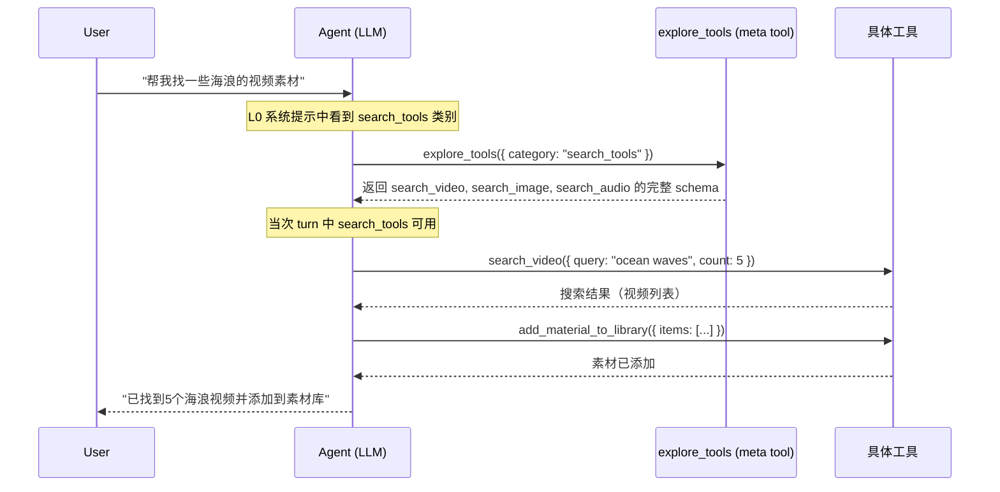
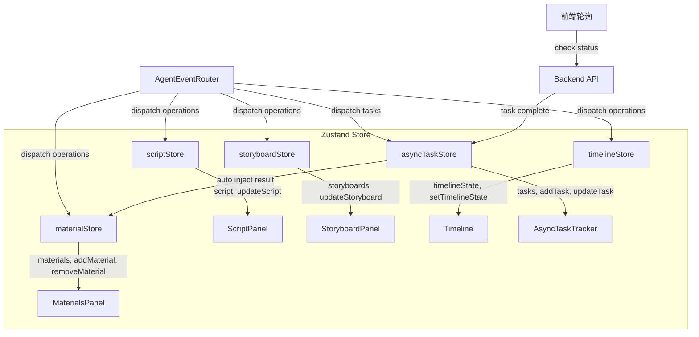
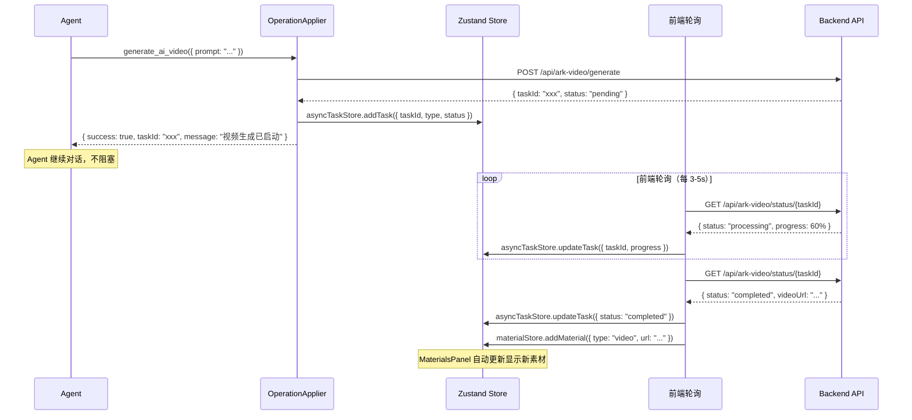
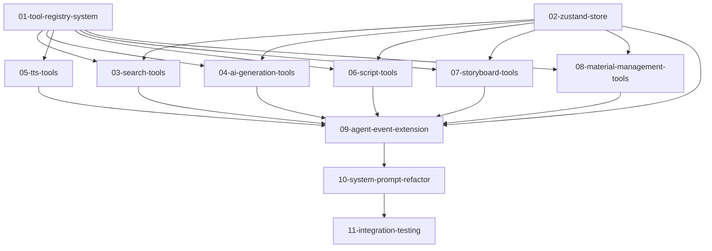

# Master Plan: Agent Tool Expansion — 视频编辑 Agent 全能力扩展

## 1. 概述

将 Ecliptrix 视频编辑 Agent 从当前仅有 8 个基础剪辑工具，扩展为覆盖整个视频编辑工作流的全能力 Agent。新增工具涵盖素材搜索、AI 内容生成、脚本与分镜创作、TTS 语音合成等，同时引入树形渐进式披露机制、中心化状态管理、异步任务处理系统，使 Agent 成为真正的视频编辑全流程控制器。

## 2. 目标

- **扩展 Agent 工具集**：从 8 个增长到 ~30 个，覆盖视频编辑全流程
- **树形渐进式披露**：通过 meta tool 实现工具按需加载，控制上下文开销
- **中心化状态管理**：引入 Zustand store，实现 Agent ↔ UI 面板双向同步
- **异步任务系统**：前端轮询 + 素材面板直注入，AI 生成任务不阻塞对话
- **面板控制能力**：Agent 可直接操控脚本面板、分镜面板、素材面板状态

## 3. 范围

### In Scope

- 树形工具注册系统 + `explore_tools` meta tool
- 素材搜索工具（视频/图片/音频搜索）
- AI 生成工具（AI 图像生成、AI 视频生成、图生视频）
- TTS 语音合成工具
- 脚本工具（AI 视频脚本生成、脚本扩展、视频理解脚本）
- 分镜工具（分镜生成、分镜描述、分镜批量视频生成、分镜组合）
- 素材管理扩展工具（上传素材通知、删除素材）
- Zustand 中心化 store（Agent 状态、面板状态统一管理）
- OperationApplier 扩展（支持新的 operation 类型）
- AgentEventRouter 扩展（路由新工具的事件）
- 异步任务追踪系统（前端轮询 + 状态通知）
- System prompt 重构（L0 树形目录 + meta tool 机制）

### Out of Scope

- Workflow 可视化编辑器相关功能
- 用户认证系统变更
- 后端 Python 服务的新接口开发（使用现有 API）
- 视频导出/合成功能的 Agent 控制
- YouTube 下载/上传功能
- 多用户协作功能

## 4. 架构设计

### 4.1 树形工具层级结构

```
L0: System Prompt（始终加载）
├── 工具目录摘要（一行一个类别 + 简介）
├── 项目状态摘要（现有 formatCompactSummary）
└── explore_tools meta tool

L1: 工具类别详情（Agent 通过 explore_tools 按需加载）
├── query_tools     → get_timeline, list_materials, search_materials
├── search_tools    → search_video, search_image, search_audio
├── ai_gen_tools    → generate_ai_image, generate_ai_video, image_to_video
├── tts_tools       → generate_tts, batch_generate_tts
├── script_tools    → generate_video_script, expand_video_script, understand_video_script
├── storyboard_tools → generate_storyboard, describe_storyboard, batch_storyboard_video, compose_storyboard
├── editing_tools   → add_to_track, trim_clip, delete_clip, move_clip, resize_clip
└── material_tools  → add_material_to_library, remove_material

L2: 运行时数据（Agent 调用具体工具获取）
└── 具体工具返回的搜索结果、生成结果、时间线详情等
```

### 4.2 工具加载流程



### 4.3 中心化状态管理 (Zustand)



### 4.4 异步任务处理流



### 4.5 Operation 类型扩展

现有 operation 类型：`add_clip`, `trim_clip`, `delete_clip`, `move_clip`, `resize_clip`

新增 operation 类型：
- `add_material` — 添加素材到素材库（搜索结果/AI生成结果）
- `remove_material` — 从素材库移除素材
- `start_async_task` — 启动异步任务（AI生成等）
- `update_script` — 更新脚本面板内容
- `update_storyboard` — 更新分镜面板内容
- `generate_storyboard` — 生成分镜到分镜面板

## 5. 设计决策

| 决策 | 选择 | 理由 |
|------|------|------|
| 工具组织 | 树形层级 + meta tool | 控制 LLM 上下文窗口，避免一次性加载 30+ 工具 schema |
| 工具加载时机 | 仅当次 turn 有效 | 每次 turn 重新评估需要哪些工具，避免上下文膨胀 |
| 状态管理 | Zustand 中心化 store | 当前 React Context + 状态提升模式在跨面板同步上力不从心 |
| 异步处理 | 前端轮询，对 Agent 透明 | Agent 不需要知道轮询细节，降低 Agent 端复杂度 |
| 执行确认 | 完全自动 | 用户通过 undo 控制，不打断 Agent 工作流 |
| 结果去向 | 智能判断用户意图 | 由 Agent LLM 自行决定是仅入库还是同时上轨 |

## 6. 依赖分析



## 7. 风险

| 风险 | 影响 | 缓解措施 |
|------|------|----------|
| LLM 上下文窗口不足 | 加载过多工具后 Agent 推理质量下降 | 树形渐进式披露 + 每次 turn 只加载需要的工具 |
| 异步任务失败/超时 | AI 生成失败影响用户体验 | 前端轮询设置超时上限，失败后通知用户并允许重试 |
| Zustand 迁移风险 | 现有 React 状态逻辑重构可能引入 bug | 分阶段迁移，先新建 store 并行运行，逐步替换 |
| 工具调用链过长 | 复合任务可能涉及 10+ 工具调用 | Agent 自动规划 + 并行执行不依赖的工具调用 |
| meta tool 增加 LLM 调用轮次 | explore_tools 调用额外消耗一轮 LLM 调用 | L0 提供足够信息让 Agent 精准加载，避免多次探索 |

## 8. Spec 文件目录

| # | Spec 文件 | 内容 |
|---|----------|------|
| 01 | tool-registry-system | 树形工具注册系统 + explore_tools meta tool |
| 02 | zustand-store | 中心化状态管理架构 |
| 03 | search-tools | 视频/图片/音频搜索工具 |
| 04 | ai-generation-tools | AI 图像/视频生成 + 图生视频工具 |
| 05 | tts-tools | TTS 语音合成工具 |
| 06 | script-tools | 脚本生成/扩展/理解工具 |
| 07 | storyboard-tools | 分镜生成/描述/批量视频/组合工具 |
| 08 | material-management-tools | 素材库管理扩展工具 |
| 09 | agent-event-extension | AgentEventRouter + OperationApplier 扩展 |
| 10 | system-prompt-refactor | System Prompt 重构（树形目录 + 工具流程指导）|
| 11 | integration-testing | 端到端集成测试 |
