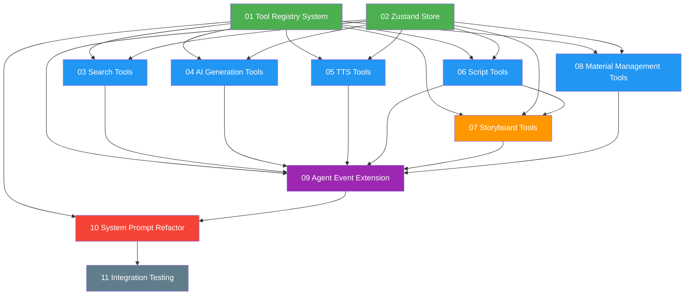

# Task Orchestration: Agent Tool Expansion

## 1. 依赖图



**颜色说明**：
- 绿色 = Phase 1（基础设施，无依赖）
- 蓝色 = Phase 2（工具实现，依赖基础设施）
- 橙色 = Phase 3（依赖其他工具）
- 紫色 = Phase 4（集成层，依赖所有工具）
- 红色 = Phase 5（提示重构，依赖集成层）
- 灰色 = Phase 6（测试，依赖全部）

## 2. 执行阶段

### Phase 1: 基础设施（并行）
| 任务 | Agent | 预估复杂度 |
|------|-------|-----------|
| 01 Tool Registry System | eng-01 | 中 |
| 02 Zustand Store | eng-02 | 中 |

**并行度**: 2 agents，无依赖
**完成标准**: ToolRegistry 可实例化 + Store 可读写

### Phase 2: 工具实现（并行）
| 任务 | Agent | 预估复杂度 |
|------|-------|-----------|
| 03 Search Tools | eng-01 | 中 |
| 04 AI Generation Tools + AsyncTaskPoller | eng-02 | 高 |
| 05 TTS Tools | eng-03 | 低 |
| 06 Script Tools | eng-04 | 中 |
| 08 Material Management Tools | eng-05 | 低 |

**并行度**: 5 agents
**依赖**: 01 + 02 必须完成
**完成标准**: 每个工具可独立调用，结果正确写入 Store

### Phase 3: 分镜工具
| 任务 | Agent | 预估复杂度 |
|------|-------|-----------|
| 07 Storyboard Tools | eng-01 | 高 |

**并行度**: 1 agent（依赖 06 Script Tools 中的 scriptStore 读取能力）
**依赖**: 01 + 02 + 06
**完成标准**: 分镜工具可独立调用 + storyboardStore 更新 + AsyncTaskPoller 支持

### Phase 4: 事件系统集成
| 任务 | Agent | 预估复杂度 |
|------|-------|-----------|
| 09 Agent Event Extension | eng-01 | 高 |

**并行度**: 1 agent
**依赖**: 02 + 所有工具 (03-08)
**完成标准**: 所有 operation 类型正确路由到 Store + Undo 工作正常

### Phase 5: 系统提示重构
| 任务 | Agent | 预估复杂度 |
|------|-------|-----------|
| 10 System Prompt Refactor | eng-01 | 中 |

**依赖**: 01 + 09
**完成标准**: 新 L0 提示 < 600 tokens + explore_tools 返回格式正确

### Phase 6: 集成测试
| 任务 | Agent | 预估复杂度 |
|------|-------|-----------|
| 11 Integration Testing | eng-01 | 高 |

**依赖**: 全部 (01-10)
**完成标准**: 所有测试用例通过

## 3. 关键路径

```
01 Tool Registry → 06 Script Tools → 07 Storyboard Tools → 09 Event Extension → 10 System Prompt → 11 Testing
```

**瓶颈任务**:
- **09 Agent Event Extension** — 依赖所有工具，是最大的汇聚点
- **04 AI Generation Tools** — 包含 AsyncTaskPoller，复杂度最高
- **07 Storyboard Tools** — 依赖 scriptStore，无法与 Phase 2 完全并行

## 4. Agent 分配建议

**推荐 5 agents**：

| Agent | Phase 1 | Phase 2 | Phase 3 | Phase 4 | Phase 5 | Phase 6 |
|-------|---------|---------|---------|---------|---------|---------|
| eng-01 | 01 Registry | 03 Search | 07 Storyboard | 09 Events | 10 Prompt | 11 Testing |
| eng-02 | 02 Store | 04 AI Gen | — | — | — | — |
| eng-03 | — | 05 TTS | — | — | — | — |
| eng-04 | — | 06 Script | — | — | — | — |
| eng-05 | — | 08 Material | — | — | — | — |

**总执行 6 个阶段**，Phase 1-2 高度并行，Phase 3-6 串行（依赖链）。

## 5. 每个 Agent 的必读文件

### 所有 Agent 必读
- `docs/plans/agent-tool-expansion/master-plan.md`
- `docs/plans/agent-tool-expansion/task-orchestration.md`
- `src/lib/video-editing-agent/types.ts`
- `src/lib/video-editing-agent/agent.ts`
- `src/lib/video-editing-agent/tools/index.ts`
- `src/types/index.ts` (MaterialItem, TimelineState 等类型)

### eng-01 (Registry → Search → Storyboard → Events → Prompt → Testing)
- `src/lib/video-editing-agent/systemPrompt.ts`
- `src/lib/video-editing-agent/AgentEventRouter.ts`
- `src/lib/video-editing-agent/OperationApplier.ts`
- `src/lib/video-editing-agent/AgentStateManager.ts`
- 对应 spec: 01, 03, 07, 09, 10, 11

### eng-02 (Store → AI Gen)
- `src/components/video/hooks/useMaterialManagement.ts`
- `src/components/video/components/MaterialsPanel/MaterialsPanel.tsx`
- `src/app/api/ark-video/generate/route.ts`
- `src/app/api/ark-image/generate/route.ts`
- 对应 spec: 02, 04

### eng-03 (TTS)
- `src/app/api/tts/convert/route.ts`
- `src/app/api/tts/batch-convert/route.ts`
- 对应 spec: 05

### eng-04 (Script)
- `src/app/api/ai-video-script-generation/route.ts`
- `src/app/api/ai-video-script-expand/route.ts`
- `src/app/api/video-understanding-script/route.ts`
- `src/components/video/hooks/useScriptGeneration.ts`
- 对应 spec: 06

### eng-05 (Material)
- `src/components/video/hooks/useMaterialManagement.ts`
- 对应 spec: 08

## 6. 协调注意事项

- **接口契约先行**: Phase 1 的两个基础设施任务必须先确定接口（ToolRegistry API + Store API），Phase 2 的 agents 依赖这些接口
- **categories.ts 合并冲突**: Phase 2 的多个 agents 都会修改 `categories.ts` 添加各自类别 → 每个 agent 只添加自己的类别，最后由 Phase 4 统一验证
- **AsyncTaskPoller 单一组件**: 由 eng-02 (AI Gen) 创建基础版，eng-03 (TTS) 和 eng-01 (Storyboard) 在各自阶段扩展任务类型支持
- **types.ts 扩展**: Phase 2 的 agents 各自定义自己工具的 operation type，Phase 4 (eng-01) 统一合并到 AgentOperation union type
