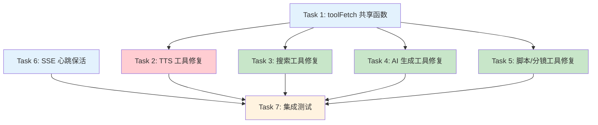

# Task Orchestration: Agent Tool Robustness Fix

## 1. Dependency Graph



## 2. Execution Phases

### Phase 1: 基础设施（无依赖）

| Task | Description | Files | Parallel Group |
|------|-------------|-------|---------------|
| T1 | 创建 `toolFetch` 共享函数：统一超时、重试、错误处理 | `apiHelper.ts` | A |
| T6 | SSE 心跳保活机制 + SSEStreamManager 超时调整 | `chat/route.ts`, `SSEStreamManager.ts` | A |

### Phase 2: 工具迁移（依赖 T1）

| Task | Description | Files | Parallel Group |
|------|-------------|-------|---------------|
| T2 | TTS 工具修复：迁移到 toolFetch，修复失败问题 | `generateTts.ts`, `batchGenerateTts.ts` | B |
| T3 | 搜索工具修复：迁移到 toolFetch | `searchVideo.ts`, `searchImage.ts`, `searchAudio.ts` | B |
| T4 | AI 生成工具修复：迁移到 toolFetch，修复 fire-and-forget | `generateAiImage.ts`, `generateAiVideo.ts`, `imageToVideo.ts` | B |
| T5 | 脚本/分镜工具修复：迁移到 toolFetch，修复静默失败 | `generateVideoScript.ts`, `expandVideoScript.ts`, `understandVideoScript.ts`, `generateStoryboard.ts`, `describeStoryboard.ts`, `batchStoryboardVideo.ts` | B |

### Phase 3: 验证（依赖 T2, T3, T4, T5, T6 全部完成）

| Task | Description | Files | Parallel Group |
|------|-------------|-------|---------------|
| T7 | 集成测试：验证所有工具正常工作 | `__tests__/` | C |

## 3. Critical Path

```
主路径:  T1 (toolFetch) → T2 (TTS 修复) → T7 (集成测试)
并行路径: T6 (SSE 心跳保活)         → T7 (集成测试)
```

TTS 修复是首要目标，也是用户报告的 bug。T7 的启动需要两条路径都完成：主路径（T1 → T2/T3/T4/T5）和并行路径（T6）。T6（心跳保活）与 T1 并行，是 TTS 长耗时场景的关键保障。如果 T6 耗时超过 T1 + T2，则 T6 成为实际瓶颈。

## 4. Agent Assignments

**推荐 Agent 数量：3**

| Agent | Tasks | Role |
|-------|-------|------|
| agent-01 | T1 + T2 | 基础设施 + TTS 修复（关键路径） |
| agent-02 | T3 + T4 + T5 | 工具批量迁移 |
| agent-03 | T6 + T7 | SSE 保活 + 集成测试 |

### Coordination Notes

- agent-01 先完成 T1 (toolFetch) 后，agent-02 才能开始 T3/T4/T5（agent-02 在此期间空闲）
- agent-03 可以立即启动 T6 (SSE 保活)，与 T1 无依赖
- T7 需要等待 T2, T3, T4, T5, T6 全部完成后才能开始（agent-03 完成 T6 后需等待 agent-01 和 agent-02）

## 5. Context Files (Required Reading)

每个 Agent 必须读取的文件：

### 所有 Agent 共读

- `docs/plans/agent-tool-robustness/master-plan.md`
- `docs/plans/agent-tool-robustness/task-orchestration.md`（本文件）
- `src/lib/video-editing-agent/types.ts` — 类型定义
- `src/lib/video-editing-agent/tools/apiHelper.ts` — 当前 apiUrl 实现

### Agent-01 额外阅读

- `src/lib/video-editing-agent/tools/generateTts.ts`
- `src/lib/video-editing-agent/tools/batchGenerateTts.ts`
- `src/app/api/tts/convert/route.ts`
- `src/app/api/tts/batch-convert/route.ts`

### Agent-02 额外阅读

- `src/lib/video-editing-agent/tools/searchVideo.ts`
- `src/lib/video-editing-agent/tools/searchImage.ts`
- `src/lib/video-editing-agent/tools/searchAudio.ts`
- `src/lib/video-editing-agent/tools/generateAiImage.ts`
- `src/lib/video-editing-agent/tools/generateAiVideo.ts`
- `src/lib/video-editing-agent/tools/imageToVideo.ts`
- `src/lib/video-editing-agent/tools/generateVideoScript.ts`
- `src/lib/video-editing-agent/tools/expandVideoScript.ts`
- `src/lib/video-editing-agent/tools/understandVideoScript.ts`
- `src/lib/video-editing-agent/tools/generateStoryboard.ts`
- `src/lib/video-editing-agent/tools/describeStoryboard.ts`
- `src/lib/video-editing-agent/tools/batchStoryboardVideo.ts`

### Agent-03 额外阅读

- `src/app/api/video-editing-agent/chat/route.ts`
- `src/lib/video-editing-agent/SSEStreamManager.ts`
- `src/lib/video-editing-agent/agent.ts`
- `src/lib/video-editing-agent/AgentEventRouter.ts`

## Task Details

### T1: 创建 toolFetch 共享函数

**目标**：在 `apiHelper.ts` 中创建 `toolFetch` 函数，统一处理：

```typescript
interface ToolFetchOptions {
  /** 超时时间（毫秒），默认 30000 */
  timeout?: number;
  /** 是否在网络错误时重试，默认 true */
  retry?: boolean;
  /** 最大重试次数，默认 1 */
  maxRetries?: number;
}

async function toolFetch(
  context: ToolContext,
  path: string,
  options: RequestInit & ToolFetchOptions
): Promise<Response>
```

功能要求：
1. 自动使用 `AbortSignal.timeout()` 设置超时
2. 仅在网络错误（TypeError）时重试，不在超时（AbortError）时重试
3. 不在 HTTP 4xx/5xx 时重试（业务错误不重试）
4. 自动设置 `Content-Type: application/json`
5. 保持与原有 `apiUrl` 兼容

### T2: TTS 工具修复

**目标**：修复 `generate_tts` 和 `batch_generate_tts` 工具

修改内容：
1. 使用 `toolFetch` 替代直接 `fetch`
2. `generate_tts` 超时设为 60 秒
3. `batch_generate_tts` 超时设为 120 秒
4. 增加响应数据防御性解析
5. 改善错误信息（包含具体 HTTP 状态码和响应内容）

### T3: 搜索工具修复

**目标**：统一 3 个搜索工具的 fetch 实现

修改内容：
1. 使用 `toolFetch` 替代直接 `fetch`（保持 15 秒超时）
2. 翻译 API 调用也使用 `toolFetch`（10 秒超时）
3. 增加响应数据防御性解析（`?.` 和默认值）

### T4: AI 生成工具修复

**目标**：修复 3 个 AI 生成工具

修改内容：
1. `generate_ai_image`：修复 fire-and-forget 模式，改为等待初始 API 响应并检查成功/失败，使用 `toolFetch`（120 秒超时）
2. `generate_ai_video`：使用 `toolFetch`（120 秒超时）
3. `image_to_video`：使用 `toolFetch`（120 秒超时），增加响应数据防御性解析

### T5: 脚本/分镜工具修复

**目标**：修复 6 个脚本和分镜工具

修改内容：
1. 所有工具使用 `toolFetch`（脚本工具 60 秒，分镜工具 120 秒）
2. `expand_video_script`：修复循环中的静默失败，改为累积错误并在最终结果中报告
3. `describe_storyboard`：添加操作记录（当前是唯一不记录操作的工具）
4. 所有工具增加响应数据防御性解析

### T6: SSE 心跳保活机制

**目标**：防止工具执行期间 SSE 连接超时

修改内容：

1. **`chat/route.ts`**：在 `subscribeAgentEvents` 中，当 `tool_execution_start` 事件发生时启动心跳定时器，每 10 秒发送 SSE 注释 `: heartbeat\n\n`，在 `tool_execution_end` 时停止。

2. **`SSEStreamManager.ts`**：
   - 将默认 `heartbeatTimeout` 从 30 秒增加到 90 秒
   - 确保 SSE 注释行（`: heartbeat`）也触发心跳重置
   - 当前 `resetHeartbeat()` 在收到任何数据时调用，包括注释，所以此项可能已自动满足

### T7: 集成测试

**目标**：验证所有 Agent 工具正常工作

测试方式：
1. 创建 `apiHelper.test.ts`：测试 `toolFetch` 的超时、重试、错误处理逻辑
2. 创建 `tools.integration.test.ts`：对每个 API 工具进行模拟调用测试
3. 手动验证：启动前后端，通过 Agent 对话面板测试 TTS 生成
