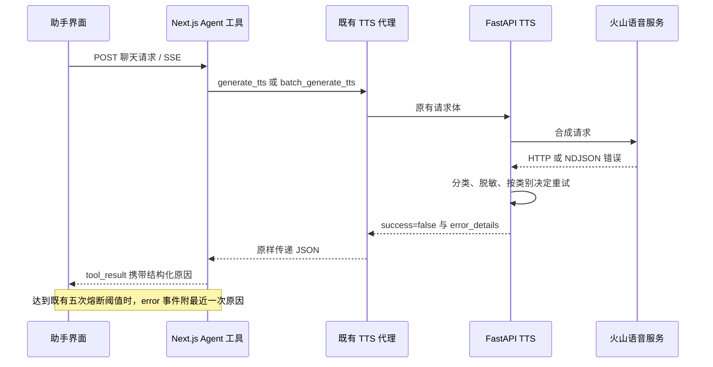

# AI 剪辑助手交互与语音错误诊断设计方案

**版本：** v2 · 2026-09-15

**节点：** #1 方案评审及正文修订；交付物仅为本文，供 #2 实施。

**目标：** 修复思考结束后仍旋转的状态反馈，将面板关闭改为保留现场的最小化，准确呈现语音失败原因，并改善浮窗的信息层级。

**架构：** 沿用 Electron、Next.js 渲染器、本地 FastAPI 和现有 Agent SSE 链路。以消息状态驱动图标，以面板可见性控制展示，以结构化错误贯通 TTS 服务、工具结果与界面。

**技术栈：** Next.js 15、React 19、TypeScript 5、Tailwind CSS 3、现有 framer-motion、Python/FastAPI、Pydantic、Vitest、pytest。无需新增依赖。
**实施方法：** 下游按第 8 节逐项执行，参考 `superpowers:executing-plans` 的逐项验证方式；本节点不实施、不提交代码。

## 评审记录

评审依据为基线 `6c99b0bfb8425d9948310f5602c66b8f22ccff59` 的实际源码、`CLAUDE.md`、用户截图和 v1 全文。评审开始时只有上游设计目录未跟踪；本文中的“已修复”均指设计正文已修订，不表示功能已经实现或测试通过。

| 编号 | 级别 / 维度 | 关注点与代码证据 | 正文处理 / 状态 |
| --- | --- | --- | --- |
| R01 | P1 / 完整性 | `TimelineChatPanel.getConnectorState` 无条件把 `isThinkingPhase` 当活动状态；只修灯泡后，已结束思考的连接线仍持续流动。 | §3.1 统一活动判据，补 A01/A21；已修复。 |
| R02 | P1 / 可行性 | 面板和 FAB 分别钳制不能保证 FAB 可达；FAB 在左上角时会被更高层的面板整个覆盖。 | §3.4 增加可见抓取区域与遮挡时的层级规则，补 A22；已修复。 |
| R03 | P1 / 一致性 | v1 混用供应商 HTTP 状态和本地代理状态，且 429 兜底位于 lifetime 等明确语义之前；`BACKEND_TIMEOUT`、配置缺失可能被说成火山故障。 | §4.1–4.3、§5–6 明确来源、语义优先和本地错误类别，补 A11/A23；已修复。 |
| R04 | P1 / 可行性 | `generateTts` 60s、batch 工具 120s 早于代理 120s/600s；单段三次 30s 加 2s/4s 已可达约 96s；两个 async 路由直接运行阻塞服务。 | §4.3、§5.1 对齐工具等待上限，并在线程池运行原同步服务，补 A24/A25；已修复。 |
| R05 | P1 / 完整性 | `batch_tts_service.convert_batch` 外层异常把已成功段落丢成空数组；工具 payload 仅有计数，模型拿不到成功素材 ID 和原段落映射。 | §4.4、§5.2 固定批量异常收集、请求索引、素材引用和计数契约，补 A26；已修复。 |
| R06 | P1 / 一致性 | 工具参数承诺每段 `voice_type`，但 `BatchTTSSegmentRequest` 无该字段，服务始终传 `request.voice_type`；诊断音色权限时会误导用户。 | §4.4、§5.1、§6 添加可选段落音色并沿用整体默认，补 A27；已修复。 |
| R07 | P1 / 完整性 | 白名单字段名不等于字段值安全；`provider_code`、旧错误和外层 catch 仍可包含凭据、文本或路径；NDJSON 缺 code 也可能被当成功。 | §4.1、§4.3、§5.2 明确校验、脱敏边界和日志出口，补 A13/A19/A28；已修复。 |
| R08 | P1 / 完整性 | “记住最近原因”未规定非 TTS 失败覆盖旧 TTS cause；仅设 `runErrorSent` 无法阻止后续 `message_end` 再发模型错误。 | §4.3、§4.5 固定 cause 替换与熔断后终态去重，补 A18/A29；已修复。 |
| R09 | P2 / 完整性 | 展开动画结束后无条件聚焦可能抢走已转移的焦点；减少动画时读取隐藏 DOM 会把滚动位置覆写为零；默认分支“分析完成”也可能误指中断。 | §3.1–3.3 明确中性文案、焦点所有权和滚动快照时机，补 A07/A08；已修复。 |
| R10 | P2 / 适度性 | §11 仍要求报告 index=0；文件计划和“沿用不修改”表需跟随评审修正，且超项目大小限制须注明局部例外。 | §7–8、§10–11 更新交接、范围和验证要求；已修复。 |
| R11 | P1 / 一致性 | `VideoEditingInterface` 与 `useAgentExecution` 各有挂载清理，前者整份 content 写回可能覆盖后者清理结果；只改 hook 无法保证多会话均被清理。 | §3.1 由编辑器唯一负责加载清理，按全会话一次写回，补 A30；已修复。 |

逐节覆盖：§1–2 的四项需求和桌面架构适用；§3 对应 R01/R02/R09/R11；§4–6 对应 R03–R08；§7–11 已同步文件、接口、测试、风险和节点交接。共发现 **P0 0 项、P1 9 项、P2 2 项**，均在正文闭合；不引入新依赖、数据库变更、跨项目草稿系统或全局任务调度改造。

## 1. 概述

视频编辑工作区已有浮动 AI 剪辑助手。用户截图显示，语音生成步骤反复呈现“语音转换失败: 语音转换失败 (尝试3次): 语音合成失败”，最终又归因为本地服务或网络异常。用户无法判断是账户欠费、音色权限、请求限制还是服务故障。与此同时，思考记录结束后仍旋转，标题栏的叉号也无法清楚表达“暂时收起、任务继续”的行为。本次改善应使状态、结果和下一步操作都能从界面直接理解。

设计围绕四项明确结果展开：只有正在思考的节点旋转；最小化把面板收回悬浮按钮并保留草稿、阅读位置及执行现场；TTS 的真实原因以稳定错误类别和脱敏细节到达工具卡片；面板采用紧凑且有层次的标题栏、内容区与输入区。失败信息只在必要位置显示一次，长原因可以换行并展开查看。产品文案使用既有中英文翻译体系，视觉继续使用项目主题变量。

本方案基于工作目录 `M:/takoAI/Ecliptrix` 的现有代码，基线提交为 `6c99b0b`。已阅读根目录 `README.md`、`CLAUDE.md`、`.claude-index/index.md` 和用户附件；开始时工作区 `git status --short` 为空。任务提示中的 JRAgentMesh 打包服务器目录属于只读运行环境参考，实际 Ecliptrix 代码位于当前工作区。此项工作不改变数据库、登录模型、Electron 窗口最小化、视频时间轴算法或部署方式，也不增加欢迎落地页。

## 2. 现状与技术依据

### 2.1 已核对的关键路径

下列行号是本次读取时的定位辅助；实施时以符号名为准。

| 位置 | 现有行为与设计依据 |
| --- | --- |
| `src/components/video/components/VideoChatWindow/timeline/AgentThinkingNode.tsx` | 两个渲染分支都固定传 `variant="thinking"`；`node.isStreaming` 只控制文案与光标，没有控制图标。 |
| `src/components/video/components/VideoChatWindow/timeline/TimelineNodeIcon.tsx` | `thinking` 分支无条件附加 `timeline-anim-spin`，不存在思考完成的静态变体。 |
| `src/components/video/components/VideoChatWindow/timeline/utils.ts` 的 `mapMessageToNodes` | 历史思考节点来自 `thinkingContent`；其流状态直接取 `message.isThinking`，未同时检查消息已结束或取消。 |
| `src/lib/video-editing-agent/AgentStateManager.ts:105,163,171,193` | `thinking_end` 对应的状态切换、`setError`、`finalize`、`markCancelled` 已清除 `isThinking`；应保留这些正确路径。 |
| `src/components/video/hooks/useAgentExecution.ts:474` 及挂载清理 effect | watchdog 只显式写 `isStreaming:false`；历史清理遗漏单独残留的 `isThinking:true`，也会丢弃仅有思考内容的消息。 |
| `src/components/video/components/AgentChatDock/AgentChatDock.tsx` | `{isOpen && (...)}` 卸载整个聊天视图；执行 hook 位于父编辑器，不因这里的卸载自动停止，但聊天本地状态会消失。 |
| `src/components/video/components/AgentChatDock/AgentChatFloatingPanel.tsx` | 标题栏使用叉号，尺寸估算为 30% × 80%；已有 FAB 锚点与安全边界钳制。 |
| `src/components/video/components/VideoChatWindow/VideoChatWindow.tsx:73` | 草稿保存在组件 `useState` 中；列表滚动与自动跟随状态属于 `TimelineChatPanel`。 |
| `src/styles/video-editing.css:1404–1491` | FAB 56px，面板 30% × 80%，只有入场动画；减少动画规则未覆盖 FAB 的伪元素脉冲。 |
| `backend-services/basic-service/app/services/tts_service.py:123–274` | HTTP 错误、NDJSON 错误帧、解码与写文件失败都转换成 `False`；具体响应只在日志中出现。 |
| 同文件 `convert_text_to_speech:476–714` | `False` 被改成“语音合成失败”，任何异常均尝试三次，最终再包一层字符串。 |
| `backend-services/basic-service/app/routers/tts_router.py:119` | 再次添加“语音转换失败”前缀；`TTSErrorResponse` 目前没有详细错误字段。 |
| `src/lib/video-editing-agent/tools/generateTts.ts` | 任意失败且不是默认音色都会换默认音色重试；工具结果只保留 `message/error`。 |
| `src/lib/video-editing-agent/tools/batchGenerateTts.ts` | 按 `data.results` 读取结果，但代理实际透传后端顶层 `results`；部分失败也直接退出，未收集成功素材。 |
| `src/lib/video-editing-agent/agent.ts:397–450` | 连续五次工具失败触发熔断，文案固定猜测网络或内部接口问题；工具 `details` 已可透传对象。 |
| `src/lib/video-editing-agent/AgentEventRouter.ts`、`useAgentExecution.ts:376` | SSE 错误通过 `describeError` 本地化并存入消息；当前 `toolFailures` 翻译没有原因插槽。 |

### 2.2 方案选择

| 方案 | 取舍 | 决定 |
| --- | --- | --- |
| 状态驱动图标、保留视图实例、结构化错误逐层透传 | 直接覆盖缺陷，可保留现有消息、撤销与执行架构；需补齐批量结果处理。 | **采用。** |
| 只替换图标和按钮，在界面解析现有中文错误字符串 | 改动少，但底层原因已经丢失，无法可靠判断欠费；收起仍丢草稿。 | 不采用。 |
| 重写聊天状态机、全站错误层和任务系统 | 范围过大，会牵动时间轴锁定、持久化与其他工具。 | 不采用。 |

### 2.3 外部错误语义的边界

v1 引用了火山官方[语音合成接口说明](https://www.volcengine.com/docs/6561/2228192?lang=zh)与[到期/欠费关停说明](https://www.volcengine.com/docs/6561/1359394)作为背景，并提醒不同接口的数值码不能直接作为当前 V3 映射表。v2 保留这一保守原则：不能把含义不明的 `quota exceeded` 一律解释成欠费。

本次未取得实际欠费响应，V3 详细文档访问也未成功。v2 复核上述官方链接时，分别遇到抓取失败和仅返回 JavaScript 应用外壳，未独立取得错误码正文；保留为上游参考，不作为具体码映射证据。以下分类是应用层设计：欠费只依据明确的欠费/余额不足语义；不臆造 V3 数值欠费码。合成成功码 `{0, 20000000}` 沿用现有客户端逻辑并通过模拟响应回归。本文 JSON 均为测试示例，不表示真实账户已经欠费。

## 3. 技术设计：状态、面板与视觉

### 3.1 思考状态与终态不变量

复用 `ChatMessage.isThinking`、`isStreaming`、`isCancelled`，不增加数据库字段或持久化状态枚举。

1. `mapMessageToNodes` 为思考阶段节点计算 `active = message.isThinking === true && message.isStreaming === true && !message.isCancelled`；历史思考内容继续保留，节点 ID 仍为 `${message.id}-agent-thinking`。
2. 给 `TimelineNodeIcon` 增加 `thinking-idle` 变体：与旋转图标同为 16px 占位，使用静态灯泡线条；不使用成功绿色勾号，以免把中断的思考误作任务成功。
3. `AgentThinkingNode` 的两个分支均按 `node.isStreaming` 选择 `thinking` 或 `thinking-idle`。结束后立即移除旋转类和流式光标（不能等待光标退出动画）；结束标题均用中性的既有 `thoughtProcess`，不新增会把中断描述成成功的 `analysisComplete`。默认流式文本节点在整条消息完成后按既有映射转为 response，无需强行保留第二个思考节点。
4. 保留 `AgentStateManager` 的现有终态处理。`thinking_end` 只结束思考，不能结束整个 Agent；工具执行仍显示自己的执行状态，FAB 仍由 `agentIsExecuting` 控制，包含现有 `finishing` 阶段。
5. `useAgentExecution` 的 `onFinishingTimeout` 写回同时指定 `isThinking:false`；不改变事件队列排空顺序、退役轮次写入范围和轨道补丁逻辑。
6. 在 `agentTurnLifecycle.ts` 增加纯函数 `normalizeInterruptedAgentMessages(messages)`。Agent 脏消息判据为任一活动标志或执行中工具；清除两个活动标志、保留原有取消约定，把仍执行的工具设为 `cancelled`。只有内容、思考内容、工具记录都为空时才删除 Agent 空占位。非 Agent 消息仅沿用原编辑器的 `isStreaming:false` 清理，不能误加 Agent 取消标记或删除内容。已干净的消息及数组引用保持原样。
   **加载清理只保留一个写入者：** `VideoEditingInterface` 在当前项目内容首次可用且尚未开启执行时，对所有会话调用该函数，最后一次 `onUpdateContent` 写回整份 conversations；删除 `useAgentExecution` 的重复挂载 sweep。同一编辑器项目只初始化一次，不在每次消息更新/开合/切换会话时重跑。必须测试两个脏会话同时加载，防止逐会话更新基于同一旧快照互相覆盖；延迟到达的初始 content 也必须先清理再允许开始新轮次。
7. 在 `useAgentExecutionState.finishExecution` 进入 `finishing` 时即清除 `isThinking`，以及收到 `error/agent_end/cancelled` 时清除它；不在这些事件上提前解锁时间轴。防止完成等待期间忙碌栏仍写“思考中”。
8. `TimelineChatPanel.getConnectorState` 的 thinking 分支仅由 `node.isStreaming` 判断活动，删除 `isThinkingPhase` 的无条件活动分支；它只表示节点类型。历史和中断思考的连接线不得有 `timeline-anim-flow`。仅有 `thinkingContent` 的历史消息已具有可见内容，不再额外生成“模型返回空响应”的 fallback 卡片。

| 输入或事件 | 思考图标 | 思考光标 | Agent/FAB |
| --- | --- | --- | --- |
| 当前消息开始思考、产生 delta | 旋转 | 可见 | 忙碌 |
| `thinking_end`，工具仍在执行 | 静态灯泡 | 消失 | 忙碌 |
| 正常 `agent_end` 或流结束 | 静态 | 消失 | 队列排空后恢复 |
| 工具/模型错误、网络中断、用户停止 | 静态 | 消失 | 沿现有终态收尾 |
| watchdog 到期 | 静态 | 消失 | 保持现有 watchdog 解锁语义 |
| 重开历史会话或加载残留思考记录 | 静态 | 消失 | 不自行开启执行 |

### 3.2 最小化、生命周期与焦点

沿用父级受控的 `isAgentDockOpen`。`AgentChatDock`、浮窗的内部回调改名 `onMinimize`，标题按钮标签改为“最小化助手”/“Minimize assistant”，图标使用水平短线。`VideoEditingInterface` 仅更新这个属性名；最小化回调只执行 `setIsAgentDockOpen(false)`。

新增 `useDockPresence(isOpen)` 管理 `unmounted → opening → open → minimizing → hidden` 五种展示阶段。首次打开前允许不挂载视图；首次打开后保持相同组件实例，`hidden` 时才用 `display:none`。`isOpen` 仍是唯一用户意图，动画结束回调不能反过来修改父级状态。

- 正常收起：从面板按钮/Escape 发起时，先记录面板内有效聚焦元素并把焦点移至 FAB，再设置面板 `inert`、`aria-hidden=true` 和 `pointer-events:none`；执行 180ms 的 `transform/opacity` 收起动画，结束后设 `hidden`。若是外部受控状态变化且焦点已在编辑器或模态框，不抢回 FAB。不清空会话、不终止 SSE、不调用撤销或停止按钮回调。
- 正常展开：移除 `hidden`，布局测量后开始 200ms 展开；第一帧禁用过渡，下一帧启动，避免首次闪烁。恢复交互后仅在仍属本次打开 generation、且焦点仍在触发 FAB 时恢复面板焦点；用户在动画期间切换到编辑器/设置后不得被抢回。优先恢复仍属于当前面板且未禁用的元素；首次优先可编辑 textarea，执行中改为最小化按钮。会话 key 改变时清除旧元素引用。
- 快速反复切换：每次意图变化递增 generation；动画事件与 240ms 兜底定时器只处理当前 generation；清理旧定时器和 rAF。重新打开不能被旧收起回调隐藏。`transitionend` 只接收面板本身的 `transform` 事件。
- 用户要求减少动画时，上述阶段直接达到 `open/hidden`；焦点与状态保留规则相同。
- `Escape` 在面板内部冒泡处理：仅当 `isOpen`、DOM target 真正位于面板内、未处于 IME composition、子控件未 `preventDefault()` 时最小化；处理后阻止继续传播。React portal 的事件可能沿 React 树冒泡，必须做 DOM 包含检查。移除目前无条件的 window Escape 监听，避免焦点位于设置弹窗或时间轴时收起助手。
- FAB 始终挂载，保留拖拽阈值、拖拽后吞掉合成 click、键盘 Enter/Space 激活；增加 `aria-expanded={isOpen}` 与 `aria-controls={panelId}`。面板用 `useId` 生成稳定 ID，保持 `role=dialog`、`aria-modal=false`，不做全局焦点圈禁，也不增加遮罩。
- 点击面板外不最小化；用户仍能使用编辑器允许的控件。面板隐藏时不抢夺编辑器焦点，后台任务完成也不自动弹开。
- 保存输入现场仅限同一会话。Dock 渲染 `VideoChatWindow` 时传 `key={chatProps.conversation?.id ?? 'empty'}`，在会话真正切换时重置整个聊天视图的草稿与滚动，避免不同会话混用草稿；仅切换 `isOpen` 时 key 不变。不能仅给组件内部的 DOM 节点加 key，因为这不会重置 `VideoChatWindow` 自身的 `useState`。

### 3.3 滚动与隐藏态工作

新增可选 `isVisible?: boolean` 到 `VideoChatWindowProps`、`TimelineChatPanelProps`，默认 `true`，由 Dock 传入 `isOpen && !presence.isHidden`。展开意图提交后，必须等父面板退出 `display:none` 才恢复列表测量；否则子组件 layout effect 会先读到零尺寸。隐藏期间停止该列表的 150ms 自动跟随定时器和延迟滚动；不要根据隐藏元素的零尺寸重算“是否位于底部”。

可见期间的有效 onScroll 和程序滚动完成后持续保存 `scrollTop`、当前 `shouldAutoScroll` 到 ref；不能等 `display:none` 提交后再读 DOM 保存，否则减少动画路径会得到零。隐藏时取消 100ms 延迟滚动、150ms 定时器，所有滚动回调先检查当前可见性；不让隐藏产生的 scroll 事件覆写 ref。再次显示后的 layout effect：原来在底部则定位到新消息底部；原来在阅读历史则恢复旧 `scrollTop`（限制到当前可滚范围），不强行跳至最新。首次显示正常跟随底部。恢复动作期间不反向重算用户的跟随意图。新回复、工具状态、折叠卡片与草稿仍在保留的组件实例内更新；只有渲染可见性改变，执行生命周期由父编辑器拥有。

### 3.4 尺寸、布局与动效参数

所有尺寸相对编辑器工作区，不使用浏览器页面整体代替工作区。定位继续遵守“面板完整可见优先、FAB 始终可达”的现有约定；常规右下角仍让面板底边位于 FAB 垂直中线。

| 元素 | 确定规范 |
| --- | --- |
| 面板宽度 | `min(calc(100% - 16px), clamp(360px, 32%, 520px))`；移除旧 30% 和窄屏宽度覆盖，避免规则冲突。 |
| 面板高度 | `min(calc(100% - 16px), clamp(320px, 80%, 760px))`；不设会造成溢出的独立 `min-width/min-height`。 |
| 标题栏 | 常规 52px，水平 16px；标题 14px/600；右侧 32×32px 最小化按钮，图形 16px。 |
| 容器 | 圆角 16px、1px `var(--border)`，背景 `var(--card)`；浅色阴影 `0 16px 48px rgba(0,0,0,.16)`，深色 .28。 |
| 消息区 | 水平 16px、上下 16px，正文 14px、行高 1.6，节点间距 12px；列表为主体滚动区。 |
| 输入区 | 合并为同一背景的工具栏与输入容器，整体间距 12px；保留现有灯泡、转脚本、Agent 开关、清空及发送/停止功能。 |
| 输入框 | 最小 40px、内容增长上限 120px；高度初始化和内容调整使用同一组常量。`handleKeyDown` 先检查 `e.nativeEvent.isComposing`，为 true 时直接返回，然后处理既有 Enter/Shift+Enter 规则。 |
| 失败步骤 | 正常底色，错误图标及单条原因强调；用 `break-words`/`overflow-wrap:anywhere`，错误原因不使用 `truncate`。 |
| 层级 | 常规沿用 `z-dock=850`、`z-dock-panel=860`；FAB 被钳制后的面板遮住抓取区域时，仅 FAB 临时提升到 861；仍低于项目已有全局模态层。 |

面板 geometry 使用未受 transform 影响的 `offsetWidth/offsetHeight` 与父容器 `clientWidth/clientHeight` 做安全边 8px 钳制；不再用正在缩放的 `getBoundingClientRect().width` 作为布局尺寸。可用 rect 的坐标计算 FAB 中心到面板中心的位移；收起终点为这段位移加 `scale(.12)`、`opacity:0`，transform-origin 为面板中心。通过 `ResizeObserver` 观察工作区和面板尺寸，处理分栏变化；隐藏时跳过零尺寸测量，展开时重新计算。动画中发生工作区 resize 或 FAB 拖动时直接按当前意图归位，避免错误终点。移除旧 CSS 入场 keyframes，防止与新 transition 叠加。

**边角遮挡规则：** 钳制后在工作区坐标计算面板与 FAB 的相交区域；常规下半部至少保留 24×24px 可点击抓取区域。若不足，则通过面板 `onFabOcclusionChange` 回传 Dock，给 FAB `isOccluded` 并临时提升层级。FAB 取得键盘焦点或拖拽期间也提升，保证完整焦点轮廓和拖拽命中；失焦/拖拽结束后按遮挡状态恢复。不要移动用户保存的锚点。面板 hidden 时复位遮挡状态；不得只凭两个元素各自“在屏内”推断 FAB 可达。实际布局同时验证左上角、右上角和四边。

低高度工作区（高度不足 420px）压缩标题栏至 44px、输入框增长上限至 80px、内边距至 8px；内容区仍可滚动，输入与最小化入口保持可见。为所有交互提供可见 `focus-visible` 轮廓。`prefers-reduced-motion` 同时覆盖 Dock、FAB `::after`、时间线旋转/脉冲/光标/闪烁，以及本次触及组件中的 framer-motion 过渡；减少动画时仍保留文字状态，不用颜色作为唯一信号。

## 4. 技术设计：语音错误端到端传递

### 4.1 错误流与兼容策略



新增 `app/services/tts_errors.py`，定义无共享可变状态的 `TTSServiceError(RuntimeError)`。异常包含 `error_code`、安全的中文 `message` 及第 6 节的 details。`__str__` 只返回安全摘要，使旧调用者即使仍读取字符串，也能获得具体原因。服务层构造错误一次；其余层传递同一原因，不继续添加嵌套前缀。

`TTSClient.synthesize_speech` 的成功返回继续为 `True`，失败改为抛出 `TTSServiceError`。替换所有失败 `return False`；为 mock 模式返回 False 的情况转换为本地合成错误。最外层先 `except TTSServiceError: raise`，随后分别处理网络、解析及本地 I/O 异常，避免新异常又被总 catch 吞掉。检查当前两个调用者 `convert_text_to_speech`、`convert_text_to_speech_local`；后者保留异常类型，不包装成新的通用 RuntimeError。

HTTP 非成功响应尝试解析一次 JSON，限定读取顶层 `code/message` 或对象 `error.code/error.message`；HTTP 200 按已有 NDJSON 逐行检查。每个非空帧必须为对象，`code` 必须是非布尔整数或严格十进制字符串归一化后的值，仅 `{0, 20000000}` 成功。缺 code、非法 message/data 类型按 `TTS_INVALID_RESPONSE` 处理；空行可跳过，成功控制帧允许缺 data。非空音频 data 必须为字符串并严格 base64 解码（`validate=True`），避免非法块被宽松解码忽略。同一响应先有音频后有错误时丢弃该次完整结果，不把半成品记作成功。非 JSON、无音频、错误 base64、文件写入失败各有独立类别。

来源分为 `provider`（火山响应/连接）、`backend`（本地 FastAPI/代理）、`client`（Agent 请求/解析）、`local`（配置/文件）。`TTSClient` 分类供应商错误；`ttsResponse.ts` 先识别结构化 TTS 结果，再识别代理 `BACKEND_TIMEOUT/BACKEND_UNREACHABLE/BACKEND_ERROR` 和 FastAPI `detail`。不能把本地代理的 HTTP 状态自动解释为火山账户状态；非 JSON 本地响应只显示安全状态摘要，不展示原始 body/堆栈。

### 4.2 分类规则和用户行动

供应商分类由后端统一完成，前端按类别翻译；工具不得让模型猜测类别。表中 1–10 的供应商判断仅适用于确认来自供应商的失败，11–13 描述解析/本地处理或兜底：**先匹配明确业务语义，再做 HTTP 兜底**，不能将状态码兜底与语义放在同一轮匹配。字符串先大小写归一化、折叠空格。英文模式是应用识别用语，不是供应商固定文案。

| 优先级 / `error_code` | 匹配依据 | 展示摘要与建议 | `retryable` |
| --- | --- | --- | --- |
| 1 `TTS_INSUFFICIENT_BALANCE` | 明确“欠费”“余额不足”“账户余额不够”，或 `insufficient balance`、`balance is insufficient`、`account in arrears` | “语音服务余额不足或已欠费。请在火山引擎控制台充值后重试。” | false |
| 2 `TTS_RATE_LIMITED` | `quota exceeded for types: concurrency`、并发超限、`rate limit`、或无更具体原因的 HTTP 429 | “语音请求过于频繁或并发超限，请稍后重试。” | true |
| 3 `TTS_QUOTA_EXHAUSTED` | `quota exceeded` 且带 `lifetime`、试用额度用完/耗尽；或明确用量额度耗尽 | “语音服务额度已用完，请检查资源包或开通相应服务。” | false |
| 4 `TTS_AUTH_FAILED` | HTTP 401，或明确 invalid API key、authentication failed、鉴权失败 | “语音服务凭据无效，请在设置中检查 TTS API Key。” | false |
| 5 `TTS_VOICE_UNAVAILABLE` | 明确音色不存在、不支持，或 `speaker/voice` 与 `not found/unsupported/does not exist` 同时出现 | “当前音色不可用，请检查音色与所选资源是否匹配。” | false |
| 6 `TTS_PERMISSION_DENIED` | HTTP 403，或明确 resource access denied、permission denied、未开通/未授权；排除之前类别 | “语音服务或音色未获授权，请检查服务开通状态及音色权限。” | false |
| 7 `TTS_INVALID_REQUEST` | HTTP 400/422 或明确参数/文本错误 | “语音请求参数无效，请检查文本、音色和语速。” | false |
| 8 `TTS_TIMEOUT` | requests timeout | “语音服务响应超时，请稍后重试。” | true |
| 9 `TTS_NETWORK_ERROR` | requests 连接错误 | “无法连接语音服务，请检查网络后重试。” | true |
| 10 `TTS_PROVIDER_ERROR` | HTTP 5xx 或未知上游业务错误 | “语音服务返回错误。”并显示脱敏原因；HTTP 5xx 可重试，其余未知业务码不自动重试 | 按左列 |
| 11 `TTS_INVALID_RESPONSE` | NDJSON/JSON/base64 解析失败、非对象帧、缺失有效音频 | “语音服务返回了无效音频数据。” | false |
| 12 `TTS_LOCAL_IO_ERROR` | 写入、读取、验证本地文件失败 | “无法保存语音文件，请检查存储空间和目录权限。” | false |
| 13 `TTS_UNKNOWN_ERROR` | 未分类异常或老响应没有具体原因 | “语音生成失败，服务未返回可识别的原因。” | false |

语义阶段依次匹配欠费、明确并发/频率、明确用量耗尽、鉴权、音色、权限、参数错误，再处理裸 `quota exceeded` 为 `TTS_PROVIDER_ERROR`；均未匹配才以 401/403/429/400/422/5xx 兜底。HTTP 429 + lifetime 额度耗尽应为 `TTS_QUOTA_EXHAUSTED`；裸 quota 和任意 HTTP 402/403 不直接标记欠费。互相冲突或不能可靠判断的语义使用 `TTS_PROVIDER_ERROR`。

本地链路另增加三个类别：`TTS_CONFIG_MISSING`（未配置 TTS 凭据，提示在设置中配置）、`TTS_BACKEND_TIMEOUT`（代理超时，提示本地处理等待超时、结果未确认）、`TTS_BACKEND_UNAVAILABLE`（代理不可达/其他本地服务错误，提示检查桌面本地服务），均不自动重试。`validate_config` 改抛结构化 `TTS_CONFIG_MISSING`；这是单段配置异常从 HTTP 500 改为 HTTP 200 业务失败的明确兼容修正，输入验证 HTTP 4xx 不变。旧配置缺失 detail 仅适配已知安全文案，不展开任意验证对象中的用户输入。工具自身超时用 `TTS_TIMEOUT` 加 `source:'client'`，本地 fetch 连接失败用 `TTS_BACKEND_UNAVAILABLE`，不伪造 provider。表中的 `retryable` 只授权后端内部尝试，不授权整轮 Agent 自动重放。

### 4.3 重试、错误清理与日志

- 后端保持最多三次总尝试。只有上述可重试类别使用原有 2s、4s 等待；不可重试错误首次失败就返回，`attempts=1`。最终错误保留最后一次的 HTTP 状态、业务码、请求标识与实际次数，不再用“尝试3次”字符串覆盖原因。
- 次数按实际供应商调用累计；配置检查未调用时为 0；本地代理不知道时省略。两条 service 调用者中，合成后的文件读取/验证异常也归为 `TTS_LOCAL_IO_ERROR`，不能再次付费合成。只清理本次调用自有失败文件；清理异常记录安全摘要，不能覆盖首要原因或删除成功素材。
- 单段工具仅在 `TTS_VOICE_UNAVAILABLE` 且原音色不是默认音色时允许一次默认音色回退；欠费、额度、鉴权、权限、限流、超时、未知错误全部禁止自动换音色。回退失败以最后原因呈现，details 标注发生过音色回退。
- 批量工具取消自动整批换音色重跑，避免重复生成已经成功的段落；部分失败通过明确的段落列表交给用户/后续有意图的工具调用处理。
- 两个 TTS 工具调用 `toolFetch` 时设置 `retry:false`，避免合成 POST 在网络异常后由工具层自动重复提交；后端内部重试仍有上述边界。用户仍可在修复问题后新发一轮消息。
- 超时分层：保留单段代理 120,000ms、批量代理 600,000ms，将工具等待分别改为 **130,000ms / 610,000ms**，留出代理错误返回时间；仍小于现有 Agent 30 分钟空闲和 2 小时总上限，不修改 watchdog。requests 的 30s 不是全程墙钟硬上限，依据 [Requests 超时说明](https://requests.readthedocs.io/en/latest/user/quickstart/#timeouts)；代理超时应提示结果未确认，不虚构次数。用虚拟时钟测单段约 96s 后返回根因、batch 超过 120s 后完成、代理超时先返回 envelope。
- 用户取消/导航 abort 优先于超时分类：调用前、响应后、音色回退前及写素材/recordOperation 前检查 `context.abortSignal`；取消则传播取消，不分类成欠费/超时、不回退、不写操作。取消本地等待不保证供应商停止，也不新增自动恢复或轮询。
- 批量后端维持已有并发策略，不在本次增加全局熔断或撤销正在处理的线程。欠费时本批已调度的多个段落各返回一次失败；“不重试”不能误验收成“整批只发一个请求”。
- 保留五次连续失败阈值。每次失败都替换 cause：当前 TTS 详情可信则保存，否则立即清空旧 cause；成功（含有成果的 partial）清空计数和原因。达到阈值时先发 `tool_result`，再发带当前可用 cause 的 `tool_failures`。同时置 `runErrorSent=true`；熔断后的 `message_end` 只发该生命周期标记，不再运行模型错误/空响应合成，`agent_end` 也不追加覆盖根因的错误。保留终态和已开始工具的结果收尾，不改变独立模型错误的原处理。
- 对失败且没有有效成功素材的 TTS 工具，不再记录 `start_async_task`。该批接口实际同步返回，删除工具中提前创建的虚假 pending task；保留 `taskId` 作为关联标识。真正异步的其他工具保持原样。
- 白名单字段值也必须验证：先移除 API Key 的全部出现、已知请求文本和本次文件路径，再清理 Bearer、X-Api-Key、api_key/token/secret/authorization 键值及 URL 查询/片段；移除控制字符、折叠空白，最后截断到 240 个 Unicode 字符。替换只对非空值进行。provider_code 仅接受整数或至多 64 字符的字母/数字/点/连字符/下划线；request ID 同样限制到 128 字符但不允许点；两者验证前也先去掉已知凭据。数值字段不可接受对象或任意字符串。
- 原文仅取已识别 JSON message 中经清洗的简短原因；疑似夹带文本、路径、头部或堆栈时丢弃，保留类别摘要。不展示非 JSON HTML/body、音频 base64、请求全文或未知结构。覆盖客户端、两条 service 调用者、batch 内外 catch 和两个 route 的日志出口；这些路径的 text_preview、原始 chunk/response、str(e) 和路径日志改为安全摘要与长度/ID，不能只修最内层。
- 前端不知道任意旧密钥，不能声称正则可完全恢复缺失的安全上下文：旧字符串只保留保守过滤后的可识别原因片段，疑似凭据/路径/HTML/长随机内容或无法确认时用通用摘要。同一安全结果供 content、details、cause 和 UI，禁止先送原对象给模型再在 UI 脱敏。`compactToolResult` 仅去内联媒体，不负责脱敏。测试凭据用程序构造的无效占位值，不读取真实密钥制作 fixture。

### 4.4 批量结果的确定处理

后端 `BatchTTSResponse` 顶层形状保持不变，给每段失败结果以及整体响应增加可选 `error_code/error_details`。`BatchTTSService._convert_single_segment` 单独捕获 `TTSServiceError` 并保留详情；汇总时按原段落顺序选首个失败作为整体原因。整体 `success` 仍表示全部段落成功。

`BatchTTSSegmentRequest` 新增可选 `voice_type`，空字符串拒绝；worker 使用段落音色，未指定才用 `request.voice_type`。旧调用者保留全局默认，不能静默丢弃已传音色。工具保留原始 0 基 `input_index`，不得先滤空段落再重排；空白段落或超限文本在发请求前拒绝整次调用为 `TTS_INVALID_REQUEST`，不提交部分输入。请求 segment_id 在工具构造和后端验证均须唯一。

批量收集使用请求内按 segment_id 保存的结果表。`as_completed` 超时/收集异常在收集层捕获，保留已经得到的结果并补齐剩余段落的安全失败；外层兜底不得无条件清空已收集成功项。**保留线程池等待退出的既有行为**：超时瞬间快照已完成 futures，未完成项记为本地批量等待超时，之后完成不改变该响应快照、不重复导入。`as_completed(timeout=...)` 不是线程硬终止；退出可能继续等待，代理预算先到则整次响应仍可能不可达。此时提示结果未确认，不宣称没有生成文件，不自动重试。此边界依据 [Python Executor 文档](https://docs.python.org/3/library/concurrent.futures.html#concurrent.futures.Executor.shutdown) 的等待语义；异步任务系统和线程硬取消不在本次范围。

前端 `ttsResponse.ts` 将响应统一成顶层 `results`：优先使用真实顶层数组，兼容旧 `data.results`；其他形状视为无效响应。段落必须有有效 `segment_id`；成功段落还必须有非空 `audio_url`。按本次请求段落 ID 对齐、去重；无关 ID 忽略并计入诊断，重复、缺失或格式错误的预期段落计入失败，不能通过 HTTP 200 或顶层 success 判为成功。

顶层 results 存在但非数组时拒绝响应，只有顶层不存在才接受 data.results。每个预期 ID 恰好出现一次；重复 ID 的所有返回项均不导入。`success` 必须为布尔 true，duration 若存在须有限且非负，缺失仍兼容为 0、不称为精确时长。缺失项优先继承可信整体失败（例如整批欠费），无整体原因才用无效响应，避免缺段落掩盖根因。成功/失败计数按原请求 ID 重算，不信任不一致的返回计数。

工具先收集可用成功素材，再判断整体结果：

| 归一化结果 | Agent 工具结果 | 素材操作 |
| --- | --- | --- |
| 全部成功 | `success:true, partial:false` | 一次 `add_materials` |
| 部分成功 | `success:true, partial:true, failures:[...]`，文案“成功 X/Y 段，Z 段失败” | 仅把成功段落加入，一次操作；不能因失败丢失这些素材 |
| 全部失败/无有效段落 | `success:false, error, error_code, error_details, failures` | `operation:null`，不增加素材、不留下 pending task |

`partial:true` 是工具层“有可应用成果”的语义，不能修改后端 `success` 语义。该结果不会触发整个 Agent 的失败计数，但卡片必须显示“部分完成”和失败原因；不能伪装成全成功。不自动重试整个批次，也不丢弃已有成功结果。

工具 content/details 必须同时返回成功项的 `input_index, segment_id, material_id, audio_url, duration`；material_id 与唯一 add_materials 操作、context.materials 完全一致，让后续工具可直接引用。失败项保留原索引和实际请求 ID。taskId 仅关联日志，不轮询或写 asyncTask store；工具 description 删除“用于跟踪进度”的承诺，说明同步结果和仅重试指定失败段落。卡片从 result.partial 派生琥珀色/“部分完成”，不新增持久化工具状态；clientApplyError、cancelled、undone 优先，partial 不出现绿色全成功图标或 flash。

### 4.5 展示、历史记录与国际化

新增共享纯模块 `src/lib/ttsErrors.ts`，提供错误类别类型、字段校验、脱敏文本处理和 `describeTtsFailure(failure, translations)`。该模块不引用服务端凭据、React 或 Node API；模型工具结果与持久化对象采用 JSON 字段。

`ToolStep` 通过类型守卫读取 TTS 失败；普通工具继续走原格式化分支，保留已有 `clientApplyError` 的优先级。TTS 卡片布局为：第一行工具名、状态和展开按钮；第二行只出现一次原因；第三行为需要时的行动建议。展开后显示脱敏服务原文、错误码、请求 ID、实际尝试次数；参数仍可展开，但不再把同一原因同时渲染于“结果”和红色错误块。部分成功结果使用“部分完成”文案及琥珀色标记，下方按段落展示失败原因，成功计数始终可见。

`AgentEventRouter.describeError` 的入参扩展可选 `cause`。`useAgentExecution.describeServerError` 遇到 `tool_failures`：有可信 cause 时按当前语言输出“连续 5 次工具调用失败，已停止。最近一次失败：{detail}”；没有 cause 时输出“连续 5 次工具调用失败，已停止。请查看失败步骤的具体原因。”删除旧的“通常是本地服务或网络异常”推断。沿用现有消息及通知写入路径，不新建重复错误弹窗，也不改 SSE 传输错误的处理机制。

工具结果的安全 details 由已有 `compactToolResult` 保存到 `agentToolCalls[].result`，使历史卡片重新打开仍能本地化。旧字符串按 §4.3 保守过滤，不根据“语音合成失败”补造欠费判断；不解析用户对话文本构建错误。TTS 卡片仅对 `generate_tts/batch_generate_tts` 启用守卫，其他工具不因碰巧同名字段被当成 TTS。source 为 backend/client/local 时使用对应文案，诊断区域只显示存在且校验通过的字段。错误摘要和行动建议分开翻译，不能把“请充值”同时写进两行。当前错误通知和已保存的熔断正文仍为当时语言；只有结构化历史卡片保证随后切换语言时重新本地化，不增加历史正文重写机制。

## 5. 接口设计

### 5.1 REST 保持路径和请求兼容

| 调用 | 签名/请求 | 响应变化 |
| --- | --- | --- |
| 单段 | `POST /api/tts/convert`；`text, voice_type?, speed_ratio?, segment_id?, task_id?` | 成功沿用 `TTSResponse`；失败沿用 HTTP 200 的 `TTSErrorResponse` 业务失败风格，添加可选详情。既有参数验证 4xx 不变。 |
| 批量 | Next.js `POST /api/tts/batch-convert` → FastAPI `POST /api/tts/convert-batch`；现有字段，并允许 segments[].voice_type | 保留顶层 results、计数及时间，增加可选错误信息；不人为增加 data 包装；旧请求仍使用整体音色。 |
| Agent | `POST /api/video-editing-agent/chat`，响应 `text/event-stream` | `tool_result.result` 增加错误字段；`error` 可选 `cause`。保留所有原事件名、顺序和终态处理。 |

FastAPI `/convert` 在通用异常之前捕获 `TTSServiceError`，直接填充 `TTSErrorResponse`。通用异常归一化为安全 `TTS_UNKNOWN_ERROR`；除 §4.2 明确更正的配置缺失外，原有 HTTPException 保持约定。两个 async 路由以现有 Starlette `run_in_threadpool` 等待同步的单段/批量 service，不在事件循环直接执行 requests、time.sleep、ThreadPoolExecutor 等待或文件处理；保留服务同步签名供既有句子调用者使用。异常从线程池回到原路由捕获，取消 await 不等于取消线程。用事件屏障测试合成未结束时同一事件循环的轻量请求仍能响应。无需新增依赖。

最终审查补充：同步 service 接受可选 `storage_loop`，由单段、批量及
`/ai-audio-synthesize` 普通音色入口传入当前持久事件循环。
工作线程用 `run_coroutine_threadsafe` 将异步存储及波形入队交回该循环，
防止临时循环退出取消后台任务并耗尽共享队列。纯同步独立调用没有持久
循环时只保存文件，不预生成波形；前端仍可按需请求波形。误在同一循环
直接同步调用时保留已验证的本地素材，不阻塞等待自身。

Next.js 两条代理保持原路径、超时和透传实现，新增的字段由现有 JSON 透传保留；工具适配其已有错误 envelope，不重写全站代理，不引入 WebSocket 或 CLI。工具超时调整及配置缺失业务状态变化属于本次明确 API 行为变更，应在回归中覆盖。

示例业务失败（HTTP 200）：

```json
{
  "success": false,
  "message": "语音服务余额不足或已欠费。请充值后重试。",
  "error_code": "TTS_INSUFFICIENT_BALANCE",
  "error_details": {
    "source": "provider",
    "provider": "volcengine",
    "provider_code": "45000000",
    "provider_message": "insufficient balance",
    "http_status": 200,
    "request_id": "example-request-id",
    "attempts": 1,
    "retryable": false
  }
}
```

上例的欠费分类来自 `provider_message`，不是数值 `45000000`。

### 5.2 TypeScript 与组件接口

以下为接口设计，实施时写入第 7 节指定模块：

```typescript
type TtsErrorCode =
  | 'TTS_INSUFFICIENT_BALANCE' | 'TTS_RATE_LIMITED'
  | 'TTS_QUOTA_EXHAUSTED' | 'TTS_AUTH_FAILED'
  | 'TTS_VOICE_UNAVAILABLE' | 'TTS_PERMISSION_DENIED'
  | 'TTS_INVALID_REQUEST' | 'TTS_TIMEOUT' | 'TTS_NETWORK_ERROR'
  | 'TTS_PROVIDER_ERROR' | 'TTS_INVALID_RESPONSE'
  | 'TTS_LOCAL_IO_ERROR' | 'TTS_UNKNOWN_ERROR'
  | 'TTS_CONFIG_MISSING' | 'TTS_BACKEND_TIMEOUT'
  | 'TTS_BACKEND_UNAVAILABLE';

interface TtsErrorDetails {
  source?: 'provider' | 'backend' | 'client' | 'local';
  provider?: 'volcengine';
  provider_code?: string;
  provider_message?: string;
  http_status?: number;
  request_id?: string;
  attempts?: number;
  retryable: boolean;
  voice_fallback?: boolean;
}

interface TtsFailure {
  error_code: TtsErrorCode;
  error: string;
  error_details?: TtsErrorDetails;
}

interface TtsSegmentFailure extends TtsFailure {
  segment_id: string;
  input_index: number;
}

interface TtsSegmentSuccess {
  input_index: number;
  segment_id: string;
  material_id: string;
  audio_url: string;
  duration: number;
}

interface TtsBatchToolResult {
  success: boolean;
  partial: boolean;
  taskId: string;
  total_segments: number;
  successful_segments: number;
  failed_segments: number;
  results: TtsSegmentSuccess[];
  failures: TtsSegmentFailure[];
  message: string;
  error_code?: TtsErrorCode;
  error?: string;
  error_details?: TtsErrorDetails;
}

// 仅扩展既有 SSEEvent 的 error 分支。
// { type: 'error'; message: string; code?: AgentStreamErrorCode;
//   cause?: TtsFailure }

// AgentChatDock: onClose -> onMinimize，其余业务 props 保持。
// AgentChatFloatingPanel: isOpen, panelId, onMinimize,
//   minimizeLabel, title, anchor, children, onFabOcclusionChange。
// AgentChatFloatingButton: aria-expanded/controls, isOccluded。
// VideoChatWindow / TimelineChatPanel: isVisible?: boolean（默认 true）。
```

`TtsErrorCode` 包含 §4.2 表中十三个值及其后新增三个本地类别，共十六个；未知值归为 `TTS_UNKNOWN_ERROR`。message 为兼容摘要，工具失败统一输出 error。source 在新生成的 error_details 内必填，类型可选仅为旧记录兼容；provider 仅在确知火山来源时填写，禁止无依据默认。attempts 若存在为非负整数，0 表示确认尚未合成，未知则省略；retryable 必须为布尔值。HTTP status 限 100–599，所有字段按 §4.3 长度与类型过滤。工具校验拒绝且尚未形成 batch 请求时返回普通 TtsFailure，details 为 source=client、attempts=0、retryable=false，不虚构 taskId/results。

TtsBatchToolResult 中 results.length = successful_segments，failures.length = failed_segments，两者相加等于 total_segments；顺序依 input_index。success 当且仅当成功数大于 0，partial 当且仅当成功和失败数均大于 0。失败主原因按最小失败 input_index 选取。只在失败时填顶层 error 字段，partial 的失败详情置于 failures。全部成功仍返回 results，不能只返回计数。

## 6. 数据模型与持久化

后端在 `tts_models.py` 增加 `TTSErrorDetails` Pydantic 模型；对 `TTSErrorResponse`、`BatchTTSSegmentResult`、`BatchTTSResponse` 添加可选 `error_details`，后两者还添加可选 `error_code`。可选字段默认 None，成功结果不依赖这些字段；内部异常使用相同字段定义，避免 service 与 router 互相导入。批量段落现有 `error:string` 保留。

TTSErrorDetails 对齐 source/可选 provider/可选 attempts 及数值约束；`tts_errors.py` 可依赖该模型，模型不得反向导入 service。`BatchTTSSegmentRequest.voice_type` 默认 None 并验证非空，原请求不变；input_index 和 material_id 属于工具结果，由工具根据请求映射补全，不要求 REST 返回内部素材 ID。

前端新增结构仅存在于 `agentToolCalls[].result` 和 SSE 错误可选 cause。会话已保存 JSON，因此无需修改 `ChatMessage` 顶层结构、SQLite 表、项目 schema 或迁移。未结束的历史思考在既有加载清理环节归一化，保存时仍走既有会话更新/自动保存。

面板状态 `phase`、generation、是否首次打开、最后聚焦元素以及滚动位置仅存于 React/ref；最小化不写 localStorage。切换项目时保留既有编辑器卸载与执行取消行为。页面重启不恢复未发送草稿，本次承诺的保留范围是同一编辑器会话内的最小化/展开。

## 7. 文件 / 模块变更计划

下列为下游实施完整清单，路径相对仓库根。标记“新增测试”的文件当前可不存在；其余修改项已核对存在。不得据此在本设计节点修改实现。

| 操作 | 文件 | 一行意图 |
| --- | --- | --- |
| 修改文档 | `docs/plans/ai-editing-assistant-polish/spec.md` | v2 评审及下游实施证据入口；本节点唯一编辑文件。 |
| 修改 | `src/components/video/VideoEditingInterface.tsx` | onMinimize 接线；唯一加载清理者，全部会话一次写回。 |
| 修改 | `src/components/video/components/AgentChatDock/AgentChatDock.tsx` | 首开后保留视图，传可见性、管理焦点和最小化。 |
| 新增 | `src/components/video/components/AgentChatDock/useDockPresence.ts` | 管理展示阶段、动画竞态、reduced motion 与清理。 |
| 修改 | `src/components/video/components/AgentChatDock/AgentChatFloatingPanel.tsx` | 最小化、布局测量、缩回 FAB、遮挡回传、非模态语义。 |
| 修改 | `src/components/video/components/AgentChatDock/AgentChatFloatingButton.tsx` | expanded/controls、遮挡/聚焦时提升层级，保留拖拽。 |
| 修改 | `src/components/video/components/VideoChatWindow/VideoChatWindow.tsx` | 接收 isVisible，优化输入与工具栏，补充输入法组合按键保护。 |
| 修改 | `src/components/video/components/VideoChatWindow/timeline/TimelineChatPanel.tsx` | 隐藏停滚、恢复阅读位置，连接线只按 streaming 活动。 |
| 修改 | `src/components/video/components/VideoChatWindow/timeline/types.ts` | TimelineChatPanelProps 加可选 isVisible。 |
| 修改 | `src/components/video/components/VideoChatWindow/timeline/AgentThinkingNode.tsx` | 按当前节点流状态切换静态/活动图标。 |
| 修改 | `src/components/video/components/VideoChatWindow/timeline/TimelineNodeIcon.tsx` | 静态思考变体及对应无障碍/动画偏好。 |
| 修改 | `src/components/video/components/VideoChatWindow/timeline/utils.ts` | 思考活动判据同时检查消息 streaming/cancelled。 |
| 修改 | `src/components/video/components/VideoChatWindow/timeline/ToolStep.tsx` | 单次呈现具体错误、部分成功及展开诊断。 |
| 修改 | `src/components/video/components/VideoChatWindow/timeline/animations.ts` | 为时间线 CSS 动画提供减少动画覆盖。 |
| 修改 | `src/styles/video-editing.css` | Dock 尺寸、收起动画、层次、响应式与伪元素规则。 |
| 修改 | `src/components/video/hooks/agentTurnLifecycle.ts` | 提取可测试的残留思考记录清理。 |
| 修改 | `src/components/video/hooks/useAgentExecution.ts` | 删除重复挂载清理，watchdog 清除思考，原因本地化。 |
| 修改 | `src/components/video/hooks/useAgentExecutionState.ts` | 终态与 finishing 清除忙碌栏思考标记。 |
| 新增 | `src/lib/ttsErrors.ts` | 前端错误类型、字段守卫、脱敏与翻译格式化。 |
| 新增 | `src/lib/video-editing-agent/tools/ttsResponse.ts` | 单次解析、错误来源与代理契约、批量 ID/索引映射。 |
| 修改 | `src/lib/video-editing-agent/tools/generateTts.ts` | 透传原因、限制换音色、禁用工具层 POST 自动重试。 |
| 修改 | `src/lib/video-editing-agent/tools/batchGenerateTts.ts` | 返回素材 ID/原索引，部分成功，删整批回退与 pending task，更新同步描述。 |
| 修改 | `src/lib/video-editing-agent/agent.ts` | 五次熔断保留最近失败原因；防止重复模型错误。 |
| 修改 | `src/lib/video-editing-agent/types.ts` | SSE error 分支加可选 cause。 |
| 修改 | `src/lib/video-editing-agent/AgentEventRouter.ts` | 向 describeError 传递经过守卫的 cause。 |
| 修改 | `src/lib/i18n.ts` | 同步类型、中文与英文的最小化、错误分类、部分完成及诊断标签。 |
| 新增 | `backend-services/basic-service/app/services/tts_errors.py` | 结构化异常、分类规则、安全摘要。 |
| 修改 | `backend-services/basic-service/app/services/tts_service.py` | 替换丢失原因的 False/通用异常，分类重试与安全日志。 |
| 修改 | `backend-services/basic-service/app/services/batch_tts_service.py` | 传递段落音色，异常保留结果表，安全整体失败摘要。 |
| 修改 | `backend-services/basic-service/app/models/tts_models.py` | 错误来源/数值约束，可选段落音色及唯一 ID 校验。 |
| 修改 | `backend-services/basic-service/app/routers/tts_router.py` | 异常映射与线程池等待，明确配置缺失业务失败约定。 |
| 修改测试 | `src/components/video/components/AgentChatDock/__tests__/AgentChatDock.test.tsx` | 更新旧“只在打开时挂载/叉号/30%”断言，保留布局及拖拽约束。 |
| 新增测试 | `src/components/video/components/AgentChatDock/__tests__/AgentChatDock.lifecycle.test.tsx` | 真实挂载下验证最小化保留、焦点、快速切换、隐藏 inert。 |
| 新增测试 | `src/components/video/components/AgentChatDock/__tests__/useDockPresence.test.ts` | 动画世代、超时兜底、减少动画与卸载清理。 |
| 新增测试 | `src/components/video/components/VideoChatWindow/timeline/__tests__/AgentThinkingNode.lifecycle.test.tsx` | 思考结束后图标和光标同步恢复。 |
| 新增测试 | `src/components/video/components/VideoChatWindow/timeline/__tests__/TimelineChatPanel.visibility.test.tsx` | 隐藏期间与恢复后的滚动策略。 |
| 新增测试 | `src/components/video/components/VideoChatWindow/timeline/__tests__/ToolStep.ttsError.test.tsx` | 错误不重复、不截断；部分成功与中英文。 |
| 新增测试 | `src/components/video/hooks/__tests__/agentTurnLifecycle.thinking.test.ts` | 历史残留思考清理与只含思考内容的消息保留。 |
| 新增测试 | `src/components/video/__tests__/VideoEditingInterface.initialization.test.tsx` | 多会话一次写回、延迟初始内容、首轮开始后不误清理。 |
| 修改测试 | `src/components/video/hooks/__tests__/useAgentExecution.ordering.test.ts` | watchdog 和迟到事件仍保持轮次隔离与静态思考。 |
| 新增测试 | `src/components/video/hooks/__tests__/useAgentExecutionState.thinking.test.ts` | terminal/finishing 不残留思考标记，不提前解锁。 |
| 新增测试 | `src/lib/__tests__/ttsErrors.test.ts` | 错误结构守卫、两种语言、旧错误与凭据脱敏。 |
| 新增测试 | `src/lib/video-editing-agent/__tests__/ttsTools.errorPropagation.test.ts` | 单段/批量真实契约、次数、成功素材与失败详情。 |
| 新增测试 | `src/lib/video-editing-agent/__tests__/agent.ttsFailure.test.ts` | 第五次熔断附原因，成功重置，事件顺序和路由本地化。 |
| 新增测试 | `backend-services/basic-service/tests/test_tts_error_details.py` | HTTP/NDJSON 分类、脱敏、文件及重试边界。 |
| 新增测试 | `backend-services/basic-service/tests/test_batch_tts_error_details.py` | 并发隔离、逐段音色、收集超时保留成功及顶层字段。 |
| 修改测试 | `backend-services/basic-service/tests/test_tts_router.py` | response_model 保留字段；线程池异常映射与事件循环可响应。 |
| 修改测试（实施补充 I04） | `backend-services/basic-service/tests/test_batch_tts.py` | 修复实例化后替换 mock 的错误隔离，更新结构化安全失败契约断言。 |

v2 原始清单共 47 项（含本文）；实施补充 I04 后为 48 项。沿用但不需实现改动：两条 Next.js TTS 代理、`apiHelper.ts`、`compactToolResult.ts`、`AgentStateManager.ts`、`useDraggableFab.ts`、`src/lib/api/tts.ts`、SQLite 与 Electron 主进程；其既有行为须由调用处回归验证。若实施发现必须扩大范围，应先在本文记录实际缺陷及原因，再同步文件表。

## 8. 实施顺序与可执行验证计划

以下命令属于下游实施验收计划，本节点没有运行这些功能测试。每条命令独立执行，检查退出码后再执行下一条；不要用 `&&` 或反斜线续行。运行耗时任务时遵守调度器 progress/wait_async 约定。

### 步骤一：建立失败原因契约

1. 在 `test_tts_error_details.py` 中使用模拟 requests 响应覆盖 HTTP 403 明确余额不足、403 普通权限、200 NDJSON 业务失败及成功控制帧；断言原代码会丢失详情。
2. 增加 `TTSErrorDetails`、异常和分类函数；替换客户端吞错与两条 service 调用者包装。
3. 添加 requests 实际调用计数：不可重试 1 次，可重试最多 3 次；用 mock sleep，不实际等待。
4. 补充路由及 batch 测试，检查 Pydantic 没有过滤新增字段。
5. 增加配置缺失 0 次、语义优先于 HTTP 兜底、严格 NDJSON/base64、文件后处理不重试、所有错误日志出口脱敏。批量验证逐段音色与超时仍保留已经收集的成功项。
6. 路由 await run_in_threadpool 后，以事件屏障阻住模拟合成，同时在同一 ASGI 事件循环调用轻量请求，确认先完成轻量请求再释放合成；不使用真实 sleep 或付费请求。覆盖异常返回 response_model 后仍有 source/details。

工作目录 `backend-services/basic-service`，使用该项目 Python 环境：

```powershell
python -m pytest tests/test_tts_error_details.py tests/test_batch_tts_error_details.py tests/test_tts_router.py tests/test_tts_api.py tests/test_batch_tts.py -q
```

预期：新回归用例全部通过；既有失败如与本次无关，必须给出同环境、修改前后的具体用例差分，不使用共享黑板上较早的全量失败计数作为当前基线。

### 步骤二：修复工具端结果与熔断原因

1. 为真实顶层 `results`、兼容 `data.results`、部分成功、缺失段落、HTTP 非成功及非 JSON 响应写失败测试。
2. 实现 `ttsResponse.ts` 与 `ttsErrors.ts`，两个工具统一使用；禁止重复读取 Response body。
3. 调整单段换音色与批量素材收集，删除同步 batch 的 pending task 操作；确认失败不记录素材操作，部分成功只记录一次成功素材。
4. 扩展 SSE cause、AgentEventRouter 和本地化；复用模拟 Agent 订阅测试驱动连续五次失败，然后插入成功以验证计数重置。
5. 覆盖 partial 返回素材 ID 与 operation/context 完全一致、非法输入不提交、代理/供应商来源区分、取消与音色回退竞态、130s/610s 等待配置，以及“先 TTS 失败、最后非 TTS 失败”不遗留 cause。熔断后连续注入 message_end(error)/agent_end，仅允许一次根因错误事件。

仓库根目录：

```powershell
npx vitest run src/lib/__tests__/ttsErrors.test.ts src/lib/video-editing-agent/__tests__/ttsTools.errorPropagation.test.ts src/lib/video-editing-agent/__tests__/agent.ttsFailure.test.ts
```

预期：原因在 backend fixture → tool details → SSE → 消息/卡片每层一致；模拟凭据不出现在结果、日志及模型文本。

### 步骤三：修复动画生命周期

1. 为 `isThinking:true/isStreaming:false` 的历史消息及先 true 后 false 的组件重渲染写回归。
2. 加静态图标及连接线判据；编辑器统一做加载清理，删除 hook 重复 sweep；修复 watchdog/finishing 标记及仅含思考内容的空响应兜底。
3. 运行现有取消、顺序、SSE 超时与 undo 测试，确认不改变终止、队列排空和历史保存规则。

```powershell
npx vitest run src/components/video/hooks/__tests__ src/components/video/components/VideoChatWindow/timeline/__tests__ src/lib/video-editing-agent/__tests__
npx vitest run src/components/video/__tests__/VideoEditingInterface.initialization.test.tsx
```

预期：结束路径无残留 spinner，实际执行期间时间轴仍按原规则锁定；旧轮次晚到的写入不改变新轮次。

### 步骤四：完成浮窗交互和视觉

1. 先写挂载测试：草稿输入、历史滚动、执行中最小化、重开、焦点恢复，断言取消回调调用次数为 0。
2. 实现 presence 阶段、visibility 透传、滚动保存、会话切换边界；更新旧源码字符串测试中与新需求冲突的断言。
3. 接入尺寸、ResizeObserver、收缩动效、工具卡片排版和双语标签。
4. 组件测试复用现有 `src/components/video/timeline/__tests__/test-utils/compileComponent.ts` 及 timeline 的 `motionStub`，真正渲染并交互；项目 JSX 为 preserve，不为本功能修改全局 Vitest 编译配置。不能仅用源码字符串查找宣称行为正确。
5. 覆盖 reduced motion 直接隐藏仍保存非零 scrollTop，展开途中转移焦点、portal Escape、会话切换清除旧焦点引用，以及四角 FAB 遮挡。JSDOM 只验证状态和确定的几何输入，真实尺寸/层叠命中/焦点可达在 Electron 验收，不能以 mock rect 代替实窗证据。

```powershell
npx vitest run src/components/video/components/AgentChatDock/__tests__ src/components/video/components/VideoChatWindow/timeline/__tests__
```

### 步骤五：整体验证与证据

依次执行：

```powershell
npm run type-check
npm run lint
npm run build
```

前端 build 当前忽略 ESLint 错误，因此不能替代 lint。只在改动涉及的回归通过后运行这些总体检查；有失败先定位与本次的关系，不扩大成无关重构。不要求为纯渲染器和本地 API 变化打包整套 Electron 安装器。

启动既有开发入口（`desktop` 目录执行 `npm run dev`），在实际 Electron 窗口完成第 9 节视觉/键盘验收。可用浏览器调试同一渲染器辅助检查。开发验证的 TTS 上游响应必须模拟，不使用真实付费语音请求来制造欠费。截图/录屏由下游通过 runlog attach 登记，结果逐次用 runlog result 记录；不把测试计划文字写成已经通过的报告。

## 9. 测试与验收标准

### 9.1 功能与异常矩阵

| 编号 | 场景/输入 | 必须观察到的结果 |
| --- | --- | --- |
| A01 | 思考开始 → delta → thinking_end → 工具继续执行 | 思考节点下一次 UI 状态提交即静止且无光标；工具/FAB 仍忙碌。 |
| A02 | 正常完成、SSE 错误、断流、用户停止、watchdog | 思考均恢复静态；不能靠固定时间等旋转自动结束。 |
| A03 | 历史仅有 thinkingContent；残留 isThinking=true | 内容保留，两个流标记清除，不显示活动动画。 |
| A04 | 输入未发送草稿后最小化、再展开 | 草稿、选择的 Agent 模式、展开卡片保留，无新消息和新请求。 |
| A05 | Agent 执行中最小化直至完成/失败 | SSE 不中止，结果写入同一会话；FAB 执行完恢复，重开见到结果。 |
| A06 | 150ms 内连续展开/收起/展开 | 最终严格匹配 isOpen；无旧回调隐藏新面板，无重复组件。 |
| A07 | 阅读历史时收起，期间新增回复 | 重开仍在旧阅读位置；原来在底部才跟随最新。 |
| A08 | 键盘打开、Escape、鼠标最小化、拖动 FAB | 焦点恢复有效；拖拽不触发开合；隐藏内容不能 Tab 到达。 |
| A09 | 子菜单已处理 Escape，或焦点在其他弹窗 | 助手不擅自收起；中文输入法组合输入不误触发。 |
| A10 | 200 + NDJSON 中明确 insufficient balance | 显示欠费/余额不足、充值建议；实际 attempts=1，不换音色。 |
| A11 | 401、403 access denied、并发 quota、lifetime quota | 分别显示鉴权、权限、并发、用量额度；均不误报欠费。 |
| A12 | 502、网络错误、超时；未知业务码 | 只有允许类别最多三次后端尝试；未知详情安全可见，不泛化成欠费。 |
| A13 | 音频成功帧后出现错误；畸形 JSON/base64；空音频 | 不生成成功素材；展示无效响应或真实业务错误。 |
| A14 | 文件写入失败、磁盘权限错误 | 提示本地保存问题，公开响应无本地完整路径。 |
| A15 | Batch 顶层 results 全成功/全失败/部分成功 | 计数准确；仅成功素材入库一次；全失败无 pending task。 |
| A16 | Batch 缺失、重复、未知段落 ID | 按原请求 ID 对齐，缺失计失败，不出现 0/N 全成功。 |
| A17 | 同时两段失败，错误码和 request ID 不同 | 每段详情各自正确，不通过共享 last_error 串线。 |
| A18 | 五次工具失败，中间无成功；另测中间有成功 | 前者先结果后熔断且带最近原因；后者重新计数，旧原因不残留。 |
| A19 | 响应含模拟 API Key、Bearer、HTML、长字符串 | UI、tool content/details、日志中无模拟密钥；HTML 作为普通文本，安全详情最多 240 字符。 |
| A20 | 中英文切换及历史旧字符串错误 | 新卡片类别随语言切换；未知旧原因可读，不出现 undefined、重复前缀或误判。 |
| A21 | 已结束 isThinkingPhase=true 的思考节点；仅含思考内容 | 连接线无 flow，图标/光标静止，无额外“空响应”错误卡。 |
| A22 | FAB 在四角/四边、工作区 resize、键盘聚焦 | 面板始终在安全边内；抓取区域至少 24×24px，不足时 FAB 提升到 861，聚焦轮廓可见。 |
| A23 | BACKEND_TIMEOUT/UNREACHABLE、配置缺失、供应商超时 | 来源和文案正确；配置缺失 0 次；未知次数省略，不把本地状态码当欠费。 |
| A24 | 单段 96s 返回错误；batch 120s 后完成；代理预算到达 | 工具不提前丢根因；等待配置 130s/610s；代理超时带本地原因，不自动重发 POST。 |
| A25 | 合成被事件屏障阻住，同时发轻量本地请求 | 同一事件循环可先返回轻量请求；释放后原错误模型完整返回。 |
| A26 | Batch 一段成功后收集超时；成功/失败乱序返回 | 已收集成功保留，失败补齐；input_index 不变，素材 ID 与 operation/context 相同，计数和总数一致。 |
| A27 | 两段指定不同 voice_type；旧请求无段落音色 | worker 收到各自音色；旧请求使用整体默认。空白段落/超限输入拒绝且 0 次 HTTP，重复输入 ID 拒绝。 |
| A28 | code/message/request ID 内有模拟凭据；旧错误是路径/HTML | 每个自由字符串及日志出口无泄漏；不可信原文用安全摘要，不依赖 compactToolResult 脱敏。 |
| A29 | TTS 后非 TTS 连续失败至第五次；随后 message_end(error) | cause 不残留旧 TTS；只发一次熔断根因，仍有终态事件。响应后 abort 则无素材操作/回退。 |
| A30 | 两个脏会话首次加载、延迟 content、开始首轮后更新 | 合并写回清理全部历史；若同帧其他初始化写回覆盖清理，按最新快照补偿重试，接纳后才开放输入；新轮次不被初始化 sweep 清除。 |

### 9.2 视觉和可访问性验收

以附件 `paste-1789443020796.png` 的失败卡片密度作为对照，在浅/深主题、中文/英文和 1280×720、1920×1080 窗口，以及缩窄至 720px 的编辑器工作区检查：

- 面板四边距工作区至少 8px，无横向溢出；FAB 常规下半部可达，边缘钳制后仍能拖动或键盘访问。
- 标题、最小化、输入与停止按钮始终可见；长错误换行，展开详情后不推动输入区离开面板。
- 每个失败步骤只有一条主原因；部分成功明确显示计数与失败段落；截图中的成排重复红字不再出现。
- 活动状态、静态思考、成功、部分成功、错误可由文字/图形区分；正文文字目标对比度至少 4.5:1，控件轮廓与大文字至少 3:1。
- 面板向当前 FAB 位置收回；拖动、工作区 resize、反复切换不产生跳出屏幕或不可交互的隐形层。
- 系统减少动画开启时没有持续旋转、脉冲或闪烁；信息和键盘功能完整。
- 首次展开直接进入聊天操作面，保持项目现有“空内容区而非介绍落地页”的行为。

## 10. 风险与缓解

| 风险 | 缓解与完成条件 |
| --- | --- |
| 供应商错误码/文案变化，欠费响应尚无现场证据 | 使用保守类别和明确语义，未知时显示脱敏原文；不能把模拟响应称为真实账户诊断。补充真实样本前不新增数值欠费码映射。 |
| 后端三次重试加 Agent 回退造成重复计费 | 关闭工具层 POST 自动重试、限制单段回退、删除整批回退；保留原有并发界限。服务端收到请求但客户端断开时远端可能继续，超时文案不得宣称已经取消供应商生成。 |
| 批量部分成功被错误失败门禁吞掉 | 先收集有效素材，工具层 partial 成果可应用，后端全成功语义保持；用部分成功回归确认只应用一次。 |
| TTSClient 返回契约改变影响本地合成及句子合成 | 更新两个直接调用者；句子服务可由异常 str 获得安全原因。运行相关既有 TTS 回归；句子服务自己的重试不纳入 Agent 单段/批量“1 次不可重试”承诺，不改句子拼接和调度。 |
| 保留隐藏视图带来滚动、定时器和焦点问题 | 增加 visibility 输入、停止列表自动滚动、inert 和 display:none、generation 清理；不增加跨项目草稿持久化。 |
| 视觉动画影响面板测量 | 使用布局尺寸计算钳制，坐标单独计算，resize 时停止过渡归位；验证四个边角和小工作区。 |
| 状态清理破坏晚到事件/撤销 | 只补充思考标记及纯历史清理，不改变队列/轨道补丁；运行现有 ordering、cancel、undo 测试。 |
| 新错误详情进入模型上下文或本地历史 | 后端和前端入口都采用白名单、脱敏与长度上限；安全测试检查 content、details、SSE 和日志。 |
| 旧结构测试把过去实现当硬性规范 | 明确替换卸载、叉号和 30% 尺寸断言；保留拖拽、层级和编辑器布局断言，新增真实交互验证。 |
| 现有大文件超项目约定 | 分类、解析与 presence 放独立模块；新函数遵守 CLAUDE.md 大小/参数限制。既有超限函数仅做接线，若仍超限在相应处注明保留理由，不把“既有大文件”当隐含豁免；不顺带重构整个编辑器。 |
| 批量软超时和取消不停止正在工作的线程 | 保留已确认的结果快照；超过代理预算只报结果未确认，不能承诺无远端费用或全部文件已导入。异步任务恢复、硬取消不属于本次；用模拟 future 验证边界。 |
| 新旧桌面组件版本混用 | 单段成功/批量顶层结构保持，新增字段可选；前端兼容旧包装/字符串。交付同一桌面包内前后端配套更新，回退也回退同一套，历史 JSON 无迁移。 |

## 11. 交付边界与下游交接

节点 #0 完成条件为：本文位于 `docs/plans/ai-editing-assistant-polish/spec.md`，在 git 状态中可见；覆盖四项需求及概述、技术设计、文件清单、接口、数据模型、测试、风险；总篇幅超过任务要求的 800 字。节点 #0 不修改实现文件、不提交 git、不宣称用户缺陷已经修复。

节点 #1 的完成条件为：版本 v2，顶部评审记录与末尾评审结论完整，P0/P1 全部改入正文；只编辑本文，不修改源码、不提交 Git。本次修订不要求节点 #1 运行尚未实现的功能回归，不把计划当成测试证据。

节点 #2 按 v2 文件表与步骤实施；节点 #3 做代码评审和实际验收。实施中的设计缺陷、基线差异和结果写回本文或通过 runlog 登记。节点 #1 完成全部编辑和文档核验后，最后执行 `python .agentmesh/.task-tools.py complete` 并确认 success，再执行 `python .agentmesh/.task-tools.py status` 确认 **index=1** 为 completed；不得报告上游 index=0。失败按任务提示重试/回退。本节点只报告设计完成，功能交付由后续节点验证。

## 评审结论

**通过。** P0 0 项、P1 9 项、P2 2 项均已在 v2 正文修复；未留下待定的 P0/P1 设计问题。方案可沿用当前桌面技术栈实施，文件计划、接口模型、错误来源、生命周期和 30 项功能验收已同步。

此结论批准设计进入实施，不表示用户缺陷已经修复。下游须按 §8–9 实际运行功能/兼容回归并完成 Electron 视觉及键盘验收。真实 V3 欠费样本尚未取得，继续采用明确语义和保守兜底；批量软超时与远端取消边界见 §4.4/§10，不能据此承诺已取消供应商生成。

## 实施过程发现的方案缺陷

- I01：路由改为线程池后，旧单段服务用 `get_event_loop().run_until_complete`
  保存文件在线程中没有事件循环。实施节点曾改用 `asyncio.run`，最终审查
  发现它会取消原存储接口创建的后台波形任务。现按 §5.1 将异步存储交回
  路由持久循环；保留成功响应结构，本地文件后处理失败不触发再次合成。
- I02：既有 `test_batch_tts.py` 先实例化 service 再替换 TTSService，
  原 mock 未覆盖已有实例，会误发真实 HTTP。验证中隔离所有供应商请求，
  在允许的新测试文件中补充可靠的批量回归，并记录同环境基线差分。
- I03：初始化需同时覆盖延迟 content 和“清理写回前禁止新轮次”。
  在已列出的 `agentTurnLifecycle.ts` 中增加可独立验证的初始化 hook，
  由 `VideoEditingInterface` 唯一调用；纯消息归一化函数保持纯函数。
  不增加文件或第二个清理写入者，等待父级接纳清理结果后才允许发送。
- I04：同环境、禁用真实供应商请求的后端差分发现旧批量测试有 3 个
  新失败，源于 Mock 任意伪造新增字段及要求透传原始异常字符串。
  将已存在的 `tests/test_batch_tts.py` 加入变更表，修复隔离与契约断言；
  不为迁就 Mock 弱化生产字段校验。实施清单由 47 项增至 48 项。
- I05：单段原服务会静默截断 5000 字符以上文本，与零请求拒绝超限输入
  的要求冲突；直接服务调用改为 `TTS_INVALID_REQUEST/attempts=0`，
  REST 请求继续沿用 Pydantic 的原有 4xx 参数验证。

## 实施结果与交接（节点 #2，2026-09-15）

### 已落地功能

- 思考结束、异常、取消、finishing 及 watchdog 均清除活动标记；历史
  思考保留内容并使用静态图标，不再出现多余空响应。编辑器对全部历史
  会话一次写回清理，接纳清理结果后允许新轮次。
- 浮窗使用最小化按钮；同一会话保留组件、草稿及阅读位置，支持
  generation 动画清理、局部 Escape、IME、焦点归还和恢复、减少动画、
  工作区尺寸钳制，以及被遮挡时提升 FAB 层级。
- TTS 全链路传递 16 类安全错误；明确区分供应商与本地来源，按类别
  重试并保留实际尝试次数。单段仅音色不可用时允许一次默认音色回退；
  批量保留成功段落及素材映射，不自动整批重跑。
- 工具卡片单次显示原因与行动建议，展开安全诊断；部分成功使用明确
  计数和琥珀色状态。五次连续失败保留当前根因，终态事件不再覆盖原因。

### 实际验证

| 检查 | 实际结果 |
| --- | --- |
| 前端相关目录与新增测试 | **79 文件、606 项通过**。涵盖 hooks、timeline、Dock、Agent 工具/SSE、TTS 守卫、编辑器初始化。 |
| 后端规定五文件 pytest | **131 项通过、25 项跳过、0 失败**；25 项为既有真实服务集成开关，28 条弃用警告保留。 |
| `npm run type-check` | **退出 0**，最终独立复验通过。 |
| `npm run build` | **退出 0**；编译、类型验证、83 个静态页面与产物收集完成。 |
| `npm run lint` | **退出 1，6 项既有错误**，全部位于下述未修改文件。项目构建原配置跳过 lint，因此单独登记。 |
| 清单与范围 | 48 项均存在且有修改；未新增依赖、未提交 Git。 |
| 交叉审查 | 后端、TS 工具链与 UI 相互检查；发现的配置健康检查、字段类型/脱敏及本地应用失败展示问题均已补回归修复。 |

全量 lint 的既有错误：`AudioSearchModal.tsx`、`ImageSearchModal.tsx`、
`VideoSearchModal.tsx` 的空接口各一项；
`VideoCoverModal/components/ImageUploadInput.tsx` 的直接 fetch 一项；
`WatermarkRemovalModal.tsx` 的两个未转义引号。逐文件 `git status` 为空，
没有为本功能扩大修改这些模块。

### Electron 实窗证据

使用 `desktop` 的现有 `npm run dev` 启动服务，再以隔离的工作区内用户
数据目录启动 Electron 开发窗口。Playwright 通过本地 CDP 检查实际渲染器。
项目 API 和 Agent/TTS 响应由脚本拦截模拟，未修改用户项目或请求付费合成。

已验证中英文错误卡片、浅深主题、最小化草稿同 DOM 保留、焦点返回 FAB、
Escape/Enter、历史思考无旋转或光标、减少动画下阅读位置恢复；
1280×720、1920×1080、720×540 视口均保留工作区 8px 安全边。
四角拖拽后的 `elementFromPoint` 均命中 FAB。该检查临时隐藏 Next.js
开发诊断浮标，避免其覆盖左下角；发布产品代码未因此改变。

截图与日志已通过 runlog attach 归档，工作副本位于：

- `.agentmesh/polish-electron-zh-light.png`
- `.agentmesh/polish-electron-zh-dark.png`
- `.agentmesh/polish-electron-en.png`
- `.agentmesh/polish-electron-1280x720.png`
- `.agentmesh/polish-electron-1920x1080.png`
- `.agentmesh/polish-electron-720x540.png`
- `.agentmesh/polish-frontend-final.log`
- `.agentmesh/polish-build.log`

验收脚本等待 `inert=false` 后才输入；仅等待面板 visible 会在展开动画
期间过早尝试输入，已修正脚本时序，未将其误作产品草稿缺陷。

### 保留边界

真实欠费账号未参与验证；分类以明确业务语义和模拟回归为依据。
批量软超时仍不强制终止线程或供应商任务；代理超时表示结果尚未确认。
本节点交付工作区实现和证据，由下游节点负责最终评审及 Git 提交。

## 最终代码审查与修复（节点 #3，2026-09-15 至 16 日）

以 `6c99b0b` 为基线，对照第 7 节逐文件审查实际 diff，包括新增测试、
命名、异常出口和相邻调用者。实际功能范围与 48 项清单完全一致，
没有新增依赖、数据库变更或公共队列重构。

### 审查发现及修复

| 编号 | 级别 | 实证问题与最终处理 |
| --- | --- | --- |
| C01 | P1 | 重开隐藏浮窗时，`isOpen` 先变更，列表在父面板仍为 `display:none` 时读取零尺寸，将 120px 阅读快照覆盖为 0。可见性改为 `isOpen && !presence.isHidden`，普通和减少动画两个原失败用例均通过；旧结构断言同步更新。 |
| C02 | P2 | 初始化清理尚未被父级接纳时，父发送入口会直接返回，但聊天视图仍会清空草稿。将 `!isConversationReady` 接入既有 `isLoading`，输入和提交入口共同禁用，避免丢稿。初始化 hook 回归与独立接线审查确认该顺序。 |
| C03 | P1 | 工作线程内 `asyncio.run(upload_audio_file)` 关闭临时循环时取消共享波形任务；实证三次存储后队列许可耗尽且没有生成波形。单段、批量及 AI 普通音色入口传持久循环，异步存储和后台任务在该循环运行；加入三个真实路由回归、独立同步调用及同循环自等待防护。 |
| C04 | P1 | JSON 单/双引号键、引号路径及 Unicode 格式字符可绕过诊断脱敏。前后端补充凭据与请求回显键、路径边界，以及归一化后已知敏感值检查；新增先失败再通过的回归，确保安全摘要进入工具、历史及界面。 |
| C05 | P2 | 读取 `Response.json()` 的正文传输超时被当作无效 JSON。仅将 `SyntaxError` 归无效响应；传输异常交回工具分类，非用户取消的超时保留 client 来源，用户 abort 仍优先传播且不写素材。 |
| C06 | P1 | 实窗和 React 回归均确认：旧项目的素材初始化同帧整份写回覆盖会话清理，使 ready 永久 false。初始化完成标记延后至实际观察到干净内容；新快照覆盖时合并重试，同快照去重，接纳后禁止再次 sweep。保留最新 materials，兼容 StrictMode；项目入口既有 `key={projectId}` 负责切换隔离。 |

新增逻辑保持在原清单文件内。补充说明直接写回 §3.3、§5.1 与 I01；
既有大组件保留局部接线，过期注释同步修正。C06 同步修订 A30，
仍由编辑器唯一清理 hook 写回；不修改各业务保存层。测试焦点操作使用 `act`，
避免新浮窗用例的状态更新警告。

### 逐项覆盖核验

| 验收编号 | 实现与复验依据 |
| --- | --- |
| A01–A03、A21、A30 | 消息映射、静态灯泡、连接线、唯一历史清理者和终态标记；thinking、ordering、初始化及状态 hook 测试。 |
| A04–A09、A22 | 保留聊天实例、visibility/presence、焦点/IME/Escape、FAB 几何和输入接线；Dock 行为测试与实际 Electron 验收。 |
| A10–A14、A17、A19、A20、A23–A25、A28 | HTTP/NDJSON 语义优先、16 类错误、安全字段、重试次数、线程池和前端守卫；pytest、TTS 工具、卡片双语和安全回归。 |
| A15、A16、A26、A27 | 顶层与兼容批量结果、ID/索引对应、部分成功素材、超时快照、逐段音色和输入验证；批量前后端用例。 |
| A18、A29 | 五次连续失败先结果后根因，成功清零、非 TTS 失败替换旧原因、终态去重、取消不回退或落素材；Agent/SSE 与工具回归。 |

### 最终自动化复验

- 前端：79 个文件、626 项通过，进程退出 0。
- 后端：规定五文件 146 项通过、25 项跳过，进程退出 0。
  跳过项为既有真实服务集成开关，28 条依赖弃用警告保留。
- 类型检查：`npm run type-check` 退出 0。
- 生产构建：最终代码 `npm run build` 退出 0，83 个静态页面生成完成。
  实窗开发服务曾与 `.next` 缓存发生冲突，已停止开发服务后独占重建；
  最终实窗改用生产产物，未以受干扰的构建作为验收依据。
- 全量 lint：退出 1，恰有 6 项既有错误；逐一核对五个相关文件的
  `git status` 为空，本功能文件没有 lint error。具体文件见上游结果表。
- 清单核验：设计 48 项与实际变更集合严格相等；`git diff --check`
  退出 0，构建、截图、脚本及日志仅作运行证据，不纳入功能提交。

验证日志为 `.agentmesh/node3-final-frontend.log`、
`.agentmesh/node3-final-backend.log`、`.agentmesh/node3-final-types.log`、
`.agentmesh/node3-final-lint.log`、`.agentmesh/node3-final-build.log`。
最后补充修改的 TTS 与初始化文件还分别通过定向 lint（0 警告、0 错误）。
本节点每轮失败/修复/最终验证均有
runlog result，前后端独立审查报告也存于 `.agentmesh/`。

真实欠费账户未参与验证；明确业务语义与模拟响应是分类依据。
批量软超时不承诺终止供应商线程。纯同步、无持久循环的服务调用只跳过
波形预生成，音频仍保存且前端按需波形接口保留。

### 最终 Electron 实窗验收

使用最终生产构建、隔离 Electron 用户目录和模拟项目/API 完成检查，
没有调用真实供应商，也没有修改真实用户项目。8 项交互检查通过：
旧项目完成初始化后输入可用；历史思考静止；普通/减少动画下非零阅读
位置均为 240→240；最小化期间收到 SSE 新回复后阅读位置均为 360→360；
草稿、同一 DOM、展开诊断、Agent 模式及焦点保留；隐藏 Tab 隔离、IME、
快速开合和外部 Escape/焦点规则均正确。

中英文 × 浅深主题 × 1280×720、1920×1080、720×540 共 12 个布局
组合通过，无面板横向溢出，标题、最小化和输入保持可达。四角拖拽后
24×24px 抓取区域九点均命中 FAB，未误切换面板。浅色补验显式使用
应用的 `light` 类并断言 `--card=#FFFFFF`；原脚本仅移除 `dark` 的
记录不作为浅色证据。Playwright 截图超时改用 Electron 原生截图完成，
未通过修改产品代码迁就验证工具。

实际结果与代表截图：

- `.agentmesh/review-ui-final-results.json`：25 项有效检查的最终汇总。
- `.agentmesh/review-ui-final-summary.md`：验收说明与证据取舍。
- `.agentmesh/review-ui-results.json`：交互检查。
- `.agentmesh/review-ui-visual-final-results.json`：深色布局、四角及隔离边界。
- `.agentmesh/review-ui-light-confirmed-results.json`：正确浅色主题六种组合。
- `.agentmesh/review-ui-confirmed-zh-CN-light-1280x720.png`。
- `.agentmesh/review-ui-confirmed-en-light-1280x720.png`。
- `.agentmesh/review-ui-en-dark-1280x720.png`。

主审已查看中英文浅深代表截图，确认具体欠费原因不再重复堆叠，
最小化入口和静态思考图标清楚。验收自有服务及 Electron 进程已停止，
`tsconfig.json` 与 `next-env.d.ts` 未修改，证据通过 runlog 归档。

**最终结论：** 通过；6 项最终审查发现均已修复，无待处理的本功能
P0/P1 问题。提交仅包含第 7 节的 48 个文件，使用 `feat:` 前缀，
不纳入 `.agentmesh/`、构建目录或其他运行产物。
