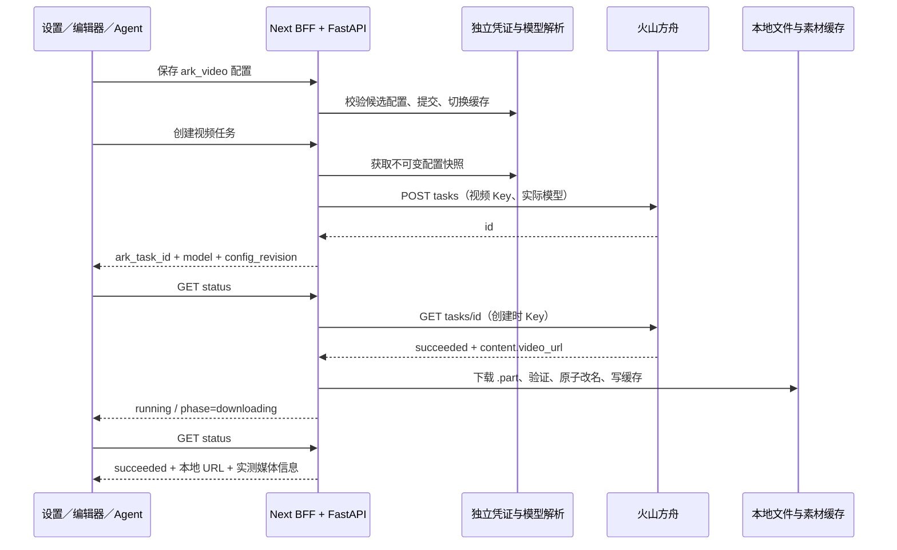

# AI 图片与视频独立凭证、视频模型配置及真实生成链路设计

> 版本：v2。编写及评审日期：2026-11-05。节点职责：方案评审与修复。
> 后续实施按 `superpowers:executing-plans` 逐项执行；本节点不编写实现代码，不提交 Git。

**目标：** 在现有设置中心及首次引导中分别配置图片、视频凭证，选择默认视频模型，并使普通生成、分镜和 Agent 使用同一条可验证的视频生成链路。

**架构：** 继续使用现有集成凭证注册表、SQLite 存储和热更新解析器。拆分 `ark_image`、`ark_video`，由后端统一解析视频模型、校验模型能力、提交异步任务、下载并验证真实视频，再向各调用入口报告完成。

**技术栈：** Electron 33、Next.js 15、React 19、TypeScript、FastAPI、Pydantic、SQLAlchemy 异步 SQLite、httpx、FFmpeg/ffprobe、pytest、Vitest。

**本轮定位信息：** `plan/current = {path: "docs/plans/ai-media-generation-credentials", slug: "ai-media-generation-credentials", doc: "spec.md", deliverable: "docs/plans/ai-media-generation-credentials/spec.md"}`。已在开始时尝试写入共享黑板；当前任务工具缺少 `TASK_SERVER_URL`，该尝试未成功，不能视为已登记。完成时按任务要求重试并使用任务板兜底，保留上述明确路径供调度恢复。

## 评审记录

逐节核对了可行性、完整性、项目一致性和范围。以下“已修复”均指已修改设计正文，不表示代码已实现或真实视频已生成。未引用共享黑板中的历史轮次发现。本轮 `get/put` 均因缺少调度环境失败；定位依据是本次前置节点明确给出的离线记录。

| 编号 | 等级 | 依据与问题 | 正文修复及验证落点 | 状态 |
|---|---|---|---|---|
| RV-01 | P0 | `main.py:495` 将 `RequestValidationError.errors()` 原样记日志并返回；新 `extra=forbid` 或错误类型可把请求中的 Key、提示词和 data URI 回显，业务 catch 无法拦截。 | §6.4 增加路由边界的脱敏校验错误；§8 纳入 main.py；A19 验证日志与响应。 | 已修复 |
| RV-02 | P1 | §5.4 只要求视频流、正时长和解码头两帧；本机实验确认单帧 MP4 的该命令仍退出 0，也不能发现尾部损坏。缓存服务还会复制文件并吞掉复制异常。 | §5.4 改为容器、有效视频帧、完整解码及最终缓存副本一致性检查；A12、A20。 | 已修复 |
| RV-03 | P1 | §5.2 在 POST 前“检查”容量，ID 返回后才登记；两个并发请求可同时占最后一个名额。队列闭包的 Key 也不受该 TTL 管理。 | §5.2 原子预留、批次预留、统一快照引用释放及 shutdown；A21。 | 已修复 |
| RV-04 | P1 | §7 的恢复校验在 `agent.ts:168` 初始化时运行，早于工具查询新 revision；若仍与空全局 revision 比较，会丢弃视频失败记录。GET models 与 POST 之间换设置还会把失败归到错误配置。 | §4.2、§6.3、§7 明确 expected_config_revision、一次解析和按能力延迟校验恢复记录；A22。 | 已修复 |
| RV-05 | P1 | §3.2 只设置 load_failed；现有 read/resolve/save 仍继续使用环境层或空缓存，迁移失败后可以误调用其他 Key 或覆盖未知库状态。现有 require_configured 又会把无效模型误报为缺 Key。 | §3.2、§3.3、§6.4 区分加载故障、缺 Key 和模型错误，失败时禁止媒体提交和配置写入；A23。 | 已修复 |
| RV-06 | P1 | §5.3 把创建和状态查询共用错误映射；查询 403 会包装成 502，前端按 5xx 重试；BFF 不保证透传 Retry-After。普通 HTTP 客户端默认 30 秒，短于服务端创建超时。 | §5.3、§5.5、§6.4 固定查询错误类别、单层重试及端到端超时；A24。 | 已修复 |
| RV-07 | P1 | §6.3 只要求 JobState 增加 model/phase；现有 sbv 路由、批量状态序列化和 TS 适配器没有完整透传尺寸、浮点时长及错误，分镜无法满足实测元数据契约。 | §5.5、§6.3、§8 明确所有适配层字段、原生 ID 和稳定素材身份；A25。 | 已修复 |
| RV-08 | P1 | §4.4 缺少本地图片宽高比、编码膨胀后的请求上限、冲突模式字段规则；keyframe 的 image_url 仍可被忽略。 | §4.4 在付费提交前完整规范化、限制解码内存并拒绝冲突输入；A26。 | 已修复 |
| RV-09 | P1 | §5.2 声称重启后恢复已完成任务，但缓存表无 model、尺寸或校验标记；30 分钟释放 Key 后仍承诺活动任务使用原 Key，下载失败也缺少可操作恢复路径。 | §5.2、§5.4 明确缓存优先恢复、未知模型为 null、本地过期和同任务重新收取的边界；A27。 | 已修复 |
| RV-10 | P2 | §10.2 将原始现场证据输出到未被忽略的 docs 目录，却要求它仅存在忽略目录；隔离库、storage 和启动方式不具体。 | §10.2 改用现有忽略目录 data/ark-video-acceptance，给出隔离启动配置和证据分层；A28。 | 已修复 |
| RV-11 | P2 | 英文模型教程入口本轮仅显示“该语言不可用”；v1 的只读 200 是前置节点报告，不能写成本评审执行结果。 | §2.2 改为可读取的中文官方来源；§10.3 分开记录两节点证据及本机实验。 | 已修复 |

章节覆盖：§1–2 保留独立集成及产品范围，复核官方模型目录；§3 修复迁移和错误边界；§4 修复配置竞争及输入约束；§5–6 修复生命周期、媒体验证与接口；§7 修复 Agent 恢复；§8–10 同步文件清单、命令和验收；§11–12 同步风险及交付条件。无需新增云服务、数据库表、通用 Provider 框架或远程任务持久化队列。

## 1. 概述

用户需要在设置中单独管理 AI 图片生成与 AI 视频生成的凭证，并选择视频生成默认使用的豆包／火山方舟 Seedance 模型。现有应用已有“服务与素材库”设置和首次引导，不能另建一套存储：现在的一个 `ark` 集成同时解锁 `ai_image`、`ai_video`，所有服务从 `ark_api_key()` 读取同一值；用户即使只想配置视频，也会被界面告知图片已经配置。这与两个服务可能采用不同账号、权限及 Key 的实际需求不一致。

本设计将两项能力分别归属两个集成。图片凭证覆盖 Seedream 普通图片、角色／场景图、分镜图及 AI 封面；视频凭证覆盖普通视频、逐句视频、分镜视频队列及 Agent 视频工具。模型选择在视频凭证卡片保存，所有未显式覆盖模型的调用读取该默认值。前端可以显示实际模型及能力，服务端负责最终校验，不能继续让 Agent 的 `model` 参数被无声忽略。

“生成成功”必须表示获得了供应商生成的真实、可解码视频并写入本地素材缓存。只获得任务 ID、收到远程成功状态、拿到一张图片或一个不可访问的地址，均不足以宣告完成。此次同时修复模型相关的参考图角色、请求参数和完成判定，防止只新增设置表单而真实生成仍使用旧模型或旧 Key。

## 2. 范围、证据与明确决策

### 2.1 已阅读的项目约定和现状

依据根目录 `README.md`、`CLAUDE.md`、`.claude-index/index.md` 以及下列实际源码制定设计。应用是单用户本地桌面软件，不新增登录、服务部署、RBAC 或云存储。

| 已核实的代码位置 | 现状及影响 |
|---|---|
| `app/services/integration_registry.py` | `ark` 只有一个 `api_key`，同时声明两个能力；注册表还驱动契约夹具及直接读取凭证的扫描测试。 |
| `app/services/integration_credentials_service.py` | 数据库优先于环境变量；清除数据库字段会恢复环境配置；写库成功后才替换内存缓存；目前所有生成共用 `ark_api_key()`。 |
| `app/services/integration_probes.py` | Ark 探测是 GET 视频任务列表，成功只证明该读取接口通过鉴权，不证明图片或选定视频模型的生成权限。 |
| `app/services/ark_video_service.py` | `ARK_MODEL` 固定为 `doubao-seedance-1-5-pro-251215`；重复使用 `first_frame` 处理第三、第四张图；未发送请求中的 `watermark`、`camera_fixed`。 |
| 同上 `get_status`、`_download_and_cache` | 返回 CDN 地址即 `succeeded`；写入最终 `.mp4` 后断流可留下半文件，下次仅凭文件存在跳过下载；缺少真实视频流校验。 |
| `src/components/Onboarding/wizard/integrationGroups.ts` | 生成步骤只有 `ark`；设置页面复用同一分组和 `IntegrationCard`。 |
| `src/lib/video-editing-agent/tools/generateAiVideo.ts` | 声明并发送 `model`，但服务端请求模型没有该字段，实际被忽略；恢复／熔断能力字符串含固定旧模型。 |
| `src/components/video/hooks/materialManagement/useMaterialGeneration.ts` | 用缩略图是否出现判断所谓“OSS 完成”，等待后可将 CDN 地址当作最终素材；与本地桌面架构不符。 |
| `src/components/video/components/AsyncTaskPoller.tsx` | Agent 一见 `succeeded` 就完成并入库；必须与新的完成契约一致。 |

本表 `app/` 均相对于 `backend-services/basic-service/`。

### 2.2 官方接口及模型核验

核查日期为 2026-11-05。创建任务使用 `POST https://ark.cn-beijing.volces.com/api/v3/contents/generations/tasks`，`model` 可填写模型 ID 或推理接入点 ID；首尾帧和参考图是不同、互斥的输入方式。后续实现采用结构化 JSON 字段，不拼接提示词参数。[官方创建任务接口](https://docs.volcengine.com/docs/ark/create-video-generation-task-api?lang=zh)

当前官方 2.0 系列列出了 `doubao-seedance-2-0-260128`、`doubao-seedance-2-0-fast-260128`、`doubao-seedance-2-0-mini-260615`。本次预置这三个模型；不将用户口述的“Seedance 2.0 lite”擅自映射为 Fast、Mini，或文本理解模型 `doubao-seed-2-0-lite-*`。本轮从中文页复核了三个 ID 和能力表；英文入口本次未提供正文。[官方 Seedance 2.0 系列说明](https://docs.volcengine.com/docs/ark/seedance-2-0?lang=zh)

2.0 标准版支持的输出规格多于 Fast、Mini；本产品只开放现有界面的规格子集，见 §4.3，不新增 4K、视频编辑、参考音频、参考视频、Draft 或 2.5 功能。[官方模型列表](https://docs.volcengine.com/docs/ark/model-list?lang=zh&redirect=1)

前置设计节点报告：已用用户提供的凭证向上述官方主机执行一次 `GET /contents/generations/tasks?page_size=1`，结果为 HTTP 200、JSON 对象；未提交生成请求、未生成视频。本评审未重做该鉴权请求。该报告仅支持“视频任务列表鉴权通过”，不能证明“2.0 lite”的真实 ID、模型开通状态或出片结果。文档、源码、测试夹具、日志和任务摘要中均不得复制该凭证。

### 2.3 方案选择

| 方案 | 取舍与决定 |
|---|---|
| 在原 `ark` 中加 `image_api_key`、`video_api_key` | 表面改动少，但一个集成的 `usable`、能力映射、配置引导与探测无法准确表示只配置一项；不采用。 |
| 拆成两个集成，复用注册表、凭证服务和卡片 | 能沿用独立校验、原子保存、热更新、缺凭证跳转和能力引导；采用。 |
| 并入聊天模型 Provider 系统或重新做媒体 Provider 框架 | 视频异步任务协议与聊天不同，且当前只要求火山方舟；不采用。 |

确定以下边界，实施时不再自行选择：

1. 旧共享配置只迁移到图片能力；视频必须有自己的配置，不自动复制或借用图片 Key。允许用户主动把同一个 Key 分别填入两个卡片，但保存、修改、清除彼此独立。
2. 视频预置默认值为标准 Seedance 2.0；新视频卡片首次保存时明确显示该值。它是应用默认值，不表示用户提供的凭证已获模型授权。
3. 图片模型仍沿用现有 Seedream 模型，本次不做图片模型选择器。
4. 保留现有 REST 地址及响应顶层结构，新增字段向后兼容。只将 `succeeded` 的语义收紧为本地可用。
5. 不在“保存并测试”时收费生成。真实视频验收由显式启用的现场测试执行，不能把只读探测算成生成成功。

## 3. 凭证数据模型、迁移与保存契约

### 3.1 注册表和环境变量

不新建数据库表、不做 DDL。继续使用 `integration_credentials(integration_id, fields JSON, created_at, updated_at)`。

| 集成 ID | 能力 | 字段 | 环境变量 | 默认值 |
|---|---|---|---|---|
| `ark_image` | `ai_image` | `api_key: secret, required` | `ARK_IMAGE_API_KEY` | 无 |
| `ark_video` | `ai_video` | `api_key: secret, required` | `ARK_VIDEO_API_KEY` | 无 |
| `ark_video` | — | `default_model: choice` | `ARK_VIDEO_MODEL` | `doubao-seedance-2-0-260128` |
| `ark_video` | — | `custom_model: text` | `ARK_VIDEO_CUSTOM_MODEL` | 空 |
| `ark_video` | — | `custom_profile: choice` | `ARK_VIDEO_CUSTOM_PROFILE` | `text_only` |

`default_model.choices` 固定为三个预置的实际 ID 加 `custom`。`custom_profile.choices` 为 `text_only`、`first_frame`、`seedance_2`。两个集成都设置 `verify_level="free"`，但图片的免费验证可以回答 `unverifiable`，不能冒用视频列表权限推断图片权限。

在 `Settings` 和 `get_settings()` 同时新增对应属性。旧 `ark_api_key` 和 `ARK_API_KEY` 只作为图片的兼容环境来源；注册表新增 `LEGACY_CREDENTIAL_BASELINES=(BaselineRef("ark_api_key", "ARK_API_KEY"),)`，`baseline_patterns()` 和扫描测试均遍历它，禁止任意业务服务直接访问。迁移模块所需的图片环境可用性由凭证服务传入布尔值，迁移模块不直接读 settings／env。环境解析顺序为“新图片变量 > 旧共享变量”，视频只读新视频变量。空字符串、占位值不算配置。

新增公开辅助函数 `ark_image_api_key()`、`ark_video_api_key()`；删除生产用 `ark_api_key()`，同步修改测试。模型通过 `resolve_video_config()` 获取，不在各调用方分别读取环境变量。

### 3.2 旧数据库迁移

新增 `integration_credential_migration.py`，在 `load_all()` 读取原始行之后、过滤未知集成之前执行。整个迁移使用一个事务；迁移成功后重新读取并一次性替换缓存。

1. 查找旧 `integration_id="ark"` 行。不存在则返回。
2. 其 `fields._media_split_v1` 为 `true` 时返回，防止清除图片配置后旧 Key 再次复活。
3. 新 `ark_image` 行不存在、没有有效 `ARK_IMAGE_API_KEY`、且旧 Key 有效时，插入 `ark_image.fields={"api_key":旧值}`。已存在的新行即使暂时只有其他字段也不覆盖。
4. 永远不写 `ark_video`。给旧行 JSON 写入 `_media_split_v1=true`，旧行作为兼容存档保留，不在接口列表展示，也不在运行时解析。
5. 审计只写迁移类型、集成 ID、字段名，不写新旧值。事务失败时回滚，令 `load_failed=true`；不可悄悄用旧共享 Key 继续生成。

通过现有 SQLAlchemy JSON 字段整体赋新字典，不能只原地修改嵌套对象而遗漏持久化。迁移标记与新行在同一事务提交；重复启动、失败重启、清除后重启均须测试。SQLite 单进程启动时运行，不在每次 GET 中执行迁移。

迁移／加载失败时不能将空缓存当作真实库状态。`ark_image_api_key()`、`ark_video_api_key()`、媒体配置解析和所有媒体入口预检均先检查 `load_failed`，返回 503 `integration_load_failed`，禁止退到任何环境 Key。两个卡片公开 `usable=false`，models 仍可返回静态目录但 `configured=false/default_model=null`，附 `configuration_warning=integration_load_failed`。本次启动内禁止两个媒体集成的 PUT/DELETE/test，避免在未知库状态上覆盖记录；提示修复本地数据库后重启，成功 load_all 后恢复。其他集成保持现有行为。

### 3.3 清除和补丁语义

维持原有语义：PUT 中省略字段保持不变；`null` 或空字符串清除该数据库字段；DELETE 清除该集成的应用配置，恢复**该集成自己的**环境层／默认值。图片可以恢复旧 `ARK_API_KEY`，UI 明示其兼容来源；视频永远不会回退到该值。

切换模型不能清空已保存 Key；秘密输入框留空且未编辑时不发送 `api_key`。自定义 ID 清空的同时将 `default_model` 改回预置，应在一次 PUT 中成功；当前有效模型仍为 `custom` 却没有有效 ID 时必须原子拒绝，不能把配置写成半有效状态。

在 `save()` 中先合并补丁到候选配置，解析其完整环境层和默认值，再做跨字段校验，最后提交。自定义 ID 规则为 `^[A-Za-z0-9][A-Za-z0-9._-]{0,127}$`，只允许已知视频模型命名 `doubao-seedance-...` 或 `ep-...`。该特例仅用于 `custom_model`，不放宽其他集成的 text 校验。不得把任意字符串插入 URL；它只是 JSON 的 `model` 值。

`default_model="custom"` 时完整配置必须有有效自定义 ID 和 profile，否则 HTTP 422 `invalid_model_configuration`，详情仅包含字段名。`usable` 除 Key 外还须通过完整模型配置校验；环境配置错误也必须显示不可用，不能保存／启动后悄悄改回标准模型。仅对视频模型 choice 字段改变当前 `_resolve_choice` 的无效值回退规则：非空数据库／环境值不在 choices 中时保留 invalid 标记；只有真正未设置才回退。普通集成 choice 行为不变。

媒体入口预检顺序固定为加载故障 → 对应 Key 缺失 → 当前生效模型配置错误，分别返回 503、409、422；不能直接以 `usable=false` 全部映射为缺 Key。`clear()` 是用户恢复环境配置的操作，即使环境模型非法也允许清除数据库配置并显示不可用状态；PUT 则必须校验合并后的有效配置。未启用的 custom 草稿不决定预置模型的 usable，但新提交的草稿字段仍须符合字段格式。

依赖方向固定为 `integration_registry → ark_video_profiles`、`integration_credentials_service → integration_registry + migration`、`ark_video_config → integration_credentials_service + ark_video_profiles`。通用跨字段校验放在不读凭证的 `ark_video_profiles` 纯函数中，凭证服务不得反向导入 `ark_video_config`，避免初始化循环。

旧 `/api/integrations/ark` 的写入、删除及测试统一返回 HTTP 410 `integration_replaced`，详情列出两个替代 ID，不把旧请求同时应用到两边。新前端永远不发送该 ID。

### 3.4 无秘密响应及配置修订

沿用 `IntegrationPublic`；秘密字段仅有 `configured/source`，不提供前后缀掩码或原值。公开模型 ID、选项、profile 均可返回。增加可选 `configuration_warning`，值为 `legacy_image_environment`、`invalid_model_configuration` 或 `integration_load_failed`；`ResolvedIntegration` 同时携带该标记，经 `to_public()` 输出，TS `fromWire()` 映射为 `configurationWarning`，前端本地化展示。

视频配置服务在加载／有效配置改变时生成进程内不透明 UUID `config_revision`，不由 Key 的哈希派生。幂等保存相同有效配置不变更修订；变更视频 Key、默认模型、自定义 ID/profile 才变化。图片修改不影响视频修订。该修订用于 Agent 的失败缓存失效，不是秘密，也不持久化为凭证。

## 4. 视频模型目录、解析和输入校验

### 4.1 单一模型目录

新增 `ark_video_profiles.py`，用不可变数据定义 `VideoModelSpec` 和 profile：

```text
VideoModelSpec:
  id: str
  display_name: str
  profile: str
  modes: tuple[description, keyframe, reference]
  resolutions: tuple[str]
  duration_min: int
  duration_max: int
  max_reference_images: int
  supports_last_frame: bool
  supports_camera_fixed: bool
```

该目录驱动设置预置、后端参数校验及前端 capabilities，不允许 TS 再维护另一份模型能力表。模型目录是应用支持列表，不是账户已开通列表；下拉框不能标“已授权”。本次不新增在线模型枚举，因为文本模型列表及接入点列表不能可靠等同于可调用的视频模型。

### 4.2 配置及单次覆盖顺序

新增 `ark_video_config.py`：`resolve_video_config(model_override: str | None = None) -> VideoRuntimeConfig`。返回 `model_id`、能力 profile、`config_revision`、`integration_id="ark_video"` 和 `api_key`；秘密字段使用 `repr=False`，整个对象不序列化到 HTTP／日志。

模型解析顺序为“明确的单次 model > 已保存默认模型 > 视频专属环境模型 > 注册表默认模型”。单次 `model` 只可为预置 ID 或当前已配置的自定义 ID；不接受任意 Agent 编造的 ID，也不能仅靠不同字符串获得新的生成重试预算。空白 model 视为省略。客户端绝不能提交 Key、base URL、profile 或 header。

普通生成弹窗本次只显示默认模型及“前往配置”入口，不新增与设置竞争的第二个永久默认值。Agent 的合法单次覆盖会真正发送；响应记录实际 ID。分镜批量在**入队时**解析一次配置，整批冻结该模型及 Key，不能排队到一半读取新设置而混用。

解析必须在同一无 await 的读段取得有效 Key、模型、profile 和 revision，之后所有校验、POST、响应和任务上下文均使用该不可变快照；不得创建前后分别读默认配置。直接生成和分镜批量请求可带 `expected_config_revision?: string`（普通弹窗、Agent 和现场脚本必须发送；未读取 models 的旧调用可省略）。有值且不匹配时返回 409 `video_configuration_changed`，零上游提交；客户端刷新配置并保留草稿，不自动再次 POST。该字段是本地竞争检查，不进入 Ark payload，也不改变幂等保存规则。

### 4.3 产品支持的能力子集

| 目录项／profile | 文生 | 单首帧／首尾帧 | 真正参考图 | 分辨率 | 时长 | 固定镜头参数 |
|---|---|---|---|---|---|---|
| Seedance 2.0 | 是 | 是／是 | 1–4 张 | 480p、720p、1080p | 整数 4–12 秒 | 不支持 |
| Seedance 2.0 Fast | 是 | 是／是 | 1–4 张 | 480p、720p | 整数 4–12 秒 | 不支持 |
| Seedance 2.0 Mini | 是 | 是／是 | 1–4 张 | 480p、720p | 整数 4–12 秒 | 不支持 |
| 自定义 `seedance_2` | 是 | 是／是 | 1–4 张 | 仅 720p | 整数 4–12 秒 | 不支持 |
| 自定义 `first_frame` | 是 | 是／否 | 否 | 仅 720p | 整数 4–12 秒 | 不支持 |
| 自定义 `text_only` | 是 | 否／否 | 否 | 仅 720p | 整数 4–12 秒 | 不支持 |

表中限制是本次产品支持范围，不能宣称供应商最多只允许四张图或十二秒。保留逐句时长桶 `[5,7,10,12]`，修正文案为“编辑器预设”，不再说是 Ark API 唯一时长枚举。此举避免扩展逐句对齐算法。

当前官方创建接口将 `camera_fixed` 适用范围限定于较旧模型，故上述新预置禁用此选项。收到 `false` 时省略字段，收到 `true` 时以参数错误拒绝，不能收下后静默无效。`watermark` 则必须按用户值进入 JSON。[官方参数说明](https://docs.volcengine.com/docs/ark/create-video-generation-task-api?lang=zh)

### 4.4 内容构建规则

新增 `ark_video_payload.py`，校验在上传本地图片和提交付费任务之前完成，产生可测试的规范化输入。后端复用现有 `_resolve_image_url` 的本地读取能力，但限制路径在 `settings.storage.root` 下：仅接受 `/api/storage/files/` 开头的本地 URL，规范化及解码后验证 containment；拒绝 `..`、驱动器路径、缺失文件及未知相对 URL。不得把原始本地路径发给供应商。

| 输入情况 | 确定处理 |
|---|---|
| `description`，没有图 | 仅一个 text content，使用用户 `aspect_ratio`。 |
| `description`，1 或 2 张旧式图片 | 兼容旧调用，规范化为首帧／首尾帧语义，分别只发一个 `first_frame`、一个 `last_frame`；图像比例取 `adaptive`。 |
| `description`，超过 2 张 | 422 `video_parameters_unsupported`，要求显式改用参考图模式，禁止截断和重复首帧角色。 |
| `keyframe` | 必须有首帧，尾帧可选；`image_url` 和 `image_urls` 中与显式首尾帧重复的镜像字段忽略，其余额外图片拒绝。首、尾同一张允许，不能按 URL 全局去重而删掉尾帧角色。 |
| `reference` | 合并 `image_url` 与 `image_urls`，trim、去空、保序去重，必须 1–4 张；每张角色都是 `reference_image`，不得夹带 first/last。比例采用用户值。 |
| 模型不支持某模式、尾帧、分辨率或时长 | 422，详情为 `field/model/allowed`，不调用上游，不自动换模型。 |

所有模式先 trim、去空、限制原始列表长度（最多 8 个镜像输入）再规范化。description/reference 若带非空 first_frame_url 或 last_frame_url，返回 422，不能静默忽略。规范化后的图片再按 §4.3 检查模式及数量；不会截断超额图。

本地图片及 data URI 只接受 JPEG/PNG/WebP，实际格式须匹配 MIME；宽高均在 300–6000，宽/高在 0.4–2.5。单图按十进制小于 30,000,000 字节，最终**实际发送的 UTF-8 JSON 字节**不超过 64,000,000（包含 base64 膨胀及封装）；先检查文件大小／编码长度，再解码。Pillow 先读尺寸，限制不超过 3600 万像素，再 verify/load，捕获解码及解压炸弹异常。逐图处理，不同时保留全部像素；不在事件循环做大量图片解码。此处格式子集由产品选择，尺寸和上游请求上限依据[官方图片输入要求](https://docs.volcengine.com/docs/ark/create-video-generation-task-api?lang=zh)。

本地 URL 仅接受 §4.4 指定前缀，单次解码后拒绝残留编码分隔符、query/fragment、反斜杠、NUL、Windows ADS 冒号；用 realpath/resolve 验证符号链接／junction 后仍在 storage 根内。远程 HTTP(S) 图片只校验 URL 语法、禁止 userinfo 和字面 loopback／私网地址，内容规格交供应商检查；不主动抓取任意远程图、不额外做本地 DNS 探测。`blob:` 拒绝并提示先导入素材库。全部错误只含受控字段名，不输出原路径或 data URI。

基础 payload 明确包含 `model/content/duration/ratio/resolution/watermark`。本次统一发送 `generate_audio=false` 仅针对 `seedance_2` 家族；未知自定义 profile 省略，UI 不承诺音轨。不得将提示词替换为图片生成、静态幻灯片或搜索素材来伪装 AI 视频成功。

## 5. 请求、轮询、下载和任务生命周期

### 5.1 主链路



创建只尝试一次。网络超时、无 ID、非 JSON 等可能已被供应商接受的情况返回 `generation_submission_unknown`，`retryable=false`；不能自动再次 POST，更不能遍历模型试到成功。读取状态和下载允许有界重试，均不创建新付费任务。

### 5.2 运行配置快照与资源上限

新增 `ark_video_task_context.py`：进程内上下文管理器保存创建时配置（Key 字段隐藏 repr）、时间、阶段、错误、下载句柄和最后结果。所有入口共享最多 200 个名额，计入尚未返回上游 ID 的提交和分镜排队项。**先在同一个 asyncio.Lock 内清理终态并原子预留名额，再做任何 POST**；返回 ID 后将预留绑定到 task ID。失败／取消在 finally 释放未绑定名额；受理未知仍报告 unknown，不因释放名额而重发。原生 task ID 在查询、登记和拼接 URL 前统一验证 §5.4 的格式。

分镜在入队前校验全部有效项的模式／时长并一次预留所需名额，容量不足返回 429、整批零入队。队列只传不透明 context handle；Key 仅在管理器的私有配置快照中，不进入 JobState、task_args 的公开序列化、metadata 或日志。worker 通过 handle 取同一批快照；排队取消、enqueue 异常、worker 退出和服务关闭都释放引用。可共享一个批次快照，但必须引用计数，最后一项完成／过期后清除。禁止留下捕获明文 Key 的长期闭包。

活动上下文从预留开始最多存活 30 分钟；每 60 秒运行清理（在 main lifespan 初始化及 shutdown 停止并 await）。未提交的过期排队项只返回本地 timeout，不再向上游提交；已提交的过期项标记本地 timeout，注明远程可能仍运行，清除 Key、取消并回收该上下文的下载／校验协程。配置快照在上游终态立即解除该任务的秘密引用，下载只保留受控元数据和私有短期 URL。无秘密终态最多保留 1 小时；需要容量时可提前淘汰，字典和锁随记录清理。管理器 TTL 不等于供应商任务 TTL，不承诺无限期保存旧 Key。

同一进程内，存活任务始终用创建快照；修改／清除视频设置不影响它。无上下文的原生 ID（包括重启／TTL 淘汰后）先查询本地缓存，已有缓存无需 Key；文件存在须后台重新按 §5.4 校验，期间返回 running/validating，探测实测元数据后才返回 ready。当前缓存表没有生成模型列：恢复时 `model=null`，UI 显示“历史模型未知”，不得填当前默认值。未找到有效文件才可用当前独立视频 Key 查询 Ark，并为该 ID 注册一个受同样容量／TTL 约束的恢复上下文；403/404 提示核对创建任务时的视频配置及任务有效期。永远不尝试图片／旧共享 Key。

本次不新增持久化视频队列表。`sbv-` 队列重启后仍返回明确 404 `storyboard_job_not_found`；已存素材按本地 URL 正常播放。该错误表示本地队列记录丢失，不能声称远程任务被取消或不存在。显式“重新查询／重新收取”只对已有原生 task ID 操作，不能自动转为创建新任务。

### 5.3 状态契约

保留 `status = queued | running | succeeded | failed | timeout`，新增可选 `phase = queued | generating | downloading | validating | ready`。

| 上游／本地状态 | 对客户端结果 |
|---|---|
| queued / running | 原状态，`success=true`；`video_url=null`。 |
| succeeded，已获合法 HTTP(S) 视频 URL | 启动一次后台下载；`running`，`phase=downloading`，不返回可最终入库的 URL。 |
| 下载、解码校验及缓存登记全部成功 | `succeeded`、`phase=ready`；返回本地视频 URL及实测时长尺寸。 |
| failed / cancelled / canceled / error | `failed`、`success=false`、受控 `error_code`，不泄露上游正文。 |
| expired / timeout | `timeout`、`success=false`，明确超时；不能当作 running 无限轮询。 |
| 未知状态／成功却缺少 URL | `failed`、`invalid_provider_response`。 |
| 下载／验证／登记失败 | `failed`，分别为 `video_download_failed`、`invalid_video_artifact`、`video_cache_failed`。 |

HTTP 鉴权错误、404、限流不是视频生成状态，返回 §6.4 的查询专用 ErrorResponse。客户端根据 `error_code/error_details.retryable/upstream_status` 判定，不能把所有本地 502 当瞬态。重试只在消费端 poller（分镜由 worker）实施，服务端单次 GET、http-client 和 BFF 均不隐式重试；连续网络或可重试 5xx 最多额外三次，间隔 5/10/20 秒，成功后清零且始终受总期限约束。上游 401/403/404 或未知状态立即停止。

上游 429 解析 Retry-After 为秒，写入 JSON `error_details.retry_after_seconds`，BFF 不透传 header 时仍可执行。最长自动等待 60 秒；供应商要求超过 60 秒时停止本地轮询并显示稍后重新查询，不能把 120 秒截成 60 秒提前请求。等待期间不占查询 in-flight 名额；取消后定时器不得继续发请求。

### 5.4 真实文件验证

新增 `ark_video_artifacts.py`，从 `ark_video_service` 抽出下载／校验职责，避免继续扩展大函数。每个 task ID 使用一个后台任务和锁；状态查询在下载期间不反复访问 Ark。

1. 目标为既有 `STORAGE_ROOT/video/ark/YYYYMMDD/<task_id>.mp4`，task ID 限定 `^[A-Za-z0-9_-]{1,128}$`。先写同目录随机 `.part`，不把半文件放在最终路径。
2. 使用独立不带 Authorization 的安全下载客户端；GET 120 秒超时，最多两次尝试，单文件上限 128 MiB。重试必须重新创建 `.part`；清理自身临时文件。拒绝非 HTTP(S)、loopback、私网、metadata 地址，重定向每跳检查，复用已有安全下载客户端的 URL／DNS 检查能力。
3. 文件非空，ffprobe 必须识别 MP4 容器（不能仅看扩展名或 Content-Type），选择非 attached_pic 的真实视频流，宽高正数、时长有限且大于零。随后对该视频流及存在的音轨完整解码，使用 `ffmpeg -nostdin -v error -xerror -err_detect explode ... -f null -`，禁止 `-frames:v 2` 短路；从解码进度取得实际输出帧数，至少 2 帧，不补帧／循环输入，正常退出 0 才通过。探测限 15 秒、完整解码限 120 秒，超时 kill 并 wait；只处理本地文件，禁止网络协议，stdout/stderr 有界且不原样日志输出。音频非必需，只有封面图的视频流、单帧 MP4、图片伪装、HTML、尾部损坏均失败。[FFmpeg 选项说明](https://ffmpeg.org/ffmpeg.html)。多帧可解码只证明媒体有效；是否符合提示词、是否真实运动仍由 §10.2 现场画面验收判断，不用静态像素差阈值误拒合法静止镜头。
4. 使用 ffprobe 实测的浮点时长、宽高，不能从 `720p` 推断所有素材都是横屏 1280×720。响应 duration 改为 float，TS 原本 number 无需收窄。
5. 校验通过后原子替换最终路径，调用 `store_external_download_async(source="ark", source_id=task_id, ...)`，检查实际缓存记录和本地 URL，再缓存成功结果。该业务源名仍叫 `ark`，不能与凭证集成拆分混为一谈并改成 `ark_video`。
6. 缩略图失败可降级为 `null`，真实视频成功仍可完成；因此所有前端必须以 ready 判定，不能等缩略图。可保留现有异步缩略图抽取，子进程超时必须 kill 并 wait 回收。
7. 已有最终文件也须通过本节验证，存在本身不代表完整；有效文件复用并补登记，损坏文件走重新下载。进程内成功快照可记录 `(path, size, mtime_ns)`，每次 ready 返回前确认仍匹配，缺失／变化后重新校验；重启后无该证据，必须重新验证。

安全下载具体使用已核对的 `app/services/web_research/safe_http_client.py` 公共接口：`SafeHttpClient.fetch(FetchPolicy(max_bytes=128*1024*1024, timeout=120, respect_robots=False, document=False), RequestSpec(url=url, method="GET"))`。实例的 `proxy_settings` 从 `default_proxy_settings()` 获取，保留代理解析结果，将 `egress_mode="strict"`、`egress_allow_hosts=()`、`concurrency=1` 固定用于生成产物下载；所有下载再共享一个 `asyncio.Semaphore(1)`，避免该客户端缓冲整个 body 时多文件放大内存。检查 `HttpResult.status == 200`、body非空后异步写 `.part`，及时释放 body。客户端内部已逐跳检查并钉住直连 DNS；不另建第二次未受保护的 httpx 请求。此调用不启用 research run、不调用研究模型、不依赖研究启用开关；代理场景采用原客户端策略，不强制本地 DNS。

`store_external_download_async()` 实际返回 `None`，不能把返回值当缓存行。调用之后须执行 `lookup_async(source="ark", source_id=task_id)`，确认记录的本地文件存在，并用 `local_url_for(row)` 得到统一缓存 URL；该 URL 为最终 `video_url`。日期目录 URL仅作为文件落盘布局，不保证是缓存模块最终对外路径。状态示例中的 URL只说明本地同源形态。

现有缓存登记会复制文件，且复制失败时直接 return，因此还须验证 row 的 source/source_id/status、本地路径 containment，以及缓存副本与已验证产物的字节数和 SHA-256 相同；大小相同但内容不同也不能复用旧 ready 行。散列／文件 IO 放在线程或异步 IO 中。复制或登记失败返回 video_cache_failed，保留已验证原件以便显式重新收取时只补缓存；不修改通用缓存服务的公共行为。

下载／验证／登记失败不会由普通 status GET 反复启动。复用 GET `/status/{task_id}?retry_artifact=true` 作为**显式**重新收取动作，只允许已有原生 ID、当前无工作者且失败属于产物阶段；每 ID 至少冷却 30 秒，原子复用同一锁／句柄，返回 running。先复用已验证原件；需要刷新过期 CDN URL 时按 §5.2 用当前视频 Key 重新 GET 原任务，再下载，绝不 POST。远程 failed/expired、受理未知没有 ID 的情况不能靠该动作恢复。BFF 必须透传该单一布尔参数；前端轮询默认不带它。UI 仅在拥有原生 ID 时显示重新收取，sbv 无原生 ID 时显示现有错误建议。

### 5.5 前端统一结束条件

`useMaterialGeneration` 删除“OSS 等待 20 次后用 CDN 完成”的分支；`ready` 后即使没有缩略图也入库完成，写入 `url/serverUrl/cacheUrl` 为本地 URL、实测 duration/width/height 和 model 元数据。失败保留可见错误，不留下仍然转圈的占位素材。所有本地期限到达只停止本地等待，显示供应商任务可能仍运行，不宣称已远程取消。

`AsyncTaskPoller`、`useAIVideoScriptGeneration`、`useStoryboardScriptGeneration` 同步处理 `timeout`、永久错误及 phase。并发轮询要有 per-task in-flight 防重入；ready 响应同时给出原生 `ark_task_id`，同一供应商任务统一为 `ai-vid-<ark_task_id>`，不能一处用 sbv ID、一处用原生 ID。普通生成已有的占位素材需在 ready 时原子替换／合并并移除旧占位，更新所引用的任务记录，禁止遗留重复项。每次异步结果应用前重读 store 的终态和当前请求代号，已删除任务、已切换项目或过期请求不再入库；加入时间线以 store 内任务 result 的已消费标记判重，不能仅靠组件内 Set。该 store 当前不跨进程持久化，本次不新增任务持久化；组件重挂载不得重复插入，重启仅恢复已保存素材及时间线。原有自动加入时间线意图保持不变。

普通调用最多等待 10 分钟；分镜使用既有 YAML 超时。所有 poller 卸载／取消时清理 timer，不能重新提交生成。10 分钟只是本地等待期限，不改写供应商 task execution TTL。

普通 `createArkVideoTask` 显式设置 `retries=0, timeoutMs=120000`，对应服务端创建 60 秒、BFF 现有 300 秒；Agent 维持 120 秒和 retry=false。状态查询服务端单次 15 秒，前端和 BFF 至少 25 秒；下载／验证在后台执行，不能阻塞 GET 等待媒体完成。前端网络超时或取消发生在提交之后时显示“受理状态未知／可能仍在生成”，不当作未提交，不显示可自动重试的按钮。只刷新配置的 models 请求保持 5 秒。

## 6. REST 接口和错误设计

### 6.1 设置接口

沿用四个接口，由既有 `integrationWrite` 保持 Origin 和 Content-Type 检查：

```text
GET    /api/integrations
PUT    /api/integrations/{ark_image|ark_video}
DELETE /api/integrations/{ark_image|ark_video}
POST   /api/integrations/{ark_image|ark_video}/test
```

视频保存示例（尖括号值仅为说明，真实占位值应被校验拒绝）：

```json
{
  "fields": {
    "api_key": "<仅经用户输入传入，不回显>",
    "default_model": "doubao-seedance-2-0-fast-260128"
  }
}
```

修改模型但保留 Key：`{"fields":{"default_model":"custom","custom_model":"ep-example","custom_profile":"seedance_2"}}`。此示例不代表真实接入点存在或已授权。

视频探测沿用官方任务列表 GET、5 秒冷却及现有互斥保护，明确“鉴权通过，模型生成尚未验证”。图片探测本次固定返回 `unverifiable`，提示已保存、首次实际图片请求验证权限；它不使用视频任务接口，也不消耗费用。图片与视频探测冷却分别计时。

### 6.2 新增只读模型能力接口

`GET /api/ark-video/models` 由后端返回，Next 新建同名 BFF 路由。无需凭证即可列出目录，但绝不包含凭证；不访问上游，不收费。

```json
{
  "success": true,
  "data": {
    "configured": true,
    "default_model": "doubao-seedance-2-0-fast-260128",
    "config_revision": "11111111-1111-4111-8111-111111111111",
    "models": [
      {
        "id": "doubao-seedance-2-0-fast-260128",
        "display_name": "Seedance 2.0 Fast",
        "profile": "seedance_2_fast",
        "modes": ["description", "keyframe", "reference"],
        "resolutions": ["480p", "720p"],
        "duration_min": 4,
        "duration_max": 12,
        "max_reference_images": 4,
        "supports_last_frame": true,
        "supports_camera_fixed": false
      }
    ]
  }
}
```

实际 `models` 包含全部三个预置及有效的当前自定义条目；不会包含未保存草稿。配置非法时 `configured=false`，`default_model=null` 并给出受控 `configuration_warning`；仍返回预置列表。此接口放在 `/status/{id}` 等动态路由之前注册。

### 6.3 生成及状态接口

`POST /api/ark-video/generate` 请求新增 `model?: string`、`expected_config_revision?: string`，其他现有字段保留。后者仅接受不透明 UUID 格式，不进入上游 payload。`duration` 严格整数 4–12，拒绝 bool、小数、NaN；prompt trim 后 1–2000 字符。未知字段使用 `extra="forbid"`，先更新所有已知调用方以免误拒合法字段；其校验错误必须经过 §6.4 的脱敏分支。

成功仍为 HTTP 200：

```json
{
  "success": true,
  "message": "Video generation task created",
  "ark_task_id": "provider-task-id",
  "model": "doubao-seedance-2-0-fast-260128",
  "config_revision": "11111111-1111-4111-8111-111111111111"
}
```

`GET /api/ark-video/status/{task_id}` 保留顶层 `status/video_url/thumbnail_url/duration/width/height/error`，增加 `phase/model/error_code/ark_task_id`，支持 §5.4 的可选 `retry_artifact`。model 允许 null（重启后的历史缓存未知），无效 task ID 返回脱敏 422，禁止字符串直接拼上游 URL。本地成功例：

```json
{
  "success": true,
  "status": "succeeded",
  "phase": "ready",
  "ark_task_id": "provider-task-id",
  "model": "doubao-seedance-2-0-fast-260128",
  "video_url": "/api/storage/files/video/ark/20261105/provider-task-id.mp4",
  "thumbnail_url": null,
  "duration": 5.08,
  "width": 1280,
  "height": 720
}
```

旧 `sbv-` 状态分支继续工作；`JobState` 增加无秘密的 `model/phase/width/height/error_code`，duration 改 float，保留原生 `ark_task_id`。queue worker、`ark_video_router` 的 sbv 映射、`storyboard_service.get_batch_video_status` 的 dict、`src/lib/api/storyboard.ts` 的 envelope 和映射均完整透传；批量 status 保持现有 success/generating 词汇，在 TS 适配器明确映射，不能直接混用原生 succeeded/running。队列只有底层 ready 才设 success，timeout 必须立即成为终态。两个分镜轮询分支（单候选和多候选）均无需 thumbnail 才结束，并使用实测 duration/width/height。

`StoryboardBatchVideoRequest` 增加可选 `expected_config_revision`，整批在预留前比较一次；支持 custom text_only 的直接文生，但分镜需要首帧时须在入队前以 422 拒绝，不自动丢弃分镜图。内部 `create_task` 改为返回无秘密的 `VideoSubmission(task_id, model_id, config_revision)`，或等价明确的返回类型，调用方同步更新；不能 POST 后再调用配置解析器来构造 response。分镜公开响应不含配置快照，受控错误仍携带 ark_video 配置提示。

### 6.4 错误映射与日志

| 本地 HTTP／错误码 | 场景 | 调用方行为 |
|---|---|---|
| 409 `credential_not_configured` | 缺对应图片或视频 Key | `error_details.integration_id` 精确指向卡片。 |
| 503 `integration_load_failed` | 启动加载或迁移失败 | 禁止媒体提交与两个媒体卡片写入，提示修复本地库后重启。 |
| 409 `video_configuration_changed` | 已读取的 revision 与创建时不符 | validation 类、非 sticky；刷新配置并保留草稿，不自动 POST。 |
| 422 `invalid_model_configuration` | 自定义配置不完整或环境模型非法 | 展示字段错误，不付费提交。 |
| 422 `video_parameters_unsupported` | 模型不支持请求模式／规格 | 显示模型及允许值，由用户改参数。 |
| 502 `provider_authentication` | 上游 401/403 | 配置类失败，停止自动提交，不切 Key。 |
| 502 `provider_unavailable` | 模型未开通／不存在／接入点关闭 | 提示核对模型服务；保留无秘密 request ID。 |
| 502 `provider_rate_limited` | 上游限流 | 创建不自动重试；状态读取按限定策略处理。 |
| 502 `generation_submission_unknown` | 创建超时／返回格式异常 | 明确受理未知，不自动再次收费。 |
| 429 `video_task_capacity` | 本地上下文已满 | 未提交上游，等待现有任务结束。 |

继续复用 `generation_error_response`，扩展已知验证异常的 422 映射及精确能力名。移除本链路对 `response.text`、异常字符串、完整 payload 的日志输出；只记录模型 ID、模式、task ID、HTTP 状态、受控错误码和白名单 request ID。签名 CDN URL、Key、提示词全文和 base64 图片不进入错误详情。

创建表与查询表分离：查询上游 401/403 返回 502 `provider_authentication`（`retryable=false`），404 返回 404 `video_task_not_found`（false），429 返回 429 `provider_rate_limited`（true，附 retry_after_seconds），网络／5xx 返回 502 `video_status_unavailable`（true）。所有错误含 `operation=status` 与可取得的 upstream_status，不能返回 generation_submission_unknown；后者只用于创建。错误读取客户端按上述结构归类，分镜 worker 使用同一规则。新增 `video_download_failed/invalid_video_artifact/video_cache_failed/video_task_capacity/storyboard_job_not_found` 均有受控文案，不把 Python 异常字符串放进 JobState.error。

必须同时修改 `app/main.py` 中 RequestValidationError 处理：对 `/api/integrations`、`/api/ark-video` 及本次涉及的 `/api/storyboard/batch-video` 精确路径族，在通用日志语句之前返回脱敏 422。只保留已知字段名／数字索引和受控错误类型；未知字段名统一为 unknown_field，不能照抄用户自定键；删除 `input/ctx/url`，message 用本地固定文案，禁止使用 `str(exc)` 或原始 `exc.errors()` 记录日志。畸形 JSON、错误容器类型、extra 字段、超长提示词、非法 data URI、NaN 和模型验证器异常均覆盖；不可只在 router 函数内 catch。其他路由行为不重写。用 fake sentinel Key 与内容测试响应、应用日志和审计均无输入泄露。

## 7. 界面、首次引导及 Agent 交互

设置“服务与素材库 → AI 图片与视频”显示两张卡片，分别为“AI 图片生成（Seedream）”和“AI 视频生成（Seedance）”。视频卡片顺序为 Key、默认视频模型、自定义 ID（只在 custom 时显示）、自定义能力类型（同上）、保存并检查连接。所有输入有 label，错误关联 `aria-describedby`，键盘可操作；复用现有外链白名单 `GetCredentialLink`。

首次引导 generation 分组改为 `['ark_image','ark_video']`，两个能力分别 ready、分别 opt-out。图片 ready 不跳过缺视频配置，反之亦然。设置保存仍调用 `notifySetupConfigUpdated()`；向导聚焦目标及 `ConfigureCta`、缺凭证监听器都识别新 ID。已有用户看到“图片配置已保留；视频请单独配置”，不显示“两项已经就绪”。

`IntegrationCard` 继续复用。新增字段标签及模型名翻译；仅为视频卡片过滤 custom 可见字段，不让隐藏的自定义草稿误清空有效 Key。保存新预置时保留自定义 ID 作为可再次选择的已保存值；读取仍由当前 `default_model` 决定，不能因为自定义值存在就覆盖预置。

视频弹窗打开时请求 models 接口；加载中禁用生成，失败可重试。收到设置更新事件后刷新能力；若用户当前分辨率／模式变得不支持，显示错误并禁用提交，不无声丢弃已选图片。支持的 keyframe UI 只显示首帧和可选尾帧；reference 最多四张；description 只提供最多两张兼容帧，文案明确其首尾帧用途。固定镜头选项对本次预置隐藏。弹窗尺寸布局沿用现有样式。

Agent 在 `generate_ai_video` 中先读取 models（5 秒超时，无收费且不自动提交），解析 model、profile、revision，再申请现有能力执行名额。视频能力标识改为稳定 `ark_video:contents/generations/tasks`，模型 ID作为结果元数据而不是任意字符串扩充名额。视频专用修订仅参与该能力失败记录比较，不修改 research／host／图片的全局恢复修订；给 `acquireGeneration`、`finishGeneration` 和恢复校验增加可选 revision 参数，旧调用保持原行为。

`restoreCapabilityFailures` 在 Agent 初始化时尚无本次视频 revision：对新视频 capability 先验证 scope、过期时间、结构和能力白名单后保留记录，**延迟到 acquireGeneration(context, video, revision) 才比较 revision**；其他能力保持原全局 revision 规则。历史恢复事件必须按原时间顺序处理，只清除相同 capability、scope、revision 的失败，不能用图片或其他配置的 recovery 清空视频失败。无需把视频 revision 写入全局 generationConfigRevision；无需重构 Agent 初始化为异步。已有显式用户重试语义保留。

Agent 在本地检查 model、严格整数 duration、prompt 长度及 configured 后才占生成名额（删除 duration 的静默 clamp），POST 必须带读取的 expected_config_revision。finishGeneration 使用本次请求捕获的 revision，成功 metadata 使用创建响应的实际 model/revision。409 配置变化只刷新 models，不记录 sticky 失败且不自动提交。models 读取失败／请求取消发生于 POST 之前时，不算“生成受理未知”，也不消耗生成名额；POST 开始后取消必须保留受理不确定提示。跨回合同配置失败会继续阻止生成，真正配置变化才解除，旧固定模型 capability 记录按版本丢弃。

同一配置下的鉴权／权限失败阻断后续视频工具调用；Agent 改写 model 字符串不能绕过。保存有效视频配置后修订变化，旧失败记录失效；无修改的重复保存不重置。用户显式要求不同模型时才使用合法单次覆盖，不自动切换以试探权限。保存会话恢复时旧的固定模型能力记录一律按旧版本记录丢弃，不误恢复为当前视频失败。

## 8. 文件／模块变更计划

下表是后续实现的明确范围；本评审节点仅修订本 spec.md，并在调度工具不可用时按任务提示回填所属任务板段落。不得顺手修改当前工作区已有的桌面启动脚本改动。

### 8.1 后端运行代码

所有路径均相对 `backend-services/basic-service/`。

| 文件 | 动作 | 意图 |
|---|---|---|
| `app/config.py` | 修改 | 声明并加载五个独立配置，保留图片遗留来源。 |
| `app/main.py` | 修改 | 媒体／凭证路由的校验错误脱敏；上下文管理器 lifespan 启停和回收。 |
| `app/services/integration_registry.py` | 修改 | 拆分两个集成、模型字段、遗留秘密扫描模式。 |
| `app/services/integration_credentials_service.py` | 修改 | 独立读取、候选配置校验、公开警告、启动迁移入口。 |
| `app/services/setup_status_service.py` | 验证并按需修改 | 加载错误、缺 Key 和模型无效分别为不可用，能力归属不混淆。 |
| `app/services/integration_credential_migration.py` | 新建 | 事务化一次迁移及标记，禁止生成视频凭证。 |
| `app/models/integration_models.py` | 修改 | 加可选配置警告字段。 |
| `app/routers/integrations_router.py` | 修改 | 公开警告、旧 ark 410、模型配置验证错误映射。 |
| `app/services/integration_probes.py` | 修改 | 视频独立免费探测，图片 unverifiable，各自限流。 |
| `app/services/credential_errors.py` | 修改 | 新 ID 提示、视频验证及状态查询受控错误。 |
| `app/services/ark_video_profiles.py` | 新建 | 模型目录及能力子集，唯一事实来源。 |
| `app/services/ark_video_config.py` | 新建 | 原子配置解析、无秘密修订、合法单次模型覆盖。 |
| `app/services/ark_video_payload.py` | 新建 | 内容角色、模型参数和本地图片边界校验。 |
| `app/services/ark_video_task_context.py` | 新建 | 原子预留、批次 handle／引用计数、容量／TTL、查询快照和 shutdown。 |
| `app/services/ark_video_artifacts.py` | 新建 | 安全下载、临时文件、真实解码、缓存登记。 |
| `app/services/ark_video_service.py` | 修改 | 接入上述模块；去除固定模型及提前成功分支。 |
| `app/models/ark_video_models.py` | 修改 | model、phase、修订、错误码、float duration、输入约束。 |
| `app/routers/ark_video_router.py` | 修改 | models 接口、独立预检、创建／状态映射及队列透传。 |
| `app/services/ark_image_service.py` | 修改 | 所有 Seedream 请求仅用图片辅助函数。 |
| `app/routers/ark_image_router.py` | 修改 | 预检 `ark_image`。 |
| `app/services/storyboard_service.py` | 修改 | 分镜图用图片 Key；批量视频入队冻结视频配置。 |
| `app/routers/storyboard_router.py` | 修改 | 图片 generate 检查图片，batch-videos 检查视频。 |
| `app/services/storyboard_video_queue.py` | 修改 | 传递快照、model/phase，等待本地 ready。 |
| `app/models/storyboard_models.py` | 修改 | 批量请求 expected_config_revision；其余 dict 响应按 §6.3 完整透传。 |
| `app/services/video_cover_v2_service.py` | 修改 | 封面 readiness 只看图片。 |
| `app/services/video_cover_job_service.py` | 修改 | 仅对需要生成图片的 job 预检图片；本地编辑封面不要求 Key。 |
| `env.template` | 修改 | 新配置说明；旧 ARK_API_KEY 标记为图片兼容项。 |

`app/models/db_models.py`、`app/database.py` 无需改表；现有 material 下载服务、安全 HTTP 客户端保持公共行为，新增模块通过调用它们完成集成。

### 8.2 前端运行代码和使用文档

| 文件 | 动作 | 意图 |
|---|---|---|
| `src/lib/api/integrations.ts` | 修改 | 新 ID、警告、错误码；去掉旧 ID 配置入口。 |
| `src/lib/api/__fixtures__/integrations-schema.json` | 重生成 | 与后端注册表一一一致。 |
| `src/lib/credentialLinks.ts` | 修改 | 两个凭证入口使用相同官方控制台白名单链接。 |
| `src/lib/i18n.ts` | 修改 | 中英文双卡片、模型、权限说明和错误文案。 |
| `src/components/Onboarding/wizard/integrationGroups.ts` | 修改 | generation 两张卡、能力独立归属。 |
| `src/components/integrations/integrationFieldLabels.ts` | 修改 | 模型和 custom 字段标签映射。 |
| `src/components/integrations/IntegrationCard.tsx` | 修改 | 条件模型字段、独立探测提示、迁移警告。 |
| `src/components/integrations/IntegrationField.tsx` | 修改 | select 的 invalid／describedBy 语义，与自定义模型校验一致。 |
| `src/components/integrations/integrationDrafts.ts` | 修改 | 自定义字段跨字段检查及未改秘密不发送。 |
| `src/components/integrations/useIntegrationCard.ts` | 修改 | 新错误显示、独立保存与探测状态。 |
| `src/lib/api/arkVideo.ts` | 修改 | models 客户端、新增请求／响应字段，严格状态解析。 |
| `src/lib/api/storyboard.ts` | 修改 | 批量 revision、完整状态及实测元数据适配，保留原接口词汇。 |
| `src/app/api/ark-video/status/[taskId]/route.ts` | 修改 | 透传受控 retry_artifact 参数，查询超时及错误 JSON 保真。 |
| `src/app/api/ark-video/models/route.ts` | 新建 | 只读后端透传，5 秒超时。 |
| `src/components/video/components/AiVideoModal/AiVideoModal.tsx` | 修改 | 显示默认模型、按能力限制界面并刷新。 |
| `src/components/video/components/AiVideoModal/useVideoModelConfig.ts` | 新建 | models 加载、设置变更刷新、取消过期请求。 |
| `src/components/video/hooks/materialManagement/useMaterialGeneration.ts` | 修改 | 本地 ready 入库，删除 OSS／CDN 完成分支。 |
| `src/components/video/hooks/useAIVideoScriptGeneration.ts` | 修改 | 新阶段／错误和超时，正确 metadata 与本地 URL。 |
| `src/components/video/hooks/useStoryboardScriptGeneration.ts` | 修改 | 分镜状态终态处理，禁止把超时当运行。 |
| `src/components/video/components/AsyncTaskPoller.tsx` | 修改 | ready、永久错误、稳定素材 ID 和查询防重入。 |
| `src/components/video/utils/arkVideoDuration.ts` | 修改 | 仅纠正时长桶注释，保留桶值和映射行为。 |
| `src/lib/video-editing-agent/tools/generateAiVideo.ts` | 修改 | 有效 model、配置修订、能力读取及结果 metadata。 |
| `src/lib/video-editing-agent/tools/apiHelper.ts` | 修改 | 视频稳定能力标识、视频局部修订及新增错误码。 |
| `src/stores/slices/asyncTaskSlice.ts` | 验证并按需修改 | 用当前内存终态／result 表达素材入库和自动添加已消费；若需原子 action 则补充，不新增持久化层。 |
| `README.md`、`README.zh-CN.md`、`CLAUDE.md` | 修改 | 记录独立配置、视频模型和真实出片验收；删除共享 Key 描述。 |

设置面板、向导流程、BFF 动态集成路由、setup status 服务主要由注册表／分组驱动，先通过其契约测试确认新行为；不为改名称做无关重写。`source='ark'` 的素材下载／代理测试属于资源来源标记，继续保留。

### 8.3 测试和验收脚本

| 文件 | 动作 | 责任 |
|---|---|---|
| `backend-services/basic-service/tests/test_ark_credentials_split.py` | 新建 | 独立 Key、旧库迁移、清除、重启、事务回滚。 |
| `backend-services/basic-service/tests/test_ark_video_configuration.py` | 新建 | 模型解析、custom、环境错误及修订。 |
| `backend-services/basic-service/tests/test_ark_video_payload.py` | 新建 | 参数能力和正确图像角色，超限不提交。 |
| `backend-services/basic-service/tests/test_ark_video_lifecycle.py` | 新建 | 在途换 Key、状态映射、下载中轮询、终态、容量。 |
| `backend-services/basic-service/tests/test_ark_video_artifacts.py` | 新建 | 真实最小视频、伪 MP4、断流、竖屏、无缩略图。 |
| `backend-services/basic-service/tests/test_ark_video_request_redaction.py` | 新建 | 经应用实际异常处理器验证非法 JSON／extra／NaN 等响应和日志脱敏。 |
| `backend-services/basic-service/tests/test_integrations_contract.py` | 修改 | 新注册表和 8 项能力仍一一归属。 |
| `backend-services/basic-service/tests/test_integration_credentials.py` | 修改 | 原共享集成用例拆分及跨字段原子保存。 |
| `backend-services/basic-service/tests/test_integration_hot_reload.py` | 修改 | 两个辅助函数分别热更新。 |
| `backend-services/basic-service/tests/test_integration_probes.py` | 修改 | 视频 Header 隔离、图片无收费请求、限流隔离。 |
| `backend-services/basic-service/tests/test_no_direct_credential_reads.py` | 修改 | 新旧凭证路径均受扫描约束。 |
| `backend-services/basic-service/tests/test_credential_prechecks.py` | 修改 | 每个生成入口精确指向新 ID。 |
| `backend-services/basic-service/tests/test_setup_status.py` | 修改 | 只填一项不解锁另一项。 |
| `backend-services/basic-service/tests/test_ark_video_modes_unit.py`、`test_ark_api_modes.py`、`test_integration_modes.py` | 修改 | 去掉重复 first_frame 和固定旧模型断言，使用视频 fixture。 |
| `backend-services/basic-service/tests/test_ark_cache_writeback.py` | 修改 | ready 必须已验证并完成缓存写入。 |
| `backend-services/basic-service/tests/test_ark_image_reference.py`、`test_character_scene_grid.py`、`test_storyboard_chained.py`、`test_storyboard_reference_image.py`、`test_video_cover_jobs.py` | 修改 | 注入独立图片凭证，保留原功能断言。 |
| `backend-services/basic-service/tests/test_storyboard_batch_concurrency.py` | 修改 | 批量冻结配置，下载阶段仍占原队列名额。 |
| `src/components/integrations/__tests__/fixtures.ts` | 修改 | 双集成、模型字段和 warning 夹具。 |
| `src/components/integrations/__tests__/IntegrationCard.test.tsx`、`ConfigureCta.test.tsx`、`GetCredentialLink.test.tsx` | 修改 | 两张卡独立、条件输入及准确跳转。 |
| `src/components/Onboarding/wizard/__tests__/wizardGroups.test.ts`、`src/components/Onboarding/__tests__/IntegrationGroupStep.test.tsx` | 修改 | 单项 ready／opt-out 不影响另一项。 |
| `src/components/settings/__tests__/IntegrationsSettingsPanel.test.tsx` | 修改 | 两卡及持久化模型选择。 |
| `src/lib/api/__tests__/integrationsContract.test.ts`、`src/lib/__tests__/credentialLinks.test.ts` | 修改 | 目录、文案、链接与注册表一致。 |
| `src/lib/api/__tests__/arkVideo.test.ts` | 修改 | 新响应字段、phase 与终态解析。 |
| `src/components/video/components/AiVideoModal/__tests__/AiVideoModal.test.tsx` | 新建 | 默认模型显示、能力变化及无效草稿禁止提交。 |
| `src/components/video/components/__tests__/AsyncTaskPoller.aiVideo.test.tsx` | 新建 | ready 一次入库、失败终止及重入防重。 |
| `src/components/video/hooks/materialManagement/__tests__/useMaterialGeneration.test.tsx` | 新建 | 无缩略图 ready 成功、下载失败不伪成功。 |
| `src/lib/video-editing-agent/tools/__tests__/generateAiVideo.configuration.test.ts` | 新建 | model 真正生效、配置修订、重试预算隔离。 |
| `src/components/video/hooks/__tests__/useAIVideoScriptGeneration.test.tsx`、`useStoryboardScriptGeneration.test.tsx` | 新建或补充 | 逐句、单候选／多候选本地 ready、完整元数据、取消和重入。 |
| `src/app/api/ark-video/status/[taskId]/__tests__/route.test.ts` | 新建 | retry_artifact 透传和查询错误体保留。 |
| `backend-services/basic-service/scripts/verify_ark_video_generation.py` | 新建 | 显式启用的真实出片现场验证，默认不联网不收费。 |
| `docs/plans/ai-media-generation-credentials/acceptance.md` | 实施阶段新建 | 记录脱敏现场结果及失败原因，不能提前写通过。 |

同一行缩写的测试文件均与该行第一个文件同目录；不得把此表当作已经修改的文件清单。

## 9. 分步实施顺序与验证命令

### 步骤 A：独立存储与契约

先写分离、迁移／回滚、占位 Key、清除后重启、图片环境兼容测试，确认旧实现不能满足；实现 §3 的注册表、迁移、解析器和路由。依次替换图片所有请求入口、视频所有入口及缺凭证预检。重新生成前端契约并更新分组、ID、链接、翻译和卡片测试。禁止为保持旧测试通过而留下隐藏共享 fallback。

后端目录下依次执行（PowerShell，每行单独运行，确认前一步退出码）：

```powershell
python -m pytest tests/test_ark_credentials_split.py tests/test_integration_credentials.py tests/test_integration_hot_reload.py tests/test_credential_prechecks.py tests/test_no_direct_credential_reads.py tests/test_setup_status.py -q
$env:UPDATE_INTEGRATION_FIXTURE='1'
python -m pytest tests/test_integrations_contract.py -q
Remove-Item Env:UPDATE_INTEGRATION_FIXTURE
python -m pytest tests/test_integrations_contract.py tests/test_integration_probes.py -q
```

使用项目已安装依赖的 Python／venv；本设计不安装额外依赖。夹具生成后必须有一次不带更新变量的契约验证。

### 步骤 B：视频配置和 payload

实现目录、模型解析、跨字段校验和只读 models 接口，删除固定模型。用 MockTransport 捕获 Authorization 和 JSON，断言视频只带视频 Key，图片只带图片 Key，所有合法 model 实际生效。测试 custom 指向文本模型被拒绝，能力错误发生在 POST 之前，水印不丢失，参考角色准确。

```powershell
python -m pytest tests/test_ark_video_configuration.py tests/test_ark_video_payload.py tests/test_ark_video_request_redaction.py tests/test_ark_video_modes_unit.py tests/test_ark_api_modes.py tests/test_integration_modes.py -q
```

### 步骤 C：生命周期与真实文件

以本地动态小视频夹具替代供应商网络；使用真实 ffprobe/ffmpeg 验证，不只 mock 视频流存在。实现配置快照、状态映射、原子下载、缓存登记和队列接入。故障注入覆盖中途换 Key、断流、403、expired、缓存写库失败、缩略图失败、并发重复 GET。

```powershell
python -m pytest tests/test_ark_video_lifecycle.py tests/test_ark_video_artifacts.py tests/test_ark_cache_writeback.py tests/test_storyboard_batch_concurrency.py -q
```

开发机器必须有 ffmpeg 和 ffprobe；若缺失，真实媒体测试标记为未执行，不得通过全部 mock 代替最终验收。

### 步骤 D：界面和 Agent

实现 capability hook、卡片显示、弹窗输入约束和四条轮询路径；更新 Agent 的有效模型和稳定能力预算。对“视频失败但图片可用”“改写 model 不能绕过熔断”“修改真实视频配置后恢复”“ready 但无缩略图”等行为做测试。

仓库根目录执行：

```powershell
npm test -- src/components/integrations src/components/Onboarding src/components/settings/__tests__/IntegrationsSettingsPanel.test.tsx src/lib/api/__tests__/integrationsContract.test.ts src/lib/__tests__/credentialLinks.test.ts src/lib/api/__tests__/arkVideo.test.ts
npm test -- src/components/video/components/AiVideoModal src/components/video/components/__tests__/AsyncTaskPoller.aiVideo.test.tsx src/components/video/hooks/materialManagement/__tests__/useMaterialGeneration.test.tsx src/lib/video-editing-agent/tools/__tests__
npm test -- src/components/video/hooks/__tests__/useAIVideoScriptGeneration.test.tsx src/components/video/hooks/__tests__/useStoryboardScriptGeneration.test.tsx src/app/api/ark-video/status src/stores/__tests__/videoEditingStore.test.ts
npm run type-check
npm run build
```

ESLint 9 与仓库 `next lint` 命令可能存在既有兼容性问题；仍按仓库要求运行 `npm run lint` 并记录实际结果，不能把 build 忽略 lint 当作通过 lint。已有无关失败应保留原始证据并与本次新增失败区分，不进行无关重构。

### 步骤 E：现场验收、文档和回归

按 §10 执行一次真实视频验收；补充涉及图片、分镜和封面的既有测试。最终从后端目录运行 `python -m pytest tests/ -q`，根目录运行 `npm test`，仅在新增失败或代码变更后补跑相关项。检查 Git diff，源文件中不再出现运行时共享读取或固定旧视频模型路径，真实 Key 不落入版本控制。按图中后续提交节点规则交付，本节点不提交。

## 10. 测试与验收标准

### 10.1 必须通过的行为矩阵

| 编号 | 操作／条件 | 可观察验收结果 |
|---|---|---|
| A1 | 只保存图片 Key | 图片 ready，视频未配置；视频 409 指向 ark_video，上游零调用。 |
| A2 | 只保存视频 Key | 视频可创建，图片／分镜图／封面生成指向 ark_image；既有本地封面编辑不受影响。 |
| A3 | 图片 Key=A、视频 Key=B | Mock 捕获所有服务 Header，分别严格为 A/B；无交叉 fallback。 |
| A4 | 清除／修改一张卡、重启 | 另一张卡 Key 和默认模型不变；视频不恢复旧 ARK_API_KEY。 |
| A5 | 从旧库启动两次、迁移写库失败后重试 | 图片迁移幂等、不覆盖新值、不生成视频 Key；失败无半迁移。 |
| A6 | 三个预置及 custom 保存、只改 model | 重启／重新打开后保留；Key 不清空；无效组合原子拒绝。 |
| A7 | 普通、逐句、分镜、Agent 四入口 | 均使用实际配置的默认模型；合法 Agent override 生效，非法 ID 请求零提交。 |
| A8 | reference 四图／keyframe 首尾 | 参考图全为 reference_image；首尾各一次；重复镜像字段不额外发送，额外图被拒绝。 |
| A9 | Fast 请求 1080p 或 unsupported true camera_fixed | 前端阻止，绕过前端后仍 422，供应商零调用。 |
| A10 | 在途保存另一个视频 Key／模型 | 已提交与已入队批次仍用原快照，新任务用新配置。 |
| A11 | queued→running→上游 succeeded→下载中→本地 ready | 本地 ready 前所有入口均不完成、不提前加时间线；ready 后只入库一次。 |
| A12 | 伪 MP4、零字节、下载中断、旧半文件、仅音频 | 不能 succeeded，不缓存坏结果；下次下载不误复用半文件。 |
| A13 | 竖屏视频／缩略图失败 | 返回实际竖屏尺寸；视频校验成功时无缩略图仍完成。 |
| A14 | expired、401、403、404、429、5xx、无 ID | 分类清楚、等待有上限、无模型切换或重复付费提交。 |
| A15 | 视频生成熔断后改模型字符串／修改真实设置 | 字符串不能重置预算；真实配置变化能恢复；图片预算不受影响。 |
| A16 | 无网、设置 GET 失败 | 显示加载失败，不把失败当成缺 Key，不抹除已存配置。 |
| A17 | 中英文、键盘操作、缺凭证 CTA | 两卡完整可操作、错误可读、精确聚焦，外链走白名单。 |
| A18 | 日志、响应、测试夹具、Git diff 检查 | 无真实 Key、Authorization、签名 URL 或 base64 内容泄露。 |
| A19 | 实际 FastAPI 应用收到 fields 类型错误、畸形 JSON、extra Key、NaN、非法图片 | 校验仍为 422；响应／日志无 fake sentinel 原值、input、ctx 或攻击者自定字段名；不调用上游。 |
| A20 | 单帧 MP4、封面图流、头部正常尾部损坏、旧缓存复制失败／同大小坏副本 | 均不 ready；完整动态视频可通过；超时子进程被回收。真实 FFmpeg 集成验证。 |
| A21 | 只剩 1 名额时两个请求交错、超额批次、排队取消／30 分钟 TTL／shutdown | 上游最多 1 次提交；超额批次零提交；所有预留／快照引用／锁／下载协程释放，无悬挂 Key。 |
| A22 | 同配置跨 Agent 回合恢复失败；GET models 后改 Key／模型再 POST | 前者零 POST；后者 409、零 POST、不 sticky；修订改变后可显式新建，图片恢复记录不受影响。 |
| A23 | 迁移／load_all 失败且环境有有效 Key；缺 Key；无效环境模型 | 分别 503／409／422；迁移失败时两个媒体写入拒绝且上游零调用；成功重启后恢复。 |
| A24 | 502 包装查询 403、429 要求等待 120 秒、连续瞬态错误、创建响应 45 秒才到 | 403 不重试；不提前于 Retry-After；瞬态重试只有一层且有上限；45 秒创建不被 30 秒客户端误中止。 |
| A25 | 原生与 sbv 查询同一竖屏视频；批量 status 与单／多候选分支 | 各入口都透传 float duration、尺寸、模型和原生 ID，无 thumbnail 也 ready；素材／时间线各一次。 |
| A26 | 不合法宽高比、JPEG 伪装 PNG、base64 后 JSON 超 64 MB、模式字段冲突、text_only 分镜 | 全部在 POST／入队前受控拒绝；零收费提交，原始图片和提示词不进错误。 |
| A27 | 重启后清空视频 Key 查询有效缓存；文件被删除；失败后显式重新收取 | 有效缓存离线 ready、实测尺寸、model=null；丢失文件不伪成功；重新收取最多读原任务，无新 POST。 |
| A28 | 现场验收启动和证据输出 | DB／storage／userData／证据均在隔离忽略目录；git check-ignore 成功；摘要无 Key、签名 URL。 |

### 10.2 真实视频验收脚本契约

新脚本只调用本地应用的生成和状态接口，不直接绕过应用向供应商生成，否则无法证明设置生效。命令：

```powershell
python scripts/verify_ark_video_generation.py --base-url http://127.0.0.1:18321 --allow-billed-generation --output data/ark-video-acceptance/live-evidence.json
```

从后端目录执行。脚本默认没有 `--allow-billed-generation` 只展示待验证配置和检查项，绝不提交。无 Key 的命令行参数，不接受命令行秘密；通过设置卡片保存用户提供的 Key，仅写入隔离测试数据库。

现场验收优先启动已构建桌面程序，传现有 `--user-data-dir=M:/takoAI/Ecliptrix/backend-services/basic-service/data/ark-video-acceptance/userData`（`desktop/main/index.js` 已支持）；用这个独立实例完成设置、播放及导出。先结束占用测试端口的该测试实例，再启动；不终止用户工作中的桌面程序。后端基址从该实例实际启动信息取得，默认 18321、冲突时会改变，命令中的端口必须随之调整。此方式由既有 backendService 自动注入隔离 DATABASE_URL/STORAGE_ROOT，不能在正式 userData 中试验。

若先做开发服务验证，则启动前明确设置 DATABASE_URL 为 `sqlite+aiosqlite:///M:/takoAI/Ecliptrix/backend-services/basic-service/data/ark-video-acceptance/dev.db`，STORAGE_ROOT 为同目录下 `storage`，前端 BACKEND_URL 指向该隔离后端。禁止混用隔离后端和正式桌面 UI。桌面与开发模式各自独立；实际收费创建总计一次，后续只收取／预览同一任务。`data/` 已被仓库忽略，无需更改 .gitignore；使用 `git check-ignore data/ark-video-acceptance/live-evidence.json` 验证。原始证据、临时媒体和所有测试 userData 均在该目录。仅脱敏 acceptance.md 摘要进入 docs，不把真实 Key 写入源码 .env。

现场过程固定为：

1. 通过实际设置 UI 配置独立视频 Key，明确选中预置或账户实际模型 ID，记录选择的 ID。用户口述的 lite 尚不能确定时，先核对官方控制台／已授权接入点；不可通过多模型收费试错。缺确切 ID时将“指定 lite 型号验证”记为阻塞，不冒充已验证该型号。
2. 脚本先 GET `/api/ark-video/models`，记录 model、配置修订；确认配置可用，检查本机 ffprobe/ffmpeg。API返回的是当前真实配置，脚本不覆盖模型。
3. 创建**一次**：携带上一步的 expected_config_revision；中文提示词“固定构图，一只红色纸船在清澈水面缓慢漂动，水面有连续自然涟漪，无文字”，5 秒、720p、16:9、无参考图。默认模型支持此规格；custom 不支持则前置失败，不自动改参数／模型。配置竞争时停止且标记未提交，不自动 POST。
4. 最多轮询 10 分钟，记录各阶段及 HTTP 状态。创建超时不重新 POST；失败记录受控错误码和供应商 request ID。保存 task ID仅在忽略的现场证据中。
5. ready 后通过本地 URL下载真实文件，ffprobe 输出至少一个视频流、正宽高、正时长；ffmpeg 完整解码输出到 `-f null -` 成功。提取三帧用于人工确认存在真实视频画面和连续动作，不能用文件后缀或缩略图代替。
6. 在桌面打开同一素材，播放并拖动，加入时间线导出短片；退出重启后断网打开本地素材及导出文件，验证播放／再次导出无需供应商 CDN。图片卡不填写此视频测试 Key，确认其仍未配置。
7. `live-evidence.json` 仅记 run ID、模型 ID、状态序列、受控错误、文件 SHA-256、字节数、时长宽高、解码退出码、人工预览／时间线／导出结果。自动脚本未做的 GUI 操作填 `not_run`，由验收者补充证据；不得自动写 true。可提交 `acceptance.md` 的脱敏摘要，现场视频和原始日志保留在忽略目录。

退出码约定：0 代表脚本能自动验证的生成和文件校验全部通过；1 代表已执行但失败；2 代表配置缺失、模型 ID 待确认或依赖缺失。GUI及离线导出结果由 acceptance 文档另行记录，脚本 0 不能代表整个 A1–A28 已通过。

用户已授权使用其凭证测试，不再要求重复许可。该授权不代表可无限重试、换账号或把凭证发送到非官方接口。若准确模型未开通，实施完成度与真实生成结果分开报告，禁止 mock 填补现场证据。

### 10.3 设计与评审证据边界

前置设计节点报告源码阅读、官方文档核验及一次任务列表只读 HTTP 200；本评审只复核源码和公开文档，没有使用真实 Key 发起请求。

本评审执行了一个纯内存、无网络的 FFmpeg 反例实验：生成 64×64、1 帧、1 秒的 MP4（1705 字节），ffprobe 返回视频流及正时长，但 `ffmpeg -frames:v 2 -f null -` 仍退出 0，证明 v1 检查不足。实验未写入媒体文件、未修改源代码。§5.4 的新完整校验要求须在实施阶段用真实正常／损坏媒体测试验证。

本轮交付检查包括文档结构、JSON 示例、文件计划路径、评审问题与 A19–A28 的对应关系和秘密泄露扫描。没有执行尚未实现的项目测试、收费生成或真实出片验收；不能引用本节代替实施后的验收。

## 11. 风险与缓解

| 风险 | 确定的缓解措施 |
|---|---|
| “2.0 lite”名称不等于真实 Model ID | 只预置官方确认的 ID；custom/Endpoint 入口保留；真实型号现场核对，不猜测映射。 |
| API Key 能读取任务但模型未开通 | 免费探测文案限定结论，真实收费生成独立验收并保留受控错误。 |
| 拆分导致旧用户视频暂时不可用 | 只保留图片旧配置，向导明确要求单独配置视频；不在后台替用户将图片 Key 当视频 Key。 |
| 旧共享 Key 被删除后反复迁移 | 旧行带事务标记，删除图片配置不移除标记；测试双启动和清除后重启。 |
| 模型切换后 UI保留了不支持参数 | UI显示冲突并禁用生成，后端二次校验；禁止静默裁剪图片或改变模型。 |
| 换 Key 令活动任务无法继续查询 | 同进程使用创建快照，批量入队冻结；重启受限情况明示恢复原视频配置。 |
| 下载失败仍显示成功或产生半文件 | `.part`、真实解码、原子改名、缓存提交后 ready。 |
| 后台完成重复触发素材／时间线操作 | 原生 task ID 锁、poller 防重入、稳定素材 ID、store 已消费标记及项目切换检查。 |
| 校验错误泄露非法请求内容 | 在 main.py 的实际异常边界脱敏，错误结构只留受控字段与类型。 |
| 迁移失败后误用环境 Key 或覆盖旧库 | 两个媒体集成停止提交和写入，成功重启后才恢复。 |
| 并发创建／排队快照突破容量和 TTL | 共享原子预留、handle／引用计数、定时清理和 shutdown 回收。 |
| Agent 恢复时尚未获取视频 revision | 只对视频延迟比较，POST 带 expected_config_revision，失败绑定实际请求快照。 |
| Agent重复创建导致额外费用 | 创建不自动重试，固定能力名，真实配置修订控制失败缓存。 |
| 测试不小心使用真实 Key | 单元测试全部 fake key + MockTransport；现场脚本显式开关，秘密由设置传入，不入仓库。 |
| 供应商模型及能力后续变化 | 目录集中维护，保持官方来源和核验日期；未知 custom 保守 profile，错误透传，不动态猜能力。 |
| 当前工作区混有其他任务变更 | 实施只按本表更改和精确暂存；本节点不触碰已有桌面脚本与 pytest 临时目录。 |

## 12. 交付定义及后续审查重点

本节点交付为这份中文设计文档。后续评审优先核对：独立凭证是否覆盖全部调用入口；旧配置是否会偷偷恢复为共享；模型配置与 Agent预算是否一致；参数校验是否在收费请求之前；真实媒体与入库是否都完成才返回 succeeded；现场结果是否与证据一致。

实现交付必须同时满足 A1–A28、相关测试及实际出片验证；未执行、外部权限受阻、指定型号未确认都要明确标记。不得把前置节点只读 HTTP 200 结论写成“AI 视频生成已验证成功”。后续文档变更以本 `plan/current` 路径为准，不扫描其他历史方案目录猜测本轮产物。

## 实施过程发现的方案缺陷

- 最终代码审查发现普通／逐句占位由 `useMaterialManagement` 的 React 本地状态保存，不能以 Zustand 素材列表判定其是否仍存在。补充该 hook 的素材引用传递，并在项目载入时通过独立纯函数恢复中断的逐句生成状态；相关 `VideoEditorContainer.tsx` 和回归测试属于必要依赖。详细修复与最新验证记录见 [review.md](review.md)，不替代尚缺的现场验收。

- 真实出片验证发现开发后端未获得桌面通常注入的系统代理，本机代理 DNS 的非公网地址被严格下载策略拒绝。验收通过隔离实例既有网络设置沿用已存在的系统代理后，重新收取同一原任务成功；没有修改生产下载策略或放宽私网拦截。现场脚本续跑保留历史失败，再查询原任务，不重复收费创建。

- 现场开发界面曾成功启动并观察到独立能力，但开发缓存受多服务编译干扰。关闭验收开发服务后标准生产构建已通过；自动审批随后拒绝启动验收前端（仅返回 `blocked by policy`）。不重试该被拒绝操作。后续真实调用改用隔离后端的既有凭证设置 API 写入视频卡对应配置，保留 Origin 校验与隔离数据库；实际设置 UI 保存、播放及桌面导出仍须独立记录为未执行，不能用 API 代替 GUI 成功证据。

- 逐句弹窗通过 `VideoEditingInterface.tsx` 桥接到普通生成 hook；原桥接丢弃 Promise，父层立即关闭。补充该文件的一处 `return` 和 `ScriptPanel.tsx` 的 await，使 409 保留逐句草稿，避免未处理 Promise 拒绝。已存在的聊天相关改动保持不动。

- 既有 `src/lib/video-editing-agent/tools/__tests__/egressTools.test.ts` 把视频工具唯一一次 HTTP 调用视为生成请求；新模型目录 GET 使旧桩提前失败，绕过原有反重试、恢复修订和取消测试。补入该测试文件：目录 GET 与收费 POST 分别计数、固定视频专用 revision，保留预算和仅一次提交断言；POST 后取消改验“受理未知且 cancelled=true、迟到成功不入库”，目录阶段取消仍零 POST。分镜批量响应同时补充既有 YAML 的 `timeout_seconds`，由客户端持久化该期限，避免前端硬编码覆盖用户超时设置。

- 普通素材入口的父组件在 `onConfirm` 发出请求后立即关闭弹窗，导致 409 不能保留草稿。因此补充 `src/components/video/components/MaterialsPanel/MaterialsPanel.tsx` 的最小修改：等待提交结果后再关闭；弹窗在配置竞争时仅刷新目录并保留输入。失败任务由现有 `AsyncTaskPoller.tsx` 呈现受控错误与显式重新收取，不引入自动收费重试。

- 测试的自动隔离夹具 `tests/conftest.py` 原先只遍历注册表，拆分后还须清空 `LEGACY_CREDENTIAL_BASELINES`，否则开发机旧环境 Key 会污染测试。将该文件纳入必需测试改动。
- 既有素材缓存 `_target_path` 把源 ID 截为 64 字符，而本方案允许 128 字符任务 ID。补充 `app/services/material_download_service.py` 的局部修复：仅 `source=ark` 保留完整合法 ID，其他来源行为不变，避免合法长 ID 相互覆盖。
- 任务清理可与在途 HTTP 响应交错；提交绑定与状态应用必须再次检查期限和终态，过期的迟到响应不恢复任务。显式重新收取先查本地原件，仅无可复用文件时才读取原供应商任务。
- 分镜候选的共享 TypeScript 类型未声明实测元数据，逐句 hook 也未接收项目身份。补充 `src/types/index.ts` 的可选元数据及 `AIVideoScriptTab.tsx`、`ScriptPanel.tsx` 的最小 projectKey 传递，确保同名片段跨项目迟到结果不会入库。
- 既有 `tests/test_storyboard_video_queue.py` 也依赖旧的字符串提交返回值及共享凭证，补入回归清单，使用新 `VideoSubmission`、独立视频凭证及 ready 状态。

## 评审结论（原文）

**有条件通过。** 共记录 11 项问题（P0 × 1、P1 × 8、P2 × 2），均已在正文、文件计划和验收矩阵就地修复，文档版本为 v2；无尚未解决的 P0/P1 设计问题。沿用现有桌面、本地数据库、凭证注册表、队列和缓存体系，可进入代码实施阶段。

条件属于实施／发布验收门槛，不是遗留的设计修复：

1. 按 §8–10 落地并通过 A1–A28，特别是异常边界脱敏、完整媒体校验、并发预留和跨回合 Agent 恢复；本评审不宣称这些测试已通过。
2. 在隔离实例中完成一次真实视频生成、预览、时间线导出和重启离线验收，写入脱敏 acceptance.md。用户口述 lite 对应的真实 ID／权限尚未确认，不得把其他型号成功或任务列表 200 当作指定型号成功。
3. 调度环境恢复后同步本文明确的 plan/current，并核对本次任务状态；当前缺少 TASK_SERVER_URL，任务板兜底只能证明本地已回填，不能宣称服务器已登记。
