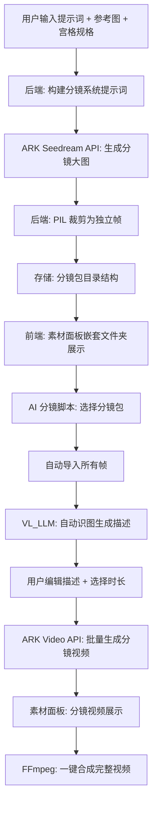
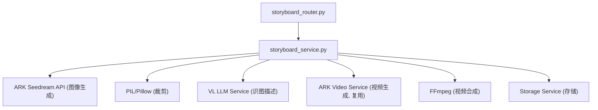
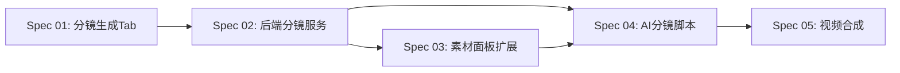

# AI 分镜生成系统 — Master Plan

## 1. 项目概述

为 Ecliptrix 平台新增 **AI 分镜生成** 完整工作流：用户通过提示词和参考图生成多宫格分镜大图，系统自动裁剪为独立帧并打包为"分镜包"，在 AI 分镜脚本面板中可从分镜包导入帧、自动生成描述、批量生成分镜视频，并支持一键合成完整视频。

## 2. 目标

- **G1**: 在 AI 图像生成弹窗 (AiImageModal) 中新增"分镜生成"Tab，支持正方形宫格 (2x2 ~ 8x8) 生成
- **G2**: 后端自动裁剪分镜大图为独立帧，形成分镜包存储
- **G3**: 素材管理面板中以嵌套文件夹形式展示分镜包
- **G4**: 新增 AI 分镜脚本面板，支持从分镜包导入、VL_LLM 自动识图描述、视频批量生成
- **G5**: 支持一键合成所有分镜视频为完整视频

## 3. 范围

### 纳入范围 (In Scope)

| 模块 | 功能 |
|------|------|
| 分镜生成Tab | 提示词输入、参考图上传、宫格规格选择 (2x2/3x3/4x4/6x6/8x8)、白色分隔线样式 |
| 后端分镜服务 | 调用 ARK Seedream API 生成分镜大图、PIL 自动裁剪、分镜包存储管理 |
| 素材面板扩展 | 分镜包嵌套文件夹展示、双击进入/面包屑返回、分镜包内帧预览 |
| AI 分镜脚本 | 新 Tab 页、选择分镜包导入、VL_LLM 自动描述、描述编辑、时长选择、视频生成 |
| 批量视频生成 | 一键生成所有分镜视频、并发控制、进度跟踪 |
| 视频合成 | 一键按顺序拼接所有分镜视频为完整视频 (FFmpeg) |

### 排除范围 (Out of Scope)

- 非正方形宫格支持
- 每格独立参考图
- 分镜包编辑器 (重新排序/替换单帧)
- 视频转场效果选择
- 分镜包分享/导出

## 4. 架构设计

### 4.1 整体数据流



### 4.2 前端组件架构

```mermaid
graph TD
    AiImageModal --> StoryboardTab["StoryboardTab (新增第4Tab)"]
    StoryboardTab --> PromptInput[提示词输入]
    StoryboardTab --> ImageUploadArea[参考图上传 (复用)]
    StoryboardTab --> GridSelector[宫格规格选择器]
    StoryboardTab --> GenerateButton[生成按钮]

    MaterialsPanel --> StoryboardFolder["分镜包文件夹视图"]
    StoryboardFolder --> FrameGrid[帧网格展示]

    ScriptPanel --> StoryboardScriptTab["AI分镜脚本Tab (新增)"]
    StoryboardScriptTab --> PackSelector[分镜包选择器]
    StoryboardScriptTab --> FrameSegmentList[帧段列表]
    FrameSegmentList --> FrameSegmentCard[帧段卡片 x N]
    FrameSegmentCard --> FramePreview[分镜图预览]
    FrameSegmentCard --> DescriptionEditor[描述编辑器]
    FrameSegmentCard --> DurationSelector[时长选择]
    FrameSegmentCard --> GenerateVideoBtn[生成视频按钮]
    StoryboardScriptTab --> BatchGenerateBtn[一键批量生成]
    StoryboardScriptTab --> ComposeVideoBtn[一键合成视频]
```

### 4.3 后端服务架构



### 4.4 存储结构

```
static/uploads/storyboard/
├── {YYYYMMDD}/
│   ├── {pack_id}/
│   │   ├── original.png          # 原始分镜大图
│   │   ├── metadata.json         # 分镜包元数据
│   │   ├── frame_001.png         # 裁剪后的第1帧
│   │   ├── frame_002.png         # 裁剪后的第2帧
│   │   └── ...
│   └── {pack_id}/
│       └── ...
```

metadata.json 结构:
```json
{
  "pack_id": "uuid",
  "prompt": "用户原始提示词",
  "grid_size": "3x3",
  "frame_count": 9,
  "created_at": "ISO timestamp",
  "reference_image": "path or null",
  "frames": [
    { "index": 0, "filename": "frame_001.png", "row": 0, "col": 0 }
  ]
}
```

## 5. 关键设计决策

| # | 决策 | 原因 |
|---|------|------|
| D1 | 分镜Tab 放在 AiImageModal 内 | 复用现有弹窗框架和参考图上传组件，用户心智模型一致 |
| D2 | 后端 PIL 裁剪 | 服务端裁剪可直接存储独立文件，前端不需要处理大图二进制操作 |
| D3 | 白色分隔线在系统提示词中指示 | 通过提示词控制 AI 生成带白线分隔的图片，裁剪时裁掉白线边缘 |
| D4 | VL_LLM 自动描述 | 复用现有视觉语言模型配置，通过图片识别生成视频生成所需的场景描述 |
| D5 | 描述模式+分镜作参考 | 分镜图作为参考图传入视频生成API，结合文字描述获得最佳视频效果 |
| D6 | 嵌套文件夹展示分镜包 | 分镜包作为一个整体管理，双击进入查看子帧，清晰的层级结构 |
| D7 | FFmpeg 一键合成 | 复用现有 FFmpeg 基础设施 (video_composition_service)，按帧顺序拼接 |

## 6. 依赖关系



## 7. 风险与缓解

| 风险 | 影响 | 缓解策略 |
|------|------|----------|
| ARK Seedream 无法精确控制宫格布局 | 生成的分镜图宫格不均匀，裁剪失败 | 系统提示词中明确描述宫格布局要求；裁剪时使用均等分割而非智能边缘检测 |
| 白色分隔线宽度不稳定 | 裁剪后帧边缘有残留白边 | 裁剪时向内缩进固定像素 (如 2-4px)；或不依赖白线，纯按像素均等分割 |
| VL_LLM 描述质量不佳 | 生成的视频与分镜意图不符 | 用户可手动编辑描述；提供重新生成描述按钮 |
| 大量并发视频生成 | API 限流或超时 | 复用现有 QueueManager 并发控制机制，限制同时生成数量 |
| 8x8 = 64 帧生成大量请求 | 批量视频生成耗时过长 | 显示总体进度，允许取消；建议用户选择合理宫格大小 |

## 8. Spec 文件目录

| 文件 | 内容 |
|------|------|
| `specs/01-storyboard-generation-tab.md` | 前端分镜生成Tab UI 与交互 |
| `specs/02-backend-storyboard-service.md` | 后端分镜生成、裁剪、存储服务 |
| `specs/03-materials-panel-extension.md` | 素材面板分镜包嵌套文件夹展示 |
| `specs/04-storyboard-script-tab.md` | AI 分镜脚本面板完整功能 |
| `specs/05-video-composition.md` | 一键合成与时长控制 |
