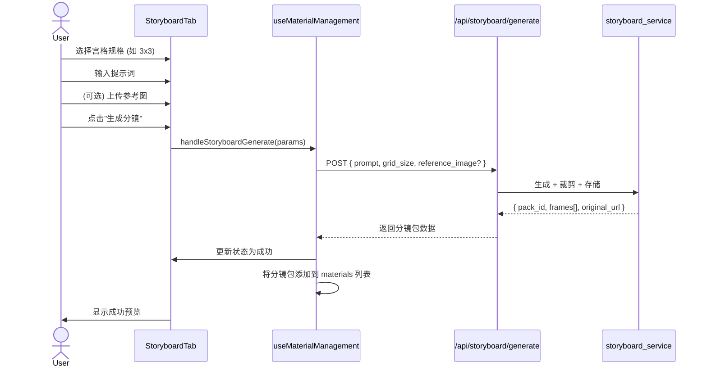

# Spec 01: 分镜生成Tab (StoryboardTab)

## 1. 概述

在现有 `AiImageModal` 弹窗中新增第4个Tab"分镜生成"，允许用户通过提示词、参考图和宫格规格生成多宫格分镜大图。

## 2. UI 组件结构

```
AiImageModal
├── Tab 1: 基础生成 (现有)
├── Tab 2: 人物建模 (现有)
├── Tab 3: 场景建模 (现有)
└── Tab 4: 分镜生成 (新增 StoryboardTab)
    ├── 宫格规格选择器 (GridSizeSelector)
    │   └── 下拉或按钮组: 2x2 | 3x3 | 4x4 | 6x6 | 8x8
    ├── 提示词输入区 (复用 textarea 样式)
    │   └── placeholder: "描述您想要生成的分镜内容..."
    ├── 参考图上传区 (复用 ImageUploadArea 组件)
    │   └── 单张参考图, 最大 10MB, 转 base64
    ├── 生成按钮
    │   └── 显示当前宫格数量提示: "将生成 NxN = M 格分镜"
    └── 生成状态区
        ├── 加载状态: spinner + "正在生成分镜..."
        ├── 成功状态: 缩略图预览 + "已自动裁剪为 M 张分镜并创建分镜包"
        └── 失败状态: 错误信息 + 重试按钮
```

## 3. 交互流程



## 4. 数据模型

### 前端类型 (添加到 `src/types/index.ts`)

```typescript
// 宫格规格
type StoryboardGridSize = '2x2' | '3x3' | '4x4' | '6x6' | '8x8';

// 分镜包中的单帧
interface StoryboardFrame {
  index: number;
  filename: string;
  url: string;           // 可访问的图片URL
  row: number;
  col: number;
  description?: string;  // VL_LLM 生成的描述 (后续填充)
}

// 分镜包
interface StoryboardPack {
  packId: string;
  prompt: string;
  gridSize: StoryboardGridSize;
  frameCount: number;
  createdAt: string;
  originalImageUrl: string;   // 原始大图URL
  referenceImageUrl?: string; // 参考图URL
  frames: StoryboardFrame[];
}

// 生成请求参数
interface StoryboardGenerateParams {
  prompt: string;
  gridSize: StoryboardGridSize;
  referenceImage?: string;    // base64 data URI
}
```

### API 请求/响应

**请求**: `POST /api/storyboard/generate`
```json
{
  "prompt": "一个奇幻森林的冒险故事分镜",
  "grid_size": "3x3",
  "reference_image": "data:image/png;base64,..."  // 可选
}
```

**响应**:
```json
{
  "success": true,
  "message": "分镜包生成成功",
  "data": {
    "pack_id": "uuid-xxx",
    "prompt": "...",
    "grid_size": "3x3",
    "frame_count": 9,
    "created_at": "2026-03-21T10:00:00Z",
    "original_image_url": "/api/storage/files/storyboard/20260321/xxx/original.png",
    "frames": [
      {
        "index": 0,
        "filename": "frame_001.png",
        "url": "/api/storage/files/storyboard/20260321/xxx/frame_001.png",
        "row": 0,
        "col": 0
      }
    ]
  }
}
```

## 5. 组件实现要点

### 5.1 GridSizeSelector

- 使用按钮组 (ToggleGroup) 样式，类似现有模式切换
- 每个按钮显示: 宫格名称 + 总数 (如 "3x3 (9格)")
- 默认选中 3x3
- 选中后更新生成按钮提示文字

### 5.2 提示词输入

- 复用现有 textarea 样式 (同 BasicGenerationTab)
- 无需提供预设模板 (与现有人物/场景建模不同, 分镜内容完全由提示词决定)
- 最大长度限制: 2000 字符

### 5.3 参考图上传

- 直接复用 `ImageUploadArea` 组件
- 单张图片，最大 10MB
- 转为 base64 data URI 传递给后端

### 5.4 生成状态管理

- 使用与现有 AI 图像生成一致的状态流: idle → generating → success/error
- 生成过程中禁用所有输入控件和按钮
- 成功后显示原始大图缩略图 + 裁剪帧数提示
- 失败后显示错误信息和重试按钮

## 6. 与现有组件的集成

### AiImageModal 修改

- 在 Tab 列表中新增第4个 Tab: `{ id: 'storyboard', label: '分镜生成' }`
- 导入 `StoryboardTab` 组件
- Tab 切换逻辑保持现有模式不变

### useMaterialManagement Hook 扩展

- 新增 `handleStoryboardGenerate(params: StoryboardGenerateParams)` 方法
- 生成成功后将分镜包作为特殊类型的 MaterialItem 添加到 materials 列表
- MaterialItem 扩展: `type: 'storyboard_pack'`, `metadata.storyboardPack: StoryboardPack`

### MaterialItem 类型扩展

在现有 `MaterialItem` 接口中:
- 新增 type 值: `'storyboard_pack'`
- metadata 中存储 `StoryboardPack` 数据

## 7. 文件清单

| 文件 | 操作 | 说明 |
|------|------|------|
| `src/components/video/components/AiImageModal/StoryboardTab.tsx` | 新增 | 分镜生成 Tab 主组件 |
| `src/components/video/components/AiImageModal/GridSizeSelector.tsx` | 新增 | 宫格规格选择器 |
| `src/components/video/components/AiImageModal/AiImageModal.tsx` | 修改 | 添加第4个Tab |
| `src/types/index.ts` | 修改 | 添加分镜相关类型定义 |
| `src/lib/api/storyboard.ts` | 新增 | 分镜API客户端 |
| `src/app/api/storyboard/generate/route.ts` | 新增 | Next.js API路由代理 |
| `src/components/video/hooks/useMaterialManagement.ts` | 修改 | 添加分镜生成处理 |

## 8. 边界条件

- 宫格规格 8x8 = 64 格，需在 UI 中提示用户此为大量生成
- 参考图过大 (>10MB) 需前端校验拦截
- ARK API 生成超时需有适当的 loading 状态和超时处理
- 生成期间切换 Tab 或关闭弹窗需要确认提示
