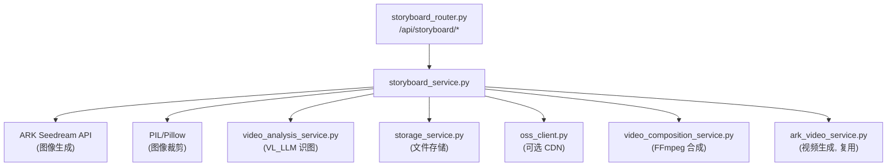

# Spec 02: 后端分镜服务 (Backend Storyboard Service)

## 1. 概述

后端新增分镜服务模块，负责调用 ARK Seedream API 生成多宫格分镜大图、使用 PIL/Pillow 自动裁剪为独立帧、管理分镜包的存储和元数据，以及调用 VL_LLM 为帧生成描述文字。

## 2. 服务架构



## 3. 数据模型 (Pydantic)

### 文件: `app/models/storyboard_models.py`

```python
# --- 请求模型 ---

class StoryboardGenerateRequest(BaseModel):
    """分镜生成请求"""
    prompt: str = Field(..., max_length=2000, description="分镜生成提示词")
    grid_size: Literal["2x2", "3x3", "4x4", "6x6", "8x8"] = Field(
        default="3x3", description="宫格规格"
    )
    reference_image: Optional[str] = Field(
        None, description="参考图 base64 data URI"
    )

class StoryboardDescribeRequest(BaseModel):
    """批量生成帧描述请求"""
    pack_id: str
    frame_indices: Optional[List[int]] = None  # None = 所有帧

class StoryboardBatchVideoRequest(BaseModel):
    """批量视频生成请求"""
    pack_id: str
    segments: List[StoryboardVideoSegment]

class StoryboardVideoSegment(BaseModel):
    """单帧视频生成参数"""
    frame_index: int
    description: str
    duration: int = Field(ge=4, le=12, default=5)

class StoryboardComposeRequest(BaseModel):
    """视频合成请求"""
    pack_id: str
    video_urls: List[str]  # 按顺序排列的视频URL列表

# --- 响应模型 ---

class StoryboardFrame(BaseModel):
    """单帧信息"""
    index: int
    filename: str
    url: str
    row: int
    col: int
    description: Optional[str] = None

class StoryboardPack(BaseModel):
    """分镜包信息"""
    pack_id: str
    prompt: str
    grid_size: str
    frame_count: int
    created_at: str
    original_image_url: str
    reference_image_url: Optional[str] = None
    frames: List[StoryboardFrame]

class StoryboardGenerateResponse(BaseModel):
    """分镜生成响应"""
    success: bool
    message: str
    data: Optional[StoryboardPack] = None

class StoryboardDescribeResponse(BaseModel):
    """帧描述生成响应"""
    success: bool
    message: str
    descriptions: List[dict]  # [{ index: int, description: str }]

class StoryboardBatchVideoResponse(BaseModel):
    """批量视频生成响应"""
    success: bool
    message: str
    tasks: List[dict]  # [{ frame_index: int, ark_task_id: str }]

class StoryboardComposeResponse(BaseModel):
    """视频合成响应"""
    success: bool
    message: str
    video_url: Optional[str] = None
```

## 4. API 端点

### 文件: `app/routers/storyboard_router.py`

| 端点 | 方法 | 说明 | 请求体 | 响应体 |
|------|------|------|--------|--------|
| `/api/storyboard/generate` | POST | 生成分镜大图 + 自动裁剪 | StoryboardGenerateRequest | StoryboardGenerateResponse |
| `/api/storyboard/packs` | GET | 获取所有分镜包列表 | - | List[StoryboardPack] |
| `/api/storyboard/packs/{pack_id}` | GET | 获取单个分镜包详情 | - | StoryboardPack |
| `/api/storyboard/packs/{pack_id}` | DELETE | 删除分镜包 | - | BaseResponse |
| `/api/storyboard/describe` | POST | 为帧批量生成描述 | StoryboardDescribeRequest | StoryboardDescribeResponse |
| `/api/storyboard/batch-video` | POST | 批量提交视频生成任务 | StoryboardBatchVideoRequest | StoryboardBatchVideoResponse |
| `/api/storyboard/batch-video/status/{pack_id}` | GET | 查询批量视频生成状态 | - | 各帧任务状态 |
| `/api/storyboard/compose` | POST | 合成完整视频 | StoryboardComposeRequest | StoryboardComposeResponse |

## 5. 核心服务逻辑

### 文件: `app/services/storyboard_service.py`

### 5.1 分镜生成 + 裁剪

```
async def generate_storyboard(request: StoryboardGenerateRequest) -> StoryboardPack:
    1. 解析 grid_size → rows, cols (如 "3x3" → 3, 3)
    2. 构建分镜系统提示词 (见 5.2)
    3. 处理参考图:
       - 如有 reference_image (base64): 解码保存到临时文件, 获取URL
       - 作为 image_urls 参数传递给 ARK API
    4. 调用 ARK Seedream API:
       - model: "doubao-seedream-5-0-260128"
       - prompt: 系统构建的分镜提示词
       - size: "2048x2048" (正方形大图, 保证裁剪质量)
       - n: 1 (只生成一张大图)
       - image_urls: [参考图URL] (如有)
    5. 下载生成的大图到本地存储
    6. 创建分镜包目录: static/uploads/storyboard/{YYYYMMDD}/{pack_id}/
    7. 保存原图为 original.png
    8. PIL 裁剪 (见 5.3)
    9. 生成 metadata.json
    10. (可选) 上传到 OSS
    11. 返回 StoryboardPack
```

### 5.2 系统提示词构建

```
def build_storyboard_prompt(user_prompt: str, rows: int, cols: int) -> str:
    prompt = f"""Create a {rows}x{cols} grid storyboard image.

LAYOUT REQUIREMENTS:
- The image must be divided into exactly {rows} rows and {cols} columns
- Each cell must be exactly the same size
- There must be thin white separator lines (about 2-3 pixels wide) between each cell
- The cells must fill the entire image with no margins

CONTENT:
{user_prompt}

Each cell should contain a distinct scene or frame as described above.
The overall style should be consistent across all cells.
Number the cells from left to right, top to bottom (1 to {rows * cols}).
"""
    return prompt
```

### 5.3 PIL 裁剪逻辑

```
def crop_storyboard(image_path: str, rows: int, cols: int, output_dir: str) -> List[dict]:
    """将分镜大图裁剪为独立帧"""
    from PIL import Image

    img = Image.open(image_path)
    width, height = img.size

    cell_width = width // cols
    cell_height = height // rows

    # 向内缩进像素数, 裁掉白色分隔线
    padding = 4  # 每边裁掉4像素

    frames = []
    index = 0
    for row in range(rows):
        for col in range(cols):
            left = col * cell_width + padding
            upper = row * cell_height + padding
            right = (col + 1) * cell_width - padding
            lower = (row + 1) * cell_height - padding

            cell = img.crop((left, upper, right, lower))
            filename = f"frame_{index + 1:03d}.png"
            cell.save(os.path.join(output_dir, filename))

            frames.append({
                "index": index,
                "filename": filename,
                "row": row,
                "col": col
            })
            index += 1

    return frames
```

### 5.4 VL_LLM 帧描述生成

```
async def generate_frame_descriptions(pack_id: str, frame_indices: List[int] = None) -> List[dict]:
    """使用 VL_LLM 为分镜帧生成场景描述"""
    1. 读取分镜包 metadata.json
    2. 确定需要描述的帧 (全部或指定索引)
    3. 对每一帧:
       a. 读取帧图片, 转为 base64
       b. 构建 VL_LLM 请求:
          - system: "你是一个专业的视频分镜描述专家。请根据图片内容生成一段适合视频生成的详细场景描述。
                     描述应包含: 主体、动作、场景环境、光线氛围、镜头角度。
                     描述长度: 2-4句话。语言: 中文。"
          - user: [图片] + "请描述这个分镜画面"
       c. 获取描述文字
    4. 更新 metadata.json 中的帧描述
    5. 返回 [{ index, description }]

    并发控制: 使用 asyncio.Semaphore(3) 限制同时请求数
```

### 5.5 批量视频生成

```
async def batch_generate_videos(request: StoryboardBatchVideoRequest) -> List[dict]:
    """批量提交分镜视频生成任务"""
    1. 读取分镜包 metadata
    2. 对每个 segment:
       a. 获取对应帧的 URL
       b. 构建 ARK Video 请求:
          - mode: "description"
          - prompt: segment.description
          - image_urls: [帧图片URL]  # 分镜图作为参考图
          - duration: segment.duration
       c. 调用 ark_video_service.create_task()
       d. 记录 { frame_index, ark_task_id }
    3. 并发控制: 使用 QueueManager 或 Semaphore, 同时最多 3 个任务
    4. 返回所有任务 ID 列表
```

### 5.6 视频合成

```
async def compose_storyboard_video(request: StoryboardComposeRequest) -> str:
    """将所有分镜视频按顺序合成为完整视频"""
    1. 下载/定位所有视频文件
    2. 创建 FFmpeg concat 文件列表:
       file 'video_001.mp4'
       file 'video_002.mp4'
       ...
    3. 调用 FFmpeg:
       ffmpeg -f concat -safe 0 -i list.txt -c copy output.mp4
       (如果视频编码不一致则需要重编码:
        ffmpeg -f concat -safe 0 -i list.txt -c:v libx264 -c:a aac output.mp4)
    4. 存储合成视频: static/uploads/storyboard/{date}/{pack_id}/composed.mp4
    5. (可选) 上传到 OSS
    6. 返回视频 URL
```

## 6. 分镜包管理

### 6.1 列表查询

```
async def list_packs() -> List[StoryboardPack]:
    """扫描存储目录, 读取所有 metadata.json, 返回分镜包列表"""
    - 扫描 static/uploads/storyboard/ 下所有日期目录
    - 读取每个 pack 的 metadata.json
    - 按 created_at 降序排序
    - 返回列表
```

### 6.2 删除

```
async def delete_pack(pack_id: str):
    """删除整个分镜包目录"""
    - 查找 pack_id 对应的目录
    - 删除整个目录 (shutil.rmtree)
    - 如有 OSS 文件也同步删除
```

## 7. 配置

### 环境变量

无新增环境变量，复用现有:
- `ARK_API_KEY`: ARK Seedream API 密钥
- `VL_LLM_API_URL`, `VL_LLM_API_KEY`: 视觉语言模型
- `STORAGE_ROOT`: 存储根目录
- `OSS_ENABLED`, `OSS_*`: 可选 OSS 配置

### 常量

```python
STORYBOARD_IMAGE_SIZE = "2048x2048"     # 生成大图尺寸
STORYBOARD_CROP_PADDING = 4             # 裁剪时每边内缩像素
STORYBOARD_MAX_CONCURRENT_DESCRIBE = 3  # VL描述并发数
STORYBOARD_MAX_CONCURRENT_VIDEO = 3     # 视频生成并发数
STORYBOARD_STORAGE_DIR = "storyboard"   # 存储子目录名
```

## 8. 错误处理

| 场景 | 处理 |
|------|------|
| ARK API 返回错误 | 返回 ErrorResponse, 包含 ARK 错误详情 |
| ARK API 超时 | httpx 超时 120s, 返回超时错误 |
| 生成图片下载失败 | 重试 2 次, 仍失败则返回 CDN URL 作为 fallback |
| PIL 裁剪失败 | 返回错误, 保留原图供用户手动下载 |
| VL_LLM 描述失败 | 对应帧 description 为 null, 不阻塞其他帧 |
| 视频生成任务失败 | 在状态查询中标记该帧为 failed, 不影响其他帧 |
| FFmpeg 合成失败 | 返回错误详情, 建议用户检查视频格式一致性 |
| 分镜包目录不存在 | 返回 404 错误 |

## 9. 文件清单

| 文件 | 操作 | 说明 |
|------|------|------|
| `app/models/storyboard_models.py` | 新增 | Pydantic 数据模型 |
| `app/routers/storyboard_router.py` | 新增 | API 路由定义 |
| `app/services/storyboard_service.py` | 新增 | 核心业务逻辑 |
| `app/main.py` | 修改 | 注册 storyboard_router |
| `requirements.txt` (或 pip) | 确认 | 确认 Pillow 已安装 |

## 10. 与现有服务的交互

- **ark_image_service**: 不直接复用，但参考其 ARK API 调用模式和图片下载逻辑
- **ark_video_service**: 复用 `create_task()` 和 `get_status()` 用于分镜视频生成
- **video_analysis_service**: 参考其 VL_LLM 调用模式用于帧描述生成
- **video_composition_service**: 复用或参考其 FFmpeg 拼接逻辑用于视频合成
- **storage_service**: 复用文件存储和 URL 生成
- **oss_client**: 可选的 CDN 上传
