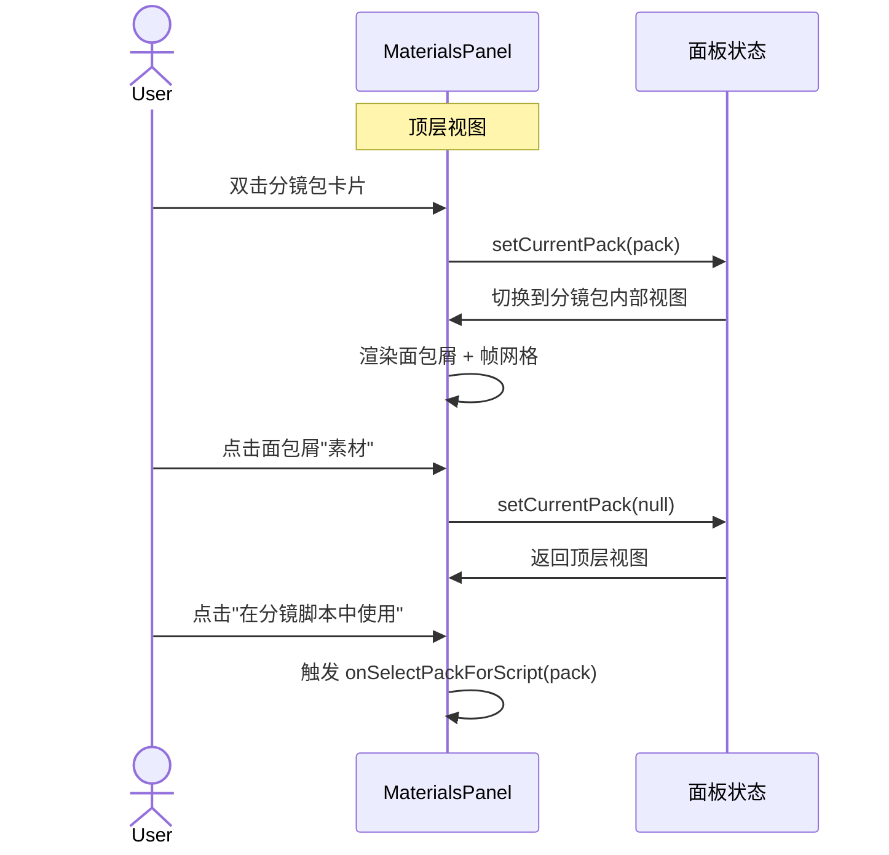

# Spec 03: 素材面板分镜包展示 (Materials Panel Extension)

## 1. 概述

扩展现有素材管理面板 (MaterialsPanel)，以嵌套文件夹形式展示分镜包。用户可以双击分镜包进入查看子帧，通过面包屑导航返回。

## 2. UI 结构

### 2.1 素材面板顶层视图 (现有基础上扩展)

```
MaterialsPanel
├── 类型筛选栏 (现有)
│   ├── 全部 | 视频 | 音频 | 图片 | 字幕 (现有)
│   └── 分镜包 (新增筛选项)
├── 素材网格 (现有 3列布局)
│   ├── [普通素材卡片] (现有)
│   └── [分镜包文件夹卡片] (新增)
│       ├── 文件夹图标叠加
│       ├── 原始大图缩略图作为封面
│       ├── 标签: "NxN · M帧"
│       └── 创建时间
└── 上传/操作区 (现有)
```

### 2.2 分镜包内部视图 (新增)

```
MaterialsPanel (进入分镜包后)
├── 面包屑导航
│   └── "素材" > "分镜包名称"  (点击"素材"返回顶层)
├── 分镜包信息栏
│   ├── 原始提示词 (可折叠)
│   ├── 宫格规格: 3x3
│   ├── 帧数: 9
│   └── 操作: [删除分镜包] [在分镜脚本中使用]
├── 原始大图预览 (可点击放大)
├── 帧网格 (3列布局)
│   └── [帧卡片] x N
│       ├── 帧缩略图
│       ├── 帧序号标签: "#1", "#2", ...
│       ├── 描述文字预览 (如已生成)
│       └── 右键菜单: 预览 | 复制URL | 添加到素材
└── 底部操作栏
    └── [全部添加到素材] (将所有帧作为独立图片素材添加)
```

## 3. 交互流程



## 4. 状态管理

### 新增状态

```typescript
// MaterialsPanel 新增状态
interface MaterialsPanelState {
  // 现有状态...
  currentStoryboardPack: StoryboardPack | null;  // 当前打开的分镜包, null=顶层
  storyboardPacks: StoryboardPack[];              // 所有分镜包列表
}
```

### 数据加载

```
分镜包列表获取:
- 在 MaterialsPanel 挂载时, 调用 GET /api/storyboard/packs
- 将结果存储在 storyboardPacks 状态中
- 分镜包与普通素材合并显示 (按创建时间排序)
- 当筛选类型为"分镜包"时, 只显示分镜包
```

## 5. 组件设计

### 5.1 StoryboardPackCard (分镜包卡片)

```
Props:
  - pack: StoryboardPack
  - onDoubleClick: (pack) => void  // 进入包内部
  - onDelete: (packId) => void
  - onContextMenu: (pack, event) => void

渲染:
  - 使用与普通素材卡片一致的尺寸和圆角
  - 左上角: 文件夹叠加图标 (Folder icon)
  - 中间: 原始大图缩略图 (objectFit: cover)
  - 底部: 宫格规格 + 帧数标签
  - hover: 显示边框高亮 + 删除按钮
```

### 5.2 StoryboardPackView (分镜包内部视图)

```
Props:
  - pack: StoryboardPack
  - onBack: () => void              // 返回顶层
  - onSelectForScript: (pack) => void  // 在脚本中使用
  - onAddFrameToMaterials: (frame) => void

渲染:
  - 面包屑: Breadcrumb 组件
  - 信息栏: 提示词、规格、帧数
  - 原始大图: 可点击放大的缩略图
  - 帧网格: 3列网格, 每帧一个 FrameCard
```

### 5.3 FrameCard (帧卡片)

```
Props:
  - frame: StoryboardFrame
  - index: number
  - onClick: (frame) => void  // 预览

渲染:
  - 帧缩略图
  - 左上角: 序号标签 "#1"
  - 底部: 描述文字截断显示 (如有)
  - hover: 显示操作按钮
```

## 6. 与现有素材面板的集成

### MaterialsPanel 修改要点

1. **类型筛选扩展**: 在现有筛选栏末尾添加"分镜包"选项
2. **素材列表合并**: 分镜包与普通素材混合显示，分镜包使用 StoryboardPackCard 渲染
3. **视图切换**: 通过 `currentStoryboardPack` 状态控制显示顶层 vs 内部视图
4. **回调传递**: 新增 `onSelectPackForScript` 回调，供 AI 分镜脚本面板使用

### MaterialItem 兼容

分镜包在素材列表中以特殊的 MaterialItem 出现:
```typescript
{
  id: pack.packId,
  name: `分镜_${grid_size}_${timestamp}`,
  type: 'storyboard_pack',
  url: pack.originalImageUrl,
  thumbnailUrl: pack.originalImageUrl,
  metadata: {
    source: 'storyboard',
    storyboardPack: pack
  }
}
```

## 7. 文件清单

| 文件 | 操作 | 说明 |
|------|------|------|
| `src/components/video/components/MaterialsPanel/StoryboardPackCard.tsx` | 新增 | 分镜包卡片组件 |
| `src/components/video/components/MaterialsPanel/StoryboardPackView.tsx` | 新增 | 分镜包内部视图 |
| `src/components/video/components/MaterialsPanel/FrameCard.tsx` | 新增 | 帧卡片组件 |
| `src/components/video/components/MaterialsPanel/MaterialsPanel.tsx` | 修改 | 集成分镜包展示逻辑 |
| `src/lib/api/storyboard.ts` | 修改 | 添加 listPacks, deletePack API |

## 8. 边界条件

- 空分镜包列表: 显示空状态提示"暂无分镜包，点击AI图像生成创建"
- 分镜包删除确认: 弹出确认对话框，提示将删除所有帧和相关视频
- 大量分镜包 (>20): 考虑分页或虚拟滚动 (初期不实现, 预留接口)
- 帧图片加载失败: 显示占位图 + 重试按钮
- 分镜包内无描述: 帧卡片底部显示"未生成描述"灰色文字
