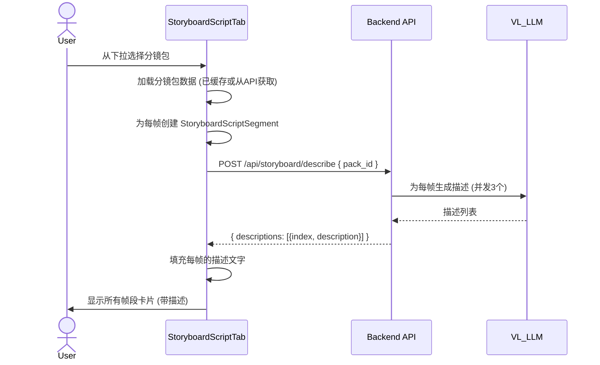
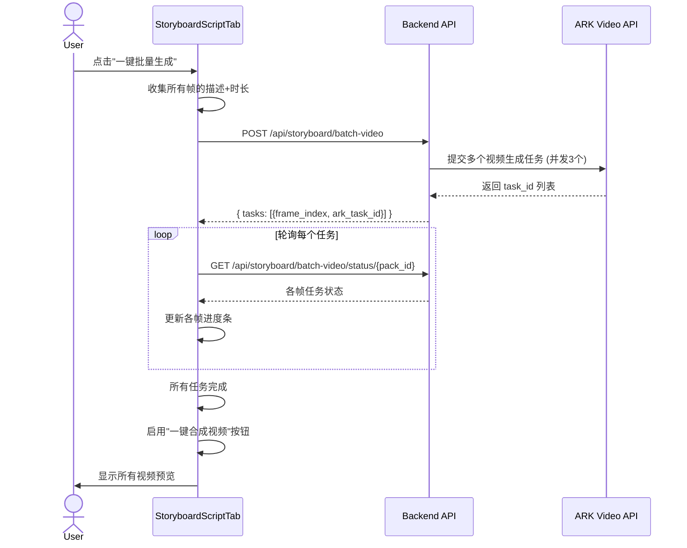
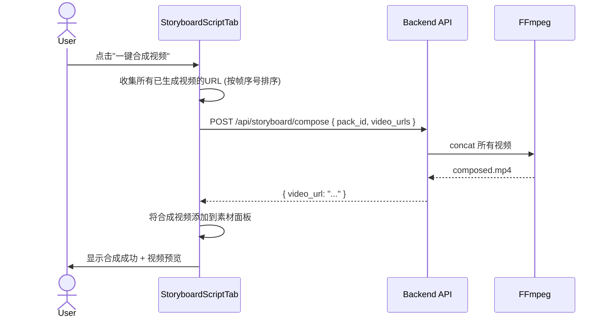

# Spec 04: AI 分镜脚本面板 (Storyboard Script Tab)

## 1. 概述

在现有 ScriptPanel 中新增"AI 分镜脚本"Tab，与现有的"旁白"和"AI视频"Tab 并列。用户可从分镜包导入帧、自动生成描述、编辑描述和时长、逐个或批量生成分镜视频。

## 2. UI 结构

```
ScriptPanel
├── Tab 导航
│   ├── 旁白 (现有)
│   ├── AI视频 (现有 AIVideoScriptTab)
│   └── AI分镜 (新增 StoryboardScriptTab)
└── StoryboardScriptTab
    ├── 顶部工具栏
    │   ├── 分镜包选择器 (下拉)
    │   │   └── 列出所有分镜包: "3x3分镜_14:30:45" 等
    │   ├── [一键批量生成] 按钮
    │   └── [一键合成视频] 按钮 (所有分镜视频生成完成后可用)
    ├── 帧段列表 (可滚动)
    │   └── StoryboardSegmentCard x N
    │       ├── 帧预览区
    │       │   ├── 分镜图缩略图 (可点击放大)
    │       │   └── 帧序号: "#1 / 9"
    │       ├── 描述编辑区
    │       │   ├── textarea (自动填充 VL_LLM 描述)
    │       │   ├── [重新生成描述] 按钮
    │       │   └── [AI扩展] 按钮 (复用现有 expand API)
    │       ├── 时长选择器
    │       │   └── 预设: 5s | 7s | 10s | 12s
    │       ├── 操作按钮
    │       │   ├── [生成视频] (单个)
    │       │   └── [删除此帧]
    │       ├── 生成进度 (生成中显示)
    │       │   └── 进度条 + 百分比
    │       └── 视频预览 (生成完成后显示)
    │           └── video player + 元数据
    └── 底部状态栏
        ├── 总进度: "已生成 5/9 个视频"
        └── 总时长: "预计视频总时长: 45s"
```

## 3. 交互流程

### 3.1 导入分镜包



### 3.2 批量视频生成



### 3.3 一键合成



## 4. 数据模型

### 前端类型 (添加到 `src/types/index.ts`)

```typescript
interface StoryboardScriptSegment {
  id: string;                        // 唯一ID
  frameIndex: number;                // 帧序号 (0-based)
  frameUrl: string;                  // 帧图片URL
  frameThumbnailUrl: string;         // 帧缩略图URL (同 frameUrl)
  description: string;               // 场景描述 (VL_LLM生成或用户编辑)
  duration: number;                  // 视频时长 (秒, 4-12)

  // 生成状态
  generationStatus: 'idle' | 'generating' | 'succeeded' | 'failed';
  generationProgress: number;        // 0-100
  arkTaskId?: string;
  generationError?: string;

  // 生成结果
  generatedVideoUrl?: string;
  generatedVideoThumbnailUrl?: string;
  generatedVideoDuration?: number;
  generatedVideoWidth?: number;
  generatedVideoHeight?: number;
}
```

### VideoEditingTaskContent 扩展

```typescript
interface VideoEditingTaskContent {
  // 现有字段...
  storyboardScriptSegments?: StoryboardScriptSegment[];  // 新增
  selectedStoryboardPackId?: string;                       // 新增: 当前选择的分镜包ID
}
```

## 5. 核心 Hook

### useStoryboardScriptGeneration

```typescript
interface UseStoryboardScriptGenerationProps {
  segments: StoryboardScriptSegment[];
  onUpdateSegments: (segments: StoryboardScriptSegment[]) => void;
  onAddMaterial: (material: MaterialItem) => void;
  taskId: string;
}

interface UseStoryboardScriptGenerationReturn {
  // 分镜包管理
  loadPack: (packId: string) => Promise<void>;
  availablePacks: StoryboardPack[];

  // 描述生成
  generateDescriptions: (packId: string) => Promise<void>;
  regenerateDescription: (segmentId: string) => Promise<void>;
  isDescribing: boolean;

  // 视频生成
  generateVideo: (segmentId: string) => void;
  batchGenerateVideos: () => void;
  cancelGeneration: (segmentId: string) => void;

  // 合成
  composeVideo: () => Promise<void>;
  isComposing: boolean;
  composedVideoUrl: string | null;

  // 状态
  overallProgress: { completed: number; total: number };
  totalDuration: number;
}
```

### 关键逻辑

**loadPack**:
1. 调用 `GET /api/storyboard/packs/{packId}`
2. 为每帧创建 `StoryboardScriptSegment` (description 为空, duration 默认 5s)
3. 调用 `POST /api/storyboard/describe` 获取描述
4. 填充描述到各 segment

**batchGenerateVideos**:
1. 收集所有 status=idle 的 segments
2. 调用 `POST /api/storyboard/batch-video`
3. 获得 task_id 列表
4. 启动轮询定时器 (5s 间隔)
5. 每次轮询更新各 segment 的进度和状态
6. 视频完成时自动添加到素材面板

**composeVideo**:
1. 验证所有 segment 都已生成视频
2. 收集所有 generatedVideoUrl (按 frameIndex 排序)
3. 调用 `POST /api/storyboard/compose`
4. 将合成视频添加到素材面板

## 6. 段操作

### 添加帧

- 用户可以在帧段列表末尾点击"+"添加额外帧
- 弹出图片选择: 从素材中选择 或 上传新图片
- 创建新的 StoryboardScriptSegment

### 删除帧

- 点击帧段上的删除按钮
- 确认后从列表中移除
- 不影响已生成的视频 (视频仍在素材面板中)
- 重新计算帧序号显示

### 调整顺序

- 初始导入按分镜包中的帧顺序排列
- 支持拖拽排序 (可选, 初版可不实现)

### 编辑描述

- textarea 直接编辑
- 支持"重新生成描述"按钮 (重新调用 VL_LLM)
- 支持"AI扩展"按钮 (复用 ai-video-script-expand API)

## 7. 与现有组件的集成

### ScriptPanel 修改

- 新增第3个 Tab: `{ id: 'storyboard', label: 'AI分镜' }`
- 传递 `storyboardScriptSegments`, `onUpdateStoryboardScriptSegments` 等 props

### 与素材面板的联动

- 分镜脚本中的"选择分镜包"下拉需要获取分镜包列表
- 通过 props 传递 `storyboardPacks` 列表 (来自素材面板数据)
- 也可以通过 `onSelectPackForScript` 回调从素材面板直接触发
- 视频生成完成后通过 `onAddMaterial` 添加到素材面板

### 数据持久化

- StoryboardScriptSegments 与 AIVideoScriptSegments 一样存储在 VideoEditingTaskContent 中
- 页面刷新后可恢复状态 (已生成的视频URL保留)

## 8. 文件清单

| 文件 | 操作 | 说明 |
|------|------|------|
| `src/components/video/components/StoryboardScriptTab/StoryboardScriptTab.tsx` | 新增 | 主面板组件 |
| `src/components/video/components/StoryboardScriptTab/StoryboardSegmentCard.tsx` | 新增 | 帧段卡片 |
| `src/components/video/components/StoryboardScriptTab/PackSelector.tsx` | 新增 | 分镜包选择器 |
| `src/components/video/components/StoryboardScriptTab/index.ts` | 新增 | 模块导出 |
| `src/components/video/hooks/useStoryboardScriptGeneration.ts` | 新增 | 分镜脚本逻辑Hook |
| `src/components/video/ScriptPanel.tsx` | 修改 | 新增第3个Tab |
| `src/types/index.ts` | 修改 | 添加 StoryboardScriptSegment 类型 |
| `src/lib/api/storyboard.ts` | 修改 | 添加 describe, batchVideo, compose API |

## 9. Next.js API 路由

| 路由文件 | 说明 |
|----------|------|
| `src/app/api/storyboard/generate/route.ts` | 代理到后端生成接口 |
| `src/app/api/storyboard/packs/route.ts` | 代理到后端列表接口 |
| `src/app/api/storyboard/packs/[packId]/route.ts` | 代理到后端详情/删除接口 |
| `src/app/api/storyboard/describe/route.ts` | 代理到后端描述生成接口 |
| `src/app/api/storyboard/batch-video/route.ts` | 代理到后端批量视频接口 |
| `src/app/api/storyboard/batch-video/status/[packId]/route.ts` | 代理到后端状态查询接口 |
| `src/app/api/storyboard/compose/route.ts` | 代理到后端合成接口 |

## 10. 边界条件

- 空分镜包列表: 下拉显示"暂无分镜包"提示
- 切换分镜包: 如当前有未保存状态，确认是否切换
- 批量生成中断网: 已提交的任务继续在后端执行，重连后可恢复轮询
- 合成前验证: 确保所有帧都有视频，否则提示"请先生成所有分镜视频"
- 大量帧 (64帧): 帧段列表使用虚拟滚动或分页 (初版可不实现)
- 描述生成失败的帧: 用户仍可手动输入描述后生成视频
