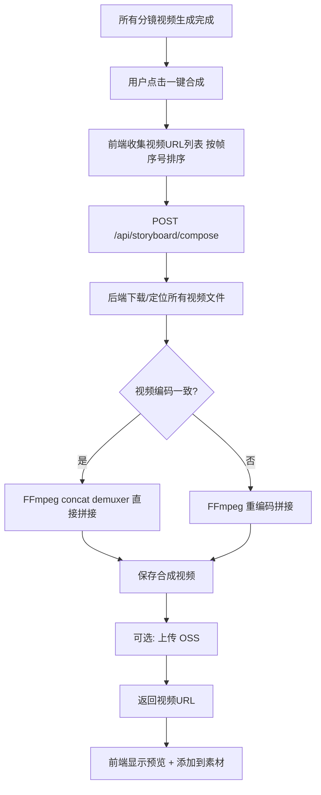

# Spec 05: 视频合成与导出 (Video Composition)

## 1. 概述

提供一键将所有分镜视频按帧顺序合成为一个完整视频的功能。复用现有 FFmpeg 基础设施，在后端完成视频拼接。

## 2. 合成流程



## 3. 后端实现

### 合成逻辑 (storyboard_service.py 中)

```
async def compose_storyboard_video(request: StoryboardComposeRequest) -> str:
    """
    拼接分镜视频为完整视频

    步骤:
    1. 创建临时工作目录
    2. 确定所有视频文件的本地路径:
       - 如果 video_url 是本地路径: 直接使用
       - 如果是远程URL: 下载到临时目录
    3. 生成 FFmpeg concat 列表文件 (list.txt):
       file '/path/to/video_001.mp4'
       file '/path/to/video_002.mp4'
       ...
    4. 执行 FFmpeg 合成命令:
       a. 首先尝试 stream copy (无损快速):
          ffmpeg -f concat -safe 0 -i list.txt -c copy output.mp4
       b. 如果失败 (编码不一致), 使用重编码:
          ffmpeg -f concat -safe 0 -i list.txt
                 -c:v libx264 -preset medium -crf 23
                 -c:a aac -b:a 128k
                 -movflags +faststart
                 output.mp4
    5. 验证输出文件存在且大小 > 0
    6. 移动到永久存储: static/uploads/storyboard/{date}/{pack_id}/composed.mp4
    7. 可选: 上传到 OSS
    8. 生成缩略图: ffmpeg -i output.mp4 -ss 00:00:01 -vframes 1 thumb.jpg
    9. 清理临时文件
    10. 返回合成视频URL
    """
```

### 视频信息提取

```
async def get_composed_video_info(video_path: str) -> dict:
    """使用 ffprobe 获取合成视频信息"""
    cmd = [
        'ffprobe', '-v', 'quiet',
        '-print_format', 'json',
        '-show_format', '-show_streams',
        video_path
    ]
    # 返回 { duration, width, height, size }
```

## 4. 前端交互

### 合成按钮状态

| 状态 | 显示 |
|------|------|
| 有帧视频未生成 | 灰色禁用, tooltip: "请先生成所有分镜视频" |
| 所有视频已生成 | 高亮可用: "一键合成视频" |
| 合成中 | spinner + "正在合成..." + 进度不确定 |
| 合成成功 | 显示视频预览 + "合成完成" |
| 合成失败 | 错误信息 + 重试按钮 |

### 合成完成后

1. 显示合成视频预览 (video player)
2. 显示视频信息: 时长、分辨率、文件大小
3. 自动添加到素材面板 (MaterialItem type='video')
4. 可选: 提供"添加到时间线"按钮

## 5. 错误处理

| 错误场景 | 处理 |
|----------|------|
| 部分视频下载失败 | 返回错误，标明哪些视频不可用 |
| FFmpeg stream copy 失败 | 自动回退到重编码模式 |
| FFmpeg 重编码失败 | 返回 FFmpeg stderr 错误详情 |
| 输出文件为空 | 返回错误"合成结果为空" |
| 磁盘空间不足 | 返回错误提示 |
| 超时 (>5分钟) | 返回超时错误 |

## 6. 与现有视频合成服务的关系

现有 `video_composition_service.py` 提供了 FFmpeg 视频合成能力。分镜视频合成逻辑可以:
- **方案A**: 在 `storyboard_service.py` 中直接实现 concat 逻辑 (推荐, 因为分镜合成较简单)
- **方案B**: 复用 `video_composition_service` 的 FFmpeg 调用封装

选择方案A，因为分镜合成本质上是简单的 concat 操作，不需要复杂的合成参数。

## 7. 文件清单

| 文件 | 操作 | 说明 |
|------|------|------|
| `app/services/storyboard_service.py` | 修改 | 添加 compose_storyboard_video 方法 |
| `app/routers/storyboard_router.py` | 修改 | 添加 /compose 端点 |
| `src/lib/api/storyboard.ts` | 修改 | 添加 composeVideo API 方法 |
| `src/app/api/storyboard/compose/route.ts` | 新增 | Next.js API 路由代理 |

注: 大部分合成代码集成在 storyboard_service 和 storyboard_router 中，已在 Spec 02 中涵盖。此 Spec 聚焦于合成的具体实现细节和前端交互。

## 8. 性能考虑

- **stream copy 优先**: 首选无损拼接, 速度极快 (秒级)
- **重编码 fallback**: 仅在编码不一致时使用, 可能需要几十秒到几分钟
- **临时文件清理**: 确保成功/失败后都清理临时文件
- **文件大小**: 64帧 x 12s = 768s ≈ 13分钟视频, 文件可能较大, 需要足够的磁盘空间
