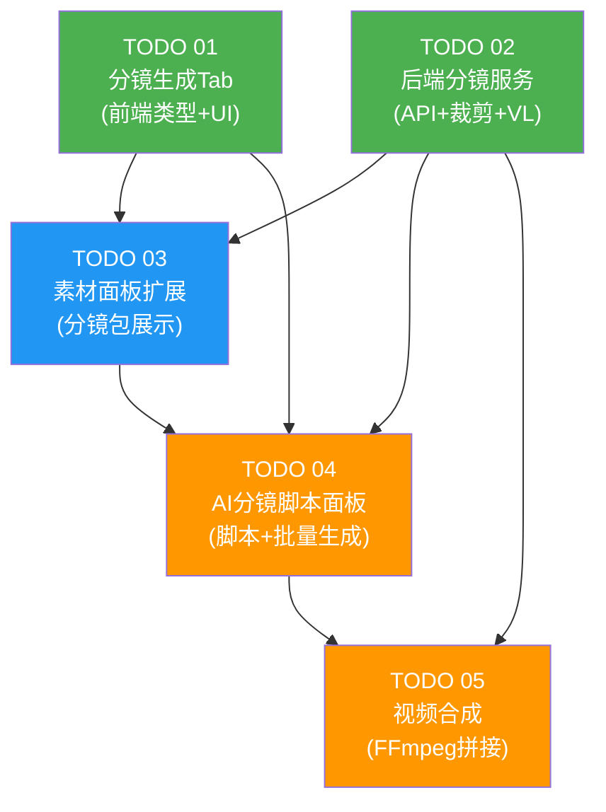

# Task Orchestration — AI 分镜生成系统

## 1. 依赖关系图



## 2. 执行阶段

### Phase 1 (无依赖，可并行)

| 任务 | Agent | 说明 |
|------|-------|------|
| TODO 01: 分镜生成Tab | Agent 1 | 前端类型定义 + StoryboardTab UI + API 客户端 |
| TODO 02: 后端分镜服务 | Agent 2 | 后端全部: 模型 + 路由 + 服务 (生成/裁剪/VL/批量视频/合成) |

**并行原因**: 前端和后端可独立开发，前端使用 mock 数据或直接定义接口类型

### Phase 2 (依赖 Phase 1)

| 任务 | Agent | 说明 |
|------|-------|------|
| TODO 03: 素材面板扩展 | Agent 3 | 依赖 TODO 01 (类型) + TODO 02 (API) |

### Phase 3 (依赖 Phase 2)

| 任务 | Agent | 说明 |
|------|-------|------|
| TODO 04: AI分镜脚本面板 | Agent 4 | 依赖 TODO 01 + 02 + 03 |
| TODO 05: 视频合成 | Agent 4 | 与 TODO 04 合并执行，合成功能集成在脚本面板中 |

**合并原因**: TODO 05 的前端集成部分属于 TODO 04 的 StoryboardScriptTab，合并避免重复工作

## 3. 关键路径

```
TODO 02 (后端服务) → TODO 03 (素材面板) → TODO 04+05 (脚本面板+合成)
```

**瓶颈**: TODO 02 (后端服务) 是最大的任务，包含 ARK API 集成、PIL 裁剪、VL 描述、批量视频和 FFmpeg 合成。

**预计耗时分布**:
- Phase 1: TODO 01 + TODO 02 并行 (最长为 TODO 02)
- Phase 2: TODO 03
- Phase 3: TODO 04 + 05

## 4. Agent 分配

### 推荐 Agent 数量: 4

| Agent | 角色 | 任务 | Phase | 技能要求 |
|-------|------|------|-------|----------|
| Agent 1 | 前端工程师 | TODO 01: 分镜生成Tab | Phase 1 | React, TypeScript, shadcn/ui |
| Agent 2 | 后端工程师 | TODO 02: 后端分镜服务 | Phase 1 | Python, FastAPI, PIL, FFmpeg, OpenAI API |
| Agent 3 | 前端工程师 | TODO 03: 素材面板扩展 | Phase 2 | React, TypeScript, 素材面板代码理解 |
| Agent 4 | 全栈工程师 | TODO 04+05: 脚本面板+合成 | Phase 3 | React, TypeScript, API 集成 |

### 协调注意事项

1. **Agent 1 ↔ Agent 2**: 需在开始前对齐 API 接口定义 (请求/响应格式)。Spec 中已定义接口，双方按 Spec 实现。
2. **Agent 3**: 需要理解现有 MaterialsPanel 的复杂代码 (30K+ 行)，在读取计划文档后重点阅读 MaterialsPanel.tsx。
3. **Agent 4**: 需要理解现有 AIVideoScriptTab 和 useAIVideoScriptGeneration 作为参考实现。

## 5. 上下文文件

### 所有 Agent 必读

- `docs/plans/ai-storyboard-generation/master-plan.md`
- `docs/plans/ai-storyboard-generation/task-orchestration.md`
- `CLAUDE.md`
- `src/types/index.ts` (现有类型定义)

### Agent 1 (分镜生成Tab)

- `docs/plans/ai-storyboard-generation/specs/01-storyboard-generation-tab.md`
- `docs/plans/ai-storyboard-generation/todos/01-storyboard-generation-tab.md`
- `src/components/video/components/AiImageModal/AiImageModal.tsx`
- `src/components/video/components/AiImageModal/BasicGenerationTab.tsx` (参考实现)
- `src/components/video/components/AiImageModal/ImageUploadArea.tsx` (复用)
- `src/components/video/components/AiImageModal/promptTemplates.ts` (参考)
- `src/lib/api/arkImage.ts` (参考 API 客户端结构)
- `src/components/video/hooks/useMaterialManagement.ts`

### Agent 2 (后端分镜服务)

- `docs/plans/ai-storyboard-generation/specs/02-backend-storyboard-service.md`
- `docs/plans/ai-storyboard-generation/specs/05-video-composition.md`
- `docs/plans/ai-storyboard-generation/todos/02-backend-storyboard-service.md`
- `backend-services/basic-service/app/services/ark_image_service.py` (ARK API 参考)
- `backend-services/basic-service/app/routers/ark_image_router.py` (路由参考)
- `backend-services/basic-service/app/models/ark_image_models.py` (模型参考)
- `backend-services/basic-service/app/services/ark_video_service.py` (视频生成复用)
- `backend-services/basic-service/app/services/video_composition_service.py` (FFmpeg 参考)
- `backend-services/basic-service/app/services/video_analysis_service.py` (VL_LLM 参考)
- `backend-services/basic-service/app/main.py` (路由注册)
- `backend-services/basic-service/app/config.py` (配置)
- `backend-services/basic-service/app/services/storage_service.py`
- `backend-services/basic-service/app/services/oss_client.py`

### Agent 3 (素材面板扩展)

- `docs/plans/ai-storyboard-generation/specs/03-materials-panel-extension.md`
- `docs/plans/ai-storyboard-generation/todos/03-materials-panel-extension.md`
- `src/components/video/components/MaterialsPanel/MaterialsPanel.tsx` (重点, 大文件)
- `src/components/video/hooks/useMaterialManagement.ts`
- `src/lib/api/storyboard.ts` (Agent 1 创建的 API 客户端)

### Agent 4 (脚本面板+合成)

- `docs/plans/ai-storyboard-generation/specs/04-storyboard-script-tab.md`
- `docs/plans/ai-storyboard-generation/specs/05-video-composition.md`
- `docs/plans/ai-storyboard-generation/todos/04-storyboard-script-tab.md`
- `docs/plans/ai-storyboard-generation/todos/05-video-composition.md`
- `src/components/video/components/AIVideoScriptTab/AIVideoScriptTab.tsx` (参考实现)
- `src/components/video/components/AIVideoScriptTab/ImagePickerSlot.tsx` (参考)
- `src/components/video/hooks/useAIVideoScriptGeneration.ts` (参考实现)
- `src/components/video/ScriptPanel.tsx` (需修改)
- `src/app/api/ai-video-script-expand/route.ts` (AI扩展 API 参考)
- `src/lib/api/arkVideo.ts` (视频 API 参考)
- `src/lib/api/storyboard.ts` (API 客户端)
