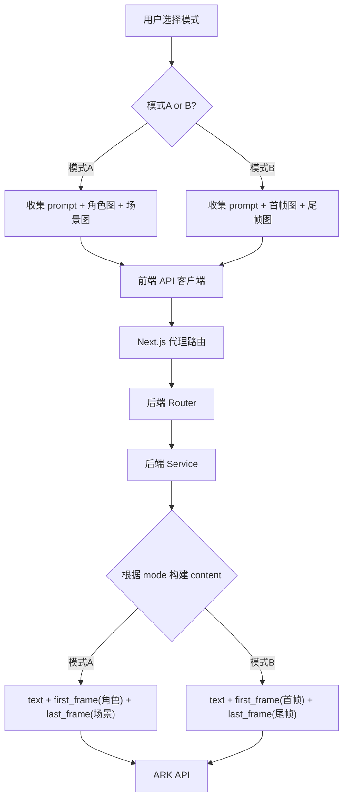

# Master Plan: AI 视频生成双模式支持

## 1. 概述

为 Ecliptrix 视频编辑功能的 AI 视频生成增加两种生成模式的完整前后端支持：

- **模式A — 描述生成**：用户输入文字描述 + 可选的角色/场景参考图，生成视频
- **模式B — 关键帧生成**：用户提供首帧图片（必填）+ 尾帧图片（可选）+ 文字描述，生成视频

两种模式需要在两个前端入口同时支持：
1. **文本脚本面板**（AIVideoScriptTab）
2. **素材管理 AI 视频生成弹窗**（AiVideoModal）

## 2. 目标

- 前端两处入口支持模式切换，交互风格一致
- 后端适配模式参数，正确构建 ARK API content 数组
- 先通过测试脚本验证 ARK API 首尾帧调用正确性，再编写业务代码
- 不引入新的 API 功能（草稿模式、音频生成等留后续迭代）

## 3. 范围

### 范围内（In Scope）

| 项目 | 描述 |
|------|------|
| ARK API 测试 | 编写测试脚本验证首帧、首尾帧、纯描述三种调用方式 |
| 后端模型层 | `ArkVideoGenerateRequest` 增加 `mode` 字段和首尾帧专用字段 |
| 后端服务层 | `ark_video_service.create_task()` 根据 mode 构建不同的 content 数组 |
| 前端脚本面板 | AIVideoScriptTab 增加模式切换器，根据模式显示/隐藏不同图片槽 |
| 前端素材弹窗 | AiVideoModal 增加模式下拉选择，表单根据模式动态变化 |
| 前端 Hook | `useAIVideoScriptGeneration` 适配新模式参数 |
| 前端 API 客户端 | `arkVideo.ts` 适配新请求参数 |
| 类型定义 | `AIVideoScriptSegment` 增加模式和首尾帧相关字段 |

### 范围外（Out of Scope）

- 草稿模式（draft）
- 原生音频生成（generate_audio）
- 多模型切换（Lite I2V / Seedance 2.0）
- 更多时长选项（4-12秒范围）
- 生成历史记录
- 实时服务端进度

## 4. 架构设计

### 4.1 模式定义

```
Mode A (描述生成):
  - prompt: string (必填)
  - character_image_url: string (可选) → API role: first_frame
  - scene_image_url: string (可选) → API role: last_frame
  - 当有图片时 ratio 自动设为 "adaptive"

Mode B (关键帧生成):
  - prompt: string (必填)
  - first_frame_url: string (必填) → API role: first_frame
  - last_frame_url: string (可选) → API role: last_frame
  - 角色/场景图片槽隐藏
  - ratio 强制为 "adaptive"
```

### 4.2 数据流



### 4.3 UI 交互设计

**模式切换器**（两处统一）：
- 使用 SegmentedControl / Toggle 按钮组
- 两个选项：「描述生成」和「关键帧生成」
- 默认选中「描述生成」（保持向后兼容）

**脚本面板（AIVideoScriptTab）**：
- 模式A：显示角色形象 + 场景形象图片槽（现有行为）
- 模式B：显示首帧图片（必填标记）+ 尾帧图片（可选标记）图片槽
- 切换模式时清空对应模式的图片数据

**素材弹窗（AiVideoModal）**：
- 模式A：显示 Prompt + 参考图URL输入（现有行为，但改为两个槽：角色+场景）
- 模式B：显示 Prompt + 首帧图URL输入（必填）+ 尾帧图URL输入（可选）
- 切换模式时表单重置

## 5. 关键设计决策

| 决策 | 选择 | 理由 |
|------|------|------|
| API 模型 | 继续用 `seedance-1-5-pro` | 用户要求简单可靠，不引入多模型复杂度 |
| 参考图传递方式 | 复用 `first_frame` / `last_frame` 角色 | Pro 模型不支持 `reference_image`，但 first/last frame 在描述模式下起到参考图效果 |
| 关键帧模式下参考图 | 隐藏参考图槽 | API 限制只能传两张图，关键帧已占满 |
| 尾帧 | 可选 | 降低用户门槛，只需首帧即可生成 |
| 交互一致性 | 两处统一 | 降低学习成本 |
| 开发顺序 | 先 API 测试 → 后端 → 前端 | 先验证 API 调用正确性再改业务代码 |

## 6. 依赖与风险

### 依赖

- `ARK_API_KEY` 配置正确且有效
- 火山 ARK API 对首尾帧图片的支持稳定
- 图片 URL 需要是公网可访问的（ARK API 会远程下载）

### 风险

| 风险 | 影响 | 缓解措施 |
|------|------|----------|
| ARK API 首尾帧调用方式与文档不符 | 功能无法使用 | 先写测试脚本验证 |
| 本地存储的图片 URL 无法被 ARK API 访问 | 图片上传失败 | 检查是否需要 OSS 上传后传公网 URL |
| 图片格式/尺寸超出 API 限制 | 生成失败 | 前端加验证提示 |

## 7. Spec 文件目录

| 文件 | 内容 |
|------|------|
| `specs/01-api-testing.md` | ARK API 首尾帧调用测试方案 |
| `specs/02-backend-changes.md` | 后端模型和服务层改动 |
| `specs/03-frontend-script-panel.md` | 脚本面板模式切换改动 |
| `specs/04-frontend-modal.md` | 素材弹窗模式切换改动 |
