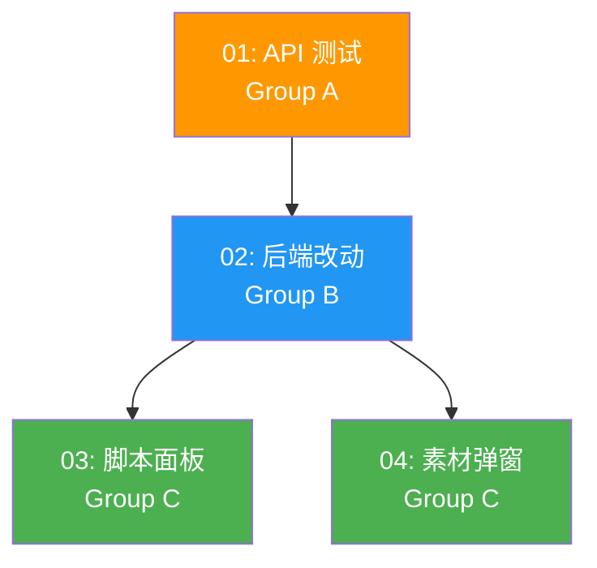

# Task Orchestration: AI 视频生成双模式支持

## 1. Dependency Graph



## 2. Execution Phases

| Phase | Tasks | 并行度 | 说明 |
|-------|-------|--------|------|
| Phase 1 | 01 - API 测试 | 1 agent | 必须先完成，验证 API 行为 |
| Phase 2 | 02 - 后端改动 | 1 agent | 依赖 Phase 1 结果 |
| Phase 3 | 03 + 04 - 前端改动 | 2 agents 并行 | 依赖 Phase 2，两个前端任务可并行 |

## 3. Critical Path

```
01 (API测试) → 02 (后端) → 03/04 (前端)
```

**瓶颈：** Phase 1 的 API 测试。因为需要真实调用 ARK API 并等待生成结果（每次 30-120 秒），这一步耗时最长。

## 4. Agent Assignments

| Agent | 任务 | 技能要求 |
|-------|------|----------|
| Agent 1 | 01 - API 测试脚本 | Python, httpx, ARK API |
| Agent 2 | 02 - 后端改动 | Python, FastAPI, Pydantic |
| Agent 3 | 03 - 脚本面板改动 | React, TypeScript, Tailwind |
| Agent 4 | 04 - 素材弹窗改动 | React, TypeScript, Tailwind |

**协调：** Agent 3 和 Agent 4 都需修改 `src/lib/api/arkVideo.ts`。由 Agent 3 先改 arkVideo.ts（因为是共享依赖），Agent 4 在此基础上开发。或者 Agent 3 改完 arkVideo.ts 后 Agent 4 再开始。

**实际建议：** 鉴于 arkVideo.ts 的共享依赖，Phase 3 中让 Agent 3 先启动（改 arkVideo.ts + 脚本面板），Agent 4 稍后启动（只改弹窗组件，复用 Agent 3 已改的 arkVideo.ts）。或者由一个 Agent 串行完成两个前端任务。

## 5. Context Files (每个 Agent 必读)

### 所有 Agent 共读

- `docs/plans/ai-video-generation-modes/master-plan.md`
- `docs/plans/ai-video-generation-modes/task-orchestration.md`

### Agent 1 (API 测试)

- `docs/plans/ai-video-generation-modes/specs/01-api-testing.md`
- `backend-services/basic-service/app/services/ark_video_service.py` (了解现有 API 调用方式)
- `backend-services/basic-service/app/config.py` (了解 ARK_API_KEY 配置)

### Agent 2 (后端)

- `docs/plans/ai-video-generation-modes/specs/02-backend-changes.md`
- `docs/plans/ai-video-generation-modes/todos/02-backend-changes.md`
- `backend-services/basic-service/app/models/ark_video_models.py`
- `backend-services/basic-service/app/services/ark_video_service.py`
- `backend-services/basic-service/app/routers/ark_video_router.py`
- Agent 1 的测试结果（确认 API 行为）

### Agent 3 (脚本面板)

- `docs/plans/ai-video-generation-modes/specs/03-frontend-script-panel.md`
- `docs/plans/ai-video-generation-modes/todos/03-frontend-script-panel.md`
- `src/components/video/components/AIVideoScriptTab/AIVideoScriptTab.tsx`
- `src/components/video/components/AIVideoScriptTab/ImagePickerSlot.tsx`
- `src/components/video/hooks/useAIVideoScriptGeneration.ts`
- `src/lib/api/arkVideo.ts`

### Agent 4 (素材弹窗)

- `docs/plans/ai-video-generation-modes/specs/04-frontend-modal.md`
- `docs/plans/ai-video-generation-modes/todos/04-frontend-modal.md`
- `src/components/video/components/AiVideoModal/AiVideoModal.tsx`
- `src/lib/api/arkVideo.ts` (Agent 3 已修改版本)
- `src/components/video/components/MaterialsPanel/MaterialsPanel.tsx` (了解触发入口)
