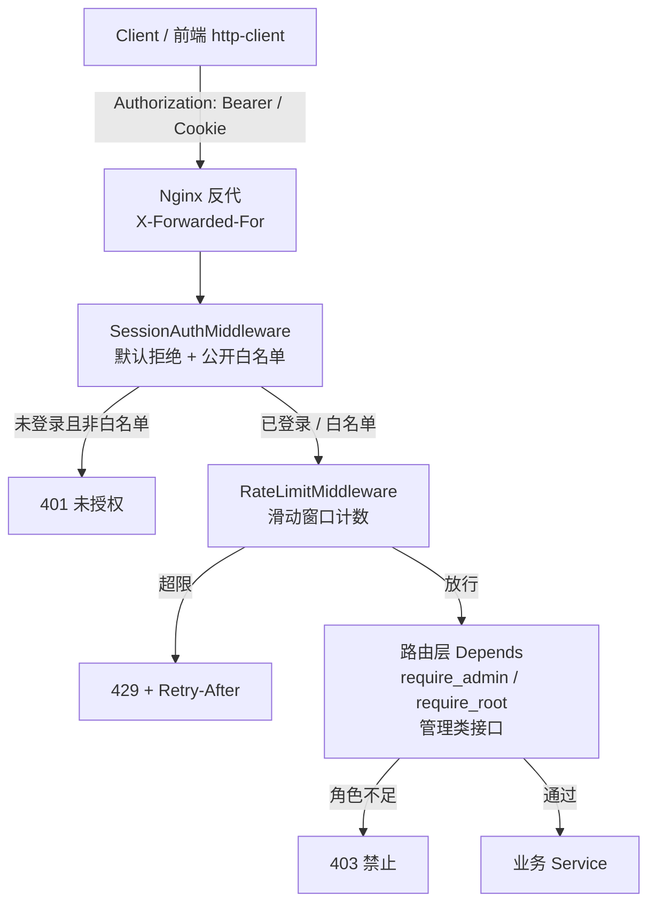
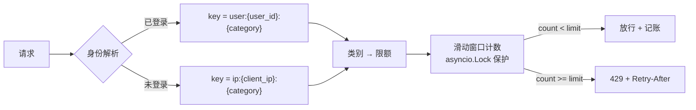
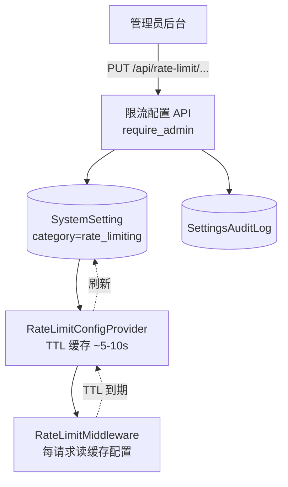
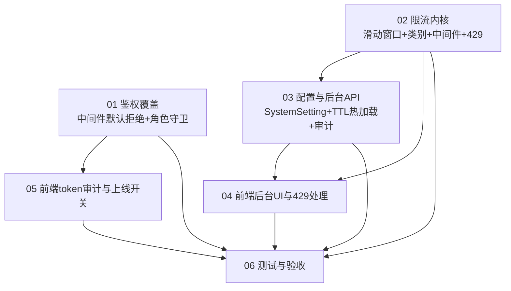

# Master Plan — 接口权限控制与频率限制 (API Authorization & Rate Limiting)

> 主题: `api-authz-rate-limiting`
> 模式: Full Process / 语言: 中文 / 远程服务器: 无
> 状态: 规划阶段(Phase 2)

---

## 1. 项目概述 (Overview)

Ecliptrix 后端(FastAPI,`backend-services/basic-service/`)目前有大量接口**未做用户权限校验**(约 74 个端点、26 个路由无任何鉴权,占路由总数 ~68%),且**全站无请求频率限制**(仅 `media_proxy_service` 有一处局部 per-IP 滑动窗口先例)。这带来两类风险:

1. **未授权访问**:任意匿名请求即可调用 AI 视频/音频/TTS/LLM/chat 生成、工作流、时间线、模型配置(含 API 密钥)等敏感、耗资源接口。
2. **资源滥用/DoS**:无频限,单个用户或脚本可无限制消耗算力与第三方 API 配额。

本项目为这些接口补齐**鉴权(Authorization)**与**频率限制(Rate Limiting)**,并提供**根管理员可在后台配置频限频率**的能力,默认值偏宽松,以最小化对正常用户的影响。

**关键利好:基础设施大部分已存在**,本项目重在「覆盖补齐」+「新增一层限流」+「后台可配 + 热生效」+「前端防回归与提示」,而非从零搭建鉴权体系。

> ⚠️ **据 spec 评审对照真实代码核实**:前序安全加固(commit `5473c7a`)已落地默认拒绝中间件骨架(`ALLOWLIST_EXACT`/`ALLOWLIST_PREFIX`/`HARD_PROTECT_PATHS`、token 三来源提取、常量时间比较、`request.state.user` 注入),且前端代理已通过 `backend-proxy.ts` 统一转发 `Authorization`、403 已有 `ForbiddenError` 处理。因此本期实质是「核对/收敛既有实现 + 补齐管理类角色守卫 + 新增限流层 + 补 429 处理」,**鉴权部分以核对收敛为主、不重建**。各 spec §「现状核对」为开发第一步。

### 现状盘点(勘探结论)

| 能力 | 现状 | 文件参考 |
|---|---|---|
| 鉴权依赖 | 已有 `get_current_user` / `require_admin` / `require_root` | `app/dependencies/auth.py`(约 24–209 行) |
| 会话中间件 | 已有 `SessionAuthMiddleware`(白名单 + 强制保护名单 + token 提取) | `app/middleware/auth_middleware.py:50-135` |
| 角色模型 | User 已有 `is_root` / `is_admin` / `user_role`(admin\|regular\|premium) / `is_active` | `app/models/db_models.py:15-42` |
| 鉴权覆盖 | **稀疏**:全站共 38 路由注册,其中约 26 路由 / ~74 端点无任何鉴权 | `app/main.py`(38 处 `include_router`) |
| 限流 | **几乎为零**;仅 media_proxy 有 per-IP 滑动窗口 | `app/services/media_proxy_service.py:276-304` |
| 并发控制 | `QueueManager` / `@with_simple_queue`(信号量,**非**频限) | `app/services/queue_manager.py`、`app/services/simple_queue_decorator.py` |
| 配置后台 | 已有 `SystemSetting` + `SettingsAuditLog` + `system_settings_router`(`require_admin`) | `app/routers/system_settings_router.py`、`app/models/db_models.py:103-120,290-305` |
| 配置热加载 | **无**:SystemSetting 改动不会自动重载到运行服务 | — |
| Redis | **无**(生产单机部署) | `requirements.txt` |
| 前端后台 | 已有 `AdminSettingsPage`(8 菜单),`systemSettings` 为占位 | `src/components/AdminSettings/AdminSettingsPage.tsx` |
| 前端 token | `http-client` 已统一注入 `Authorization: Bearer`;全局处理 401;**403 已有 `ForbiddenError`,缺 429 处理**;代理路由经 `backend-proxy.ts` 已转发 Authorization | `src/lib/api/http-client.ts:328-330,411-435`、`src/lib/api/server/backend-proxy.ts` |

---

## 2. 目标 (Goals)

1. **默认拒绝(Default-Deny)鉴权**:除极小公开白名单外,所有接口要求已登录会话;以中间件为单一管控点,降低改动面与回归风险。
2. **角色管控**:管理类接口(系统设置、模型配置、用户管理、管理观测)强制 `admin`/`root`。
3. **请求频率限制**:进程内内存滑动窗口,按「用户为主、未登录按 IP」计数;按接口类别分级(AI 生成严格、普通宽松、媒体服务高额度、登录防爆破)。
4. **登录防爆破**:登录/注册接口独立的 per-IP 严格限流(可后台单独配置),无锁定/验证码(本期范围)。
5. **后台可配 + 热生效**:复用 `SystemSetting` 存储 `rate_limiting` 类别配置,管理员后台可改,TTL 缓存数秒内自动生效,无需重启;改动写入 `SettingsAuditLog`。
6. **宽松默认**:默认开启限流但额度宽松(普通 ~300/分、AI 生成 ~30/分、登录 ~10/分(IP)、媒体服务高额度);全局开关可一键停用。
7. **前端协同**:`http-client` 增加 429 处理(读 `Retry-After`,全局友好 toast);新增独立「接口安全/限流」后台菜单(admin/root 可改);**上线前审计前端所有调用补齐 token** 防回归。
8. **质量保障**:鉴权/限流中间件单测 + 关键接口集成测试 + 429 行为测试。

### 非目标 / 本期不做 (Out of Scope)

- **资源归属/对象级授权**(用户只能访问自己的项目/素材)—— 留作后续独立任务,本期仅做「登录即可」。
- **分布式/多 worker 精确限流**(Redis)—— 本期为进程内内存,接受单进程精度;预留后端可替换接口。
- **premium 分级功能门控**(RBAC 超出 admin/root 部分)。
- **登录锁定 / 验证码 / 失败退避**—— 本期登录防护仅限 per-IP 限流。

---

## 3. 范围 (Scope)

### In Scope

- 后端:中间件默认拒绝鉴权 + 公开白名单;管理类路由的 `require_admin`/`require_root` 守卫。
- 后端:滑动窗口限流服务 + 限流中间件;身份解析(user_id / IP);接口类别注册表;429 响应(含 `Retry-After`)。
- 后端:`rate_limiting` 配置类别(SystemSetting)+ TTL 热加载 Provider + 审计 + 种子迁移。
- 后端:管理后台 API(读/写/重置限流配置 + 当前用量/状态只读,`require_admin`)。
- 前端:新增「接口安全/限流」后台配置页 + API client + Next.js 代理路由 + i18n。
- 前端:`http-client` 429 处理(全局 toast + Retry-After)。
- 前端:**调用 token 携带审计**(`src/app/api/*` 代理路由转发 Authorization;直接 fetch 收口到 http-client)。
- 测试:中间件单测 + 关键受保护接口集成测试 + 429 行为测试。

### Out of Scope(见上「非目标」)

---

## 4. 架构设计 (Architecture)

### 4.1 总体请求链路

> **中间件顺序(重要)**:认证在前(限流需知道 user 身份),限流在后(超限尽早拒绝、避免进入业务)。`app/main.py` 中间件按 LIFO 注册,需保证执行序为 `Auth → RateLimit`。

### 4.2 鉴权层(Authorization)

**策略:中间件「默认拒绝」为单一管控点**(而非逐一编辑 26 路由 × 74 端点),把鉴权 enforcement 收口到一处,改动面小、回归可控。

- **认证(Authentication)**:`SessionAuthMiddleware` 改为默认拒绝 —— 非白名单路径若无有效会话 token,直接 401;有效则把 user 注入 `request.state.user`。
- **公开白名单(PUBLIC_ALLOWLIST,极小)**:
  - `/api/health`、`/api/`(健康/根)
  - `/api/auth/login`、`/api/auth/register`、`/api/auth/validate-session`
  - `/api/config/*`(feature flags)
  - 文档:`/docs`、`/redoc`、`/openapi.json`
  - 静态/媒体服务(供浏览器 `<video>`/`<audio>` 标签,基于 cookie 认证或公开):`/static/*`、`/api/storage/files/*`、`/api/audio/generated/*`、`/api/audio/subtitles/*`
    - 注:这些路径**鉴权上**放行,但**限流上**仍计数(见 4.3 媒体类别)。
- **角色管控(Authorization)**:路由/路由组级 `require_admin` / `require_root` 依赖,覆盖:`system_settings_router`(已)、`model_settings_router`(**待补**,含 API 密钥)、用户管理、`admin_playback_router`、新增限流配置路由。
- **路由层 `get_current_user`**:业务 handler 若需 user 对象,仍可注入(读 `request.state.user` 快路径);enforcement 由中间件兜底。

> 待开发阶段**核对中间件真实行为**:确认现有「白名单 / 强制保护名单」逻辑,落地为「白名单 = 公开例外,其余默认拒绝」。

### 4.3 限流层(Rate Limiting)

**核心:进程内内存滑动窗口**(沿用 `media_proxy_service` 模式),封装为可复用 `RateLimiter` 服务。

- **身份解析(Key)**:已登录 → `user:{user_id}`;未登录 → `ip:{client_ip}`(IP 从 `X-Forwarded-For` 首段取,信任 nginx;需配置可信代理)。
- **接口类别(Category)与默认限额**(均可后台配,宽松默认):
  | 类别 | 匹配 | 默认额度 | 说明 |
  |---|---|---|---|
  | `ai_generation` | AI 视频/音频/TTS/LLM/chat 生成、ARK、storyboard、voice_clone 等 | ~30/分 | 耗算力/第三方配额,严格 |
  | `auth` | `/api/auth/login`、`/api/auth/register` | ~10/分(**按 IP**) | 防爆破,独立可配 |
  | `media_serving` | `/api/storage/files/*`、`/static/*`、`/api/audio/*` | 高(如 ~6000/分) | 视频/音频 range 分块请求量大,**给高额度避免播放被误伤**(非豁免,仍计数) |
  | `normal`(默认) | 其余所有 | ~300/分 | 普通读写/搜索/CRUD,宽松;额度按身份取值:已登录用 `default_per_user_per_min`,未登录用 `default_per_ip_per_min`(见 4.4 配置键) |
- **无身份豁免**(按用户决策):admin/root 也受限;无 IP/路径白名单豁免。媒体播放问题通过「`media_serving` 高额度类别」解决,而非豁免。⚠️ 见风险 R2。
- **算法**:滑动窗口计数(每分钟),与 media_proxy 一致;实现可复用/统一为同一 `RateLimiter` 内核。
- **数据结构**:`Dict[key, Deque[timestamp]]` + `asyncio.Lock`;超过容量阈值(如 1024+ keys)做 GC。
- **响应**:超限返回 `HTTP 429`,`Retry-After: <秒>` 头 + `error_code = "rate_limit.exceeded"`,响应体走统一 `ErrorResponse`(`success/message/error_code/error_details`)。

### 4.4 配置与热生效

- **存储**:`SystemSetting` 新增 `rate_limiting` 类别,键如:`enabled`、`default_per_user_per_min`、`default_per_ip_per_min`、`ai_generation_per_min`、`auth_per_ip_per_min`、`media_serving_per_min`、(可选)`window_seconds`。
- **种子**:Alembic 迁移注入默认值(参照 `004_seed_default_settings.py`)。
- **热生效**:`RateLimitConfigProvider` 带短 TTL(5–10s)缓存;中间件每请求读缓存,过期自动从 DB 刷新 → 后台改完数秒内生效,无需重启。
- **审计**:改动写 `SettingsAuditLog`(`setting_type=system_setting`,记录 `changed_by`)。

### 4.5 管理后台 API

- 复用 `SystemSetting` 持久化与审计,但提供**专用** `rate_limit_settings_router`(`require_admin`),端点示例:
  - `GET /api/rate-limit/config` —— 取当前生效配置(含默认值/类型/说明)
  - `PUT /api/rate-limit/config` —— 批量更新(校验数值范围)
  - `POST /api/rate-limit/reset` —— 重置为默认
  - `GET /api/rate-limit/status` —— 只读:当前进程内活跃 key 数 / 命中限流次数等观测指标
- 全局开关 `enabled` 走同一配置;关闭时中间件直通(只透传,不计数/不拦截)。

### 4.6 前端

- **后台配置页**:`AdminSettingsPage` 新增侧边栏菜单「接口安全 / 限流」(`SettingsSidebar`),受 `canManageUsers`(=isAdmin)门控;表单含全局开关 + 各类别额度 + 登录限流值 + 重置;只读状态区展示 `GET /status`。
- **API client**:`src/lib/api/rateLimitSettings.ts`;Next.js 代理路由 `src/app/api/rate-limit/*`(转发 `Authorization`)。
- **429 处理**:`http-client` 检测 `status === 429`,读 `Retry-After`,通过自定义事件 / `NotificationContext` 弹全局友好 toast(「请求过于频繁,N 秒后重试」),不自动重试(本期)。
- **i18n**:`src/lib/i18n.ts` 的 `t.adminSettings.*` 增加限流相关文案(中英)。
- **token 携带审计**(防回归,**上线前置任务**):核对 `src/app/api/*` 代理路由均转发请求方 `Authorization`/cookie;前端直接 fetch 收口到 `http-client`;补齐遗漏后再翻开默认拒绝开关。

---

## 5. 关键设计决策 (Design Decisions)

| # | 决策 | 理由 | 取舍 |
|---|---|---|---|
| D1 | 鉴权以**中间件默认拒绝**为单一管控点 | 一处改动覆盖 74 端点,回归面可控,避免逐路由漏改 | 中间件需精确维护公开白名单;角色管控仍需路由层 |
| D2 | 限流用**进程内内存滑动窗口** | 无 Redis,沿用既有 media_proxy 先例,零新依赖 | 多 worker 下计数不共享(生产单机单 worker 可接受);预留 Provider 接口便于将来换 Redis |
| D3 | 身份**用户为主、未登录按 IP** | 登录用户精确计量;公开接口仍可防匿名滥用 | 同 NAT/代理后未登录用户共享 IP 计数 |
| D4 | 限流**按类别分级** | AI 接口耗资源需严控,普通接口宽松不打扰 | 需维护「路径 → 类别」映射注册表 |
| D5 | 媒体服务用**高额度类别**而非豁免 | 兼顾用户「无豁免」诉求与视频播放 range 请求量大 | 仍需为该类别设足够高的额度(见 R2) |
| D6 | 配置存 **SystemSetting** + **TTL 热加载** | 复用现成后台/审计;解决「SystemSetting 不热加载」痛点 | TTL 窗口内最多数秒延迟生效(可接受) |
| D7 | **全局开关默认开启 + 宽松额度** | 默认有保护但几乎不误伤;出问题可一键关 | —— |
| D8 | 登录限流**独立 per-IP 类别**且可单独配 | 防爆破独立于普通额度;不引入锁定/验证码 | 仅 IP 维度,无账号级失败计数 |
| D9 | **先审计前端 token 再开强制** | 默认拒绝最大风险是前端漏带 token | 增加一项前置审计工作量 |

---

## 6. 依赖与构建顺序 (Dependencies & Build Order)

- **后端两条相对独立的主线**:鉴权覆盖(S01)与限流内核(S02)可并行起步。
- 后台 API(S03)依赖限流内核的配置项定义;前端 UI(S04)依赖后台 API;前端 token 审计(S05)依赖鉴权范围(S01)确定。
- 测试(S06)收尾,贯穿验证。

---

## 7. 风险与缓解 (Risks & Mitigations)

| # | 风险 | 影响 | 缓解 |
|---|---|---|---|
| R1 | 74 端点翻为默认拒绝后,前端漏带 token 的调用 → 功能回归 | 高 | **上线前全面审计前端调用补齐 token**(S05);默认拒绝开关与审计完成挂钩;可加临时「宽限记录」日志找漏点 |
| R2 | 静态/媒体 range 分块请求量大,若按普通额度计数会**误伤视频/音频播放** | 高 | 设 `media_serving` 高额度类别(默认很高);**请用户在评审时确认该额度**;按需提供该类别独立配置项 |
| R3 | 进程内内存限流在**多 worker**(gunicorn/uvicorn --workers>1)下计数不共享 | 中 | 确认生产为单进程;文档化限制;Provider/Limiter 设计为可替换 Redis 后端 |
| R4 | nginx 反代下 IP 识别(`X-Forwarded-For`)配置不当 → 所有用户共享代理 IP | 中 | 明确可信代理与取 IP 规则;部署校验真实客户端 IP |
| R5 | 中间件顺序错误(限流在认证前)→ 拿不到 user 身份 | 中 | 明确 `Auth → RateLimit` 执行序;单测覆盖 |
| R6 | 公开白名单遗漏(如 register)→ 阻断未登录必经流程 | 中 | 白名单清单评审 + 集成测试覆盖匿名必经路径 |
| R7 | TTL 缓存导致后台改动延迟生效,误判「没生效」 | 低 | UI 提示「数秒内生效」;可加显式刷新(可选) |
| R8 | `model_settings_router` 含 API 密钥却疑似未鉴权 | 高(安全) | S01 优先确认并补 `require_admin`;集成测试覆盖 |

---

## 8. 验收标准 (Acceptance Criteria)

1. 除公开白名单外,匿名请求受保护接口一律 401;管理类接口非 admin/root 返回 403。
2. 限流生效:超额请求返回 429 + `Retry-After`;普通/AI/登录/媒体各类别按配置额度独立计数。
3. 管理员后台可改各类别额度与全局开关,改动**数秒内热生效**且写入审计日志。
4. 默认额度宽松,正常人工操作零误伤;视频/音频播放不被限流打断。
5. 前端收到 429 弹友好全局提示;后台新菜单可读写限流配置。
6. 前端既有功能在默认拒绝开启后**无回归**(token 审计完成)。
7. 中间件单测 + 关键接口集成测试 + 429 行为测试通过。

---

## 9. 规划文档目录 (TOC)

| 文档 | 内容 |
|---|---|
| [`specs/01-authorization-coverage.md`](specs/01-authorization-coverage.md) | 中间件默认拒绝 + 公开白名单 + 管理类路由角色守卫 |
| [`specs/02-rate-limiter-core.md`](specs/02-rate-limiter-core.md) | 滑动窗口限流服务、身份解析、类别注册表、限流中间件、429 响应 |
| [`specs/03-config-and-admin-api.md`](specs/03-config-and-admin-api.md) | `rate_limiting` 配置类别、TTL 热加载 Provider、后台 API、审计、种子迁移 |
| [`specs/04-frontend-admin-ui-and-429.md`](specs/04-frontend-admin-ui-and-429.md) | 后台配置页(新菜单)、API client、代理路由、429 处理、i18n |
| [`specs/05-frontend-token-audit-and-rollout.md`](specs/05-frontend-token-audit-and-rollout.md) | 前端调用 token 携带审计、全局开关、上线与回归验证 |
| [`specs/06-testing-and-acceptance.md`](specs/06-testing-and-acceptance.md) | 中间件单测、关键接口集成测试、429 行为测试 |
| [`task-orchestration.md`](task-orchestration.md) | 依赖图、执行阶段、关键路径、Agent 分配、上下文清单 |

> 各 spec 仅用自然语言/伪代码/图,不含真实代码。
