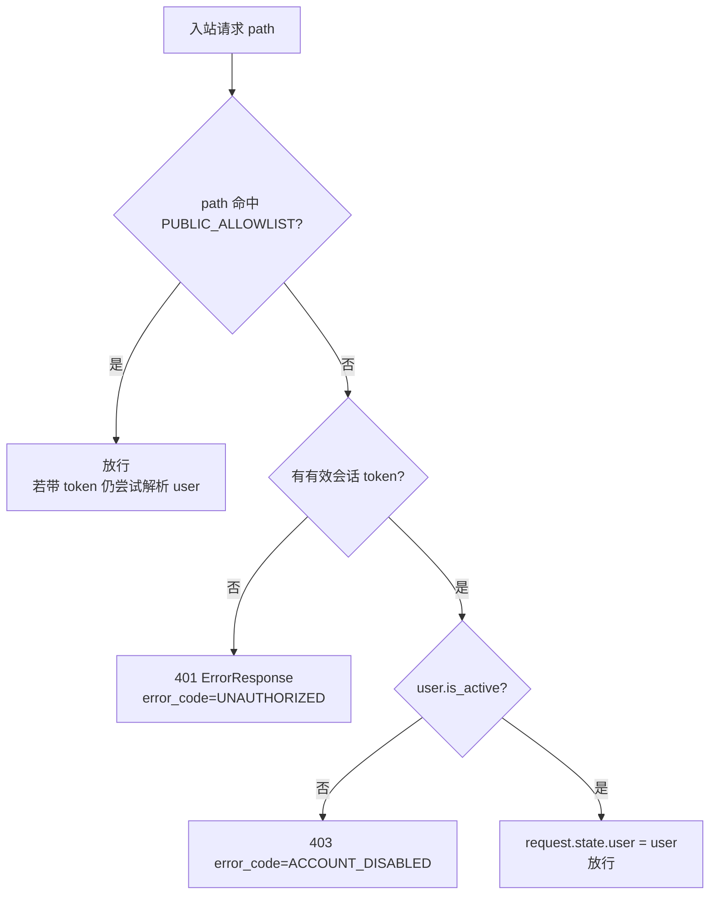

# Spec 01 — 鉴权覆盖 (Authorization Coverage)

> 对应 master-plan §4.2、§5(D1)、§7(R1/R6/R8)
> 模块边界: 后端 `backend-services/basic-service/app/middleware/`、`app/dependencies/`、`app/routers/`、`app/main.py`

## 1. 目标

把当前约 74 个未鉴权端点收敛到「默认拒绝 + 极小公开白名单」模型,并对管理类接口强制 `admin`/`root` 角色。以**中间件为单一认证管控点**,角色管控在路由层。本期**不做**资源归属校验。

## 2. 现状核对(开发第一步,必须先做)

> ⚠️ **重要前提**:`SessionAuthMiddleware` 的「默认拒绝」能力**已在既有安全加固中落地**(见 `auth_middleware.py` 的 `ALLOWLIST_EXACT` / `ALLOWLIST_PREFIX` / `HARD_PROTECT_PATHS`、token 三来源提取、常量时间比较、`is_active` 校验、`request.state.user` 注入)。因此本 spec **不是从零新建默认拒绝**,而是:① 核对既有实现与本 spec 设计是否一致;② 按本 spec 收敛/补齐公开白名单;③ 补齐 `model_settings_router` 等管理类路由的角色守卫。开发时**不要重写已存在的中间件骨架**,只做差异收敛。

在改动前,开发 agent **必须先 Read 并梳理**:
- `app/middleware/auth_middleware.py` —— 核对现有 `SessionAuthMiddleware` 的真实行为:`_is_allowlisted` 的判定顺序(hard-protect 优先于 allowlist)、`ALLOWLIST_EXACT` / `ALLOWLIST_PREFIX` / `HARD_PROTECT_PATHS` 的具体内容,以及它返回的 401/403 **error_code 实际取值**(现为 `UNAUTHORIZED` / `ACCOUNT_DISABLED`,见 §4)。
- `app/dependencies/auth.py` —— `get_current_user` / `require_admin` / `require_root` 的签名与异常(401/403)行为;注意 `get_current_user` 有「读 `request.state.user` 快路径」。
- `app/main.py` —— `include_router` 的 prefix 与挂载点(注意 `ai_video_generate_router`/`video_export_router`/`intent_detection_router` 挂在根而非 `/api`),以及 `/api/audio/generated`、`/api/audio/subtitles`、`/static/timeline_exports` 等 `StaticFiles` 挂载点。
- `app/routers/model_settings_router.py` —— **已确认缺少任何鉴权**(无路由级 `dependencies`、无 `Depends(require_admin)`,含 API 密钥配置端点,R8 高危),本期必须补齐。

产出一份「路由 → 当前鉴权状态 → 目标状态(public / authed / admin / root)」对照表,**并标注既有 `ALLOWLIST_*` 与本 spec §3.2 白名单的差异项**,作为后续改动依据。

## 3. 设计

### 3.1 中间件默认拒绝

- **默认拒绝**:非白名单路径,无有效 token → 直接 401(不再进入路由)。
- **token 提取**保持现有三来源:`Authorization: Bearer`、`X-Session-Token`(legacy)、Cookie `ecliptrix-session-token`(供 `<video>`/`<audio>`)。
- **会话校验**保持现有常量时间比较(防时序攻击),命中则注入 `request.state.user`。
- 白名单路径即便无 token 也放行;若带 token 则顺带解析 user(便于这些端点感知登录态,但不强制)。

### 3.2 PUBLIC_ALLOWLIST(极小公开白名单)

集中定义为一个**显式常量列表**(精确路径 + 前缀匹配两类),置于中间件模块顶部,便于评审与测试。中间件已有 `ALLOWLIST_EXACT` / `ALLOWLIST_PREFIX` 两个常量,本 spec 以**目标白名单**形式给出下表,开发时与既有常量**逐项比对收敛**(下表中既有实现尚未包含的项已在「备注」标注「待补」):

| 模式 | 路径 | 理由 | 备注 |
|---|---|---|---|
| exact | `/api/health`、`/api/health/` | 健康/探活 | 既有(`/api/health/` 尾斜杠变体已含) |
| exact | `/api/`(根) | 根信息端点(`api_router` 的 `GET /`) | **待补**(既有 `ALLOWLIST_EXACT` 未含;若评审认为根端点也应鉴权可不加) |
| exact | `/api/auth/login`、`/api/auth/register`、`/api/auth/validate-session` | 登录必经,未登录可达 | 既有 |
| prefix | `/api/config/` | feature flags(前端启动即读,如 `/api/config/playback-flag`) | **待补**(既有 allowlist 未含;注:裸 `GET /api/config` 不带尾斜杠,如需放行该端点须单列 exact) |
| exact/prefix | `/docs`、`/redoc`、`/openapi.json` | API 文档(生产环境已在 `main.py` 关闭这些 URL) | 既有 |
| prefix | `/static/`、`/api/storage/files/`、`/api/audio/generated/`、`/api/audio/subtitles/` | 浏览器媒体标签(cookie 认证或公开),见 master-plan §4.2 | 既有 |

> 注:`/api/auth/logout`、`/api/auth/me` 等需登录,**不在**白名单。开发时核对 `auth_router` 全部端点逐一归类。
> 匹配规则:exact 全等;prefix 为 `path.startswith(prefix)`。OPTIONS 预检请求(CORS)放行。
> 注:既有中间件还有一份 `HARD_PROTECT_PATHS`(ai-video-generate / video-export / intent-detection)作纵深防御,优先级高于白名单(防止将来误扩白名单),与 §5「强制保护名单」对应,**保留不弱化**。

### 3.3 角色管控(路由层)

管理类路由组追加路由级依赖,集中而非散落到每个 handler:

| 路由 | 目标 | 备注 |
|---|---|---|
| `system_settings_router` | `require_admin` | 已有,核对保持 |
| `model_settings_router` | `require_admin` | **本期补齐**(R8,含 API 密钥) |
| `admin_playback_router` | `require_admin` | 已有,核对保持 |
| 用户管理相关(`user_router` 中管理端点,如创建/删除/改角色) | `require_admin`;改 admin 角色用 `require_root` | 普通用户自身资料端点保持 `get_current_user` |
| 新增 `rate_limit_settings_router`(见 spec 03) | `require_admin` | —— |

实现方式优先用 `APIRouter(dependencies=[Depends(require_admin)])` 组级依赖;若单路由内混合普通/管理端点,则按端点加依赖。

### 3.4 与限流中间件的关系

认证中间件在前、限流中间件在后(见 spec 02 §中间件顺序)。认证负责 `request.state.user`,限流据此取身份。

## 4. 接口契约 (Interfaces)

- **PUBLIC_ALLOWLIST**(本 spec 产出)→ 被 `SessionAuthMiddleware` 消费;**也被 spec 02 限流中间件参考**(限流身份解析需知道是否匿名路径)。
- **`request.state.user`**:类型为 User ORM 或 None;produced by 认证中间件,consumed by 路由层 `get_current_user`(快路径)与 spec 02 限流中间件(取 `user.id`)。
- **401/403 响应体**:统一 `ErrorResponse`(`success=false`、`message`、`error_code`、`error_details`),与项目既有异常处理一致。沿用**既有中间件/依赖已发出的 error_code 取值**(勿擅自改名,避免前端按 `error_code` 分支的逻辑回归):
  - 401(未提供 token / 会话无效或过期)`error_code=UNAUTHORIZED`
  - 403(角色不足,由 `require_admin`/`require_root` 抛出)`error_code=FORBIDDEN`
  - 403(账号停用)`error_code=ACCOUNT_DISABLED`

## 5. 行为与边界

- 白名单遗漏 = 阻断未登录必经流程(R6)→ 必须有匿名可达性测试(spec 06)。
- CORS 预检 `OPTIONS` 必须放行(否则前端跨域报错)。
- 既有「强制保护名单」(ai-video-generate / video-export / intent-detection)在默认拒绝模型下成为冗余,可保留或简化,但**不可弱化**保护。
- 默认拒绝的**最终启用**由 spec 05 的全局/灰度开关与前端 token 审计联动(R1):中间件实现「默认拒绝」能力,但是否对全部路径强制可由开关或环境变量分批放开,避免一次性回归。

## 6. 验收点

1. 匿名请求任一受保护端点(如 `/api/workflow/*`、`/api/tts/*`、`/api/model-settings/*`)→ 401。
2. 白名单端点匿名可达(login/register/health/config/媒体)。
3. 非 admin 用户访问管理类端点 → 403;admin/root → 通过。
4. `model_settings_router` 已受 `require_admin` 保护(R8 闭环)。
5. 携带有效 token 的正常请求行为不变(无回归)。
