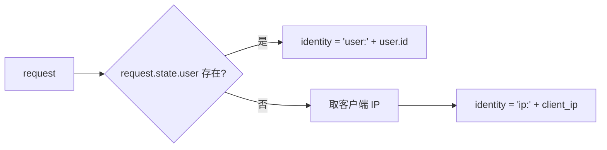
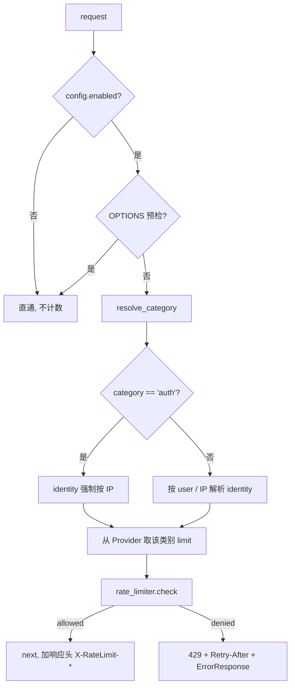

# Spec 02 — 限流内核 (Rate Limiter Core)

> 对应 master-plan §4.3、§5(D2/D3/D4/D5)、§7(R2/R3/R4/R5)
> 模块边界: 后端 `app/services/rate_limiter.py`(新)、`app/middleware/rate_limit_middleware.py`(新)、`app/main.py`

## 1. 目标

提供进程内内存滑动窗口限流内核 + 限流中间件:按「用户为主、未登录按 IP」计数,按接口类别分级限额,超限返回 `429 + Retry-After`。配置值由 spec 03 的 Provider 提供(本 spec 只消费配置接口,不负责持久化)。

## 2. 设计

### 2.1 RateLimiter 服务(滑动窗口内核)

沿用 `media_proxy_service`(`media_proxy_service.py:276-304`)的 per-IP 滑动窗口思路,抽象为通用内核:

```
class RateLimiter:
    # 内部: _windows: Dict[str, Deque[float]]  # key -> 单调时间戳队列
    #       _lock: asyncio.Lock
    #       _max_keys: int  # GC 阈值, 默认 4096

    async def check(key: str, limit: int, window_seconds: int = 60) -> Decision
    # 行为(伪代码):
    #   now = monotonic()
    #   async with _lock:
    #       dq = _windows[key]
    #       # 淘汰窗口外时间戳
    #       while dq and dq[0] <= now - window_seconds: dq.popleft()
    #       if len(dq) >= limit:
    #           retry_after = ceil(window_seconds - (now - dq[0]))
    #           return Decision(allowed=False, retry_after=retry_after,
    #                           limit=limit, remaining=0)
    #       dq.append(now)
    #       _maybe_gc()  # keys 超阈值时清理空队列/最旧 key
    #       return Decision(allowed=True, retry_after=0,
    #                       limit=limit, remaining=limit-len(dq))
```

- `Decision`: `{allowed: bool, retry_after: int, limit: int, remaining: int}`。
- 全局单例 `rate_limiter`(类似 `queue_manager` 单例)。
- **可替换后端**:`check` 的签名与实现解耦,future 可换 Redis 后端(D2/R3),不影响中间件。
- GC:`_windows` key 数超阈值时,清理空队列;必要时按最旧活动时间淘汰,避免内存无界增长。

### 2.2 身份解析 (Identity)



- **client_ip**:优先 `X-Forwarded-For` 首段(strip),否则 `request.client.host`。信任 nginx 注入(R4)。提供一个 `get_client_ip(request)` 工具函数集中处理,便于测试与将来加可信代理校验。
- 计数 key = `f"{identity}:{category}"`,使各类别独立计数。

### 2.3 接口类别注册表 (Category Registry)

路径 → 类别映射,集中定义、可读性优先:

| 类别 | 匹配规则(前缀/精确,按顺序匹配,先命中先生效) | 配置键(spec 03) |
|---|---|---|
| `auth` | `/api/auth/login`、`/api/auth/register` | `auth_per_ip_per_min` |
| `media_serving` | 前缀 `/api/storage/files/`、`/static/`、`/api/audio/generated/`、`/api/audio/subtitles/` | `media_serving_per_min` |
| `ai_generation` | AI/生成类前缀集合(见下) | `ai_generation_per_min` |
| `normal`(默认) | 其余所有 | `default_per_user_per_min`(登录)/ `default_per_ip_per_min`(匿名) |

- **`ai_generation` 前缀集合**(开发时对照 `app/main.py` 实际 prefix 核定,初版包含):
  `/api/workflow/ai-video-generate`、`/api/workflow/video-export`、`/api/tts/`、`/api/audio/`(转写/处理,排除上面的 media_serving 子路径)、`/api/llm/`、`/api/chat`、`/api/video/understanding`、`/api/ark-video`、`/api/ark-image`、`/api/storyboard`(生成相关)、`/api/voice-clone`、`/api/image`(生成相关)。
  > 注:类别匹配按表中**顺序**进行,`media_serving` 的 `/api/audio/generated/` 等子前缀须排在 `ai_generation` 的 `/api/audio/` 之前以正确分流。
- **类别解析器** `resolve_category(path) -> str`:本 spec 产出,集中可测;新增接口时只改此表。

### 2.4 限流中间件



- **`auth` 类别强制按 IP 计数**(防爆破,与登录用户无关)。
- **`normal` 类别按身份取额度**:已登录用 `default_per_user_per_min`,匿名(`identity` 为 `ip:`)用 `default_per_ip_per_min`(对应 spec 03 两个独立键);其余类别(`ai_generation`/`media_serving`)用各自单一键,不区分 user/ip。
- **全局开关**:`config.enabled=false` → 中间件直通(不计数/不拦截),实现「一键关闭」(D7)。
- **无身份豁免**:admin/root 同样计数(用户决策);媒体播放靠 `media_serving` 高额度(D5/R2)解决,而非豁免。
- **限流统计**(供 spec 03 `/status`):计数器累计 `total_checked`、`total_blocked`、`active_keys`,可由 `rate_limiter` 暴露只读快照。

### 2.5 中间件顺序(R5,关键)

执行序必须 `SessionAuth(认证) → RateLimit(限流)`:认证先跑(填 `request.state.user`),限流后跑(读 user 身份)。

`app/main.py` 中间件按 Starlette **LIFO** 注册(**后注册者位于最外层、每请求最先执行**;现有代码已在 `app.add_middleware(SessionAuthMiddleware)` 处注释说明此约定)。要让执行序为 `Auth → RateLimit`,**注册顺序须反过来**:先 `add_middleware(RateLimitMiddleware)`、后 `add_middleware(SessionAuthMiddleware)`,使 `SessionAuth` 成为外层先跑、`RateLimit` 成为内层后跑。开发时务必据此核对注册位置。本 spec 须在 PR 中明确注册位置并加注释。

## 3. 接口契约 (Interfaces)

- **Produces** `rate_limiter`(单例)、`resolve_category(path)`、`get_client_ip(request)`、`RateLimitMiddleware`。
- **Consumes** spec 03 的 `RateLimitConfigProvider.get_config()` → 取 `enabled` 与各类别 `*_per_min`、`window_seconds`。**契约**:Provider 必须提供同步可读(或已缓存)的取值,避免每请求 await DB。
- **Consumes** spec 01 的 `request.state.user`(身份)与 `PUBLIC_ALLOWLIST` 认知(媒体路径分类一致性)。
- **429 响应**:`ErrorResponse`,`error_code="rate_limit.exceeded"`,header `Retry-After: <秒>`;并附 `X-RateLimit-Limit` / `X-RateLimit-Remaining`(可选,便于前端与调试)。

## 4. 行为与边界

- 滑动窗口默认 `window_seconds=60`(每分钟),可配。
- 多 worker 下计数不共享(R3)—— 文档化;生产确认单进程。
- `media_serving` 必须给足额度(默认 ~6000/分),否则视频 range 请求会被误伤(R2)——**评审时确认默认值**。
- 限流中间件须放在异常处理之内、业务路由之外,确保 429 也走统一 `ErrorResponse` 序列化。

## 5. 验收点

1. 同一用户对 `normal` 接口超过额度 → 429 + `Retry-After`;窗口滚动后恢复。
2. AI 接口按 `ai_generation` 更低额度独立计数,不与 `normal` 混桶。
3. 登录接口按 IP 计数(同 IP 多账号共享 auth 额度)。
4. `enabled=false` 时完全直通无限制。
5. 媒体路径按 `media_serving` 高额度,正常播放不被打断。
6. 中间件执行序为 `Auth → RateLimit`,限流能拿到 user 身份。
