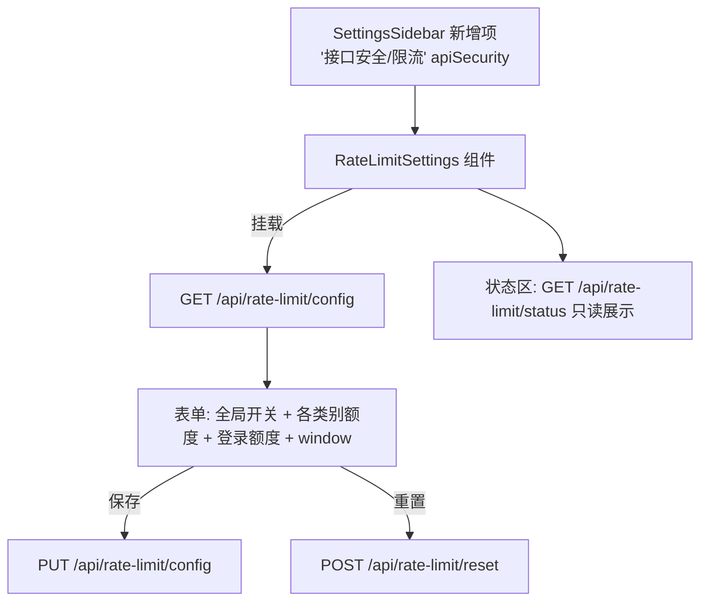

# Spec 04 — 前端后台 UI 与 429 处理 (Frontend Admin UI & 429 Handling)

> 对应 master-plan §4.6、§5(D7)、§7(R7)
> 模块边界: 前端 `src/components/AdminSettings/`、`src/lib/api/`、`src/app/api/rate-limit/`、`src/lib/i18n.ts`、`src/contexts/`

## 1. 目标

1. 在 `AdminSettingsPage` 新增独立「接口安全 / 限流」侧边栏菜单,admin/root 可读写 spec 03 的限流配置。
2. `http-client` 增加 429 处理:读 `Retry-After`,弹全局友好 toast(不自动重试)。
3. 配套 API client、Next.js 代理路由、i18n。

## 2. 设计

### 2.1 后台配置页



- **菜单项**:在 `SettingsSidebar` 增加 `apiSecurity`(或 `rateLimit`)项;沿用现有 8 项的样式与图标约定。具体需改三处保持一致:
  1. `SettingsSidebar.tsx` 的 `SettingsMenuItem` 联合类型新增 `'apiSecurity'`(现为 8 个字面量的 union),并在 `menuItems` 数组按现有结构追加一项(`id/label/description/icon`,label/description 取自 i18n)。
  2. `AdminSettingsPage.tsx` 的 `renderContent()` switch 新增 `case 'apiSecurity'` 渲染 `RateLimitSettings`(现有 8 个 case 同样模式)。
  3. 新增的菜单 id 全程统一(Mermaid 与文中均用 `apiSecurity`)。
- **门控**:AdminSettings 面板整体由其上层入口(打开该面板处)按 `canManageUsers`(=isAdmin,见 `AuthContext` line 346)门控;`AdminSettingsPage`/`SettingsSidebar` 内部**并不**对各菜单项再做单独门控,新菜单项天然继承面板级门控,无需额外前端判断。后端仍以 `require_admin` 兜底(前端门控不可信)。
- **组件** `RateLimitSettings`(放 `src/components/AdminSettings/`):
  - 顶部全局开关(`enabled`),关闭时下方额度项灰显并提示「限流已停用」。
  - 各类别数字输入(普通用户/匿名/AI/登录/媒体)+ `window_seconds`,带 min/max 校验(取自 `GET /config` 的 meta)。
  - 「保存」「重置为默认」按钮;保存成功 toast「已保存,数秒内生效」(对应 R7)。
  - 只读状态区:`active_keys` / `total_checked` / `total_blocked` / `enabled`。
- 表单字段与 spec 03 `GET /config` 返回结构严格对应(契约一致性)。

### 2.2 API client + 代理路由

- **API client** `src/lib/api/rateLimitSettings.ts`:`getConfig()`、`updateConfig(payload)`、`resetConfig()`、`getStatus()`,统一走 `http-client`(自动注入 Bearer)。
- **Next.js 代理路由**(backend proxy 模式,读 `process.env.BACKEND_URL`):
  - `src/app/api/rate-limit/config/route.ts`(GET、PUT)
  - `src/app/api/rate-limit/reset/route.ts`(POST)
  - `src/app/api/rate-limit/status/route.ts`(GET)
  - **必须转发入站 `Authorization` 头**(与 spec 05 token 审计同一要求),否则后端 `require_admin` 拿不到会话。

### 2.3 429 全局处理(http-client)

参照现有 401 全局处理(`http-client.ts:411-430`)模式扩展:

```
// 收到响应 status === 429:
//   retryAfter = parseInt(headers['Retry-After']) || 默认值
//   解析 ErrorResponse.message
//   dispatch 自定义事件 'ecliptrix:rate-limited' { retryAfter, message }
//   抛出 RateLimitError(继承 ApiError, 携带 retryAfter)
//   不自动重试(本期决策)
```

- 新增错误类型 `RateLimitError`(继承现有 `ApiError`,带 `retryAfter`)。
- 在合适的全局监听处(参照 AuthContext 监听 `session-expired` 的模式)监听 `ecliptrix:rate-limited`,经 `NotificationContext.showWarning` 弹「请求过于频繁,请 N 秒后重试」。
- **去抖**:短时间内多个 429 只弹一次 toast。注意**不要照搬 401 的 once-flag**——`http-client.ts` 的 `sessionExpiryHandled` 是「永久闩锁」,只在重新登录时由 `resetSessionExpiryFlag()` 复位(因为 401 是终态、随后跳转登录页);429 是瞬态,若用同样的永久闩锁会让此后所有 429 toast 都被静音。应改用**时间窗节流**(参照 `AuthContext` 的 `NETWORK_WARN_THROTTLE_MS`:记录上次弹出时间戳,窗口内不重复弹),窗口可取 `Retry-After` 或一个固定下限(如数秒)。另外 `NotificationContext.showNotification` 本身已对「完全相同的 message+type」去重,但因 toast 文案含倒计时秒数会变化,不能仅依赖它,仍需上述时间窗节流。

### 2.4 i18n

`src/lib/i18n.ts` 的 `t.adminSettings.*` 增加(中英双语):菜单名、页面标题/说明、各字段标签与提示、保存/重置文案、状态区标签、429 toast 文案。

> 注:`i18n.ts` 当前**无顶层 `t.errors` 命名空间**(各 `errors` 子块均嵌套在具体功能块内,如 `t.video.errors`)。为与本 spec 其余文案保持一致,429 toast 文案统一新增在 `t.adminSettings.*` 下(如 `t.adminSettings.rateLimited`),不要引用不存在的 `t.errors.*`。英文与中文两份(约 line 120 / line 5655 附近的 `adminSettings` 块)须同步补齐,缺一会触发类型不匹配。

## 3. 接口契约 (Interfaces)

- **Consumes**: spec 03 `GET/PUT /api/rate-limit/config`、`/reset`、`/status`(字段需与后端返回一一对应)。
- **Produces**: 代理路由(供前端组件)、`RateLimitError`(供调用方与全局监听)、`ecliptrix:rate-limited` 事件。
- **Consumes**: 现有 `AuthContext`(`canManageUsers`)、`NotificationContext`、`LocaleContext`、`http-client`、`SettingsSidebar` 约定。

## 4. 行为与边界

- 全局开关关闭后,前端额度项灰显但仍展示当前值。
- 429 toast 不阻断页面,不自动重试;倒计时秒数来自 `Retry-After`。
- 代理路由若漏转 `Authorization` → 后台 API 401/403(与 spec 05 审计同根问题)。
- 前端门控仅为 UX,真正鉴权在后端(spec 01/03)。

## 5. 验收点

1. admin 打开「接口安全/限流」菜单,看到当前配置并可保存,改动经后端生效。
2. 非 admin 看不到该菜单(且即便直连接口也被后端 403)。
3. 触发 429 时,前端弹一次友好 toast 含倒计时,不自动重试。
4. 全局开关关闭后,UI 正确反映「已停用」。
5. 中英文案完整,无硬编码缺失。
