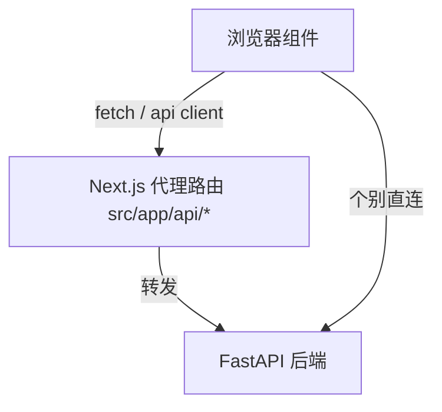

# Spec 05 — 前端 Token 审计与上线 (Frontend Token Audit & Rollout)

> 对应 master-plan §5(D1/D9)、§7(R1)
> 模块边界: 前端 `src/app/api/**`(100+ 代理路由,经 `src/lib/api/server/backend-proxy.ts` 统一转发)、`src/lib/api/**`、后端默认拒绝开关
> 这是**默认拒绝鉴权(spec 01)正式启用的前置闸门**。

## 1. 目标

在把后端切到「默认拒绝」之前,**系统性审计前端所有对后端的调用**,确保每个请求都带上会话 token(或显式属于公开白名单),消除「翻开鉴权后功能回归」的风险(R1)。并定义安全的上线/灰度策略。

## 2. 审计范围与方法

### 2.1 两类调用路径

1. **Next.js 代理路由**(`src/app/api/**/route.ts`,100+):绝大多数已收口到统一的代理助手 `src/lib/api/server/backend-proxy.ts`(`createPassthroughRoute` / `backendProxy`,前序 `unified-api-auth-refactor` 项目落地)。**现状核实(必做第一步)**:该助手的 `buildForwardedHeaders` **已对每个代理调用透传 `Authorization` 与 legacy `x-session-token`**;因此 R1 的真实风险**不是**「代理普遍不转 auth 头」,而是收窄为两类**例外**:
   - **未走助手的路由**:核对是否有路由仍用裸 `fetch` 自行拼请求而未透传 auth(代码中标注为 `SWEEP-EXCEPTION` / `Pattern E` 的少数逃生通道,如 chat、video-editing-agent、video-proxy)。逐一确认这些路由要么不需要后端会话(第三方 LLM / CDN 直连),要么显式转发了 token。
   - **遗漏接入助手的新增路由**:核对是否所有 `src/app/api/**/route.ts` 都经由助手或显式透传 auth。
   > 审计**不是**「逐个补转发」,而是「确认助手覆盖面 + 枚举并核验逃生通道」。
2. **前端直连/api client**:经 `http-client` 的已自动注入 Bearer(`requireAuth` 默认 `true`,见 `http-client.ts:292,328-330`);**审计点**:有无绕过 http-client 的裸 `fetch`(尤其媒体 URL、SSE/流式、WebSocket、`<video src>`)。

### 2.2 审计产出

- 一份**清单**:`src/app/api/**` 每个代理路由 → 是否经 `backend-proxy` 助手(自动转发 Authorization)→ 若未经助手则是否显式透传 → 需修复(Y/N)。
- 一份**逃生通道清单**:所有标注 `SWEEP-EXCEPTION` / `Pattern E` 或自拼裸 `fetch` 的路由 → 分类为「无需后端会话(第三方 LLM/CDN 直连)」或「需会话且已/未转发 token」→ 需修复(Y/N)。
- 一份**清单**:前端裸 `fetch`/EventSource 调用点 → 是否携带 token → 需修复(Y/N)。
- 媒体/流式特殊项:`<video>`/`<audio>` 走 cookie 认证(spec 01 已将媒体路径列入白名单 + cookie 认证),确认 cookie 正确下发;SSE/流式接口确认带 token。

### 2.3 修复策略

- **优先复用现有 `backend-proxy` 助手**(其 `buildForwardedHeaders` 已透传 `Authorization` + `x-session-token`):未接入助手的路由收口到助手即可,避免逐个手写转发逻辑。
- 逃生通道路由:若需后端会话却未转 token → 显式补 `Authorization`/`x-session-token` 转发;若属第三方 LLM/CDN 直连(不打后端受保护接口)→ 文档化标注「无需 auth」并保留例外。
- 绕过 http-client 的裸 fetch → 收口到 http-client 或显式补 Authorization。
- 公开端点(login/register/config/health/media)确认**不需要**也不强加 token。

## 3. 上线 / 灰度策略(R1)

- **默认拒绝开关**:spec 01 中间件实现「默认拒绝」能力,但通过一个开关/环境变量(如 `AUTH_ENFORCE_DEFAULT_DENY`,默认先 `false`)控制是否对全部非白名单路径强制 401。
- 推荐上线序:
  1. 合并 spec 01-04 代码,`AUTH_ENFORCE_DEFAULT_DENY=false`(不改变现有行为)。
  2. 完成本 spec 前端 token 审计与修复。
  3. 在测试环境置 `true`,跑 spec 06 集成测试 + 手动回归核心流程(登录、视频编辑、TTS、工作流、媒体播放)。
  4. 确认无回归后,生产置 `true`。
- 可选「宽限记录」模式:`true` 之前先开一个仅日志(不拦截)模式,记录哪些路径收到无 token 请求,二次确认漏点(对应 master-plan Round 2 的「先审计补齐」决策的兜底)。

> 限流的全局开关(spec 03 `enabled`)与本鉴权开关相互独立:限流默认开启且宽松;鉴权默认拒绝在审计完成后启用。

## 4. 接口契约 (Interfaces)

- **Consumes**: spec 01 的 PUBLIC_ALLOWLIST(判定哪些路径无需 token)与默认拒绝开关。
- **Produces**: 审计清单文档(代理路由覆盖 + 逃生通道核验 + 裸 fetch 调用点);上线 checklist。复用既有 `backend-proxy` 助手,**本 spec 不新造**转发助手(已存在)。
- 与 spec 04 共享「代理路由必须转发 Authorization」的要求(spec 04 的 `/api/rate-limit/*` 也适用)。

## 5. 行为与边界

- 审计须覆盖全部 100+ 代理路由,避免抽样遗漏(R1)。鉴于统一助手已默认转发 auth,实际工作量集中在「核实助手覆盖面」+「枚举核验少数逃生通道」,而非逐路由补转发。
- 媒体/流式/下载类与逃生通道(裸 fetch / `SWEEP-EXCEPTION`)是最易漏 token 的高风险点,重点核查。
- 本 spec 不改业务逻辑,只补(必要时的)auth 透传与上线开关。

## 6. 验收点

1. 全部 `src/app/api/**` 代理路由确认转发 Authorization(经 `backend-proxy` 助手或显式透传;或属公开白名单/第三方直连例外),逃生通道清单逐项有结论。
2. 无绕过 http-client 且缺 token 的受保护调用。
3. `AUTH_ENFORCE_DEFAULT_DENY=true` 下,核心用户流程(登录/视频编辑/TTS/工作流/播放)端到端无回归。
4. 提供可回滚的开关与上线 checklist。
