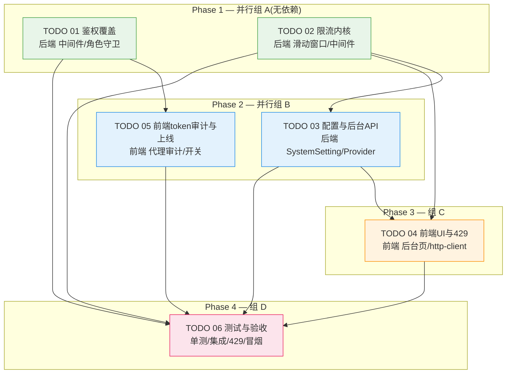

# Task Orchestration — api-authz-rate-limiting

> 治理模式: **三权分立 + Token 经济**(tripower_tokens) / 团队: Google Core Engineering / 远程服务器: 无
> 输入文档: `master-plan.md` + `specs/01..06` + `todos/01..06`

## 1. 依赖图 (Dependency Graph)



## 2. 执行阶段 (Execution Phases)

| 阶段 | 任务 | 并行 | 前置 | 说明 |
|---|---|---|---|---|
| **Phase 1** | TODO 01 鉴权覆盖、TODO 02 限流内核 | 是(2 路并行) | 无 | 两条后端主线;01 以核对收敛既有默认拒绝中间件为主,02 新建限流内核 |
| **Phase 2** | TODO 03 配置+后台API、TODO 05 前端token审计 | 是(2 路并行) | 03←02;05←01 | 03 实现 Provider 并接入 02;05 审计前端代理 token 透传 |
| **Phase 3** | TODO 04 前端UI与429 | 否(1 路) | 04←02,03 | 后台限流配置页 + http-client 429 处理 |
| **Phase 4** | TODO 06 测试与验收 | 否(1 路) | 06←全部 | 单测+集成+429+前端冒烟+验收 traceability |

> 每阶段并发 ≤ 7(含 dev/reviewer/tester/inspector 全角色);本项目实际峰值并发为 4(详见 §4 配比与并发说明)。Phase N+1 仅在 Phase N 全部通过 review(+test+结算)后启动。

## 3. 关键路径 (Critical Path)

```
TODO 02(限流内核) → TODO 03(配置/后台API) → TODO 04(前端UI/429) → TODO 06(测试)
```

- **最长链 4 段**,是项目工期瓶颈。`TODO 01 → 05 → 06` 为较短旁链。
- 瓶颈任务:**TODO 03**(同时被 04 和 06 依赖,且依赖 02)。优先保障 02→03 的契约(配置键、Provider 接口)稳定,避免下游返工。
- 高风险接缝(集成验证重点):中间件注册顺序(02)、配置键一致(02↔03)、`GET /config` schema(03↔04)、默认拒绝开关与前端审计(01↔05)。

## 4. Agent 分配 (Agent Assignments)

**四角色团队(共 7 agent,Inspector 恰 1 且不计 token):**

| 角色 | Agent | 职责 | Token 初值 |
|---|---|---|---|
| Inspector | `google-inspector` | 全局监察、token 结算、仲裁(唯一 token 操作者) | 不计 token |
| Reviewer | `google-reviewer-01` | 代码评审(每阶段所有 dev 产出) | 100 |
| Tester | `google-tester-01` | 验收测试 + spec 可追溯 | 100 |
| Dev(后端/鉴权) | `google-dev-01` | TODO 01 | 100 |
| Dev(后端/限流) | `google-dev-02` | TODO 02 → TODO 03 | 100 |
| Dev(前端) | `google-dev-03` | TODO 05 → TODO 04 | 100 |
| Dev(QA/测试) | `google-dev-04` | TODO 06 | 100 |

> **配比与并发说明**:全队 7 agent 满足「≤7」硬约束;Inspector 恰 1 且不计 token,受 token 评价的 6 agent 中 Dev 占 4(主体)、Reviewer/Tester 各 1。本项目仅 6 个任务单元、任一阶段最多 2 路 dev 并行,故**单 Reviewer + 单 Tester 串行贯穿各阶段**即可覆盖(Reviewer/Tester 占比偏向区间下沿是刻意取舍,避免引入第 2 名评审/测试反而推高 Reviewer 占比与总并发)。**实际峰值并发 = Inspector 1 + Reviewer 1 + Tester 1 + Dev ≤2 = 4**,远低于 7。

**逐阶段 agent 活动:**

| 阶段 | Dev | Reviewer | Tester |
|---|---|---|---|
| Phase 1 | dev-01(T01)、dev-02(T02) | reviewer-01 评审两者 | tester-01 验收两者 |
| Phase 2 | dev-02(T03)、dev-03(T05) | reviewer-01 | tester-01 |
| Phase 3 | dev-03(T04) | reviewer-01 | tester-01 |
| Phase 4 | dev-04(T06) | reviewer-01 | tester-01(+ inspector 终审) |

**协调注意:**
- 信息边界:Reviewer 不看测试结果;Tester 只看 Reviewer 的 Meta/Verdict,不看其详细评论。
- dev-02 跨 Phase1→2 承接 02→03,保证限流契约连续性。
- dev-03 跨 Phase2→3 承接 05→04,保证前端一致性。
- 集成验证(5.5)在每阶段末做契约静态核对 + 跑 `pytest`。

## 5. 上下文文件 (Context Files)

**所有 agent 必读(写码前):**
- `master-plan.md`
- 对应 `specs/0X-*.md` + `todos/0X-*.md`
- `task-orchestration.md`(本文件)
- `summaries/global-context.md`(Phase ≥2;Phase 1 仅含头部,免读)

**各 agent 聚焦上下文:**

| Agent / 任务 | 额外聚焦 |
|---|---|
| dev-01 / T01 | `app/middleware/auth_middleware.py`、`app/dependencies/auth.py`、`app/main.py`、`app/routers/model_settings_router.py` |
| dev-02 / T02 | `app/services/media_proxy_service.py:276-304`、`app/main.py`(中间件注册) |
| dev-02 / T03 | `app/models/db_models.py`(SystemSetting/SettingsAuditLog)、`app/routers/system_settings_router.py`、`alembic/versions/`、`app/config.py`;dev-02 自身 T02 摘要 |
| dev-03 / T05 | `src/lib/api/server/backend-proxy.ts`、`src/lib/api/http-client.ts`、`src/app/api/**`;dev-01 的 T01 摘要(白名单/开关) |
| dev-03 / T04 | `src/components/AdminSettings/*`、`src/contexts/*`、`src/lib/i18n.ts`;dev-02 的 T02/T03 摘要(429/config schema) |
| dev-04 / T06 | `tests/conftest.py`、既有 `tests/test_auth_middleware.py`/`test_settings_services.py`;全部上游 dev 摘要 + `global-context.md` |
| reviewer-01 | 受评 dev 的摘要 + 对应 spec + master-plan |
| tester-01 | 受测 dev 的摘要 + reviewer Meta/Verdict + spec(可追溯) |
| inspector | 当前阶段全部摘要 + global-context |

## 6. 备注

- **重大利好**:鉴权默认拒绝中间件骨架与前端 auth 透传已在 `5473c7a` 落地,T01/T05 以「核对收敛」为主,实际改动面小于初估。
- **风险盯防**:R1 回归(由 T05 审计 + 灰度开关化解)、R2 媒体播放误伤(由 02 `media_serving` 高额度化解)、R8 `model_settings` 裸奔(T01 优先补 `require_admin`)。
- 单进程内存限流(R3):生产单机可接受,Provider/Limiter 预留可替换 Redis 后端。
