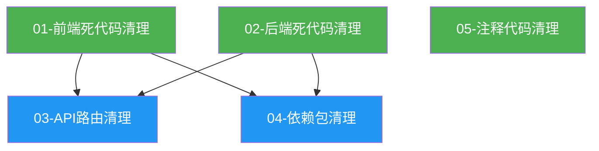

# 任务编排: 全栈废弃代码清理

## 1. 依赖关系图



## 2. 执行阶段

### Phase 1（无依赖，可并行）
| Agent | 任务 | 并行组 |
|-------|------|--------|
| Agent 1 | TODO 01 - 前端废弃代码扫描与清理 | A |
| Agent 2 | TODO 02 - 后端废弃代码扫描与清理 | A |
| Agent 3 | TODO 05 - 注释代码块全面清理 | A |

### Phase 2（依赖 Phase 1，可并行）
| Agent | 任务 | 依赖 | 并行组 |
|-------|------|------|--------|
| Agent 4 | TODO 03 - API 路由对应关系检查与清理 | T01, T02 | B |
| Agent 5 | TODO 04 - 未使用依赖包检查与清理 | T01, T02 | B |

## 3. 关键路径

```
T01(前端死代码) → T03(API路由清理) → 完成
T02(后端死代码) ↗
```

**瓶颈任务：** T01 和 T02 是 Phase 2 的前置条件。T01（前端死代码清理）预计工作量最大（组件数量多、类型定义多）。

## 4. Agent 分配

**推荐 Agent 数量：** 5 个（Phase 1: 3 个并行，Phase 2: 2 个并行）

| Agent | 名称 | 负责 | 说明 |
|-------|------|------|------|
| Agent 1 | `cleanup-eng-01` | 前端死代码清理 | 扫描 src/ 下的 TS/TSX 文件 |
| Agent 2 | `cleanup-eng-02` | 后端死代码清理 | 扫描 app/ 下的 Python 文件 |
| Agent 3 | `cleanup-eng-03` | 注释代码清理 | 扫描全项目注释代码 |
| Agent 4 | `cleanup-eng-04` | API 路由清理 | 交叉验证前后端路由 |
| Agent 5 | `cleanup-eng-05` | 依赖包清理 | 检查 npm + Python 依赖 |

**协调要点：**
- Phase 1 的 Agent 3（注释代码）可能修改 Agent 1/2 也要修改的文件 → Agent 3 只做注释代码清理，不动非注释部分
- Phase 2 在 Phase 1 全部完成后启动

## 5. Context Files

### 所有 Agent 必读
- `docs/plans/code-cleanup/master-plan.md`
- `docs/plans/code-cleanup/task-orchestration.md`
- `.claude-index/index.md`（项目索引）
- `CLAUDE.md`（项目规范）

### Agent 1 额外必读
- `docs/plans/code-cleanup/specs/01-frontend-dead-code.md`
- `docs/plans/code-cleanup/todos/01-frontend-dead-code.md`
- `src/types/index.ts`（类型定义入口）
- `src/app/page.tsx`（前端入口）

### Agent 2 额外必读
- `docs/plans/code-cleanup/specs/02-backend-dead-code.md`
- `docs/plans/code-cleanup/todos/02-backend-dead-code.md`
- `backend-services/basic-service/app/main.py`（后端入口）

### Agent 3 额外必读
- `docs/plans/code-cleanup/specs/05-commented-code-cleanup.md`
- `docs/plans/code-cleanup/todos/05-commented-code-cleanup.md`

### Agent 4 额外必读
- `docs/plans/code-cleanup/specs/03-api-route-cleanup.md`
- `docs/plans/code-cleanup/todos/03-api-route-cleanup.md`

### Agent 5 额外必读
- `docs/plans/code-cleanup/specs/04-dependency-cleanup.md`
- `docs/plans/code-cleanup/todos/04-dependency-cleanup.md`
- `package.json`
- `backend-services/basic-service/requirements.txt`
