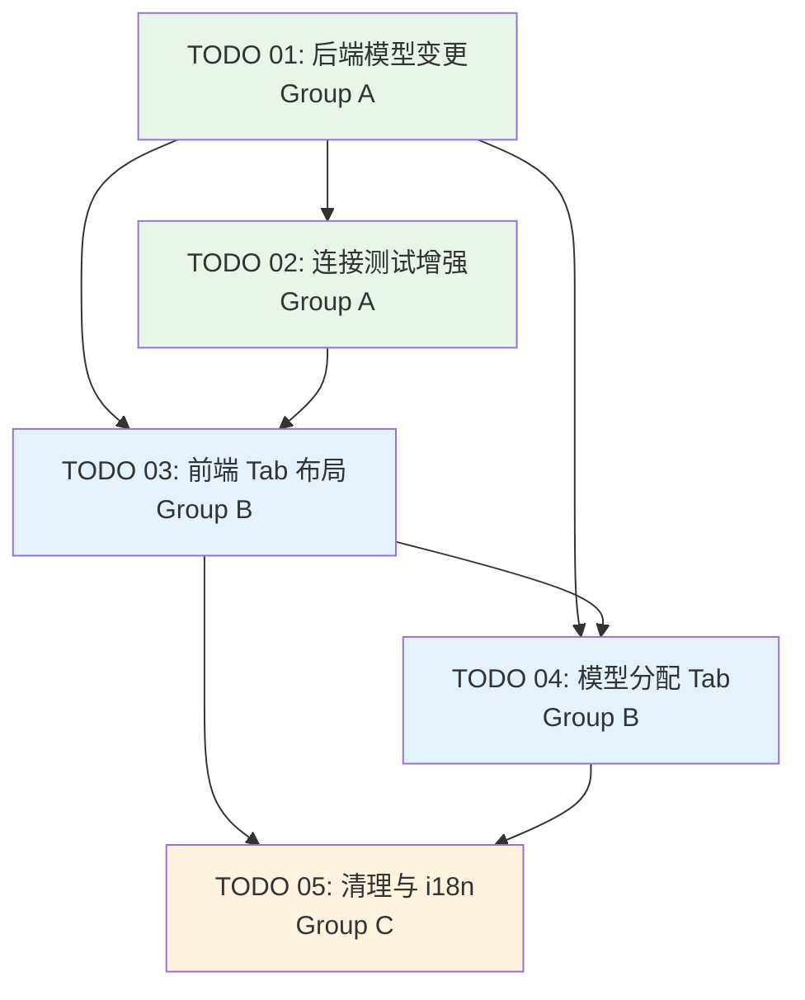

# Task Orchestration: Coding Plan 模型设置适配

## 1. 依赖关系图



## 2. 执行阶段

### Phase 1（无依赖，立即启动）

| 任务 | Agent | 预计复杂度 |
|------|-------|-----------|
| TODO 01: 后端模型变更与 DB 迁移 | dev-01 | 中 |

- 后端 Pydantic 模型扩展、ORM 变更、Alembic 迁移、PROVIDERS 列表更新、常量重构
- 无前置依赖，可立即开始
- **关键输出：** api_format 字段在所有后端模型中可用，DB 迁移就绪

### Phase 2（依赖 Phase 1）

| 任务 | Agent | 预计复杂度 |
|------|-------|-----------|
| TODO 02: 连接测试增强 | dev-01 | 低-中 |

- 依赖 TODO 01 完成的 `_resolve_api_format` 函数和 DB api_format 列
- 重构 test_connection、提取 _test_openai_connection、新增 _get_provider_db_format
- **关键输出：** 测试连接 API 支持 api_format 参数和 model_info 返回

### Phase 3（依赖 Phase 2）

| 任务 | Agent | 预计复杂度 |
|------|-------|-----------|
| TODO 03: 前端 Tab 布局与提供商管理 | dev-02 | 高 |
| TODO 04: 模型分配 Tab 与 Coding 集成 | dev-03 | 中 |

- TODO 03 是最大的前端重构任务（Tab 框架、提供商表单增强、卡片化）
- TODO 04 依赖 TODO 03 的 Tab 框架，但可以在 TODO 03 完成框架搭建后紧跟执行
- 由于 TODO 04 直接依赖 TODO 03 的 Tab 状态管理，建议**串行执行**（dev-02 先做 03，dev-03 后做 04）
- **i18n 注意：** TODO 03/04 所需的新增 i18n key（如 `tabProviders`、`tabAssignments`、`tabAdvanced`、`apiFormat` 等）应由 dev-02 在 TODO 03 实现时一并添加到 `i18n.ts`，而非等到 TODO 05。TODO 05 仅负责清理废弃的 `codingPlan*` key
- **关键输出：** 完整的三 Tab 面板，coding 类型可配置

### Phase 4（依赖 Phase 3）

| 任务 | Agent | 预计复杂度 |
|------|-------|-----------|
| TODO 05: 清理与 i18n | dev-02 或 dev-03 | 低 |

- 删除 CodingPlanPanel、清理菜单、清理废弃的 `codingPlan*` 翻译 key
- 新增 i18n key 已在 TODO 03 中完成，本阶段仅清理废弃 key
- 必须在 Tab 布局和 coding 功能完全就位后执行
- **关键输出：** 无残留引用，构建通过

## 3. 关键路径

```
TODO 01 → TODO 02 → TODO 03 → TODO 04 → TODO 05
```

最长路径经过所有 5 个任务（串行）。瓶颈任务：
- **TODO 03**（前端 Tab 布局重构）— 最大代码量、最多 UI 变更
- **TODO 01**（后端模型变更）— 所有其他任务的基础

## 4. Agent 分配

| Agent | 角色 | 负责任务 | 说明 |
|-------|------|---------|------|
| dev-01 | 后端开发 | TODO 01, TODO 02 | Python/FastAPI/SQLAlchemy 专长 |
| dev-02 | 前端开发 | TODO 03, TODO 05 | React/TypeScript/UI 重构专长 |
| dev-03 | 前端开发 | TODO 04 | React 状态管理 + 表单交互 |
| reviewer-01 | 代码审查 | Phase 1-4 全程 | 覆盖后端和前端 |
| tester-01 | 测试验证 | Phase 1-4 全程 | 端到端测试 + 类型检查 |
| inspector | 治理监督 | 全局 | Token 经济管理 + 裁决 |

**总计：** 6 agents（3 dev + 1 reviewer + 1 tester + 1 inspector）

## 5. 上下文文件

### 所有 Agent 必读

- `docs/plans/coding-plan-model-settings/master-plan.md`
- `docs/plans/coding-plan-model-settings/task-orchestration.md`

### dev-01（后端）额外必读

- `backend-services/basic-service/app/models/model_settings_models.py`
- `backend-services/basic-service/app/models/db_models.py`
- `backend-services/basic-service/app/services/model_settings_service.py`
- `backend-services/basic-service/app/routers/model_settings_router.py`
- `backend-services/basic-service/alembic/versions/003_add_settings_tables.py`（参考现有迁移格式）
- `docs/coding-plan/kimi/test_kimi_k2.5.py`（Kimi API 参考）
- `docs/coding-plan/glm/test_glm_coding_plan.py`（GLM API 参考）
- `docs/plans/coding-plan-model-settings/specs/01-backend-model-changes.md`
- `docs/plans/coding-plan-model-settings/specs/02-backend-test-connection.md`
- `docs/plans/coding-plan-model-settings/todos/01-backend-model-changes.md`
- `docs/plans/coding-plan-model-settings/todos/02-backend-test-connection.md`

### dev-02（前端 Tab + 清理）额外必读

- `src/components/AdminSettings/ModelSettingsPanel.tsx`
- `src/components/AdminSettings/CodingPlanPanel.tsx`（理解当前实现，后续删除）
- `src/components/AdminSettings/SettingsSidebar.tsx`
- `src/components/AdminSettings/AdminSettingsPage.tsx`
- `src/lib/i18n.ts`（翻译文件）
- `docs/plans/coding-plan-model-settings/specs/03-frontend-tab-layout.md`
- `docs/plans/coding-plan-model-settings/specs/05-frontend-cleanup-i18n.md`
- `docs/plans/coding-plan-model-settings/todos/03-frontend-tab-layout.md`
- `docs/plans/coding-plan-model-settings/todos/05-frontend-cleanup-i18n.md`

### dev-03（前端模型分配）额外必读

- `src/components/AdminSettings/ModelSettingsPanel.tsx`（Tab 重构后版本）
- `docs/plans/coding-plan-model-settings/specs/04-frontend-model-assignment.md`
- `docs/plans/coding-plan-model-settings/todos/04-frontend-model-assignment.md`

### reviewer-01 必读

- 所有 spec 和 todo 文件
- 被审查 agent 创建/修改的所有源文件

### tester-01 必读

- 所有 spec 文件（用于需求追溯）
- 被测试 agent 创建/修改的所有源文件
