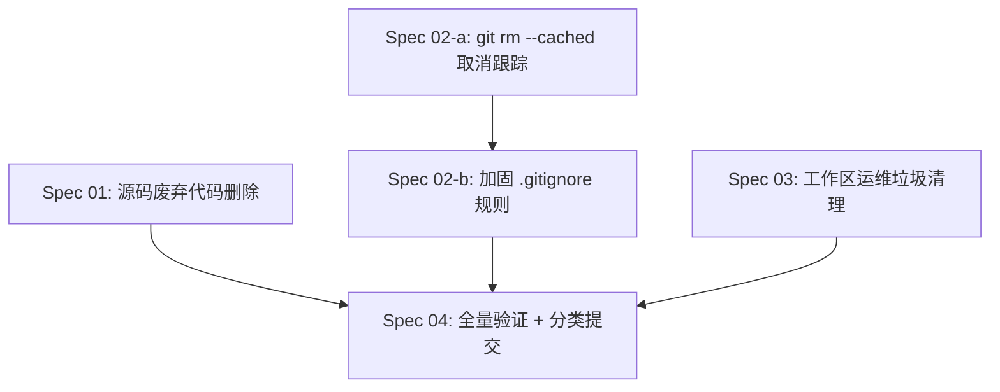

# Master Plan：废弃代码与仓库垃圾清理（dead-code-cleanup）

> 主分支：`feat/local-video-editing-refactor`（本次清理在此分支上分类提交）
> 创建日期：2026-06-11　|　运行模式：Full Process　|　文档语言：中文

## 一、概述（Overview）

Ecliptrix 在经历多轮大重构（local-video-editing-refactor、OSS 移除、Workflow/Brainstorm 下线、API 鉴权限流）后，**源码本身相当干净**，但仓库累积了三类需要清理的内容：

1. **少量源码废弃代码**：前端约 5 处确认无引用 / `@deprecated` 且无人调用的模块、函数、测试；后端几乎为零。
2. **误提交进 git 的生成物**：54 个媒体/日志文件被跟踪（含 35MB 的 `app.log`、合成视频 mp4、TTS mp3、缩略图），它们都是运行时产物，不应进版本库。
3. **工作区运维垃圾**：4 个部署包 `ops/*.tgz`（~272MB）+ 138 个一次性运维/排障脚本 `ops/_dp_*.py` / `_ssh_*.py`，以及 `.gitignore` 缺口导致的再堆积风险。

本计划的目标是**安全、可回退地**清除上述三类内容，并加固 `.gitignore` 防止复发，同时**绝不误删**仍在使用的部署工具与有效源码。

## 二、目标（Goals）

- **G1**　删除经独立验证确认零引用的前端废弃源码（模块/函数/孤儿测试）。
- **G2**　将误提交的生成媒体与日志从 git 跟踪中移除（`git rm --cached`，保留本地文件），不重写历史。
- **G3**　删除工作区中的部署包 `*.tgz` 与明显重复的一次性排障脚本，**保留**在用的部署工具（如 `_dp_upload2.py`、`_dp_wait2.py`）。
- **G4**　全面加固 `.gitignore`，覆盖生成媒体目录、日志、`*.tgz`、`.env*`、`ops/` 临时脚本等，杜绝复发。
- **G5**　每一步删除后通过全量验证（type-check + lint + build + 前端 vitest + 后端 pytest）确认不破坏功能。
- **G6**　在当前分支按类别分多次提交，便于审阅与单独回退。

## 三、范围（Scope）

### 范围内（In Scope）

- 前端 `src/` 下确认无引用的废弃模块、函数、孤儿测试的删除。
- 后端 `__pycache__/` / `*.pyc` 的处理（构建产物，非源码；当前为未跟踪状态，措施是 `.gitignore` 覆盖以杜绝误入库，并可选地清理本地未跟踪目录）。
- `git rm --cached` 取消跟踪 54 个生成媒体/日志文件。
- 删除 `ops/*.tgz` 与重复一次性脚本。
- `.gitignore` 规则加固。
- 全量验证与分类提交。

### 范围外（Out of Scope）

- **文档目录不动**：`docs/plans/`（37 个）与 `docs/diagnoses/`（30 个）一概保留，不归档、不删除（依据第二轮问答 Q7「保留不动」，覆盖第一轮 Q1 的归档勾选）。
- **不重写 git 历史**：不使用 `git filter-repo` 清理历史中的大文件；`.git` 体积优化留待后续单独决策（重写会要求 force-push，分支若已共享有风险）。
- **不删除在用部署工具**：`_dp_upload2.py`、`_dp_wait2.py` 及其他经确认仍被引用的运维脚本保留。
- **不动后端"前向兼容预留"字段**：`cover_render_metadata`、`ref_count` 等有意保留、已写明用途的字段不碰。
- **不迁移仍被引用的 `@deprecated` 组件**：`AgentMessageBubble`、`AgentToolCallCard` 等仍被 import 的组件本次保留原样（依据 Q4「只删无人引用的」）。

## 四、方法与架构（Approach）

清理按**五个互相解耦的类别**推进，每类对应一份 spec：

| 类别 | Spec | 核心动作 | 风险等级 |
|------|------|---------|---------|
| 源码废弃代码 | `01` | 逐文件零引用验证 → 删除 | 中（误删风险，靠验证兜底） |
| 跟踪产物取消跟踪 + gitignore | `02` | `git rm --cached` + 加固 `.gitignore` | 低 |
| 工作区运维垃圾清理 | `03` | 删 `*.tgz` + 重复脚本，保留在用工具 | 中（误删工具风险，靠白名单兜底） |
| 后端构建产物处理 | `02` 附属 | `.gitignore` 覆盖 `__pycache__`/`*.pyc`（未跟踪）+ 可选清本地目录 | 低 |
| 全量验证与分类提交 | `04` | 五道验证闸 + 分类 commit | 低 |

### 核心设计决策（Key Decisions）

- **D1 验证优先，探查报告只当候选**：本次扫描已抓出 `lib/clipboard.ts` 的误判（探查报"HIGH 无引用"，实际被 `chat/MessageBubble.tsx` 引用）。**任何源码删除前，必须对该文件的导出符号与文件路径做一次独立的全仓库零引用检索（含动态引用、字符串路径、`index.ts` 再导出）**，确认后才删。这是 G1 的硬约束。
- **D2 取消跟踪而非删除本地**：生成媒体/日志用 `git rm --cached`，本地文件保留，桌面/本地运行时仍可用；通过 `.gitignore` 阻止再次入库。
- **D3 不重写历史**：仅停止跟踪，不清理历史 blob。`.git` 体积优化（filter-repo + force-push）作为独立的、需显式授权的后续任务。
- **D4 运维脚本白名单保护**：删除前先列出"保留白名单"（在用工具）与"删除清单"（重复迭代脚本 + tgz），删除清单经用户/审阅确认后才执行；优先采用"可回退"的方式（如先移动到一个临时归档目录或仅删 tgz）。
- **D5 分类提交，逐类验证**：每个类别独立 commit，commit 前跑相应验证；源码类删除后必须跑全量验证。
- **D6 .gitignore 加固与现有规则不冲突**：新增规则需核对现有 77 行 `.gitignore`，避免重复或误伤已跟踪文件（已跟踪文件不受 `.gitignore` 影响，需先 `git rm --cached`）。

## 五、依赖关系（Dependencies）

- `Spec 01/02/03` 三类**互相独立**，可并行准备；但都在 `Spec 04` 汇合做最终全量验证与提交。
- `Spec 02` 内部有顺序约束（图中 `02-a → 02-b`）：必须先 `git rm --cached` 取消跟踪，再在 `.gitignore` 加规则（否则规则对已跟踪文件无效）。
- 提交顺序建议：`02`（低风险，先清环境）→ `03`（运维垃圾）→ `01`（源码，最需谨慎）→ `04` 收尾验证；每类提交前跑验证。

## 六、风险与缓解（Risks & Mitigations）

| 风险 | 影响 | 缓解措施 |
|------|------|---------|
| R1 误删被引用源码（如 clipboard 误判） | 编译失败 / 运行时报错 | D1 逐文件零引用验证 + 删除后全量 type-check/build/test |
| R2 误删在用部署工具 | 丢失运维能力 | D4 白名单保护，仅删 tgz + 确认重复的脚本 |
| R3 `git rm --cached` 误伤本地运行所需文件 | 本地预览/导出缺素材 | D2 仅取消跟踪、保留本地；验证桌面/本地路径仍可读 |
| R4 `.gitignore` 规则误伤需跟踪文件 | 应入库文件被忽略 | D6 核对现有规则；规则只针对生成物目录与明确产物 |
| R5 孤儿测试删除后覆盖率/CI 报错 | 测试套件失败 | 删 `usePlaybackWaitState.ts` 时同删其测试，跑 vitest 确认 |
| R6 删 `timelineExportService.ts` 留下悬空注释引用 | 注释指向不存在文件 | 同步更新 `TimelineRepository.ts` 中的注释或标注为历史 |

## 七、规划文档目录（TOC）

| 文件 | 内容 |
|------|------|
| `specs/01-source-dead-code-removal.md` | 前端废弃源码清单、逐文件零引用验证流程、删除与回退 |
| `specs/02-tracked-artifact-untracking-and-gitignore.md` | 54 个跟踪产物的 `git rm --cached`、后端 `__pycache__`/`*.pyc` 的 `.gitignore` 覆盖与本地清理、`.gitignore` 全面加固 |
| `specs/03-untracked-ops-junk-cleanup.md` | `ops/*.tgz` 删除、重复脚本判定与删除、在用工具白名单保护 |
| `specs/04-verification-and-commit.md` | 五道验证闸（type-check/lint/build/vitest/pytest）、分类提交顺序与 commit 规范 |
| `task-orchestration.md` | 依赖图、执行阶段、关键路径、Agent 分工、上下文阅读清单 |

## 八、验收标准（Definition of Done）

- [ ] 所有删除的源码文件均经过独立零引用验证，无一误删。
- [ ] 54 个生成媒体/日志全部取消跟踪，本地文件保留，`git status` 不再显示为已跟踪。
- [ ] `ops/*.tgz` 已删；重复一次性脚本已删；在用部署工具完好。
- [ ] `.gitignore` 加固后，重新生成媒体/日志/tgz 不会再被 `git status` 列为待提交。
- [ ] type-check、lint、build、前端 vitest、后端 pytest 全部通过（与清理前基线一致或更好）。
- [ ] 改动按类别分多次提交，commit message 符合 `[refactor]`/`[update]` 规范。
