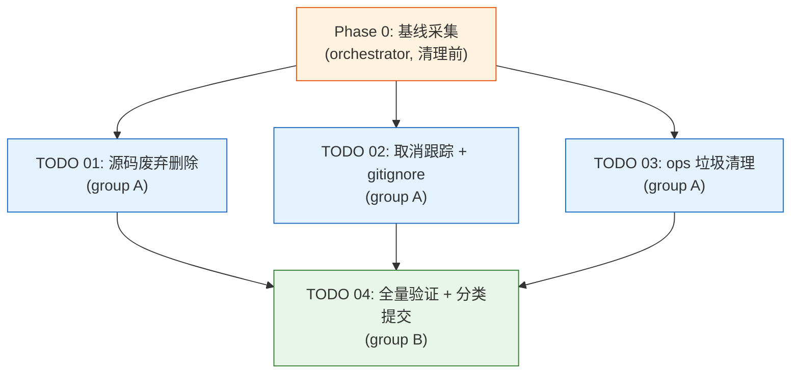

# 任务编排：废弃代码与仓库垃圾清理

> 治理模式：三权分立 + Token 经济（tripower_tokens）　|　团队画像：Google Core Engineering Team
> 分支：`feat/local-video-editing-refactor`　|　无远程服务器

## 1. 依赖图（Dependency Graph）



- **必须先于一切**：Phase 0 基线采集（否则无法判定"是否引入新失败"）。
- **group A（T01/T02/T03）互相独立、可并行**：文件集不相交（`src/` vs git 索引+`.gitignore` vs `ops/` 未跟踪）。三者**均不 commit**。
- **group B（T04）** 依赖 group A 全部完成，串行执行验证与所有 git 提交。

## 2. 执行阶段（Execution Phases）

| 阶段 | 任务 | 执行者 | 并发 | 说明 |
|------|------|--------|------|------|
| **Phase 0** | 基线采集（type-check/lint/build/test/pytest） | orchestrator 直接执行 | — | 在任何删除前完成，结果存入 `summaries/global-context.md` 与执行报告 |
| **Phase 1** | TODO 01 + 02 + 03 | dev-01 / dev-02 / dev-03 并行 | 3 dev | 各自只改不提交；完成后各过 reviewer→tester |
| **Phase 2** | TODO 04 | dev-04（验证+提交） | 1 dev | 跑五道闸，按提交序 02-a→02-b→01 串行提交（共 3 个 commit）；TODO 03 删的是未跟踪文件，**不产生 commit**，仅在 summary 记删除清单 |

> 评审管线：每个 dev 完成后 → reviewer 审 → tester 验收 → inspector 结算（escrow 暂记）→ 集成验证（Phase 2 末）→ escrow 释放。

## 3. 关键路径（Critical Path）

```
Phase 0 基线 → Phase 1 最慢的一条 dev 链（预计 T01 源码核验最久）
            → Phase 2 T04 全量五道闸 + 三次提交（02-a / 02-b / 01；T03 无 commit）
```

- **瓶颈**：T01（源码删除）需逐文件五步核验，最耗时且风险最高；T04 的全量 `build`/`test` 次之。
- **可压缩点**：T02/T03 简单快速，不在关键路径；它们的产出不阻塞 T01 的核验。

## 4. Agent 分工（四角色团队）

| 角色 | Agent ID | 任务 | Token 初值 |
|------|----------|------|-----------|
| Inspector | `google-inspector` | 全局监察 + Token 结算（唯一记账权），首个 spawn | 不参与评分 |
| Dev | `google-dev-01` | TODO 01 源码废弃删除（最高风险） | 100 |
| Dev | `google-dev-02` | TODO 02 取消跟踪 + gitignore 加固 | 100 |
| Dev | `google-dev-03` | TODO 03 ops 工作区垃圾清理 | 100 |
| Dev | `google-dev-04` | TODO 04 全量验证 + 分类提交（Phase 2） | 100 |
| Reviewer | `google-reviewer-01` | 审 dev-01/02/03/04 的产出 | 100 |
| Tester | `google-tester-01` | 验收（对照基线判定无回归 + spec 可追溯） | 100 |

**团队规模核对**：并发峰值 = Phase 1 的 3 dev（dev-04 仅在 Phase 2 上场，不与前三者并发）+ reviewer + tester + inspector = 6 ≤ 7 ✓。按 7 人总编制计：Dev 占比 ~57%（4/7，落在 50–60% 区间内 ✓）、Reviewer ~14%、Tester ~14%、Inspector 1。

> 说明：Reviewer/Tester 占比（各 ~14%）略低于 tripower 推荐带（reviewer 20–25%、tester 15–20%），原因是本次为单 reviewer + 单 tester 的最小可行编制——任务体量小、产出以"删除 + 索引变更"为主，单角色即可覆盖全部 dev 链的串行评审/验收，无需扩编。如后续任务量上升可按推荐带补位。

**协调要点（contract notes）**：
- **git 索引唯一写者约束**：Phase 1 中仅 dev-02 执行 `git rm --cached`（动索引）；dev-01 仅删 `src/` 工作树文件、dev-03 仅删未跟踪文件 —— 三者无索引竞争。**任何 dev 都不得 `git commit`**，提交权独属 Phase 2 的 dev-04。
- **基线归属**：dev-04 的验收依赖 Phase 0 基线；orchestrator 须在 spawn Phase 1 前完成基线并写入 global-context。
- **保留清单红线**：dev-01 不得碰 `clipboard.ts`/`AgentMessageBubble`/`AgentToolCallCard`；dev-02 不得加 `ops/_*.sh` 规则；dev-03 不得删 `_dp_upload2.py`/`_dp_wait2.py`。reviewer 须逐条核对红线。

## 5. 上下文阅读清单（Context Files）

| Agent | 必读 |
|-------|------|
| 全部 dev | `master-plan.md` + `summaries/global-context.md` |
| google-dev-01 | `specs/01` + `todos/01` |
| google-dev-02 | `specs/02` + `todos/02` + 现有 `.gitignore` |
| google-dev-03 | `specs/03` + `todos/03` + `MEMORY.md`（白名单引用扫描） |
| google-dev-04 | `specs/04` + `todos/04` + dev-01/02/03 的执行 summary |
| google-reviewer-01 | 被审 dev 的 summary + 对应 spec/todo + `global-context.md` |
| google-tester-01 | 被验 dev 的 summary + reviewer 的 Meta/Verdict + 对应 spec + `global-context.md` + Phase 0 基线 |
| google-inspector | 当前 phase 全部 summary + `global-context.md` + 治理规则 + Token 表 |

## 6. 备注

- 无远程服务器（`remote_server_mode = none`），无 Section 6 服务器配置。
- 本次多数 dev 产出为"删除 + git 索引变更"，reviewer/tester 的重点是**红线核对**与**基线对比无回归**，而非常规功能新增验收。
- Token 奖励在集成验证（Phase 2 末）通过前以 escrow 暂记；通过后释放。
