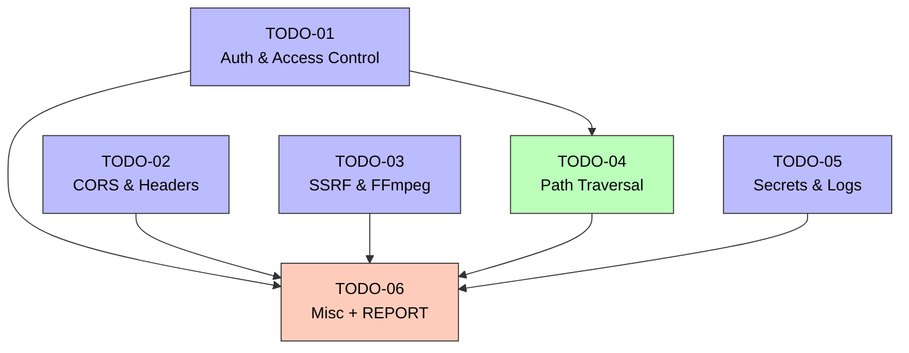

# Task Orchestration：Ecliptrix 高危安全修复

## 1. 依赖图（Dependency Graph）



颜色含义：
- 蓝色 (Group A)：无依赖，可立即并发执行
- 绿色 (Group B)：依赖 Group A 完成
- 橙色 (Group C)：依赖所有前序，最后执行

## 2. 执行阶段（Execution Phases）

| Phase | 并发任务 | 持续时间预估 | 完成条件 |
|---|---|---|---|
| **Phase A** | TODO-01, TODO-02, TODO-03, TODO-05（4 个并发） | 各 60-90 min；并行总时 60-90 min | 4 个 DEV 报告 + Reviewer PASS + Tester ALL PASS |
| **Phase B** | TODO-04（1 个） | 40-60 min | DEV 报告 + Reviewer PASS + Tester ALL PASS |
| **Phase C** | TODO-06（1 个） | 30-45 min | DEV 报告（含 REPORT.md）+ Reviewer PASS + 集成验证 PASS |

并发上限：4 个 DEV agent 同时执行（不含 Reviewer/Tester/Inspector）。

## 3. 关键路径（Critical Path）

最长依赖链：

```
TODO-01 → TODO-04 → TODO-06
```

总耗时 ≈ Phase A 完成时间 + TODO-04 + TODO-06 ≈ 90 + 60 + 45 = **约 195 min**

瓶颈任务：
- **TODO-01**（Auth）：因 TODO-04 与 TODO-06 都依赖它，是阻塞链的关键
- **TODO-06**（Report）：必须等所有前序完成，无法压缩

## 4. Agent 分配（Agent Assignments）

按 master-plan §3.1 governance_mode = `tripower_tokens`，四角色 + Inspector：

### 4.1 团队组成

| 角色 | Agent ID | 分配任务 | 起始 token |
|---|---|---|---|
| Inspector | `google-inspector` | 全局裁判 + token 操作 | N/A（无评分） |
| DEV | `google-dev-01` | TODO-01 | 100 |
| DEV | `google-dev-02` | TODO-02 | 100 |
| DEV | `google-dev-03` | TODO-03 | 100 |
| DEV | `google-dev-05` | TODO-05 | 100 |
| DEV | `google-dev-04` | TODO-04（Phase B） | 100 |
| DEV | `google-dev-06` | TODO-06（Phase C） | 100 |
| Reviewer | `google-reviewer-01` | TODO-01, TODO-02 | 100 |
| Reviewer | `google-reviewer-02` | TODO-03, TODO-05 | 100 |
| Reviewer | `google-reviewer-03` | TODO-04, TODO-06 | 100 |
| Tester | `google-tester-01` | Phase A 全部测试 | 100 |
| Tester | `google-tester-02` | Phase B + Phase C 测试 | 100 |

**总人数：12（Inspector × 1 + DEV × 6 + Reviewer × 3 + Tester × 2）**

> 注：实际执行可能因 orchestrator 上下文限制做 batch（如 Phase A 实际只跑 2 个并发 DEV，分两轮）。最大并发严格不超过 7（含 Inspector）。

### 4.2 调度策略

- **Phase A 开始：** orchestrator 同时 `Agent()` 启动 `google-inspector`（必须最先）→ `google-dev-01/02/03/05`（4 个 `run_in_background: true`）。
- **Phase A Review：** 每个 DEV 完成后立即 spawn 对应 Reviewer，等其 PASS 后 spawn Tester。
- **Phase A 结算：** 所有 4 个任务通过 review + test 后，Inspector 跑 settlement（provisional rewards → 等 Phase 5.5 集成 → escrow 释放）。
- **Phase B 开始：** Phase A 全部完成且集成验证通过后启动 `google-dev-04`。
- **Phase C 开始：** Phase B 完成后启动 `google-dev-06`，其 DEV 摘要必须 Read summaries/phase-A/* + summaries/phase-B/* 才能写 REPORT.md。

### 4.3 协调说明

| 跨任务接口 | 提供方 | 消费方 | 契约 |
|---|---|---|---|
| `Depends(get_current_user)` | T01 | T04 | T04 假设此 dependency 已生效 |
| `storage_files_router` | T01 | T04 | T04 在该 router 上追加 svg/html → attachment 逻辑 |
| `_validate_path` 重构 | T04 | T03 | T03 的 `validate_local_path_for_ffmpeg` 与 T04 的 `_validate_path` 在思想上相近但独立模块；不互相依赖代码，但需在 REPORT 中说明二者差异 |
| `app/security/` 目录 | T03（首先创建） | T04, T05 | T03 创建 `app/security/__init__.py` + `url_guard.py`；T05 可在此目录下新增 `log_redact.py`，T04 可独立选择是否使用 |
| `settings.env` 字段 | T02（如果新增） | T05, T06 | 所有任务都假设 `settings.env` 存在；T02 是首先必须保证它存在的任务 |

冲突处理：
- 多任务都改 `app/main.py` → 严格按 Phase A 顺序提交（先 T01 加 router/depends，再 T02 改 CORS/加中间件，再 T03/T05 改各服务文件）
- Inspector 在每个 DEV 完成时检查 `app/main.py` 行号是否对应（避免 merge 冲突）

## 5. 上下文文件（Context Files）

### 每个 DEV agent 必读

- `docs/plans/high-risk-security-fixes/master-plan.md`（项目总体方向）
- `docs/plans/high-risk-security-fixes/specs/0N-*.md`（自身分配的 spec）
- `docs/plans/high-risk-security-fixes/todos/0N-*.md`（自身分配的 TODO）
- `docs/plans/high-risk-security-fixes/summaries/global-context.md`（跨阶段累积上下文，Phase A 起 agent 不必读 — 还没内容；Phase B 起必读）
- 依赖任务的 DEV 摘要（如 T04 必读 `summaries/phase-A/dev--google-dev-01--todo-01.md`）

### 每个 DEV agent 焦点文件（基于 TODO 的阶段 A 盘点结果）

- T01：`app/main.py`、`app/middleware/auth_middleware.py`、`app/dependencies/auth.py`、`app/routers/{ai_video_generate,video_export,intent_detection}_router.py`、`src/app/api/workflow/test-node/route.ts`
- T02：`app/main.py`（CORS 段）、`app/config.py`、`env.template`
- T03：`app/services/youtube_service.py`、`preview_proxy_service.py`、`video_composition_service.py`、`app/routers/{preview_proxy,media_proxy}_router.py`
- T04：`app/services/storage_service.py`、`app/routers/storage_router.py`、其他上传 router
- T05：`.gitignore`、所有 `.env*`、`env.template`、`app/main.py`（日志中间件）
- T06：所有 spec、所有 summary、`app/main.py`（FastAPI 实例化）

### Reviewer 必读

- 自身分配的 spec + TODO
- 对应 DEV agent 的 summary
- master-plan.md
- `summaries/global-context.md`

### Tester 必读

- 对应 spec
- DEV agent 的 summary
- Reviewer summary 的 Meta/Verdict 段（**仅** Meta，不读 detailed findings）
- 该任务的 pytest 测试文件路径

## 6. Remote Server Config

不适用 — `remote_server_mode = "none"`（用户在 Phase 0 选择"不需要，只在本地修复"）。

---

## 7. Token Economy 配置（governance_mode = tripower_tokens）

数据文件：`docs/plans/high-risk-security-fixes/governance/scoreboard.json`

事件评分（摘要，详见 `planning-with-discovery/token-economy-rules.md`）：

| 事件 | 对象 | 影响 |
|---|---|---|
| D1: Code passed review no modifications | DEV | +15 provisional |
| D5: Code required rework after review | DEV | -20 |
| D12: Integration test pass | DEV | +10 confirmed |
| D13: Integration failure root cause | DEV | -25 |
| R1: Review caught issues that tester later confirmed | Reviewer | +10 provisional |
| R9: Reviewer missed an issue tester found | Reviewer | -15 |
| T1: Thorough test coverage | Tester | +10 |
| C1: Integration pass collective bonus | All agents in phase | +5 |
| C2: Integration fail collective penalty | Non-root-cause agents | -5 |

KILL 条件：累计 confirmed token < 30 → 替换 agent，重置为 80 token。

单事件惩罚上限：-50。

## 8. 验证矩阵

| 验证项 | 命令 | 触发时机 |
|---|---|---|
| 单元 + 回归测试 | `pytest backend-services/basic-service/tests/security/ -v` | 每个 task 的 Tester 阶段 |
| 完整后端测试 | `pytest backend-services/basic-service/tests/ -v` | Phase 5.5 集成验证 |
| 类型检查 | `npm run type-check` | T01、T05 涉及前端时 |
| Lint | `npm run lint` | 同上 |
| 启动冒烟 | `uvicorn app.main:app` + 关键路由 curl | Phase C 最终验证 |

## 9. 收尾产出

- `docs/plans/high-risk-security-fixes/REPORT.md`（T06 阶段 E 产出，必交付）
- `docs/plans/high-risk-security-fixes/summaries/phase-A/`（4 个 dev + reviewer + tester 摘要 + phase-digest.md）
- `docs/plans/high-risk-security-fixes/summaries/phase-B/`（T04 相关）
- `docs/plans/high-risk-security-fixes/summaries/phase-C/`（T06 相关）
- `docs/plans/high-risk-security-fixes/summaries/global-context.md`（累积上下文）
- `docs/plans/high-risk-security-fixes/governance/scoreboard.json`（最终 token 报告）
