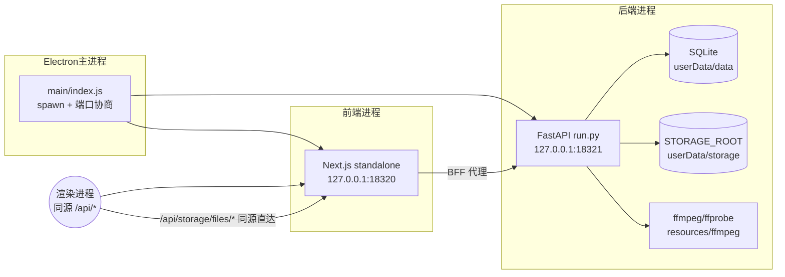
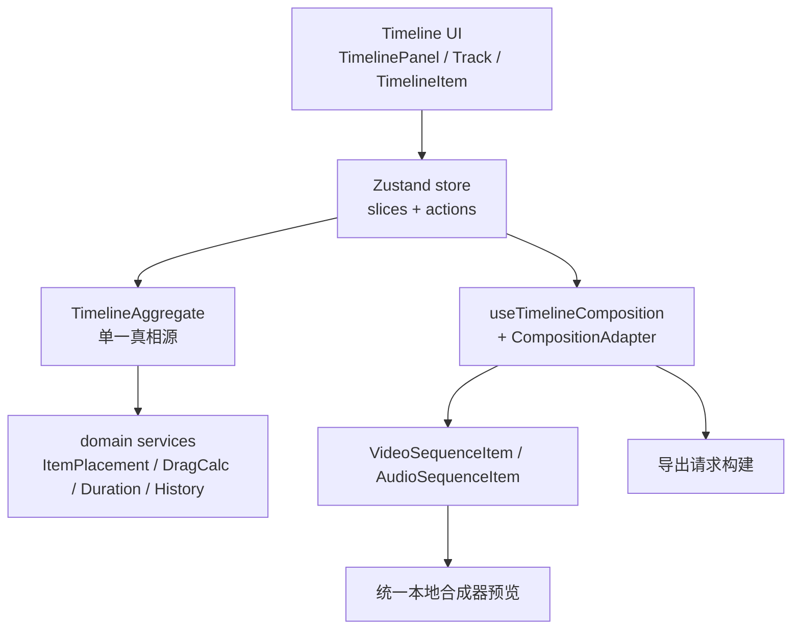
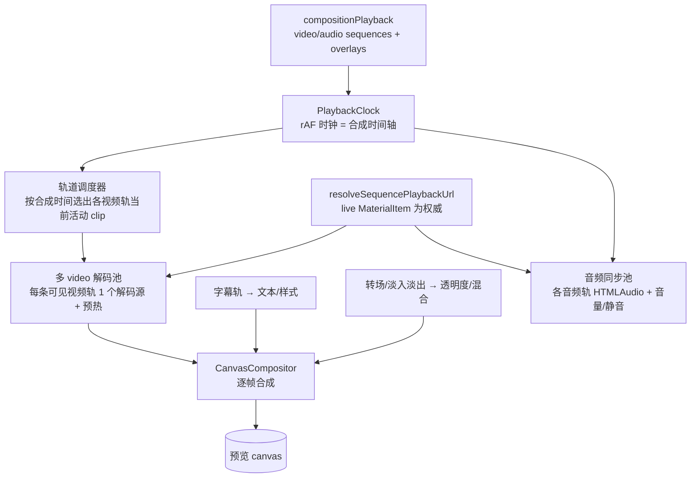
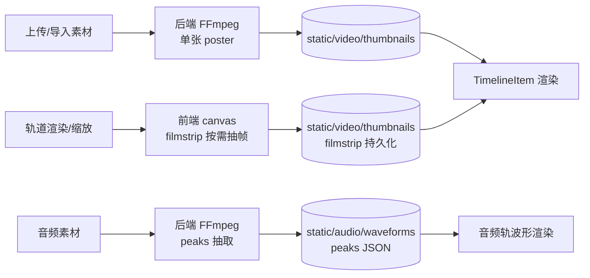
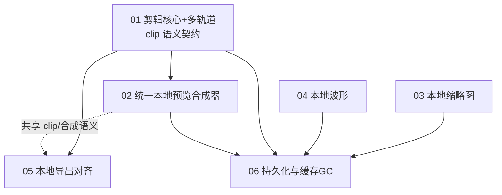

# Master Plan — 本地桌面端视频剪辑重构 (local-video-editing-refactor)

> 版本：v1　|　语言：中文（保留英文技术术语）　|　运行模式：Full Process（全流程）
> 远程服务器：无（纯本地桌面端）

## 1. 概述 (Overview)

Ecliptrix 已经从云端形态转为**本地桌面端 Electron 应用**：Electron 主进程拉起内置的
FastAPI 后端（`127.0.0.1:18321`，SQLite，`STORAGE_ROOT=userData/storage`）与 Next.js
前端（`127.0.0.1:18320`）；渲染进程走**同源** `/api/...` 请求，`/api/storage/files/...`
直达本地磁盘；FFmpeg/ffprobe 已随包内置（`resources/ffmpeg`，注入后端 PATH）；OSS 云上传
已删除。这一桌面地基（见 `docs/plans/desktop-electron-packaging`、`local-only-material-storage`、
`local-desktop-video-editing`）是**本计划的既有前提，不在本次重构范围内重做**。

本次重构的目标是把**视频剪辑功能**整体做成可靠、流畅、纯本地的桌面体验：用户把素材拖到
下方剪辑轨道后，**剪辑能成功、播放预览能成功、缩略图本地生成本地存储、导出本地合成**，
不再依赖任何云端存储或云端转码。

本计划是一份**全新的总纲方案**。按用户明确指示，不与现有的三份 preview spec
（`local-desktop-video-preview`、`timeline-local-preview-playback`、`timeline-material-preview-fix`）
做整合或继承——它们的结论仅作为代码现状的旁证参考，本计划独立成章。

## 2. 目标 (Goals)

| 编号 | 目标 | 验收信号 |
| --- | --- | --- |
| G1 | **剪辑可靠**：核心 + 多轨道编辑操作在本地稳定工作 | 拖入/移动/裁剪/分割/删除/撤销重做、多轨道(视频/音频/字幕)、轨道间移动、音画分离、静音/隐藏均正确 |
| G2 | **预览可靠流畅**：单一本地实时合成器预览 | 多视频轨叠加合成 + 字幕实时叠加 + 实时转场/淡入淡出；不再黑屏/不播；trim/split/move 与预览同步 |
| G3 | **管线唯一**：废弃 playback v1/v2 双轨与 feature flag，收敛为一套最佳本地方案，清除死代码 | 代码中不再有 `isPlaybackV2Enabled()` 分支、`useVideoPlayback`(@deprecated)、flag 插桩 |
| G4 | **缩略图本地化**：混合生成 + 持久化 | 单张 poster(后端 FFmpeg) + 轨道 filmstrip(前端 canvas 按需) 持久化到 `STORAGE_ROOT/static/video/thumbnails`，经 `/api/storage/files` 服务 |
| G5 | **波形本地化**：本地生成 + 持久化 | 后端 FFmpeg 抽取 peaks → JSON 持久化；前端从 peaks 渲染，不再每次 live decode 整段音频 |
| G6 | **导出本地化**：本地 FFmpeg 合成，特性与预览对齐 | 导出消费 backend-resolvable 本地 URL；后端支持多轨视频合成 + 转场 + 字幕烧录，输出到本地 |
| G7 | **持久化可靠**：项目保存与重载 | 轨道/clip/trim/缩略图与波形引用随项目本地保存，重载后完全恢复且可预览 |
| G8 | **缓存治理**：派生文件随素材清理 + 启动回收孤儿 | 删除素材时清理其缩略图/波形/预览缓存；启动扫描回收无引用的派生文件 |

**重点修复症状（来自需求确认）**：① 预览黑屏/不播；② trim/split/move 后错位、与预览不同步。

## 3. 范围 (Scope)

### 3.1 In Scope

- **剪辑操作**：核心集（拖入、移动、trim/resize、**split(新建)**、删除、撤销/重做）+ 多轨道
  （视频/音频/字幕分轨、轨道间移动、**音画分离**、静音/隐藏/锁定/音量）。
- **预览管线**：**单一** canvas/WebGL 实时合成器——多视频轨叠加合成、字幕实时叠加、
  实时转场/淡入淡出、音频同步。删除 v1、删除 v2 feature flag 与所有死代码/stub。
- **缩略图**：后端 FFmpeg 出单张 poster + 前端 canvas 按需出 filmstrip；二者**持久化**到本地
  存储目录，经 `/api/storage/files` 服务；轨道 clip 渲染 filmstrip；抽帧密度 zoom-aware。
- **音频波形**：后端 FFmpeg 生成 peaks → 本地持久化；前端从 peaks 绘制轨道波形。
- **导出**：本地化重构（消费本地 URL、harden `local_media_resolver`）；后端 FFmpeg 增加
  多轨视频合成 + 转场，使导出与预览特性对齐；输出到本地。
- **持久化**：项目保存/重载（含 clip/trim/缩略图与波形引用），重载后可预览。
- **缓存治理**：删除素材时清理派生缓存；启动回收孤儿派生文件。
- **验收**：vitest/pytest 单测与集成测试 + 真实 Electron 桌面壳层手动走查关键流程。

### 3.2 Out of Scope

- 桌面打包/Electron 主进程/同源路由/FFmpeg 内置等**地基**（已落地，不重做）。
- 崩溃恢复 / autosave（用户本轮未要求；持久化仅做"保存与恢复"）。
- 云端时代旧项目数据迁移（用户本轮未要求）。
- 关键帧/特效/滤镜/调色/变速等时间轴高级编辑（超出"核心 + 多轨道"范围）。
- 复制粘贴、duplicate（不在核心集；如需可后续）。
- 远程服务器、云对象存储、媒体代理转码（桌面端已废弃）。

## 4. 架构 (Architecture)

### 4.1 桌面运行时（既有地基，本计划依赖之）

要点：渲染进程**只发同源相对路径**；`/api/storage/files/...` 通过前端 BFF 代理到后端本地磁盘；
后端直接子进程调用内置 ffmpeg。**这意味着剪辑/预览/缩略图/波形/导出全程不需要任何云端往返，
也不需要新增 Electron IPC**（保持当前"零业务 IPC"设计）。

### 4.2 剪辑域分层（既有，需巩固与扩展）

现状评估：domain/store 分层清晰、不变量完善（locked track、排序、duration 重算），核心操作
（add/move/resize/swap/remove/track 控制/undo-redo/autoOrganize）已实现且有测试。**缺口**：
`split/cut` 未实现（仅枚举）；`audio detach` 未实现；trim 通过 `clipStart/clipEnd` 表达但
**预览/导出是否正确消费 clip 区间需校验**（症状②的疑点）。

### 4.3 统一本地预览合成器（核心新建）

目标：把现有 v2 canvas 管线扩展为**真正的多轨实时合成器**，并删除 v1 与 feature flag。

关键设计决策（详见 spec 02）：
- **唯一权威源**：播放 URL 始终由 `resolveSequencePlaybackUrl(seq, liveMaterials, opts)` 按
  `materialId` 解析 live `MaterialItem` 得出；序列/item 上的 URL 快照仅作持久化与兜底。
  直接本地素材优先返回同源 `/api/storage/files/...`，`source==='localStorageUrl'`。
- **比对键 == 赋值**：消除"比较用 stale snapshot、赋值用 live material"的分叉（症状①根因）。
- **多视频轨**：每条可见视频轨维持一个解码源；合成器逐帧把各轨当前帧按 z-order/opacity 叠加。
- **字幕/转场**：字幕实时叠加渲染到 canvas（文本/换行/样式/背景）；转场以透明度/混合在 clip
  边界实现淡入淡出与交叉溶解。
- **音频同步**：音频轨用 HTMLAudio 池，按合成时钟对齐，尊重 track 静音与 item/track 音量。
- **clip 区间**：合成时间 ↔ 源时间映射统一走单一 `mapTimelineTime↔VideoTime`，严格使用
  `clipStart/clipEnd`（症状②根因之一）。
- **死代码清除**：删除 `useVideoPlayback`(@deprecated)、`isPlaybackV2Enabled()` 全部分支、
  `playbackFlags.ts` 中 v2 相关 key、`/api/config/playback-flag` 消费、env 插桩、
  `PlaybackVariantSwitcher`、killswitch 监控等。

### 4.4 缩略图 / 波形（本地生成 + 持久化）

约定：派生文件持久化到 `STORAGE_ROOT/static/video/thumbnails`、`STORAGE_ROOT/static/audio/waveforms`，
经现有 `/api/storage/files` 鉴权静态服务；以 `materialId`/storageKey 关联。filmstrip 抽帧密度
**zoom-aware**（默认固定间隔基线 + 缩放细化，详见 spec 03 的推荐策略）。

### 4.5 本地导出（特性对齐预览）

后端 `video_composition_service.py` 现仅支持顺序 concat + 单层 overlay + 字幕烧录；为与预览
对齐，需补 `filter_complex` 多轨视频合成与转场。前端 `useVideoExport` 改用
`selectPlaybackUrl(material,{purpose:'export'})` 选本地 URL；后端 `local_media_resolver`
收紧为本地优先并校验路径在允许目录内。详见 spec 05。

## 5. 设计决策 (Design Decisions)

| 编号 | 决策 | 理由 | 替代方案与取舍 |
| --- | --- | --- | --- |
| D1 | 唯一预览管线 = 扩展 v2 canvas 合成器；删除 v1 + flag | 用户要求"一个方案、删死代码"；多轨叠加/字幕/转场只能在 canvas 合成器实现，v1 的 `<video>` 直连做不到 | 保留 v1 作 safe mode——被否决（用户要求唯一管线、清死代码） |
| D2 | 播放 URL 唯一权威 = live MaterialItem（resolver 按 materialId） | 根治症状①（stale snapshot / 比对键分叉）；同源本地 URL 即时可播 | 信任序列快照——会再次黑屏 |
| D3 | clip 映射统一单一函数，严格用 clipStart/clipEnd | 根治症状②（trim/split/move 错位）；预览与导出共用同一 clip 语义 | 各处各自换算——易 off-by-epsilon |
| D4 | split 为新建剪辑操作（domain 层一拆二） | 核心集要求；现仅有 `cut` 枚举无实现 | 不做 split——不满足需求 |
| D5 | 缩略图混合：后端 poster + 前端 filmstrip，均持久化 | 后端 ffmpeg 出稳定首图；前端按需出滚动条省往返；持久化避免重复抽帧 | 全后端——交互延迟；全前端——重启重抽 |
| D6 | 波形后端 peaks + 持久化 JSON，前端从 peaks 绘制 | 避免每次 live decode 整段音频卡顿（中等性能基线） | 仅前端 wavesurfer live——长音频卡 5–10s |
| D7 | 导出后端补 filter_complex 多轨 + 转场，与预览对齐 | 预览有多轨/转场，导出必须一致，否则所见非所得 | 导出仅 concat——预览与成片不符 |
| D8 | 派生文件删除时清理 + 启动回收孤儿 | 现无清理，长期膨胀；用户明确要求 | 仅 LRU/手动——孤儿堆积 |
| D9 | 不新增 Electron IPC，沿用同源 HTTP + 后端 ffmpeg | 地基已支持同源本地 URL 与内置 ffmpeg；零 IPC 更安全简单 | 走 IPC 直读本地文件——增加攻击面与复杂度 |
| D10 | 大文件 `VideoPlayerPanel.tsx`(3350)/`video_composition_service.py`(2700+) 拆分 | 超 800 行阈值；合成器重构正好按职责拆模块 | 原地堆叠——继续超阈值、难测 |

## 6. 依赖与执行顺序 (Dependencies)

- **01 剪辑核心**是地基：clip 语义契约（clipStart/clipEnd/originalDuration、时间映射）同时喂给
  02 预览与 05 导出，必须先稳。
- **02 预览合成器**依赖 01 的 clip 契约与 live-material resolver。
- **03 缩略图 / 04 波形**相对独立（后端生成 + 前端渲染），可并行；二者产出供 06 持久化追踪。
- **05 导出**依赖 01 契约，并与 02 共享多轨/转场合成语义（特性对齐）。
- **06 持久化与缓存 GC**收口：保存/重载 + 派生文件清理/孤儿回收，依赖 01/02/03/04 的产物形状。

## 7. 风险与缓解 (Risks & Mitigations)

| 风险 | 影响 | 缓解 |
| --- | --- | --- |
| R1 多轨实时合成器是大工程，浏览器多路解码 + canvas 合成在中等性能(部分4K/20-50 clip)下可能掉帧 | 预览卡顿，体验差 | 解码源池化 + 预热；自适应降帧（CanvasCompositor 已有 adaptive FPS 雏形）；按需只解码可见轨；先达成正确性再调优；性能基线测量门槛 |
| R2 预览(canvas)与导出(ffmpeg)对多轨/转场的合成语义不一致 | 所见非所得 | spec 02/05 共用同一份合成语义契约（z-order、opacity、转场时序）；导出/预览对拍测试 |
| R3 删除 v1 + flag 后若合成器有回归，无 safe mode 兜底 | 预览全挂 | 充分单测/集成测试 + 桌面手动走查后再删；按阶段删除（先并存验证、确认后清除） |
| R4 trim/split 的 clip 时间映射 off-by-epsilon | 错位/抖动 | 统一时间映射函数 + TIME_EPSILON；split/trim/undo 往返测试；预览-时间轴游标对齐测试 |
| R5 缩略图/波形持久化导致存储膨胀，无清理则孤儿堆积 | 占用暴涨 | spec 06 删除联动清理 + 启动孤儿回收；filmstrip 可设容量与按需淘汰 |
| R6 后端 `local_media_resolver` 路径解析（绝对 vs 相对、同源 vs 文件路径）不一致致 ffmpeg 找不到媒体 | 导出/合成静默失败 | 收紧并集中解析；允许目录白名单校验；记录实际 URL 形状便于诊断 |
| R7 大文件内存压力（上传/合成整段读入内存） | OOM/卡顿 | 流式写入本地存储；ffmpeg 直接读本地路径而非缓冲 |
| R8 SQLite 在并发剪辑/导出下 WAL 锁竞争 | 偶发卡死 | 沿用 WAL；导出/缩略图/波形任务排队（QueueManager） |
| R9 字幕/图层实时叠加到 canvas（字体度量/换行/缓存）复杂度高 | 字幕渲染错位/性能 | 字幕渲染独立模块 + 缓存；先文本后样式，逐步增强 |

## 8. 文档目录 (TOC → Spec Files)

| Spec | 标题 | 覆盖目标 | 范围摘要 |
| --- | --- | --- | --- |
| [`specs/01-timeline-editing-core.md`](specs/01-timeline-editing-core.md) | 剪辑核心 + 多轨道 + clip 语义契约 | G1 | 巩固 add/move/resize/delete/undo-redo；**新建 split、audio detach**；多轨道编排；统一 clip 时间映射契约；修复 trim/split/move 错位(症状②) |
| [`specs/02-unified-local-preview-compositor.md`](specs/02-unified-local-preview-compositor.md) | 统一本地预览合成器 | G2, G3 | 单一 canvas 多轨叠加合成 + 字幕叠加 + 实时转场 + 音频同步；live-material 权威 URL；修复黑屏/不播(症状①)；删除 v1 + flag + 死代码 |
| [`specs/03-local-thumbnails.md`](specs/03-local-thumbnails.md) | 本地缩略图（poster + filmstrip） | G4 | 后端 FFmpeg poster + 前端 canvas filmstrip 按需；持久化到 `static/video/thumbnails`；zoom-aware 密度；TimelineItem filmstrip 渲染 |
| [`specs/04-local-waveform.md`](specs/04-local-waveform.md) | 本地音频波形 | G5 | 后端 FFmpeg peaks → 持久化 JSON；前端从 peaks 渲染；音频轨波形显示；替换 live decode |
| [`specs/05-local-export-parity.md`](specs/05-local-export-parity.md) | 本地导出（特性对齐预览） | G6 | 前端用 `selectPlaybackUrl(export)`；后端 `local_media_resolver` 收紧；FFmpeg `filter_complex` 多轨 + 转场 + 字幕烧录；输出本地 |
| [`specs/06-persistence-and-cache-gc.md`](specs/06-persistence-and-cache-gc.md) | 持久化与缓存治理 | G7, G8 | 项目保存/重载（clip/缩略图/波形引用），重载可预览；派生文件随素材清理 + 启动孤儿回收 |

> 目标全覆盖校验：G1→01、G2/G3→02、G4→03、G5→04、G6→05、G7/G8→06，8 个目标无遗漏、无重叠。

## 9. 验收与验证 (Acceptance & Verification)

- **测试**：vitest（前端 timeline/preview/缩略图/波形）+ pytest（后端缩略图/波形/导出）；
  先写失败用例再实现（修 bug 必先复现）。
- **桌面手动走查**：在真实 Electron 桌面壳层走通"导入 → 拖入轨道 → trim/split/move → 多轨叠加预览
  → 字幕/转场 → 缩略图/波形显示 → 保存/重载 → 本地导出"全链路；DevTools Network 仅见
  `/api/storage/files/...` 本地读，无云端/proxy 调用。
- **关键回归门**：症状① 预览不再黑屏/不播；症状② trim/split/move 与预览/导出严格同步。

## 10. 关键代码现状索引 (Reference — 现状定位)

| 子系统 | 关键文件 | 现状 |
| --- | --- | --- |
| 预览 v1/v2 | `src/components/video/components/VideoPlayerPanel/VideoPlayerPanel.tsx`(3350行)、`src/components/video/playback/*`(PlaybackEngine/AbBufferController/CanvasCompositor/PlaybackClock/PlayheadController)、`PreviewSurface.tsx`、`useVideoPlayback.ts`(@deprecated)、`src/lib/playbackFlags.ts` | 两套均单活动序列；overlay/字幕/转场为 stub；v2 无音频接线 |
| URL 解析 | `src/components/video/lib/resolveSequencePlaybackUrl.ts`、`selectPlaybackUrl.ts`、`timeline/infrastructure/CompositionAdapter.ts` | resolver 已按 materialId 读 live material；export 路径 `selectCanonicalExportReference` |
| 剪辑域 | `timeline/domain/{entities,services,aggregates,machines}`、`timeline/store/{slices,actions}`、`useTimelineComposition.ts` | 核心操作齐全；**split/audio-detach 缺失**；composition rebuild 有 stale 风险 |
| 缩略图 | `utils/extractVideoThumbnail.ts`(data URL)、`timeline/TimelineItem.tsx`(单 img)、后端 `storage_service.py`(单 poster) | 无 filmstrip；前端临时不持久；后端单帧无清理 |
| 波形 | `components/VideoProcessingModal/WaveformPreview.tsx`(wavesurfer live)、`TimelineItemData.waveformData`(空置) | 无后端生成、无持久化 |
| 导出 | `hooks/useVideoExport.ts`(758行)、后端 `video_composition_service.py`(2700+行)、`local_media_resolver.py`、`video_router.py /video/compose` | concat + 单 overlay + 字幕烧录；**无多轨视频合成/转场**；仍有云下载假设 |
| 桌面壳层 | `desktop/main/{index,backendService,frontendService,window}.js`、`desktop/electron-builder.yml`、`desktop/scripts/prepare-ffmpeg.js` | 同源本地 URL ✅；内置 ffmpeg ✅；零业务 IPC |
