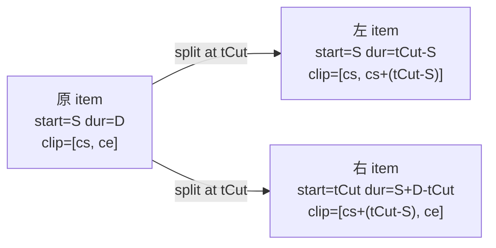

# Spec 01 — 剪辑核心 + 多轨道 + clip 语义契约

> 所属：`local-video-editing-refactor`　|　依赖：master-plan　|　被依赖：02 预览、05 导出、06 持久化
> 覆盖目标：G1（剪辑可靠）、症状②（trim/split/move 错位）根治的地基

## 1. 概述 (Overview)

本 spec 巩固并扩展剪辑域，使**核心 + 多轨道**编辑操作在本地稳定工作，并确立一份**单一的 clip
语义契约**——它定义"时间轴时间 ↔ 源媒体时间"的唯一换算规则，供预览(02)与导出(05)共用。
现状剪辑域（DDD 分层：`domain → store → UI`）核心操作完备，但存在三处缺口必须补齐：

1. **`split`（分割/cut）未实现**——现仅有 `selectionSlice.activeTool: 'cut'` 枚举，无任何
   一拆二逻辑。核心集明确要求 split。
2. **`audio detach`（音画分离）未实现**——item 是单轨实体，视频自带音频无法独立成轨。
3. **clip 区间消费不统一**——`clipStart/clipEnd/originalDuration` 已由
   `CompositionAdapter` 写入序列，但"时间轴时间 ↔ 源时间"的映射散落在播放器与导出各处，是
   症状②（trim/split/move 后预览错位）的疑点。

本 spec 不改动渲染/播放本身（属 02），只保证**剪辑后产生的时间轴数据是正确、自洽、可被 02/05
正确消费的**。

## 2. 技术设计 (Technical Design)

### 2.1 数据模型语义（既有，本 spec 固化为契约）

`TimelineItem` 的时间字段语义（秒，统一约定）：

- `startTime`：clip 在**轨道时间轴**上的起点（≥ 0）。
- `duration`：clip 在轨道上的**可播放时长**（> 0）。`endTime() = startTime + duration`。
- `clipStart`：clip 对应**源媒体**内的起点偏移（裁剪入点；缺省 0）。
- `clipEnd`：clip 对应源媒体内的终点偏移（裁剪出点；缺省 `originalDuration`）。
- `originalDuration`：源媒体完整时长（用于约束 resize；缺省回退 `duration`）。

**不变量（契约 INV）**：

```
INV-1  duration > 0
INV-2  0 <= clipStart < clipEnd <= originalDuration
INV-3  duration == clipEnd - clipStart        # 轨道时长 == 源裁剪区间长度（playbackRate=1）
INV-4  startTime >= 0
INV-5  同一轨道内 item 不重叠（epsilon 容差），且按 startTime 排序
```

> 注：当前 `TimelineItem.resize` 在调整 `duration` 时，按 `timeDelta`（边缘位移量）平移
> `clipStart`（start 边）或 `clipEnd`（end 边），但只 clamp 到 `[0, originalDuration]`，**未保证**
> `clipEnd - clipStart == duration`，故可能违反 INV-3。本 spec 要求把 INV-3 作为**强约束**：
> resize 即裁剪源区间，`duration` 与 `clipEnd - clipStart` 始终相等。

### 2.2 clip 语义契约：唯一时间映射

确立一对纯函数（domain 层，无 DOM/React），作为预览与导出**共用的唯一换算**：

```
mapTimelineTimeToSourceTime(item, tTimeline):
    # 给定轨道时间 tTimeline（落在 [item.startTime, item.endTime()] 内），
    # 返回应当读取的源媒体时间。
    local = clamp(tTimeline - item.startTime, 0, item.duration)
    return item.clipStart + local            # playbackRate 固定 1

mapSourceTimeToTimelineTime(item, tSource):
    local = clamp(tSource - item.clipStart, 0, item.duration)
    return item.startTime + local
```

- 使用统一的 `TIME_EPSILON = 0.001` 处理边界，避免 off-by-epsilon（症状②抖动根因）。
- 该契约由 domain 暴露，02 播放器与 05 导出请求构建**必须**调用它，禁止各自换算。

### 2.3 split（分割）操作设计

在 `domain` 层新增一拆二能力，并在 store/action 层编排与历史记录。



伪代码（domain 服务 `SplitService.splitItemAtTime(track, itemId, tCut)`）：

```
找到 item；要求 item.startTime < tCut < item.endTime()（含 epsilon 余量，否则 no-op）
offset = tCut - item.startTime                      # 切点在 clip 内的本地偏移
left  = clone(item) with duration=offset,
                       clipEnd = item.clipStart + offset
right = clone(item) with id=new, startTime=tCut,
                       duration = item.duration - offset,
                       clipStart = item.clipStart + offset
校验 left/right 均满足 INV-1..INV-3
用 [left, right] 原位替换 track 中的 item（保持排序）
返回 {leftId, rightId}
```

- **多选 split**：对当前播放头 `currentTime` 落入的所有选中（或所有可见非锁定轨）item 批量切，
  作为单条历史记录。
- 编排：`splitAction(get, tCut, scope)` → `recordAction('SPLIT_ITEM')` → 调用 SplitService →
  `autoOrganize()`（视频/音频轨）→ 调度 `captureNextState()`。
- UI：`activeTool='cut'` 时在 clip 上点击或在播放头处触发；切点取点击像素→时间或播放头时间。

### 2.4 audio detach（音画分离）操作设计

把视频轨上某个自带音频的视频 item，派生出一条**对应音频轨 item**，二者保持相同
`startTime/duration/clip` 区间，引用同一 `materialId`（音频从同一源解出）。

**「素材含音轨」判定位于何处**：domain 实体/DTO（`TimelineItemData`）当前**不携带**任何音轨存在
信号（无 `hasAudio` 字段）。因此 domain 服务保持纯函数、不读 live material；**是否含音轨的判定
交由 store action 在编排前完成**——action 持有 live `MaterialItem`（含 `metadata`，可由 03/04 的
ffprobe 探测或现有 metadata 提供音轨存在标记）。判定失败（无音轨/已分离）则 action no-op，不记历史。

```
# domain 编排（经 TimelineAggregate.detachAudio，复用 TrackSelectionService；
# 不读 live material；调用方已确认 item 可分离）
detachAudio(track, audioTracks, itemId):
    要求 item.type=='video' 且 item.audioDetached != true（否则 no-op）
    audioItem = createAudioItem(materialId=item.materialId,
                                startTime=item.startTime, duration=item.duration,
                                clipStart=item.clipStart, clipEnd=item.clipEnd)
    目标音频轨 = TrackSelectionService 在 audioTracks 中选/建一条 audio 轨
    将 audioItem 放入目标音频轨（避让重叠）
    标记原视频 item.audioDetached=true（合成/导出据此对其视频轨静音，避免重复出声）
    返回 { audioItemId, targetTrackId }
```

- 合成(02)与导出(05)读取 `audioDetached` 标志：视频轨该 item 不再贡献音频；音频由派生的
  audio item 贡献。
- 编排：`detachAudioAction(get, itemId)` → 先用 live material 判定含音轨且未分离（否则 no-op）→
  `recordAction('DETACH_AUDIO')` → 调用 domain `detachAudio` → autoOrganize → capture。

### 2.5 多轨道编排（既有，固化为受支持能力）

- 轨道类型：`video`（含 image 子类，`originalMaterialType='image'`）、`audio`、`subtitle`。
- 轨道间移动：`moveItem(itemId, newStartTime, targetTrackId?)`，落点前做**类型兼容**校验。
- 轨道控制：lock / mute / visibility / volume（已实现，回归覆盖）。
- `autoOrganize`：紧排视频/音频轨（从 0 flush），跳过 subtitle 与 locked 轨（保持既有）。

### 2.6 症状② 根治：剪辑数据正确性边界

本 spec 的职责边界是**保证产出数据正确**；02/05 负责正确消费。三道关卡：

1. **resize 强约束 INV-3**：trim 后 `duration == clipEnd - clipStart`，不再按比例近似。
2. **split 产出满足 INV-1..INV-3**：左右两段 clip 区间精确衔接，无缝隙无重叠。
3. **统一时间映射契约（2.2）**：交付给 02/05 调用，消除"各处各自换算"导致的错位。

> 02 的 `useTimelineComposition` stale-snapshot 与播放器比对键问题、05 的导出 clip 消费，分别在
> 各自 spec 处理；本 spec 仅提供正确数据与契约函数，并以测试钉死边界。

## 3. 文件 / 模块变更计划 (File / Module Change Plan)

| 文件 | 动作 | 意图 |
| --- | --- | --- |
| `src/components/video/timeline/domain/services/ClipTimeMapping.ts` | 新建 | 2.2 的两个纯函数 + `TIME_EPSILON`；domain 唯一时间映射契约 |
| `src/components/video/timeline/domain/services/SplitService.ts` | 新建 | 2.3 一拆二逻辑，校验 INV |
| `src/components/video/timeline/domain/services/__tests__/SplitService.test.ts` | 新建 | split 切点、左右衔接、边界 no-op、INV 校验 |
| `src/components/video/timeline/domain/services/__tests__/ClipTimeMapping.test.ts` | 新建 | 映射往返、clip 偏移、epsilon 边界 |
| `src/components/video/timeline/domain/entities/TimelineItem.ts` | 修改 | resize 强约束 INV-3（trim 即裁剪源区间）；新增 `audioDetached?`、（必要时）派生克隆辅助 |
| `src/components/video/timeline/domain/aggregates/TimelineAggregate.ts` | 修改 | 暴露 `splitItemAtTime`、`detachAudio` 入口，复用 Split/TrackSelection 服务 |
| `src/components/video/timeline/domain/services/HistoryService.ts` | 修改 | `TimelineAction['type']` 联合类型补 `'SPLIT_ITEM'`、`'DETACH_AUDIO'`（否则 `recordAction(...)` 无法通过 `type-check`） |
| `src/components/video/timeline/store/actions/splitItem.ts` | 新建 | `splitAction`：record→split→autoOrganize→capture（支持多选/播放头 scope） |
| `src/components/video/timeline/store/actions/detachAudio.ts` | 新建 | `detachAudioAction`：record→detach→autoOrganize→capture |
| `src/components/video/timeline/store/actions/__tests__/splitItem.test.ts` | 新建 | split 编排 + 历史 + undo/redo 往返 |
| `src/components/video/timeline/store/actions/__tests__/detachAudio.test.ts` | 新建 | 音画分离编排 + 标志 + undo |
| `src/components/video/timeline/store/slices/selectionSlice.ts` | 修改 | `activeTool='cut'` 触发 split 的接线（工具态 → 动作） |
| `src/components/video/timeline/store/actions/resizeItem.ts` | 修改 | resize 走 INV-3 强约束路径；保证 clip 区间精确 |
| `src/components/video/timeline/TimelineToolbar.tsx` | 修改 | cut 工具/分割按钮可用（现 comingSoon 测试存在，需放开） |
| `src/components/video/timeline/TimelineItem.tsx` | 修改 | cut 工具下点击切分交互；detach 入口（右键/菜单） |
| `src/components/video/timeline/infrastructure/CompositionAdapter.ts` | 修改（小） | 透传 `audioDetached`；视频/音频序列遵循契约（不改 URL 选择） |
| `src/types/index.ts` | 修改 | `TimelineItem` 补 `audioDetached?: boolean`（可选，无破坏性） |

## 4. 接口设计 (Interface Design)

无新增 REST / IPC。新增的是 domain 内存契约：

```
// ClipTimeMapping（domain 纯函数，02/05 共用）
mapTimelineTimeToSourceTime(item, tTimeline): number
mapSourceTimeToTimelineTime(item, tSource): number

// SplitService
splitItemAtTime(track, itemId, tCut): { leftId, rightId } | null

// Aggregate
TimelineAggregate.splitItemAtTime(itemId, tCut)
TimelineAggregate.detachAudio(itemId)

// Store actions
splitAction(get, tCut, scope: 'selected' | 'playhead')
detachAudioAction(get, itemId)
```

序列 DTO（`VideoSequenceItem`/`AudioSequenceItem`）新增可选透传字段 `audioDetached`，供 02/05
判断视频轨是否贡献音频。

## 5. 数据模型 (Data Model)

无数据库迁移。前端形状增量（均可选，向后兼容旧项目）：

```
TimelineItem {
  ...既有...
  audioDetached?: boolean   // 视频 item 的音轨是否已分离到独立 audio item
}
```

clip 字段 `clipStart/clipEnd/originalDuration` 维持既有，但本 spec 起以 INV-1..INV-3 为强约束。
持久化（06）需保证 split 产生的新 item id、`audioDetached` 标志一并保存。

## 6. 测试与验收 (Testing & Acceptance)

先写失败用例，再实现。

单元（domain）：
1. `ClipTimeMapping`：clip=[2,5] start=10 → t=12 映射到源 4；往返一致；越界 clamp；epsilon 边界。
2. `SplitService`：start=10 dur=6 clip=[2,8]，在 t=13 切 → 左 dur=3 clip=[2,5]、右 start=13 dur=3 clip=[5,8]；左右无缝衔接；切点在端点/界外 → no-op；产出满足 INV。
3. `TimelineItem.resize`：trim 后 `duration == clipEnd - clipStart`（INV-3）；不越 originalDuration。

编排（store）：
4. `splitAction('playhead')`：播放头落在多个可见轨 item 上 → 各自一拆二，单条历史；undo 完整还原为切前；redo 再切。
5. `detachAudioAction`：视频 item → 生成对应 audio 轨 item（同 start/dur/clip），原 item `audioDetached=true`；undo 还原。
6. 多轨道：跨轨移动类型兼容校验；autoOrganize 紧排视频/音频、跳过 subtitle/locked（回归）。

命令：
```bash
npm run type-check
npm run test -- src/components/video/timeline/domain/services/__tests__/ClipTimeMapping.test.ts
npm run test -- src/components/video/timeline/domain/services/__tests__/SplitService.test.ts
npm run test -- src/components/video/timeline/store/actions/__tests__/splitItem.test.ts
npm run test -- src/components/video/timeline/store/actions/__tests__/detachAudio.test.ts
```

桌面手动走查：拖入素材 → trim 边界 → 在播放头 split → 跨轨移动 → 音画分离 → 撤销/重做；
时间轴显示与（02 完成后）预览游标严格对齐。

## 7. 风险与缓解 (Risks & Mitigations)

| 风险 | 影响 | 缓解 |
| --- | --- | --- |
| resize 改为 INV-3 强约束可能影响既有"按 timeDelta 平移 clip"行为与其测试 | 既有用例红 | 同步更新既有 resize 测试；明确 trim 语义=裁剪源区间，文档化 |
| split 与 autoOrganize 交互（切后紧排导致位置变化） | 切后 item 位移不符预期 | split 后保持原相对位置；autoOrganize 仅闭合真实空隙；用例覆盖切+紧排 |
| audioDetached 标志未被 02/05 消费导致重复出声 | 音频翻倍 | 契约在 spec 02/05 明确消费；集成测试校验音频不重复 |
| 多选 split 的历史记录粒度（批量 vs 多条） | undo 体验割裂 | 单次 split 操作记一条历史（批量），与 removeItems 批量一致 |
| 旧项目无 `audioDetached`/不满足新 INV 的数据 | 加载异常 | 字段可选默认 false；加载时对违反 INV-3 的旧 item 以 clipEnd 回算 duration 做一次性规整（见 06） |
