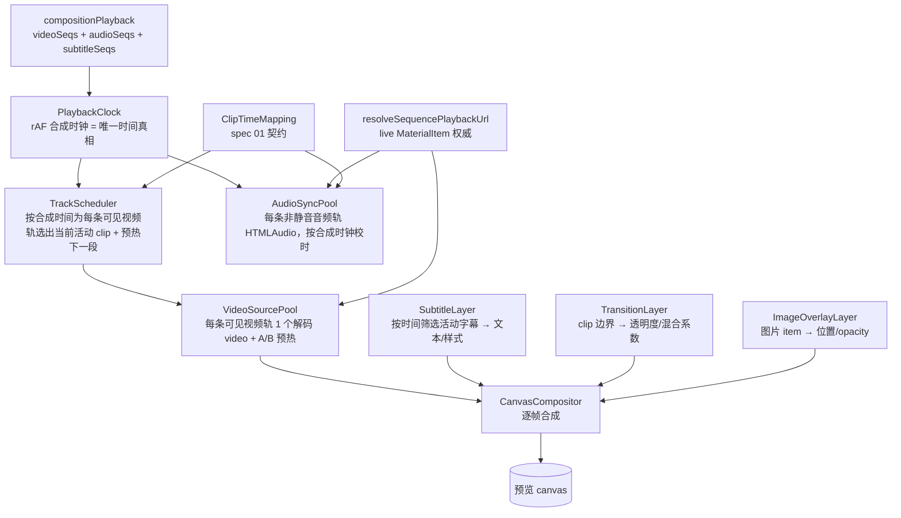

# Spec 02 — 统一本地预览合成器

> 所属：`local-video-editing-refactor`　|　依赖：master-plan、spec 01（clip 语义契约）
> 被依赖：05 导出（共享合成语义）、06 持久化
> 覆盖目标：G2（预览可靠流畅）、G3（管线唯一、清死代码）、症状①（黑屏/不播）根治

## 1. 概述 (Overview)

把视频编辑器的播放预览收敛为**唯一一套本地实时合成器**：基于 canvas，逐帧把多条可见视频轨的
当前帧按 z-order/opacity **叠加合成**，叠加字幕轨实时渲染、在 clip 边界应用转场/淡入淡出，并以
统一合成时钟驱动音频轨同步。同时**删除 playback v1 与 v2 的 feature-flag 双轨**及全部相关死代码/
stub，使代码中只剩一条预览路径。

现状（已勘察确认）：
- 存在两套管线：**v1**（`VideoPlayerPanel.tsx` 内联 `<video>`，3350 行；`useVideoPlayback.ts`
  @deprecated）与 **v2**（`src/components/video/playback/`：`PlaybackEngine`、
  `AbBufferController`、`CanvasCompositor`、`PlaybackClock`、`PlayheadController`、
  `PreviewSurface.tsx`），由 `isPlaybackV2Enabled()`(`src/lib/playbackFlags.ts`) 切换。
- **二者都只支持单活动序列**：同一时刻只播一条 clip，按边界换源。v2 的 canvas 每帧只画一个活动
  `<video>`。**overlay/字幕注入端为 stub**：`VideoPlayerPanel` 的 `v2OverlaysProvider` 恒返回
  `[]`（见源码注释 "Phase 2 ships without compositor overlays"），故 `CanvasCompositor` 的
  `_overlays` 永远为空、`renderFrame` 内 `if (this._overlays.length > 0)` 永不进入。**注意**：
  `CanvasCompositor` 已实现 `setOverlays()` 与逐帧 `_drawOverlays`（已能绘制 image/subtitle/
  watermark 三类 `OverlayPayload`），缺的是**注入真实 overlay 数据**与**多视频源叠加**，而非
  overlay 绘制本身。**转场无任何实现**（无 stub 也无入口）。**v2 无音频接线**（音频逻辑仅在 v1
  内联 `HTMLAudioElement` 池，见 `VideoPlayerPanel.tsx` `audioElementsRef`）。
- 因此"多视频轨叠加合成 + 字幕轨数据接线 + 实时转场 + 音频同步"**都需新建**；不是简单开关切换。
  其中字幕/图片的 canvas 绘制可**复用并扩展** `CanvasCompositor._drawOverlays` 既有能力，但**多
  视频源同帧叠加**与**转场混合**是 `CanvasCompositor` 当前不具备、必须新增的核心能力。

症状①（黑屏/不播）的根因（已勘察）：
- **RC-A**：`useTimelineComposition` 原仅在序列 id/数量/总时长变化时重建 `compositionPlayback`，
  素材 URL 在加入轨道后才敲定时不重建 → 序列 URL stale 为空。
- **RC-B**：播放器 bootstrap 比对键用 `selectPlaybackUrl(staleSequence)`（空），而真正赋值走
  `resolveSequencePlaybackUrl(seq, liveMaterials)`（读 live material）→ 比对键==赋值不一致 →
  `srcChanged=false` → `<video>.src`/canvas 源永不赋值 → 黑屏。

> **现状核对**：在当前分支上，RC-A（`useTimelineComposition` 签名重建 + materials-change effect）
> 与 RC-B（v1 比对键改用 live-material 解析）**已部分/全部落地**（见 §2.6 两处"现状核对"）。本
> spec 的实际任务是：① 把这两个不变量**带入新合成器**（v1 随 G3 删除，修复不能只留在 v1）；
> ② 用回归测试钉死；③ 补强签名字段。实现前务必核对上述文件当前状态，避免重复造轮子或回退已修复点。

## 2. 技术设计 (Technical Design)

### 2.1 目标架构：单一合成器



**关键原则**：
- **合成时钟唯一**：`PlaybackClock` 的 `compositionTime` 是预览唯一时间真相；视频解码源、音频、
  字幕、转场全部以它为基准对齐。
- **逐帧合成**：rAF 每帧 → 调度器算出各可见视频轨此刻活动 clip 及其源时间（用 spec 01
  `mapTimelineTimeToSourceTime`）→ 各解码源 seek/对齐 → compositor 按 track z-order 与 opacity
  叠加 → 叠字幕/图片 → 输出 canvas。
- **live-material 权威**：所有源 URL 由 `resolveSequencePlaybackUrl(seq, liveMaterials, opts)` 按
  `materialId` 解析得出，直接本地素材优先同源 `/api/storage/files/...`。
- **比对键 == 赋值**：源是否变化的判定与实际赋值使用同一解析结果（根治 RC-B）。

### 2.2 多视频轨叠加合成

```
每帧 render(compositionTime):
  activeByTrack = {}
  for track in 可见视频轨(按 z-order 从底到顶):           # 底轨先画
     clip = scheduler.activeClipAt(track, compositionTime)  # 命中 [start,end) 的 item
     if clip:
        src = pool.sourceFor(track, clip)                   # 该轨解码源
        tSource = mapTimelineTimeToSourceTime(clip, compositionTime)
        ensureSeeked(src, tSource)                          # 容差内不重复 seek
        alpha = transition.alphaFor(clip, compositionTime)  # 见 2.4
        compositor.draw(src, layout=fitContain, opacity=clip.opacity * alpha)
  subtitleLayer.draw(compositor, compositionTime)
  imageOverlayLayer.draw(compositor, compositionTime)
```

- **解码源池 `VideoSourcePool`**：为每条可见视频轨维持一个 `<video>` 解码源 + 一个预热源（A/B），
  复用 v2 `AbBufferController` 的 A/B 思路，但**从"单条全局"升级为"每轨一组"**。
- **z-order**：底层为主轨，叠加轨在上；由 track 顺序决定。`opacity` 来自 item 与转场系数。
- **fitContain**：等比适配画布（复用 `CanvasCompositor` 既有 letterbox）。

### 2.3 字幕轨实时叠加

```
subtitleLayer.draw(compositor, t):
  for subItem in 字幕轨 where subItem covers t:
     text = subItem.text ; style = subItem.subtitleStyle
     绘制：背景框 → 自动换行（按画布宽与字号）→ 描边/阴影 → 填充文字
     位置：style.position（底部居中默认）
```

- 字体度量/换行/缓存独立成模块；同一文本+样式+画布尺寸的 layout 结果缓存，避免每帧重算。
- 不烧录到视频源；仅画在合成 canvas 上（导出由 05 用 ffmpeg drawtext 对齐）。

### 2.4 实时转场 / 淡入淡出

```
transition.alphaFor(clip, t):
  # 入场淡入
  if t < clip.startTime + fadeIn:        return (t - clip.startTime)/fadeIn
  # 出场淡出
  if t > clip.endTime() - fadeOut:       return (clip.endTime() - t)/fadeOut
  return 1
```

- 交叉溶解（cross-dissolve）：相邻 clip 重叠区间内，前段 alpha 递减、后段递增，compositor 两段
  都画（后段叠在前段上）。本期支持 **cut / 淡入淡出 / 交叉溶解** 三种；更复杂转场（擦除等）留待后续。
- 转场参数（fadeIn/fadeOut/dissolve 时长）存于 item 或 clip 边界元数据（见 §5 数据模型）。
- **预览与导出共用同一转场语义契约**（05 据此用 ffmpeg `xfade`/`fade` 实现），避免所见非所得。

### 2.5 音频同步

```
audioSyncPool.tick(compositionTime):
  for track in 非静音音频轨(含被 detach 出的音频 item，spec 01):
     clip = activeClipAt(track, compositionTime)
     audioEl = pool.audioFor(track)
     if clip:
        tSource = mapTimelineTimeToSourceTime(clip, compositionTime)
        if |audioEl.currentTime - tSource| > DRIFT_EPSILON: audioEl.currentTime = tSource
        audioEl.volume = clamp(item.volume * track.volume, 0, 1) ; ensure playing
     else: pause audioEl
  # 被 detach 的视频 item：其视频轨不再贡献音频（读 audioDetached，spec 01）
```

- 复用 v1 已验证的 HTMLAudio 同步思路（lifted 进合成器），但接入统一合成时钟。`DRIFT_EPSILON`
  为音频漂移校正阈值（与 spec 01 时间映射的 `TIME_EPSILON` 不同概念）：仅当 `audioEl.currentTime`
  与目标源时间偏差超过该阈值才硬纠偏，避免每帧 seek 抖动。建议沿用 v1 既有阈值（实现时核对 v1
  漂移校正常量取值），落地前作为常量集中定义，不留裸 magic number。
- 视频轨自带音频：未 detach 时由视频解码源出声；已 detach 则静音视频轨、改由音频轨出声
  （消费 spec 01 `audioDetached`，避免重复出声）。

### 2.6 症状① 根治

> **现状核对（实现前必读）**：`useTimelineComposition.ts` 在当前分支上**已部分落地** RC-A
> 设计——已有基于 `computeCompositionSignature(...)` 的签名重建，且已加入 `materials` 变化时以
> `lastTimelineStateRef` 持有的上次 TimelineState 重提取序列、并保留 `currentSequenceIndex` 的
> effect（源码标注 "RC-1"）。实现本 spec 前**先核对该文件当前状态**：RC-A 可能只需补强签名字段
> （纳入下文列出的全部 live 字段）与回归测试，而非从零重建。下文按"目标设计"描述，按差异落地。

- **RC-A 修复**：`useTimelineComposition` 基于**逐序列 playback signature** 重建——签名纳入
  `materialId` 解析出的 live 字段（`url/cacheUrl/serverUrl/metadata.localResolvedUrl` 等）与
  clip/timing 字段；并在 `materials` 变化时（用 ref 持有的上次 TimelineState）按签名差异决定是否
  重建，保留 `currentSequenceIndex`。先比签名再 extract，避免每渲染重算。
- **RC-B 修复**：合成器内"源是否变化"的比对与赋值统一走同一解析包装（live material + 锁定
  options），消除 stale snapshot 比对键。**现状核对**：当前分支的 **v1 内联播放器**已落地此修复
  （`VideoPlayerPanel.tsx` 源码标注 "RC-2"/"RC-3"：比对键改用 `getSequencePreviewSrc` =
  `resolveSequencePlaybackUrl` + live materials + 锁定 flags，`srcChanged` 据此计算）。由于 v1
  将随 G3 删除，本 spec 的职责是**把同一"比对键==赋值"不变量带入新合成器**（`PreviewCanvas` /
  `VideoSourcePool` 的源切换判定），而非在 v1 上重做。
- **就绪门**：直接本地素材在 `canPreviewDirectLocalMaterial(material)` 为真时即视为就绪，不被
  缺失的 proxy/download 状态阻塞（同源本地 URL 立即可播）。

### 2.7 删除 v1 + flag + 死代码（G3）

分阶段删除（先让新合成器并存验证通过，再清除）：

| 删除项 | 文件/符号 |
| --- | --- |
| v1 内联播放 | `VideoPlayerPanel.tsx` 中 v1 composition/preview 分支（约 1949–2179 等）、`useVideoPlayback.ts`(@deprecated) |
| feature flag | `src/lib/playbackFlags.ts` 中 v2 相关：`isPlaybackV2Enabled` 及 `ecliptrix-playback-v2*` keys（`STORAGE_KEY`/`KILL_SWITCH_KEY`/`VARIANT_OVERRIDE_KEY`/`SESSION_REMOTE_KEY`）、killswitch、variant-override；前端对 `/api/config/playback-flag` 的远端消费；env `NEXT_PUBLIC_PLAYBACK_V2_*` 插桩。**勿误删**与 v2 解耦、默认 ON 的 `PREVIEW_PROXY_FLAG_KEY`(`ecliptrix-preview-proxy`)、`LOCAL_PREVIEW_FLAG_KEY`(`ecliptrix-local-preview`)（见该文件注释 "Intentionally decoupled"，纯本地下仍作 remote 兜底，详见下方保留说明） |
| 切换/监控 UI | `playback/components/PlaybackVariantSwitcher.tsx`、`playback/internal/killswitchMonitor.ts`。**勿删** `playback/internal/proxyHitMeter.ts`——它被 `selectPlaybackUrl.ts`、`PlaybackEngine.ts` 引用（服务保留的 preview-proxy 兜底，非纯 flag 代码），仅在确认无引用后才可清理 |
| stub（注入端） | `v2OverlaysProvider` 恒返回 `[]` 的空实现（被真实的字幕/图片 overlay 注入替代）。注：`CanvasCompositor._drawOverlays` 已是真实实现，**不删除**，由新合成器复用/扩展 |

> 保留 `resolveSequencePlaybackUrl`/`selectPlaybackUrl`/`useTimelineComposition`/`CompositionAdapter`
> （共享，非死代码）。`preview-proxy`/`local-proxy` 远端档位逻辑在桌面纯本地下可保留为 remote 兜底，
> 但不应阻塞直接本地素材；CLAUDE.md 的 playback-v2 段落需相应更新（文档同步，不属本 spec 代码改动，
> 在 06 收尾或单独提交）。

### 2.8 大文件拆分（D10）

`VideoPlayerPanel.tsx`(3350) 拆为：`PreviewCanvas`（合成器宿主）、`TrackScheduler`、
`VideoSourcePool`、`SubtitleLayer`、`TransitionLayer`、`ImageOverlayLayer`、`AudioSyncPool`、
`useCompositionPlayback`（编排 hook）。每文件 ≤ 800 行、方法 ≤ 50 行。

## 3. 文件 / 模块变更计划 (File / Module Change Plan)

| 文件 | 动作 | 意图 |
| --- | --- | --- |
| `src/components/video/playback/CanvasCompositor.ts` | 修改 | 升级为多源逐帧合成：支持同帧叠加**多个视频源**（z-order、opacity、转场 alpha）；复用既有 `setOverlays`/`_drawOverlays`（image/subtitle 绘制已实现）承接字幕与图片层 |
| `src/components/video/playback/TrackScheduler.ts` | 新建 | 按合成时间为每条可见视频/音频轨选活动 clip + 预热判定；用 spec 01 ClipTimeMapping |
| `src/components/video/playback/VideoSourcePool.ts` | 新建 | 每轨一组 A/B 解码源；seek 容差；预热下一段（由 AbBufferController 演进） |
| `src/components/video/playback/SubtitleLayer.ts` | 新建 | 字幕**数据层**：按时间筛选活动字幕、组装样式与换行 layout（绘制委托 `CanvasCompositor._drawSubtitle`/`_drawOverlays`）；layout 缓存 |
| `src/components/video/playback/TransitionLayer.ts` | 新建 | 淡入淡出/交叉溶解 alpha 计算（与 05 共享语义） |
| `src/components/video/playback/ImageOverlayLayer.ts` | 新建 | 图片 item **数据层**：按时间筛选活动图片 item、算出 bounds/opacity（绘制委托 `CanvasCompositor._drawOverlays` 的 `image` 分支，替代现 React `<ImageOverlay>`） |
| `src/components/video/playback/AudioSyncPool.ts` | 新建 | 音频轨同步池，接入合成时钟；消费 audioDetached |
| `src/components/video/playback/PlaybackEngine.ts` | 修改 | 编排多轨调度 + 合成 + 音频；移除单序列假设 |
| `src/components/video/playback/PlaybackClock.ts` | 修改（小） | 作为唯一合成时钟；驱动 audio tick |
| `src/components/video/components/VideoPlayerPanel/PreviewCanvas.tsx` | 新建 | 合成器宿主（canvas + 隐藏解码源容器），取代 v1 `<video>` 渲染 |
| `src/components/video/components/VideoPlayerPanel/VideoPlayerPanel.tsx` | 修改（大，拆分） | 删 v1 分支与 flag 分叉；改为挂载 PreviewCanvas + useCompositionPlayback；体积降到阈值内 |
| `src/components/video/hooks/useCompositionPlayback.ts` | 新建 | 预览编排 hook（替代 useVideoPlayback 的职责） |
| `src/components/video/hooks/useTimelineComposition.ts` | 修改 | playback signature 重建 + materials-change effect（RC-A） |
| `src/components/video/lib/resolveSequencePlaybackUrl.ts` | 修改（仅按需） | 保证 stale seq.url 不压过 live 直接本地 URL；锁定 options 一致 |
| `src/lib/playbackFlags.ts` | 修改/删减 | 移除 v2 flag/killswitch/variant 逻辑（G3） |
| `src/components/video/playback/components/PlaybackVariantSwitcher.tsx` | 删除 | flag 切换 UI 死代码 |
| `src/components/video/playback/internal/killswitchMonitor.ts` | 删除 | flag 监控死代码 |
| `src/components/video/hooks/useVideoPlayback.ts` | 删除 | @deprecated v1 hook |
| `src/lib/playbackFlags.ts` 中 `/api/config/playback-flag` 远端获取逻辑（`SESSION_REMOTE_KEY` 缓存等） | 删减 | 移除前端对 flag 远端档位的消费。**注**：该端点是**后端**路由（`backend-services/basic-service/app/routers/config_router.py` `@router.get("/playback-flag")`），无对应的 Next.js 前端路由文件；后端端点是否一并下线由 06 收尾或单独提交决定，不在本 spec 代码改动内 |
| 相关 `__tests__/*` | 新建/修改 | 见 §6 |

## 4. 接口设计 (Interface Design)

无新增 REST/IPC。内存合成契约：

```
// 合成器渲染入口（每帧）
CanvasCompositor.renderFrame(layers: Layer[])
  Layer = { kind:'video', source, layout, opacity, z }
        | { kind:'subtitle', text, style }
        | { kind:'image', source, rect, opacity, z }

// 调度
TrackScheduler.activeClipAt(track, t): clip | null
TrackScheduler.prewarmNext(track, t): clip | null

// 源是否变化（比对键 == 赋值，复用同一解析）
resolvePlayerSource(seq): ResolvedPlaybackUrl | null  // = resolveSequencePlaybackUrl(seq, liveMaterials, lockedOpts)

// 转场（与 05 共享语义）
TransitionLayer.alphaFor(clip, t): number   // [0,1]
```

转场数据契约（预览/导出共用）：clip 携带 `transitionIn?/transitionOut?`（type: 'fade'|'dissolve'、
duration 秒）。

## 5. 数据模型 (Data Model)

无 DB 迁移。序列与 item 形状增量（可选）：

```
VideoSequenceItem { ...既有... ; trackZ?: number; opacity?: number;
                    transitionIn?: {type, duration}; transitionOut?: {type, duration};
                    audioDetached?: boolean }   // 透传自 timeline item
SubtitleSequenceItem { id; text; startTime; duration; style }   // 新增（供合成器字幕层）
```

`compositionPlayback` 增加 `subtitleSequences` 字段；签名（RC-A）纳入上述及 live material 字段。

## 6. 测试与验收 (Testing & Acceptance)

先写失败用例。

单元/hook：
1. `resolveSequencePlaybackUrl`：seq.url='' + live 直接本地素材 `/api/storage/files/video/x.mp4` → 返回本地 URL，`source==='localStorageUrl'`。
2. `useTimelineComposition`：item 已在轨道、seq.url 空 → patch live material URL（id 不变）→ 签名/序列刷新；`currentSequenceIndex` 保持。
3. `useTimelineComposition`：仅 `materials` 变化（timeline 不变）→ 仍重建。
4. `TrackScheduler.activeClipAt`：多轨各自命中正确 clip；边界 epsilon。
5. `TransitionLayer.alphaFor`：淡入/淡出/溶解区间 alpha 曲线正确，区间外恒 1。

组件：
6. 导入本地 MP4 → 加入轨道 → 播放：合成器源解析为 `/api/storage/files/...`，不黑屏；不等待 transcode/ingest/proxy。
7. patch-after-insert：素材 URL 空时先加入，后敲定 URL → 无需手动 reload 即可播（RC-A/RC-B）。
8. 多视频轨：两轨叠加，上层 opacity<1 → canvas 合成可见底层（用离屏像素断言）。
9. 字幕轨：活动字幕渲染到 canvas（断言绘制调用/像素）。
10. 音频同步：两条音频轨随时钟对齐；视频 item detach 后视频轨静音、音频轨出声（不重复）。
11. flag 删除回归：代码内无 `isPlaybackV2Enabled` 引用；预览唯一路径可用。

命令：
```bash
npm run type-check
npm run test -- src/components/video/lib/__tests__/resolveSequencePlaybackUrl.test.ts
npm run test -- src/components/video/hooks/__tests__/useTimelineComposition.localPreview.test.ts
npm run test -- src/components/video/playback/__tests__/TrackScheduler.test.ts
npm run test -- src/components/video/playback/__tests__/TransitionLayer.test.ts
npm run test -- src/components/video/components/VideoPlayerPanel/__tests__/VideoPlayerPanel.localPreview.test.tsx
```

桌面手动走查：导入 MP4 → 加入轨道 → 多轨叠加 + 字幕 + 转场预览 → 播放/seek/暂停/恢复均从
`/api/storage/files/...` 同源本地读；DevTools Network 无 ingest/preview-proxy/media-proxy/blob；
中等素材（部分 4K、20–50 clip）预览不黑屏、不长时间卡顿。

## 7. 风险与缓解 (Risks & Mitigations)

| 风险 | 影响 | 缓解 |
| --- | --- | --- |
| 多路 `<video>` 并发解码 + canvas 合成在中等性能下掉帧 | 预览卡顿 | 只解码可见轨；A/B 预热；自适应降帧（CanvasCompositor 既有雏形）；seek 容差去抖；先正确后调优；性能基线门 |
| 删 v1 + flag 后合成器回归无 safe mode | 预览全挂 | 分阶段：先并存验证（新路径通过全部 §6 用例 + 桌面走查）再删；删除作为独立提交便于回退 |
| 预览转场/多轨语义与导出(05)不一致 | 所见非所得 | 转场/z-order/opacity 契约（§4）由 02/05 共享；与 05 对拍测试 |
| 字幕 canvas 渲染（字体/换行/缓存）复杂 | 字幕错位/性能 | 独立 SubtitleLayer + layout 缓存；先文本后样式；像素级用例 |
| 音频从 v1 lift 到合成器丢同步细节 | 音画不同步 | 复用 v1 漂移校正阈值；多轨同步用例；桌面走查 seek 后对齐 |
| useTimelineComposition 过度重建导致播放重置 | 卡顿/跳回 | 比有界字符串签名而非深比；保 `currentSequenceIndex`；先比签名再 extract |
| 大文件拆分引入回归 | 行为漂移 | 拆分保持纯函数边界 + 单测护栏；逐模块迁移 |
