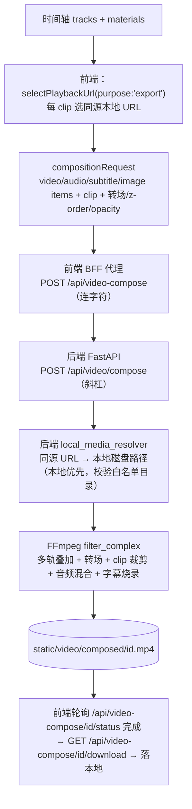

# Spec 05 — 本地导出（特性对齐预览）

> 所属：`local-video-editing-refactor`　|　依赖：master-plan、spec 01（clip 契约）、spec 02（合成语义）
> 被依赖：—
> 覆盖目标：G6（导出本地化，特性与预览对齐）

## 1. 概述 (Overview)

把"合成最终视频"的导出做成**纯本地**：前端把时间轴序列化为合成请求，用
`selectPlaybackUrl(material, { purpose:'export' })` 选**backend-resolvable 同源本地 URL**（绝不传
blob/preview-proxy/media-proxy）；后端用**内置 FFmpeg** 直接读本地文件合成，输出到本地
`static/video/composed/`。并把后端合成能力补齐到**与预览(02)特性对齐**：多视频轨叠加合成 +
转场（淡入淡出/交叉溶解）+ 字幕烧录，使"所见即所得"。

现状（已勘察，**实现前必读**）：
- 前端 `hooks/useVideoExport.ts`(758 行) 经 `lib/api/videoComposition.ts` 构建 compositionRequest，
  POST **前端 BFF 代理路由** `/api/video-compose`（连字符），由 `src/app/api/video-compose/route.ts`
  （`createPassthroughRoute('/api/video/compose')`）转发到**后端** `POST /api/video/compose`（斜杠）；
  随后轮询 `/api/video-compose/{id}/status`、经 `videoCompositionAPI.triggerDownload` 下载
  `/api/video-compose/{id}/download`（兜底也用同一前端路由）。URL 用 `material.serverUrl || material.url`
  （**未用** `selectPlaybackUrl(export)`）。
  > **路由命名注意**：前端始终调连字符版 `/api/video-compose[...]`（Next.js BFF 代理）；后端 FastAPI
  > 实际路由是斜杠版 `/video/compose`、`/compose/{id}/status`、`/compose/{id}/download`（挂载于 `/api`
  > 前缀下，即 `/api/video/compose[...]`）。本 spec 下文凡称"前端 POST"指连字符路由、"后端路由"指斜杠路由，
  > 二者均**不改路由名**。
- 后端 `services/video_composition_service.py`(2700+ 行)：cache 复用(`cached_materials`) →
  `resolve_media_reference(url, allow_remote=False)`（本地命中）→ **未命中则回退下载**
  (yt-dlp/ffmpeg) → 归一 → **concat** → 音频混合 → 图片/字幕 overlay(drawtext) → 输出
  `static/video/composed/{id}.mp4`。
- FFmpeg 现支持：concat、clip(clip_start/clip_end)、音频混合、图片 overlay、字幕烧录、GPU；
  **不支持多轨视频叠加合成（PiP/stack）、不支持转场（crossfade、无 `xfade`）**。
- 云假设的**实际位置**：不在 `resolve_media_reference`（其 `allow_remote` 已默认 `False`、且本服务已
  以 `allow_remote=False` 调用），而在**本地解析未命中时回退到下载队列**（CDN/yt-dlp/ffmpeg 拉流）。
  本 spec 要收紧的正是这条回退路径，而非 resolver 的 `allow_remote` 默认值。

## 2. 技术设计 (Technical Design)

### 2.1 导出数据流（本地化目标）



### 2.2 前端：导出 URL 选择本地化

- `useVideoExport` 把每个 video/audio/image item 的 URL 改用
  `selectPlaybackUrl(material, { purpose:'export' })`（已存在但未被使用）：直接本地素材返回
  `/api/storage/files/...`；**绝不返回** `blob:`、`/api/media/proxy`、preview-proxy URL。
- clip 时间用 spec 01 契约语义：传 `clip_start/clip_end`（= clipStart/clipEnd），后端据此裁剪。
- 传递与预览一致的合成元数据：每 clip 的 `track_z`(z-order)、`opacity`、`transition_in/out`
  （type:'fade'|'dissolve', duration），以及 `audio_detached`（spec 01）。
- 复用 `CompositionAdapter.buildCompositionRequest`/`selectCanonicalExportReference` 的导出引用选择，
  与 `selectPlaybackUrl(export)` 收敛为同一选择逻辑（避免两套）。
- 既有测试 `CompositionAdapter.exportPath.test.ts` 守卫"导出不含 blob/proxy/preview-proxy"，保留并加强。

### 2.3 后端：本地优先解析 + 去掉默认云下载回退

> **现状核对（实现前必读）**：`local_media_resolver.py` 在当前分支上**已基本满足本节目标**——
> `resolve_media_reference(...)` 的 `allow_remote` **已默认 `False`**；已按 `ROUTE_PREFIXES` 把同源
> `/api/storage/files/`、`/api/audio/generated/`、`/api/audio/subtitles/`、`/static/timeline_exports/`、
> `/api/video/compose/` 与 loopback host（`localhost/127.0.0.1/::1`）抽取 pathname → 映射本地目录；
> 已用 `validate_local_path_for_ffmpeg(..., _allowed_roots())` 做**白名单目录校验**并拒绝越权；已拒绝
> `file/blob/data` 等 scheme。**因此本节的解析与白名单基本无需重做**，本 spec 的实际剩余工作集中在
> 下面第三条（去掉 composition 的默认下载回退）与 §2.5 的模块抽取。落地前请按差异处理，勿重复造轮子。

- 解析顺序（**沿用既有**）：同源 `/api/storage/files/...`、相对 `/api/storage/files/...`、
  `http://127.0.0.1:<port>/api/...` 统一抽取 pathname → 映射到允许目录下真实路径。
- **白名单目录校验（已具备，按需补齐缩略图目录）**：解析结果必须落在允许目录内（现含
  `STORAGE_ROOT`、`static/audio/generated`、`static/audio/subtitles`、`static/video/composed`、
  `temp_dir`、系统 temp 等）；导出涉及 `static/video/thumbnails` 时若该目录不在 `_allowed_roots()` 内则**补入**，否则拒绝（防越权读盘 R7）。
- **去掉默认云下载回退**：现状是本地解析失败即把 URL 推入 `urls_to_download` 走 yt-dlp/ffmpeg 拉流
  （见 `video_composition_service.py` 约第 963 行）。导出路径改为：本地解析或 `cached_materials`
  命中即用本地路径；**两者皆未命中则明确报错**（提示先本地化素材），不再静默下载。
  （本计划范围聚焦本地；保留 remote 兜底为**可选开关**，不作默认路径——见 §7。）

### 2.4 后端 FFmpeg：多轨叠加 + 转场（与预览对齐）

把现有"concat 顺序拼接"升级为 `filter_complex` 合成图，语义**对齐 spec 02**：

```
合成图（伪 filtergraph）:
  # 1) 每条视频轨：把该轨所有 clip 按 clip_start/clip_end 裁剪 + 置于时间轴 start_time（trim/setpts/tpad）
  # 2) 轨内相邻 clip 的转场：fade（淡入淡出）或 xfade（交叉溶解，按 transition duration 重叠）
  # 3) 轨间叠加：按 track_z 从底到顶 overlay，应用每 clip opacity（format=rgba, colorchannelmixer/overlay）
  # 4) 字幕：drawtext 烧录（沿用既有），位置/样式对齐预览 SubtitleLayer
  # 5) 音频：各音频轨 + 未 detach 的视频轨音频 → amix；尊重 item/track 音量、track 静音、audio_detached
  # 6) 输出：libx264/nvenc/qsv（沿用既有 GPU 检测），输出 static/video/composed/{id}.mp4
```

- **转场语义契约（与 02 共享）**：`fade` → ffmpeg `fade=in/out`；`dissolve` → `xfade=transition=fade`，
  重叠时长 = transition.duration。预览 `TransitionLayer.alphaFor` 与导出 filtergraph 必须产出**一致
  的视觉结果**（对拍测试，见 §6）。
- **多轨叠加**：z-order = track 顺序（底轨先 overlay），opacity 经 `format=rgba` +
  `colorchannelmixer=aa=opacity` 或 `overlay` alpha 实现。
- **复杂度控制**：本期支持 cut / 淡入淡出 / 交叉溶解 与 N 视频轨叠加；更复杂转场（擦除等）不在范围
  （与 02 一致）。filtergraph 构建独立成模块，避免堆进 2700 行巨型 service（D10 拆分）。
- **失败回退**：filter_complex 失败时回退到既有 concat 路径（仅当无多轨叠加/转场时等价），并上报诊断。

### 2.5 大文件拆分（D10）

`video_composition_service.py`(2700+) 拆出：`filtergraph_builder.py`（构建 filter_complex）、
`media_resolution.py`（composition 侧解析编排：cache 命中 / **复用** `local_media_resolver` / 非本地报错——
**不重实现** resolver 的白名单与路径映射）、`audio_mix.py`、`encode.py`（GPU/参数）。主 service 编排。

## 3. 文件 / 模块变更计划 (File / Module Change Plan)

| 文件 | 动作 | 意图 |
| --- | --- | --- |
| `src/components/video/hooks/useVideoExport.ts` | 修改 | URL 改用 `selectPlaybackUrl(export)`；传 track_z/opacity/transition/audio_detached；clip 用 spec 01 语义 |
| `src/components/video/timeline/infrastructure/CompositionAdapter.ts` | 修改 | `buildCompositionRequest` 透传 z/opacity/transition/audio_detached；导出引用与 selectPlaybackUrl(export) 收敛 |
| `src/components/video/lib/selectPlaybackUrl.ts` | 修改（仅按需） | 确认 export 分支：本地优先、排除 blob/proxy/preview-proxy（多为既有） |
| `src/components/video/timeline/infrastructure/__tests__/CompositionAdapter.exportPath.test.ts` | 修改 | 加强：导出 URL 必为本地、含 z/opacity/transition 字段 |
| `src/components/video/hooks/__tests__/useVideoExport.localExport.test.ts` | 新建 | 导出请求只含本地 URL；多轨/转场字段正确 |
| `backend-services/basic-service/app/services/local_media_resolver.py` | 修改（小，按需） | 白名单已具备；仅在需要时补入 `static/video/thumbnails` 等目录（本地优先 + `allow_remote=False` 均为既有） |
| `backend-services/basic-service/app/services/video_composition_service.py` | 修改（拆分） | 编排：解析→filtergraph→编码；**去掉本地未命中即下载的回退**（约第 963 行）；接 track_z/transition/audio_detached |
| `backend-services/basic-service/app/services/composition/filtergraph_builder.py` | 新建 | 构建 filter_complex：多轨叠加 + 转场 + clip + 字幕；与 02 转场语义对齐 |
| `backend-services/basic-service/app/services/composition/media_resolution.py` | 新建 | composition 侧解析编排：cache 命中 / **调用** `local_media_resolver.resolve_media_reference(allow_remote=False)` / 非本地报错（不重实现白名单） |
| `backend-services/basic-service/app/services/composition/audio_mix.py` | 新建 | amix + 音量/静音/audio_detached |
| `backend-services/basic-service/app/services/composition/encode.py` | 新建 | GPU/编码参数（从巨型 service 抽出） |
| `backend-services/basic-service/app/models/video_models.py` (`VideoCompositionItem`) | 修改 | 增 `track_z`/`transition_in`/`transition_out`/`audio_detached`（snake_case）；`opacity`/`volume` 已存在，复用 |
| `backend-services/basic-service/tests/test_filtergraph_builder.py` | 新建 | 多轨叠加图、转场 filter 串、clip 裁剪、字幕、回退 |
| `backend-services/basic-service/tests/test_audio_mix.py` | 新建 | amix 串、音量/静音/audio_detached（见 §6 用例 6） |
| `backend-services/basic-service/tests/test_local_media_resolver.py` | 修改/新建 | 本地解析、白名单拒绝越权、非本地报错 |
| `backend-services/basic-service/tests/test_export_parity.py` | 新建 | 导出与预览对拍（见 §6） |

## 4. 接口设计 (Interface Design)

沿用既有路由（**均不改路由名**）：前端 POST 连字符版 `/api/video-compose`（BFF 代理）→ 后端
`POST /api/video/compose`。扩展请求体（snake_case）：

```
VideoCompositionRequest {
  ...既有: task_id, video_items[], audio_items[], subtitle_items[], image_items[], total_duration, output_* ...
  video_items[i]: { ...既有 url/start_time/duration/clip_start/clip_end/opacity/volume... ;
                    track_z?: int;                                   # 新增（z-order）
                    transition_in?: {type:'fade'|'dissolve', duration:float};   # 新增
                    transition_out?: {type, duration};               # 新增
                    audio_detached?: bool }                          # 新增
}
```

- **字段现状核对**：`VideoCompositionItem` **已有** `opacity`(默认 1.0) 与 `volume`(默认 1.0)、
  `clip_start/clip_end/original_duration`，故 `opacity` **非新增**——但现 concat 路径未消费它做叠加；
  本期真正新增的是 `track_z`、`transition_in/out`、`audio_detached`，并让 filtergraph 消费 `opacity`。
- 响应/状态/下载端点维持既有：前端 `/api/video-compose/{id}/status`、`/api/video-compose/{id}/download`
  → 后端 `/api/video/compose/{id}/status`、`/api/video/compose/{id}/download`。
- 转场字段语义与 spec 02 `TransitionLayer` 契约一致；后端据此构 filtergraph。
- 媒体引用：`url` 必须是 backend-resolvable 本地引用（同源/相对/loopback）；非本地默认拒绝（§2.3）。

## 5. 数据模型 (Data Model)

无 DB 迁移。请求模型增量字段均可选、向后兼容（缺省 = 无转场、opacity=1、z 按轨顺序、未分离）。
输出仍写 `static/video/composed/{id}.mp4`；桌面下该目录在 `STORAGE_ROOT` 内，经 `/api/storage/files`
或既有 compose 下载端点取回并落本地。

## 6. 测试与验收 (Testing & Acceptance)

先写失败用例。

前端：
1. `useVideoExport`：导出请求每个 item 的 URL 为本地 `/api/storage/files/...`；无 blob/proxy/preview-proxy。
2. 多轨/转场：请求含 track_z、opacity、transition_in/out、audio_detached，取值正确。
3. `CompositionAdapter.exportPath`：导出引用本地优先；加强守卫。

后端：
4. `local_media_resolver`：同源/相对/loopback → 正确本地路径；越权路径被白名单拒绝；非本地 URL 默认报错。
5. `filtergraph_builder`：两视频轨叠加生成含 overlay 的 filter_complex；相邻 clip dissolve 生成 xfade；clip 裁剪 trim/setpts 正确；字幕 drawtext；无多轨时回退 concat。
6. `audio_mix`：amix 尊重音量/静音/audio_detached（detach 后视频轨不贡献音频）。

对拍（关键，特性对齐）：
7. `test_export_parity`：给定一段含两视频轨叠加 + 一处 dissolve + 一条字幕的时间轴，导出成片在
   若干采样时刻的帧/像素，与预览合成器在相同合成时刻的输出**在容差内一致**（z-order、opacity、转场
   alpha、字幕位置）。

命令：
```bash
npm run type-check
npm run test -- src/components/video/hooks/__tests__/useVideoExport.localExport.test.ts
npm run test -- src/components/video/timeline/infrastructure/__tests__/CompositionAdapter.exportPath.test.ts
pytest backend-services/basic-service/tests/test_filtergraph_builder.py -v
pytest backend-services/basic-service/tests/test_audio_mix.py -v
pytest backend-services/basic-service/tests/test_local_media_resolver.py -v
pytest backend-services/basic-service/tests/test_export_parity.py -v
```

桌面手动走查：剪好一段多轨 + 转场 + 字幕的时间轴 → 导出 → 成片与预览所见一致；导出全程仅读本地
`STORAGE_ROOT` 文件（无网络下载）；输出落本地可播放。

## 7. 风险与缓解 (Risks & Mitigations)

| 风险 | 影响 | 缓解 |
| --- | --- | --- |
| 预览(canvas)与导出(ffmpeg)合成语义不一致 | 所见非所得 | 转场/z-order/opacity 契约与 02 共享；`test_export_parity` 对拍；同一 clip 时间映射(spec 01) |
| filter_complex 复杂图在多轨/长时间线下慢或 OOM | 导出慢/失败 | 分段构图 + 中间文件；GPU 编码沿用；超时与进度上报；无多轨时走轻量 concat |
| 收紧 local_media_resolver 误伤合法本地路径（绝对/相对/loopback 多形态） | 导出失败 | 统一 pathname 抽取后再映射；白名单宽到覆盖全部本地媒体目录；多形态用例 |
| 去云下载后，历史含远端 URL 的项目导出失败 | 旧项目不可导出 | 明确报错并提示先本地化；保留可选 remote 兜底开关（非默认） |
| 巨型 service 拆分引入回归 | 行为漂移 | 按职责拆纯函数 + 单测护栏；保留 concat 回退路径 |
| 字幕烧录位置/样式与预览 SubtitleLayer 不一致 | 字幕错位 | 二者共用样式/位置约定；对拍校验字幕像素位置 |
| GPU 编码器在桌面机器缺失 | 导出失败 | 沿用既有 GPU 检测 + libx264 软编回退 |
