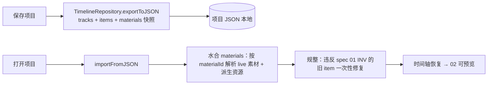

# Spec 06 — 持久化与缓存治理

> 所属：`local-video-editing-refactor`　|　依赖：master-plan、spec 01（剪辑数据）、02（预览）、03（缩略图）、04（波形）
> 被依赖：—（收尾 spec）
> 覆盖目标：G7（持久化可靠：保存与恢复）、G8（缓存治理：删除清理 + 孤儿回收）

## 1. 概述 (Overview)

本 spec 收口两件事：

1. **持久化（G7）**：剪辑结果（轨道、clip、trim、split、转场、音画分离、缩略图/波形引用）随项目
   **本地保存**，重载后**完全恢复且可预览**。派生资源（缩略图/波形）不把数据塞进项目 JSON，而是
   以 `materialId` 重新解析（命中本地持久化文件）。
2. **缓存治理（G8）**：删除素材时**联动清理**其本地派生文件（缩略图目录、波形 JSON、预览缓存）；
   应用**启动时回收孤儿**派生文件（本地有文件但无任何素材引用）。

现状（已勘察）：
- 前端 `timeline/infrastructure/TimelineRepository.ts` 已能 export/import 项目 JSON（tracks、items
  含 `clipStart/clipEnd/originalDuration/opacity`、materials 快照）；**不持久化** selection 与 undo 历史
  （export 虽写 `isSelected`，import 一律置 `false`、`isPlaying=false`，故 selection/历史实际不恢复）。
  **item 不存 live URL（仅存 `materialId`，加载时重解析）**；但 **materials 快照仍存 `url`/`serverUrl`**
  ——加载后水合以**按 materialId 解析的 live `MaterialItem` 为权威**（对齐 spec 02 D2），快照 URL 仅作兜底，
  不得压过 live 直接本地 URL。
- 当前 item 还**内联持久化** `waveformData: number[]`；本计划改为**不再写入内联波形**（见 §2.1、对齐
  spec 04：波形按 materialId 重解析，避免大数组入 JSON），仅容忍读取历史内联值作首屏兜底。
- 派生文件清理**几乎不存在**：前端删素材（`useMaterialManagement.handleMaterialDelete`）仅做**状态移除**，
  既不联动后端删源文件，也不清缩略图/波形；后端仅有 timeline_exports 的按时长清理
  （`timeline_export_router.py` `DELETE /timeline/export/cleanup`，删 `static/timeline_exports` 中超
  `max_age_hours` 的文件）；**无孤儿回收**，也无素材删除端点。
- 前端缓存：`LocalMediaCache`(blob, ~1.5GiB LRU)、`VideoCacheAdapter`(video 元素)；**删素材无清理钩子**。

## 2. 技术设计 (Technical Design)

### 2.1 项目持久化（保存与恢复）



持久化字段（在既有基础上**补齐本计划新增**）：

- **clip/trim**：`startTime/duration/clipStart/clipEnd/originalDuration`（既有，确保 split 产生的新 item
  与精确 clip 区间一并保存）。
- **split 产物**：split 后新 item 的 `id`、衔接的 clip 区间随项目保存（无需特别字段，落在 items 数组）。
- **音画分离（spec 01）**：视频 item `audioDetached`、派生音频轨 item（同 materialId）一并保存。
- **转场/合成（spec 02）**：item 的 `transitionIn/transitionOut`、`opacity`、轨道顺序（决定 z-order）。
- **字幕**：`text/subtitleStyle`（既有）。
- **派生资源引用**：**不存** poster/filmstrip/waveform 的 URL 或数据；保存 `materialId` 即可，
  加载后由 03/04 按 materialId 解析本地持久化文件（命中则直接用，未命中按需重生成）。窄 clip 的单
  `thumbnailUrl` 快照可作首屏兜底（非权威）。
- **停止内联波形**：现状 item 内联持久化 `waveformData: number[]`；本 spec 改为**导出时不再写入**
  （波形按 materialId 重解析，spec 04）；import 仍**容忍读取**历史内联 `waveformData` 作首屏兜底，
  就绪后由持久化 peaks 替换。此为 `TimelineRepository` 序列化行为的一处明确变更，需测试覆盖新旧混合。

**加载水合**：
- 按 `materialId` 关联 live `MaterialItem`（同源本地 URL）；解析 poster/filmstrip/waveform。
  **权威源**：水合后预览 URL 由 spec 02 的 `resolveSequencePlaybackUrl` 按 materialId 从 live material
  解析（对齐 D2/RC-B）；materials 快照里的 `url`/`serverUrl` 仅作兜底，不得压过 live 直接本地 URL。
- **旧数据规整（spec 01 INV）**：对违反 INV-3（`duration != clipEnd-clipStart`）的历史 item，
  以 `clipEnd-clipStart` 回算/校正一次（保守、可日志），保证 02 预览与 05 导出读到自洽 clip。
- 加载后 `isPlaying=false`、清空 selection 与历史（与既有一致）。

### 2.2 派生资源登记（供清理/回收）

为支持"按素材清理"与"孤儿回收"，需要一份**素材 → 派生文件**的可枚举关系。两种实现，取其一：

- **方案 A（推荐，无需迁移）**：靠**目录约定**枚举——缩略图在 `static/video/thumbnails/{materialId}/`、
  波形在 `static/audio/waveforms/{materialId}.json`。删除/回收直接按 materialId 目录与文件名匹配。
- **方案 B（可选）**：`cached_materials` 增 `thumbnail_dir`/`waveform_path` 字段（迁移）。仅当目录约定
  不足以覆盖（如非 cached_materials 的本地上传素材）时采用。

> 采用方案 A：缩略图(03)/波形(04)已统一按 `{materialId}` 归集，目录约定足以枚举，避免 DB 迁移。
> 删素材时，"哪些 materialId 不再被任何项目/素材库引用"由前端发起（它掌握引用集），后端按 materialId 删文件。

### 2.3 删除素材联动清理（G8）

```
deleteMaterial(materialId):
  后端 DELETE /api/storage/material/{materialId}（本 spec 新增）:
     删源文件
     删 static/video/thumbnails/{materialId}/*           # 03 thumbnail_service.delete_by_material
     删 static/audio/waveforms/{materialId}.json         # 04 waveform_service.delete_by_material
  前端：LocalMediaCache.evict(materialId)、VideoCacheAdapter.drop(materialId)、filmstrip/waveform 缓存清键
```

- **现状核对（实现前必读）**：后端**今天没有任何素材删除端点**——`storage_router.py` 仅有
  `/upload-audio`、`/upload-file`、`/upload-video`、`/user-materials`、`/health`；`material_router.py`
  仅有 `/ingest`、`/lookup`。前端 `useMaterialManagement.ts` 的 `handleMaterialDelete`→`executeDelete`
  仅做**前端状态移除**，不联动后端删源文件或派生文件。故 `DELETE /storage/material/{material_id}` 与
  `POST /storage/reclaim-orphans` 均为**新增路由**，与既有路由**无命名冲突**（已核对）。
- 复用 03/04 暴露的 `delete_by_material`（按 materialId 列举/删除派生文件）。
- 前端在素材删除流程中调用缓存清键，避免内存里残留 stale blob/URL。

### 2.4 启动孤儿回收（G8）

```
reclaimOrphans()  # 应用/后端启动时，后台、限流：
  referenced = 当前素材库 + 所有本地项目引用到的 materialId 集合
  for dir in static/video/thumbnails/*:        if dir.name ∉ referenced: 删除
  for f   in static/audio/waveforms/*.json:    if f.stem ∉ referenced: 删除
  （可选）清理 composed/ 与 timeline_exports/ 中超期产物（复用既有 cleanup 思路）
```

- **引用集来源**：素材库（DB/本地素材记录）∪ 本地项目文件中出现的 materialId。桌面单用户场景，
  扫描本地项目目录即可。为安全：**仅删确认无引用**者；不确定则保留（宁留勿误删）。
- 限流后台执行，不阻塞启动；记录回收数量与字节，便于诊断。
- filmstrip 容量上限（03）属"热"治理；孤儿回收属"冷"治理，二者互补。

### 2.5 与既有清理的关系

- 保留后端 `DELETE /timeline/export/cleanup`（导出产物按时长清理）；孤儿回收可顺带覆盖
  `composed/` 超期产物，但不改其既有语义。
- `LocalMediaCache`/`VideoCacheAdapter` 的 LRU 仍按容量自治；新增的是**按 materialId 主动清键**钩子。

## 3. 文件 / 模块变更计划 (File / Module Change Plan)

| 文件 | 动作 | 意图 |
| --- | --- | --- |
| `src/components/video/timeline/infrastructure/TimelineRepository.ts` | 修改 | export/import 覆盖 split 产物、`audioDetached`、`transitionIn/out`、`opacity`、轨序；加载水合按 materialId |
| `src/components/video/timeline/infrastructure/__tests__/TimelineRepository.persistence.test.ts` | 新建 | 保存→重载完全恢复（含 split/trim/转场/音画分离）；旧数据 INV 规整；selection/历史不持久 |
| `src/components/video/lib/projectHydration.ts` | 新建（或并入 Repository） | 水合：materialId→live 素材 + 派生资源解析 + INV 规整 |
| `src/components/video/lib/__tests__/projectHydration.test.ts` | 新建 | 水合后可预览（02 resolver 命中本地 URL）；缺失派生触发重生成 |
| `backend-services/basic-service/app/services/thumbnail_service.py` | 修改 | 暴露 `delete_by_material(materialId)`、`list_material_dirs()`（供清理/回收）——若 03 已含则复用 |
| `backend-services/basic-service/app/services/waveform_service.py` | 修改 | 暴露 `delete_by_material(materialId)`、`list_material_files()`——若 04 已含则复用 |
| `backend-services/basic-service/app/services/derived_gc_service.py` | 新建 | 孤儿回收：给定 referenced 集合扫描删除无引用的缩略图/波形；启动后台入口 |
| `backend-services/basic-service/app/routers/storage_router.py` | 修改 | **新增** `DELETE /storage/material/{material_id}`（删源 + 联动删派生缩略图/波形；今无此端点）；（可选）`POST /storage/reclaim-orphans` |
| `backend-services/basic-service/app/main.py` | 修改（小） | 启动钩子调度 `derived_gc_service` 后台回收（限流、非阻塞） |
| `backend-services/basic-service/tests/test_derived_gc.py` | 新建 | 删素材联动清理；孤儿回收只删无引用、保留有引用；引用集边界 |
| `src/components/video/timeline/infrastructure/LocalMediaCache.ts` | 修改（小） | 增 `evict(materialId)` 主动清键 |
| `src/components/video/timeline/infrastructure/VideoCacheAdapter.ts` | 修改（小） | 增 `drop(materialId)` 主动清键 |
| `src/components/video/hooks/useMaterialManagement.ts` | 修改（小） | 删素材流程串联后端联动删 + 前端缓存清键 + filmstrip/waveform 缓存清键 |

## 4. 接口设计 (Interface Design)

复用/扩展素材删除（同源本地）：

```http
DELETE /api/storage/material/{material_id}     # 删源 + 联动删派生（缩略图目录 + 波形 JSON）
  → { deleted: { source: bool, thumbnails: int, waveform: bool } }

POST   /api/storage/reclaim-orphans            # 可选：手动触发；正常由启动后台执行
  json: { referenced_material_ids: string[] }  # 前端提供引用集（素材库 ∪ 项目引用）
  → { reclaimed: { thumbnail_dirs: int, waveform_files: int, bytes: int } }
```

后端服务契约：
```
thumbnail_service.delete_by_material(materialId) -> int          # 删帧数
waveform_service.delete_by_material(materialId) -> bool
derived_gc_service.reclaim(referenced: set[str]) -> {dirs, files, bytes}
```

前端缓存契约：
```
LocalMediaCache.evict(materialId): void
VideoCacheAdapter.drop(materialId): void
filmstripCache.evict(materialId): void   # 03
waveformCache.evict(materialId): void    # 04
```

## 5. 数据模型 (Data Model)

- **采用目录约定（方案 A）**，无 DB 迁移；派生文件归属由 `{materialId}` 目录/文件名表达。
- 项目 JSON：在既有结构上确保 items 数组包含 split 产物与新增字段（`audioDetached`、
  `transitionIn/transitionOut`、`opacity`）；**不写**派生资源数据/URL（仅 materialId）。
- 历史项目兼容：缺失新字段按缺省（无转场、opacity=1、未分离）；违反 INV-3 的 item 加载时规整。

## 6. 测试与验收 (Testing & Acceptance)

先写失败用例。

前端持久化：
1. 构造含 trim/split/转场/音画分离/多轨的时间轴 → export→import → 完全恢复（item 数、clip 区间、
   `audioDetached`、转场、轨序一致）。
2. 加载后水合：按 materialId 解析 live 素材 → 02 resolver 命中本地 URL → 可预览；缺失 poster/波形触发重生成。
3. 旧数据规整：`duration != clipEnd-clipStart` 的历史 item 加载后被校正为自洽。
4. selection/undo 历史不持久（与既有一致）。
5. 内联波形：export 后的 JSON **不含** item 级 `waveformData`；import 历史含内联 `waveformData` 的旧
   JSON 时仍可读作首屏兜底（新旧混合往返不报错）。

后端缓存治理：
6. `DELETE /api/storage/material/{id}`：源文件 + `thumbnails/{id}/*` + `waveforms/{id}.json` 均删除。
7. `derived_gc_service.reclaim(referenced)`：无引用的缩略图目录/波形文件被删；有引用的保留；空引用集不误删全部（安全阈值）。
8. 启动回收：后台触发、限流、报告回收量。

前端缓存清键：
9. 删素材后 `LocalMediaCache/VideoCacheAdapter/filmstripCache/waveformCache` 对应键被清除。

命令：
```bash
npm run type-check
npm run test -- src/components/video/timeline/infrastructure/__tests__/TimelineRepository.persistence.test.ts
npm run test -- src/components/video/lib/__tests__/projectHydration.test.ts
pytest backend-services/basic-service/tests/test_derived_gc.py -v
```

桌面手动走查：剪辑（trim/split/转场/音画分离/多轨）→ 保存 → 关闭重开 → 完全恢复且可预览、缩略图/
波形命中持久化（不重生成）；删除某素材 → 其缩略图/波形文件随之消失；重启后无孤儿堆积。

## 7. 风险与缓解 (Risks & Mitigations)

| 风险 | 影响 | 缓解 |
| --- | --- | --- |
| 孤儿回收误删仍被引用的派生文件 | 缩略图/波形丢失需重生成 | 引用集 = 素材库 ∪ 全部本地项目引用；**仅删确认无引用**；空/异常引用集时**跳过回收**（安全阈值）；先 dry-run 日志 |
| 引用集收集不全（项目散落多处） | 误判孤儿 | 明确项目存储位置；扫描全部本地项目目录；不确定即保留 |
| 旧项目 INV 规整改变用户既有剪辑 | 行为漂移 | 规整保守（仅修自相矛盾的 duration/clip）；记录日志；不动 startTime |
| 删除联动与正在进行的生成任务竞争 | 删后又被重新写入 | 删除前取消/标记该 materialId 的 pending 生成任务；回收跳过 in-flight |
| 派生数据不入项目 JSON，跨机器拷贝项目后无缩略图/波形 | 异地打开需重生成 | 设计即"按需重生成"；同机重载命中持久化；跨机器属可接受降级（本期单机桌面） |
| TimelineRepository 扩字段破坏旧 JSON 解析 | 加载失败 | 新字段全可选 + 缺省；import 容错；持久化往返测试覆盖新旧混合 |
