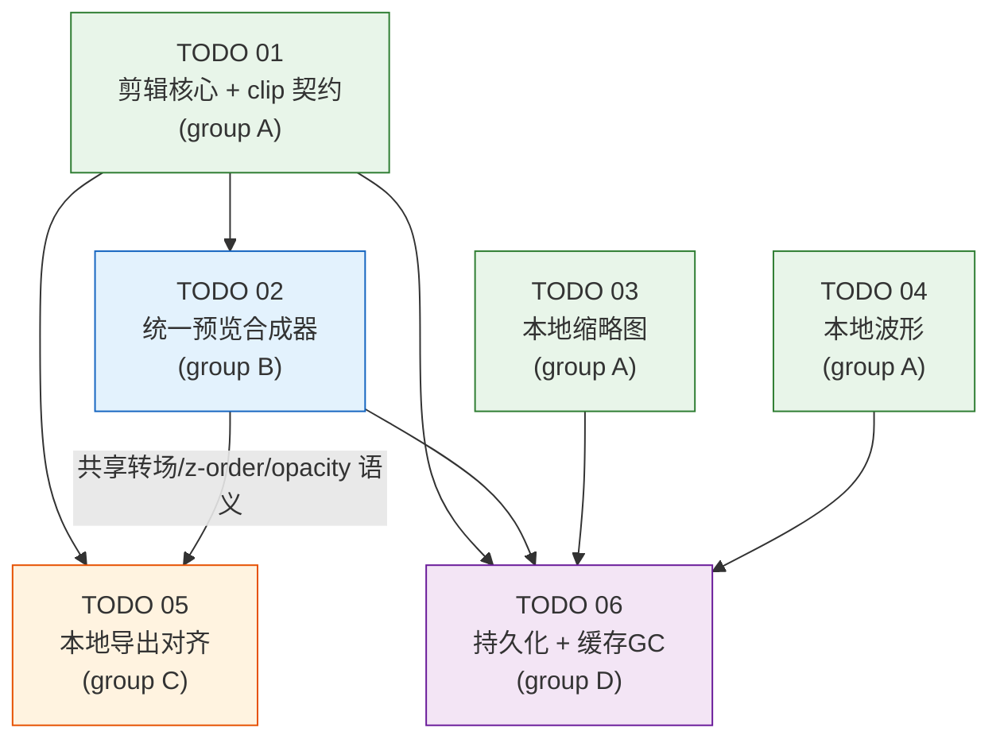

# Task Orchestration — local-video-editing-refactor

> 治理模式：三权分立 + Token 经济（full_auto）　|　远程服务器：无（纯本地桌面）
> 输入：master-plan + specs/01–06 + todos/01–06

## 1. 依赖图 (Dependency Graph)



依赖来源：master-plan §6 与各 TODO 的 `## Dependencies`（以 TODO 的 `depends_on`/`blocks` 为编排权威）。无环。`T02 --> T05` 为**硬依赖**：TODO 05 `depends_on:[01,02]`、TODO 02 `blocks:[05,06]`，故 05 必须在 02 通过后才开工（见 Phase 3 进入条件与关键路径）；该边的**内容**是 02↔05 共享的转场/z-order/opacity 合成语义契约——导出 filtergraph 须复现预览合成语义。master-plan §6 把这条边画作语义虚线（`S2 -.-> S5`），本编排按 TODO 依赖将其固化为硬依赖边，二者描述同一关系、不矛盾。

## 2. 执行阶段 (Execution Phases)

并发上限 ≤ 7（含全部角色）。Inspector 为全局 1 个，跨所有阶段。

| 阶段 | 并行任务 | 进入条件 | 说明 |
| --- | --- | --- | --- |
| **Phase 1** | TODO 01、TODO 03、TODO 04 | 无前置 | 三块互不依赖、不同领域（时间轴域 / 缩略图 / 波形），完全并行。03/04 同改 `storage_router.py`/`storage_models.py`/`config.py`，需协调（见 §4 协调注记） |
| **Phase 2** | TODO 02 | Phase 1 的 TODO 01 通过 review+test | 预览合成器依赖 01 的 clip 契约与 audioDetached；体量最大 |
| **Phase 3** | TODO 05、TODO 06 | 05：01+02 通过；06：01+02+03+04 通过 | 05 与 06 并行；06 的 03/04 依赖在 Phase 1 已满足，仅等 02 |

> 注：Phase 2 仅 1 个 dev 任务（02），但 02 内部模块多（调度/解码池/合成/字幕/转场/音频/删 v1），可由 1 个 dev 顺序推进或在阶段内细分子任务；保持单 TODO 单 dev 以维持合成器一致性。

## 3. 关键路径 (Critical Path)

```
TODO 01 (剪辑核心 + clip 契约)
   → TODO 02 (统一预览合成器)          ← 最大体量，瓶颈
      → TODO 05 (导出对齐)  ┐
      → TODO 06 (持久化GC)  ┘ 并行收尾
```

- **关键路径** = 01 → 02 → {05 | 06}。瓶颈在 **TODO 02**（多轨合成器 + 删 v1，工作量最大、风险最高）。
- 03、04 不在关键路径（Phase 1 与 01 并行完成，只为 06 供清理钩子）。
- 缩短手段：02 内部可拆"合成器核心 / 字幕转场 / 音频 / 删 v1"为子任务并行评审；但删 v1 必须在新合成器验证通过后。

## 4. 角色与任务分配 (Agent Assignments)

四角色团队（三权分立），并发 ≤ 7。命名：`google-{role}-NN`（团队 profile 见 Phase 4.1）。

| 角色 | 数量 | 职责 |
| --- | --- | --- |
| Inspector | 1（全局） | 规则仲裁 + token 结算；不受 token 评估；最先 spawn |
| Developer | Phase 1 最多 3；Phase 2 为 1；Phase 3 为 2 | 按 TODO 写代码 + 自测 |
| Reviewer | 1–2 | 1 个 reviewer 配 2–3 dev；查正确性/质量/完整性/契约 |
| Tester | 1 | 每阶段 ≥1；按 spec 验收做接受性测试 + 契约/对拍 |

**任务到 dev 映射**：

| 阶段 | dev | TODO | 关键交付 |
| --- | --- | --- | --- |
| Phase 1 | dev-01 | TODO 01 | ClipTimeMapping 契约、split、audio detach、resize INV-3 |
| Phase 1 | dev-02 | TODO 03 | 后端 poster 落点统一、thumbnail_service、前端 filmstrip |
| Phase 1 | dev-03 | TODO 04 | waveform_service peaks、前端 drawWaveform/cache |
| Phase 2 | dev-01 | TODO 02 | 多轨合成器、字幕/转场/图片层、音频同步、症状①、删 v1+flag |
| Phase 3 | dev-01 | TODO 05 | 前端导出本地化、filtergraph 多轨+转场、去云下载回退、对拍 |
| Phase 3 | dev-02 | TODO 06 | 持久化保存/恢复、删除联动清理、孤儿回收 |

**协调注记（关键）**：
- **同文件协调（Phase 1）**：TODO 03 与 04 同改 `storage_router.py`、`storage_models.py`、`config.py`。
  端点/模型/配置不重叠（thumbnail-frame vs waveform；ThumbnailConfig vs WaveformConfig）。dev-02 与
  dev-03 须按"新增不互删"原则；Reviewer 在合并点做契约一致性检查（Step 5.5.1）。
- **契约对齐（Phase 3）**：TODO 05 的导出 filtergraph 必须复现 TODO 02 的转场/z-order/opacity 语义。
  Reviewer/Tester 在 05 做"预览↔导出对拍"（`test_export_parity`）。
- **clip 契约一致性**：01 的 `ClipTimeMapping` 被 02、05 共用；任何 clip 语义变更须回 01 改契约，不在下游各自换算。
- **删 v1 时序（Phase 2）**：先让新合成器通过全部 review+test+桌面走查，再执行 v1/flag/死代码删除（独立提交，便于回退）。

## 5. 上下文文件 (Context Files — 各 agent 必读)

| Agent | 必读 |
| --- | --- |
| 全体 dev/reviewer/tester | `master-plan.md`、本 `task-orchestration.md`、`summaries/global-context.md` |
| Phase 1 dev-01 (TODO01) | `specs/01-*.md` + `todos/01-*.md` |
| Phase 1 dev-02 (TODO03) | `specs/03-*.md` + `todos/03-*.md`（+ 留意与 04 同文件） |
| Phase 1 dev-03 (TODO04) | `specs/04-*.md` + `todos/04-*.md`（+ 留意与 03 同文件） |
| Phase 2 dev-01 (TODO02) | `specs/02-*.md` + `todos/02-*.md` + `specs/01-*.md`（clip 契约）+ `summaries/phase-1/dev--*--todo-01.md` |
| Phase 3 dev-01 (TODO05) | `specs/05-*.md` + `todos/05-*.md` + `specs/01-*.md` + `specs/02-*.md` + phase-1/2 相关 dev summary |
| Phase 3 dev-02 (TODO06) | `specs/06-*.md` + `todos/06-*.md` + `specs/01-04`（持久化/清理依赖）+ phase-1/2 相关 dev summary |
| Reviewer | 被审 TODO 对应 spec + `master-plan.md` + 该任务 dev summary + `global-context.md` |
| Tester | 对应 spec（验收/对拍依据）+ dev summary + reviewer summary 的 Meta/Verdict + `global-context.md` |
| Inspector | 当前阶段全部 summaries + `global-context.md` + governance 规则 |

## 6. 备注 (Notes)

- 远程服务器：无。全部本地 vitest/pytest + 真实 Electron 桌面壳层手动走查（用户选定的验收方式）。
- 阶段门：每阶段全部任务通过 review + test（tripower）+ 集成验证（含 Phase 3 的导出↔预览对拍）后方进入下一阶段。
- 大文件拆分（D10）贯穿：`VideoPlayerPanel.tsx`(3350)、`video_composition_service.py`(2700+) 按职责拆到阈值内。
