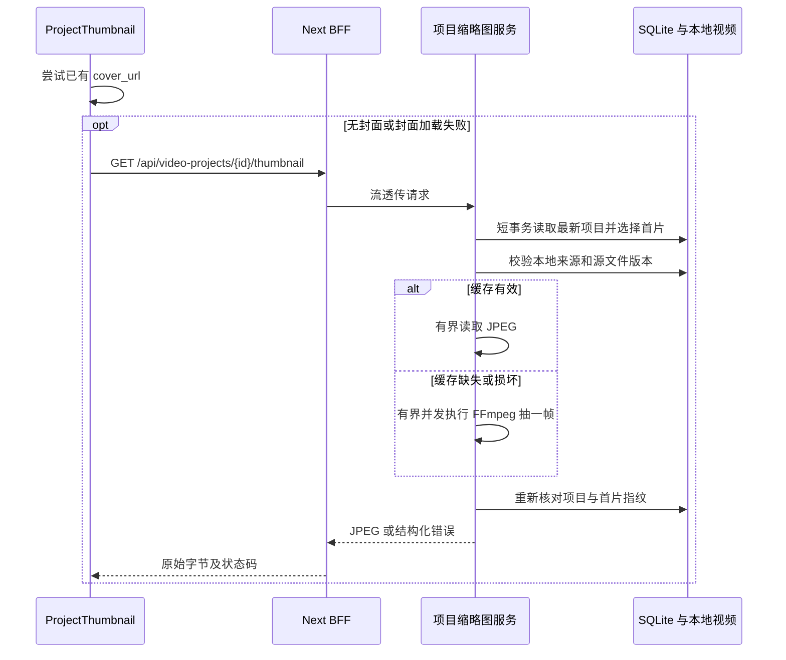

# 项目卡片自动视频缩略图设计与实施计划

> 版本：v2；日期：2026-11-20；当前节点：代码 Review、修复与提交。
> 本文包含已通过的设计评审、实施验证及最终代码复审记录。
> 实施时逐项执行本文计划，并遵循
> `superpowers:executing-plans` 的验证原则。

**目标：** 用户未制作或应用封面时，项目列表卡片自动展示项目首个
视频片段的真实画面，已有项目无需重新保存即可获得缩略图。

**架构：** 卡片优先加载现有 `cover_url`；缺失或加载失败时，访问新增的
同源项目缩略图接口。后端从持久化时间线选取首片，解析本地视频，按
裁剪起点抽帧，并将可重建的 JPEG 缓存到项目目录。

**技术栈：** Next.js 15 App Router、React 19、TypeScript、FastAPI、
异步 SQLAlchemy、SQLite、FFmpeg、Pillow、Vitest、pytest。

---

## 评审记录

本次逐节对照工作区代码及 `CLAUDE.md`，审查可行性、完整性、
一致性和范围。以下“已修复”均指设计正文已修订，不代表业务代码
已经实现或测试通过。未发现 P0；发现 6 项 P1、4 项 P2，均已就地修订。

| 编号 | 级别 | 问题与代码依据 | v2 修订位置与结果 |
|---|---|---|---|
| R-01 | P1 | §3.3 只在 originalMaterialType 缺省时检查 material.type，可能把相互矛盾的图片当视频；仅检查 metadata.cover 也与 coverTimeline.ts 的 role 标记不同。renderableTimeline.ts 明确任一处标为 image 即为图片。 | §3.3 统一类型排除、正向视频依据和 role 排除；AC-06、27；已修复。 |
| R-02 | P1 | §4.2 遗漏 CompositionAdapter.ts 已使用的 metadata.localResolvedUrl / localResolvedUrl，以及 metadata.storageKey；有效本地原片可能被误判丢失，旧 item 快照也可能压过当前素材引用。 | §4.2 明确素材与快照优先级、嵌套字段、远程缓存查找和旧段落内联素材；AC-28；已修复。 |
| R-03 | P1 | §4.5 最终只比较选择描述与旧路径 stat，不能发现缓存从未就绪变为就绪、优先引用文件出现或路径重新映射，可能发布并非当前来源的图。 | §4.5 在新快照上重新解析来源，比较完整解析指纹；命中缓存也执行；AC-29；已修复。 |
| R-04 | P1 | §4.3 / §5.2 仅要求 BFF abort 和服务捕获取消，但普通 FastAPI GET 不会仅因断连就必然取消处理任务；仓库 youtube_router.py 已显式监听断连。 | §5.1 加 Request 断连监听、取消传播和任务回收契约；AC-30；已修复。 |
| R-05 | P1 | §4.4 只要求路径仍在 STORAGE_ROOT 下，未排除指向同根其他项目或 covers 的链接；读取、touch 或清理可能作用于错误目录。 | §4.4 / §4.5 要求精确归属、拒绝目录链接和 Windows junction，单层清理不跟随文件链接；AC-31；已修复。 |
| R-06 | P1 | §4.3 的 15 秒硬截止与 run_blocking 取消后等待线程完成的现有语义冲突；直接超时释放锁会使文件线程越过删除继续发布。 | §4.3 / §4.5 区分工作预算和不可抢占清理，具体规定锁与槽位生命周期；§5.2 对齐代理时限；AC-32；已修复。 |
| R-07 | P2 | §4.3 的 -threads 1 位于 -i 之后，只约束输出编码；解码与滤镜仍可能自动启用多线程。 | §4.3 分别限制输入解码、输出编码及滤镜线程；AC-33；已修订。 |
| R-08 | P2 | §4.5 新增恢复扫描未规定单目录 IO 失败隔离，也未收敛崩溃后留下的超额完整缓存。 | §4.5 在恢复时执行容量清理并隔离新增清理错误；AC-34；已修订。 |
| R-09 | P2 | §4.1 将原生 lazy loading 描述成“可见才请求”，但浏览器可能预取邻近图片；错误 JSON 样例也省略了模型字段。 | §4.1 明确懒加载边界，§5.1 用 ErrorResponse.model_dump(mode='json') 构造含 timestamp/data 的响应；已修订。 |
| R-10 | P2 | §3.3 将裁剪起点超出源长度描述为来源不可用，但 §5.1 将其归入解码失败，实施会产生不同 HTTP 契约。 | §3.3 与 §5.1 统一为 422 decode failed，AC-20 明确覆盖越界；已修订。 |

逐节结论：§1、§2 的问题定位与本地产品边界成立；§3 按 R-01
收紧首片身份；§4 按 R-02–08 补齐来源、竞态和资源生命周期；§5
按 R-04、06、09、10 固化 HTTP 契约；§6、§7 同步函数与文件职责；§8、
§9 增加修订回归门槛；§10、§11 同步风险与交接范围。
继续采用按需抽帧和可重建磁盘缓存，不增加数据库迁移、下载器、
持久任务系统或全时间线合成，范围适合当前桌面栈。

## 1. 概述

“最近打开”、全部项目和分类列表共用 `VideoProjectListView` 及
`ProjectCard`。目前卡片直接把 `cover_url` 设为 CSS 背景；该字段没有值时，
显示由项目 ID 算出的渐变和摄像机图标。普通剪辑项目即使已有视频，
也不会自动取得与内容相关的卡片图。已有素材的 `thumbnailUrl` 又可能
来自搜索服务、整段素材中点或临时浏览器画布，不能证明其对应项目里
实际使用的首段视频及其裁剪位置。

本次增加独立的项目预览缩略图能力。用户已有并已应用的封面仍优先
展示；否则由后端读取已保存的时间线，找出最早出现的有效视频片段，
抽取其源视频裁剪起点的一帧。读取卡片即可触发生成，用户不用打开
封面工作室、调用图片模型、导出视频或重新保存旧项目。生成结果是
本地缓存，可以删除和重建，不写进用户编辑文档、撤销历史或封面版本。

本次只覆盖项目卡片的内容关联预览。它表示首个视频片段的源画面，
不执行全时间线合成，因此不叠加字幕、转场、镜头运动或其他轨道图层。
空项目、纯音频项目、纯图片项目，以及真实视频文件不可用的项目，
保留现有占位。离线读取已在本机的上传、缓存及生成视频必须正常工作；
未落地的远程视频依赖现有素材下载流程，缩略图接口自身不发起下载。

## 2. 已核对的现状与设计边界

| 现有位置 | 核对结果与本次关联 |
|---|---|
| `README.md`、`CLAUDE.md` | 桌面本地产品；前端通过 Next BFF 调本地 FastAPI；SQLite 和文件存储，不引入新服务。 |
| `src/components/video/projects/ProjectCard.tsx` | `gradientFromId` 为无封面占位；CSS 背景无法可靠处理图片加载失败。 |
| `src/components/video/projects/VideoProjectListView.tsx` | 最近、分类、搜索和排序共用卡片，不应分别实现抽帧。 |
| `src/components/video/projects/hydrateTimeline.ts` | 已保存时间线位于 `project_data.uiState.currentTimelineState`。 |
| `src/components/video/timeline/domain/types.ts` | 视频轨道类型为 `video`；图片也可能在视频类型轨道，需结合 `originalMaterialType` 判断。 |
| `src/components/video/timeline/infrastructure/CompositionAdapter.ts` | `track.order` 是层叠顺序，值越大图层越靠上。 |
| `src/components/video/timeline/infrastructure/renderableTimeline.ts`、`src/components/video/cover/coverTimeline.ts` | 任一侧明确标为 image 即为图片；封面片段身份以 metadata.role='video-cover' 为准。 |
| `src/types/index.ts` | 片段有 `clipStart`、`clipEnd`、`duration`、`materialId`；素材有本地播放引用及来源信息。 |
| `src/lib/api/videoProjects.ts` | 保存前剥离临时交接数据和内联缩略图，不能将自动图 Base64 写回项目。 |
| `backend-services/basic-service/app/services/video_project_service.py` | 列表不返回完整 `project_data`；普通保存不会生成封面；v2 保存按已应用 revision 计算 `cover_url`。 |
| `backend-services/basic-service/app/services/video_cover_v2_service.py` | `applied_revision` 校验已应用封面；生成但尚未应用的封面不应改变卡片。 |
| `backend-services/basic-service/app/services/storage_service.py` | 上传 poster 取整段素材中点；`write_to_well_known_slot` 当前实现直接写最终文件，不能当作原子发布。 |
| `backend-services/basic-service/app/services/local_media_resolver.py` | `resolve_media_reference(..., allow_remote=False)` 是已有本地地址解析与路径校验入口。 |
| `backend-services/basic-service/app/services/material_download_service.py` | `lookup_async` 和 `local_url_for` 可读取已经落地的远程素材缓存，无需另建下载器。 |
| `backend-services/basic-service/app/services/video_cover_asset_service.py` | 提供共享 `project_locks`；`run_blocking` 在取消时等待线程结束，可保护文件生命周期。 |
| `backend-services/basic-service/app/services/video_cover_job_service.py` | 启动时调用资产恢复扫描，可接入项目缩略图孤儿清理。 |
| `src/lib/api/server/backend-proxy.ts` | `streaming: true` 可透传 JPEG；默认缓冲分支面向 JSON，新增图片路由必须选择流透传。 |
| `backend-services/basic-service/app/routers/youtube_router.py` | `_until_disconnect` 显式轮询 Request.is_disconnected；缩略图复用该模式的语义，在自身路由内实现，不跨 router 导入私有 helper。 |

本评审节点只修订本文，不修改上表中的业务文件，不提交 Git。
工作区现有 SkillRouter 等其他改动保持原状。

## 3. 方案选择与产品规则

### 3.1 方案取舍

选择**后端按需抽帧及文件缓存**。它能从列表直接补齐旧项目，在 Electron
打包环境和开发环境共用同一条本地解析路径，且无需新增数据库列、
迁移、持久任务、轮询接口或保存副作用。

另外两种方案不采用：仅在编辑器画布截图并随自动保存写入，会遗漏未
重新打开的历史项目，且截图受当前播放头和画布解码状态影响；直接
复用素材缩略图虽然快，但素材中点、远程推荐图和裁剪起点可能不一致。
首版也不启动完整 FFmpeg composition，避免为小卡片支付导出成本。

### 3.2 展示顺序

1. 非空且加载成功的 `project.cover_url`。
2. 本项目缩略图接口返回的首个视频片段 JPEG。
3. 原有渐变和摄像机图标。

用户封面加载失败时允许尝试自动图；新能力不重写 `cover_url`，也不
修正或降级 `coverSchemaVersion`。封面工作室的草稿、候选生成和应用
逻辑保持现有语义；撤销应用后，列表重新挂载便自然回到视频缩略图。

### 3.3 “首个视频片段”的确定规则

选择器是纯函数 `select_project_thumbnail(project_data)`，只返回来源描述。
所有结构检查使用字典、列表和有限数字判断；Python 的 `bool` 不算数字。
不得在选择器里读文件、访问数据库、调用 FFmpeg 或修改原始 JSON。

时间线来源按以下顺序判定，先判断键是否存在，再判断结构是否有效：

1. `uiState` 为字典且包含 `currentTimelineState` 键时，该值是唯一权威
   时间线。即使值为 `null`、结构损坏或 `tracks=[]`，也不回退旧脚本。
   这样用户清空时间线后不会重新展示已删除的视频。
2. 没有上述键且顶层存在 `pendingTimelineData` 键时，该值是交接分支的
   唯一时间线，使用相同选择规则；值损坏或无 tracks 也不回退旧脚本。
   这是兼容历史交接记录；当前 normaliseProjectDataForSave 会剥离
   pending 字段，不把它描述为新保存项目必然存在的结构。
3. 两种时间线键都不存在时，兼容旧的 `scriptSegments`：按段落数组顺序，
   再按每段 `videos` 顺序，取第一个 `type='video'` 的素材，源起点为 0。
   内联素材同样执行下面的明确类型与封面身份排除规则。
   这是旧数据兼容，不从 `materials` 或 `pendingMaterials` 随机取图。

对权威时间线，遍历所有 `type='video'` 且 `isVisible !== false` 的轨道。
静音和锁定不影响视频画面，所以不作为过滤条件。候选必须满足：

- item 为字典、`type='video'`，`startTime` 为有限且非负数字，
  `duration` 为有限且大于 0 的数字。
- `opacity` 缺省视为 1；显式为 0、负值或非有限数字的 item 不参加选择。
- `originalMaterialType` 和关联素材的 `type` 中，任一存在且不是 `video`
  就排除；尤其任一处为 `image` 必须排除，与 isStillImageItem 一致。
  至少一处必须明确为 `video`，不能仅凭 item.type='video' 将类型不明、
  素材已删除的历史图片猜为视频。缺素材但有 originalMaterialType='video'
  和持久 item 来源的快照仍可使用；类型冲突时不能跳过反证。
- item 或关联 material 的 `metadata.role='video-cover'` 均排除，
  不要求同时存在有效 revision。历史 `metadata.cover` 是字典且带非空
  `revisionId` 或 `assetId` 时也排除；已有 role 标记时，即使 cover
  内容损坏也不能当作普通视频。
- `clipStart` 缺省为 0，否则必须有限且非负；`clipEnd` 若存在，必须有限
  且大于 `clipStart`。缺省 `clipEnd` 用 `clipStart + duration` 描述有效区间。

按 `(startTime 升序, track.order 降序, track 数组下标升序,
item 数组下标升序)` 排序，取第一个；缺省或无效 `track.order` 使用 0。
这保证数组无序时仍选最早的视频，并在同时开始时优先取上层视频。
轨道 item 不原地排序。

**先选首片，再解析该片文件。** 首片文件缺失、路径不可接受或解码失败，
该项目降级占位，不能悄悄跳到后续片段。合法黑帧也保留，不用“找亮帧”
算法改选画面。源取帧时间严格为 `clipStart`，不使用时间线 `startTime`、
素材中点或编辑器当前播放头。若源文件实际短于裁剪起点，返回
422 `PROJECT_THUMBNAIL_DECODE_FAILED`，不把取帧时间回退到源视频零点。

## 4. 技术设计

### 4.1 组件与数据流



列表接口仍只返回原有轻量字段，不携带视频、Base64、完整时间线或新
缩略图状态。URL 由卡片根据项目 ID 构造，不要求遍历列表时启动抽帧。
图片使用浏览器原生懒加载；浏览器可能预取视口附近的卡片，不能把
它当作精确可见性或并发控制。后端的两槽限额始终生效；压力下的
busy 由卡片有限重试和占位承接，不承诺一次列表加载全部冷缓存成功。

### 4.2 本地视频解析

根据选中 item 的 `materialId` 在项目 `materials` 中匹配素材；重复 ID
只取数组中的第一个匹配对象，不在库中另选其他视频。交接分支中先查
`pendingMaterials`，再用 `materials` 补缺，只查已经被选中 item 引用的
ID。legacy-segment 分支以所选 `videos` 内联对象本身为素材来源，
无需假设它也存在于顶层 materials；不得换成同名但不同 ID 的素材。

同一片段先尝试匹配素材的以下字段，再尝试 item 快照的同组字段：
`metadata.localResolvedUrl`、`localResolvedUrl`、`cacheUrl`、`storageKey`、
`metadata.storageKey`、`url`、`serverUrl`。素材记录优先与现有
CompositionAdapter 的持久原片语义对齐，旧快照只补足不可用来源。
只接收非空字符串，逐层检查 metadata 字典，按顺序去重；上述 URL
只进行本地解析，远程候选不触发网络。`storageKey` 转为
`/api/storage/files/<key>` 引用，再统一交给
`resolve_media_reference(..., allow_remote=False)`；不得手工拼绝对磁盘
路径绕过校验。接受现有解析器认可的本地存储、同源及历史本地引用。
明确排除 `blob:`、`data:`、`file:`、媒体代理、预览代理以及缩略图接口
自身，避免将预览地址、图片或循环请求当作源视频。

直接本地引用均失败后，只针对所选素材调用已有
`get_material_download_service().lookup_async`：优先使用素材
`metadata.source` 与 `metadata.sourceId`；缺省时才使用 item metadata
中的同名来源身份。先按来源组合键查找，再按去重的原始远程
`serverUrl`、`url`、`metadata.originalUrl` 顺序作只读 URL 查找，
全部来自同一所选片段。每个查询结果只有状态 ready 且本地可解析
才接受；组合键返回未就绪或丢失文件时，不能因此跳过有效 URL 回退。
仅 `ready` 缓存通过
`local_url_for` 转回同源地址后，再经过本地解析器使用。
在同一片段内从失效的 `cacheUrl` 回退有效 `url` 是允许的。

本功能不调用 `enqueue`，不请求外部模型，不把远程 URL 直接交给
FFmpeg。若缓存尚未完成，返回 `PROJECT_THUMBNAIL_SOURCE_UNAVAILABLE`。
卡片会有一次延迟重试，之后在下次进入列表时重新读取。网络离线、
未下载及丢失原视频均属于真实不可用状态，不能用无关图片冒充成功。

### 4.3 抽帧与资源上限

在 `project_thumbnail_media.py` 实现异步 `extract_thumbnail`，使用
`asyncio.create_subprocess_exec` 传 argv 数组，禁止 `shell=True`。
FFmpeg 路径采用既有 `shutil.which('ffmpeg')` 解析方式，兼容桌面注入的
PATH。Windows 设置 `subprocess.CREATE_NO_WINDOW`。

命令参数固定为以下序列，只有经校验的源路径和裁剪起点可变：

```text
ffmpeg -hide_banner -loglevel error -nostdin -filter_threads 1
  -threads 1 -ss <clipStart> -i <validated-local-path>
  -map 0:v:0 -frames:v 1 -an -sn -dn -threads 1
  -vf scale=640:360:force_original_aspect_ratio=decrease,pad=640:360:(ow-iw)/2:(oh-ih)/2,setsar=1
  -q:v 3 -f image2pipe -vcodec mjpeg pipe:1
```

这是参数说明，实施和测试都不能将其拼接为 shell 字符串。
输入侧 `-ss` 保持 FFmpeg 默认准确寻址，编码一帧时丢弃目标时间之前的
解码帧；保留默认旋转元数据处理。输出固定 640×360，保持原比例并补
黑边，竖屏不会拉伸。

`-i` 前的 `-threads 1` 约束输入解码，输出侧同名参数约束 JPEG 编码，
`-filter_threads 1` 约束滤镜线程池。参数位置与准确寻址语义已对照
[FFmpeg 官方文档](https://ffmpeg.org/ffmpeg.html#Options)。
并发两进程不等于每进程只有一个操作系统线程；只承诺这些组件的
配置上限，不对解复用器内部线程作额外保证。

限制如下，作为模块常量，不新增设置页面：

| 资源 | 固定值与处理 |
|---|---|
| 全局 FFmpeg 并发 | 2；获取槽位最多等待 2 秒，超时返回 503 busy。 |
| 同项目请求串行 | 使用独立缩略图生成锁，最多等待 10 秒；后来请求重新查缓存。 |
| 单次 FFmpeg | 最多 8 秒；超时 kill，随后 await wait 回收。 |
| 请求工作预算 | 自服务入口起 15 秒；生成锁、两次共享锁、DB、解析、槽位和抽帧共用 monotonic 剩余时间，不逐阶段累加。预算耗尽进入清理，不再开始新工作。 |
| 不可抢占清理 | 预算到期或取消后仍等待已启动的文件线程、子进程和管道任务结束；清理不受上述工作预算强行中断，不承诺整个处理函数 15 秒硬返回。 |
| JPEG 字节 | 最大 512 KiB；流式读 stdout，一旦越界终止子进程。 |
| stderr | 持续排空，只保留最后 8 KiB，避免管道阻塞；不原样返回本地路径。 |
| 结果校验 | Pillow 验证单帧 JPEG、实际尺寸 640×360、非空且字节数在上限内。 |

每阶段开始前检查剩余预算，等待上限为该阶段固定值与剩余预算的
较小者；共享锁等待、DB 访问和来源复核也不能漏计。阶段等待上限
先到返回 busy/抽帧 timeout，总预算先到返回请求 timeout；只清理
不启动新阶段。以 asyncio.wait_for 配合 monotonic 实现，不要求
Python 3.11 才有的 timeout_at API。

读取 stdout、stderr 和等待进程需要协同执行。任何异常、请求取消或
截止时间耗尽，都应终止并回收子进程，等待管道读取任务结束，最后
释放执行槽位；不能留下后台 FFmpeg。Pillow 和磁盘 IO 在工作线程运行，
并复用现有 `run_blocking` 的取消等待语义。

预算超时产生 `PROJECT_THUMBNAIL_TIMEOUT`，外部 CancelledError 保留
取消语义；不能将后者吞成正常错误响应。若取消发生在临时写入之前，
禁止随后发布；若原子发布线程已经启动，就等它退出再释放共享锁，
其发布视为先于随后取得同一锁的删除操作，删除负责清除该缓存。
重复取消也不能提前释放生命周期资源。清理可能越过 15 秒，BFF 的
20 秒时限仅是客户端响应边界，不能被解释为文件线程已被强制停止。

### 4.4 缓存键与失效

缓存目录固定为：

```text
STORAGE_ROOT/projects/<canonical-project-uuid>/thumbnails/
    <sha256>.jpg
    <sha256>.<random-uuid>.part
```

最终文件由接口读取并返回，不把路径写进 `cover_url`。项目 UUID 先
标准化；以存储根的规范绝对路径构造精确目标，目录 `resolve()` 后
必须仍等于 `root/projects/<uuid>/thumbnails`，同时位于 root 内。
检查 projects、UUID 目录、thumbnails 已有各层的 lstat/reparse 属性，
拒绝符号链接及 Windows junction，即使它仍指向同一个存储根也拒绝。
使用 Python 3.10 可用的 lstat/st_file_attributes 和
stat.FILE_ATTRIBUTE_REPARSE_POINT，不依赖较新版 Path.is_junction。
散列仅使用服务端产生的 64 位十六进制值。

缓存键为规范 JSON 的 SHA-256，JSON 使用排序键、固定分隔符和 UTF-8：

- 算法版本 `project-thumbnail-v1` 和项目 UUID。
- 选择来源 `timeline | pending | legacy-segment`、track/item/material ID，
  选中片段的起始位置、轨道层级、裁剪起终点及 duration。
- 实际选择的输入引用、规范本地路径、文件 `st_size` 和 `st_mtime_ns`。
- 输出宽高、JPEG 质量和缩放规则版本。

不包含播放头、缩放、选择状态、文本、项目名称或 `last_opened_at`。
因此换首片、改裁剪、源文件替换会重建，重命名和移动播放头复用缓存。
文件大小与纳秒 mtime 是本地缓存失效依据；无需每次对整段视频做内容
哈希。同路径、同大小且保留 mtime 的外部强制替换不在自动检测保证内。

命中缓存也要有界读取、验证 JPEG 并进行最终来源复核；损坏文件按
未命中重建，不直接返回坏字节。写入时在同目录生成随机 `.part`，
完成写入和关闭后用 `os.replace` 原子替换为最终 `.jpg`，最后清理临时
文件。不能直接用当前的 `write_to_well_known_slot` 写最终文件。

每项目最多保留 3 个完整 JPEG，按文件 mtime 保留最新，当前命中文件
必须保留。成功命中时更新缓存文件访问用 mtime，但指纹中的源 mtime
只来自视频，不来自 JPEG。容量清理只匹配本目录的合法散列文件，不能
碰 covers、effects、原视频或其他项目目录。最多约 1.5 MiB/项目。

读、touch、写及清理共用同一目录归属校验，文件必须是本层普通文件，
通过 lstat 排除符号链接、reparse point 和多硬链接文件；不跟随链接
读取或更新目标。完整缓存名匹配 `[0-9a-f]{64}.jpg`，临时文件匹配
`<64位散列>.<规范随机UUID>.part`；只枚举本层，不用递归 glob 或
跟随目录的递归删除。目录被替换成链接时返回 storage unavailable，
清理时跳过并告警，不能把其他项目资产当成本项目缓存处理。

### 4.5 并发、保存与删除顺序

服务构造参数支持注入 `session_factory`，默认使用
`app.database.async_session_factory`。新增入口不借用一个跨抽帧阶段的
长事务。两次读取各使用全新短生命周期 `AsyncSession`，避免身份映射
或 SQLite 旧事务快照使“重新读取”仍读到旧项目。

按以下顺序实现 `get_thumbnail(project_id, user_id)`：

1. 校验 UUID，并取得该项目独立的生成锁。该锁只串行缩略图请求，
   不能与项目更新/删除共享，因此耗时解码不会阻塞自动保存。
2. 短暂进入现有 `video_cover_asset_service.project_locks(project_id)`，
   用新 session 按 UUID 和 `user_id` 读取项目，复制选择描述后关闭
   session，释放共享项目锁。不存在返回 404。
3. 在共享项目锁之外解析本地来源、取文件 stat、计算键和读缓存。
   未命中时获取全局槽位，抽帧、验证得到有界 JPEG 字节。
4. 再次进入共享项目锁，用新的 session 重读项目并重新选片，复制完整
   不可变选择描述后关闭 session，保持共享锁。对新描述重新执行
   resolve_thumbnail_source，含本地候选优先级和只读缓存查询，重新
   取得规范路径及 stat；不得只 stat 旧路径。比较选择签名和完整解析
   指纹（实际引用、路径、size、mtime_ns）。项目删除返回 404；
   首片消失、来源变得不可用或任一指纹改变均返回 409 stale，丢弃
   本轮结果，不在同一请求追赶新版本。来源验证也受剩余工作预算约束。
   首次快照就不可用时仍按 source unavailable，不混淆两种状态。
5. 对未命中结果，在共享锁内通过 `run_blocking` 完成原子写入和容量
   清理；读取命中结果也经过第 4 步后才可返回。任何响应都返回已经
   持有的 `bytes`，不使用稍后才打开文件的 `FileResponse`。
6. 全局解码槽位在进程和管道任务结束后即可释放；生成锁和共享锁
   必须等各自保护的文件工作线程真正结束后才释放，再返回 JPEG。
   每次请求只执行一轮，409 的一次重试由卡片完成，后端不无限追赶
   持续编辑。

生成锁注册表对持有者和等待者计数，在没有使用者时移除；加减计数
在同一事件循环中无 await 地完成。锁超时及取消也必须减少计数。
锁顺序始终是生成锁在外、短共享项目锁在内；删除路径只拿现有共享
锁，绝不等待生成锁，从而避免反向等待。

在 `_delete_project` 已有数据库 commit 成功之后，追加缩略图目录
清理；rollback 时不得清理。清理失败记录带项目 ID 的 warning，不把
已经提交的项目删除变成失败。复用共享锁保证删除后，进行中的抽帧
在最终复核发现项目不存在，无法重新创建目录。

扩展现有资产 `recover_storage`：无对应项目的 UUID 目录同时清理
thumbnails；有对应项目时清理合法 `.part` 中超过 24 小时的文件，
并将合法完整 JPEG 收敛到最新 3 个，处理崩溃发生在发布后、裁剪前
的情况。仅新增的 thumbnails 恢复分支按目录捕获明确的路径/IO
异常，记录 warning 后继续扫描其他项目，不让可丢弃缓存故障阻断
应用启动；不扩大捕获范围去吞掉数据库或既有封面恢复异常。
该扫描由现有封面任务服务启动流程调用，不另建后台常驻任务。
相关删除 helper 只能处理指定 UUID 的 thumbnails，不能删除整个
`projects/<id>`。线程取消必须等到文件动作真正结束才释放共享锁，
具体复用 `run_blocking`，不直接用裸 `to_thread` 后放任线程继续写盘。
恢复阶段发生在服务启动、尚未接收卡片请求时；请求中的容量清理与
项目删除都处于共享项目锁内。只对通过校验的单层普通文件 unlink，
目录清空后可 rmdir，不对可疑目录执行 rmtree。

### 4.6 前端状态与占位

新增 `projects/ProjectThumbnail.tsx`，接收
`{ projectId, coverUrl?, updatedAt }`。在 `ProjectCard` 内以
`projectId + coverUrl + updatedAt` 为 key 挂载，替换原封面背景 div 内的
绘图部分；容器的宽高、圆角及原有点击行为保持原样。

状态为 `explicit | automatic | placeholder`：初始有非空 `coverUrl` 则
使用 explicit，否则 automatic。图片用普通 ``，设置
`loading='lazy'`、`decoding='async'`、640/360 尺寸、空 alt 和
`aria-hidden=true`，下方标题承担可访问名称。使用 `object-cover` 保持
原卡片视觉；JPEG 内部的黑边已保证视频比例。

始终先画现有渐变和图标，图片覆盖其上。explicit 的 `onError` 只切到
automatic；automatic 第一次错误时先显示占位，3 秒后重试一次，在
URL 追加 `retry=1` 强制重新设置 src；第二次错误保持 placeholder。
成功后不再重试，组件卸载或 key 改变时清除定时器。使用阶段和尝试
编号校验事件归属，已退场的图片错误不能影响新来源。可将不同尝试
渲染成不同 key 的 img，确保旧事件闭包不推进新状态。

自动 URL 格式：
`/api/video-projects/<encoded-id>/thumbnail?v=<encoded-updatedAt>`。
`v` 只帮助图片重置与调试，不能作为后端内容缓存键；SQLite 时间戳
可能在同一秒内重复，正确性来自每次请求读取真实首片和源文件 stat。
接口 `Cache-Control: no-store` 保证重新进入列表时重新验证。编辑器退出
仍走原有 autosave flush，缩略图始终反映后端已成功保存的内容。

不新增“生成项目封面”按钮、技术状态文字或全局失败通知。空项目和
网络/解码错误均由卡片占位承接，不妨碍打开、重命名和删除。

## 5. 接口设计

### 5.1 新增 REST 接口

**浏览器和后端同路径：**
`GET /api/video-projects/{project_id}/thumbnail`。

- 路径参数 `project_id: UUID`；非法 UUID 按 FastAPI 校验返回 422。
- 可选查询 `v: str | None`，最大 128 字符；`retry: int = 0`，范围 0–1。
  两者不参与来源选择，不接受客户端视频 URL、磁盘路径或取帧时间。
- owner 由路由传 `LOCAL_OWNER_ID`；不新增用户请求字段或认证系统。
- 成功返回 HTTP 200 原始 JPEG，`Content-Type: image/jpeg`、
  `Cache-Control: no-store`、`X-Content-Type-Options: nosniff`。
  不发送 ETag，不返回 JSON 成功 envelope。
- 此 GET 允许写可丢弃缓存，但不写项目数据库。读取不能调用会触碰
  `last_opened_at` 的现有详情 GET，也不能改变 `updated_at` 或最近排序。

失败使用现有 `ErrorResponse` 形状，由新路由捕获本功能的
`ProjectThumbnailError` 并构造 `JSONResponse`：

```json
{
  "success": false,
  "message": "无法读取项目视频缩略图",
  "timestamp": "2026-11-20T12:00:00",
  "data": null,
  "error_code": "PROJECT_THUMBNAIL_SOURCE_UNAVAILABLE",
  "error_details": { "project_id": "项目 UUID" }
}
```

响应实例化现有 ErrorResponse，传给 JSONResponse 的是
`model_dump(mode='json')`，不直接传带 datetime 的 model_dump()。
`timestamp` 使用模型默认值，以上仅为示例。除项目 UUID 外不返回
磁盘路径、命令行、源 URL 或 FFmpeg stderr。失败响应同样设置
`Cache-Control: no-store`。

| HTTP | error_code | 条件 |
|---|---|---|
| 404 | `PROJECT_NOT_FOUND` | 项目不存在或不属于服务传入 owner。 |
| 404 | `PROJECT_THUMBNAIL_EMPTY` | 没有符合规则的视频片段或时间线不可读。 |
| 409 | `PROJECT_THUMBNAIL_SOURCE_UNAVAILABLE` | 本地文件缺失、仅有未落地远程引用或引用被拒绝。 |
| 409 | `PROJECT_THUMBNAIL_STALE` | 抽帧期间首片、裁剪或源文件发生变化。 |
| 503 | `PROJECT_THUMBNAIL_BUSY` | 项目生成锁或全局槽位等待超时。 |
| 503 | `PROJECT_THUMBNAIL_DECODER_UNAVAILABLE` | FFmpeg 不存在或无法启动。 |
| 504 | `PROJECT_THUMBNAIL_TIMEOUT` | 抽帧时限或请求工作预算耗尽。 |
| 422 | `PROJECT_THUMBNAIL_DECODE_FAILED` | 解码失败、源裁剪越界、结果超限或 JPEG 验证失败。 |
| 503 | `PROJECT_THUMBNAIL_STORAGE_UNAVAILABLE` | 缓存目录不可读写或原子发布失败。 |

只有这些明确可识别异常转换成本表错误；意外数据库或编程异常沿用
全局异常处理，不能捕获所有异常后伪装成“空项目”。

路由额外接收 FastAPI `Request`，在工作期间显式监测客户端断连：
创建服务任务及每 200 ms 检查 `request.is_disconnected()` 的 watcher，
断连时取消服务任务；路由直接 await 服务任务，禁止 shield 整个业务。
正常结束时取消并 await watcher；路由本身取消时，取消并等待服务
任务和 watcher 全部收敛，最后保留 CancelledError。收敛使用可承受
重复取消的等待方式，不遗留 detached task。只在 GET 工作期间监听，
不与请求体读取或 Response 发送竞争消费 ASGI receive。
不要假设 BFF AbortController 或 Uvicorn 会代替此监听；断连后的
客户端无需接收业务错误 envelope，子进程和线程必须按 §4.3 退出。

### 5.2 Next BFF

新增 `src/app/api/video-projects/[projectId]/thumbnail/route.ts`，通过
`createPassthroughRoute` 的 GET 映射同一后端路径。设置
`streaming: true`、`timeoutMs: 20000`、
`abortOnClientDisconnect: true`。响应头 allowlist 仅为 `content-type`、
`cache-control`、`content-length`、`x-content-type-options`。
后端在发送响应头之前完成抽帧工作，正常工作预算 15 秒，小于代理
20 秒响应等待上限；超时或取消后的不可抢占清理可能更久，仍须在
后端等到真实退出。代理自己的 502/504 继续沿用 helper 的既有
envelope，不宣称它与后端业务错误码相同，也不更改共享 helper。
不得先解析 JSON 再透传成功图片。原有项目、分类及封面 REST 签名不变。

## 6. 数据模型与函数契约

**数据库：** 不新增表、字段或索引，不运行任何 DDL。`VideoProject`
及 v2 封面四表仍按原语义持久化。列表和详情模型无需增加字段。

**项目 JSON：** 不新增键，不写 `thumbnailUrl`、`data:` 或自动图标记，
不修改 `coverSchemaVersion`、`timelineRecoveryBackup` 和素材记录。
现有 `normaliseProjectDataForSave` 原样工作。

**内存对象：** 在新来源模块定义 frozen dataclass，字段语义如下。

| 对象 | 字段与意义 |
|---|---|
| `ProjectThumbnailSelection` | `origin`、`track_id`、`item_id`、`material_id`、`start_time`、`track_order`、`clip_start`、`clip_end`、`duration`、`references`、`remote_urls`、`source`、`source_id`；references 和 remote_urls 为按 §4.2 优先级去重的不可变元组，不保留原始 metadata 字典引用。 |
| `ResolvedThumbnailSource` | `selection`、经校验的 `path: Path`、`input_reference`、`size_bytes`、`mtime_ns`；不向客户端序列化。 |
| `ProjectThumbnailError` | `code: str`、`status: int`；异常消息使用固定公开文本，内部日志另存必要诊断。 |
| 生成锁注册项 | `lock: asyncio.Lock`、`users: int`；仅当前进程使用，请求结束回收。 |

主要接口固定为以下签名；源解析和 FFmpeg 用独立函数便于真实集成验证：

```text
select_project_thumbnail(project_data: dict | None)
    -> ProjectThumbnailSelection | None
resolve_thumbnail_source(selection: ProjectThumbnailSelection, *, deadline: float)
    -> ResolvedThumbnailSource                # async
extract_thumbnail(source: ResolvedThumbnailSource, *, deadline: float)
    -> bytes                                # async，受剩余截止时间约束
ProjectThumbnailService(session_factory=None)
    .get_thumbnail(project_id: UUID, user_id: str) -> bytes  # async
cleanup_project_thumbnails(project_id: str | UUID) -> None
recover_project_thumbnails(project_id: str | UUID, is_live: bool) -> None
```

绝对截止时间作为媒体操作的命名选项传入，方法参数最多 5 个。
测试可注入 session factory、临时存储根和抽帧适配器；生产解析器、
FFmpeg 参数和原子文件操作必须有不替换实现的集成测试。

## 7. 文件 / 模块变更计划

下表是后续代码节点的完整范围。除本 `spec.md` 外，当前节点不修改
这些文件。标注“新增”的源码在当前仓库尚不存在。

| 操作 | 文件 | 一行意图 |
|---|---|---|
| 修改，本节点 | `docs/plans/project-card-auto-thumbnail/spec.md` | 评审 v1、修订为 v2，固化规则、实施顺序和验收门槛。 |
| 新增 | `backend-services/basic-service/app/services/project_thumbnail_source.py` | 纯首片选择、不可变来源描述及选择签名。 |
| 新增 | `backend-services/basic-service/app/services/project_thumbnail_media.py` | 本地来源解析、缓存查询、有界 FFmpeg、JPEG 校验和功能异常。 |
| 新增 | `backend-services/basic-service/app/services/project_thumbnail_service.py` | 双快照复核、生成锁、截止时间、原子缓存和目录清理。 |
| 修改 | `backend-services/basic-service/app/routers/video_project_router.py` | 增加二进制 GET、显式断连监听与任务收敛，序列化本功能错误 envelope。 |
| 修改 | `backend-services/basic-service/app/services/video_project_service.py` | 项目删除提交后清理 thumbnails，失败仅记录警告。 |
| 修改 | `backend-services/basic-service/app/services/video_cover_asset_service.py` | 在既有恢复扫描补充孤儿 thumbnails 和过期 part 清理，函数内导入避免循环。 |
| 新增 | `src/app/api/video-projects/[projectId]/thumbnail/route.ts` | JPEG 流透传、超时和响应头限制。 |
| 新增 | `src/components/video/projects/ProjectThumbnail.tsx` | 明确封面、自动图片、占位三级展示与一次有界重试。 |
| 修改 | `src/components/video/projects/ProjectCard.tsx` | 接入 ProjectThumbnail，保持卡片菜单、标题和打开行为。 |
| 新增 | `backend-services/basic-service/tests/test_project_thumbnail_source.py` | 首片选择、裁剪、排序、图片排除及旧数据回归。 |
| 新增 | `backend-services/basic-service/tests/test_project_thumbnail_media.py` | 真实本地解析及 FFmpeg 帧内容、限额、旋转和故障。 |
| 新增 | `backend-services/basic-service/tests/test_project_thumbnail_service.py` | SQLite 双快照、缓存、更新删除竞争和清理。 |
| 新增 | `backend-services/basic-service/tests/test_project_thumbnail_router.py` | HTTP 二进制、错误序列化、无数据库副作用和 ASGI 断连回收。 |
| 新增 | `src/components/video/projects/__tests__/ProjectThumbnail.test.tsx` | 用 DOM 事件验证优先级、重试、卸载及跨项目隔离。 |
| 新增 | `src/app/api/video-projects/[projectId]/thumbnail/__tests__/route.test.ts` | 经过真实 proxy helper 验证字节与状态透传，不替换 helper 本身。 |

不修改 `src/types/index.ts`、请求模型、自动保存 hook 或项目列表组件；
也不增加依赖、设置项、AI 调用或单独部署单元。新增模块各自控制在
800 行以内，函数原则上不超过 50 行；既有超长文件只做必要小范围修改。

## 8. 实施顺序

### 步骤一：固定来源选择

先增加来源测试，构造无序时间线、裁剪首片、同起点多轨、图片和空
时间线等输入；确认新规则在实现前失败，再编写纯选择器。选择器输出
应明确携带 `clipStart` 和实际首片身份，不能只返回素材 poster URL。
以冻结输入和深比较验证没有修改项目 JSON。
同时固定缺省/冲突类型、role-only 封面、损坏 pending 键不复活旧段落，
以及 legacy videos 内联素材不要求顶层重复存储的行为。

### 步骤二：实现真实媒体路径与抽帧

增加使用临时目录的解析测试和 FFmpeg 测试，随后实现媒体模块。
核心视频夹具通过真实 FFmpeg `lavfi` 生成两段红、蓝各 1 秒的 MP4：
素材中点与 `clipStart=0.2` 颜色不同。再验证 `clipStart=1.2` 能得到蓝色。
所有夹具、JPEG 和临时目录放在 pytest 的 `tmp_path`，不提交二进制。
安装测试环境没有 FFmpeg 时可标记依赖缺失，但不得据此宣称抽帧验收
通过；交付前必须在带打包 FFmpeg 的环境执行核心真实测试。

### 步骤三：实现服务缓存和竞态

用 SQLite 临时数据库及可控抽帧屏障编写更新/删除竞争测试，再实现
服务。setup 数据先 commit，让两个独立 session 都能读取。验证读
缓存和写缓存都走最终复核，且共享项目锁没有覆盖 FFmpeg 的执行。
完成容量上限、失败原子性和启动恢复 helper，再接入现有删除及恢复
路径。通过回归确认封面资产、effects 和源媒体没有被缩略图清理触碰。
为“旧路径未变但更高优先来源已就绪”和不可抢占写盘分别建立屏障；
覆盖缓存命中及抽帧未命中两条路径，避免只测 project_data 被替换。

### 步骤四：实现 REST 与 BFF

测试通过 FastAPI router 发请求，断言响应真为 JPEG；对应 Next route
使用 `NextRequest` 和延迟 `params`，执行实际 proxy helper，断言输出
字节相同、查询参数透传、上游 404/409/503 状态保留。
新增 endpoint 不复用带 touch 行为的详情 GET。
通过真正执行路由的 ASGI receive harness，在解码任务运行时投递
http.disconnect，验证 watcher 会取消工作并回收进程；不能只直接
调用服务 task.cancel() 就宣称 HTTP 断连语义已通过。

### 步骤五：接入卡片并执行验收

增加 React Testing Library 行为测试，使用 fake timers 和 load/error
事件覆盖阶段转移；完成新组件及卡片接入。运行下列定向检查，再按
验收表逐项手测旧项目、首片修改和已有封面项目。当前节点不执行这些
尚未实现的业务测试，不将文档检查当成业务通过证据。

## 9. 测试与验收标准

### 9.1 必须覆盖的用例

| 编号 | 输入 / 操作 | 必须观察到的结果 |
|---|---|---|
| AC-01 | 无 cover_url 的旧项目，已有本地视频但从未生成封面，直接进入最近列表 | 自动出现对应首片画面，无需打开或保存项目。 |
| AC-02 | 首片 startTime=5、clipStart=1.2，素材 0–1 秒红、1–2 秒蓝 | JPEG 为蓝色；不取时间线 5 秒，也不取源零点。 |
| AC-03 | items 数组顺序与时间顺序不同 | 始终选择最小 startTime 的有效视频。 |
| AC-04 | 两个可见视频轨同时开始，order 不同 | 选择 order 较大的视频；稳定处理相等层级。 |
| AC-05 | 隐藏轨道、透明视频、静音视频和锁定视频 | 隐藏/透明排除；静音/锁定仍可作为首片。 |
| AC-06 | 封面图片和普通图片位于视频轨道、排在视频之前 | 自动图仍来自首个真实视频，不把图片当视频。 |
| AC-07 | canonical tracks=[] 或 canonical 值损坏，但 scriptSegments 有旧视频 | 保持占位，不复活旧片，不修改损坏数据或 recovery backup。 |
| AC-08 | canonical 键缺失，分别只有 pendingTimelineData 或 legacy scriptSegments | 按兼容规则选择首片，且不从未被使用的 materials 取图。 |
| AC-09 | 选中首片丢失，第二片文件存在 | 占位及 source unavailable，不偷偷展示第二片。 |
| AC-10 | 空项目、纯音频、纯图片、零时长及无效数值 | 无抽帧调用，无崩溃，保持占位并返回明确 empty。 |
| AC-11 | cover_url 有效、封面草稿生成但未应用、应用封面、撤销应用 | 已应用封面优先；草稿不抢占；撤销后回到视频图。 |
| AC-12 | 显式封面失效，随后自动图成功；自动图也失败 | 按三级顺序回退，最多一次延迟重试，无无限请求。 |
| AC-13 | 重排首片、修改 clipStart、替换源文件后返回列表 | 新请求产生对应新画面/键；原图不被误认作当前图。 |
| AC-14 | 修改播放头、重命名或重新进入列表 | 源描述未变时复用 JPEG，不重新启动 FFmpeg。 |
| AC-15 | 同项目并发请求及多项目高峰 | 同项目仅一个解码进程；全局同时最多两个，其余遵守等待上限。 |
| AC-16 | 抽帧屏障期间保存新首片 | 旧结果返回 stale、没有发布旧缓存；卡片重试后显示新首片。 |
| AC-17 | 抽帧或缓存读取期间删除项目；删除事务回滚 | 成功删除后无目录复活；回滚保留原缓存；无死锁。 |
| AC-18 | 连续读取缩略图前后比较数据库 | project_data、cover_url、updated_at、last_opened_at 及最近排序均不变。 |
| AC-19 | 缓存损坏、写盘失败、源文件在抽帧中被替换 | 损坏缓存重建；失败不留下可用名的半文件；替换触发最终复核失败。 |
| AC-20 | 无 FFmpeg、超时、超大输出、损坏视频、裁剪起点超出源长度、请求取消 | 返回相应错误，越界为 422 decode failed；子进程被回收；后续请求可取得锁和槽位。 |
| AC-21 | 竖屏及含旋转元数据视频 | 输出 640×360、方向正确、比例正常；黑边允许。 |
| AC-22 | 路径遍历、编码穿越、外部绝对路径、符号链接越界、blob/data/代理引用 | 不越过已有本地解析边界，不联网，不启动远程 FFmpeg。 |
| AC-23 | 已缓存的 Pexels/ARK/本机生成视频；远程尚未下载 | 前者真实出图；后者占位且没有隐式下载或模型请求。 |
| AC-24 | 切换项目/分类、搜索、卸载时仍有图片事件和重试定时器 | 不串图、不更新卸载组件、不影响菜单、标题按钮和删除操作。 |
| AC-25 | 多次首片更换及程序重启后的恢复扫描 | 每项目最多三图，删除孤儿和过期 part，covers/effects/原视频不受影响。 |
| AC-26 | 同一秒内两次成功保存不同首片，再重新进入列表 | 即使 updated_at 相等，也通过 no-store 请求和内容指纹显示新图。 |
| AC-27 | originalMaterialType=video 但 material.type=image，反向冲突、类型全缺失、role-only 封面、损坏 pending 值且有旧脚本 | 不把图片或封面当视频；无正向视频依据不猜测；存在损坏 pending 键时不复活旧段落。 |
| AC-28 | 唯一有效原片分别在 metadata.localResolvedUrl、localResolvedUrl、metadata.storageKey；item 快照引用旧片；legacy videos 仅内联存储；组合键缓存失败但 URL 缓存 ready | 按 §4.2 得到当前所选片段的真实本地来源；优先当前素材引用；旧数据和 URL 缓存回退均有效，无联网或下载。 |
| AC-29 | 初次解析后高优先级文件出现、远程缓存 ready 路径变化或链接重映射，旧文件 stat 不变 | 命中与未命中两条路径都重新解析并返回 stale；不发布/返回旧来源图；下一请求可用新来源。 |
| AC-30 | 真实路由收到 http.disconnect；BFF 请求信号 abort；服务任务被重复取消 | 断连确实传播到工作任务；进程、管道、watcher 回收，锁与槽位最终可重用；不能仅靠 BFF 设置或直接服务取消测试代替。 |
| AC-31 | thumbnails 或上层是指向同根 covers/其他项目的 symlink、junction；缓存文件是符号链接或多硬链接 | 拒绝读取/touch/发布；删除及恢复不跟随链接，其他资产内容与 mtime 不变；Windows 真 junction 验收必须执行并记录。 |
| AC-32 | 总预算在共享锁等待、最终解析、写盘线程期间耗尽，或在文件线程运行时重复取消并发删除 | 不启动后续工作；进程被回收；已启动文件线程结束前锁不释放；随后删除无目录复活，清理越过预算不会被误报为硬时限失败。 |
| AC-33 | 执行真实红蓝视频抽帧，并检查实际 argv 的输入/输出参数位置 | -i 前后分别有 threads=1、滤镜线程为 1，裁剪帧颜色与尺寸仍正确；参数断言不能替代产物验证。 |
| AC-34 | 启动时有四张完整缓存、过期 part、一个不可访问目录及其他正常项目 | 只有合法缓存被收敛到三张；单目录新增清理故障告警并继续；应用可启动，covers/effects 不受影响。 |

真实 FFmpeg 测试不能只断言进程参数或替身返回的 JPEG。应以 Pillow
读取产物中央色块，在有损压缩容差内验证红/蓝主通道，另断言 MIME、
尺寸、文件存在和重复请求的真实缓存复用。竞态单测可替换抽帧耗时以
建立屏障，但至少保留一项“真实源视频 → HTTP JPEG”的集成用例。
R-01–10 的修订测试分别落入第 7 节既定的 source、media、service、
router 和组件测试文件，不另建测试框架。路由错误测试必须断言
timestamp 可序列化、data=null、状态码及 no-store；断连测试执行
实际路由逻辑，文件取消测试执行真实原子写入并用屏障控制完成时点。
无权限建立 symlink 的机器可记录该项缺失，但 Windows junction
及真实文件操作不得全部用 mock 代替后宣称 AC-31 已通过。

### 9.2 后续实施节点的验证命令

在 `backend-services/basic-service` 工作目录、使用已安装依赖的 Python
执行，每行均为独立命令：

```powershell
python -m pytest tests/test_project_thumbnail_source.py tests/test_project_thumbnail_media.py tests/test_project_thumbnail_service.py tests/test_project_thumbnail_router.py -v
python -m pytest tests/test_video_project_service.py tests/test_video_project_service_collation.py tests/test_video_cover_project.py tests/test_thumbnail_service.py tests/test_storage_video_thumbnail.py -v
```

在仓库根目录执行，每行独立：

```powershell
npm run test -- src/components/video/projects/__tests__/ProjectThumbnail.test.tsx src/components/video/projects/__tests__/ProjectCard.test.tsx src/app/api/video-projects/[projectId]/thumbnail/__tests__/route.test.ts
npm run test -- src/components/video/projects/__tests__/coverPersistence.test.ts src/components/video/projects/__tests__/projectHydration.test.tsx src/components/video/projects/__tests__/VideoProjectListView.delete.test.tsx src/lib/api/__tests__/videoProjects.normalise.test.ts
npm run type-check
git diff --check
```

定向测试通过后，实施节点再执行 `npm run build` 验证新增 App Router
路由可构建，并记录已有工作区错误与本次引入错误的区别。安装包验收
需要使用实际随包 FFmpeg，在现有桌面开发/发行验证流程中执行
AC-01、02、11、13、18、21；开发依赖或 CI 缺失时必须记录缺项。

## 10. 风险与缓解

| 风险 | 缓解与可接受边界 |
|---|---|
| 首片与用户理解不一致 | 固定以已保存时间线最早有效视频为准；同起点按层级；不按素材库、脚本展示顺序或当前播放头推测。 |
| 新图覆盖用户封面或影响导出 | 自动缓存不写 cover_url、不创建 revision、不插入时间线；显式封面优先。 |
| 历史 JSON 损坏导致列表崩溃 | 纯选择器逐层检查；不修复写回；图片错误局限在单卡片。 |
| 数据更新与抽帧发生竞争 | 两次独立短事务、共享项目锁内最终比较；过期结果拒绝发布。 |
| 旧路径未变但优先来源更新 | 最终在最新快照上重新解析完整来源，比较选择与解析指纹，不仅检查旧文件 stat。 |
| 大量项目拖慢列表 | 列表不抽帧，图片懒加载；并发、输出、锁等待和进程时间都有界，真实 JPEG 本地缓存。 |
| 删除失败或线程取消后重建目录 | commit 后清理，文件发布复用取消等待 helper；删除和最终发布使用同一项目锁。 |
| 客户端离开但后端继续抽帧 | GET 显式监听 Request.is_disconnected 并收敛任务；工作预算与不可抢占清理分开，锁在真实退出后释放。 |
| 图片缓存无限增加 | 每项目三图，项目删除清理及启动恢复；临时文件 24 小时清理。 |
| 缓存路径链接到同根其他资产 | 检查精确目录与 reparse 属性，单层普通文件操作；恢复新增错误隔离，不递归跟随链接。 |
| 路径和远程媒体进入 FFmpeg | 所有源走现有本地解析器；缓存只读，不调用下载；固定 argv 及 UUID/散列目录。 |
| 首帧黑屏、单片内字幕或镜头效果与预览不同 | 黑帧是合法来源；本次明确输出源片帧，不承诺合成截图或自动找高光。 |
| 远程素材未下载或本机原文件被移走 | 保持占位，有限重试；下一次列表挂载可恢复；实际文件不存在时无法保证出图。 |
| no-store 增加小图片请求 | 每次重新进入列表允许有一次后端校验，但命中磁盘缓存不重复解码，确保同秒保存正确性。 |
| 来源文件保持同路径/大小/mtime 被外部替换 | 作为缓存检测边界明确记录；删除项目 thumbnails 可重建，不为小图扫描整段视频哈希。 |

## 11. 完成标准与交接

本评审节点完成条件：本文为 v2，顶部含评审记录、末尾含评审结论，
P0/P1 均有明确正文修订和验收映射；仅修改本文，未修改源码、未提交
代码。评审只核验设计依据、文档结构、引用路径和变更范围，不声称
业务功能已实现或业务测试已通过。任务 CLI 回报失败时按本节点提示
执行重试及任务板本 Subtask #1 节的状态回填，该调度记录不属源码变更。

代码实施节点完成条件：按文件清单落实所有变更；AC-01–34 有对应
自动化或人工证据；真实 FFmpeg 用例与 HTTP 字节链路通过；现有封面
工作室、保存、列表删除回归通过；交付记录包含实际命令、通过数量、
依赖缺失或预存失败。若实施发现缺陷，在本文追加“实施过程发现的
方案缺陷”并记录取舍，不覆盖本轮评审记录；无需另行决定抽帧时点、
接口路径、缓存归属或封面优先级。

## 评审结论

**通过。** v2 已就地修复全部 6 项 P1，并完成 4 项 P2 修订；未发现
P0，当前无未解决的 P0/P1。按当前 Next.js / FastAPI / SQLite / FFmpeg
和本地存储栈可以实施，不需要数据库迁移或新增依赖，文件范围保持
第 7 节所列 16 项。

本结论批准设计进入代码开发阶段。后续实施必须完成 AC-01–34、
真实 FFmpeg/HTTP、断连与文件竞态验证，以及桌面随包验证；这些是
实施验收门槛，本次设计评审未运行尚不存在的业务测试，也未提交 Git。

## 实施过程发现的方案缺陷

- Windows Python 的 `os.utime(..., follow_symlinks=False)` 和文件描述符
  形式不可用。缓存命中后的时间戳更新使用已打开并经 fstat 校验的文件
  句柄，通过 Windows `SetFileTime` 更新；其他平台使用描述符形式的
  `os.utime`。目录归属、reparse point、普通文件和单硬链接校验仍保留，
  不退回跟随路径链接的更新时间戳操作。
- `asyncio.wait_for` 本身不能保证调用者重复取消时，等待内部文件线程
  清理的阶段不被第二次取消打断。工作预算适配器显式持有操作 task，
  取消后以 shield 等待该 task 收敛，再传播 CancelledError，确保共享锁
  和生成锁覆盖线程的完整生命周期。
- 真实管道超量回归表明：stdout 超限 reader 退出后，仅 kill 再 wait
  可能因 StreamReader 暂停 transport 而永久等待。清理会停止旧 reader，
  终止进程后继续丢弃式排空 stdout/stderr，再收敛进程与管道任务。
- Python 3.11 的 `wait_for` 在任务完成与外部取消同拍时可能吞取消。
  预算等待器改用显式 `asyncio.wait` 和取消收敛；锁、共享锁及槽位的
  已取得标记放入实际 acquire 协程，并让 finally 覆盖整个等待阶段。
  三类资源均有同拍取消回归，避免转抛取消后遗失已取得资源。
- 来源组合键必须取自同一条完整 metadata 身份。v2 对缺省字段的描述
  未明确禁止逐字段拼接；实现按素材完整 source/sourceId 对优先，缺失
  时整体回退 item 完整身份，避免新来源和旧快照 ID 组合误命中其他缓存。

## 实施验证记录（2026-11-20）

第 7 节的 16 项文件均已落盘，其中 15 项为业务源码或测试，本文追加
实施发现及验收记录。未新增依赖、数据库字段或项目 JSON 键；未执行
git commit。工作区原有 SkillRouter 等改动保留；对照开始时的变更清单
检查，没有出现计划外的新变更。三个新增 Python 模块均低于 800 行，
其函数均不超过 50 行。

| 验证 | 实际结果与证据边界 |
|---|---|
| 新增后端四文件完整测试 | `python -m pytest tests/test_project_thumbnail_source.py tests/test_project_thumbnail_media.py tests/test_project_thumbnail_service.py tests/test_project_thumbnail_router.py -q --disable-warnings --tb=short --basetemp M:/takoAI/Ecliptrix/.pytest-workspace-import/project-thumbnail-verified`：93 通过、1 跳过。 |
| 前端定向及关联回归 | §9.2 两组前端文件合并执行：7 文件、47 项全部通过，包含真实 DOM 图片事件、定时器、卡片打开与菜单操作，以及实际 BFF helper 的二进制、错误状态和 abort 验证。 |
| 随包 FFmpeg | PATH 优先使用 `desktop/release/win-unpacked/resources/ffmpeg`，媒体与路由文件 39 项通过；最终对红帧、蓝帧及真实源视频到 HTTP JPEG 再验证，3 项通过。 |
| 生产构建 | 最终 `npm run build` 退出码 0；成功生成 99 个静态页面，构建路由清单包含 `/api/video-projects/[projectId]/thumbnail`。 |
| 标准类型检查 | `npm run type-check` 仍有 1 项预存错误：`src/components/skillrouter/__tests__/SkillRouterSettingsPanel.test.tsx:145` 的失败态 lastVerified 缺少必填 stale；本节点未修改该文件。 |
| 隔离类型检查 | 构建结束后，使用同一 tsconfig 的 TypeScript Program，仅排除上述单一预存失败测试文件，其余源码、测试和生成路由类型检查得到 diagnostics=0。未改动 tsconfig 或共享类型。 |
| 现有后端回归 | §9.2 五个既有测试文件：61 通过、1 失败。失败为 `test_video_project_service.py::test_create_get_update_delete_project` 的旧夹具未建立 effect_render_jobs 表；将 HEAD 原版 video_project_service 在独立进程内加载后，同一测试仍在旧 `_mark_effects_cancelling` 位置失败，确认先于本次缩略图清理路径。 |
| Windows 文件验证 | projects、项目 UUID、thumbnails 三层真实 junction 均被拒绝；真实硬链接不被读取或 touch，其他资产内容和 mtime 不变。唯一跳过项为文件 symlink 用例，原因是当前账户没有创建符号链接权限。 |
| 独立复审 | 修复超量 stdout 清理、损坏 URL、大整数、代理路径误判及取消同拍问题；复审最终未发现剩余明显 P0/P1，相关独立定向测试 14 项通过。 |
| 空白与范围 | `git diff --check` 通过；文件计划 16 项全部存在；相对预存改动的计划外新变更为空。 |

验收证据对应关系：AC-01、02 由旧项目数据的真实 HTTP 抽帧与卡片
自动 URL 覆盖；AC-03–10、27、28 由纯选择和本地来源用例覆盖；
AC-11、12、24 由封面优先、DOM 错误回退、跨项目卸载和菜单测试覆盖；
AC-13–19、25、26、29 由缓存复用、重命名、裁剪、源替换、就绪缓存
重映射、双快照、删除/回滚和恢复测试覆盖；AC-15、20、30、32 由
全局槽位、预算、真实 ASGI 断连、重复取消及三类资源取得同拍测试覆盖；
AC-21、33 由真实旋转视频、红蓝帧和 argv 位置测试覆盖；AC-22、23、31
由本地解析拒绝、只读 ready 缓存、真实 junction 和硬链接验证覆盖；
AC-34 由单目录 IO 故障隔离、孤儿、过期 part 和完整缓存限额覆盖。

本节点未重新打包或人工点击已安装的 Electron 应用，桌面随包验证
使用现有包内真实 FFmpeg；界面行为通过 React DOM 测试验证。未下载的
远程视频、缺失源文件及解码失败仍按设计保留占位。符号链接权限缺项
和上述既有失败不计为本功能验收通过，不扩展本节点去修改无关模块。

## 最终代码复审（2026-11-20）

逐项核验第 7 节 16 文件及 AC-01–34：覆盖完整，未发现需修复的新增问题。
重点复核来源优先级、双快照、取消回收、原子缓存、链接拒绝和删除回滚，均有对应测试。
随包 FFmpeg 后端复跑 93 通过、1 项符号链接权限跳过；前端及关联回归 47 通过；生产构建成功。
相邻后端回归 61 通过、1 项既有缺表失败，独立进程加载 HEAD 原版服务仍复现；标准类型检查仍仅报上述 SkillRouter 旧测试 stale 缺失，排除该单文件后 diagnostics=0。提交范围限定本功能 16 文件。
