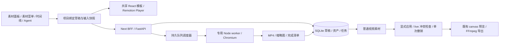

# Remotion 特效工作台设计方案

版本：v2（方案评审与修复；代码实施及最终审查已完成）
适用仓库：Ecliptrix，勘查基线 `9265179e`
方案目录：`docs/plans/remotion-effects-studio/`
交付物：本文 `spec.md`；本轮仅评审和修订文档，不修改源码、不安装依赖、不提交 Git。

## 评审记录

评审基线为前序节点交付的 v1；逐节核对 `CLAUDE.md`、实际接入代码及
Remotion 官方接口。以下问题均已在正文修复；“已修复”指方案契约已修复，
不代表功能实现或实包验收完成。未发现 P0；发现 7 项 P1、2 项 P2。

| 编号 | 级别 | 问题、证据与影响 | 就地修复 / 验收 |
|---|---|---|---|
| RV-01 | P1 | §5/6 用包含草稿及运行时的 input_hash 判断同体重放，但草稿表仅保留当前版本；保存新版、软删除或升级后无法重新计算旧请求，网络重试可能错误冲突 | §5.2、6.3 分离 submission_hash 与 input_hash，先查原提交；AC-27 |
| RV-02 | P1 | §7/9 要求重新选择目标时核验成品基础源，但公开 asset DTO 没有不可变来源，request_json 又禁止返回；无法可靠阻止把 A 的成品替换到 B | §5.1、6.6、7.1/2、9.2 增加只读来源摘要与统一匹配守卫；AC-28 |
| RV-03 | P1 | 现有 useAgentExecution 的 OperationApplier 从 timelineStateRef 读取；§9 只登记外部 patches 和更新服务端镜像，没有同步客户端 ref，也未规定新 SSE 进入既有 eventChain | §9.3/4 明确串行事件、提交后同步客户端镜像、按真实结果回执；AC-29 |
| RV-04 | P1 | §3 可先选模板再填图片，§4/8 却对草稿直接要求必填槽位，未区分保存合法性与可生成性；未填完的作品无法可靠自动保存和关闭恢复 | §3.3、5.1、6.2、8、9.2 分层校验，草稿返回 renderability；AC-30 |
| RV-05 | P1 | ManagedService 实际使用普通 pipe，无 IPC；killTree 只在被调用时清理。§6 的断连清理、父进程心跳、reset 超时重启及健康重试缺少可执行接线 | §6.3–6.6、10.3 明确双层 IPC/心跳、关闭次序、恢复屏障和调度时版本复核；AC-31 |
| RV-06 | P1 | §10 的 closing 只约束入队/发布，inputs 复制、草稿写入及恢复也能跨越删项目的 await，形成已删项目孤儿文件或新行 | §5.3/4、10.2 将全部写入纳入项目生命周期守卫，长 I/O 后重检再提交；AC-32 |
| RV-07 | P1 | 新 API envelope 使用 details 而项目约定为 error_details；现有 backend-proxy 默认缓冲 JSON 且仅保留 Content-Type，无法兑现 ETag/304、Retry-After 透传 | §8.1/2、10.1 使用既有响应模型和本路由的透传配置，不修改全局代理；AC-33 |
| RV-08 | P2 | §3.2 与 §11.3 的栏宽、弹窗高度、断点互相冲突，实现与验收会按两套布局判断 | §3.2 统一尺寸与断点，§11.3 只引用该规范；AC-07 |
| RV-09 | P2 | §8 JSON 示例缺必填 kind；“所有对象禁止附加字段”未说明 params 的模板键；已删除/不兼容草稿一律承诺复制也无恢复契约 | §3.1、5.1、8.1 修正示例、字典规则和可恢复边界；AC-34 |

逐节结论：§1–2 的本地 worker 加烘焙素材方案符合当前架构，12 库/24
模板范围保留；§3–9 按上述契约修复；§10 补齐必要模块接线；§11 增加
针对缺口的行为门禁；§12–13 保留安装包、性能及许可的发行前证据要求。
不增加通用工作流平台、云端渲染或任意代码执行。P0/P1 未解决项为 0。

## 1. 概述

为现有视频编辑器增加一个统一的「特效」工作台。用户可以从素材面板
「AI 混剪」旁的「特效」按钮进入，也可以携带一个视频或图片素材进入，
或从时间线上的一个视频片段进入。在弹窗内选择模板、输入文字、加入
图片、调整颜色与节奏，实时预览后生成本地视频。首版交付 **12 个模板
素材库，每库 2 个独立可编辑模板，共 24 个模板**；每个模板均有内置
示例、缩略图、参数 schema 和真实渲染能力，不用空分类充数。

采用共享的 Remotion React 组合完成弹窗预览和本地逐帧渲染，成品以普通
MP4 素材进入现有素材库。整条编辑时间线仍由既有 canvas compositor
预览、FFmpeg 导出；在生成阶段烘焙特效后，现有导出流程直接读取成品。
对于指定时间线视频，只处理其源素材的裁剪区间，用户明确选择「替换
此片段」后才提交一次可撤销的时间线事务。草稿、渲染和应用分别成功或
失败；“生成完成”不会被表述为“已上轨”。

Agent 与用户共用模板目录、草稿 API、持久渲染任务和时间线应用函数。
类别目录只显示一行能力摘要，工具按需加载，模板参数再按单个模板查询。
Agent 可以自主制作并应用用户要求的特效，也可以把结果留在素材库，
供用户重新打开草稿继续修改。整个流程离线可用，不要求用户安装 Node、
Remotion CLI 或浏览器，不把素材发送到外部渲染服务。

### 1.1 范围和明确边界

- 首版支持文本、静态图片、单个基础视频及最多 8 个图片槽位；最长 60 秒，
  固定 30 fps，输出不透明 H.264 MP4。模板可同时包含文字和图片。
- 支持空白制作、素材制作、时间线视频制作、成品再次编辑四个入口。
- 不包含任意 JSX/脚本执行、在线模板市场、AI 编写代码、跨镜头转场、
  透明视频导出、外部字体上传、多片段批处理、4K、音频特效。
- 图片素材可以制作视频；时间线图片片段首版仅支持另存成品和新轨插入，
  不做原位替换，避免既有 imagePosition 在视频路径中的语义变化。
- 时间线封面片段继续走封面编辑器，不开放原位特效替换。
- 视频内的标题条、角标和遮罩在源画面内合成。首版没有独立透明叠加轨；
  为现有视频增加标题应携带该视频进入工作台。
- 本文中的新增路径与接口是实施契约，现状路径已读码核对。本文验收项
  是后续开发的门禁，不能据此宣称功能或实包测试已经完成。

## 2. 项目现状与架构决策

### 2.1 已核对的接入位置

| 现有路径 / 标识 | 已有行为与设计影响 |
|---|---|
| `README.md`、`CLAUDE.md` | Electron 33、Next.js 15、React 19、Tailwind 3、FastAPI、SQLite；以源码及 CLAUDE 的新账号门禁说明为准，README 的“无登录”描述已落后 |
| `src/components/video/components/MaterialsPanel/MaterialsPanel.tsx` | `onAIMixedEditing` 与 `ws-materials-footer` 是主按钮接入点 |
| 同目录 `MaterialCard.tsx` | `MaterialCardActions` / `useCardMenuItems` 承载素材菜单 |
| `src/components/video/VideoEditingInterface.tsx` | 项目、素材管理、封面控制器和 Agent 桥接的编排根；只接线，不继续堆入制作逻辑 |
| `src/components/video/timeline/TimelineToolbar.tsx` | 已有 disabled / comingSoon 的 effects 占位，需替换为真实入口 |
| 同目录 `TimelineItem.tsx` | 普通视频右键可能直接分离音频，尚无通用菜单；新建菜单并保留旧功能 |
| 同目录 `store/useTimelineStore.ts` | 时间线真相源；从 `exportToData()` 读取最新状态 |
| 同目录 `store/actions/replaceTimeline.ts` | `replaceTimelineAction` 负责外部写入与一次撤销，已有锁与轨道视图标志处理 |
| 同目录 `store/actions/applyCover.ts` | 项目 / 手势 / 锁检查、纯 planner、注册素材后的同步二次检查可作为事务样板 |
| `src/components/video/hooks/useMaterialManagement.ts` | 仍有 React 本地素材列表；不能假设 materialSlice 是唯一素材源，必须调用 `addOrReplaceMaterial` 同步注册 |
| `src/components/video/lib/derivedMaterial.ts` | 已记录衍生素材继承原缓存而播错、删错源文件的事故；新成品重建所有文件身份 |
| `src/lib/api/videoProjects.ts` | `normaliseProjectDataForSave` 保留 metadata；不持久化 blob URL 或进行中的弹窗状态 |
| `app/services/video_cover_job_service.py`（后端目录下） | 持久任务、幂等提交、启动恢复和生命周期可借鉴；QueueManager 本身全是内存状态 |
| 后端 `app/services/local_media_resolver.py` | `resolve_media_reference` / `storage_relative_path` 是本地路径边界 |
| 后端 `app/routers/storage_files_router.py` | 已支持 Range、206、416 和媒体内联；复用，不另建不支持 Range 的静态文件挂载 |
| `desktop/main/frontendService.js` | 已用 Electron 可执行文件 + `ELECTRON_RUN_AS_NODE=1` 启动 Node 服务 |
| `desktop/main/processManager.js` | `ManagedService` 与 `killTree` 提供隐藏进程、健康检查和 Windows 子进程树清理 |
| `src/lib/video-editing-agent/registry/ToolActivationState.ts` | `load` / `offer` / `canExecute` 实施真实工具披露，不能只改提示词 |

表中后端短路径均相对于 `backend-services/basic-service/`。源码中图片
timeline item 实际是 `type:'video', originalMaterialType:'image'`；不新增
第四种轨道，不添加与 Remotion 绑定的播放类型。

### 2.2 三种方案比较与结论

| 方案 | 优点 | 代价 / 结论 |
|---|---|---|
| 共享 Remotion 模板 + 专用本地 worker，成品入库 | 参数预览快、生成可验证、离线、现有导出可消费 | 增加浏览器与原生运行资源；**采用** |
| 把 Remotion 实时组件接入整条时间线 | 每次修改都能立即呈现 | 要同时重做 canvas 与 FFmpeg 的实时一致性、透明合成和项目水合；不适合首版 |
| 云端渲染 / 任意代码模板 | 扩展面广 | 改变本地产品定位，增加上传、费用、网络和执行隔离；本轮不采用 |

根项目仅引入客户端 `remotion`、`@remotion/player`、`zod`；独立
`effects-runtime/` npm 项目引入 renderer / bundler，避免 Next standalone
依赖追踪漏带原生文件。查询 npm 官方包元数据时 `remotion` 版本为
`4.0.544`，本功能相关 Remotion 包均固定为此精确版本，不写 `^` 或 `~`。
两份 lockfile、React / ReactDOM 版本和 runtime manifest 必须一致。
若版本在安装环境不可用，实施者应整体更新版本和本文契约，禁止单包升级。
[Remotion 版本一致性说明](https://www.remotion.dev/docs/version-mismatch)。



## 3. 产品与交互设计

### 3.1 入口与目标

1. 素材面板底部同一操作组依次为「AI 混剪」「特效」，按钮高度 32px，
   使用现有图标和主题 token；窄面板用等宽按钮，禁止横向溢出。
2. video / image 素材卡菜单增加「制作特效」，将素材作为 base 输入；
   音频、素材包及尚未下载的候选不直接开始渲染。远程候选显示「先下载」。
3. 时间线工具栏启用已有「特效」，单选普通视频时带目标进入。无选择时
   打开空白工作台；多选时提示只支持一个片段，不猜测目标。音频 / 字幕
   选择时显示说明，保留按钮帮助文案。
4. 普通视觉片段右键打开新的 `ClipContextMenu`，其中有「制作特效」和
   原有条件满足时的「分离音频」；右键本身不再直接分离。封面专用菜单
   保持其行为并提供返回封面编辑，不进入原位特效。
5. 成品素材菜单增加「编辑特效草稿」，按 metadata 中的 draftId 打开；
   打开的为草稿当前版本，显示成品原版本，不能暗示可还原旧成品参数。
   草稿软删除后可通过只读 GET 查看，提供“复制为新草稿”；只有当前
   catalog 能无损验证的文档可复制。未知 schema/template 版本只允许
   查看原视频和新建作品，不承诺复制或静默迁移。项目删除后不可恢复。

### 3.2 弹窗布局与视觉

使用现有 `ui/Modal` 并在控制器层 `createPortal(..., document.body)`，
不能假设 Modal 自身已有 portal。弹窗宽 `min(1280px, 96vw)`、高
`min(860px, 92vh)`：顶部项目 / 草稿名 / 保存状态，底部生成与应用栏。
以弹窗可用内容宽度（CSS px，非屏幕物理像素）为唯一断点：≥1100px
时左栏 208px、右栏 288px、中央弹性预览；900–1099px 时模板库改抽屉，
右栏 260px；<900px 用「模板 / 编辑 / 预览」切页。生成 / 取消常驻底部。
高度不足时各内容区独立滚动，不能整体缩小文字；Windows 125% / 150%
缩放按实际 CSS 可用宽度验收。§11.3 不另设一套布局尺寸。

沿用项目的 surface、border、primary 和 muted CSS 变量，主操作使用
单一强调色；文字、视频画面与留白优先，避免渐变铺底。模板卡比例随
所选画布，卡片只在悬停 / 聚焦时播放内置短预览，至多一个活动预览。
内置示例素材自制或许可明确，禁止以远程网络图作默认资产。

中央 Player 仅弹窗打开时懒加载，显示播放 / 暂停、逐帧、时间码、静音
和进度拖动；参数更新按动画帧合并，不触发服务端渲染。右侧分成「内容」
「画面」「动画」「输出」四组，只显示当前模板支持的字段。模板切换前
保留可兼容的内容字段，丢弃的专属字段需在一次本地草稿撤销中恢复。
文字框显示计数与溢出提示，不静默裁掉文字。

焦点进入弹窗标题容器，Tab 受限于弹窗，关闭后回到入口；Escape 先关闭
子菜单 / 子确认框，再关闭主弹窗。文本输入期间空格、E 和方向键不得
触发全局时间线快捷键。提供 label、aria-live 状态以及键盘可用的模板卡。
`prefers-reduced-motion` 下卡片用静态海报，用户仍可主动播放作品。

### 3.3 操作状态和按钮

编辑状态：`loading → editing ↔ saving → ready`，保存失败仍保留本地
输入；仅成功保存的明确版本可以渲染。编辑停止 500ms 自动 PUT 草稿，
同一草稿写请求串行，生成按钮等待最后一次保存完成。关闭前若未保存
显示「保存并关闭 / 放弃本地修改 / 继续编辑」；保存失败不能当作已保存。
草稿 undo / redo 为弹窗内局部历史，不触碰时间线历史，最多 50 步。

“保存成功”与“可生成”独立：缺少 title 或必填图片槽位的编辑中草稿
也可保存、关闭、重开。服务端返回 renderability 与字段错误，界面在
缺失字段旁提示；只有生成按钮受必填内容/资源就绪检查限制。结构非法、
未知参数或数值越界仍拒绝保存。不能用填入隐藏示例图来伪装用户已填完。

任务状态分开显示：排队、准备素材、渲染帧、编码、校验、完成、已取消、
中断、失败。生成期间仍可编辑；成功结果明确标注对应版本。已编辑成
v6 而完成的是 v5 时显示「v5 生成完成」，不能错误呈现为当前修改已生效。
关闭弹窗只让任务后台继续，不等于取消；按钮「取消生成」单独请求取消。
项目页保留任务徽标，重开后从服务端重新查询。

底部主操作随状态变化：未生成时「生成视频」；生成完成后「保存到素材库」
（幂等注册）与「应用到时间线」。时间线目标默认应用模式为「替换此片段」，
其它入口默认「在新视频轨插入」。应用前显示目标名、时间点和时长，
用户可改为「仅保存成品」。没有自动覆盖原素材的选项。后台完成只增加
可领取成品；用户之前在当前项目明确开启“完成后入库”时才自动注册。
Agent 的制作请求隐含同项目成品入库，但上轨另由明确工具表达。

### 3.4 缺失与降级

模板目录和草稿编辑不依赖 worker 健康。worker 不可用时仍可看模板，
「生成」禁用并显示“本地渲染组件不可用”及重试；不影响普通编辑。
输入缺失、下载中、模板字段未填、字体失败、工作台保存冲突均在就近
字段解释。错误保留草稿、已生成素材及其它项目的任务。

## 4. 内置模板库与参数契约

### 4.1 统一模板结构

模板目录由 `src/lib/effects/catalog.json` 唯一维护，生成后端校验包及
worker 清单；构建时比较 hash。`schemaVersion=1`、catalogVersion=1。
24 个 ID 固定，templateVersion 初始为 1。分类、名称、描述均存 i18n
键；manifest 包含 `id, libraryId, version, componentId, variant,
allowedInputKinds, slots, defaults, parameterSchema, thumbnail,
demoPreview, minFrames, maxFrames`。缩略图必须实际存在。

每个库对应一个 React 组件，通过两个有区别的 variant 形成两个模板。
每个模板默认 150 帧，允许 15–1800 帧；动画入口最多占前 25%，停留至少
50%，出口最多占后 25%，15 帧时也必须出现可读内容。不为短片段偷加时长。
打字模板 revealFraction 相对于入口子段计算，不相对于总时长；逐字 / 逐行
揭示在入口结束前完成，完整文案停留仍不少于总时长的 50%。

| 库 ID / 中文名 | 两个模板 ID（组件 variant） | 内容 / 图片槽位 | 动画与专属参数（默认值；范围） |
|---|---|---|---|
| `titles` 动态标题 | `title-rise` / `title-mask` | title 必填、subtitle 可选 | 上升淡入 / 横向遮罩；distance=0.08，0–0.2（画布比例） |
| `typewriter` 打字文案 | `type-cursor` / `type-lines` | title 必填 | 单游标逐字 / 逐行揭示；revealFraction=0.5，0.2–0.7 |
| `lower-thirds` 信息字幕条 | `lower-clean` / `lower-block` | title 必填、subtitle 可选 | 细线 / 色块入场；anchor=`bottom-left`，枚举另含 bottom-right |
| `image-reveal` 图片揭幕 | `image-zoom` / `image-wipe` | hero 图片必填、title 可选 | 缓慢缩放 / 圆形揭幕；zoom=1.08，1–1.3 |
| `slideshow` 图片相册 | `slides-crossfade` / `slides-stack` | images 2–8 张、title 可选 | 交叉淡化 / 层叠滑入；transitionFraction=0.15，0.05–0.3 |
| `split-screen` 对比画面 | `split-horizontal` / `split-vertical` | left、right 图片必填、title 可选 | 横 / 竖分屏；divider=0.5，0.2–0.8 |
| `product` 产品展示 | `product-float` / `product-spotlight` | hero 图片必填、title 必填、subtitle 可选 | 浮动卡片 / 聚光；cardScale=0.75，0.4–0.9 |
| `callouts` 标注指示 | `callout-line` / `callout-ring` | base 图片或视频必填、title 必填 | 引线 / 圆环描边；pointX=0.5、pointY=0.5，各 0.05–0.95 |
| `counters` 数字动画 | `counter-up` / `counter-bars` | title 可选 | 数字递增 / 三列增长；value=100，0–1000000；suffix=''，0–8 字；bars=[30,60,90]，固定 3 项，各 0–100 |
| `countdown` 倒计时 | `countdown-ring` / `countdown-flip` | title 可选 | 圆环 / 翻牌；from=5，整数 1–60；数值按 from*(1-progress) 取 ceil，末帧为 0 |
| `video-look` 视频风格 | `video-cinematic` / `video-glitch` | base 视频必填、title 可选 | 信箱画幅 / 受控色差抖动；strength=0.35，0–1，glitch 频率最多 3 次/秒且可设 0 |
| `backgrounds` 动态背景 | `background-orbit` / `background-grid` | title、subtitle 可选 | 轨道几何 / 网格波动；density=12，整数 4–24；无外部图片 |

“可选 title”无内容时不显示默认广告词；必填 title 初始示例须在用户
输入前明确作为示例展示，生成时允许保留。`counters` 非当前 variant
使用的字段不暴露；其它模板不接受表外专属字段。

### 4.2 公共参数与单位

`content.title` 最多 120 Unicode code points、subtitle 最多 300；全部
纯文本，保留换行，不解释 HTML。`palette.background='#15171A'`、
foreground='#F5F4F1'、accent='#C87758'，只允许 `#RRGGBB`。
`typography.family='sans'`，枚举 sans / serif / mono，映射离线字体；
`scale=1`（0.6–1.4），`align='center'`（left / center / right）。
`motion.speed=1`（0.5–2）、`motion.intensity=1`（0–1）、`seed=1`
（0–2147483647 整数）。speed 改变入出节奏，不改变总时长或源视频速度。

公共可选 base 背景输入适用于所有非必须指定 base 的模板：选中视频进入
标题库时视频仍作为背景；选中图片进入时图片作为背景。hero / left /
right / images 为前景槽位，不能自动吞掉 base。不支持重复 base 视频、
同时播放多个视频，输入总计最多 1 视频 + 8 图片。

图像布局统一 `fit='cover'`（cover / contain）、`focalX=focalY=0.5`
（0–1），按槽位独立保存。横竖屏重排按同一套归一化坐标执行；标题
安全区距四边至少 6%，默认字号为短边的 7%，subtitle 为 3.5%。先换行，
再按 0.6 倍字号下限缩小；仍溢出时阻止生成并指出字段，禁止截断。
播放前等待字体和图片加载；字体失败直接报告，不用系统字体悄悄替代。

空白制作画布为 1920×1080、1080×1920 或 1080×1080，默认当前项目比例，
无项目设置用 1920×1080。单边不超过 1920，均为偶数像素；时间线视频
替换锁定源视频的显示比例，长边缩至最多 1920，按旋转元数据归一化。
固定 30 fps；durationFrames 为整数，时长显示 `frames/30`。

### 4.3 动画与媒体组件

全部动画从 `useCurrentFrame()` / `useVideoConfig()` 推导，使用
`interpolate` / `spring`，输入边界 clamp；随机纹理用固定 seed。
不得用 CSS 动画、Date.now、无种子的 Math.random 或外部网络驱动结果。
图片用 `Img`；视频使用 `OffthreadVideo`，源入点为
`trimBefore = round(trimStartSeconds * 30)`，取帧长度通过
`durationInFrames` 指定；这些属性以帧计，不能误传秒。
Player 与渲染均采用同一受支持组件和同样的输入，源入点最多存在一帧
量化差异，须用非零裁剪测试固定。[OffthreadVideo 官方单位及裁剪契约](https://www.remotion.dev/docs/offthreadvideo)。

## 5. 领域模型与持久化

### 5.1 公开数据形态

TypeScript 用 camelCase，REST / Python 用 snake_case，仅在边界显式映射；
不要递归改写模板自定义 key。固定对象均 `additionalProperties:false`；
params 的 properties 由当前 template/version 展开，仍拒绝模板外的键，
不能把 Record 误实现为允许任意字段的字典。

```ts
interface EffectDocument {
  schemaVersion: 1;
  templateId: string;
  templateVersion: number;
  canvas: { width: number; height: number; fps: 30 };
  durationFrames: number;
  seed: number;
  content: { title: string; subtitle: string };
  palette: { background: string; foreground: string; accent: string };
  typography: { family: 'sans' | 'serif' | 'mono'; scale: number;
    align: 'left' | 'center' | 'right' };
  motion: { speed: number; intensity: number };
  params: Record<string, string | number | number[]>;
  inputs: EffectInputBinding[];
}
interface EffectInputBinding {
  slot: string; assetId: string; kind: 'image' | 'video';
  fit: 'cover' | 'contain'; focalX: number; focalY: number;
  index?: number; // 仅 images 槽位必填，0 起连续整数；其它槽位禁止
  trimStartSeconds?: number; // video 必填且 >=0；image 禁止
}
interface EffectDraft {
  id: string; projectId: string; name: string;
  version: number; document: EffectDocument; documentHash: string;
  createdAt: string; updatedAt: string;
  renderability: EffectRenderability;
  deletedAt?: string; readOnly: boolean;
}
interface EffectRenderability {
  ready: boolean;
  errors: { path: string; code: string; messageKey: string }[];
}
interface EffectOutputProvenance {
  jobId: string; draftId: string; draftVersion: number;
  documentHash: string; inputHash: string;
  durationFrames: number; fps: 30;
  canvas: { width: number; height: number };
  baseVideo?: { assetId: string; sourceSha256: string;
    trimStartFrame: number; sourceFrameCount: number;
    displayWidth: number; displayHeight: number };
}
interface EffectTargetSnapshot {
  projectId: string; trackId: string; clipId: string;
  sourceMaterialId?: string; targetFingerprint: string;
  durationSeconds: number;
  sourceSha256?: string; trimStartFrame?: number;
  durationFrames?: number; // replace 视频意图三项必填，插入不需要
}
interface EffectRenderJob {
  id: string; projectId: string; draftId: string; draftVersion: number;
  status: 'queued' | 'running' | 'cancelling' | 'succeeded'
    | 'failed' | 'cancelled' | 'interrupted';
  phase: 'queued' | 'preparing' | 'frames' | 'encoding' | 'validating' | 'publishing'
    | 'done' | 'cancelled' | 'failed' | 'interrupted';
  progress: number; // 0..1；未成功不能等于 1
  resultAssetId?: string; errorCode?: string; retryable: boolean;
}
interface EffectMaterialMetadata {
  schemaVersion: 1; projectId: string; draftId: string;
  draftVersion: number; jobId: string; assetId: string;
  templateId: string; templateVersion: number; documentHash: string;
}
```

EffectTargetSnapshot 是客户端 / Agent 应用意图，不属于渲染文档，也不是
后端时间线写授权。当前时间线来自前端 store，不能拿可能滞后的数据库
project_data 代替它。草稿 API 只保存文档；目标快照随明确应用操作传递。
UI 控制器及本轮 ToolContext.effectsTargets 使用相同注册表形态：
drafts Map 存 draftId→待核验意图，outputs Map 存 (assetId,clipId)→
已验证意图；create 返回快照/指纹，render/get 按不可变来源核验后关联
成品，get_effect_target 可直接建立 outputs 项。这些 Map 不持久化。
重开、切项目、SSE 重放或新 Agent 回合没有旧应用意图，必须重新选择当前
片段并取得新指纹；不得通过草稿 ID 猜测 sourceClipId。后端草稿没有这个字段。

### 5.2 SQLite 新表

新建 `app/models/effects_db_models.py` 并在 `init_db` 之前显式导入以注册
Base.metadata。沿用 Base、UUID、JSON 和 SQLite 兼容层；所有表都有
`user_id=LOCAL_OWNER_ID`。只新增表，不修改 / 清空旧业务表。

| 表 | 列及约束 |
|---|---|
| `effect_drafts` | id UUID PK，project_id UUID 非空，name VARCHAR(100)，schema_version INT，version INT 默认 1，document_json JSON，document_hash CHAR(64)，deleted_at nullable，created_at / updated_at；索引(project_id,updated_at) |
| `effect_assets` | id UUID PK，project_id UUID，kind input-image / input-video / output-video，sha256 CHAR(64)，storage_key VARCHAR(1000) UNIQUE，bytes BIGINT，mime VARCHAR(80)，width / height INT，duration_seconds FLOAT nullable，thumbnail_key nullable，origin_material_id nullable（仅溯源），created_at；索引(project_id,kind,sha256)，不跨项目共享文件 |
| `effect_render_jobs` | id UUID PK，project_id / draft_id UUID，request_id UUID，submission_hash CHAR(64)，input_hash CHAR(64)，draft_version INT，request_json JSON（不可变提交与渲染快照），status / phase VARCHAR(24)，progress FLOAT，cancel_requested BOOL，result_asset_id UUID nullable，error_code VARCHAR(64) nullable，error_message VARCHAR(500) nullable，runtime_fingerprint CHAR(64)，started_at / finished_at / created_at / updated_at；UNIQUE(project_id,request_id)，索引(status,created_at) |

任务 request_json 包含完整 document、每个输入 assetId + sha256、catalog
hash、字体 hash、Remotion 版本、渲染 bundle hash，以及输出配置。不从
之后的草稿重新读取参数。后端 canonical JSON 为 UTF-8、排序对象键、
紧凑分隔符、禁止 NaN / Infinity，SHA-256 作为 input_hash；seed 包含在内。
输入字段和非公开运行参数不能任意互相混入。

另存 submission_hash：仅对规范化的公开提交 `{draft_id,expected_version,
output:{profile}}` 求 SHA-256（补默认 profile 后再算），项目/requestId
由唯一键标识。request_json 分为 submission 与 render_snapshot 两部分。
submission_hash 不含当前草稿内容、运行时或时间；input_hash 则标识已解析
的不可变渲染输入，两者不可混用。不为此引入草稿历史表。

成功输出的来源摘要 EffectOutputProvenance 从该 job 的 render_snapshot
推导，随 output asset DTO 只读返回，不由客户端传入，也不读草稿现值。
不含路径、token 或完整文案；baseVideo 仅在确有单个视频 base 时存在。
canvas 为实际输出尺寸，baseVideo.displayWidth/Height 为输入旋转归一化
后的显示尺寸，sourceFrameCount 为本次选取的 N 帧；不能混作源视频总帧数。

### 5.3 文件与输入快照

目录均位于 `STORAGE_ROOT/effects/projects/<projectId>/`：

```text
inputs/<assetId>.<ext>
outputs/<jobId>/video.mp4
outputs/<jobId>/thumbnail.jpg
outputs/<jobId>/complete.json
.work/<jobId>/inputs/<assetId>.<ext>
.work/<jobId>/render.part.mp4
.work/<jobId>/video.part.mp4
.work/<jobId>/thumbnail.jpg.part
```

输入通过“附加为特效输入”显式复制到项目 effects inputs；后端只接受
本机同源 `/api/storage/files/...` 引用，经 `resolve_media_reference`
核验真实路径、可读性和允许根，再通过 ffprobe / 图片解码识别真实媒体。
不接受 file://、blob:、data:、任意 http(s)、UNC、绝对磁盘路径或穿越路径。
origin_material_id 是显示溯源，不是访问控制。桌面为单本地 owner，允许
将自己其它项目已有的本地媒体明确复制为当前项目输入；复制后归当前项目。
来源上传或下载还没完成时先走现有流程，本接口不暗中联网下载。

每个原文件最大 512 MiB，图片解码后最大 40MP，长边最大 16384，单次
所有输入累计不超过 1 GiB。输入项目内以(kind,sha256)在项目锁下去重；
先写临时文件、校验、原子 rename、事务建资产。读出 input 时不能让
客户端更改存储路径。对视频检查 `trimStart + durationFrames/30` 不超
真实时长一帧以上；允许只因 ceil 多的一帧以最后有效帧补齐。

附加输入的复制/探测在项目锁外执行，临时文件放在
`STORAGE_ROOT/effects/.staging/<uploadId>/`，不提前创建正式项目子目录。
提交时取得 effects 项目锁，重新查项目存在且未 closing，再去重、rename
及提交资产行；删除项目先赢则删除 staging 并返回 EFFECT_NOT_FOUND。
staging 不作为已附加资产返回；崩溃遗留按 24 小时清理，排除活动导入。
所有文件 I/O/探测均在线程或异步子进程执行，不阻塞 FastAPI 事件循环。

渲染前从 inputs 复制至独立 work 快照，不能用 symlink 指向任意来源。
删除原素材不破坏草稿或任务；删除成品也不删除原素材。成品只返回新的
本地 URL、storageKey 和实际探测到的 size / duration / dimensions。

### 5.4 保存、版本、引用与删除

PUT 草稿使用 expected_version CAS；冲突 409 时停止自动保存并提供
「加载服务器版本 / 另存为新草稿」。不自动用旧内容覆盖新版本。草稿
删除为软删除；已成功的成品和历史任务可继续查看。

草稿保存只检查结构/类型/范围/模板版本、槽位基数上限及已引用资产的
归属；缺少必填内容作为 renderability.errors 返回，仍提交合法草稿。
入队前再检查必填槽位、非空文案、可解码输入、时间范围、字体及文字
布局；不满足返回 EFFECT_DRAFT_INCOMPLETE 或已有具体错误码，不建 job。
renderability 是派生状态，不作为持久授权；磁盘文件变化后入队仍须复核。
ready 只表示文档/输入可生成，worker 健康单独取 capability；因此离线
缺 worker 时也能正常保存内容完整的草稿，生成按钮同时检查两项状态。
软删除草稿 GET 返回 deleted_at/read_only，PUT 和新 jobs 均拒绝；可读取
并验证其文档后用普通 POST 复制，inputs 留在本项目无需再次复制文件。

inputs、draft create/update/delete、job 提交/取消/发布和恢复写入均使用
同一个 effects 项目锁，并在最后写入前重新查项目存在、未 closing。
不得持有旧 ORM project 对象跨 I/O 后当作项目仍存在的证明。删除规则
及完整锁序以 §10.2 为准，单进程 SQLite 服务不新增分布式锁。

普通项目 JSON 只保存注册后的 MaterialItem、clip.metadata.effects 和
普通时间线，不存 worker token、运行句柄、当前打开弹窗或轮询状态。
草稿与任务恢复通过项目 API 获取，不给旧项目强加迁移。metadata.effects
采用上述强类型引用；TimelineItemData 等重复类型继续复用 metadata，
不增加容易在 domain entity 序列化中丢失的顶层字段。

首版**不自动回收正式 inputs / outputs**；移出素材库仅移除项目列表
引用，不物理删除 effects 文件，确保 undo / redo、未保存时间线和草稿
仍可用。现有通用删除 / reclaim-orphans 入口必须排除 `effects/` 命名空间，
统一交给项目删除清理。取消 / 失败的 .work 及无正式资产行的未发布
outputs 可以在启动和每小时清理，须排除 queued/running/cancelling 任务。
未发布孤儿文件最多保留 24 小时供恢复；用户明确删除项目后取消任务、
停止 worker 子进程并等待释放句柄，再移除该项目 effects 子目录。

## 6. 技术设计与执行顺序

### 6.1 共享组合和确定性预览

`src/lib/effects/compositions/EffectComposition.tsx` 按 catalog 的 componentId
分派到 12 个库组件；根项目 Player 和构建期 Remotion entry 导入同一个
组件。Player 通过 client-only dynamic import 加载，弹窗关闭即暂停并
卸载播放器，库卡片最多同时播放一个示例。不把整个模板包加入编辑器
首屏执行路径。[Remotion Player](https://www.remotion.dev/docs/player)。

所有运动来自 `useCurrentFrame` / `useVideoConfig`、interpolate、spring
或带 seed 的 random；禁止 Date.now、非确定 Math.random、CSS animation、
setInterval 和按墙钟推进。每帧文字布局、颜色、裁剪和 fit 的数学相同。
title 按 grapheme cluster 渐进展示，避免中文、emoji 的代理对 / 组合符
被切开；保存长度校验仍按 code points，二者职责不同。

图片使用 Remotion Img；视频用 `OffthreadVideo`，固定 `trimBefore`
与 `durationInFrames`，单位为组合帧。当前版本不使用已废弃的 trimAfter，
也不依据旧 skill 文本把帧数当秒。[OffthreadVideo 参数契约](https://www.remotion.dev/docs/offthreadvideo)。
共同的 AssetResolver 将 assetId 映射成 URL：Player 用同源 storage URL，
worker 用仅本次 render capability 可读的 loopback URL；文档不保存这些
短期 URL。媒体、字体未 ready 时显示缓冲状态，不用占位帧冒充完整预览。

字体随应用附带 Noto Sans SC、Noto Serif SC、Noto Sans Mono 的选定字重
及各自 OFL 文件；字体加载成功才继续渲染。实际文件名、SHA-256 和字重
写进 manifest。离线 font-face 使用构建产物路径，禁止 Google Fonts
运行时请求。超出安全区时先以确定的二分算法缩小到配置字号的 60%；
仍溢出则阻止生成，返回定位到字段的 `EFFECT_TEXT_OVERFLOW`，不静默裁字。

空白画布提供 16:9 1920×1080、9:16 1080×1920、1:1 1080×1080 三个
预置；可切 720p，对应 1280×720、720×1280、720×720。带素材进入时
默认采用源尺寸，最长边不超过 1920，按比例缩小且向下取偶数，最小
边 64；源边不足 64 拒绝。替换视频模式锁定该源比例与像素尺寸，尺寸
缩小不改变现有布局。另存 / 插入模式允许使用上述画布预置。

### 6.2 创建、编辑、渲染的顺序

1. UI 校验项目存在，读取当前素材或 live clip，抓取目标语义指纹；
   无目标时创建默认 150 帧的 `title-rise` 草稿。
2. 有源媒体则先完成本地下载 / 上传，调用 inputs API 形成独立快照，
   得到 assetId。输入复制期间不提前创建引用不存在文件的 ready 草稿。
3. POST 创建可尚未填完的草稿；PUT 自动保存参数并得到服务端版本与
   renderability。缺必填内容只阻止生成，不阻止保存。切换模板时保留
   公共文字 / 颜色和兼容槽位，删除其它模板专属参数，再套新默认值。
4. 点击生成等待最后一次保存且确认 ready，生成 request_id，将 draftId、
   精确版本与显式输出配置提交。后端先查提交幂等再验证 / 配额检查，事务提交 queued
   之后才 wake；HTTP 202 返回 durable jobId，不在请求内等待渲染。
5. 前端每 1 秒 GET 状态，后台页每 5 秒；断网后指数退避 1/2/4/8 秒，
   最大 10 秒。项目切换停止当前轮询，任务继续，重新进入查询任务列表。
6. 服务端从 DB 领取任务，准备输入快照并调用 worker。任务只用已入队
   的不可变版本。完成后校验、发布资产、终态提交。
7. 前端确认 job.projectId 与当前项目一致，并满足用户明确点击保存、
   当前项目 session 明确开启完成后入库、或本轮 Agent 制作请求的入库
   授权之一，才注册素材；其它完成任务仅显示 ready / 可领取。领取时如任务仍
   对应已删除项目，不写入其它项目。成品通过 addOrReplaceMaterial
   注册，assetId 确定素材 ID，重复轮询不会出现重复卡片。
8. 用户明确应用后执行 §7 事务；Agent 走 §9 的操作桥。冲突时视频
   仍可留在素材库供用户选择其它位置。

### 6.3 持久队列和状态机

`EffectRenderService` 类提供 `start, close, submit, get, list, cancel,
wake`；DB 为真相，内存只保存当前调度任务与唤醒标志。全局并发 1，
单项目最多 5 个非终态任务，全局最多 20 个；按 created_at / id 排序。
用条件 UPDATE queued→running 领取，session commit 之后才启动 worker。
task dispatcher 的 wake 标记模式参考 CoverJobService，防止扫描期间
提交任务而丢掉唤醒。发布者与取消者使用同一项目锁。

```text
queued → running(preparing → frames → encoding → validating → publishing)
queued → cancelled
running → cancelling → cancelled
running → succeeded | failed
queued / running / cancelling → interrupted（重启且无法恢复成品）
```

终态集合 succeeded / failed / cancelled / interrupted，一旦终态不再
倒退。progress 在 0–0.99 内单调递增，只有成功发布事务提交后为 1。
按阶段范围映射：preparing 0–.05、frames .05–.85、encoding .85–.95、
validating / publishing .95–.99；Remotion progress 只更新 frames 子段，
不虚构完整任务的精确剩余时间。状态写入最多每秒一次，阶段变化立即写。

同 projectId + requestId + submission_hash 的请求返回既有任务（202
非终态，200 终态）；同键异体为 409 EFFECT_IDEMPOTENCY_CONFLICT。
先确认项目仍存在/未 closing，再查唯一键并比较 submission_hash；命中
时不读当前草稿、不验证旧版本、不检查配额或 worker 是否健康。仅新请求
在同项目锁内读取草稿并 CAS 校验 expected_version、renderability、配额，
固定 render_snapshot/input_hash 后提交。UNIQUE 竞争失败重读获胜行并比较
submission_hash；不能泄露为通用 500。草稿更新/软删除、运行时升级之后，
原提交仍能查回原 job；项目已删除则 404，不复活任务。失败重试创建新
requestId 并明确显示重试，不复活旧任务。

同一服务实例用单个调度临界区完成全局配额检查及 queued 创建，项目锁
内完成该项目配额检查，避免两个项目并发突破 20；锁序为调度提交锁→
effects 项目锁，发布/取消/删项目不持有调度提交锁。领取时复核 job
runtime_fingerprint 与当前就绪 runtime，不一致标 interrupted /
EFFECT_RUNTIME_MISMATCH，不把旧快照交给新 bundle 渲染。

准备阶段限时 60 秒，单帧等待上限 30 秒，整次渲染上限 15 分钟；worker
活跃阶段每 2 秒心跳，30 秒无心跳判失败并清理子树。限额和超时首版
是固定内部常量，不新增一页用户配置。

### 6.4 专用 runtime 与 Electron 资源

`effects-runtime/` 是独立 npm 包：编译 worker controller / renderChild
为 Node JS；构建时用 `@remotion/bundler` 生成不可变 render bundle。
生产 worker 不现场 npm install、npx 或 webpack bundle。

`desktop/main/effectsService.js` 沿用 createFrontendDescriptor 模式，
通过 `process.execPath` 和 `ELECTRON_RUN_AS_NODE=1` 启动 worker。cwd 为
真实 `resources/effects/runtime/` 目录，禁止设成 app.asar。worker
只读安装资源，可写目录由父进程传入 userData 下 STORAGE_ROOT。
`ManagedService` 负责监听退出、隐藏窗口和健康探测；worker 失败只把
effects capability 标记 unavailable，不中止前后端或登录门禁启动。

专用 Chrome Headless Shell 与 `@remotion/compositor-win32-x64-msvc`
及其依赖文件打包进 `resources/effects/`。浏览器版本由此 Remotion
版本在构建期 ensureBrowser 所解析的结果决定，并记录下载 revision、
文件树 hash；运行时显式 browserExecutable 和 binariesDirectory。
`ffmpegExecutable` 在 Remotion 4 已移除，禁止照旧接口传参；项目原有
FFmpeg 保留用于最终探测和既有导出，不替代 Remotion 必需原生依赖。
[渲染原生资源目录](https://www.remotion.dev/docs/renderer/render-media)、
[浏览器可执行路径](https://www.remotion.dev/docs/options/browser-executable)。

不复用 `agentBrowserHost.js`：其研究会话和网络策略不同，不能视作
Remotion 支持的浏览器实例。新增专用浏览器不改变研究宿主的拒绝规则。
runtime 资源、bundle、字体和浏览器均放 extraResources，不能进 asar。

打包 / 开发启动约定：

- `desktop/scripts/prepare-effects.js` 在构建机执行 effects-runtime npm ci、
  资源准备、构建 / 导出 catalog，组装 build/effects；修改 build.js 的
  BUILD_PAYLOADS / APP_PAYLOADS 断言，缺任意必要文件即构建失败。
- runtime 自带 `manifest.json`，包括 protocolVersion=1、engineVersion、
  bundle/catalog/font/browser/native hash 和 supportedTemplates=24。
  后端安装资源中的独立 catalog 副本与 worker hash 不一致时拒绝生成。
- 主进程为 worker 分配 loopback 空闲端口（首选 18323），生成 32 随机
  字节 EFFECTS_RUNTIME_TOKEN，向 worker / backend 注入 EFFECTS_RUNTIME_URL、
  TOKEN、资源路径；不注入 Next 客户端或用户可持久化配置。
- worker 先健康检查，随后后端开始调度。后端启动可以在 worker 失败时
  继续，health 返回 unavailable；用户点重试会重新探测。
- `desktop/scripts/dev.js` 同样管理 worker 的启动、token 和 teardown；
  首次准备用新增 root script `effects:prepare`，仅开发 / 构建机下载资源。
  纯浏览器调试未启动 worker 时可编辑草稿，生成明确 unavailable。
- main 关闭顺序为阻止新生成→backend 关闭任务服务→worker 取消 / 等待→
  killTree 残留→停止其它服务；禁止关闭后尚有 Chromium 编码进程。

生命周期接线必须补齐，不能仅复用当前 ManagedService 的默认 pipe：

- effects descriptor 单独启用 `stdio=['ignore','pipe','pipe','ipc']`，
  主进程每 2 秒通过 IPC 发带启动 nonce 的心跳；controller 10 秒无心跳
  或 disconnect 即停止接单、取消任务并清理子树后退出。其它 service
  保留原 stdio。dev 启动器同样成为心跳父进程。
  descriptor 同时传 healthHeaders 的 Authorization Bearer；ManagedService
  的可选健康探测头只用于请求，不写日志，否则当前无头 httpOk 会对
  要求 token 的 /v1/health 一直得到 401。
- controller 用带 IPC 的 spawn 启动 renderChild；child 监听 disconnect
  和父心跳，失联后关闭自有 browser/编码器。正常取消先协作退出，2 秒
  后由仍存活的 controller 对 child 调 killTree，再确认进程已消失。
  controller 被强杀时由 child 的 disconnect 路径收尾；main 被强杀
  时由 controller 收尾。不能只指望被杀进程执行 finally。
- main 独立轮询认证的 runtime health；持续失联或 restart_required
  时清理仍存活的 controller 子树后重启。重启保持本次 main 生命周期的
  port/token，产生新 runtime_instance_id。无法确认旧进程已退出时保持
  unavailable，不启动第二个 renderer；UI 给出重启应用的恢复入口。
- 有序退出先由 main 直接请求 backend 的私有
  `POST /api/effects-internal/drain`，Bearer 使用 runtime token，该路由
  不经过公共 effects BFF、不对 renderer 暴露。它关闭入队并执行
  EffectRenderService.close，等待 worker 清理；最长 10 秒，超时由 main
  killTree，随后停止其它服务。不能把 effects 加入当前 stopChildren 的
  Promise.all 就声称顺序关闭；backend lifespan 的 close 仍幂等保留。

这些机制须在 AC-25/31 实测，普通 SIGTERM 测试不能代替 Windows 强杀。

controller 每个任务另起带 IPC 的 renderChild，该进程拥有自己的 browser
实例和编码子进程，取消只清理该任务子树。父子 IPC 断开时子进程立即
取消并自行清理；main 每 2 秒向 controller 发心跳，10 秒未续期则其停止
所有 renderChild 并退出。这样主进程异常退出也有回收路径。Windows
使用 killTree 的 taskkill /PID /T /F，仅对当前进程持有且核验存活的
child handle；不从磁盘读旧 PID 后盲杀，不能关闭用户自己的浏览器。

### 6.5 worker 内部协议与媒体访问

controller 仅监听 127.0.0.1，所有 `/v1/*` 要求 Bearer runtime token，
不配置 CORS，不把它暴露给网页。请求 JSON 限 256 KiB。接口固定：

| 内部接口 | 请求 / 结果 |
|---|---|
| `GET /v1/health` | protocolVersion、runtimeFingerprint、runtimeInstanceId、ready、resetState、restartRequired、errorCode；检查浏览器与 native 文件实际存在 |
| `POST /v1/jobs` | jobId、requestHash、document、input manifest、output config；200 重放 / 202 接受，runtime 同时最多一个 renderChild |
| `GET /v1/jobs/{id}` | state、phase、progress、heartbeatAt、errorCode；完成只返回相对输出名和 checksum |
| `POST /v1/jobs/{id}/cancel` | 幂等取消；返回当前状态，不能把已成功结果重标 cancelled |
| `POST /v1/reset` | 后端恢复屏障，先关闭接单再取消旧任务/确认清理；超时设置 restartRequired，由 main 独立 health 监督重启，无假设中的 backend→main IPC |

worker 从已配置 work root + UUID jobId 推导目录，输入只接受 manifest
列出的 asset 文件名，不接受任意绝对路径、serveUrl、executable 或 JS。
它从固定构建 bundle 调 `selectComposition` 和 `renderMedia`，参数全由
文档 / catalog 适配而来。codec=h264、pixelFormat=yuv420p、fps=30、
crf=18、imageFormat=png、并发帧数=min(2,max(1,cpuCount-1))，输出
`render.part.mp4`，使用合法 .mp4 扩展名与显式 codec；不向 Remotion
传不存在的 container 参数。编码后用 FFmpeg `-f mp4 -movflags +faststart`
无损重封装到 `video.part.mp4`，作为待发布视频。

每次 renderChild 创建 32 字节临时 media capability，仅开放
`/render/<capability>/` 下固定 bundle、字体与本 job inputs；capability
不入库、不记日志、任务结束撤销。不提供通用文件浏览或 URL 代理。
浏览器中媒体 URL 均来自这一前缀；worker 媒体 HTTP 服务支持 HEAD /
Range / Content-Type，路径解码后必须在确切 job 根或只读 bundle 根内。
可信模板不得发出其它网络请求；渲染浏览器的请求拦截器拒绝其它 origin、
file、data 页面导航以及 localhost 其它端口。图片数据不拼入 HTML。

Player 使用原有同源媒体文件服务，BFF 保留 Range / If-Range / 206 /
416 / Content-Length。预览和渲染访问不同 URL，但媒体 bytes、trim、
模板 / 字体版本相同；用下述帧一致性用例验证，不依赖“共享组件”推断。

### 6.6 发布、取消竞态和恢复

renderChild 完成只表示工作文件可校验。backend ffprobe 验证真实 H.264、
yuv420p、尺寸、30fps、非零字节、帧数与预计 N（容差 1 帧）、音轨
是否符合输入，然后提取时间 min(1秒,时长/2) 的 JPEG 海报。实际输出
时长不得短于目标可见时长；MP4 缺失、编码异常、黑帧或字体失败不能
伪造 succeeded。黑帧以固定测试素材验收，生产不一概拒绝合法黑色背景。

发布顺序：校验→取项目锁→重读 job / project / cancel 标记→创建 outputs
目录→同卷 os.replace 原子发布视频与海报→最后原子写 complete.json→
一个 DB 事务创建 EffectAsset 并 CAS running→succeeded，设置 resultAssetId。
complete.json 包含 jobId、requestHash、runtimeFingerprint、文件 hash、
probe 结果及由 render_snapshot 生成的来源摘要，不含 token；恢复时比对
job.input_hash 与摘要，不接受与持久快照矛盾的文件清单。事务失败时
保留可恢复文件，不发成功通知。
取消接口获取同一项目锁；它在发布事务前成功落库就赢，发布后到达则
返回 succeeded 和 `already_terminal=true`，不能删除已成功成品。

取消 running 先置 cancel_requested=true、status=cancelling 并 commit，
再通知 worker。worker 用 makeCancelSignal 取消 renderMedia，2 秒后还
未退出则终止本任务进程树。确认退出并清 work 才置 cancelled；未确认
时返回 cancelling，UI 显示“正在取消”，不能谎报资源已释放。
[Remotion 取消信号](https://www.remotion.dev/docs/renderer/make-cancel-signal)。

backend `lifespan` 在 init_db 后 start、close_db 前 close。start 先与
runtime reset 协商停止旧任务，再扫描非终态：有完整且 hash 相符的
complete.json、项目仍存在、没有 cancel_requested 时验证并补做成功
事务；已请求取消则完成取消清理；其余标 interrupted，用户可以新建
requestId 重试。queued 也标 interrupted，不在升级后自动按新引擎重跑。
runtime 无法 reset 时已有非终态任务待恢复、capability unavailable，不在
旧 renderChild 可能运行时启动另一任务；不得静默抢占。

start/运行时重连共用串行 `refresh_runtime()` 恢复屏障：先禁止领取，
确认 reset 或新 instance 已无旧 child，核对 manifest，再恢复该旧实例
拥有的非终态任务。启动前遗留 queued 标 interrupted；屏障期间新收到
的非幂等命中 submit 返回 503，不接收新任务；原提交查询/重放仍按
§6.3 返回旧 job。后端持续运行时已排队且从未派发的
任务可保留，待版本复核通过后 wake。无 runtime 时仍启动普通编辑服务。
UI 的“重试渲染组件”调用 POST /capabilities/refresh，再走该屏障；
healthy 且 instance 未变时只探测，不 reset 活跃任务。GET health 不触发
破坏性恢复。main 重启 worker 后 backend 也经此屏障，不能仅置 ready
就继续调度；失败保持 unavailable 并保留可查看的任务终态。

正式资源成功后在离线条件下重启可恢复。启动恢复不根据成功 job 的
旧输入重新生成文件；正式成品缺失时 GET 成品返回 `EFFECT_OUTPUT_MISSING`
及可重新渲染提示，不能退回原视频冒充结果。

## 7. 时间线应用事务

### 7.1 目标和时间定义

打开时间线视频时记录 `{projectId,trackId,clipId,targetFingerprint}`。
指纹为目标 track 的 id/type/order/isLocked 及目标 item 所有内容字段
（排除 isSelected）的 canonical digest，含 materialId、全部播放身份、
startTime、duration、clipStart/End、cameraMotion、transition、audioDetached、
opacity、volume、metadata。其它片段被用户修改不必使该目标失效；应用
planner 必须基于最新全时间线，而非打开弹窗时的旧整表。

源区间起点为 `clipStart ?? 0`，可见时长 D 为 item.duration，与时间线
startTime 无关。不支持 item 内变速；现有 playbackRate 只是全局预览
速度，不写入源速度。拒绝负数、非有限值、D<0.5 或 D>60 和显著
不一致的 clipEnd。用于输出的 N=ceil(D*30)，源 trimBefore=round(S*30)，
源读取最多 N 帧，最后一帧可保持以覆盖 ceil 的余量。UI 显示帧精度，
S 的舍入误差最多半帧。替换后的时间线可见 D 保持原值，源 originalDuration
为实际探测值 N/30，clipStart=0、clipEnd=D；总时长与后续片段不变。

只在**源画面空间**叠加模板。视频内嵌音频以 unity gain 烘焙，保持
原裁剪同步；缺音轨则输出无音轨。原 clip 的 volume、audioDetached、
opacity、cameraMotion、transitionIn/Out 保留在外层时间线，各应用一次。
已分离音轨继续静音该 video item，独立音轨原样保留。模板不额外加 BGM。

replace 的来源匹配是 UI 与 Agent 共用的前置条件，包括重新打开草稿
及 get_effect_target：从成功 asset 取不可变 provenance，用 inputs API
对当前目标的实际本地播放源取项目内快照/hash，核对 sourceSha256、
round(S*30)、ceil(D*30) 分别等于 baseVideo 对应字段，输出时长足够且
画布保持源显示比例（偶数像素量化容差一像素）。结果依赖的 base 被换掉、
trim/时长改变或无视频 base 时，只能另存/插入，不能通过重取指纹洗掉
来源冲突；返回 EFFECT_SOURCE_MISMATCH。禁止读取已改成新版的 draft
来证明旧成品匹配。外层 camera/opacity/volume 不参与来源相等判断，
但仍纳入应用意图指纹。首次打开时取得的源摘要保存在目标快照中。

上述 hash/媒体读取均在异步准备阶段完成。同步应用阶段再次比较当前
目标完整指纹与已核验快照，无 await；这样既不在 UI 主线程计算大文件
hash，也不允许准备期间的改源被忽略。目标本就引用同一 asset 且媒体
身份/区间吻合时可直接 noop，不再次匹配它的原始视频源。

### 7.2 纯 planner 和提交函数

新增 `effectsTimeline.ts::planEffectsTimelineChange(options)`，返回
`{status:'applied'|'noop',timeline,material,clipId,changedTrackIds}`。
新增 `store/actions/applyEffects.ts::applyEffectsTimelineAction(options)`，
参数对象包括 getStore、getProjectId、registerMaterial、intent、asset、
reason（effects / agent）和可选当前 Agent turn 的有效 lease 验证回调。
action 的返回值在纯 plan 之外带同一次提交的 before/after（真实 store
快照），供客户端镜像同步、外部 patches 与 ack 共用；不能再取一次
异步 React state 充当 before。noop 不生成撤销记录。

1. 检查当前项目等于 intent.projectId、输出属于同项目、job succeeded、
   文件回执存在、当前无手势。普通用户受 isEditLocked 限制；Agent 只有
   当前活跃 turn lease 对应的同步应用可用 reason=agent，迟到结果不豁免锁。
2. 替换模式检查目标仍存在、轨道未锁、非封面、非图片。先识别同 asset
   且媒体身份/区间一致的真实 noop；其它情况要求指纹相等及 §7.1 的
   来源摘要匹配。不能仅凭 assetId 或 draftId 授权替换。
3. 从最新 exportToData 纯规划下一状态。替换保留 clipId / trackId /
   startTime / duration 和上述外层属性，只更换 materialId、名称、
   媒体身份、thumbnail、originalDuration、clipStart/End、metadata.effects。
   保留 clip 的 segment 链接字段；新**素材**不继承 segment 自动匹配字段。
   clip 本身的 url/serverUrl/cacheUrl/storageKey、metadata.storageKey/
   localResolvedUrl/storageKind 也必须改为新输出；移除旧 localProxy/
   previewProxy/analysisResult，不能只替换素材列表而遗留 clip 的旧播放身份。
4. 新轨插入不挤开已有片段，新建独立 video track，order 为当前最大
   video order +1（既有 compositor 中 order 越大层越高；实施时用现有
   order helper 并验帧）；trackId / clipId 基于 operationId 确定生成。
   插入时刻取用户确认时捕获的 playhead，有限且 >=0，D=N/30。轨道
   name 为本地化“特效”，可见、未静音、未锁，volume=100、height=56。
   不允许插入位置在渲染完成时偷偷改跟当前播放头。
5. 建成品素材，注册前保存 live tracks baseline；调用同项目
   materialManagement.addOrReplaceMaterial。不得触发自动 AI 视频解析。
6. **同一同步调用栈，无 await** 二次检查项目、锁、手势、turn lease、
   tracks baseline 未变，再 `replaceTimelineAction(getStore,next,'effects')`
   或合法的 agent reason。任一失败均保留成品、不改轨道。
7. 成功后选中目标，显示“一步撤销可恢复”；不得 clearHistory。

`ReplaceTimelineReason` 增加 effects；`replaceTimelineAction` 对 effects
也在 isInteracting 时拒绝，不能调用 cancelDrag 打断用户手势。Agent
这条应用路径即使 reason=agent 也先执行相同手势守卫。已存在普通
Agent 操作不受这个新 planner 的行为影响。

新 MaterialItem 从后端 asset 回执完整构造：id=`effect-material:<assetId>`，
type=video，format=mp4，size / width / height / duration 取真实探测，
url / serverUrl / cacheUrl / metadata.localResolvedUrl 统一为新 storage URL，
storageKey / metadata.storageKey 为新 key，storageKind=local。
metadata.source=remotion、metadata.effects 为强类型引用。不能复制原
analysisResult、localProxy、previewProxy 或原缓存身份。此规则参照
derivedMaterial.ts，但无需为新素材先拷贝旧对象。

### 7.3 冲突、撤销和持久化

渲染期间允许继续剪辑，不长期占用编辑锁。用户移动 / 裁剪 / 删除目标、
锁轨、切项目后，原应用意图失效，返回 `EFFECT_TARGET_CHANGED` / 对应
锁错误，展示“成品已保留，可另行插入”。项目切换不自动将 A 的成品
注册到 B。图片目标没有 replace 选项；更改为新轨视频不影响原图片布局。

Ctrl+Z 只恢复时间线，不移除成品；Ctrl+Shift+Z 重做不重新渲染、不下载。
项目保存沿用现有 timeline mirror 和 normaliseProjectDataForSave。
重开项目使用成品 MP4，不要求 worker 或草稿可用。原位替换不会改变
clipId 与脚本连接；其它字幕 / 音频轨、轨道视图标记保持当前状态。

## 8. 公共接口设计

### 8.1 HTTP、字段和错误约定

前端只访问 Next 同源 `/api/effects/*`；新 catch-all route 使用项目
backend proxy 通用函数及 BACKEND_URL。FastAPI router prefix 同为
`/api/effects`。Node worker 地址只对后端可见。所有新 API 沿用本地
owner 标记，不写入账号服务器 userId，不触及 webserver/。

JSON wire 使用 snake_case；TS 客户端显式映射为 camelCase。模板 params
内部键按 catalog 原样保留，不递归改写任意用户字典。Pydantic 边界
`extra='forbid'`，JS schema `additionalProperties:false`；只接受有限数值。
沿用 `app/models/base_models.py` 的 BaseResponse/ErrorResponse：成功
envelope 为 `{success:true,message,timestamp,data:T}`，失败为
`{success:false,message,timestamp,data:null,error_code,error_details}`，
字段错误列表放 error_details.fields，不另立 details 协议。
所有列表最多 50 项，page_size 默认 12，cursor 为服务端不透明游标；
分页稳定按 `(created_at,id)`，不把所有模板 schema 一次返回。

| 方法与路径（均在 `/api/effects` 下） | 请求 / 结果 |
|---|---|
| `GET /capabilities` | ready、protocol_version、engine_version、catalog_hash、limits、unavailable_reason；不返回路径、token |
| `POST /capabilities/refresh` | 空 JSON；200 返回重探测后的 capability；恢复屏障仍未完成则 503，不重置健康实例的活跃任务 |
| `GET /libraries` | 12 个 `{id,name_key,template_count,thumbnail}` |
| `GET /templates?library_id=&query=&cursor=&page_size=12` | 简要分页 `{items:[{id,version,library_id,name_key,description_key,thumbnail,allowed_input_kinds}],next_cursor}`，不返回 parameter_schema |
| `GET /templates/{templateId}` | 单一完整 descriptor、schema、defaults、slots、时长与画布限制 |
| `POST /projects/{p}/inputs` | `{source_ref,origin_material_id?}`；201 `{asset:EffectAsset}`，项目内 hash 重放 200 |
| `GET /projects/{p}/assets/{assetId}` | asset metadata + durable storage URL；跨项目 / 缺失 404 |
| `POST /projects/{p}/drafts` | `{name,document}`；201 完整 Draft，含 renderability（未填完也可保存） |
| `GET /projects/{p}/drafts?cursor=&page_size=12` | 当前项目未删除草稿摘要，包含 last_succeeded_job_id |
| `GET /projects/{p}/drafts/{d}` | 完整 Draft、version、schema_version、renderability、deleted_at/read_only；软删可只读，未知版本 409 EFFECT_TEMPLATE_INCOMPATIBLE，原视频仍可用 |
| `PUT /projects/{p}/drafts/{d}` | `{expected_version,name,document}`；200 完整新 Draft 与 renderability；CAS 冲突 409 |
| `DELETE /projects/{p}/drafts/{d}` | `{expected_version}`，软删除；200；有运行任务不取消但不再允许新渲染 |
| `POST /projects/{p}/jobs` | `{request_id,draft_id,expected_version,output}`；202 Job，幂等重放见 §6.3 |
| `GET /projects/{p}/jobs?status=&cursor=&page_size=12` | 当前项目历史任务摘要，支持 active 过滤 queued/running/cancelling |
| `GET /projects/{p}/jobs/{j}` | Job 状态、版本、进度、错误、成功时完整 output_asset 与 material DTO |
| `POST /projects/{p}/jobs/{j}/cancel` | 空 JSON；200 终态 / 202 cancelling，返回 Job |
| `GET /projects/{p}/jobs/by-request/{requestId}` | 同项目查找原提交，恢复“请求是否收到”不确定状态；不存在 404 |

GET /libraries 及 /templates 使用 optional `If-None-Match` 和 catalog hash
ETag；BFF 透传状态。不设计 WebSocket；已有 Agent SSE 只传语义操作与
简要状态，不传逐帧图像。也不向成品制作用户暴露内部 CLI。

本 effects BFF 用现有 backendProxy 的 `forwardHeaders:['If-None-Match',
'Range','If-Range']` 和 `streaming:true`，responseHeaderAllowlist 明确为
Content-Type、Content-Length、ETag、Cache-Control、Retry-After、
Accept-Ranges、Content-Range、Last-Modified。304 保持空 body；不返回
Set-Cookie 或内部 token。业务异常由 FastAPI 保证 JSON ErrorResponse；
非 JSON 4xx/5xx 由该 route 小包装转为既有 BACKEND_ERROR，不把 HTML
作为业务 JSON 交给客户端。不修改通用代理的默认行为。媒体本身仍走
现有 storage/files BFF，effects 路由不再承载一份媒体文件服务器。

完整草稿 document 规范化后只包含下面字段（未知字段拒绝）：

```json
{
  "schema_version": 1,
  "template_id": "title-rise",
  "template_version": 1,
  "canvas": {"width": 1920, "height": 1080, "fps": 30},
  "duration_frames": 150,
  "content": {"title": "新的开始", "subtitle": "五秒呈现你的创意"},
  "palette": {
    "background": "#15171A", "foreground": "#F5F4F1", "accent": "#C87758"
  },
  "typography": {"family": "sans", "scale": 1, "align": "center"},
  "motion": {"speed": 1, "intensity": 1},
  "seed": 1,
  "inputs": [{"slot": "base", "asset_id": "<UUID>", "kind": "video",
    "fit": "cover", "focal_x": 0.5, "focal_y": 0.5,
    "trim_start_seconds": 2}],
  "params": {"distance": 0.08}
}
```

inputs 中图片不允许 trim_start_seconds，视频默认 0；images 槽位通过
`slot='images',index=0..7` 表示，index 连续且不能重复，其它槽位不带
index。inputs 可为空；只有 catalog 列出的槽位可出现。
创建和更新均补齐公共 defaults 后再保存规范形态，客户端预览使用服务端
返回的规范草稿。模板 descriptor 的 parameter_schema 描述可保存结构，
slots.required 与文案要求单独描述可生成性；不能让 JSON Schema 的
required 槽位规则拦截编辑中保存。已出现的 binding 必须带 kind，并与
真实 asset.kind 相符；不推断、不允许伪造。Draft wire 的主键 draft_id
显式映射 TS id；Job job_id、Asset asset_id 同理，GET/POST/PUT 保持一致。
output 只允许 `{profile:'mp4-1080p'|'mp4-720p'}`；
profile 控制最长边上限而不改变草稿比例，替换模式不得放大低分辨率源。
duration_frames / canvas 不在 jobs 请求重复传入，以免草稿与渲染参数分叉。

Job 对外字段为 `job_id, project_id, draft_id, draft_version, request_id,
status, phase, progress, retry_after_ms, created_at, updated_at, error_code,
error_message, output_asset, material`。`retry_after_ms=1000`，终态为 0；
output_asset / material 仅 succeeded 返回。asset 含 `asset_id,kind,sha256,
url,storage_key,thumbnail_url,bytes,width,height,duration_seconds,created_at`。
job request_json、worker 内部路径和密钥不可返回。

output-video asset 另有只读 provenance（§5.1，snake_case），可在草稿
被修改/软删除后用于来源匹配；input asset 不返回该字段。该摘要从
job 快照生成，不与对外禁止返回完整 request_json 的规则冲突。

### 8.2 稳定错误码与处理

| HTTP / code | 触发与动作 |
|---|---|
| 400 `EFFECT_INVALID_ARGUMENT` | 非法 JSON、NaN、未知字段；定位字段，修改后提交 |
| 404 `EFFECT_NOT_FOUND` | 项目 / 草稿 / 资产 / 任务不属于该路径或不存在 |
| 409 `EFFECT_VERSION_CONFLICT` | 草稿 expected_version 变化；停止保存，另存 / 重载 |
| 409 `EFFECT_IDEMPOTENCY_CONFLICT` | 同 requestId 不同请求；禁止自动新键重试 |
| 409 `EFFECT_INPUT_NOT_LOCAL` | 未完成本地化；先下载 / 上传，再显式重试 |
| 409 `EFFECT_TEMPLATE_INCOMPATIBLE` | 模板/版本不兼容；保留草稿和成品，当前 catalog 可无损验证才允许复制，否则新建 |
| 409 `EFFECT_DRAFT_INCOMPLETE` | 缺必填内容或槽位；error_details.fields 指明路径，保存草稿仍可成功，入队不创建任务 |
| 409 `EFFECT_PROJECT_CLOSING` | 项目正在删除；拒绝所有新写入，不重建目录 |
| 413 `EFFECT_INPUT_TOO_LARGE` | bytes、像素、总资源超限，入队前拒绝 |
| 422 `EFFECT_TEXT_OVERFLOW` | 最小字号仍溢出；指出 title / subtitle |
| 422 `EFFECT_SOURCE_RANGE_INVALID` | 源时间范围或媒体不可解码；回到输入修正 |
| 429 `EFFECT_QUEUE_FULL` | 达到配额，Retry-After:5；不生成无记录任务 |
| 503 `EFFECT_RUNTIME_UNAVAILABLE` | worker / browser 缺失或未就绪；普通编辑仍可用 |
| 503 `EFFECT_RUNTIME_MISMATCH` | bundle / engine / catalog / font 版本不符；修复安装包 |
| job `EFFECT_DISK_FULL` | 空间不足；释放空间后新任务重试 |
| job `EFFECT_RENDER_TIMEOUT` / `EFFECT_MEDIA_DECODE_FAILED` | 超时 / 解码失败，保留草稿，取消本任务子进程 |
| job `EFFECT_RENDER_INTERRUPTED` | 重启未恢复，不自动按新运行时重渲染 |
| asset 410 `EFFECT_OUTPUT_MISSING` | 已记录成品文件缺失；可重新渲染，禁止返回原素材 |
| local `EFFECT_TARGET_CHANGED` / `EFFECT_EDIT_LOCKED` / `EFFECT_ACTIVE_GESTURE` | 仅应用失败，成品保留，提示用户重新选择目标 |
| local `EFFECT_SOURCE_MISMATCH` | 成品与目标的源 hash/裁剪/时长/比例不符；保留成品，只能另存/插入 |

错误码在 i18n 映射；后端日志保留 jobId / phase / code 和必要 stack，
不输出原始文案、整个素材 URL、token 或绝对用户目录。网络提交超时
先按 requestId GET 原任务，再同体重放；不能悄悄 POST 两个新任务。
429 同时写 Retry-After:5 与 error_details.retry_after=5，兼容 http-client
已有的响应体兜底逻辑。列表/字段失败按同一错误模型映射，不吞掉路径。

## 9. Agent 能力与渐进式披露

### 9.1 披露层级

categories.ts 新增 `EFFECTS_TOOLS='effects_tools'`，加入按需 ID 列表，
alwaysAvailable=false。目录摘要为 `Create local motion graphics from
templates, text and images; render assets and apply to clips.`，控制在
160 UTF-8 bytes。放在按需目录前部、紧邻视觉制作能力，测试保证在
现有 2400-byte 目录预算内可见。常驻工具不增加任何模板 schema。

第一次 `explore_tools(category='effects_tools')` 返回工具摘要并最多加载
前四个（list/get/create/update）；之后用 tool_names 加载 render / job /
cancel / apply。仍服从 ToolActivationState 最多 12 活跃工具、每次最多
4 个和下一轮才可执行的规则；未 explore 调用必须被 canExecute 拒绝。
list 只给模板简述，get 才给单个 schema。每次列表最多 12 条、总响应
最多 12 KiB，单模板详情最多 24 KiB，超限返回结构化分页 / 精简说明，
不能吞掉必需 schema 字段造成无法校验的接口。

### 9.2 工具签名和执行

| 工具 | 参数（额外字段拒绝） | 成功语义 |
|---|---|---|
| `list_effect_templates` | libraryId?、query?（≤80 字）、cursor?、limit?（1–12） | 分页概要，不返回全部库 schema |
| `get_effect_template` | templateId | 单模板版本、slots、参数 schema、defaults |
| `create_effect_draft` | templateId、name?（≤100）、content?、params?、palette?、typography?、motion?、seed?、durationSeconds?（0.5–60）、aspectRatio?（三种预置）、sourceMaterialId? 或 sourceClipId?、images?（最多 8 个 `{slot,materialId,index?}`） | 从 context 材料 / timeline 解析真实本地输入并调用 inputs，再创建草稿；返回 draftId / version / renderability，缺内容不冒充可生成 |
| `update_effect_draft` | draftId、expectedVersion、changes（只允许上述内容 / 公共参数及 input slots / duration） | CAS 更新；不支持通过 changes 改 templateId，改模板创建新草稿 |
| `render_effect` | draftId、expectedVersion、requestId（UUID）、profile? | durable jobId 与 queued / 当前状态，绝不立即说“已生成” |
| `get_effect_job` | jobId | 状态、错误、成功时 asset / 简要 material；成功时记录幂等 add_materials 操作并更新 context.materials |
| `cancel_effect_job` | jobId | 真实取消 / cancelling / 已终态状态 |
| `get_effect_target` | assetId、targetClipId | 取成功 asset 的不可变 provenance，用 inputs API 核验当前目标源 hash/trim/时长/比例；匹配后返回 expectedTargetFingerprint 并绑定本轮意图，不能用草稿当前版本核验 |
| `apply_effect` | assetId、mode（replace / insert）、targetClipId?、startTime?（0–86400）、expectedTargetFingerprint? | 派发客户端请求，收到 §9.4 回执才返回 applied / not_applied；超时只返回 dispatched_unknown |

公共对象参数复用 catalog schema 的有限 TypeBox / JSON Schema 转换，
不使用任意 z.any 或 JS 字符串；params 在单模板获取后按该 schema 校验。
工具边界同时校验实际 execute 输入，防止只在 tool definition 限制。
projectId 只来自 ToolContext，不允许模型参数覆盖。工具使用 toolFetch
且所有写请求 retry=false，超时走 requestId 查询。

create sourceMaterialId 与 sourceClipId 互斥：前者读取 context.materials，
后者读取 context.timelineState 中实际 item / 所属 track，再取 material
或 item 的有效本地快照身份。sourceClipId 自动确定 trim 与时长，不能
再传 durationSeconds / aspectRatio；sourceMaterialId 默认 5 秒，超过
源时长则取 min(5,源时长)，小于 0.5 秒返回范围错误。图片可作 base / hero；
槽位缺失不猜测。source_ref 由工具内部从已知材料解析，模型不能传 URL
或磁盘路径。成功的草稿描述返回 targetFingerprint 供后续显式 apply。

apply replace 要求本轮 effectsTargets 的快照 clipId 与 targetClipId 相符，
expectedTargetFingerprint 必填；Map 无旧目标时，必须基于当前 context
取得目标新快照并明确返回 / 使用该指纹，不能读不存在的草稿字段。
Map 的逻辑键同时绑定 draftId/jobId/assetId 和 clipId；create 阶段只建
draftId 意图，job 成功后经 provenance 验证再绑定 assetId，不让同一
草稿后来切换 base 的另一成品沿用旧授权。get_effect_target 只建立本轮
意图，不修改时间线；UI 重新选择目标也走同一来源匹配函数。
insert 要求 startTime 显式给出。tool
从 context 的当前 timeline 先做一次校验，再发操作；最终校验由客户端
latest store 完成。重复应用同 asset 到同目标且现状一致返回 noop，
不再叠加 / 重新渲染；插入使用稳定 operationId 防重复投递。

### 9.3 语义操作桥和停止行为

新增强类型 `EffectsOperation`：

```ts
interface EffectsOperation {
  type: 'effects_action';
  projectId: string;
  operationId: string; // toolCallId，重放复用
  action: 'watch_job' | 'apply_asset';
  jobId?: string; // watch_job 必填
  assetId?: string; // apply_asset 必填
  mode?: 'replace' | 'insert';
  targetClipId?: string;
  expectedTargetFingerprint?: string;
  startTime?: number;
}
```

实现时用 discriminated union 分成 watch / apply 两支，将上述必填关系
落实到 TS 和运行时 schema。AgentEventRouter 在普通操作分派之前处理
effects_action，转给项目挂载的 `EffectsAgentBridge`；不要让
OperationApplier 把它当一般 add_clip，跳过指纹检查。

render_effect 同时 recordOperation(watch_job)，客户端控制器持久 API
轮询、显示 `EffectsJobCard`，成功后通过项目素材注册回调入库。GET job
时的 add_materials 与 watch 成功通知使用同一稳定素材 ID 去重；后者
必须经过 addOrReplaceMaterial 同步 React 列表，不能只改 store 已有 ID。
不额外创建没有轮询实现的 start_async_task。模型需要继续编辑时可用
get_effect_job 检查；返回 retry_after_ms，提示不要密集轮询，任务未完
可在消息中保留后台制作卡片。

apply_asset 桥调用 §7 同一个 action，返回 `{state:'applied'|'noop'|
'not_applied'|'error',assetId,clipId?,errorCode?}` 更新 tool card。
成功后把实际 before/after track patches 交给现有 Agent 撤销路径，
changedTimeline=true 只在真实 commit 时设置。整轮“撤销 Agent 操作”
和 Ctrl+Z 均可恢复，不能把渲染完成标成 changedTimeline。
OperationApplier 新增 recordExternalTimelineChange({toolCallId,operation,
before,after})，复用 diffTimelineTracks，只登记本次同步提交真实改变的
轨道 patches，不能再次执行时间线修改；其 operation 记录类型扩展为
TimelineOperation | EffectsOperation，既有按 toolCallId 撤销路径消费
同样的 patches。没有 track diff 时返回 noop，不记空历史。

effects_apply_request 必须与已有 tool_result 一样进入 useAgentExecution
的 runAfterQueuedEvents/eventChainRef，不在 SSE 回调另起并发提交。
执行前仍校验本轮 lease 与截止时间；排队等到超时就返回 not_applied，
不能为执行而延长票据。后台 watch_job 只启动轮询后立即释放事件队列。

同步 action 返回真实 before/after 后，桥调用专用
`acceptCommittedTimeline(after)`：立即更新 useAgentExecution 的
timelineStateRef.current，再更新 owner 的 currentTimelineState 及正常
保存/预览镜像。复用 TimelinePanel 的 store→owner 同步形态，不变更
externalTimelineUpdateId，不再导入/执行时间线，不新增历史条目。
recordExternalTimelineChange 只登记 patches；上述镜像同步是独立必需
步骤，必须在 ack 前完成，不能等待 React effect 才更新 ref。后续普通
OperationApplier、整轮 patches、保存及回执均从已提交的最新状态读取。

停止 Agent：立即撤销该轮未提交的 apply 意图，清除桥的运行 token，
向该轮提交且仍在运行的 job 发 cancel，使用独立 5 秒 cleanup signal，
不复用已 aborted signal。没确认取消时卡片显示 cancelling 并继续服务端
查询；已经成功的素材保留。SSE 断开或项目切换仅断开自动应用资格，
不代表用户取消后台任务；用户重开项目能看到结果。过期 SSE 重放不得
触发新轨插入。所有桥按 operationId 去重，并验证 projectId 与挂载代次。

### 9.4 服务端模型与客户端的应用回执

本节优先限定 §9.3 的派发和回执：不能仅更新 UI 卡片就让服务端模型
认为已上轨。新增 server-only `effectApplyReceipts.ts` broker，单个 Next
standalone 进程内通过 globalThis + Symbol.for 共享 Map，避免两条 route
编译成不同模块实例。每个票据绑定 projectId、runId、operationId，使用
32 字节随机 token，15 秒有效；当前 SSE AbortSignal 取消即失效。

apply_effect 创建票据后通过 context.emit 发新的 `effects_apply_request`
SSE，携带 operation、receiptId、token、expiresAt；等待回执，不先发送
最终 tool_result 的可执行操作。客户端在普通 tool_result 之外处理此
事件，提交前再查挂载代次、run token、截止时间、目标指纹和所有 §7
守卫，执行同一同步事务。最终 tool_result 不再携带可再次执行的 apply。

客户端收到真实结果后 POST 新 Next endpoint
`/api/effects-apply-receipts/{receiptId}`，body 为
`{token,run_id,project_id,operation_id,state,asset_id,clip_id?,error_code?,timeline?}`。
它直接访问 broker，不转发 FastAPI。route 校验票据、四个 ID、token、
Origin 与当前本地 renderer 一致，body 上限 8 MiB，timeline 剥离内联
缩略图后经现有时间线规范化守卫验证。applied/noop 必须携带最新完整
timeline，让服务端看到同期其它已经确认的更改；失败不更新镜像。

broker 将确认的 timeline 赋给当前 ToolContext.timelineState（服务端
镜像），不能调用会再次派发操作的 updateTimeline。然后 apply_effect
向模型返回 applied/noop/not_applied。ack 同体重放 200，异体 409，
过期或撤销票据 410；已完成票据保留 2 分钟供 ack 重试后清理，不跨重启。

15 秒无回执时只返回 dispatched_unknown；模型只能说明“应用请求已派发，
请查看结果卡”，不得说成功或自动重试。agent.ts 通过本轮
effectsApplyUncertain 标志在 updateTimeline / recordOperation 的统一
时间线修改边界拒绝继续修改，直到下一回合接收真实 timelineState。
apply_effect 在创建票据和 context.emit 前也必须调用同一个
canMutateTimeline(context) 守卫；不能直接发第二个应用请求绕过未知状态。
未知状态返回 EFFECT_TIMELINE_RESYNC_REQUIRED，不建新票据、不发 SSE，
不允许自动重试；增加“回执丢失后同轮再 apply”回归，确认没有第二次派发。
客户端收到过期事件不执行；已提交但 ack 丢失时客户端卡片仍显示实际
结果，服务端保守报告未知。render_effect 的 watch_job 保持原 tool_result
链路，不等待几分钟的渲染，也不用此票据通道。

EffectsOperation 必须实现为 action / mode 判别 union：watch_job 必填
jobId；apply_asset 必填 assetId；replace 必填 targetClipId 和指纹；
insert 必填 startTime。§9.3 示意接口中的问号不能弱化运行时必填规则。
Map 无旧目标的 resumed Agent 回合先调用 get_effect_target；读取到新
快照后才允许 replace，不能猜测不存在的草稿 sourceClipId。

Agent 撤销新增 OperationApplier.recordExternalTimelineChange(options)，
参数为 toolCallId、operation、before、after 的 options 对象；从 §7
同一次真实同步提交取得两份快照，复用 diffTimelineTracks，仅记录
变化轨道，不二次执行 replaceTimelineAction。changedTimeline 只在
实际 commit 后为 true，整轮撤销与 Ctrl+Z 分别沿用现有 patches / history。

## 10. 文件 / 模块变更计划

下表是后续开发清单；**本节点只创建本目录文档**。`新增组` 行明确
列出有限文件集合，不允许用通配符推测缺失的业务实现。所有新增模块
保持 CLAUDE 的文件 / 函数规模约束；较长入口只接线。

### 10.1 共享模板、前端与时间线

| 路径 | 动作 / 意图 |
|---|---|
| `package.json`、`package-lock.json` | 修改；固定 remotion / player / zod，增加 effects:prepare 开发命令 |
| `src/types/effects.ts` | 新增；文档、renderability、只读 provenance、asset/job、模板、应用意图注册表与桥协议公共类型 |
| `src/types/index.ts` | 修改；metadata.effects 强类型引用，不增加 clip 顶层新字段 |
| `src/lib/effects/catalog.json` | 新增；12 库 / 24 模板、schema、默认值唯一来源 |
| `src/lib/effects/catalog.ts`、`validation.ts`、`assetResolver.ts`、`fonts.ts`、`provenance.ts` | 新增组；目录查询、draft/render 分层校验、输入 URL 解析、字体加载、UI/Agent 共用来源匹配 |
| `src/lib/effects/compositions/EffectComposition.tsx`、`EffectRoot.tsx`、`layout.ts` | 新增组；共享分派、Remotion 注册、帧 / 安全区 / 文本布局 |
| 同 compositions 目录 `Titles.tsx`、`Typewriter.tsx`、`LowerThirds.tsx`、`ImageReveal.tsx`、`Slideshow.tsx`、`SplitScreen.tsx`、`Product.tsx`、`Callouts.tsx`、`Counters.tsx`、`Countdown.tsx`、`VideoLook.tsx`、`Backgrounds.tsx` | 新增组；12 库各实现两个 variant |
| `public/effects/fonts/` | 新增离线字体与 OFL；manifest 列出确切文件清单和 hash |
| `public/effects/previews/<templateId>.jpg`、`<templateId>.mp4` | 新增 24×2 个构建生成静态预览，ID 严格为 §4 表中集合 |
| `src/lib/api/effects.ts` | 新增；类型化 API、显式字段映射、requestId 恢复 |
| `src/app/api/effects/[...path]/route.ts` | 新增；GET / POST / PUT / DELETE BFF，固定公开路径 allowlist、透传 ETag/304/Retry-After/Range，拒绝私有 drain 路径并统一非 JSON 错误 |
| `src/components/video/effects/EffectsStudioModal.tsx` | 新增；createPortal 到 body，复用 Modal 的焦点 / Esc / ARIA，统筹三栏视图 |
| 同 effects 目录 `EffectsLibrary.tsx`、`EffectsInspector.tsx`、`EffectsPreview.tsx`、`EffectsJobCard.tsx`、`EffectsSourcePicker.tsx` | 新增组；模板选择、schema 表单、Player、任务卡、图片槽位 / 上传 |
| 同 effects 目录 `useEffectsController.ts`、`useEffectsDraft.ts`、`useEffectsJobs.ts` | 新增组；项目挂载代次、串行自动保存、轮询 / 取消 / 恢复 |
| 同 effects 目录 `effectsTimeline.ts`、`effectsAgentBridge.ts` | 新增组；纯应用 planner、Agent 操作与回执 / 撤销集成 |
| `src/components/video/VideoEditingInterface.tsx` | 修改；实例化 controller，传入口、素材注册与 Agent bridge |
| `src/components/video/components/MaterialsPanel/MaterialsPanel.tsx` | 修改；AI 混剪邻接特效按钮 / 成品任务徽标与回调 |
| 同 MaterialsPanel 目录 `MaterialCard.tsx` | 修改；视频 / 图片制作入口与成品重新编辑入口 |
| `src/components/video/timeline/TimelineToolbar.tsx` | 修改；替换 comingSoon 占位，按选择类型打开工作台 |
| 同 timeline 目录 `TimelinePanel.tsx`、`TrackContainer.tsx`、`Track.tsx`、`TimelineItem.tsx` | 修改组；透传特效回调；右键菜单升级，保留封面与音画分离 |
| 同 timeline 目录 `ClipContextMenu.tsx` | 新增；portal 菜单、键盘关闭和普通视频 / 图片操作 |
| 同 timeline 目录 `store/actions/applyEffects.ts` | 新增；同步二次检查与一次时间线历史事务 |
| 同 timeline 目录 `store/actions/replaceTimeline.ts` | 修改；effects reason 与手势拒绝 |
| `src/components/video/hooks/useMaterialManagement.ts` | 修改；特效稳定 ID 注册入口与本地列表 / store 一致性，禁止自动 AI 解析 |
| `src/components/video/hooks/materialManagement/materialDeleteHelpers.ts` | 修改；effects 正式文件删除改为仅移除库引用 |
| `src/lib/i18n.ts` | 修改；中英按钮、12 库 / 24 模板名称、状态、错误及无障碍标签 |

### 10.2 后端（下表路径相对 basic-service）

| 路径 | 动作 / 意图 |
|---|---|
| `app/models/effects_models.py` | 新增；Pydantic 严格请求 / 响应、错误码 |
| `app/models/effects_db_models.py` | 新增；3 张表，复用 Base / LOCAL_OWNER_ID |
| `app/routers/effects_router.py` | 新增；§8 全部公共接口，router 只做边界 / 调用 |
| `app/routers/effects_internal_router.py` | 新增；main 专用 drain，常量时间比较 runtime token，不挂到公开 BFF |
| `app/services/effects/catalog.py`、`catalog.generated.json` | 新增组；加载构建导出 schema、校验目录 hash 和草稿规范化 |
| 同 effects 目录 `draft_service.py`、`asset_service.py` | 新增组；CAS/未完成草稿、锁外 staging 复制、提交重检、只读来源摘要、正式资产和项目清理 |
| 同 effects 目录 `job_service.py`、`runtime_client.py`、`recovery.py` | 新增组；DB 调度 / 幂等 / 取消、带 timeout HTTP、恢复与 work 清理 |
| 同 effects 目录 `project_locks.py`、`__init__.py` | 新增组；同项目生命周期锁、服务实例导出 |
| `app/main.py` | 修改；公开/私有 router 与模型注册，lifespan start/close、恢复屏障，能力降级 |
| `app/services/video_project_service.py` | 修改；项目删除与 effects 生命周期同锁序，事务删除三表，commit 后清理文件 |
| `app/services/derived_gc_service.py` | 修改；effects/ 命名空间不走通用物理删除，返回保留结果 |

项目锁顺序固定：先现有封面 project_locks，再 effects project_locks，
各内部服务只取后者；effects 服务不得反向取封面锁。项目删除期间取消
任务和阻止新发布，数据库事务不跨越等待子进程退出的 await：持 effects
锁标记项目 closing、落库取消请求，再释放 effects 锁等待 worker 退出，
让取消回调能取得锁。之后重取 effects 锁，以短事务删除三表行和项目，
commit 后在锁外清理目录。提交 / 发布均检查 closing。删除失败 rollback
时清除 closing，文件不提前删除；已取消任务不自动重启。

closing 同时覆盖 inputs 最终 rename/建行、草稿 create/update/delete、
job submit/cancel、发布及恢复；每个写入口重新查 DB project，已删除
404、closing 409。长复制只占 staging，删除不等整个上传，提交遇删除
就清 staging；复制失败也不遗留正式资产。进程重启丢失 closing 标记
后以 DB 项目存在性为准：已删除项目的工作/未发布目录只清理，不恢复
job 或重建项目。同一项目删除请求串行，rollback 后可正常重新创建草稿。

### 10.3 runtime、打包、Agent 和测试

| 路径 | 动作 / 意图 |
|---|---|
| `effects-runtime/package.json`、`package-lock.json`、`tsconfig.json` | 新增组；独立 renderer / bundler 的精确版本依赖 |
| `effects-runtime/src/server.ts`、`renderChild.ts`、`mediaServer.ts`、`protocol.ts` | 新增组；controller、单任务渲染、限域 Range 文件服务、内部协议 |
| `effects-runtime/scripts/build.mjs`、`prepare.mjs`、`generate-previews.mjs` | 新增组；编译 / bundle / catalog 导出、浏览器与 native 资源清单、24 个真实示例 |
| `desktop/scripts/prepare-effects.js` | 新增；构建 runtime payload 并校验资源 hash |
| `desktop/main/effectsService.js` | 新增；worker descriptor、token / port / health、主进程心跳 |
| `desktop/main/processManager.js` | 修改；仅对显式指定的 descriptor 启用 IPC/心跳回调与 healthHeaders，默认其它 service 行为不变 |
| `desktop/main/backendService.js` | 修改；新增 effectsRuntimeEnv 参数并在 userEnv 后覆盖注入 URL/token/资源目录，不写入 Next 客户端配置 |
| `desktop/main/index.js` | 修改；启动 / 关闭与异常降级接线、向 backend 注入资源配置 |
| `desktop/scripts/dev.js`、`desktop/scripts/build.js`、`desktop/electron-builder.yml` | 修改组；dev 管理、构建准备 / payload 断言、effects extraResources |
| `desktop/scripts/effects-smoke.js` | 新增；安装资源离线真实渲染 / 取消 / 重启与无孤儿进程门禁 |
| `src/lib/video-editing-agent/registry/categories.ts`、`tools/index.ts` | 修改组；按需类别、9 个工具的注册与激活 |
| `src/lib/video-editing-agent/tools/effectsCatalogTools.ts`、`effectsDraftTools.ts`、`effectsJobTools.ts`、`effectsApplyTool.ts` | 新增组；按四个职责拆分工具，复用 toolFetch |
| `src/lib/video-editing-agent/types.ts` | 修改；EffectsOperation union、bridge 与 status 协议 |
| `src/lib/video-editing-agent/AgentEventRouter.ts` | 修改；effects_action 路由、停止 / 重放与真实应用回执 |
| `src/lib/video-editing-agent/OperationApplier.ts` | 修改；登记 EffectsOperation 的真实 track patches，支持单工具 / 整轮撤销 |
| `src/lib/video-editing-agent/agent.ts` | 修改；本轮 effectsTargets / runId、回执更新镜像及未知结果后的统一修改守卫 |
| `src/lib/video-editing-agent/effectApplyReceipts.ts` | 新增；单进程票据 broker、等待 / abort / TTL、同体回执幂等 |
| `src/app/api/effects-apply-receipts/[receiptId]/route.ts` | 新增；带短期 token 的客户端应用回执，直接访问 broker |
| `src/components/video/hooks/useAgentExecution.ts` | 修改；effects SSE 复用 eventChain、run token/停止、acceptCommittedTimeline 同步 ref/owner 且不二次导入，登记 Agent patches |
| `src/lib/video-editing-agent/systemPrompt.ts` | 修改；一行制作流程提示，模板详情按需查询，保持既有 prompt 预算 |
| `src/lib/effects/__tests__/catalog.test.ts`、`validation.test.ts` | 新增组；目录完整性 / 范围 / 字符与确定性布局 |
| `src/lib/effects/__tests__/provenance.test.ts` | 新增；真实源摘要/区间/比例匹配，换 base、重开/续轮与原位 noop |
| `src/components/video/effects/__tests__/effectsTimeline.test.ts`、`EffectsStudioModal.test.tsx`、`effectsJobs.test.ts` | 新增组；planner、modal / 保存交互、轮询恢复与过期结果 |
| `src/components/video/timeline/store/actions/__tests__/applyEffects.test.ts` | 新增；真实 aggregate 的锁 / 竞态 / 一步 undo / redo |
| `src/components/video/timeline/__tests__/TimelineToolbar.comingSoon.test.ts` | 修改；不再期待 effects disabled，转场占位仍保持原约束 |
| `src/components/video/components/MaterialsPanel/__tests__/MaterialCard.test.tsx` | 修改；素材 / 成品菜单、无效类型行为 |
| `src/components/video/projects/__tests__/effectsPersistence.integration.test.tsx` | 新增；保存 / 重开 / 元数据与文件身份 |
| `src/lib/video-editing-agent/__tests__/effectsTools.test.ts`、`effectsActivation.test.ts`、`effectsOperations.test.ts` | 新增组；工具分页 / 激活、项目归属、停止与撤销 |
| `src/lib/video-editing-agent/__tests__/effectApplyReceipts.test.ts`、`src/app/api/effects-apply-receipts/__tests__/route.test.ts` | 新增组；回执 / 超时 / 跨项目 / 失效 token、同轮镜像更新与未知状态守卫 |
| `src/components/video/hooks/__tests__/useAgentExecution.effects.test.tsx`、`src/app/api/effects/__tests__/route.test.ts` | 新增组；effect→普通 Agent 操作/整轮撤销、串行队列、单历史条目，ETag/304/Retry-After/统一错误真实 BFF 契约 |
| `backend-services/basic-service/tests/test_effects_contract.py`、`test_effects_jobs.py`、`test_effects_assets.py`、`test_effects_lifecycle.py` | 新增组；HTTP / SQLite / 真文件生命周期、竞态与恢复 |
| `effects-runtime/tests/render.integration.test.mjs`、`mediaServer.test.mjs` | 新增组；真实 render / 字体 / 中文路径、Range / 文件隔离 |
| `desktop/main/effectsService.test.js`、`effects-runtime/tests/lifecycle.test.mjs` | 新增组；IPC/心跳/恢复屏障/就绪重试；强杀清理由实包 smoke 验证 |
| `docs/plans/remotion-effects-studio/acceptance.md` | 后续开发新增；逐项记录 §11 的实测证据与环境 |
| `README.md`、`README.zh-CN.md`、`CLAUDE.md`、`desktop/README.md` | 后续开发修改；制作入口、开发准备、运行资源 / 许可说明 |

## 11. 测试与验收标准

### 11.1 自动验证矩阵

| ID | 行为与必须验证的结果 | 测试层 |
|---|---|---|
| AC-01 | libraries=12、templates=24、每库=2；ID 唯一，每个有 schema/defaults/海报/示例/组件，并能实际渲染首中末帧 | catalog + runtime |
| AC-02 | 纯文字、文字加图、1 视频加图、多图相册均可产出；三种画布正确；必填图片不允许缺失；24 模板不是同一动画换名字 | runtime 渲染集成 + 人工视觉 |
| AC-03 | 中文、英文、emoji / 组合字符、换行不破碎；120/300 字边界、超长、HTML 字面值、溢出处理一致 | schema / 布局 + 实帧 |
| AC-04 | fps / 帧数 / source trim 单位准确，0.5s 与 60s 均有内容；0、负数、NaN / Infinity、未知属性拒绝，61s 拒绝 | TS / Python 契约向量 |
| AC-05 | 同一文档 / seed 渲染两次，解码帧像素一致；比较 Player 暂停到相同帧与 MP4 解码帧的布局与文字（像素有损误差容差） | 真实浏览器 / FFmpeg |
| AC-06 | 素材面板主入口、素材菜单、时间线工具栏和右键均能进入；音频 / 字幕 / 多选 / 封面规则正确，分离音频仍可用 | React 交互 |
| AC-07 | 焦点圈定 / Esc / 焦点归还 / portal 无裁剪；输入中文时 Space / 快捷键不触发时间线；缩小窗口有可达控件 | React + 桌面 |
| AC-08 | 500ms 串行保存、生成等待保存、409 不覆盖、500 保留文字、未保存关闭提示、局部撤销不动时间线 | 控制器集成 |
| AC-09 | 202 返回前 queued 已 commit；同键同体仅一个任务，同键异体 409；配额满前重放仍成功 | 真 SQLite 集成 |
| AC-10 | 全局最多 1 实际 renderer；跨项目同时提交第 20/21 个及同项目第 5/6 个请求不突破配额，任务顺序和 wake 不丢；不是只断言 semaphore 存在 | 服务集成 |
| AC-11 | 输出非零，真实 codec / 尺寸 / fps / 帧数 / 音频 / faststart 正确；任何校验失败不写 succeeded | 真实 Remotion / ffprobe |
| AC-12 | 取消 queued、running、校验阶段、发布瞬间各自结果正确；只有一个终态，不出现 cancelled 后又生成成品 | DB / worker 竞态 |
| AC-13 | 故障注入：rename 后 DB commit 前进程退出；启动从完整 manifest 恢复。无完整文件则 interrupted；cancel_requested 不复活 | 子进程 / SQLite / 文件集成 |
| AC-14 | 生成期间移动、裁剪、删目标 / 锁轨 / 手势 / 切项目均不覆盖；别的 clip 修改保留，A 结果不进 B | 真实 timeline aggregate |
| AC-15 | 源 trimStart=2s、D=3.37s 的视频替换仍占 3.37s，新源从 0 播，后续片段不动；camera / transition / gain 各一次 | planner + 预览导出实帧 |
| AC-16 | 已分离音轨无重复音；普通视频嵌入音轨同步，外层静音 / 增益仍正确，生成纯文字视频无杂音 | 音频探测 + 桌面听测 |
| AC-17 | 一次 Ctrl+Z 恢复目标及其它轨道原状态，redo 不重渲染；新增轨操作也只占一个历史条目 | aggregate / history |
| AC-18 | 成品全部新 URL / cache / key，移除成品和通用 GC 不删原片，也不删仍用于 redo 的 effects 文件 | 素材 / 后端 GC 集成 |
| AC-19 | 项目重开，成品仍可播放 / 导出；worker 不可用、草稿软删 / 旧版均不影响已有成品；再次编辑只改变新结果 | 项目持久化集成 |
| AC-20 | Agent 初始 tool schema 不含效果工具 / 24 schema；explore 下一轮才执行；list 分页、get 单个 schema、预算内摘要可见 | Agent 单元 |
| AC-21 | Agent create→render→get ready→apply 全链路；queued 不说完成，apply 以客户端回执为准；stop / SSE 重放不重复上轨 | Agent / controller 集成 |
| AC-22 | 输入穿越 / symlink 逃逸 / 原始远程 URL / 错伪后缀 / 超大图片拒绝；worker 无 token / 跨 job media capability 拒绝 | 后端 / runtime 集成 |
| AC-23 | 缺 browser / native / 字体 / manifest mismatch / 磁盘满 / worker 崩溃分别报稳定错误，普通编辑和登录仍可用 | 故障注入 + 桌面 |
| AC-24 | 真正离线的安装包可制作、取消、重开、上轨并 FFmpeg 导出，运行中无首次下载；中文和带空格路径可用 | Windows 实包 |
| AC-25 | 关闭主窗口、kill main、kill controller、后端重启后，无遗留渲染 Chromium / FFmpeg；不误关用户浏览器或研究宿主 | Windows 进程树实测 |
| AC-26 | 删除项目与入队 / 发布竞争不重建已删项目目录、不死锁；DB rollback 不提前删文件 | 服务并发集成 |
| AC-27 | 原 POST 超时后改草稿/软删/更换 runtime/配额满，再以同 requestId 同公开请求重放仍返回原 job；换版本/profile 为 409；并发相同请求只有一行 | 真 SQLite / API 集成 |
| AC-28 | UI 重开和 Agent 新回合都可用成品 provenance 核对源；不同文件、trim、时长、画布比例或无 base 均拒绝 replace；改草稿不能改变旧成品来源；同源匹配和原位 noop 成功 | 来源匹配 + controller/Agent |
| AC-29 | 前一普通操作排队→effects apply→下一普通操作/整轮撤销，同步客户端 ref/owner 和服务端镜像，特效不被旧状态覆盖、一次历史；排队超时不执行，ack 丢失仍保守 unknown | useAgentExecution + 真实 store/事件链 |
| AC-30 | 缺 title/必填 hero 的草稿可 POST/PUT/关闭重开并回显字段错误；补齐后 ready；render 前未齐返回明确错误且无 job；未知字段/错 kind/越界依然拒绝保存 | TS/Python 契约 + modal |
| AC-31 | 缺 runtime 启动仍可编辑；重试就绪后恢复调度；健康实例重试不杀活跃任务；强杀 main/controller 后子进程清理；backend 重连先 reset，队列版本不符不交新 bundle；drain 有界且无残留 | 生命周期集成 + Windows 实包 |
| AC-32 | 在 inputs 复制后提交前、draft 保存前及恢复扫描时删项目，无晚到资产/草稿/目录；取消回调可取锁；回滚不删正式文件，closing 清除后可再保存 | 故障注入 / SQLite / 真文件 |
| AC-33 | 真实 effects BFF→FastAPI 链路保留 ETag/If-None-Match 与空 body 304、429 Retry-After/体内兜底、ErrorResponse.error_details；HTML 失败转统一错误，无 token/Set-Cookie，私有 drain 不可经 BFF 调用 | 路由契约集成 |
| AC-34 | 本文 JSON 示例替入合法 fixture UUID 后通过 schema（含 kind）；params 仅当前模板字段；软删只读可复制已知版本，未知版本不执行/不冒充可迁移，原成品可播放 | 契约/菜单集成 |

AC-05 使用同一字体 / 引擎的测试机，分别采集 0、25%、50%、75%、末帧；
编码前 PNG 两次必须逐字节相同，MP4 对照 PNG 在非边缘平坦区域每通道
MAE≤6，文字框位置 / 换行必须相同。不能拿 MP4 文件 hash 一致替代
内容一致，也不要求有损编码的每个像素相同。视频源测试用带帧号与
音频脉冲的固定 fixture，验证 trim 和 A/V 同步偏差不超过一帧。

新增测试聚焦这些公开行为，不给颜色 class 或无关实现逐行加镜像测试。
源代码行为没改的导出核心不改写实现，但需跑已有 composition golden
vectors、素材存储身份与 timeline history 相关回归。

### 11.2 后续开发执行命令

以下为仓库根的建议门禁，只有实现节点执行，结果记录到 acceptance.md。
新 npm scripts 的准确含义固定：effects-runtime test 为 Vitest，build
先编译 worker 后 bundle；effects:prepare 只准备开发资源。

```powershell
npm run type-check
npm run lint
npm test -- src/lib/effects src/components/video/effects
npm test -- src/components/video/timeline/store/actions/__tests__/applyEffects.test.ts
npm test -- src/lib/video-editing-agent/__tests__/effectsTools.test.ts
npm test -- src/lib/video-editing-agent/__tests__/effectsActivation.test.ts src/lib/video-editing-agent/__tests__/effectsOperations.test.ts src/lib/video-editing-agent/__tests__/effectApplyReceipts.test.ts
npm test -- src/components/video/hooks/__tests__/useAgentExecution.effects.test.tsx src/app/api/effects/__tests__/route.test.ts src/app/api/effects-apply-receipts/__tests__/route.test.ts
npm test -- src/components/video/hooks/__tests__/useMaterialManagement.storeSync.test.tsx
node desktop/main/effectsService.test.js
npm --prefix effects-runtime test
npm --prefix effects-runtime run build
python -m pytest backend-services/basic-service/tests/test_effects_contract.py backend-services/basic-service/tests/test_effects_jobs.py backend-services/basic-service/tests/test_effects_assets.py backend-services/basic-service/tests/test_effects_lifecycle.py
npm --prefix desktop run build:dir
node desktop/scripts/effects-smoke.js --unpacked desktop/release/win-unpacked
node desktop/scripts/smoke-test.js
```

后端 pytest 使用项目配置要求的 venv 和 basic-service import 根；如从
仓库根无法导入则在 basic-service cwd 用 `python -m pytest tests/test_effects_*.py`
的明确文件列表运行，不临时改 PYTHONPATH 来掩盖环境差异。
effects-smoke.js 是本功能新测试脚本，必须纳入文件计划并实现，不能写
一个不存在的命令当作证据。实包验收还需一次完整 installer 安装测试，
因为 build:dir 不能覆盖安装路径、只读目录和分发漏件。

### 11.3 人工体验和性能目标

在 Windows 10 / 11 x64、4 核 CPU、16GB 内存、无独立显卡环境记录设备。
以下是测量目标，不是当前已达到的事实：模板库打开后 300ms 内可操作，
Player 在预热媒体 / 字体后 150ms 内反映参数变化，打字过程中输入本身
不阻塞；复杂预览低于 20fps 时提示预览可能卡顿并可降 720p，不改变
最终帧率。渲染并发 1、内存峰值目标 <2GB；30 秒 1080p 标题 / 图片
样例目标 180 秒内完成，超出要记录瓶颈并调优，不隐藏真实耗时。

布局唯一规范见 §3.2，验收记录弹窗可用内容宽度及系统缩放比例，在
1100px/900px 断点两侧各走一遍模板、编辑、预览和生成/取消路径。
参数区自身滚动，预览保持比例，不能靠缩小整张弹窗导致文字不可读。
色彩复用项目 CSS 变量，进度与错误用语义色，无无意义的装饰动画。

人工路径：空白标题→中文文案 / 配色→加入图片→生成→新轨插入→撤销；
再选源视频裁剪片段→风格模板→生成期间修改其它片段→原位替换→
比对源区间 / 音频→撤销 / 重做→保存重开→最终 FFmpeg 导出。
同样用 Agent 一次完成，并检查卡片准确区分排队、生成与应用。

## 12. 风险与缓解措施

| 风险 | 明确缓解与发布门禁 |
|---|---|
| Remotion 并非按本项目 ISC 自动授权所有分发场景 | 项目负责人核对实际团队 / 自动化产品分发与 Remotion 当前许可，第三方清单保留其原许可证；此项是发行前待确认事实，不在 UI 生成流程新增授权弹窗 |
| 安装体积增加、Chromium / Rust native 漏包 | 精确版本 / 文件树 manifest、extraResources、实包离线 AC-24；不在用户机运行 npm 或首次下载 |
| Electron 自带 Node 与 renderer / native 的兼容 | 第一个实现切片先用 Electron 33 实包完成 5 秒带图视频，失败则阻止扩大开发；不得只用系统 Node 宣称实包可用 |
| 旧缓存身份导致播放 / 删除原片 | 只用新 asset 构造 MaterialItem，AC-18 检查每个 URL 与删除后源 hash |
| 工作台与最终时间线运动坐标不同 | 明确为源空间制作，外层相机 / fade / gain 保留一次，AC-15 实帧比对 |
| 渲染几分钟期间目标变化 | fingerprint + 最新 planner + 同步二次检查，冲突保留成品，不静默重定位 |
| 网络提交未知结果产生重复任务 | requestId + input_hash，先查询再同体重放，数据库唯一约束兜底 |
| 取消、发布、删项目竞争 | 同一项目锁、条件状态更新、commit 前验证、先停任务后项目清理，AC-12/26 |
| worker 或主进程崩溃留下后代 | IPC disconnect + 心跳超时 + 当前任务 killTree，AC-25；主编辑器继续可用 |
| 正式资产保留导致磁盘持续增长 | 首版只清 work 和未发布孤儿；成品旁显示真实大小，删除项目回收；暂不承诺不可靠的自动引用 GC |
| 未受控源 / 模板代码或 URL 造成执行与文件风险 | 只允许内置模板 + schema 参数，本地媒体快照、job capability、拒绝外部网络，不开放 JSX / HTML |
| 字体和 Player / render 环境差异 | 随包字体与 hash、资源 ready 屏障、帧一致性 AC-05 |
| 单台 CPU 资源抢占导致编辑卡顿 | 单渲染、最多 2 帧并发、后台可取消、预览可降级、实机性能记录 |
| 旧草稿模板版本失配 | 已有视频按普通视频可用；软删且已知版本可只读复制，未知版本提示新建，禁止静默迁移/重渲染 |

许可依据为 [Remotion 官方许可入口](https://www.remotion.dev/pricing)
及其链接的 LICENSE；不能因开源项目使用就自行推断所有再分发均免费。
本节点不作法律结论，不阻塞设计文档交付；正式发行前记录确认结果。

## 13. 实施顺序与交付证据

1. **运行时可行性**：锁依赖，做 1 个 5 秒文字 + 本地图 + 视频源组合，
   验证 Electron Node、专用浏览器、native、离线出片与取消。产物是
   确切 runtime manifest 与 smoke 报告；失败先修兼容，不展开 24 模板。
2. **契约与持久层**：共享目录 / schema、3 张表、inputs、草稿 CAS、
   job submit / status / cancel / recovery；先通过 AC-04/09–13/22。
3. **完整模板与工作台**：交付全部 24 模板、离线字体、预览和 4 入口，
   校验 AC-01–08，工作台内部撤销独立。
4. **素材与时间线**：新身份注册、pure planner、同步事务、项目保存 /
   重开、历史与 GC 排除，检查 AC-14–19/26。
5. **Agent**：真实按需披露、明确异步语义、桥回执与撤销，AC-20/21。
6. **打包与发布验收**：关闭 / 崩溃 / 路径 / 离线 / installer，24 个模板
   各一张实际渲染联系表，手工路径录屏和最终视频 / ffprobe 报告。

acceptance.md 每行记录 AC ID、命令 / 人工步骤、环境、结果、证据路径、
阻塞原因；未执行写“未执行”，不能把设计审查通过写成功能已验收。
本文 v2 完成设计评审；后续代码开发与代码 Review 按各自原任务门禁进行。

### 13.1 前序 v1 设计节点的核查与运行环境限制

本节保留前序节点的交付记录；其中数量与核查结论均属于 v1，不是本次
评审的新结论。本轮结果以顶部评审记录、§13.2 及文末评审结论为准。

本节点已读 README / CLAUDE、依赖清单和上述关键源码；并行只读勘查
分别核对 UI / 时间线和 backend / Agent，之后交叉检查接口与文件计划。
没有运行应用、安装依赖或执行尚未实现的验收测试。
独立读者审查后，已修复输入判别字段、目标快照存放、任务阶段枚举、
测试文件名、自动入库条件、打字时序、Agent 真实回执与超时重复应用守卫。
末次只读复核未发现新的明确 P0/P1；结论只针对设计可实施性。
本地结构核查确认 13 个主章节、12 库 24 模板、26 项验收编号，代码围栏
成对，定位 JSON 可解析，正文超过 800 个空白分隔词；git status 仅有
本方案目录的新文件。没有实现代码改动或 Git 提交。

运行时任务脚本存在，但当前进程没有注入 TASK_SERVER_URL，history /
put / progress 均在发请求前退出。不能据此声称历史为空，不能读取旧轮
spec 冒充本轮成果，也不能声称 plan/current 已写入服务端黑板。
本轮明确选择 `docs/plans/remotion-effects-studio/spec.md`；同目录
`plan-current.json` 保存定位记录供恢复，任务板按原任务规定的失败上报
fallback 填写该路径。恢复调度器环境后，必须先重放下述 put 才启动
严格依赖黑板的下游；本地定位文件不冒充服务端写入成功。

```powershell
python .agentmesh/task-tge-9a236db4-e3f3-46f7-a524-a0bba2f7c6ff/.task-tools.py put --kind plan --id current --set path=docs/plans/remotion-effects-studio --set slug=remotion-effects-studio --set doc=spec.md --set deliverable=docs/plans/remotion-effects-studio/spec.md
```

### 13.2 本次 v2 评审核查与证据边界（2026-11-17）

本次核对了 CLAUDE、项目索引与实际 package 清单，以及素材注册/删除、
Modal、时间线 aggregate/replaceTimeline/applyCover、项目删除、BFF、
AgentEventRouter、OperationApplier、useAgentExecution 与桌面进程管理。
实际基线仍为 9265179e。旧项目索引的“无登录”说明不覆盖 CLAUDE 新约定；
保留独立账号门禁、本地 LOCAL_OWNER_ID、SQLite 及逐步新增表的约定。

通过 npm 官方元数据只读查询确认 remotion@4.0.544 存在且 React peer
范围包含当前 React 19；未安装依赖。核对官方文档后确认现有
`trimBefore`/`durationInFrames` 及 `binariesDirectory` 契约成立，保留
精确版本与离线资源要求。依据：[npm 元数据](https://registry.npmjs.org/remotion/4.0.544)、
[OffthreadVideo](https://www.remotion.dev/docs/offthreadvideo)、
[renderMedia](https://www.remotion.dev/docs/renderer/render-media)。

本轮只做设计评审和文档结构/引用核查，没有运行应用、实现新增 API、
安装依赖、运行功能测试或打包；§11 的 34 项是实现阶段必须交付的证据，
不能标记为已通过。新增回归均针对公开行为与已识别竞态。

本轮 history/goal/get/put/progress 都因缺 TASK_SERVER_URL 在请求前退出。
定位依据为本次任务中的前序输出、同一任务板 Subtask #0 及其明确路径的
本地定位副本，未扫描目录猜测交付物，也未把副本当作成功黑板写入。
收尾按任务规定尝试 complete 并核验，无法连接时仅在 Subtask #1 使用
指定任务板 fallback。服务端状态与 plan/current 写入仍须在调度器环境
恢复后重放核验，不能由本地文档/任务板的完成状态替代。

## 评审结论

**有条件通过**。v2 已就地修复 RV-01–RV-09，未解决 P0/P1 为 0，
可作为后续实现基线。以下条件是进入大规模实现/正式发行的证据门禁，
不表示仍有未修复的设计阻塞：

1. 先完成 §13 的运行时可行性切片，用 Electron 33 实包验证精确版本、
   带图/视频源的离线出片、取消及父进程强杀清理；失败先修兼容性。
2. 实现节点按 §10 落地并在 acceptance.md 记录全部 34 项结果；关键
   幂等、来源匹配、客户端镜像、恢复/删除竞态必须有真实集成证据，
   发布前补齐 Windows installer、人工编辑/Agent 路径及许可确认。
3. 调度器恢复后重放 plan/current 与完成上报，核验 Subtask #1 服务端
   状态，再启动严格依赖共享黑板的下游。本地 fallback 不宣称服务器已确认。

## 实施过程发现的方案缺陷

### IM-01：OffthreadVideo 的引擎内部媒体代理

2026-11-17，Electron 33.4.11 / Remotion 4.0.544 的真实渲染在进入
frames 阶段后发现：`OffthreadVideo` 固定访问 renderer 自建的本地
`/proxy` 解码接口。§6.5 只允许 capability 前缀的拦截器会同时拦截该
必要接口并导致视频渲染失败。不能直接放行所有 localhost 端口。

修正方式：为每次渲染显式分配 renderer 内部端口；仅接受该精确端口、
`/proxy` 路径且 src 属于当前任务输入白名单的请求，经 CDP 改写到
当前任务 capability 服务，由该服务代理至引擎的固定内部接口。
跨任务 src、其它端口、通用代理和任意外部请求继续拒绝。
该适配必须随锁定 Remotion 版本验证，并纳入媒体访问边界回归。

### IM-02：独立 runtime 的 TypeScript 项目边界

根 `tsconfig.json` 的 `**/*.ts` 会把新增独立 runtime 再按 Next.js 的
ES5 目标检查，导致 Node 项目中合法 Map 迭代报 TS2802。修正根配置
排除 `effects-runtime`，其自身继续强制单独 `tsc --noEmit`。根 lib
增加 `es2022.intl`，为 Electron 33 / 现代浏览器已有的 grapheme
`Intl.Segmenter` 提供类型；不改变根 target 或既有模块编译方式。

### IM-03：Agent 单工具撤销白名单

现有 `src/lib/video-editing-agent/trackPatch.ts` 的
`UNDOABLE_TOOL_NAMES` 还控制撤销入口是否显示；只实现外部 patches
登记不足以开放 `apply_effect` 的单工具撤销。因此该现有白名单增加
一个工具名，保留原有轨道冲突检查和整轮撤销逻辑。

### IM-04：打包依赖闭包与队列领取竞争

runtime 必须在打包 payload 的 `runtime/node_modules` 内安装锁定的
生产依赖后再封存 manifest，不能仅复制 dist 并依赖开发目录解析包。
`effects-smoke --packaged` 从该实际 payload 启动 controller/renderChild。
完整 manifest 当前覆盖 12,080 个文件（约 715 MB，含浏览器与原生依赖）。
资源逐文件校验单次实测约 8 秒，IPC controller 单独启动约 9 秒；
验证脚本的启动失败也必须清理其持有的子进程，不能仅抛错遗留心跳。

独立 SQLite 回归复现：读取 queued 后取消先提交，领取 CAS 返回空，
不代表队列已空。dispatcher 必须再扫描下一条，避免其它已排队任务
在没有新提交时永久停住；回归覆盖该确定顺序而不依赖 UUID 随机排序。

### IM-05：普通 Agent 操作与 effects 的同步交界

既有普通操作先更新 React owner / ref，再由 TimelinePanel effect 导入 store。
events 串行不代表下一项 effects 执行时该 React effect 已运行。故在有效租约、
无手势的 effects 队列入口，将最新 mirror 同步到 store（已一致则 noop）；
effects 自身仍只提交一次历史，随后立即同步 ref / owner 再发送回执。
真实 Hook 回归覆盖普通→特效→普通、工具撤销、整轮撤销和过期队列。

### IM-06：应用回执的临时预览归一化与旧项目来源

回执剥离 data:/blob: 缩略图或代理以限制传输体积，因此目标指纹也必须采用
相同归一化；仅忽略这些临时预览，持久来源、剪裁、位置、轨道状态及其余
内容仍完整校验。回归覆盖 A 应用回执后再次替换带 inline poster 的 B。
旧 clip 可只持 materialId，client bridge 和 server/UI 一样从当前素材库回退
解析本地 URL，不能误判旧项目不可用。Agent Stop 在 POST 尚未提交时以
独立 5 秒清理期限重查 requestId，晚到 watch 也补偿取消，避免遗留渲染。

### IM-07：测试运行器与辅助 fixture

独立 runtime 没有 Vitest 依赖，三个 .mjs 测试采用 Node 内置 test runner，
避免新增方案外依赖。`npm --prefix effects-runtime test` 默认跑媒体边界，
真实 Electron render/lifecycle 由 `EFFECTS_REAL_RUNTIME_TEST=1` 显式启用。
新增同测试目录 `effectsFixture.ts` 仅复用 timeline / persistence fixture，
避免导入 .test 文件导致重复注册测试。桌面 smoke 支持测试专用工作根变量，
用于真实中文空格目录出片，不改变产品运行路径。

产品卡片在方形画布改为纵排，文本实际宽高和图片尺寸共同受安全区限制；
等宽字体中文使用随包 sans 回退，Player 与 renderer 显式加载同一 fallback。
提交锁覆盖保存和完整 POST / requestId 恢复期间，阻止双击重复排队。

### IM-08：最终代码审查的生命周期与路径边界修正

最终审查补齐弹窗关闭后的任务接收、保存冲突的显式重载、跨入口应用模式
重置，以及同成品重复应用的无副作用路径。来源校验统一归 planner，
避免 UI 提前校验阻断已实现的严格同成品身份判断。

服务端 cancelled 事件必须在进入事件队列前立即撤销未提交的 effects
应用资格，不能等待排队中的异步资产读取完成；后台已提交任务仍保留。
所有输入、工作、发布与清理路径必须检查每级链接祖先，不能只校验项目
根目录。发现 Windows Junction 时拒绝写入并跳过危险清理，恢复按无有效
完成清单处理，避免一个危险目录中断其它项目恢复。

六项审查问题、回归与本轮验证详见 `final-review.md`。

### IM-09：补充复核的异步顺序与故障降级

恢复任务必须在拿到项目锁后强制重读任务；首次扫描后删行、等待锁期间
删行或进入终态均直接退出，不能用旧 ORM 对象覆盖已提交的取消标记。
运行时清单即使是合法 JSON，也必须验证对象形状及后端快照使用的全部
hash 字段；损坏时只降级特效能力。极大图片在 Pillow 打开阶段触发的
DecompressionBombError 统一映射为输入超限 413，不进入视频探测。

工作台输入按选择顺序串行绑定，项目/编辑器代次及模板代次共同决定
回包是否仍可应用；新编辑器的队列不等待旧请求。上传绑定局部取消信号，
换模板时撤销，上传期间暂停素材下拉选择。空白草稿继承当前项目比例，
缩放到长边不超过 1920 的偶数尺寸，已有草稿与源素材尺寸优先。

IPC 的 connected 标记不是下一次写入一定成功的保证。所有特效父子进程
发送均使用回调承接断连错误，任务完成与渲染槽释放仍等待真实进程退出；
不能把 EPIPE 当作进程已退出。真实断管道小进程回归覆盖心跳与取消。
补充复核问题编号为 CR-07–CR-12，证据见 `final-review.md`。
