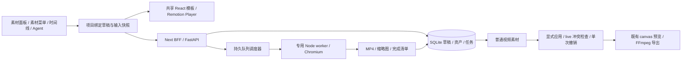

# Remotion 特效工作台设计方案

版本：v2（第三轮设计评审修订，2026-11-17；输入为第三轮设计 v4，产品实现及发行验收待执行）
适用仓库：Ecliptrix；首轮勘查 `9265179e`，本轮代码基线 `8d53a66d`
方案目录：`docs/plans/remotion-effects-studio/`
交付物：本文 `spec.md`；本节点只修改此方案，另仅按任务授权回退本节点任务状态；不修改实现、不安装依赖、不提交 Git。

版本沿革：首轮 v1 → 首轮评审 v2 → 第二轮设计 v3 → 第二轮评审
v2 → 第三轮设计 v4 → 第三轮评审 v2。v2 是评审阶段标识，不表示回退实现。
第二轮实际交付为 `8d53a66d`，包含 CR-13 / CR-14；第三轮从该提交
继续。`round-2-verification.md` 保留原记录，当前定位见
`plan-current.json`，本轮设计核查见 `round-3-verification.md`。

**本轮阅读顺序**：先读 §20–26；第三轮文件范围只以 §23 为准。
§1–19、历次 RV / IM 记录保留架构及实施依据；冲突时 §20–26 优先，
没有明确替代的原约束继续有效。§10、17 的新增 / 修改已经在前两轮
落地，不得据此重建。保留 AC-01–56，新增 AC-57–66。
`acceptance.md` / `final-review.md` 已含两轮历史实测，不能直接作为
第三轮代码、字体资源或安装包通过的证据。

**目标**：补齐离线 emoji 字形、多行文字处理、草稿分页和文字验收证据，
使现有 12 库 / 24 模板可在真实安装环境继续完成可靠制作。
**架构**：延续共享 Remotion composition、本地持久队列、MP4 入库及
单次时间线事务；本轮只补强字体资源、文字边界与草稿查询。
**技术栈**：Next.js 15 / React 19.1.1 / Remotion 4.0.544 / Electron 33 /
FastAPI / SQLite / Pillow；不增加数据库表或新的渲染服务。

下游按 §25 逐项执行，可使用 `superpowers:executing-plans`；本节点的
交付边界为设计评审，既不执行实现，也不代替最终节点提交与发行验收。

## 评审记录

本次评审输入为第三轮设计 v4，实际代码基线为 `8d53a66d`。按可行性、
完整性、现有约定和范围逐节核对；发现 **6 项 P1、2 项 P2，无 P0**。
以下各项均已在正文就地修订。这里的“已修订”仅表示设计问题闭合，
不表示对应产品代码、资源导入或安装包验收已完成。

| 编号 | 级别 | 问题、依据与影响 | 正文修订及验收 |
|---|---|---|---|
| R3-RV-01 | P1 | `stopReason.ts::normalizeChildErrorCode` 的 CHILD_ERRORS 不含文字溢出；只改 renderChild，controller 仍会将它改成媒体解码失败。对现有 dist 的只读调用已确认该映射 | §21.2、23、24、25.1 补齐 controller 白名单、端到端错误及停止优先级；AC-65；已修订 |
| R3-RV-02 | P1 | `fitEffectText` 逐 grapheme 累加 canvas 宽度不等价于 DOM shaping / CSS 折行；`type-lines` 的空 div 会折叠空行。原方案声称浏览器最终守卫，却没定义实际测量、Player 错误和渲染等待 | §21.2 新增共享 EffectText 的实际 DOM 测量、空行与揭示布局契约；§23/24/25.1 补齐模块及真实浏览器用例；AC-59/60/65；已修订 |
| R3-RV-03 | P1 | Callouts 文字在 y≤0.5 时 top=0.72H，再给 0.35H 会到 1.07H；只统一宽高仍越过 0.94H 安全边。Counters 的百分比 margin 也不能作为纵向像素预算 | §21.2 定义标注的锚点分支、组布局及明确像素间距；§24 增加边界向量；AC-60；已修订 |
| R3-RV-04 | P1 | renderer 当前仅采 layout，capturePlayer 也只返回 layout；未规定两端字体来源交付和完整节点集合。CDP 返回名字与 CSS 的 Effects-* 别名也不能凭字符串推定为同一文件，空记录可能漏检 | §21.1/21.4、22.3 明确两端原始 CDP、离线字体探针、节点覆盖及独立匹配；§23/24/25.3 补齐 helper 和负向用例；AC-63/64；已修订 |
| R3-RV-05 | P1 | 新 textLayoutHash 尚未定义资源包内生成副本的确切路径及 controller 的核验；仅后端核对不能证明运行时清单和字体更新所用 bundle 属于同一规则 | §21.2、22.2 固定三端字节身份及启动拒绝；§23/25.1 补齐 server 和真实清单回归；AC-58/60；已修订 |
| R3-RV-06 | P1 | 目录 hook 只接 projectId，controller 在弹窗关闭后仍挂载；关闭缺失 active 身份。现有 open 会等待 recentTask，指定草稿也受慢列表阻塞；refresh 清页还需明确保留页外选项 | §21.3、22.2、23–25 定义 active/epoch、显式入口独立加载、页外选项和首次创建刷新；AC-61/62；已修订 |
| R3-RV-07 | P2 | 原 prepare 顶层立即准备浏览器/原生资源，直接导入它做字体锁测试会受联网和真实目录副作用影响；“emoji 缺件均拒绝”又与允许固定源补配相冲突 | §21.1、23–25 增加无副作用字体准备模块和隔离临时目录测试，区分构建补配与安装时缺件；AC-58；已修订 |
| R3-RV-08 | P2 | 顶部 v4 与节点要求 v2 不一致；§26 指向 Subtask #0，评审结束照抄会覆盖前序记录。前序定位与核查副本也不能冒充本评审版本 | 本文顶部、§26 及文末统一当前评审 v2 / Subtask #1，保留前序文件及历史；已修订 |

| 章节 | 逐节评审结论 |
|---|---|
| §1–2 | 12 库 / 24 模板、本地烘焙 MP4、Electron / FastAPI / SQLite 架构与 CLAUDE 一致；保留已实现结构 |
| §3–4 | 保留四入口、模板契约、帧单位与渐进披露；新增目录控制和实际文本布局以 §21 为准 |
| §5–6 | 不增加数据库表、任务协议权限或渲染服务；补齐错误码、资源闭包及最终布局守卫，原幂等 / 生命周期保留 |
| §7–9 | 保留来源校验、一次时间线事务、eventChain 和真实客户端回执；本轮不扩大自动上轨权限 |
| §10–13、IM | 首轮文件计划和实施差异作为历史保留，不重建源码；既有性能 / 许可 / 实装门禁继续适用 |
| §14–19 | 第二轮恢复、租约、停止原因和证据身份约束继续适用；报告根对象由 §22.3 升为 v2，附件 envelope 仍为 v1 |
| §20 | 四项产品缺口与代码一致；维持增量范围，区分设计缺陷与产品缺陷 |
| §21 | 按 R3-RV-01–07 修订字体、DOM 测量、安全区、分页与取证接线 |
| §22 | 明确新增公开类型、生成副本和双端字体证据，不更改持久文档或 frozen 请求身份 |
| §23 | 精确计划增至 68 个文件，另由 catalog 唯一决定 48 个预览；新增项均服务于上述缺口 |
| §24 | 保持 AC-01–66 连续唯一，补强原 AC 的真实行为和证据要求，不以单测替代实包 |
| §25 | 先复现后实施，先最小真实浏览器切片再完整矩阵，最终提交后重打包重验 |
| §26 | 本节点仅交付评审文档；真实发行和调度器状态均有明确证据门禁 |

未解决设计 P0/P1 为 **0**。本轮修订见 §20–26；前序
`round-3-verification.md` / `plan-current.json` 保持设计 v4 的历史内容，
当前评审核查结果以 §26 和本节点任务板为准。

## 第二轮 v2 评审记录（历史）

评审输入为第二轮设计 v3，代码基线为 `58dce2a7`。逐节核对可行性、
完整性、项目约定和范围；保留 12 库 / 24 模板、SQLite 三表、既有
时间线事务及 Agent 回执。发现 **10 项 P1、2 项 P2，无 P0**，均已
就地修订。下表的“已修订”只表示设计闭合，不代表源码缺陷已修复。

| 编号 | 级别 | 问题、依据与影响 | 正文修订及验收 |
|---|---|---|---|
| R2-RV-01 | P1 | `api/effects.ts::saveEffectDraft` 根据 draftId 是否存在选择 PUT；稳定 ID 会使首次误走更新。后端 parse_body 用严格 Python 模式校验 JSON dict，直接增加 UUID 类型也会拒绝 wire 字符串 | §15.2、16.2 明确请求种类、UUID 字符串校验和兼容状态码；AC-47，已修订 |
| R2-RV-02 | P1 | §16.1 强制 pendingWrite，但 §15.2 要在确认旧写入后持久化新 working；没有 working-only / 基准版本状态。切草稿和“不保存”也可能重放已丢弃文案，恢复输入未规定资产加载 | §15.2、16.1 补齐记录状态、导航、丢弃和资产恢复；AC-48，已修订 |
| R2-RV-03 | P1 | 短 Web Lock + 同一冻结体比较不能保护 working：两个编辑器可读到同一 pendingWrite 后覆盖彼此新文案；storage 事件到达晚于写入 | §16.1 单编辑器租约、recordRevision CAS 和失效交付守卫；AC-49，已修订 |
| R2-RV-04 | P1 | Agent `changeDocument` 会重新附加输入，update 会重新读版本；只返回 draftId 无法跨回合重放原请求，render unknown 也只有提示词禁止换键 | §15.2、16.3 明确冻结 recovery、恢复分支和宿主待确认屏障；AC-50，已修订 |
| R2-RV-05 | P1 | allSettled 本身仍等最慢查询；“即时合并”没有逐项交付。cancel 失败和同项目翻页也缺错误及过期 cursor 规则 | §15.3 每项独立完成 / 有界请求、取消及分页守卫；AC-38/51，已修订 |
| R2-RV-06 | P1 | 外层 Modal 的 document Escape 不检查 IME；工作台已有 Ctrl+Z 处理也不检查 composing。确认层若只在 document 注册监听会受注册顺序影响 | §15.4 特效根与确认层 capture 处理，明确 IME 和保存中退出；AC-39/52，已修订 |
| R2-RV-07 | P1 | controller `finishChild` 只凭 exit=0/result 判成功；仅保存错误码仍可能接受停止后的迟到 result。监督关闭复用 cancel 还会误归用户取消 | §15.6 停止原因锁存、丢弃结果及终态规则；AC-41/53，已修订 |
| R2-RV-08 | P1 | 视觉 helper 没规定如何在包内 Electron 下调用 renderer；renderStill 不返回 DOM，不能直接实现文字 Rect 比较。环境 override、旧 --packaged 和嵌套子进程仍可能偷用开发资源 | §15.7、18.3 固定目标树、测试子进程和只读 DOM 采集方式；AC-42/54，已修订 |
| R2-RV-09 | P1 | §18.2 的 status/acceptance_ids/任意 measurements 可自报通过；缺必需附件角色、AC 证据绑定与回归来源。wx 与 partial 原子替换也未定义无覆盖协议 | §18.2 严格报告校验、场景证据矩阵和独占封存；AC-45/55，已修订 |
| R2-RV-10 | P1 | 先打包验收、后由最终节点提交，与 release_ready 要求 manifest.dirty=false 冲突；旧包或旧报告不能证明最终提交 | §18.5、19.2 明确开发验证与提交后重建重验门禁；AC-56，已修订 |
| R2-RV-11 | P2 | §18.3 固定音频 0.5 阈值会把外层 gain 后的合法脉冲当漏音；§18.4 全局“无黑帧”与合法淡出 / 黑色背景冲突 | §18.3/4 校准幅度、固定参考帧和预期空白；AC-43/44，已修订 |
| R2-RV-12 | P2 | 当前版本 v3 与节点交付 v2、§19.3 的 Subtask #0 上报、§17 前序文档动作相互混淆 | 顶部版本沿革、§17、19.2/3 及文末明确当前节点和历史边界；已修订 |

逐节复核结果：

| 章节 | 结论与范围 |
|---|---|
| §1–2 | 本地烘焙素材与当前 Electron / FastAPI / SQLite 栈一致；不重建已完成架构 |
| §3–4 | 保留制作流程、响应式布局、模板及帧单位；焦点 / 字体恢复以 §15.4/5 为准 |
| §5–6 | 既有三表、项目锁、输入身份与发布恢复保留；新增保存 / 提交恢复见 §15–16，停止终态补强 |
| §7–9 | 保留单历史事务、来源校验与真实应用回执；只补 Agent 的未知写入恢复，不增加自动上轨权限 |
| §10–13、IM | 保留首轮历史和已有实测依据；本轮不把历史新增文件计划当作重建指令 |
| §14–16 | 按上表补齐请求种类、持久状态、多窗口、工具恢复、键盘及运行时边界 |
| §17 | 文件与新增验收一一对应；开发只执行实现 / 测试 / 使用说明行，前序定位文档不重复生成 |
| §18–19 | 补齐可执行证据协议与提交后的发行顺序；缺真实环境明确 blocked，不用 mock 代替 |

本节点未解决设计 P0/P1 为 **0**。§11、18 的实现和发行门禁继续保留，
由下游实际执行；不将这些待执行测试计为本节点已通过的功能验证。

## 首轮 v2 评审记录（历史）

评审基线为前序节点交付的 v1；逐节核对 `CLAUDE.md`、实际接入代码及
Remotion 官方接口。以下问题均已在正文修复；“已修复”指方案契约已修复，
不代表功能实现或实包验收完成。未发现 P0；发现 7 项 P1、2 项 P2。

| 编号 | 级别 | 问题、证据与影响 | 就地修复 / 验收 |
|---|---|---|---|
| RV-01 | P1 | §5/6 用包含草稿及运行时的 input_hash 判断同体重放，但草稿表仅保留当前版本；保存新版、软删除或升级后无法重新计算旧请求，网络重试可能错误冲突 | §5.2、6.3 分离 submission_hash 与 input_hash，先查原提交；AC-27 |
| RV-02 | P1 | §7/9 要求重新选择目标时核验成品基础源，但公开 asset DTO 没有不可变来源，request_json 又禁止返回；无法可靠阻止把 A 的成品替换到 B | §5.1、6.6、7.1/2、9.2 增加只读来源摘要与统一匹配守卫；AC-28 |
| RV-03 | P1 | 现有 useAgentExecution 的 OperationApplier 从 timelineStateRef 读取；§9 只登记外部 patches 和更新服务端镜像，没有同步客户端 ref，也未规定新 SSE 进入既有 eventChain | §9.3/4 明确串行事件、提交后同步客户端镜像、按真实结果回执；AC-29 |
| RV-04 | P1 | §3 可先选模板再填图片，§4/8 却对草稿直接要求必填槽位，未区分保存合法性与可生成性；未填完的作品无法可靠自动保存和关闭恢复 | §3.3、5.1、6.2、8、9.2 分层校验，草稿返回 renderability；AC-30 |
| RV-05 | P1 | ManagedService 实际使用普通 pipe，无 IPC；killTree 只在被调用时清理。§6 的断连清理、父进程心跳、reset 超时重启及健康重试缺少可执行接线 | §6.3–6.6、10.3 明确双层 IPC/心跳、关闭次序、恢复屏障和调度时版本复核；AC-31 |
| RV-06 | P1 | §10 的 closing 只约束入队/发布，inputs 复制、草稿写入及恢复也能跨越删项目的 await，形成已删项目孤儿文件或新行 | §5.3/4、10.2 将全部写入纳入项目生命周期守卫，长 I/O 后重检再提交；AC-32 |
| RV-07 | P1 | 新 API envelope 使用 details 而项目约定为 error_details；现有 backend-proxy 默认缓冲 JSON 且仅保留 Content-Type，无法兑现 ETag/304、Retry-After 透传 | §8.1/2、10.1 使用既有响应模型和本路由的透传配置，不修改全局代理；AC-33 |
| RV-08 | P2 | §3.2 与 §11.3 的栏宽、弹窗高度、断点互相冲突，实现与验收会按两套布局判断 | §3.2 统一尺寸与断点，§11.3 只引用该规范；AC-07 |
| RV-09 | P2 | §8 JSON 示例缺必填 kind；“所有对象禁止附加字段”未说明 params 的模板键；已删除/不兼容草稿一律承诺复制也无恢复契约 | §3.1、5.1、8.1 修正示例、字典规则和可恢复边界；AC-34 |

逐节结论：§1–2 的本地 worker 加烘焙素材方案符合当前架构，12 库/24
模板范围保留；§3–9 按上述契约修复；§10 补齐必要模块接线；§11 增加
针对缺口的行为门禁；§12–13 保留安装包、性能及许可的发行前证据要求。
不增加通用工作流平台、云端渲染或任意代码执行。P0/P1 未解决项为 0。

## 1. 概述

为现有视频编辑器增加一个统一的「特效」工作台。用户可以从素材面板
「AI 混剪」旁的「特效」按钮进入，也可以携带一个视频或图片素材进入，
或从时间线上的一个视频片段进入。在弹窗内选择模板、输入文字、加入
图片、调整颜色与节奏，实时预览后生成本地视频。首版交付 **12 个模板
素材库，每库 2 个独立可编辑模板，共 24 个模板**；每个模板均有内置
示例、缩略图、参数 schema 和真实渲染能力，不用空分类充数。

采用共享的 Remotion React 组合完成弹窗预览和本地逐帧渲染，成品以普通
MP4 素材进入现有素材库。整条编辑时间线仍由既有 canvas compositor
预览、FFmpeg 导出；在生成阶段烘焙特效后，现有导出流程直接读取成品。
对于指定时间线视频，只处理其源素材的裁剪区间，用户明确选择「替换
此片段」后才提交一次可撤销的时间线事务。草稿、渲染和应用分别成功或
失败；“生成完成”不会被表述为“已上轨”。

Agent 与用户共用模板目录、草稿 API、持久渲染任务和时间线应用函数。
类别目录只显示一行能力摘要，工具按需加载，模板参数再按单个模板查询。
Agent 可以自主制作并应用用户要求的特效，也可以把结果留在素材库，
供用户重新打开草稿继续修改。整个流程离线可用，不要求用户安装 Node、
Remotion CLI 或浏览器，不把素材发送到外部渲染服务。

### 1.1 范围和明确边界

- 首版支持文本、静态图片、单个基础视频及最多 8 个图片槽位；最长 60 秒，
  固定 30 fps，输出不透明 H.264 MP4。模板可同时包含文字和图片。
- 支持空白制作、素材制作、时间线视频制作、成品再次编辑四个入口。
- 不包含任意 JSX/脚本执行、在线模板市场、AI 编写代码、跨镜头转场、
  透明视频导出、外部字体上传、多片段批处理、4K、音频特效。
- 图片素材可以制作视频；时间线图片片段首版仅支持另存成品和新轨插入，
  不做原位替换，避免既有 imagePosition 在视频路径中的语义变化。
- 时间线封面片段继续走封面编辑器，不开放原位特效替换。
- 视频内的标题条、角标和遮罩在源画面内合成。首版没有独立透明叠加轨；
  为现有视频增加标题应携带该视频进入工作台。
- 本文中的新增路径与接口是实施契约，现状路径已读码核对。本文验收项
  是后续开发的门禁，不能据此宣称功能或实包测试已经完成。

## 2. 项目现状与架构决策

### 2.1 已核对的接入位置

| 现有路径 / 标识 | 已有行为与设计影响 |
|---|---|
| `README.md`、`CLAUDE.md` | Electron 33、Next.js 15、React 19、Tailwind 3、FastAPI、SQLite；以源码及 CLAUDE 的新账号门禁说明为准，README 的“无登录”描述已落后 |
| `src/components/video/components/MaterialsPanel/MaterialsPanel.tsx` | `onAIMixedEditing` 与 `ws-materials-footer` 是主按钮接入点 |
| 同目录 `MaterialCard.tsx` | `MaterialCardActions` / `useCardMenuItems` 承载素材菜单 |
| `src/components/video/VideoEditingInterface.tsx` | 项目、素材管理、封面控制器和 Agent 桥接的编排根；只接线，不继续堆入制作逻辑 |
| `src/components/video/timeline/TimelineToolbar.tsx` | 已有 disabled / comingSoon 的 effects 占位，需替换为真实入口 |
| 同目录 `TimelineItem.tsx` | 普通视频右键可能直接分离音频，尚无通用菜单；新建菜单并保留旧功能 |
| 同目录 `store/useTimelineStore.ts` | 时间线真相源；从 `exportToData()` 读取最新状态 |
| 同目录 `store/actions/replaceTimeline.ts` | `replaceTimelineAction` 负责外部写入与一次撤销，已有锁与轨道视图标志处理 |
| 同目录 `store/actions/applyCover.ts` | 项目 / 手势 / 锁检查、纯 planner、注册素材后的同步二次检查可作为事务样板 |
| `src/components/video/hooks/useMaterialManagement.ts` | 仍有 React 本地素材列表；不能假设 materialSlice 是唯一素材源，必须调用 `addOrReplaceMaterial` 同步注册 |
| `src/components/video/lib/derivedMaterial.ts` | 已记录衍生素材继承原缓存而播错、删错源文件的事故；新成品重建所有文件身份 |
| `src/lib/api/videoProjects.ts` | `normaliseProjectDataForSave` 保留 metadata；不持久化 blob URL 或进行中的弹窗状态 |
| `app/services/video_cover_job_service.py`（后端目录下） | 持久任务、幂等提交、启动恢复和生命周期可借鉴；QueueManager 本身全是内存状态 |
| 后端 `app/services/local_media_resolver.py` | `resolve_media_reference` / `storage_relative_path` 是本地路径边界 |
| 后端 `app/routers/storage_files_router.py` | 已支持 Range、206、416 和媒体内联；复用，不另建不支持 Range 的静态文件挂载 |
| `desktop/main/frontendService.js` | 已用 Electron 可执行文件 + `ELECTRON_RUN_AS_NODE=1` 启动 Node 服务 |
| `desktop/main/processManager.js` | `ManagedService` 与 `killTree` 提供隐藏进程、健康检查和 Windows 子进程树清理 |
| `src/lib/video-editing-agent/registry/ToolActivationState.ts` | `load` / `offer` / `canExecute` 实施真实工具披露，不能只改提示词 |

表中后端短路径均相对于 `backend-services/basic-service/`。源码中图片
timeline item 实际是 `type:'video', originalMaterialType:'image'`；不新增
第四种轨道，不添加与 Remotion 绑定的播放类型。

### 2.2 三种方案比较与结论

| 方案 | 优点 | 代价 / 结论 |
|---|---|---|
| 共享 Remotion 模板 + 专用本地 worker，成品入库 | 参数预览快、生成可验证、离线、现有导出可消费 | 增加浏览器与原生运行资源；**采用** |
| 把 Remotion 实时组件接入整条时间线 | 每次修改都能立即呈现 | 要同时重做 canvas 与 FFmpeg 的实时一致性、透明合成和项目水合；不适合首版 |
| 云端渲染 / 任意代码模板 | 扩展面广 | 改变本地产品定位，增加上传、费用、网络和执行隔离；本轮不采用 |

根项目仅引入客户端 `remotion`、`@remotion/player`、`zod`；独立
`effects-runtime/` npm 项目引入 renderer / bundler，避免 Next standalone
依赖追踪漏带原生文件。查询 npm 官方包元数据时 `remotion` 版本为
`4.0.544`，本功能相关 Remotion 包均固定为此精确版本，不写 `^` 或 `~`。
两份 lockfile、React / ReactDOM 版本和 runtime manifest 必须一致。
若版本在安装环境不可用，实施者应整体更新版本和本文契约，禁止单包升级。
[Remotion 版本一致性说明](https://www.remotion.dev/docs/version-mismatch)。



## 3. 产品与交互设计

### 3.1 入口与目标

1. 素材面板底部同一操作组依次为「AI 混剪」「特效」，按钮高度 32px，
   使用现有图标和主题 token；窄面板用等宽按钮，禁止横向溢出。
2. video / image 素材卡菜单增加「制作特效」，将素材作为 base 输入；
   音频、素材包及尚未下载的候选不直接开始渲染。远程候选显示「先下载」。
3. 时间线工具栏启用已有「特效」，单选普通视频时带目标进入。无选择时
   打开空白工作台；多选时提示只支持一个片段，不猜测目标。音频 / 字幕
   选择时显示说明，保留按钮帮助文案。
4. 普通视觉片段右键打开新的 `ClipContextMenu`，其中有「制作特效」和
   原有条件满足时的「分离音频」；右键本身不再直接分离。封面专用菜单
   保持其行为并提供返回封面编辑，不进入原位特效。
5. 成品素材菜单增加「编辑特效草稿」，按 metadata 中的 draftId 打开；
   打开的为草稿当前版本，显示成品原版本，不能暗示可还原旧成品参数。
   草稿软删除后可通过只读 GET 查看，提供“复制为新草稿”；只有当前
   catalog 能无损验证的文档可复制。未知 schema/template 版本只允许
   查看原视频和新建作品，不承诺复制或静默迁移。项目删除后不可恢复。

### 3.2 弹窗布局与视觉

使用现有 `ui/Modal` 并在控制器层 `createPortal(..., document.body)`，
不能假设 Modal 自身已有 portal。弹窗宽 `min(1280px, 96vw)`、高
`min(860px, 92vh)`：顶部项目 / 草稿名 / 保存状态，底部生成与应用栏。
以弹窗可用内容宽度（CSS px，非屏幕物理像素）为唯一断点：≥1100px
时左栏 208px、右栏 288px、中央弹性预览；900–1099px 时模板库改抽屉，
右栏 260px；<900px 用「模板 / 编辑 / 预览」切页。生成 / 取消常驻底部。
高度不足时各内容区独立滚动，不能整体缩小文字；Windows 125% / 150%
缩放按实际 CSS 可用宽度验收。§11.3 不另设一套布局尺寸。

沿用项目的 surface、border、primary 和 muted CSS 变量，主操作使用
单一强调色；文字、视频画面与留白优先，避免渐变铺底。模板卡比例随
所选画布，卡片只在悬停 / 聚焦时播放内置短预览，至多一个活动预览。
内置示例素材自制或许可明确，禁止以远程网络图作默认资产。

中央 Player 仅弹窗打开时懒加载，显示播放 / 暂停、逐帧、时间码、静音
和进度拖动；参数更新按动画帧合并，不触发服务端渲染。右侧分成「内容」
「画面」「动画」「输出」四组，只显示当前模板支持的字段。模板切换前
保留可兼容的内容字段，丢弃的专属字段需在一次本地草稿撤销中恢复。
文字框显示计数与溢出提示，不静默裁掉文字。

焦点进入弹窗标题容器，Tab 受限于弹窗，关闭后回到入口；Escape 先关闭
子菜单 / 子确认框，再关闭主弹窗。文本输入期间空格、E 和方向键不得
触发全局时间线快捷键。提供 label、aria-live 状态以及键盘可用的模板卡。
`prefers-reduced-motion` 下卡片用静态海报，用户仍可主动播放作品。

### 3.3 操作状态和按钮

编辑状态：`loading → editing ↔ saving → ready`，保存失败仍保留本地
输入；仅成功保存的明确版本可以渲染。编辑停止 500ms 自动 PUT 草稿，
同一草稿写请求串行，生成按钮等待最后一次保存完成。关闭前若未保存
显示「保存并关闭 / 放弃本地修改 / 继续编辑」；保存失败不能当作已保存。
草稿 undo / redo 为弹窗内局部历史，不触碰时间线历史，最多 50 步。

“保存成功”与“可生成”独立：缺少 title 或必填图片槽位的编辑中草稿
也可保存、关闭、重开。服务端返回 renderability 与字段错误，界面在
缺失字段旁提示；只有生成按钮受必填内容/资源就绪检查限制。结构非法、
未知参数或数值越界仍拒绝保存。不能用填入隐藏示例图来伪装用户已填完。

任务状态分开显示：排队、准备素材、渲染帧、编码、校验、完成、已取消、
中断、失败。生成期间仍可编辑；成功结果明确标注对应版本。已编辑成
v6 而完成的是 v5 时显示「v5 生成完成」，不能错误呈现为当前修改已生效。
关闭弹窗只让任务后台继续，不等于取消；按钮「取消生成」单独请求取消。
项目页保留任务徽标，重开后从服务端重新查询。

底部主操作随状态变化：未生成时「生成视频」；生成完成后「保存到素材库」
（幂等注册）与「应用到时间线」。时间线目标默认应用模式为「替换此片段」，
其它入口默认「在新视频轨插入」。应用前显示目标名、时间点和时长，
用户可改为「仅保存成品」。没有自动覆盖原素材的选项。后台完成只增加
可领取成品；用户之前在当前项目明确开启“完成后入库”时才自动注册。
Agent 的制作请求隐含同项目成品入库，但上轨另由明确工具表达。

### 3.4 缺失与降级

模板目录和草稿编辑不依赖 worker 健康。worker 不可用时仍可看模板，
「生成」禁用并显示“本地渲染组件不可用”及重试；不影响普通编辑。
输入缺失、下载中、模板字段未填、字体失败、工作台保存冲突均在就近
字段解释。错误保留草稿、已生成素材及其它项目的任务。

## 4. 内置模板库与参数契约

### 4.1 统一模板结构

模板目录由 `src/lib/effects/catalog.json` 唯一维护，生成后端校验包及
worker 清单；构建时比较 hash。`schemaVersion=1`、catalogVersion=1。
24 个 ID 固定，templateVersion 初始为 1。分类、名称、描述均存 i18n
键；manifest 包含 `id, libraryId, version, componentId, variant,
allowedInputKinds, slots, defaults, parameterSchema, thumbnail,
demoPreview, minFrames, maxFrames`。缩略图必须实际存在。

每个库对应一个 React 组件，通过两个有区别的 variant 形成两个模板。
每个模板默认 150 帧，允许 15–1800 帧；动画入口最多占前 25%，停留至少
50%，出口最多占后 25%，15 帧时也必须出现可读内容。不为短片段偷加时长。
打字模板 revealFraction 相对于入口子段计算，不相对于总时长；逐字 / 逐行
揭示在入口结束前完成，完整文案停留仍不少于总时长的 50%。

| 库 ID / 中文名 | 两个模板 ID（组件 variant） | 内容 / 图片槽位 | 动画与专属参数（默认值；范围） |
|---|---|---|---|
| `titles` 动态标题 | `title-rise` / `title-mask` | title 必填、subtitle 可选 | 上升淡入 / 横向遮罩；distance=0.08，0–0.2（画布比例） |
| `typewriter` 打字文案 | `type-cursor` / `type-lines` | title 必填 | 单游标逐字 / 逐行揭示；revealFraction=0.5，0.2–0.7 |
| `lower-thirds` 信息字幕条 | `lower-clean` / `lower-block` | title 必填、subtitle 可选 | 细线 / 色块入场；anchor=`bottom-left`，枚举另含 bottom-right |
| `image-reveal` 图片揭幕 | `image-zoom` / `image-wipe` | hero 图片必填、title 可选 | 缓慢缩放 / 圆形揭幕；zoom=1.08，1–1.3 |
| `slideshow` 图片相册 | `slides-crossfade` / `slides-stack` | images 2–8 张、title 可选 | 交叉淡化 / 层叠滑入；transitionFraction=0.15，0.05–0.3 |
| `split-screen` 对比画面 | `split-horizontal` / `split-vertical` | left、right 图片必填、title 可选 | 横 / 竖分屏；divider=0.5，0.2–0.8 |
| `product` 产品展示 | `product-float` / `product-spotlight` | hero 图片必填、title 必填、subtitle 可选 | 浮动卡片 / 聚光；cardScale=0.75，0.4–0.9 |
| `callouts` 标注指示 | `callout-line` / `callout-ring` | base 图片或视频必填、title 必填 | 引线 / 圆环描边；pointX=0.5、pointY=0.5，各 0.05–0.95 |
| `counters` 数字动画 | `counter-up` / `counter-bars` | title 可选 | 数字递增 / 三列增长；value=100，0–1000000；suffix=''，0–8 字；bars=[30,60,90]，固定 3 项，各 0–100 |
| `countdown` 倒计时 | `countdown-ring` / `countdown-flip` | title 可选 | 圆环 / 翻牌；from=5，整数 1–60；数值按 from*(1-progress) 取 ceil，末帧为 0 |
| `video-look` 视频风格 | `video-cinematic` / `video-glitch` | base 视频必填、title 可选 | 信箱画幅 / 受控色差抖动；strength=0.35，0–1，glitch 频率最多 3 次/秒且可设 0 |
| `backgrounds` 动态背景 | `background-orbit` / `background-grid` | title、subtitle 可选 | 轨道几何 / 网格波动；density=12，整数 4–24；无外部图片 |

“可选 title”无内容时不显示默认广告词；必填 title 初始示例须在用户
输入前明确作为示例展示，生成时允许保留。`counters` 非当前 variant
使用的字段不暴露；其它模板不接受表外专属字段。

### 4.2 公共参数与单位

`content.title` 最多 120 Unicode code points、subtitle 最多 300；全部
纯文本，保留换行，不解释 HTML。`palette.background='#15171A'`、
foreground='#F5F4F1'、accent='#C87758'，只允许 `#RRGGBB`。
`typography.family='sans'`，枚举 sans / serif / mono，映射离线字体；
`scale=1`（0.6–1.4），`align='center'`（left / center / right）。
`motion.speed=1`（0.5–2）、`motion.intensity=1`（0–1）、`seed=1`
（0–2147483647 整数）。speed 改变入出节奏，不改变总时长或源视频速度。

公共可选 base 背景输入适用于所有非必须指定 base 的模板：选中视频进入
标题库时视频仍作为背景；选中图片进入时图片作为背景。hero / left /
right / images 为前景槽位，不能自动吞掉 base。不支持重复 base 视频、
同时播放多个视频，输入总计最多 1 视频 + 8 图片。

图像布局统一 `fit='cover'`（cover / contain）、`focalX=focalY=0.5`
（0–1），按槽位独立保存。横竖屏重排按同一套归一化坐标执行；标题
安全区距四边至少 6%，默认字号为短边的 7%，subtitle 为 3.5%。先换行，
再按 0.6 倍字号下限缩小；仍溢出时阻止生成并指出字段，禁止截断。
播放前等待字体和图片加载；字体失败直接报告，不用系统字体悄悄替代。

空白制作画布为 1920×1080、1080×1920 或 1080×1080，默认当前项目比例，
无项目设置用 1920×1080。单边不超过 1920，均为偶数像素；时间线视频
替换锁定源视频的显示比例，长边缩至最多 1920，按旋转元数据归一化。
固定 30 fps；durationFrames 为整数，时长显示 `frames/30`。

### 4.3 动画与媒体组件

全部动画从 `useCurrentFrame()` / `useVideoConfig()` 推导，使用
`interpolate` / `spring`，输入边界 clamp；随机纹理用固定 seed。
不得用 CSS 动画、Date.now、无种子的 Math.random 或外部网络驱动结果。
图片用 `Img`；视频使用 `OffthreadVideo`，源入点为
`trimBefore = round(trimStartSeconds * 30)`，取帧长度通过
`durationInFrames` 指定；这些属性以帧计，不能误传秒。
Player 与渲染均采用同一受支持组件和同样的输入，源入点最多存在一帧
量化差异，须用非零裁剪测试固定。[OffthreadVideo 官方单位及裁剪契约](https://www.remotion.dev/docs/offthreadvideo)。

## 5. 领域模型与持久化

### 5.1 公开数据形态

TypeScript 用 camelCase，REST / Python 用 snake_case，仅在边界显式映射；
不要递归改写模板自定义 key。固定对象均 `additionalProperties:false`；
params 的 properties 由当前 template/version 展开，仍拒绝模板外的键，
不能把 Record 误实现为允许任意字段的字典。

```ts
interface EffectDocument {
  schemaVersion: 1;
  templateId: string;
  templateVersion: number;
  canvas: { width: number; height: number; fps: 30 };
  durationFrames: number;
  seed: number;
  content: { title: string; subtitle: string };
  palette: { background: string; foreground: string; accent: string };
  typography: { family: 'sans' | 'serif' | 'mono'; scale: number;
    align: 'left' | 'center' | 'right' };
  motion: { speed: number; intensity: number };
  params: Record<string, string | number | number[]>;
  inputs: EffectInputBinding[];
}
interface EffectInputBinding {
  slot: string; assetId: string; kind: 'image' | 'video';
  fit: 'cover' | 'contain'; focalX: number; focalY: number;
  index?: number; // 仅 images 槽位必填，0 起连续整数；其它槽位禁止
  trimStartSeconds?: number; // video 必填且 >=0；image 禁止
}
interface EffectDraft {
  id: string; projectId: string; name: string;
  version: number; document: EffectDocument; documentHash: string;
  createdAt: string; updatedAt: string;
  renderability: EffectRenderability;
  deletedAt?: string; readOnly: boolean;
}
interface EffectRenderability {
  ready: boolean;
  errors: { path: string; code: string; messageKey: string }[];
}
interface EffectOutputProvenance {
  jobId: string; draftId: string; draftVersion: number;
  documentHash: string; inputHash: string;
  durationFrames: number; fps: 30;
  canvas: { width: number; height: number };
  baseVideo?: { assetId: string; sourceSha256: string;
    trimStartFrame: number; sourceFrameCount: number;
    displayWidth: number; displayHeight: number };
}
interface EffectTargetSnapshot {
  projectId: string; trackId: string; clipId: string;
  sourceMaterialId?: string; targetFingerprint: string;
  durationSeconds: number;
  sourceSha256?: string; trimStartFrame?: number;
  durationFrames?: number; // replace 视频意图三项必填，插入不需要
}
interface EffectRenderJob {
  id: string; projectId: string; draftId: string; draftVersion: number;
  status: 'queued' | 'running' | 'cancelling' | 'succeeded'
    | 'failed' | 'cancelled' | 'interrupted';
  phase: 'queued' | 'preparing' | 'frames' | 'encoding' | 'validating' | 'publishing'
    | 'done' | 'cancelled' | 'failed' | 'interrupted';
  progress: number; // 0..1；未成功不能等于 1
  resultAssetId?: string; errorCode?: string; retryable: boolean;
}
interface EffectMaterialMetadata {
  schemaVersion: 1; projectId: string; draftId: string;
  draftVersion: number; jobId: string; assetId: string;
  templateId: string; templateVersion: number; documentHash: string;
}
```

EffectTargetSnapshot 是客户端 / Agent 应用意图，不属于渲染文档，也不是
后端时间线写授权。当前时间线来自前端 store，不能拿可能滞后的数据库
project_data 代替它。草稿 API 只保存文档；目标快照随明确应用操作传递。
UI 控制器及本轮 ToolContext.effectsTargets 使用相同注册表形态：
drafts Map 存 draftId→待核验意图，outputs Map 存 (assetId,clipId)→
已验证意图；create 返回快照/指纹，render/get 按不可变来源核验后关联
成品，get_effect_target 可直接建立 outputs 项。这些 Map 不持久化。
重开、切项目、SSE 重放或新 Agent 回合没有旧应用意图，必须重新选择当前
片段并取得新指纹；不得通过草稿 ID 猜测 sourceClipId。后端草稿没有这个字段。

### 5.2 SQLite 新表

新建 `app/models/effects_db_models.py` 并在 `init_db` 之前显式导入以注册
Base.metadata。沿用 Base、UUID、JSON 和 SQLite 兼容层；所有表都有
`user_id=LOCAL_OWNER_ID`。只新增表，不修改 / 清空旧业务表。

| 表 | 列及约束 |
|---|---|
| `effect_drafts` | id UUID PK，project_id UUID 非空，name VARCHAR(100)，schema_version INT，version INT 默认 1，document_json JSON，document_hash CHAR(64)，deleted_at nullable，created_at / updated_at；索引(project_id,updated_at) |
| `effect_assets` | id UUID PK，project_id UUID，kind input-image / input-video / output-video，sha256 CHAR(64)，storage_key VARCHAR(1000) UNIQUE，bytes BIGINT，mime VARCHAR(80)，width / height INT，duration_seconds FLOAT nullable，thumbnail_key nullable，origin_material_id nullable（仅溯源），created_at；索引(project_id,kind,sha256)，不跨项目共享文件 |
| `effect_render_jobs` | id UUID PK，project_id / draft_id UUID，request_id UUID，submission_hash CHAR(64)，input_hash CHAR(64)，draft_version INT，request_json JSON（不可变提交与渲染快照），status / phase VARCHAR(24)，progress FLOAT，cancel_requested BOOL，result_asset_id UUID nullable，error_code VARCHAR(64) nullable，error_message VARCHAR(500) nullable，runtime_fingerprint CHAR(64)，started_at / finished_at / created_at / updated_at；UNIQUE(project_id,request_id)，索引(status,created_at) |

任务 request_json 包含完整 document、每个输入 assetId + sha256、catalog
hash、字体 hash、Remotion 版本、渲染 bundle hash，以及输出配置。不从
之后的草稿重新读取参数。后端 canonical JSON 为 UTF-8、排序对象键、
紧凑分隔符、禁止 NaN / Infinity，SHA-256 作为 input_hash；seed 包含在内。
输入字段和非公开运行参数不能任意互相混入。

另存 submission_hash：仅对规范化的公开提交 `{draft_id,expected_version,
output:{profile}}` 求 SHA-256（补默认 profile 后再算），项目/requestId
由唯一键标识。request_json 分为 submission 与 render_snapshot 两部分。
submission_hash 不含当前草稿内容、运行时或时间；input_hash 则标识已解析
的不可变渲染输入，两者不可混用。不为此引入草稿历史表。

成功输出的来源摘要 EffectOutputProvenance 从该 job 的 render_snapshot
推导，随 output asset DTO 只读返回，不由客户端传入，也不读草稿现值。
不含路径、token 或完整文案；baseVideo 仅在确有单个视频 base 时存在。
canvas 为实际输出尺寸，baseVideo.displayWidth/Height 为输入旋转归一化
后的显示尺寸，sourceFrameCount 为本次选取的 N 帧；不能混作源视频总帧数。

### 5.3 文件与输入快照

目录均位于 `STORAGE_ROOT/effects/projects/<projectId>/`：

```text
inputs/<assetId>.<ext>
outputs/<jobId>/video.mp4
outputs/<jobId>/thumbnail.jpg
outputs/<jobId>/complete.json
.work/<jobId>/inputs/<assetId>.<ext>
.work/<jobId>/render.part.mp4
.work/<jobId>/video.part.mp4
.work/<jobId>/thumbnail.jpg.part
```

输入通过“附加为特效输入”显式复制到项目 effects inputs；后端只接受
本机同源 `/api/storage/files/...` 引用，经 `resolve_media_reference`
核验真实路径、可读性和允许根，再通过 ffprobe / 图片解码识别真实媒体。
不接受 file://、blob:、data:、任意 http(s)、UNC、绝对磁盘路径或穿越路径。
origin_material_id 是显示溯源，不是访问控制。桌面为单本地 owner，允许
将自己其它项目已有的本地媒体明确复制为当前项目输入；复制后归当前项目。
来源上传或下载还没完成时先走现有流程，本接口不暗中联网下载。

每个原文件最大 512 MiB，图片解码后最大 40MP，长边最大 16384，单次
所有输入累计不超过 1 GiB。输入项目内以(kind,sha256)在项目锁下去重；
先写临时文件、校验、原子 rename、事务建资产。读出 input 时不能让
客户端更改存储路径。对视频检查 `trimStart + durationFrames/30` 不超
真实时长一帧以上；允许只因 ceil 多的一帧以最后有效帧补齐。

附加输入的复制/探测在项目锁外执行，临时文件放在
`STORAGE_ROOT/effects/.staging/<uploadId>/`，不提前创建正式项目子目录。
提交时取得 effects 项目锁，重新查项目存在且未 closing，再去重、rename
及提交资产行；删除项目先赢则删除 staging 并返回 EFFECT_NOT_FOUND。
staging 不作为已附加资产返回；崩溃遗留按 24 小时清理，排除活动导入。
所有文件 I/O/探测均在线程或异步子进程执行，不阻塞 FastAPI 事件循环。

渲染前从 inputs 复制至独立 work 快照，不能用 symlink 指向任意来源。
删除原素材不破坏草稿或任务；删除成品也不删除原素材。成品只返回新的
本地 URL、storageKey 和实际探测到的 size / duration / dimensions。

### 5.4 保存、版本、引用与删除

PUT 草稿使用 expected_version CAS；冲突 409 时停止自动保存并提供
「加载服务器版本 / 另存为新草稿」。不自动用旧内容覆盖新版本。草稿
删除为软删除；已成功的成品和历史任务可继续查看。

草稿保存只检查结构/类型/范围/模板版本、槽位基数上限及已引用资产的
归属；缺少必填内容作为 renderability.errors 返回，仍提交合法草稿。
入队前再检查必填槽位、非空文案、可解码输入、时间范围、字体及文字
布局；不满足返回 EFFECT_DRAFT_INCOMPLETE 或已有具体错误码，不建 job。
renderability 是派生状态，不作为持久授权；磁盘文件变化后入队仍须复核。
ready 只表示文档/输入可生成，worker 健康单独取 capability；因此离线
缺 worker 时也能正常保存内容完整的草稿，生成按钮同时检查两项状态。
软删除草稿 GET 返回 deleted_at/read_only，PUT 和新 jobs 均拒绝；可读取
并验证其文档后用普通 POST 复制，inputs 留在本项目无需再次复制文件。

inputs、draft create/update/delete、job 提交/取消/发布和恢复写入均使用
同一个 effects 项目锁，并在最后写入前重新查项目存在、未 closing。
不得持有旧 ORM project 对象跨 I/O 后当作项目仍存在的证明。删除规则
及完整锁序以 §10.2 为准，单进程 SQLite 服务不新增分布式锁。

普通项目 JSON 只保存注册后的 MaterialItem、clip.metadata.effects 和
普通时间线，不存 worker token、运行句柄、当前打开弹窗或轮询状态。
草稿与任务恢复通过项目 API 获取，不给旧项目强加迁移。metadata.effects
采用上述强类型引用；TimelineItemData 等重复类型继续复用 metadata，
不增加容易在 domain entity 序列化中丢失的顶层字段。

首版**不自动回收正式 inputs / outputs**；移出素材库仅移除项目列表
引用，不物理删除 effects 文件，确保 undo / redo、未保存时间线和草稿
仍可用。现有通用删除 / reclaim-orphans 入口必须排除 `effects/` 命名空间，
统一交给项目删除清理。取消 / 失败的 .work 及无正式资产行的未发布
outputs 可以在启动和每小时清理，须排除 queued/running/cancelling 任务。
未发布孤儿文件最多保留 24 小时供恢复；用户明确删除项目后取消任务、
停止 worker 子进程并等待释放句柄，再移除该项目 effects 子目录。

## 6. 技术设计与执行顺序

### 6.1 共享组合和确定性预览

`src/lib/effects/compositions/EffectComposition.tsx` 按 catalog 的 componentId
分派到 12 个库组件；根项目 Player 和构建期 Remotion entry 导入同一个
组件。Player 通过 client-only dynamic import 加载，弹窗关闭即暂停并
卸载播放器，库卡片最多同时播放一个示例。不把整个模板包加入编辑器
首屏执行路径。[Remotion Player](https://www.remotion.dev/docs/player)。

所有运动来自 `useCurrentFrame` / `useVideoConfig`、interpolate、spring
或带 seed 的 random；禁止 Date.now、非确定 Math.random、CSS animation、
setInterval 和按墙钟推进。每帧文字布局、颜色、裁剪和 fit 的数学相同。
title 按 grapheme cluster 渐进展示，避免中文、emoji 的代理对 / 组合符
被切开；保存长度校验仍按 code points，二者职责不同。

图片使用 Remotion Img；视频用 `OffthreadVideo`，固定 `trimBefore`
与 `durationInFrames`，单位为组合帧。当前版本不使用已废弃的 trimAfter，
也不依据旧 skill 文本把帧数当秒。[OffthreadVideo 参数契约](https://www.remotion.dev/docs/offthreadvideo)。
共同的 AssetResolver 将 assetId 映射成 URL：Player 用同源 storage URL，
worker 用仅本次 render capability 可读的 loopback URL；文档不保存这些
短期 URL。媒体、字体未 ready 时显示缓冲状态，不用占位帧冒充完整预览。

字体随应用附带 Noto Sans SC、Noto Serif SC、Noto Sans Mono 的选定字重
及各自 OFL 文件；字体加载成功才继续渲染。实际文件名、SHA-256 和字重
写进 manifest。离线 font-face 使用构建产物路径，禁止 Google Fonts
运行时请求。超出安全区时先以确定的二分算法缩小到配置字号的 60%；
仍溢出则阻止生成，返回定位到字段的 `EFFECT_TEXT_OVERFLOW`，不静默裁字。

空白画布提供 16:9 1920×1080、9:16 1080×1920、1:1 1080×1080 三个
预置；可切 720p，对应 1280×720、720×1280、720×720。带素材进入时
默认采用源尺寸，最长边不超过 1920，按比例缩小且向下取偶数，最小
边 64；源边不足 64 拒绝。替换视频模式锁定该源比例与像素尺寸，尺寸
缩小不改变现有布局。另存 / 插入模式允许使用上述画布预置。

### 6.2 创建、编辑、渲染的顺序

1. UI 校验项目存在，读取当前素材或 live clip，抓取目标语义指纹；
   无目标时创建默认 150 帧的 `title-rise` 草稿。
2. 有源媒体则先完成本地下载 / 上传，调用 inputs API 形成独立快照，
   得到 assetId。输入复制期间不提前创建引用不存在文件的 ready 草稿。
3. POST 创建可尚未填完的草稿；PUT 自动保存参数并得到服务端版本与
   renderability。缺必填内容只阻止生成，不阻止保存。切换模板时保留
   公共文字 / 颜色和兼容槽位，删除其它模板专属参数，再套新默认值。
4. 点击生成等待最后一次保存且确认 ready，生成 request_id，将 draftId、
   精确版本与显式输出配置提交。后端先查提交幂等再验证 / 配额检查，事务提交 queued
   之后才 wake；HTTP 202 返回 durable jobId，不在请求内等待渲染。
5. 前端每 1 秒 GET 状态，后台页每 5 秒；断网后指数退避 1/2/4/8 秒，
   最大 10 秒。项目切换停止当前轮询，任务继续，重新进入查询任务列表。
6. 服务端从 DB 领取任务，准备输入快照并调用 worker。任务只用已入队
   的不可变版本。完成后校验、发布资产、终态提交。
7. 前端确认 job.projectId 与当前项目一致，并满足用户明确点击保存、
   当前项目 session 明确开启完成后入库、或本轮 Agent 制作请求的入库
   授权之一，才注册素材；其它完成任务仅显示 ready / 可领取。领取时如任务仍
   对应已删除项目，不写入其它项目。成品通过 addOrReplaceMaterial
   注册，assetId 确定素材 ID，重复轮询不会出现重复卡片。
8. 用户明确应用后执行 §7 事务；Agent 走 §9 的操作桥。冲突时视频
   仍可留在素材库供用户选择其它位置。

### 6.3 持久队列和状态机

`EffectRenderService` 类提供 `start, close, submit, get, list, cancel,
wake`；DB 为真相，内存只保存当前调度任务与唤醒标志。全局并发 1，
单项目最多 5 个非终态任务，全局最多 20 个；按 created_at / id 排序。
用条件 UPDATE queued→running 领取，session commit 之后才启动 worker。
task dispatcher 的 wake 标记模式参考 CoverJobService，防止扫描期间
提交任务而丢掉唤醒。发布者与取消者使用同一项目锁。

```text
queued → running(preparing → frames → encoding → validating → publishing)
queued → cancelled
running → cancelling → cancelled
running → succeeded | failed
queued / running / cancelling → interrupted（重启且无法恢复成品）
```

终态集合 succeeded / failed / cancelled / interrupted，一旦终态不再
倒退。progress 在 0–0.99 内单调递增，只有成功发布事务提交后为 1。
按阶段范围映射：preparing 0–.05、frames .05–.85、encoding .85–.95、
validating / publishing .95–.99；Remotion progress 只更新 frames 子段，
不虚构完整任务的精确剩余时间。状态写入最多每秒一次，阶段变化立即写。

同 projectId + requestId + submission_hash 的请求返回既有任务（202
非终态，200 终态）；同键异体为 409 EFFECT_IDEMPOTENCY_CONFLICT。
先确认项目仍存在/未 closing，再查唯一键并比较 submission_hash；命中
时不读当前草稿、不验证旧版本、不检查配额或 worker 是否健康。仅新请求
在同项目锁内读取草稿并 CAS 校验 expected_version、renderability、配额，
固定 render_snapshot/input_hash 后提交。UNIQUE 竞争失败重读获胜行并比较
submission_hash；不能泄露为通用 500。草稿更新/软删除、运行时升级之后，
原提交仍能查回原 job；项目已删除则 404，不复活任务。失败重试创建新
requestId 并明确显示重试，不复活旧任务。

同一服务实例用单个调度临界区完成全局配额检查及 queued 创建，项目锁
内完成该项目配额检查，避免两个项目并发突破 20；锁序为调度提交锁→
effects 项目锁，发布/取消/删项目不持有调度提交锁。领取时复核 job
runtime_fingerprint 与当前就绪 runtime，不一致标 interrupted /
EFFECT_RUNTIME_MISMATCH，不把旧快照交给新 bundle 渲染。

准备阶段限时 60 秒，单帧等待上限 30 秒，整次渲染上限 15 分钟；worker
活跃阶段每 2 秒心跳，30 秒无心跳判失败并清理子树。限额和超时首版
是固定内部常量，不新增一页用户配置。

### 6.4 专用 runtime 与 Electron 资源

`effects-runtime/` 是独立 npm 包：编译 worker controller / renderChild
为 Node JS；构建时用 `@remotion/bundler` 生成不可变 render bundle。
生产 worker 不现场 npm install、npx 或 webpack bundle。

`desktop/main/effectsService.js` 沿用 createFrontendDescriptor 模式，
通过 `process.execPath` 和 `ELECTRON_RUN_AS_NODE=1` 启动 worker。cwd 为
真实 `resources/effects/runtime/` 目录，禁止设成 app.asar。worker
只读安装资源，可写目录由父进程传入 userData 下 STORAGE_ROOT。
`ManagedService` 负责监听退出、隐藏窗口和健康探测；worker 失败只把
effects capability 标记 unavailable，不中止前后端或登录门禁启动。

专用 Chrome Headless Shell 与 `@remotion/compositor-win32-x64-msvc`
及其依赖文件打包进 `resources/effects/`。浏览器版本由此 Remotion
版本在构建期 ensureBrowser 所解析的结果决定，并记录下载 revision、
文件树 hash；运行时显式 browserExecutable 和 binariesDirectory。
`ffmpegExecutable` 在 Remotion 4 已移除，禁止照旧接口传参；项目原有
FFmpeg 保留用于最终探测和既有导出，不替代 Remotion 必需原生依赖。
[渲染原生资源目录](https://www.remotion.dev/docs/renderer/render-media)、
[浏览器可执行路径](https://www.remotion.dev/docs/options/browser-executable)。

不复用 `agentBrowserHost.js`：其研究会话和网络策略不同，不能视作
Remotion 支持的浏览器实例。新增专用浏览器不改变研究宿主的拒绝规则。
runtime 资源、bundle、字体和浏览器均放 extraResources，不能进 asar。

打包 / 开发启动约定：

- `desktop/scripts/prepare-effects.js` 在构建机执行 effects-runtime npm ci、
  资源准备、构建 / 导出 catalog，组装 build/effects；修改 build.js 的
  BUILD_PAYLOADS / APP_PAYLOADS 断言，缺任意必要文件即构建失败。
- runtime 自带 `manifest.json`，包括 protocolVersion=1、engineVersion、
  bundle/catalog/font/browser/native hash 和 supportedTemplates=24。
  后端安装资源中的独立 catalog 副本与 worker hash 不一致时拒绝生成。
- 主进程为 worker 分配 loopback 空闲端口（首选 18323），生成 32 随机
  字节 EFFECTS_RUNTIME_TOKEN，向 worker / backend 注入 EFFECTS_RUNTIME_URL、
  TOKEN、资源路径；不注入 Next 客户端或用户可持久化配置。
- worker 先健康检查，随后后端开始调度。后端启动可以在 worker 失败时
  继续，health 返回 unavailable；用户点重试会重新探测。
- `desktop/scripts/dev.js` 同样管理 worker 的启动、token 和 teardown；
  首次准备用新增 root script `effects:prepare`，仅开发 / 构建机下载资源。
  纯浏览器调试未启动 worker 时可编辑草稿，生成明确 unavailable。
- main 关闭顺序为阻止新生成→backend 关闭任务服务→worker 取消 / 等待→
  killTree 残留→停止其它服务；禁止关闭后尚有 Chromium 编码进程。

生命周期接线必须补齐，不能仅复用当前 ManagedService 的默认 pipe：

- effects descriptor 单独启用 `stdio=['ignore','pipe','pipe','ipc']`，
  主进程每 2 秒通过 IPC 发带启动 nonce 的心跳；controller 10 秒无心跳
  或 disconnect 即停止接单、取消任务并清理子树后退出。其它 service
  保留原 stdio。dev 启动器同样成为心跳父进程。
  descriptor 同时传 healthHeaders 的 Authorization Bearer；ManagedService
  的可选健康探测头只用于请求，不写日志，否则当前无头 httpOk 会对
  要求 token 的 /v1/health 一直得到 401。
- controller 用带 IPC 的 spawn 启动 renderChild；child 监听 disconnect
  和父心跳，失联后关闭自有 browser/编码器。正常取消先协作退出，2 秒
  后由仍存活的 controller 对 child 调 killTree，再确认进程已消失。
  controller 被强杀时由 child 的 disconnect 路径收尾；main 被强杀
  时由 controller 收尾。不能只指望被杀进程执行 finally。
- main 独立轮询认证的 runtime health；持续失联或 restart_required
  时清理仍存活的 controller 子树后重启。重启保持本次 main 生命周期的
  port/token，产生新 runtime_instance_id。无法确认旧进程已退出时保持
  unavailable，不启动第二个 renderer；UI 给出重启应用的恢复入口。
- 有序退出先由 main 直接请求 backend 的私有
  `POST /api/effects-internal/drain`，Bearer 使用 runtime token，该路由
  不经过公共 effects BFF、不对 renderer 暴露。它关闭入队并执行
  EffectRenderService.close，等待 worker 清理；最长 10 秒，超时由 main
  killTree，随后停止其它服务。不能把 effects 加入当前 stopChildren 的
  Promise.all 就声称顺序关闭；backend lifespan 的 close 仍幂等保留。

这些机制须在 AC-25/31 实测，普通 SIGTERM 测试不能代替 Windows 强杀。

controller 每个任务另起带 IPC 的 renderChild，该进程拥有自己的 browser
实例和编码子进程，取消只清理该任务子树。父子 IPC 断开时子进程立即
取消并自行清理；main 每 2 秒向 controller 发心跳，10 秒未续期则其停止
所有 renderChild 并退出。这样主进程异常退出也有回收路径。Windows
使用 killTree 的 taskkill /PID /T /F，仅对当前进程持有且核验存活的
child handle；不从磁盘读旧 PID 后盲杀，不能关闭用户自己的浏览器。

### 6.5 worker 内部协议与媒体访问

controller 仅监听 127.0.0.1，所有 `/v1/*` 要求 Bearer runtime token，
不配置 CORS，不把它暴露给网页。请求 JSON 限 256 KiB。接口固定：

| 内部接口 | 请求 / 结果 |
|---|---|
| `GET /v1/health` | protocolVersion、runtimeFingerprint、runtimeInstanceId、ready、resetState、restartRequired、errorCode；检查浏览器与 native 文件实际存在 |
| `POST /v1/jobs` | jobId、requestHash、document、input manifest、output config；200 重放 / 202 接受，runtime 同时最多一个 renderChild |
| `GET /v1/jobs/{id}` | state、phase、progress、heartbeatAt、errorCode；完成只返回相对输出名和 checksum |
| `POST /v1/jobs/{id}/cancel` | 幂等取消；返回当前状态，不能把已成功结果重标 cancelled |
| `POST /v1/reset` | 后端恢复屏障，先关闭接单再取消旧任务/确认清理；超时设置 restartRequired，由 main 独立 health 监督重启，无假设中的 backend→main IPC |

worker 从已配置 work root + UUID jobId 推导目录，输入只接受 manifest
列出的 asset 文件名，不接受任意绝对路径、serveUrl、executable 或 JS。
它从固定构建 bundle 调 `selectComposition` 和 `renderMedia`，参数全由
文档 / catalog 适配而来。codec=h264、pixelFormat=yuv420p、fps=30、
crf=18、imageFormat=png、并发帧数=min(2,max(1,cpuCount-1))，输出
`render.part.mp4`，使用合法 .mp4 扩展名与显式 codec；不向 Remotion
传不存在的 container 参数。编码后用 FFmpeg `-f mp4 -movflags +faststart`
无损重封装到 `video.part.mp4`，作为待发布视频。

每次 renderChild 创建 32 字节临时 media capability，仅开放
`/render/<capability>/` 下固定 bundle、字体与本 job inputs；capability
不入库、不记日志、任务结束撤销。不提供通用文件浏览或 URL 代理。
浏览器中媒体 URL 均来自这一前缀；worker 媒体 HTTP 服务支持 HEAD /
Range / Content-Type，路径解码后必须在确切 job 根或只读 bundle 根内。
可信模板不得发出其它网络请求；渲染浏览器的请求拦截器拒绝其它 origin、
file、data 页面导航以及 localhost 其它端口。图片数据不拼入 HTML。

Player 使用原有同源媒体文件服务，BFF 保留 Range / If-Range / 206 /
416 / Content-Length。预览和渲染访问不同 URL，但媒体 bytes、trim、
模板 / 字体版本相同；用下述帧一致性用例验证，不依赖“共享组件”推断。

### 6.6 发布、取消竞态和恢复

renderChild 完成只表示工作文件可校验。backend ffprobe 验证真实 H.264、
yuv420p、尺寸、30fps、非零字节、帧数与预计 N（容差 1 帧）、音轨
是否符合输入，然后提取时间 min(1秒,时长/2) 的 JPEG 海报。实际输出
时长不得短于目标可见时长；MP4 缺失、编码异常、黑帧或字体失败不能
伪造 succeeded。黑帧以固定测试素材验收，生产不一概拒绝合法黑色背景。

发布顺序：校验→取项目锁→重读 job / project / cancel 标记→创建 outputs
目录→同卷 os.replace 原子发布视频与海报→最后原子写 complete.json→
一个 DB 事务创建 EffectAsset 并 CAS running→succeeded，设置 resultAssetId。
complete.json 包含 jobId、requestHash、runtimeFingerprint、文件 hash、
probe 结果及由 render_snapshot 生成的来源摘要，不含 token；恢复时比对
job.input_hash 与摘要，不接受与持久快照矛盾的文件清单。事务失败时
保留可恢复文件，不发成功通知。
取消接口获取同一项目锁；它在发布事务前成功落库就赢，发布后到达则
返回 succeeded 和 `already_terminal=true`，不能删除已成功成品。

取消 running 先置 cancel_requested=true、status=cancelling 并 commit，
再通知 worker。worker 用 makeCancelSignal 取消 renderMedia，2 秒后还
未退出则终止本任务进程树。确认退出并清 work 才置 cancelled；未确认
时返回 cancelling，UI 显示“正在取消”，不能谎报资源已释放。
[Remotion 取消信号](https://www.remotion.dev/docs/renderer/make-cancel-signal)。

backend `lifespan` 在 init_db 后 start、close_db 前 close。start 先与
runtime reset 协商停止旧任务，再扫描非终态：有完整且 hash 相符的
complete.json、项目仍存在、没有 cancel_requested 时验证并补做成功
事务；已请求取消则完成取消清理；其余标 interrupted，用户可以新建
requestId 重试。queued 也标 interrupted，不在升级后自动按新引擎重跑。
runtime 无法 reset 时已有非终态任务待恢复、capability unavailable，不在
旧 renderChild 可能运行时启动另一任务；不得静默抢占。

start/运行时重连共用串行 `refresh_runtime()` 恢复屏障：先禁止领取，
确认 reset 或新 instance 已无旧 child，核对 manifest，再恢复该旧实例
拥有的非终态任务。启动前遗留 queued 标 interrupted；屏障期间新收到
的非幂等命中 submit 返回 503，不接收新任务；原提交查询/重放仍按
§6.3 返回旧 job。后端持续运行时已排队且从未派发的
任务可保留，待版本复核通过后 wake。无 runtime 时仍启动普通编辑服务。
UI 的“重试渲染组件”调用 POST /capabilities/refresh，再走该屏障；
healthy 且 instance 未变时只探测，不 reset 活跃任务。GET health 不触发
破坏性恢复。main 重启 worker 后 backend 也经此屏障，不能仅置 ready
就继续调度；失败保持 unavailable 并保留可查看的任务终态。

正式资源成功后在离线条件下重启可恢复。启动恢复不根据成功 job 的
旧输入重新生成文件；正式成品缺失时 GET 成品返回 `EFFECT_OUTPUT_MISSING`
及可重新渲染提示，不能退回原视频冒充结果。

## 7. 时间线应用事务

### 7.1 目标和时间定义

打开时间线视频时记录 `{projectId,trackId,clipId,targetFingerprint}`。
指纹为目标 track 的 id/type/order/isLocked 及目标 item 所有内容字段
（排除 isSelected）的 canonical digest，含 materialId、全部播放身份、
startTime、duration、clipStart/End、cameraMotion、transition、audioDetached、
opacity、volume、metadata。其它片段被用户修改不必使该目标失效；应用
planner 必须基于最新全时间线，而非打开弹窗时的旧整表。

源区间起点为 `clipStart ?? 0`，可见时长 D 为 item.duration，与时间线
startTime 无关。不支持 item 内变速；现有 playbackRate 只是全局预览
速度，不写入源速度。拒绝负数、非有限值、D<0.5 或 D>60 和显著
不一致的 clipEnd。用于输出的 N=ceil(D*30)，源 trimBefore=round(S*30)，
源读取最多 N 帧，最后一帧可保持以覆盖 ceil 的余量。UI 显示帧精度，
S 的舍入误差最多半帧。替换后的时间线可见 D 保持原值，源 originalDuration
为实际探测值 N/30，clipStart=0、clipEnd=D；总时长与后续片段不变。

只在**源画面空间**叠加模板。视频内嵌音频以 unity gain 烘焙，保持
原裁剪同步；缺音轨则输出无音轨。原 clip 的 volume、audioDetached、
opacity、cameraMotion、transitionIn/Out 保留在外层时间线，各应用一次。
已分离音轨继续静音该 video item，独立音轨原样保留。模板不额外加 BGM。

replace 的来源匹配是 UI 与 Agent 共用的前置条件，包括重新打开草稿
及 get_effect_target：从成功 asset 取不可变 provenance，用 inputs API
对当前目标的实际本地播放源取项目内快照/hash，核对 sourceSha256、
round(S*30)、ceil(D*30) 分别等于 baseVideo 对应字段，输出时长足够且
画布保持源显示比例（偶数像素量化容差一像素）。结果依赖的 base 被换掉、
trim/时长改变或无视频 base 时，只能另存/插入，不能通过重取指纹洗掉
来源冲突；返回 EFFECT_SOURCE_MISMATCH。禁止读取已改成新版的 draft
来证明旧成品匹配。外层 camera/opacity/volume 不参与来源相等判断，
但仍纳入应用意图指纹。首次打开时取得的源摘要保存在目标快照中。

上述 hash/媒体读取均在异步准备阶段完成。同步应用阶段再次比较当前
目标完整指纹与已核验快照，无 await；这样既不在 UI 主线程计算大文件
hash，也不允许准备期间的改源被忽略。目标本就引用同一 asset 且媒体
身份/区间吻合时可直接 noop，不再次匹配它的原始视频源。

### 7.2 纯 planner 和提交函数

新增 `effectsTimeline.ts::planEffectsTimelineChange(options)`，返回
`{status:'applied'|'noop',timeline,material,clipId,changedTrackIds}`。
新增 `store/actions/applyEffects.ts::applyEffectsTimelineAction(options)`，
参数对象包括 getStore、getProjectId、registerMaterial、intent、asset、
reason（effects / agent）和可选当前 Agent turn 的有效 lease 验证回调。
action 的返回值在纯 plan 之外带同一次提交的 before/after（真实 store
快照），供客户端镜像同步、外部 patches 与 ack 共用；不能再取一次
异步 React state 充当 before。noop 不生成撤销记录。

1. 检查当前项目等于 intent.projectId、输出属于同项目、job succeeded、
   文件回执存在、当前无手势。普通用户受 isEditLocked 限制；Agent 只有
   当前活跃 turn lease 对应的同步应用可用 reason=agent，迟到结果不豁免锁。
2. 替换模式检查目标仍存在、轨道未锁、非封面、非图片。先识别同 asset
   且媒体身份/区间一致的真实 noop；其它情况要求指纹相等及 §7.1 的
   来源摘要匹配。不能仅凭 assetId 或 draftId 授权替换。
3. 从最新 exportToData 纯规划下一状态。替换保留 clipId / trackId /
   startTime / duration 和上述外层属性，只更换 materialId、名称、
   媒体身份、thumbnail、originalDuration、clipStart/End、metadata.effects。
   保留 clip 的 segment 链接字段；新**素材**不继承 segment 自动匹配字段。
   clip 本身的 url/serverUrl/cacheUrl/storageKey、metadata.storageKey/
   localResolvedUrl/storageKind 也必须改为新输出；移除旧 localProxy/
   previewProxy/analysisResult，不能只替换素材列表而遗留 clip 的旧播放身份。
4. 新轨插入不挤开已有片段，新建独立 video track，order 为当前最大
   video order +1（既有 compositor 中 order 越大层越高；实施时用现有
   order helper 并验帧）；trackId / clipId 基于 operationId 确定生成。
   插入时刻取用户确认时捕获的 playhead，有限且 >=0，D=N/30。轨道
   name 为本地化“特效”，可见、未静音、未锁，volume=100、height=56。
   不允许插入位置在渲染完成时偷偷改跟当前播放头。
5. 建成品素材，注册前保存 live tracks baseline；调用同项目
   materialManagement.addOrReplaceMaterial。不得触发自动 AI 视频解析。
6. **同一同步调用栈，无 await** 二次检查项目、锁、手势、turn lease、
   tracks baseline 未变，再 `replaceTimelineAction(getStore,next,'effects')`
   或合法的 agent reason。任一失败均保留成品、不改轨道。
7. 成功后选中目标，显示“一步撤销可恢复”；不得 clearHistory。

`ReplaceTimelineReason` 增加 effects；`replaceTimelineAction` 对 effects
也在 isInteracting 时拒绝，不能调用 cancelDrag 打断用户手势。Agent
这条应用路径即使 reason=agent 也先执行相同手势守卫。已存在普通
Agent 操作不受这个新 planner 的行为影响。

新 MaterialItem 从后端 asset 回执完整构造：id=`effect-material:<assetId>`，
type=video，format=mp4，size / width / height / duration 取真实探测，
url / serverUrl / cacheUrl / metadata.localResolvedUrl 统一为新 storage URL，
storageKey / metadata.storageKey 为新 key，storageKind=local。
metadata.source=remotion、metadata.effects 为强类型引用。不能复制原
analysisResult、localProxy、previewProxy 或原缓存身份。此规则参照
derivedMaterial.ts，但无需为新素材先拷贝旧对象。

### 7.3 冲突、撤销和持久化

渲染期间允许继续剪辑，不长期占用编辑锁。用户移动 / 裁剪 / 删除目标、
锁轨、切项目后，原应用意图失效，返回 `EFFECT_TARGET_CHANGED` / 对应
锁错误，展示“成品已保留，可另行插入”。项目切换不自动将 A 的成品
注册到 B。图片目标没有 replace 选项；更改为新轨视频不影响原图片布局。

Ctrl+Z 只恢复时间线，不移除成品；Ctrl+Shift+Z 重做不重新渲染、不下载。
项目保存沿用现有 timeline mirror 和 normaliseProjectDataForSave。
重开项目使用成品 MP4，不要求 worker 或草稿可用。原位替换不会改变
clipId 与脚本连接；其它字幕 / 音频轨、轨道视图标记保持当前状态。

## 8. 公共接口设计

### 8.1 HTTP、字段和错误约定

前端只访问 Next 同源 `/api/effects/*`；新 catch-all route 使用项目
backend proxy 通用函数及 BACKEND_URL。FastAPI router prefix 同为
`/api/effects`。Node worker 地址只对后端可见。所有新 API 沿用本地
owner 标记，不写入账号服务器 userId，不触及 webserver/。

JSON wire 使用 snake_case；TS 客户端显式映射为 camelCase。模板 params
内部键按 catalog 原样保留，不递归改写任意用户字典。Pydantic 边界
`extra='forbid'`，JS schema `additionalProperties:false`；只接受有限数值。
沿用 `app/models/base_models.py` 的 BaseResponse/ErrorResponse：成功
envelope 为 `{success:true,message,timestamp,data:T}`，失败为
`{success:false,message,timestamp,data:null,error_code,error_details}`，
字段错误列表放 error_details.fields，不另立 details 协议。
所有列表最多 50 项，page_size 默认 12，cursor 为服务端不透明游标；
分页稳定按 `(created_at,id)`，不把所有模板 schema 一次返回。

| 方法与路径（均在 `/api/effects` 下） | 请求 / 结果 |
|---|---|
| `GET /capabilities` | ready、protocol_version、engine_version、catalog_hash、limits、unavailable_reason；不返回路径、token |
| `POST /capabilities/refresh` | 空 JSON；200 返回重探测后的 capability；恢复屏障仍未完成则 503，不重置健康实例的活跃任务 |
| `GET /libraries` | 12 个 `{id,name_key,template_count,thumbnail}` |
| `GET /templates?library_id=&query=&cursor=&page_size=12` | 简要分页 `{items:[{id,version,library_id,name_key,description_key,thumbnail,allowed_input_kinds}],next_cursor}`，不返回 parameter_schema |
| `GET /templates/{templateId}` | 单一完整 descriptor、schema、defaults、slots、时长与画布限制 |
| `POST /projects/{p}/inputs` | `{source_ref,origin_material_id?}`；201 `{asset:EffectAsset}`，项目内 hash 重放 200 |
| `GET /projects/{p}/assets/{assetId}` | asset metadata + durable storage URL；跨项目 / 缺失 404 |
| `POST /projects/{p}/drafts` | `{name,document}`；201 完整 Draft，含 renderability（未填完也可保存） |
| `GET /projects/{p}/drafts?cursor=&page_size=12` | 当前项目未删除草稿摘要，包含 last_succeeded_job_id |
| `GET /projects/{p}/drafts/{d}` | 完整 Draft、version、schema_version、renderability、deleted_at/read_only；软删可只读，未知版本 409 EFFECT_TEMPLATE_INCOMPATIBLE，原视频仍可用 |
| `PUT /projects/{p}/drafts/{d}` | `{expected_version,name,document}`；200 完整新 Draft 与 renderability；CAS 冲突 409 |
| `DELETE /projects/{p}/drafts/{d}` | `{expected_version}`，软删除；200；有运行任务不取消但不再允许新渲染 |
| `POST /projects/{p}/jobs` | `{request_id,draft_id,expected_version,output}`；202 Job，幂等重放见 §6.3 |
| `GET /projects/{p}/jobs?status=&cursor=&page_size=12` | 当前项目历史任务摘要，支持 active 过滤 queued/running/cancelling |
| `GET /projects/{p}/jobs/{j}` | Job 状态、版本、进度、错误、成功时完整 output_asset 与 material DTO |
| `POST /projects/{p}/jobs/{j}/cancel` | 空 JSON；200 终态 / 202 cancelling，返回 Job |
| `GET /projects/{p}/jobs/by-request/{requestId}` | 同项目查找原提交，恢复“请求是否收到”不确定状态；不存在 404 |

GET /libraries 及 /templates 使用 optional `If-None-Match` 和 catalog hash
ETag；BFF 透传状态。不设计 WebSocket；已有 Agent SSE 只传语义操作与
简要状态，不传逐帧图像。也不向成品制作用户暴露内部 CLI。

本 effects BFF 用现有 backendProxy 的 `forwardHeaders:['If-None-Match',
'Range','If-Range']` 和 `streaming:true`，responseHeaderAllowlist 明确为
Content-Type、Content-Length、ETag、Cache-Control、Retry-After、
Accept-Ranges、Content-Range、Last-Modified。304 保持空 body；不返回
Set-Cookie 或内部 token。业务异常由 FastAPI 保证 JSON ErrorResponse；
非 JSON 4xx/5xx 由该 route 小包装转为既有 BACKEND_ERROR，不把 HTML
作为业务 JSON 交给客户端。不修改通用代理的默认行为。媒体本身仍走
现有 storage/files BFF，effects 路由不再承载一份媒体文件服务器。

完整草稿 document 规范化后只包含下面字段（未知字段拒绝）：

```json
{
  "schema_version": 1,
  "template_id": "title-rise",
  "template_version": 1,
  "canvas": {"width": 1920, "height": 1080, "fps": 30},
  "duration_frames": 150,
  "content": {"title": "新的开始", "subtitle": "五秒呈现你的创意"},
  "palette": {
    "background": "#15171A", "foreground": "#F5F4F1", "accent": "#C87758"
  },
  "typography": {"family": "sans", "scale": 1, "align": "center"},
  "motion": {"speed": 1, "intensity": 1},
  "seed": 1,
  "inputs": [{"slot": "base", "asset_id": "<UUID>", "kind": "video",
    "fit": "cover", "focal_x": 0.5, "focal_y": 0.5,
    "trim_start_seconds": 2}],
  "params": {"distance": 0.08}
}
```

inputs 中图片不允许 trim_start_seconds，视频默认 0；images 槽位通过
`slot='images',index=0..7` 表示，index 连续且不能重复，其它槽位不带
index。inputs 可为空；只有 catalog 列出的槽位可出现。
创建和更新均补齐公共 defaults 后再保存规范形态，客户端预览使用服务端
返回的规范草稿。模板 descriptor 的 parameter_schema 描述可保存结构，
slots.required 与文案要求单独描述可生成性；不能让 JSON Schema 的
required 槽位规则拦截编辑中保存。已出现的 binding 必须带 kind，并与
真实 asset.kind 相符；不推断、不允许伪造。Draft wire 的主键 draft_id
显式映射 TS id；Job job_id、Asset asset_id 同理，GET/POST/PUT 保持一致。
output 只允许 `{profile:'mp4-1080p'|'mp4-720p'}`；
profile 控制最长边上限而不改变草稿比例，替换模式不得放大低分辨率源。
duration_frames / canvas 不在 jobs 请求重复传入，以免草稿与渲染参数分叉。

Job 对外字段为 `job_id, project_id, draft_id, draft_version, request_id,
status, phase, progress, retry_after_ms, created_at, updated_at, error_code,
error_message, output_asset, material`。`retry_after_ms=1000`，终态为 0；
output_asset / material 仅 succeeded 返回。asset 含 `asset_id,kind,sha256,
url,storage_key,thumbnail_url,bytes,width,height,duration_seconds,created_at`。
job request_json、worker 内部路径和密钥不可返回。

output-video asset 另有只读 provenance（§5.1，snake_case），可在草稿
被修改/软删除后用于来源匹配；input asset 不返回该字段。该摘要从
job 快照生成，不与对外禁止返回完整 request_json 的规则冲突。

### 8.2 稳定错误码与处理

| HTTP / code | 触发与动作 |
|---|---|
| 400 `EFFECT_INVALID_ARGUMENT` | 非法 JSON、NaN、未知字段；定位字段，修改后提交 |
| 404 `EFFECT_NOT_FOUND` | 项目 / 草稿 / 资产 / 任务不属于该路径或不存在 |
| 409 `EFFECT_VERSION_CONFLICT` | 草稿 expected_version 变化；停止保存，另存 / 重载 |
| 409 `EFFECT_IDEMPOTENCY_CONFLICT` | 同 requestId 不同请求；禁止自动新键重试 |
| 409 `EFFECT_INPUT_NOT_LOCAL` | 未完成本地化；先下载 / 上传，再显式重试 |
| 409 `EFFECT_TEMPLATE_INCOMPATIBLE` | 模板/版本不兼容；保留草稿和成品，当前 catalog 可无损验证才允许复制，否则新建 |
| 409 `EFFECT_DRAFT_INCOMPLETE` | 缺必填内容或槽位；error_details.fields 指明路径，保存草稿仍可成功，入队不创建任务 |
| 409 `EFFECT_PROJECT_CLOSING` | 项目正在删除；拒绝所有新写入，不重建目录 |
| 413 `EFFECT_INPUT_TOO_LARGE` | bytes、像素、总资源超限，入队前拒绝 |
| 422 `EFFECT_TEXT_OVERFLOW` | 最小字号仍溢出；指出 title / subtitle |
| 422 `EFFECT_SOURCE_RANGE_INVALID` | 源时间范围或媒体不可解码；回到输入修正 |
| 429 `EFFECT_QUEUE_FULL` | 达到配额，Retry-After:5；不生成无记录任务 |
| 503 `EFFECT_RUNTIME_UNAVAILABLE` | worker / browser 缺失或未就绪；普通编辑仍可用 |
| 503 `EFFECT_RUNTIME_MISMATCH` | bundle / engine / catalog / font 版本不符；修复安装包 |
| job `EFFECT_DISK_FULL` | 空间不足；释放空间后新任务重试 |
| job `EFFECT_RENDER_TIMEOUT` / `EFFECT_MEDIA_DECODE_FAILED` | 超时 / 解码失败，保留草稿，取消本任务子进程 |
| job `EFFECT_RENDER_INTERRUPTED` | 重启未恢复，不自动按新运行时重渲染 |
| asset 410 `EFFECT_OUTPUT_MISSING` | 已记录成品文件缺失；可重新渲染，禁止返回原素材 |
| local `EFFECT_TARGET_CHANGED` / `EFFECT_EDIT_LOCKED` / `EFFECT_ACTIVE_GESTURE` | 仅应用失败，成品保留，提示用户重新选择目标 |
| local `EFFECT_SOURCE_MISMATCH` | 成品与目标的源 hash/裁剪/时长/比例不符；保留成品，只能另存/插入 |

错误码在 i18n 映射；后端日志保留 jobId / phase / code 和必要 stack，
不输出原始文案、整个素材 URL、token 或绝对用户目录。网络提交超时
先按 requestId GET 原任务，再同体重放；不能悄悄 POST 两个新任务。
429 同时写 Retry-After:5 与 error_details.retry_after=5，兼容 http-client
已有的响应体兜底逻辑。列表/字段失败按同一错误模型映射，不吞掉路径。

## 9. Agent 能力与渐进式披露

### 9.1 披露层级

categories.ts 新增 `EFFECTS_TOOLS='effects_tools'`，加入按需 ID 列表，
alwaysAvailable=false。目录摘要为 `Create local motion graphics from
templates, text and images; render assets and apply to clips.`，控制在
160 UTF-8 bytes。放在按需目录前部、紧邻视觉制作能力，测试保证在
现有 2400-byte 目录预算内可见。常驻工具不增加任何模板 schema。

第一次 `explore_tools(category='effects_tools')` 返回工具摘要并最多加载
前四个（list/get/create/update）；之后用 tool_names 加载 render / job /
cancel / apply。仍服从 ToolActivationState 最多 12 活跃工具、每次最多
4 个和下一轮才可执行的规则；未 explore 调用必须被 canExecute 拒绝。
list 只给模板简述，get 才给单个 schema。每次列表最多 12 条、总响应
最多 12 KiB，单模板详情最多 24 KiB，超限返回结构化分页 / 精简说明，
不能吞掉必需 schema 字段造成无法校验的接口。

### 9.2 工具签名和执行

| 工具 | 参数（额外字段拒绝） | 成功语义 |
|---|---|---|
| `list_effect_templates` | libraryId?、query?（≤80 字）、cursor?、limit?（1–12） | 分页概要，不返回全部库 schema |
| `get_effect_template` | templateId | 单模板版本、slots、参数 schema、defaults |
| `create_effect_draft` | templateId、name?（≤100）、content?、params?、palette?、typography?、motion?、seed?、durationSeconds?（0.5–60）、aspectRatio?（三种预置）、sourceMaterialId? 或 sourceClipId?、images?（最多 8 个 `{slot,materialId,index?}`） | 从 context 材料 / timeline 解析真实本地输入并调用 inputs，再创建草稿；返回 draftId / version / renderability，缺内容不冒充可生成 |
| `update_effect_draft` | draftId、expectedVersion、changes（只允许上述内容 / 公共参数及 input slots / duration） | CAS 更新；不支持通过 changes 改 templateId，改模板创建新草稿 |
| `render_effect` | draftId、expectedVersion、requestId（UUID）、profile? | durable jobId 与 queued / 当前状态，绝不立即说“已生成” |
| `get_effect_job` | jobId | 状态、错误、成功时 asset / 简要 material；成功时记录幂等 add_materials 操作并更新 context.materials |
| `cancel_effect_job` | jobId | 真实取消 / cancelling / 已终态状态 |
| `get_effect_target` | assetId、targetClipId | 取成功 asset 的不可变 provenance，用 inputs API 核验当前目标源 hash/trim/时长/比例；匹配后返回 expectedTargetFingerprint 并绑定本轮意图，不能用草稿当前版本核验 |
| `apply_effect` | assetId、mode（replace / insert）、targetClipId?、startTime?（0–86400）、expectedTargetFingerprint? | 派发客户端请求，收到 §9.4 回执才返回 applied / not_applied；超时只返回 dispatched_unknown |

公共对象参数复用 catalog schema 的有限 TypeBox / JSON Schema 转换，
不使用任意 z.any 或 JS 字符串；params 在单模板获取后按该 schema 校验。
工具边界同时校验实际 execute 输入，防止只在 tool definition 限制。
projectId 只来自 ToolContext，不允许模型参数覆盖。工具使用 toolFetch
且所有写请求 retry=false，超时走 requestId 查询。

create sourceMaterialId 与 sourceClipId 互斥：前者读取 context.materials，
后者读取 context.timelineState 中实际 item / 所属 track，再取 material
或 item 的有效本地快照身份。sourceClipId 自动确定 trim 与时长，不能
再传 durationSeconds / aspectRatio；sourceMaterialId 默认 5 秒，超过
源时长则取 min(5,源时长)，小于 0.5 秒返回范围错误。图片可作 base / hero；
槽位缺失不猜测。source_ref 由工具内部从已知材料解析，模型不能传 URL
或磁盘路径。成功的草稿描述返回 targetFingerprint 供后续显式 apply。

apply replace 要求本轮 effectsTargets 的快照 clipId 与 targetClipId 相符，
expectedTargetFingerprint 必填；Map 无旧目标时，必须基于当前 context
取得目标新快照并明确返回 / 使用该指纹，不能读不存在的草稿字段。
Map 的逻辑键同时绑定 draftId/jobId/assetId 和 clipId；create 阶段只建
draftId 意图，job 成功后经 provenance 验证再绑定 assetId，不让同一
草稿后来切换 base 的另一成品沿用旧授权。get_effect_target 只建立本轮
意图，不修改时间线；UI 重新选择目标也走同一来源匹配函数。
insert 要求 startTime 显式给出。tool
从 context 的当前 timeline 先做一次校验，再发操作；最终校验由客户端
latest store 完成。重复应用同 asset 到同目标且现状一致返回 noop，
不再叠加 / 重新渲染；插入使用稳定 operationId 防重复投递。

### 9.3 语义操作桥和停止行为

新增强类型 `EffectsOperation`：

```ts
interface EffectsOperation {
  type: 'effects_action';
  projectId: string;
  operationId: string; // toolCallId，重放复用
  action: 'watch_job' | 'apply_asset';
  jobId?: string; // watch_job 必填
  assetId?: string; // apply_asset 必填
  mode?: 'replace' | 'insert';
  targetClipId?: string;
  expectedTargetFingerprint?: string;
  startTime?: number;
}
```

实现时用 discriminated union 分成 watch / apply 两支，将上述必填关系
落实到 TS 和运行时 schema。AgentEventRouter 在普通操作分派之前处理
effects_action，转给项目挂载的 `EffectsAgentBridge`；不要让
OperationApplier 把它当一般 add_clip，跳过指纹检查。

render_effect 同时 recordOperation(watch_job)，客户端控制器持久 API
轮询、显示 `EffectsJobCard`，成功后通过项目素材注册回调入库。GET job
时的 add_materials 与 watch 成功通知使用同一稳定素材 ID 去重；后者
必须经过 addOrReplaceMaterial 同步 React 列表，不能只改 store 已有 ID。
不额外创建没有轮询实现的 start_async_task。模型需要继续编辑时可用
get_effect_job 检查；返回 retry_after_ms，提示不要密集轮询，任务未完
可在消息中保留后台制作卡片。

apply_asset 桥调用 §7 同一个 action，返回 `{state:'applied'|'noop'|
'not_applied'|'error',assetId,clipId?,errorCode?}` 更新 tool card。
成功后把实际 before/after track patches 交给现有 Agent 撤销路径，
changedTimeline=true 只在真实 commit 时设置。整轮“撤销 Agent 操作”
和 Ctrl+Z 均可恢复，不能把渲染完成标成 changedTimeline。
OperationApplier 新增 recordExternalTimelineChange({toolCallId,operation,
before,after})，复用 diffTimelineTracks，只登记本次同步提交真实改变的
轨道 patches，不能再次执行时间线修改；其 operation 记录类型扩展为
TimelineOperation | EffectsOperation，既有按 toolCallId 撤销路径消费
同样的 patches。没有 track diff 时返回 noop，不记空历史。

effects_apply_request 必须与已有 tool_result 一样进入 useAgentExecution
的 runAfterQueuedEvents/eventChainRef，不在 SSE 回调另起并发提交。
执行前仍校验本轮 lease 与截止时间；排队等到超时就返回 not_applied，
不能为执行而延长票据。后台 watch_job 只启动轮询后立即释放事件队列。

同步 action 返回真实 before/after 后，桥调用专用
`acceptCommittedTimeline(after)`：立即更新 useAgentExecution 的
timelineStateRef.current，再更新 owner 的 currentTimelineState 及正常
保存/预览镜像。复用 TimelinePanel 的 store→owner 同步形态，不变更
externalTimelineUpdateId，不再导入/执行时间线，不新增历史条目。
recordExternalTimelineChange 只登记 patches；上述镜像同步是独立必需
步骤，必须在 ack 前完成，不能等待 React effect 才更新 ref。后续普通
OperationApplier、整轮 patches、保存及回执均从已提交的最新状态读取。

停止 Agent：立即撤销该轮未提交的 apply 意图，清除桥的运行 token，
向该轮提交且仍在运行的 job 发 cancel，使用独立 5 秒 cleanup signal，
不复用已 aborted signal。没确认取消时卡片显示 cancelling 并继续服务端
查询；已经成功的素材保留。SSE 断开或项目切换仅断开自动应用资格，
不代表用户取消后台任务；用户重开项目能看到结果。过期 SSE 重放不得
触发新轨插入。所有桥按 operationId 去重，并验证 projectId 与挂载代次。

### 9.4 服务端模型与客户端的应用回执

本节优先限定 §9.3 的派发和回执：不能仅更新 UI 卡片就让服务端模型
认为已上轨。新增 server-only `effectApplyReceipts.ts` broker，单个 Next
standalone 进程内通过 globalThis + Symbol.for 共享 Map，避免两条 route
编译成不同模块实例。每个票据绑定 projectId、runId、operationId，使用
32 字节随机 token，15 秒有效；当前 SSE AbortSignal 取消即失效。

apply_effect 创建票据后通过 context.emit 发新的 `effects_apply_request`
SSE，携带 operation、receiptId、token、expiresAt；等待回执，不先发送
最终 tool_result 的可执行操作。客户端在普通 tool_result 之外处理此
事件，提交前再查挂载代次、run token、截止时间、目标指纹和所有 §7
守卫，执行同一同步事务。最终 tool_result 不再携带可再次执行的 apply。

客户端收到真实结果后 POST 新 Next endpoint
`/api/effects-apply-receipts/{receiptId}`，body 为
`{token,run_id,project_id,operation_id,state,asset_id,clip_id?,error_code?,timeline?}`。
它直接访问 broker，不转发 FastAPI。route 校验票据、四个 ID、token、
Origin 与当前本地 renderer 一致，body 上限 8 MiB，timeline 剥离内联
缩略图后经现有时间线规范化守卫验证。applied/noop 必须携带最新完整
timeline，让服务端看到同期其它已经确认的更改；失败不更新镜像。

broker 将确认的 timeline 赋给当前 ToolContext.timelineState（服务端
镜像），不能调用会再次派发操作的 updateTimeline。然后 apply_effect
向模型返回 applied/noop/not_applied。ack 同体重放 200，异体 409，
过期或撤销票据 410；已完成票据保留 2 分钟供 ack 重试后清理，不跨重启。

15 秒无回执时只返回 dispatched_unknown；模型只能说明“应用请求已派发，
请查看结果卡”，不得说成功或自动重试。agent.ts 通过本轮
effectsApplyUncertain 标志在 updateTimeline / recordOperation 的统一
时间线修改边界拒绝继续修改，直到下一回合接收真实 timelineState。
apply_effect 在创建票据和 context.emit 前也必须调用同一个
canMutateTimeline(context) 守卫；不能直接发第二个应用请求绕过未知状态。
未知状态返回 EFFECT_TIMELINE_RESYNC_REQUIRED，不建新票据、不发 SSE，
不允许自动重试；增加“回执丢失后同轮再 apply”回归，确认没有第二次派发。
客户端收到过期事件不执行；已提交但 ack 丢失时客户端卡片仍显示实际
结果，服务端保守报告未知。render_effect 的 watch_job 保持原 tool_result
链路，不等待几分钟的渲染，也不用此票据通道。

EffectsOperation 必须实现为 action / mode 判别 union：watch_job 必填
jobId；apply_asset 必填 assetId；replace 必填 targetClipId 和指纹；
insert 必填 startTime。§9.3 示意接口中的问号不能弱化运行时必填规则。
Map 无旧目标的 resumed Agent 回合先调用 get_effect_target；读取到新
快照后才允许 replace，不能猜测不存在的草稿 sourceClipId。

Agent 撤销新增 OperationApplier.recordExternalTimelineChange(options)，
参数为 toolCallId、operation、before、after 的 options 对象；从 §7
同一次真实同步提交取得两份快照，复用 diffTimelineTracks，仅记录
变化轨道，不二次执行 replaceTimelineAction。changedTimeline 只在
实际 commit 后为 true，整轮撤销与 Ctrl+Z 分别沿用现有 patches / history。

## 10. 文件 / 模块变更计划

下表是后续开发清单；**本节点只创建本目录文档**。`新增组` 行明确
列出有限文件集合，不允许用通配符推测缺失的业务实现。所有新增模块
保持 CLAUDE 的文件 / 函数规模约束；较长入口只接线。

### 10.1 共享模板、前端与时间线

| 路径 | 动作 / 意图 |
|---|---|
| `package.json`、`package-lock.json` | 修改；固定 remotion / player / zod，增加 effects:prepare 开发命令 |
| `src/types/effects.ts` | 新增；文档、renderability、只读 provenance、asset/job、模板、应用意图注册表与桥协议公共类型 |
| `src/types/index.ts` | 修改；metadata.effects 强类型引用，不增加 clip 顶层新字段 |
| `src/lib/effects/catalog.json` | 新增；12 库 / 24 模板、schema、默认值唯一来源 |
| `src/lib/effects/catalog.ts`、`validation.ts`、`assetResolver.ts`、`fonts.ts`、`provenance.ts` | 新增组；目录查询、draft/render 分层校验、输入 URL 解析、字体加载、UI/Agent 共用来源匹配 |
| `src/lib/effects/compositions/EffectComposition.tsx`、`EffectRoot.tsx`、`layout.ts` | 新增组；共享分派、Remotion 注册、帧 / 安全区 / 文本布局 |
| 同 compositions 目录 `Titles.tsx`、`Typewriter.tsx`、`LowerThirds.tsx`、`ImageReveal.tsx`、`Slideshow.tsx`、`SplitScreen.tsx`、`Product.tsx`、`Callouts.tsx`、`Counters.tsx`、`Countdown.tsx`、`VideoLook.tsx`、`Backgrounds.tsx` | 新增组；12 库各实现两个 variant |
| `public/effects/fonts/` | 新增离线字体与 OFL；manifest 列出确切文件清单和 hash |
| `public/effects/previews/<templateId>.jpg`、`<templateId>.mp4` | 新增 24×2 个构建生成静态预览，ID 严格为 §4 表中集合 |
| `src/lib/api/effects.ts` | 新增；类型化 API、显式字段映射、requestId 恢复 |
| `src/app/api/effects/[...path]/route.ts` | 新增；GET / POST / PUT / DELETE BFF，固定公开路径 allowlist、透传 ETag/304/Retry-After/Range，拒绝私有 drain 路径并统一非 JSON 错误 |
| `src/components/video/effects/EffectsStudioModal.tsx` | 新增；createPortal 到 body，复用 Modal 的焦点 / Esc / ARIA，统筹三栏视图 |
| 同 effects 目录 `EffectsLibrary.tsx`、`EffectsInspector.tsx`、`EffectsPreview.tsx`、`EffectsJobCard.tsx`、`EffectsSourcePicker.tsx` | 新增组；模板选择、schema 表单、Player、任务卡、图片槽位 / 上传 |
| 同 effects 目录 `useEffectsController.ts`、`useEffectsDraft.ts`、`useEffectsJobs.ts` | 新增组；项目挂载代次、串行自动保存、轮询 / 取消 / 恢复 |
| 同 effects 目录 `effectsTimeline.ts`、`effectsAgentBridge.ts` | 新增组；纯应用 planner、Agent 操作与回执 / 撤销集成 |
| `src/components/video/VideoEditingInterface.tsx` | 修改；实例化 controller，传入口、素材注册与 Agent bridge |
| `src/components/video/components/MaterialsPanel/MaterialsPanel.tsx` | 修改；AI 混剪邻接特效按钮 / 成品任务徽标与回调 |
| 同 MaterialsPanel 目录 `MaterialCard.tsx` | 修改；视频 / 图片制作入口与成品重新编辑入口 |
| `src/components/video/timeline/TimelineToolbar.tsx` | 修改；替换 comingSoon 占位，按选择类型打开工作台 |
| 同 timeline 目录 `TimelinePanel.tsx`、`TrackContainer.tsx`、`Track.tsx`、`TimelineItem.tsx` | 修改组；透传特效回调；右键菜单升级，保留封面与音画分离 |
| 同 timeline 目录 `ClipContextMenu.tsx` | 新增；portal 菜单、键盘关闭和普通视频 / 图片操作 |
| 同 timeline 目录 `store/actions/applyEffects.ts` | 新增；同步二次检查与一次时间线历史事务 |
| 同 timeline 目录 `store/actions/replaceTimeline.ts` | 修改；effects reason 与手势拒绝 |
| `src/components/video/hooks/useMaterialManagement.ts` | 修改；特效稳定 ID 注册入口与本地列表 / store 一致性，禁止自动 AI 解析 |
| `src/components/video/hooks/materialManagement/materialDeleteHelpers.ts` | 修改；effects 正式文件删除改为仅移除库引用 |
| `src/lib/i18n.ts` | 修改；中英按钮、12 库 / 24 模板名称、状态、错误及无障碍标签 |

### 10.2 后端（下表路径相对 basic-service）

| 路径 | 动作 / 意图 |
|---|---|
| `app/models/effects_models.py` | 新增；Pydantic 严格请求 / 响应、错误码 |
| `app/models/effects_db_models.py` | 新增；3 张表，复用 Base / LOCAL_OWNER_ID |
| `app/routers/effects_router.py` | 新增；§8 全部公共接口，router 只做边界 / 调用 |
| `app/routers/effects_internal_router.py` | 新增；main 专用 drain，常量时间比较 runtime token，不挂到公开 BFF |
| `app/services/effects/catalog.py`、`catalog.generated.json` | 新增组；加载构建导出 schema、校验目录 hash 和草稿规范化 |
| 同 effects 目录 `draft_service.py`、`asset_service.py` | 新增组；CAS/未完成草稿、锁外 staging 复制、提交重检、只读来源摘要、正式资产和项目清理 |
| 同 effects 目录 `job_service.py`、`runtime_client.py`、`recovery.py` | 新增组；DB 调度 / 幂等 / 取消、带 timeout HTTP、恢复与 work 清理 |
| 同 effects 目录 `project_locks.py`、`__init__.py` | 新增组；同项目生命周期锁、服务实例导出 |
| `app/main.py` | 修改；公开/私有 router 与模型注册，lifespan start/close、恢复屏障，能力降级 |
| `app/services/video_project_service.py` | 修改；项目删除与 effects 生命周期同锁序，事务删除三表，commit 后清理文件 |
| `app/services/derived_gc_service.py` | 修改；effects/ 命名空间不走通用物理删除，返回保留结果 |

项目锁顺序固定：先现有封面 project_locks，再 effects project_locks，
各内部服务只取后者；effects 服务不得反向取封面锁。项目删除期间取消
任务和阻止新发布，数据库事务不跨越等待子进程退出的 await：持 effects
锁标记项目 closing、落库取消请求，再释放 effects 锁等待 worker 退出，
让取消回调能取得锁。之后重取 effects 锁，以短事务删除三表行和项目，
commit 后在锁外清理目录。提交 / 发布均检查 closing。删除失败 rollback
时清除 closing，文件不提前删除；已取消任务不自动重启。

closing 同时覆盖 inputs 最终 rename/建行、草稿 create/update/delete、
job submit/cancel、发布及恢复；每个写入口重新查 DB project，已删除
404、closing 409。长复制只占 staging，删除不等整个上传，提交遇删除
就清 staging；复制失败也不遗留正式资产。进程重启丢失 closing 标记
后以 DB 项目存在性为准：已删除项目的工作/未发布目录只清理，不恢复
job 或重建项目。同一项目删除请求串行，rollback 后可正常重新创建草稿。

### 10.3 runtime、打包、Agent 和测试

| 路径 | 动作 / 意图 |
|---|---|
| `effects-runtime/package.json`、`package-lock.json`、`tsconfig.json` | 新增组；独立 renderer / bundler 的精确版本依赖 |
| `effects-runtime/src/server.ts`、`renderChild.ts`、`mediaServer.ts`、`protocol.ts` | 新增组；controller、单任务渲染、限域 Range 文件服务、内部协议 |
| `effects-runtime/scripts/build.mjs`、`prepare.mjs`、`generate-previews.mjs` | 新增组；编译 / bundle / catalog 导出、浏览器与 native 资源清单、24 个真实示例 |
| `desktop/scripts/prepare-effects.js` | 新增；构建 runtime payload 并校验资源 hash |
| `desktop/main/effectsService.js` | 新增；worker descriptor、token / port / health、主进程心跳 |
| `desktop/main/processManager.js` | 修改；仅对显式指定的 descriptor 启用 IPC/心跳回调与 healthHeaders，默认其它 service 行为不变 |
| `desktop/main/backendService.js` | 修改；新增 effectsRuntimeEnv 参数并在 userEnv 后覆盖注入 URL/token/资源目录，不写入 Next 客户端配置 |
| `desktop/main/index.js` | 修改；启动 / 关闭与异常降级接线、向 backend 注入资源配置 |
| `desktop/scripts/dev.js`、`desktop/scripts/build.js`、`desktop/electron-builder.yml` | 修改组；dev 管理、构建准备 / payload 断言、effects extraResources |
| `desktop/scripts/effects-smoke.js` | 新增；安装资源离线真实渲染 / 取消 / 重启与无孤儿进程门禁 |
| `src/lib/video-editing-agent/registry/categories.ts`、`tools/index.ts` | 修改组；按需类别、9 个工具的注册与激活 |
| `src/lib/video-editing-agent/tools/effectsCatalogTools.ts`、`effectsDraftTools.ts`、`effectsJobTools.ts`、`effectsApplyTool.ts` | 新增组；按四个职责拆分工具，复用 toolFetch |
| `src/lib/video-editing-agent/types.ts` | 修改；EffectsOperation union、bridge 与 status 协议 |
| `src/lib/video-editing-agent/AgentEventRouter.ts` | 修改；effects_action 路由、停止 / 重放与真实应用回执 |
| `src/lib/video-editing-agent/OperationApplier.ts` | 修改；登记 EffectsOperation 的真实 track patches，支持单工具 / 整轮撤销 |
| `src/lib/video-editing-agent/agent.ts` | 修改；本轮 effectsTargets / runId、回执更新镜像及未知结果后的统一修改守卫 |
| `src/lib/video-editing-agent/effectApplyReceipts.ts` | 新增；单进程票据 broker、等待 / abort / TTL、同体回执幂等 |
| `src/app/api/effects-apply-receipts/[receiptId]/route.ts` | 新增；带短期 token 的客户端应用回执，直接访问 broker |
| `src/components/video/hooks/useAgentExecution.ts` | 修改；effects SSE 复用 eventChain、run token/停止、acceptCommittedTimeline 同步 ref/owner 且不二次导入，登记 Agent patches |
| `src/lib/video-editing-agent/systemPrompt.ts` | 修改；一行制作流程提示，模板详情按需查询，保持既有 prompt 预算 |
| `src/lib/effects/__tests__/catalog.test.ts`、`validation.test.ts` | 新增组；目录完整性 / 范围 / 字符与确定性布局 |
| `src/lib/effects/__tests__/provenance.test.ts` | 新增；真实源摘要/区间/比例匹配，换 base、重开/续轮与原位 noop |
| `src/components/video/effects/__tests__/effectsTimeline.test.ts`、`EffectsStudioModal.test.tsx`、`effectsJobs.test.ts` | 新增组；planner、modal / 保存交互、轮询恢复与过期结果 |
| `src/components/video/timeline/store/actions/__tests__/applyEffects.test.ts` | 新增；真实 aggregate 的锁 / 竞态 / 一步 undo / redo |
| `src/components/video/timeline/__tests__/TimelineToolbar.comingSoon.test.ts` | 修改；不再期待 effects disabled，转场占位仍保持原约束 |
| `src/components/video/components/MaterialsPanel/__tests__/MaterialCard.test.tsx` | 修改；素材 / 成品菜单、无效类型行为 |
| `src/components/video/projects/__tests__/effectsPersistence.integration.test.tsx` | 新增；保存 / 重开 / 元数据与文件身份 |
| `src/lib/video-editing-agent/__tests__/effectsTools.test.ts`、`effectsActivation.test.ts`、`effectsOperations.test.ts` | 新增组；工具分页 / 激活、项目归属、停止与撤销 |
| `src/lib/video-editing-agent/__tests__/effectApplyReceipts.test.ts`、`src/app/api/effects-apply-receipts/__tests__/route.test.ts` | 新增组；回执 / 超时 / 跨项目 / 失效 token、同轮镜像更新与未知状态守卫 |
| `src/components/video/hooks/__tests__/useAgentExecution.effects.test.tsx`、`src/app/api/effects/__tests__/route.test.ts` | 新增组；effect→普通 Agent 操作/整轮撤销、串行队列、单历史条目，ETag/304/Retry-After/统一错误真实 BFF 契约 |
| `backend-services/basic-service/tests/test_effects_contract.py`、`test_effects_jobs.py`、`test_effects_assets.py`、`test_effects_lifecycle.py` | 新增组；HTTP / SQLite / 真文件生命周期、竞态与恢复 |
| `effects-runtime/tests/render.integration.test.mjs`、`mediaServer.test.mjs` | 新增组；真实 render / 字体 / 中文路径、Range / 文件隔离 |
| `desktop/main/effectsService.test.js`、`effects-runtime/tests/lifecycle.test.mjs` | 新增组；IPC/心跳/恢复屏障/就绪重试；强杀清理由实包 smoke 验证 |
| `docs/plans/remotion-effects-studio/acceptance.md` | 后续开发新增；逐项记录 §11 的实测证据与环境 |
| `README.md`、`README.zh-CN.md`、`CLAUDE.md`、`desktop/README.md` | 后续开发修改；制作入口、开发准备、运行资源 / 许可说明 |

## 11. 测试与验收标准

### 11.1 自动验证矩阵

| ID | 行为与必须验证的结果 | 测试层 |
|---|---|---|
| AC-01 | libraries=12、templates=24、每库=2；ID 唯一，每个有 schema/defaults/海报/示例/组件，并能实际渲染首中末帧 | catalog + runtime |
| AC-02 | 纯文字、文字加图、1 视频加图、多图相册均可产出；三种画布正确；必填图片不允许缺失；24 模板不是同一动画换名字 | runtime 渲染集成 + 人工视觉 |
| AC-03 | 中文、英文、emoji / 组合字符、换行不破碎；120/300 字边界、超长、HTML 字面值、溢出处理一致 | schema / 布局 + 实帧 |
| AC-04 | fps / 帧数 / source trim 单位准确，0.5s 与 60s 均有内容；0、负数、NaN / Infinity、未知属性拒绝，61s 拒绝 | TS / Python 契约向量 |
| AC-05 | 同一文档 / seed 渲染两次，解码帧像素一致；比较 Player 暂停到相同帧与 MP4 解码帧的布局与文字（像素有损误差容差） | 真实浏览器 / FFmpeg |
| AC-06 | 素材面板主入口、素材菜单、时间线工具栏和右键均能进入；音频 / 字幕 / 多选 / 封面规则正确，分离音频仍可用 | React 交互 |
| AC-07 | 焦点圈定 / Esc / 焦点归还 / portal 无裁剪；输入中文时 Space / 快捷键不触发时间线；缩小窗口有可达控件 | React + 桌面 |
| AC-08 | 500ms 串行保存、生成等待保存、409 不覆盖、500 保留文字、未保存关闭提示、局部撤销不动时间线 | 控制器集成 |
| AC-09 | 202 返回前 queued 已 commit；同键同体仅一个任务，同键异体 409；配额满前重放仍成功 | 真 SQLite 集成 |
| AC-10 | 全局最多 1 实际 renderer；跨项目同时提交第 20/21 个及同项目第 5/6 个请求不突破配额，任务顺序和 wake 不丢；不是只断言 semaphore 存在 | 服务集成 |
| AC-11 | 输出非零，真实 codec / 尺寸 / fps / 帧数 / 音频 / faststart 正确；任何校验失败不写 succeeded | 真实 Remotion / ffprobe |
| AC-12 | 取消 queued、running、校验阶段、发布瞬间各自结果正确；只有一个终态，不出现 cancelled 后又生成成品 | DB / worker 竞态 |
| AC-13 | 故障注入：rename 后 DB commit 前进程退出；启动从完整 manifest 恢复。无完整文件则 interrupted；cancel_requested 不复活 | 子进程 / SQLite / 文件集成 |
| AC-14 | 生成期间移动、裁剪、删目标 / 锁轨 / 手势 / 切项目均不覆盖；别的 clip 修改保留，A 结果不进 B | 真实 timeline aggregate |
| AC-15 | 源 trimStart=2s、D=3.37s 的视频替换仍占 3.37s，新源从 0 播，后续片段不动；camera / transition / gain 各一次 | planner + 预览导出实帧 |
| AC-16 | 已分离音轨无重复音；普通视频嵌入音轨同步，外层静音 / 增益仍正确，生成纯文字视频无杂音 | 音频探测 + 桌面听测 |
| AC-17 | 一次 Ctrl+Z 恢复目标及其它轨道原状态，redo 不重渲染；新增轨操作也只占一个历史条目 | aggregate / history |
| AC-18 | 成品全部新 URL / cache / key，移除成品和通用 GC 不删原片，也不删仍用于 redo 的 effects 文件 | 素材 / 后端 GC 集成 |
| AC-19 | 项目重开，成品仍可播放 / 导出；worker 不可用、草稿软删 / 旧版均不影响已有成品；再次编辑只改变新结果 | 项目持久化集成 |
| AC-20 | Agent 初始 tool schema 不含效果工具 / 24 schema；explore 下一轮才执行；list 分页、get 单个 schema、预算内摘要可见 | Agent 单元 |
| AC-21 | Agent create→render→get ready→apply 全链路；queued 不说完成，apply 以客户端回执为准；stop / SSE 重放不重复上轨 | Agent / controller 集成 |
| AC-22 | 输入穿越 / symlink 逃逸 / 原始远程 URL / 错伪后缀 / 超大图片拒绝；worker 无 token / 跨 job media capability 拒绝 | 后端 / runtime 集成 |
| AC-23 | 缺 browser / native / 字体 / manifest mismatch / 磁盘满 / worker 崩溃分别报稳定错误，普通编辑和登录仍可用 | 故障注入 + 桌面 |
| AC-24 | 真正离线的安装包可制作、取消、重开、上轨并 FFmpeg 导出，运行中无首次下载；中文和带空格路径可用 | Windows 实包 |
| AC-25 | 关闭主窗口、kill main、kill controller、后端重启后，无遗留渲染 Chromium / FFmpeg；不误关用户浏览器或研究宿主 | Windows 进程树实测 |
| AC-26 | 删除项目与入队 / 发布竞争不重建已删项目目录、不死锁；DB rollback 不提前删文件 | 服务并发集成 |
| AC-27 | 原 POST 超时后改草稿/软删/更换 runtime/配额满，再以同 requestId 同公开请求重放仍返回原 job；换版本/profile 为 409；并发相同请求只有一行 | 真 SQLite / API 集成 |
| AC-28 | UI 重开和 Agent 新回合都可用成品 provenance 核对源；不同文件、trim、时长、画布比例或无 base 均拒绝 replace；改草稿不能改变旧成品来源；同源匹配和原位 noop 成功 | 来源匹配 + controller/Agent |
| AC-29 | 前一普通操作排队→effects apply→下一普通操作/整轮撤销，同步客户端 ref/owner 和服务端镜像，特效不被旧状态覆盖、一次历史；排队超时不执行，ack 丢失仍保守 unknown | useAgentExecution + 真实 store/事件链 |
| AC-30 | 缺 title/必填 hero 的草稿可 POST/PUT/关闭重开并回显字段错误；补齐后 ready；render 前未齐返回明确错误且无 job；未知字段/错 kind/越界依然拒绝保存 | TS/Python 契约 + modal |
| AC-31 | 缺 runtime 启动仍可编辑；重试就绪后恢复调度；健康实例重试不杀活跃任务；强杀 main/controller 后子进程清理；backend 重连先 reset，队列版本不符不交新 bundle；drain 有界且无残留 | 生命周期集成 + Windows 实包 |
| AC-32 | 在 inputs 复制后提交前、draft 保存前及恢复扫描时删项目，无晚到资产/草稿/目录；取消回调可取锁；回滚不删正式文件，closing 清除后可再保存 | 故障注入 / SQLite / 真文件 |
| AC-33 | 真实 effects BFF→FastAPI 链路保留 ETag/If-None-Match 与空 body 304、429 Retry-After/体内兜底、ErrorResponse.error_details；HTML 失败转统一错误，无 token/Set-Cookie，私有 drain 不可经 BFF 调用 | 路由契约集成 |
| AC-34 | 本文 JSON 示例替入合法 fixture UUID 后通过 schema（含 kind）；params 仅当前模板字段；软删只读可复制已知版本，未知版本不执行/不冒充可迁移，原成品可播放 | 契约/菜单集成 |

AC-05 使用同一字体 / 引擎的测试机，分别采集 0、25%、50%、75%、末帧；
编码前 PNG 两次必须逐字节相同，MP4 对照 PNG 在非边缘平坦区域每通道
MAE≤6，文字框位置 / 换行必须相同。不能拿 MP4 文件 hash 一致替代
内容一致，也不要求有损编码的每个像素相同。视频源测试用带帧号与
音频脉冲的固定 fixture，验证 trim 和 A/V 同步偏差不超过一帧。

新增测试聚焦这些公开行为，不给颜色 class 或无关实现逐行加镜像测试。
源代码行为没改的导出核心不改写实现，但需跑已有 composition golden
vectors、素材存储身份与 timeline history 相关回归。

### 11.2 后续开发执行命令

以下为仓库根的建议门禁，只有实现节点执行，结果记录到 acceptance.md。
新 npm scripts 的准确含义固定：根项目 test 为 Vitest，effects-runtime
test 为 Node 原生测试运行器（`node --test --test-concurrency=1`），build
先编译 worker 后 bundle；effects:prepare 只准备开发资源。

```powershell
npm run type-check
npm run lint
npm test -- src/lib/effects src/components/video/effects
npm test -- src/components/video/timeline/store/actions/__tests__/applyEffects.test.ts
npm test -- src/lib/video-editing-agent/__tests__/effectsTools.test.ts
npm test -- src/lib/video-editing-agent/__tests__/effectsActivation.test.ts src/lib/video-editing-agent/__tests__/effectsOperations.test.ts src/lib/video-editing-agent/__tests__/effectApplyReceipts.test.ts
npm test -- src/components/video/hooks/__tests__/useAgentExecution.effects.test.tsx src/app/api/effects/__tests__/route.test.ts src/app/api/effects-apply-receipts/__tests__/route.test.ts
npm test -- src/components/video/hooks/__tests__/useMaterialManagement.storeSync.test.tsx
node desktop/main/effectsService.test.js
npm --prefix effects-runtime test
npm --prefix effects-runtime run build
python -m pytest backend-services/basic-service/tests/test_effects_contract.py backend-services/basic-service/tests/test_effects_jobs.py backend-services/basic-service/tests/test_effects_assets.py backend-services/basic-service/tests/test_effects_lifecycle.py
npm --prefix desktop run build:dir
node desktop/scripts/effects-smoke.js --unpacked desktop/release/win-unpacked
node desktop/scripts/smoke-test.js
```

后端 pytest 使用项目配置要求的 venv 和 basic-service import 根；如从
仓库根无法导入则在 basic-service cwd 用 `python -m pytest tests/test_effects_*.py`
的明确文件列表运行，不临时改 PYTHONPATH 来掩盖环境差异。
effects-smoke.js 是本功能新测试脚本，必须纳入文件计划并实现，不能写
一个不存在的命令当作证据。实包验收还需一次完整 installer 安装测试，
因为 build:dir 不能覆盖安装路径、只读目录和分发漏件。

### 11.3 人工体验和性能目标

在 Windows 10 / 11 x64、4 核 CPU、16GB 内存、无独立显卡环境记录设备。
以下是测量目标，不是当前已达到的事实：模板库打开后 300ms 内可操作，
Player 在预热媒体 / 字体后 150ms 内反映参数变化，打字过程中输入本身
不阻塞；复杂预览低于 20fps 时提示预览可能卡顿并可降 720p，不改变
最终帧率。渲染并发 1、内存峰值目标 <2GB；30 秒 1080p 标题 / 图片
样例目标 180 秒内完成，超出要记录瓶颈并调优，不隐藏真实耗时。

布局唯一规范见 §3.2，验收记录弹窗可用内容宽度及系统缩放比例，在
1100px/900px 断点两侧各走一遍模板、编辑、预览和生成/取消路径。
参数区自身滚动，预览保持比例，不能靠缩小整张弹窗导致文字不可读。
色彩复用项目 CSS 变量，进度与错误用语义色，无无意义的装饰动画。

人工路径：空白标题→中文文案 / 配色→加入图片→生成→新轨插入→撤销；
再选源视频裁剪片段→风格模板→生成期间修改其它片段→原位替换→
比对源区间 / 音频→撤销 / 重做→保存重开→最终 FFmpeg 导出。
同样用 Agent 一次完成，并检查卡片准确区分排队、生成与应用。

## 12. 风险与缓解措施

| 风险 | 明确缓解与发布门禁 |
|---|---|
| Remotion 并非按本项目 ISC 自动授权所有分发场景 | 项目负责人核对实际团队 / 自动化产品分发与 Remotion 当前许可，第三方清单保留其原许可证；此项是发行前待确认事实，不在 UI 生成流程新增授权弹窗 |
| 安装体积增加、Chromium / Rust native 漏包 | 精确版本 / 文件树 manifest、extraResources、实包离线 AC-24；不在用户机运行 npm 或首次下载 |
| Electron 自带 Node 与 renderer / native 的兼容 | 第一个实现切片先用 Electron 33 实包完成 5 秒带图视频，失败则阻止扩大开发；不得只用系统 Node 宣称实包可用 |
| 旧缓存身份导致播放 / 删除原片 | 只用新 asset 构造 MaterialItem，AC-18 检查每个 URL 与删除后源 hash |
| 工作台与最终时间线运动坐标不同 | 明确为源空间制作，外层相机 / fade / gain 保留一次，AC-15 实帧比对 |
| 渲染几分钟期间目标变化 | fingerprint + 最新 planner + 同步二次检查，冲突保留成品，不静默重定位 |
| 网络提交未知结果产生重复任务 | requestId + input_hash，先查询再同体重放，数据库唯一约束兜底 |
| 取消、发布、删项目竞争 | 同一项目锁、条件状态更新、commit 前验证、先停任务后项目清理，AC-12/26 |
| worker 或主进程崩溃留下后代 | IPC disconnect + 心跳超时 + 当前任务 killTree，AC-25；主编辑器继续可用 |
| 正式资产保留导致磁盘持续增长 | 首版只清 work 和未发布孤儿；成品旁显示真实大小，删除项目回收；暂不承诺不可靠的自动引用 GC |
| 未受控源 / 模板代码或 URL 造成执行与文件风险 | 只允许内置模板 + schema 参数，本地媒体快照、job capability、拒绝外部网络，不开放 JSX / HTML |
| 字体和 Player / render 环境差异 | 随包字体与 hash、资源 ready 屏障、帧一致性 AC-05 |
| 单台 CPU 资源抢占导致编辑卡顿 | 单渲染、最多 2 帧并发、后台可取消、预览可降级、实机性能记录 |
| 旧草稿模板版本失配 | 已有视频按普通视频可用；软删且已知版本可只读复制，未知版本提示新建，禁止静默迁移/重渲染 |

许可依据为 [Remotion 官方许可入口](https://www.remotion.dev/pricing)
及其链接的 LICENSE；不能因开源项目使用就自行推断所有再分发均免费。
本节点不作法律结论，不阻塞设计文档交付；正式发行前记录确认结果。

## 13. 实施顺序与交付证据

1. **运行时可行性**：锁依赖，做 1 个 5 秒文字 + 本地图 + 视频源组合，
   验证 Electron Node、专用浏览器、native、离线出片与取消。产物是
   确切 runtime manifest 与 smoke 报告；失败先修兼容，不展开 24 模板。
2. **契约与持久层**：共享目录 / schema、3 张表、inputs、草稿 CAS、
   job submit / status / cancel / recovery；先通过 AC-04/09–13/22。
3. **完整模板与工作台**：交付全部 24 模板、离线字体、预览和 4 入口，
   校验 AC-01–08，工作台内部撤销独立。
4. **素材与时间线**：新身份注册、pure planner、同步事务、项目保存 /
   重开、历史与 GC 排除，检查 AC-14–19/26。
5. **Agent**：真实按需披露、明确异步语义、桥回执与撤销，AC-20/21。
6. **打包与发布验收**：关闭 / 崩溃 / 路径 / 离线 / installer，24 个模板
   各一张实际渲染联系表，手工路径录屏和最终视频 / ffprobe 报告。

acceptance.md 每行记录 AC ID、命令 / 人工步骤、环境、结果、证据路径、
阻塞原因；未执行写“未执行”，不能把设计审查通过写成功能已验收。
本文 v2 完成设计评审；后续代码开发与代码 Review 按各自原任务门禁进行。

### 13.1 前序 v1 设计节点的核查与运行环境限制

本节保留首轮前序节点的交付记录；其中数量与核查结论均属于首轮 v1，
不是第二轮评审的新结论。当前结果以顶部评审记录、§19.4 及文末
评审结论为准，§13.2 继续作为首轮历史证据。

本节点已读 README / CLAUDE、依赖清单和上述关键源码；并行只读勘查
分别核对 UI / 时间线和 backend / Agent，之后交叉检查接口与文件计划。
没有运行应用、安装依赖或执行尚未实现的验收测试。
独立读者审查后，已修复输入判别字段、目标快照存放、任务阶段枚举、
测试文件名、自动入库条件、打字时序、Agent 真实回执与超时重复应用守卫。
末次只读复核未发现新的明确 P0/P1；结论只针对设计可实施性。
本地结构核查确认 13 个主章节、12 库 24 模板、26 项验收编号，代码围栏
成对，定位 JSON 可解析，正文超过 800 个空白分隔词；git status 仅有
本方案目录的新文件。没有实现代码改动或 Git 提交。

运行时任务脚本存在，但当前进程没有注入 TASK_SERVER_URL，history /
put / progress 均在发请求前退出。不能据此声称历史为空，不能读取旧轮
spec 冒充本轮成果，也不能声称 plan/current 已写入服务端黑板。
本轮明确选择 `docs/plans/remotion-effects-studio/spec.md`；同目录
`plan-current.json` 保存定位记录供恢复，任务板按原任务规定的失败上报
fallback 填写该路径。恢复调度器环境后，必须先重放下述 put 才启动
严格依赖黑板的下游；本地定位文件不冒充服务端写入成功。

```powershell
python .agentmesh/task-tge-9a236db4-e3f3-46f7-a524-a0bba2f7c6ff/.task-tools.py put --kind plan --id current --set path=docs/plans/remotion-effects-studio --set slug=remotion-effects-studio --set doc=spec.md --set deliverable=docs/plans/remotion-effects-studio/spec.md
```

### 13.2 首轮 v2 评审核查与证据边界（历史，2026-11-17）

本次核对了 CLAUDE、项目索引与实际 package 清单，以及素材注册/删除、
Modal、时间线 aggregate/replaceTimeline/applyCover、项目删除、BFF、
AgentEventRouter、OperationApplier、useAgentExecution 与桌面进程管理。
实际基线仍为 9265179e。旧项目索引的“无登录”说明不覆盖 CLAUDE 新约定；
保留独立账号门禁、本地 LOCAL_OWNER_ID、SQLite 及逐步新增表的约定。

通过 npm 官方元数据只读查询确认 remotion@4.0.544 存在且 React peer
范围包含当前 React 19；未安装依赖。核对官方文档后确认现有
`trimBefore`/`durationInFrames` 及 `binariesDirectory` 契约成立，保留
精确版本与离线资源要求。依据：[npm 元数据](https://registry.npmjs.org/remotion/4.0.544)、
[OffthreadVideo](https://www.remotion.dev/docs/offthreadvideo)、
[renderMedia](https://www.remotion.dev/docs/renderer/render-media)。

本轮只做设计评审和文档结构/引用核查，没有运行应用、实现新增 API、
安装依赖、运行功能测试或打包；§11 的 34 项是实现阶段必须交付的证据，
不能标记为已通过。新增回归均针对公开行为与已识别竞态。

本轮 history/goal/get/put/progress 都因缺 TASK_SERVER_URL 在请求前退出。
定位依据为本次任务中的前序输出、同一任务板 Subtask #0 及其明确路径的
本地定位副本，未扫描目录猜测交付物，也未把副本当作成功黑板写入。
收尾按任务规定尝试 complete 并核验，无法连接时仅在 Subtask #1 使用
指定任务板 fallback。服务端状态与 plan/current 写入仍须在调度器环境
恢复后重放核验，不能由本地文档/任务板的完成状态替代。

## 首轮 v2 评审结论（历史）

**有条件通过**。v2 已就地修复 RV-01–RV-09，未解决 P0/P1 为 0，
可作为后续实现基线。以下条件是进入大规模实现/正式发行的证据门禁，
不表示仍有未修复的设计阻塞：

1. 先完成 §13 的运行时可行性切片，用 Electron 33 实包验证精确版本、
   带图/视频源的离线出片、取消及父进程强杀清理；失败先修兼容性。
2. 实现节点按 §10 落地并在 acceptance.md 记录全部 34 项结果；关键
   幂等、来源匹配、客户端镜像、恢复/删除竞态必须有真实集成证据，
   发布前补齐 Windows installer、人工编辑/Agent 路径及许可确认。
3. 调度器恢复后重放 plan/current 与完成上报，核验 Subtask #1 服务端
   状态，再启动严格依赖共享黑板的下游。本地 fallback 不宣称服务器已确认。

## 实施过程发现的方案缺陷

### IM-01：OffthreadVideo 的引擎内部媒体代理

2026-11-17，Electron 33.4.11 / Remotion 4.0.544 的真实渲染在进入
frames 阶段后发现：`OffthreadVideo` 固定访问 renderer 自建的本地
`/proxy` 解码接口。§6.5 只允许 capability 前缀的拦截器会同时拦截该
必要接口并导致视频渲染失败。不能直接放行所有 localhost 端口。

修正方式：为每次渲染显式分配 renderer 内部端口；仅接受该精确端口、
`/proxy` 路径且 src 属于当前任务输入白名单的请求，经 CDP 改写到
当前任务 capability 服务，由该服务代理至引擎的固定内部接口。
跨任务 src、其它端口、通用代理和任意外部请求继续拒绝。
该适配必须随锁定 Remotion 版本验证，并纳入媒体访问边界回归。

### IM-02：独立 runtime 的 TypeScript 项目边界

根 `tsconfig.json` 的 `**/*.ts` 会把新增独立 runtime 再按 Next.js 的
ES5 目标检查，导致 Node 项目中合法 Map 迭代报 TS2802。修正根配置
排除 `effects-runtime`，其自身继续强制单独 `tsc --noEmit`。根 lib
增加 `es2022.intl`，为 Electron 33 / 现代浏览器已有的 grapheme
`Intl.Segmenter` 提供类型；不改变根 target 或既有模块编译方式。

### IM-03：Agent 单工具撤销白名单

现有 `src/lib/video-editing-agent/trackPatch.ts` 的
`UNDOABLE_TOOL_NAMES` 还控制撤销入口是否显示；只实现外部 patches
登记不足以开放 `apply_effect` 的单工具撤销。因此该现有白名单增加
一个工具名，保留原有轨道冲突检查和整轮撤销逻辑。

### IM-04：打包依赖闭包与队列领取竞争

runtime 必须在打包 payload 的 `runtime/node_modules` 内安装锁定的
生产依赖后再封存 manifest，不能仅复制 dist 并依赖开发目录解析包。
`effects-smoke --packaged` 从该实际 payload 启动 controller/renderChild。
完整 manifest 当前覆盖 12,080 个文件（约 715 MB，含浏览器与原生依赖）。
资源逐文件校验单次实测约 8 秒，IPC controller 单独启动约 9 秒；
验证脚本的启动失败也必须清理其持有的子进程，不能仅抛错遗留心跳。

独立 SQLite 回归复现：读取 queued 后取消先提交，领取 CAS 返回空，
不代表队列已空。dispatcher 必须再扫描下一条，避免其它已排队任务
在没有新提交时永久停住；回归覆盖该确定顺序而不依赖 UUID 随机排序。

### IM-05：普通 Agent 操作与 effects 的同步交界

既有普通操作先更新 React owner / ref，再由 TimelinePanel effect 导入 store。
events 串行不代表下一项 effects 执行时该 React effect 已运行。故在有效租约、
无手势的 effects 队列入口，将最新 mirror 同步到 store（已一致则 noop）；
effects 自身仍只提交一次历史，随后立即同步 ref / owner 再发送回执。
真实 Hook 回归覆盖普通→特效→普通、工具撤销、整轮撤销和过期队列。

### IM-06：应用回执的临时预览归一化与旧项目来源

回执剥离 data:/blob: 缩略图或代理以限制传输体积，因此目标指纹也必须采用
相同归一化；仅忽略这些临时预览，持久来源、剪裁、位置、轨道状态及其余
内容仍完整校验。回归覆盖 A 应用回执后再次替换带 inline poster 的 B。
旧 clip 可只持 materialId，client bridge 和 server/UI 一样从当前素材库回退
解析本地 URL，不能误判旧项目不可用。Agent Stop 在 POST 尚未提交时以
独立 5 秒清理期限重查 requestId，晚到 watch 也补偿取消，避免遗留渲染。

### IM-07：测试运行器与辅助 fixture

独立 runtime 没有 Vitest 依赖，三个 .mjs 测试采用 Node 内置 test runner，
避免新增方案外依赖。`npm --prefix effects-runtime test` 默认跑媒体边界，
真实 Electron render/lifecycle 由 `EFFECTS_REAL_RUNTIME_TEST=1` 显式启用。
新增同测试目录 `effectsFixture.ts` 仅复用 timeline / persistence fixture，
避免导入 .test 文件导致重复注册测试。桌面 smoke 支持测试专用工作根变量，
用于真实中文空格目录出片，不改变产品运行路径。

产品卡片在方形画布改为纵排，文本实际宽高和图片尺寸共同受安全区限制；
等宽字体中文使用随包 sans 回退，Player 与 renderer 显式加载同一 fallback。
提交锁覆盖保存和完整 POST / requestId 恢复期间，阻止双击重复排队。

### IM-08：最终代码审查的生命周期与路径边界修正

最终审查补齐弹窗关闭后的任务接收、保存冲突的显式重载、跨入口应用模式
重置，以及同成品重复应用的无副作用路径。来源校验统一归 planner，
避免 UI 提前校验阻断已实现的严格同成品身份判断。

服务端 cancelled 事件必须在进入事件队列前立即撤销未提交的 effects
应用资格，不能等待排队中的异步资产读取完成；后台已提交任务仍保留。
所有输入、工作、发布与清理路径必须检查每级链接祖先，不能只校验项目
根目录。发现 Windows Junction 时拒绝写入并跳过危险清理，恢复按无有效
完成清单处理，避免一个危险目录中断其它项目恢复。

六项审查问题、回归与本轮验证详见 `final-review.md`。

### IM-09：补充复核的异步顺序与故障降级

恢复任务必须在拿到项目锁后强制重读任务；首次扫描后删行、等待锁期间
删行或进入终态均直接退出，不能用旧 ORM 对象覆盖已提交的取消标记。
运行时清单即使是合法 JSON，也必须验证对象形状及后端快照使用的全部
hash 字段；损坏时只降级特效能力。极大图片在 Pillow 打开阶段触发的
DecompressionBombError 统一映射为输入超限 413，不进入视频探测。

工作台输入按选择顺序串行绑定，项目/编辑器代次及模板代次共同决定
回包是否仍可应用；新编辑器的队列不等待旧请求。上传绑定局部取消信号，
换模板时撤销，上传期间暂停素材下拉选择。空白草稿继承当前项目比例，
缩放到长边不超过 1920 的偶数尺寸，已有草稿与源素材尺寸优先。

IPC 的 connected 标记不是下一次写入一定成功的保证。所有特效父子进程
发送均使用回调承接断连错误，任务完成与渲染槽释放仍等待真实进程退出；
不能把 EPIPE 当作进程已退出。真实断管道小进程回归覆盖心跳与取消。
补充复核问题编号为 CR-07–CR-12，证据见 `final-review.md`。

### IM-R2-01：旧生命周期测试仍断言同体 PUT 必须冲突

第二轮 §17 遗漏 `backend-services/basic-service/tests/test_effects_lifecycle.py`。
其中真实 HTTP 生命周期测试原来把相同 expected_version / name / document
的第二次 PUT 断言为 409，与已批准的精确一次重放契约冲突。实施时仅将
该旧断言更新为 200、version 仍为 2；异体 409 断言保留。该文件纳入本轮
必要回归范围，不改变生产 API 范围或增加依赖。

### IM-R2-02：Agent 停止清理不是既有实现

§16.3 所称“既有 5 秒 requestId 清理”在首轮 effects 工具中实际缺失。
本轮在既定 `effectsJobTools.ts` 内补齐：停止后共享 5 秒预算按原键查询，
只取消身份核验成功的真实 job；未知结果保留 recovery，不发 watch / apply。
没有新增工具、接口或模型配置。

### IM-R2-03：删除通知不足以阻止旧 absent CAS

仅靠 storage 事件撤销租约，无法覆盖另一窗口删项目后事件迟到、旧写入
仍在等待短锁的窗口。`clearProjectPending` 在短锁内先写项目持久失效标记，
再清两个记录；`writePending` 在同一短锁内检查该标记。已删除的项目 UUID
不复用，旧 absent 身份也不能重建本地记录。已补真实记录 API 的负向回归；
该标记只存项目失效身份，不存 token / 路径 / 媒体，后端 require_project
继续负责阻止项目重建。

### IM-R2-04：导航退出与恢复读请求的所有权

React 的项目切换 / 卸载不能 await。controller 保留退出项目的原租约，
只完成最后一次本地 working 快照 CAS 后释放；网络及 UI 回包资格先撤销。
本地恢复优先于草稿列表，先显示 working；GET 基准确认前阻止自动续写。
所有恢复 GET 核验项目与草稿身份，旧定时器的 then/catch 也核验原 epoch，
避免列表故障挡住文案或旧项目异常污染新项目。范围仍为 §17 原有模块。

退出快照因配额、坏记录或本地上限失败时，controller 模块保留该项目
最新 working、最后确认基准及错误的内存副本。返回项目取得新租约后
优先回显该副本，保留已有冻结请求并重新核验服务器基准；可重试本地
保存，不能借此覆盖损坏记录、改用新 ID 或重新授权旧时间线目标。
副本还保留退出时读到的记录身份与内部最后确认版本。重新取得租约后，
只有持久记录身份未变时才可合并；另一编辑器已推进、确认或清除记录时
保留内存稿并报告冲突，不覆盖其 working。连续恢复 GET 失败也不将最后
确认版本降为 null。只在成功持久化 / 确认保存或用户明确丢弃后释放副本。此保证针对当前
页面仍存活时的项目导航；本地存储失败本身不能承诺崩溃后的持久恢复。

### IM-R2-05：被草稿屏障拒绝的 render 历史不是未知生成请求

独立审查发现，render_effect 被未知 draft 写入屏障拒绝时会返回草稿
recovery；若仅按工具名重建历史，会误建永久的截断 render 屏障。
恢复现按严格 recovery.write 判别，并核对工具来源、调用 ID、项目和
写入种类；只在没有 render 请求字段的被拒绝分支接受草稿恢复体。
create/update 两条完整多回合历史均先复现、后修复验证；真实未知生成
及其截断屏障不随草稿确认而解除。修改仍在 §17 既定 Agent 文件内。

### IM-R2-06：随包字体集尚不能证明 emoji 的离线字形覆盖

本轮新验收工具实际检查首轮随包 sans / serif / mono 字体，发现测试
字符 U+1F3AC、U+1F600、U+2728 缺少字形。字体文件能加载不代表这些
字符可在禁止系统字体回退的条件下稳定绘制。验收工具必须将该向量
判为失败，AC-03 / AC-05 / AC-43 的完整视觉门禁保持未通过，不能用
操作系统 emoji 回退或首轮联系表替代。第二轮 §17 未列字体资源及其
构建闭包变更，本节点不擅自更换字体包；后续修订须将补充的离线字形
资源、许可、manifest 和 Player / renderer 一致性纳入同次方案及重验。

### IM-R2-07：全量资源校验的串行冷读会撞到监管期限

新增真实执行器测到同一 12,082 文件清单：系统 Node 22 串行约
14.449s，Electron 内 Node 20.18.3 在冷读 / I/O 争用条件下约 202.229s，
超出产品现有 30s 健康期限。不得通过提高 smoke 或产品期限掩盖问题。
在 §17 已列的 `effects-runtime/src/server.ts` 内将逐项串行读取改为
固定 8 个有界 worker、每文件 256KiB 流式计数 / hash，并等待句柄关闭；
manifest 指纹、realpath 边界、全部文件字节数 / SHA256、catalog 和必要
执行文件仍须全部通过后才能 ready，没有跳项、延迟校验或信任缓存。

同一热缓存条件下，Electron 新进程的串行基准为 6.059s，有界实现为
3.370s。两者不能冒充清空 OS 文件缓存后的冷测；正式 installed 冷 / 热
及性能门禁仍保留。真实文件并发上限 / 关闭、篡改、越界 / Junction、
缺件及启动回归放入本轮已计划的 stopReason.test.mjs；旧串行实现对
新增并发 / 流式回归已实际失败，修订后通过。不新增依赖或公开参数。

### IM-R2-08：历史 smoke 的断连退出预算与本轮契约不一致

首轮 effects-smoke.js 用严格小于 8 秒断言进程退出，而实际 renderChild
在 8 秒触发 reaper 后仍需 Windows 子树终止和 exit 事件调度时间。
第二轮 §18 已批准的所属后代总退出预算为 12 秒。本轮脚本按该固定
12 秒检查实际 elapsed 与所属 PID / 创建时间，并保留失败及重跑记录；
不修改产品 8 秒 reaper、不提高 30 秒健康期限，超过 12 秒仍失败。

### IM-R2-09：工作稿的宽松值校验仍需保证模板结构可编辑

最终代码审查复现：working-only 记录仅检查 templateId 为字符串、params
为普通对象时，损坏的未知模板或缺失数组参数会进入恢复流程，并在
检查器查询模板或调用数组 map 时抛错。记录边界现按 catalog 核对模板
ID / 版本、准确参数键和原始类型；损坏记录报本地状态不可用并保留
原始字节，不覆盖或发送。文字长度、数值范围仍不按正式保存规则限制，
超长文案和越界编辑可完整恢复后修正；冻结请求继续完整校验。
新增五个损坏向量及越界值保留回归，均已先失败后修复验证。

### IM-R2-10：确认层的键盘边界包含背景撤销快捷键

最终审查复现：确认层只消费 Tab / Escape 时，Ctrl+Z 会冒泡到工作台
根的 draft.undo，使 inert 背景中的工作稿变化。确认层现阻止全部
keydown 向背景传播，仍只对 Tab / Escape preventDefault；普通按钮的
Enter 默认行为及 IME 原有处理保留。Ctrl / Meta 撤销、重做四个回归
先失败后通过，不修改共享 Modal 或时间线快捷键。

## 14. 第二轮概述、范围与现状

本轮继续完善已落地的本地特效制作能力。首轮的 12 库 / 24 模板、
共享 Remotion composition、素材输入快照、持久渲染队列、时间线原位
替换与一步撤销、Agent 渐进披露均继续作为产品基础。本轮让用户在
保存或生成回包丢失、后台任务局部失败、字体暂时加载失败时可以恢复，
同时补齐未保存提示的键盘交互，避免一次暂时故障迫使用户重新制作。

第二个目标是使“本地可出片”与“安装包可以交付”的证据对应起来。
首轮验收明确保留逐帧一致性、音频同步、真实安装后的离线闭环、最终
FFmpeg 导出和真实 LLM 路径。本轮定义独立于开发依赖的 smoke 执行和
可追溯报告，使下游能按相同输入、包身份和阈值完成这些验收。本文只
规定实现及验收方式；所有新增验收在本设计节点均为**未执行**。

定位来自本任务板明确给出的 `docs/plans/remotion-effects-studio`、
同目录的首轮文档和当前 Git 提交。已读 README、CLAUDE、项目索引和
首轮 `acceptance.md` / `final-review.md`。README / 旧索引的无登录
描述落后于 CLAUDE，设计沿用现有桌面身份门禁，不修改认证。当前为
Next.js 15 / React 19 / Zustand、FastAPI / SQLite、本地 Electron 33；
Remotion 及 player / renderer / bundler 固定为 `4.0.544`。

### 14.1 本轮缺口与代码依据

行号针对 `58dce2a7`，用于复核定位；实施时以符号名为准。下表是
静态调用链确认的方案输入，并非已执行故障注入的测试报告。

| 编号 | 级别 | 触发、当前代码及影响 | 本轮决策 |
|---|---|---|---|
| R2-01 | P1 | `useEffectsController.ts:157` 每次生成创建新 UUID；`api/effects.ts:190` 只在一次调用内查询 / 重放。POST 已提交但 POST / 查询 / 再次 POST 的回包均丢失，下一次点击会换键；后端幂等约束无法合并不同键 | §15.1 持久提交记录；未确认的请求只能查询或同体重放 |
| R2-02 | P1 | `draft_service.py:create_draft` 总是分配新 ID；PUT 每次只做 CAS。`useEffectsDraft.ts` 出错后不保存服务端 ID / 新版本。首次保存丢回包会重复建稿，更新丢回包会产生自身写入引发的 409 | §15.2 客户端稳定草稿 ID、冻结写请求和受限 CAS 重放 |
| R2-03 | P1 | `useEffectsJobs.ts:42` 用 Promise.all 批量查询；一个 404 / 503 使其它成功查询一并被丢弃，持续失败的旧任务可使整个列表永久不更新 | §15.3 独立合并任务查询、局部错误与不退回的状态 |
| R2-04 | P1 | `EffectsStudioModal.tsx:154` 的 alertdialog 只是绝对定位 div，没有初始焦点 / 独立圈定；外层 Modal 仍查询其后的全部可聚焦控件 | §15.4 特效专用关闭确认、背景 inert、独立键盘边界 |
| R2-05 | P2 | `fonts.ts:30–42` 将失败 Promise 留在模块 Map 中；Player 重挂载继续复用失败结果，恢复字体文件后仍无法在同一页面重试 | §15.5 仅复用成功 / 进行中的字体请求，显式重试预览 |
| R2-06 | P1 | `effects-smoke.js:54/69` 固定 import 仓库 dist；370 行从 desktop/node_modules 读取 Electron 版本；固定报告路径覆盖旧证据。即使指定 unpacked，也不能据此证明包内依赖闭环 | §15.7 从指定包解析全部执行资源；§18 绑定包身份的验收 |
| R2-07 | P2 | `renderChild.ts:146/204` 将内部总期限、心跳丢失及用户取消都交给 stop/isStopping，最后可能上报 EFFECT_CANCELLED；controller 的独立期限会让最终错误取决于竞争顺序 | §15.6 保留停止原因；取消、超时和断连分开报告 |

### 14.2 方案选择与边界

比较三个路径：只增加立即重试，改动最少但无法跨刷新恢复；新增通用
工作流 / 消息平台，可集中调度但扩大持久层和迁移范围；在现有请求
幂等、草稿 PK/CAS 与项目生命周期上增加小型本地待确认记录，可解决
本轮故障且不重建渲染系统。选第三种。后端的已提交数据库行仍是任务
是否存在的唯一依据，本地记录只是待确认请求，不代表渲染任务已完成。

不增加模板数量、云渲染、任意 JSX、透明视频格式或账号服务改动。
不新增数据库列和表：草稿稳定 ID 使用既有 UUID 主键，任务复用
`(project_id, request_id)` 唯一约束。保持已实现的项目锁序、源空间
特效、素材身份、provenance 与 Agent 真实应用回执，禁止用本地提交
恢复流程自动上轨。新增工具 schema 字段仍按原类别渐进披露。

## 15. 第二轮技术设计与操作顺序

### 15.1 渲染提交的待确认记录

新增 `useEffectsSubmission`，挂在项目 controller 中，不跟随弹窗卸载。
先 flush 草稿，取不可变的 projectId / draftId / expectedVersion /
profile，生成 requestId；**先持久化，再发 POST**。同项目同时最多
一个待确认提交；已经取得 job 的后台任务仍允许继续排队。记录位于
`localStorage` 的 `ecliptrix:effects:pending:v1:<projectId>`，只含公开
请求字段与 UTC 创建时间，不存 runtime token、路径或媒体字节。

状态为 idle → submitting → accepted 或 uncertain / rejected。
accepted 表示取得可验证 job，不表示成品 ready。网络异常、超时、
5xx、无法解析成功响应、身份字段不匹配均保留记录并进入 uncertain。
任何请求曾出现未知结果后，不得因随后一次错误响应直接删除记录：
先按原 requestId 查询；查到原 job 就接管；明确 404 才允许同体 POST。
没有未知结果且第一 POST 返回明确的业务 4xx 时可以标记 rejected，
显示原错误并移除待确认记录。幂等冲突 409 保留诊断，不能自动换键。

单次恢复最多执行 GET by-request → 若 404 则一次原体 POST；不在一
次调用内无限重试。仍不可确认时显示“提交状态待确认 / 重新查询”，
生成按钮禁用，但允许编辑、自动保存、关闭和切换项目；其它项目正常
工作。重开该项目或显式重新查询才触发新一轮恢复。编辑造成草稿更新
不改变旧请求；服务端现有先查 requestId 再检查版本的顺序必须保留。

取到 job 后先 `jobs.watch(job)`，再移除相同 requestId 的记录，清除
操作必须比较当前存储值的 requestId，避免误删较新的请求。若清除
失败，保留 accepted 记录和已知 jobId，下次只查询接管、不生成新键。
切换项目撤销交付资格，不抹除 A 的记录，也不把 A 的 job 注入 B。
不对未知请求提供“取消”假操作；只有获得 jobId 后才能请求任务取消。

存储访问、配额、JSON / 版本校验失败时，在 POST 前返回
`EFFECT_LOCAL_STATE_UNAVAILABLE`；保留用户文案，可重试存储。损坏的
记录不能静默覆盖，不允许退化成无记录 POST。旧版本客户端留下的
服务端 job 通过现有历史列表加载，不伪造本地请求恢复。项目删除成功
后清该项目的本地记录；暂时 404 只显示项目不存在，不自动重建项目。

### 15.2 草稿首次创建与更新的回包丢失

为 create 请求增加可选 `draft_id`。新 UI 在新建 / 复制草稿时生成
UUID；Agent 未提供时由宿主在一次工具执行开始时生成并保持。后端
把该 ID 写入既有 `effect_drafts.id`。旧调用方省略字段仍兼容，但新
UI / Agent 不得省略；未知结果返回可恢复的 draftId。

**R2-RV-01：创建与更新必须显式区分。** 客户端
`saveEffectDraft({projectId, write})` 的 write 改为接收 §16.1 的
EffectDraftWrite 判别 union，projectId 独立用于构建项目路径，
不能再以 draftId 是否存在决定 HTTP 方法。kind=create 始终 POST
集合路径，body 仅 draft_id/name/document；kind=update 始终 PUT
该 ID 路径，body 仅 expected_version/name/document。两种请求均
必须有稳定 draftId；只有收到并验证服务端稿后才建立 baseVersion，
不得因本地已经分配 ID 就把新稿当成已创建。复制同样分配新 ID 走
create；所有 UI 调用点及 mock 必须随签名更新。

保存器在请求前写入 `ecliptrix:effects:save:v1:<projectId>`，结构见
§16.1。同项目一个保存器、一次只保留一个未确认写入；它保存首次
发送的完整 name/document、draftId 和 expectedVersion，不能在重试
时把新输入塞进旧请求。编辑中的最新文档仍由 workingRef 持有；未知
保存期间的新编辑也写入同一记录的 working 字段，500ms 防抖，不能
覆盖 pendingWrite。这样刷新既能恢复提交体，也能恢复晚于提交的输入。

**R2-RV-02：记录同时支持未发送编辑。** 初次编辑即可写 working-only
记录；baseVersion=null 表示尚未确认创建，正整数表示最后确认的版本。
pendingWrite 只在即将发送时冻结。保存确认后原子推进 baseVersion，
移除已确认 pendingWrite，并保留最新 dirty working；下一次保存才
冻结新的 update。没有 pendingWrite 且 working 与该基准相等时可清
记录。刷新恢复 working-only 时先 GET：服务器版本必须等于基准，
否则显式冲突；不能把 GET 新版本直接当本地旧 working 的覆盖授权。
baseVersion=null 的工作稿仍使用原 draftId 创建，禁止刷新后换 ID。

恢复顺序：GET draftId；404 时 create 原请求；v1 且 name / 规范化
document_hash 与首次 create 完全一致时采纳；大于 v1、软删除或
内容不同均转 409，保留本地稿，供加载服务器版或复制为新草稿。服务
端 create 同 ID / 同项目 / v1 / 同体返回原稿，不新增行；异体返回
`EFFECT_IDEMPOTENCY_CONFLICT`；跨项目 ID 不可作为本项目草稿读取。
同 ID 的并发创建即使绕过进程锁，仍由 PK / IntegrityError 回读合并。

PUT 保留 CAS，只有如下严格重放例外：当前版本恰为
`expected_version + 1`，且 name 与规范化 document_hash 都与请求
一致、未软删，返回当前稿且不再递增版本。当前版本等于 expected
时正常 CAS；其它情形一律 `EFFECT_VERSION_CONFLICT`。name 必须独立
比较，因为 document_hash 不含名称。此契约不推断更久远的相同写入，
第三方已经更新两次时仍冲突，避免用内容巧合掩盖并发编辑。

成功回包先校验 ID / 项目 / 请求内容，再更新 saved，持久化最新
working；确认无 dirty 后清 save 记录。未确认旧写入时不发后续 PUT；
恢复确认旧写入后再以返回版本保存最新 working。版本冲突不重试覆盖。
原有“保存并关闭”等待 flush 全部完成；“不保存关闭”只丢弃未发送
working，不撤回已发出的写入，未知请求的恢复记录继续保留。界面应
说明“已发送的保存仍可能完成”，防止将关闭误解为事务回滚。

“不保存关闭”必须在本地锁内立即移除 working 并取消其防抖定时器，
保留 pendingWrite（若有）；下次只确认该已发送写入，不恢复已明确
丢弃的后续输入。无 pendingWrite 时清除该 save 记录。未知写入期间
选择其它草稿、新建或复制不能覆盖项目唯一 save 记录；先完成恢复，
或让用户选择保留原记录并继续当前稿。冲突稿的“加载服务器版”明确
丢弃本地 working；“复制”只在旧 pendingWrite 已确定结果后以新 ID
建稿，不能靠换 ID 绕过未确认写入。所有自动保存 / 续写前复核当前
项目、编辑器 epoch 和 §16.1 租约，旧链不阻塞新项目。

恢复先回显完整 working 或冻结体，再从两者的 inputs.assetId 并集
按本项目 GET asset，重建只在内存使用的 assets；本地记录不存 URL。
单个资产缺失保留文字和绑定，显示缺失槽位并禁用预览 / 生成；用户
显式重选，不静默删绑定或换源。恢复时间线来源的稿不恢复旧 target
授权，仍须重新选择目标并通过 §7 来源及指纹检查。

Agent create 工具增加可选 draftId，重复调用必须复用明确返回的
draftId；宿主一次调用的内部 HTTP 重试沿用同一 ID / body。
update 工具第一次读取版本过新时，在没有已冻结原请求的情况下仍报
冲突，不能从 LLM 的 changes 重新推导并覆盖；只在同次调用的未知
PUT 恢复中使用上述受限重放。无新工具、无任意 schema 常驻注入。

跨工具调用 / 跨回合未知写入不能只重传 draftId 后重新执行
changeDocument；该函数会重新附加输入，且当前版本已可能推进。
完整冻结体、恢复分支和宿主屏障以 §16.3 的 R2-RV-04 契约为准。

### 15.3 任务轮询的局部失败与单向状态

初始 history / active 两个列表和每批 job GET 都使用 allSettled；
成功项即时合并，失败项留在各自 `jobErrors` 中。首次 active 查询失败
时 history 成功结果仍显示，并提供重试；不能清空已 watch 的新任务。
轮询不因一个失败项等待所有任务恢复，也不通过 setJobs([...previous])
制造全列表重试。每项指数退避 1/2/4/8 秒，后台页最小 5 秒；每批最多
查询该项目现有五个 active job，每个 job 同时最多一个 GET。

**R2-RV-05：allSettled 仅用于收尾汇总。** 每个请求各自的 then/catch
在完成时交付成功或局部错误，不等待批次最慢项；每个 GET 有独立
10 秒 timeout 和 AbortSignal，计时结束即释放该项在途标志。此超时
不改变 job 状态。即使一项挂满 10 秒，其余项的本轮结果也必须及时
显示，下一次查询按各自退避调度；不能因 setJobs 更新重置所有计时器。

每次项目切换增加 epoch，所有 GET / cancel / 初始列表请求捕获该值；
合并前先核对项目、epoch、jobId。每个 job 另有序列号；发 cancel 时
立即增加序列号，使在途的旧 GET 不能覆盖取消回包。清 timer / Abort
只是资源清理，不能代替这两个交付守卫。

cancel 有独立在途标记，防止重复点击；只有服务端确认 cancelling
或终态才推进公开状态，不把一次点击直接锁死为 cancelling。失败
保存为该 job 的错误并恢复查询；不清旧卡、不造终态。GET 开始捕获
当前 seq，cancel 完成后的新 GET 先使用新 seq 再按单向规则合并。
history 的 cursor 绑定项目 epoch 与当前分页链；每条链最多一个
loadMore，只有匹配返回才能推进 nextCursor。失败保留旧 cursor，
重试仍查同页，按 jobId 合并去重，不把翻页结果反写成 active 列表。

公开状态仍只有 queued / running / cancelling / succeeded / failed /
cancelled / interrupted。合并允许 queued → running → terminal，
queued / running → cancelling → terminal，允许跳过中间状态；
cancelling 不回 running，terminal 不回 active。相同 terminal 可以
补齐 outputAsset，progress 在同一非终态取 max。两个不同 terminal
的回包不相互覆盖，保留第一个并重新 GET，显示局部一致性错误。
`updated_at` 是展示时间，不用于排序，避免 SQLite 秒精度撞值。

同为 running 时 phase 按 preparing / frames / encoding / validating /
publishing 的顺序合并，不被历史列表的旧快照退回；终态 phase 必须
与其公开 status 一致，不能保留完成前的 frames 文案。

GET 单任务 404 保留该卡片并标记“任务不存在”，停止其自动轮询，
用户可移除卡片或手动重查；不把它伪造成 failed / cancelled。429
取 Retry-After 与 retry_after_ms 的较大值，上限 60 秒；503 进入局部
退避。列表 / 任务错误不会重复注册素材；注册和上轨仍由现有明确动作
或 Agent 原有回执链负责。历史分页增加“加载更多”，复用 nextCursor，
防止第 13 个及更早成品无法在工作台找到；不自动拉完整历史。

### 15.4 未保存确认的焦点与键盘

新增仅供特效使用的 `EffectsCloseDialog`。打开时记住触发控件，将
工作台 header / columns / footer 包在单独容器并设 inert；确认层
是同级节点，role=alertdialog、aria-modal=true，标题与说明各有稳定 ID。
默认焦点在“继续编辑”，Tab / Shift+Tab 只循环三个动作；Escape
preventDefault + stopPropagation 后关闭确认，返回触发控件，不关闭
工作台。关闭确认清 inert；卸载也必须清理。外层 Modal 的 document
监听通过 defaultPrevented 不再处理同一按键，无需改动共享 Modal。

**R2-RV-06：处理点固定在特效 DOM 子树的 onKeyDownCapture。**
确认层对每次 Tab（包括内部控件之间的 Tab）都 preventDefault 并
自行移动焦点，同时 stopPropagation，不能让外层查询 inert 背景
后的 NodeList 再圈定一次。非 composing Escape 同样在 capture
消费。不要另注册一个晚于 Modal 的 document 冒泡监听来抢优先级。
工作台根的快捷键处理也必须先检查 nativeEvent.isComposing、维护的
compositionstart/end 标志及兼容 keyCode=229；IME 期间仅阻止冒泡
到外层，不 preventDefault、不关闭、不执行草稿 undo，交还输入法。
确认层默认焦点、关闭归还及错误摘要聚焦均在实际挂载后执行；摘要
用 tabIndex=-1，不增加第四个 Tab 动作。

点击“保存并关闭”时禁用重复提交，保存失败保留确认和输入，读出
具体错误并将焦点送到错误摘要；“不保存关闭”按 §15.2 的已发送
写入规则执行。IME composing 期间不接管 Ctrl+Z / Enter / Escape；
文本域里正常输入空格不传播到时间线。窗口小于 900px、125% / 150%
缩放仍保证动作可见并能滚动到达，避免焦点落入视觉遮挡的背景。

保存中“继续编辑”或 Escape 可返回工作台，保存继续但撤销本次关闭
意图；异步完成不得再关闭已换稿 / 已重开的编辑器。“不保存关闭”
在该 flush 尚在执行时禁用，避免同一 working 同时续写和丢弃。
关闭意图绑定 projectId / editorEpoch，只有本次完整 flush 确认且
意图仍有效才关闭；unknown / conflict / 存储失败都留在可恢复状态。

### 15.5 字体失败后的预览恢复

抽出 font load helper：缓存 key 继续是 family + URL，只共享进行中
与成功 Promise；失败时仅当 Map 当前仍指向该 Promise 才删除，避免
旧失败误删新请求。所有等待者释放各自 delayRender handle；失败
不加载系统字体替代，不无限自动重试。预览错误提供“重试预览”，
增加 playerEpoch，重新解析相同资产和字体；不修改草稿、不发渲染
任务。只有当前 epoch 的结果可以设置 readyKey。

重挂载后重置播放器 frame / isPlaying / isMuted 为实例真实值。
字体错误、媒体错误和文本溢出使用不同的既有错误摘要；缺少字体
文件必须显示字体资源失败。runtime 缺随包字体仍按 manifest 检查
降级，预览重试不能绕过校验，也不触发联网下载。

### 15.6 运行时停止原因

新增纯 helper `stopReason.ts`，定义 `user_cancel | deadline |
parent_lost`，保存首次触发原因与时间。child 的 stop(reason) 统一
取消 renderMedia / 关闭 browser / 终止 encoder；deadline 和心跳
不能再调用无参 stop。映射分别为 EFFECT_CANCELLED、
EFFECT_RENDER_TIMEOUT、EFFECT_RENDER_INTERRUPTED。

controller 收到 error 只接受固定错误码，已经记下自身 deadline /
心跳超时不能被迟到 EFFECT_CANCELLED 覆盖。实际 child exit 才释放
槽，保留 CR-12 的 EPIPE 处理。公开 cancelled 仍仅由数据库中的
cancel_requested 决定；没有取消请求的超时为 failed + TIMEOUT，
父进程丢失由恢复落 interrupted。取消与期限竞争沿用用户取消优先的
数据库规则，内部记录保留第一个停止原因；不可发出成功 asset。

**R2-RV-07：原因和结果采用同一不可逆停止门。** controller 与 child
分别锁存首个 stopReason；user_cancel 只能来自显式取消协议。
shutdown / reset / 心跳或 IPC 失联走监督停止 parent_lost，不能因
内部复用 cancel(job) 就标为用户取消。child 发送 result 前和
controller 接收 result 时都检查停止门；停止后清 didReceiveResult
及临时 result，拒绝后续 result/progress/phase 修改。finishChild
只有未停止、exit=0、收到有效结果才可 succeeded；记录 deadline
后即使收到 result 并 exit=0 仍为 failed/TIMEOUT。未知 errorCode
映射既有解码错误，不能覆盖已锁存原因或透出任意字符串。

parent_lost 的实际退出可确认后，经既有恢复屏障转 interrupted；
退出未确认则保持 unavailable / 待恢复，不伪造 failed 或释放并发
槽。数据库已落 cancel_requested 时最终仍按原规则 cancelled。
子进程 spawn 未成功的 error 可终结启动；已启动后的 IPC EPIPE
不等于 exit。正常发送 result 后的预期 disconnect 属于 finalizing，
不能反过来将成功停成 parent_lost；stop/finish 均幂等。

测试将时钟 / deadline 作为模块构造选项注入，不新增公开 HTTP 参数，
不在生产环境提供可调小的任意执行时限。单 delayRender 的 30s 与
整次任务的 900s 是两个不同期限。前者也是 TIMEOUT；心跳与进程退出
顺序按既有有界清理规则执行，不能因诊断优化改变监管职责。

### 15.7 安装目录资源与报告

`effects-smoke.js --unpacked <dir>` 的 controller、renderChild、
protocol、mediaServer、renderer / bundler 依赖全部从
`<dir>/resources/effects/runtime` 加载，Electron 使用 `<dir>/Ecliptrix.exe`，
FFmpeg / ffprobe 使用 `<dir>/resources/ffmpeg`。开发模式继续使用
仓库 dist，但报告 mode=development；不能将该结果标为 packaged。
安装模式缺任一包内文件直接失败，不回退系统 PATH 或仓库 node_modules。

**R2-RV-08：目标树优先于全部开发 override。** 有 --unpacked 或
--installed 时拒绝 ECLIPTRIX_EFFECTS_RESOURCE_ROOT /
ECLIPTRIX_EFFECTS_ELECTRON 等可改变被测入口的环境覆盖；实际测试
根只能写 evidence 下，不允许指向目标安装树。旧 --packaged 仅表示
开发暂存 payload，报告 mode=development，不能拿它满足 AC-42。
真正安装验收的全部执行入口必须来自 --installed 树，--unpacked
只用于清单核对；主场景和嵌套 renderer/controller/child 使用同一
targetRoot。路径逐级拒绝 Junction / symlink，执行前校验 manifest。

从包内 Electron 以 ELECTRON_RUN_AS_NODE 获取 process.versions，
不读取开发 Electron 的 package.json。运行脚本是测试工具，允许来自
仓库；被测代码、组合 bundle、字体、浏览器与执行依赖必须来自目标
安装树。新增回归用 require 钩子在 unpacked 模式拒绝仓库 dist /
node_modules 的被测模块加载，证明测试工具没有偷用开发资源。

require 钩子应预加载到每个测试拥有的 Node / Electron 子进程；
外层工具本身可加载 node: 内置模块和仓库 desktop/scripts/lib 下
的验收 helpers，被测 runtime / Remotion / React 依赖必须解析到
目标 resources/effects/runtime 的生产依赖闭包，不能放行整个仓库
node_modules。清除 NODE_PATH / NODE_OPTIONS 等继承的模块注入，
包内 Python 用 -B -X utf8，拒绝 PYTHONPATH 注入，不修改 _pth。
记录所有执行命令的程序来源与 PID；缺包内依赖必须失败。测试工具
无额外 npm/pip 依赖。每个子进程显式 cwd，输出和缓存只入 evidence，
finally 收尾；启动失败同样清理自己持有的进程及心跳。

报告输出必须显式 `--report <file>`；不指定时仅开发模式可写唯一
run-id 子目录。目标文件已存在时退出 1；不能覆盖成功或失败报告。
报告包含实际 executable / entry 相对路径、引擎 / browser / Electron
版本、runtimeFingerprint、catalog/font/bundle hash、包身份与附件
hash。所有临时文件写仓库内独立 userData / evidence，安装树只读。
控制器报告和渲染报告作为同次运行的独立附件，不能相互覆盖。

## 16. 第二轮接口与数据模型

### 16.1 本地记录与公开 DTO

以下是精确字段契约，驼峰仅用于客户端；序列化请求仍按 §8 使用
snake_case。pendingWrites 模块负责 schema 校验和按项目 CAS 清除，
不直接发网络请求；hook 负责生命周期。名称和文档遵守既有范围限制。

```typescript
interface EffectPendingSubmission {
  schemaVersion: 1;
  projectId: string;
  requestId: string;
  draftId: string;
  expectedVersion: number;
  profile: 'mp4-1080p' | 'mp4-720p';
  createdAt: string;
  state: 'submitting' | 'uncertain' | 'accepted';
  jobId?: string;
}

interface EffectPendingSave {
  schemaVersion: 1;
  projectId: string;
  draftId: string;
  recordRevision: number; // 每次本地变更递增的正整数
  baseVersion: number | null; // null 仅用于尚未确认创建
  pendingWrite?: EffectDraftWrite;
  working?: { name: string; document: EffectDocument };
  createdAt: string;
}

type EffectDraftWrite = {
  kind: 'create'; draftId: string; name: string;
  document: EffectDocument;
} | {
  kind: 'update'; draftId: string; expectedVersion: number;
  name: string; document: EffectDocument;
};
```

EffectPendingSave 至少有 pendingWrite / working 之一；pendingWrite
的 draftId 必须等于外层 ID，create 要求 baseVersion=null，update
要求 expectedVersion=baseVersion>=1。确认旧写入时同一原子更新
推进 baseVersion 并移除 pendingWrite，不能留下相互矛盾的版本。
working 缺省仅表示明确丢弃了未发送输入、仍有已发送请求待确认；
不能将其当空文档去保存。对外公开接口优先 interface，两个互斥请求
使用有限判别 union 以便 TS 和运行时共同校验，不增加数据库字段。

本地 working 允许暂时不符合“可保存文档”的编辑值（例如超过标题
长度的待修正文案），记录层仅检查结构 / 有限数值和单条 256KiB 上限；
pendingWrite 必须通过正式保存校验后才可发送。恢复先回显 working，
不能为满足 schema 截断用户文字。超过本地上限则明确报存储失败，
不覆盖上一份有效记录，输入仍留在内存供修正。

记录不按 TTL 静默丢弃；只有已确认、明确拒绝或项目删除成功才清除。
save 与 pending 两个 key 独立，写一个不能清另一个。localStorage
本身的 setItem 原子性只保证单键，本方案不依赖两个 key 的原子事务。
同项目多窗口通过 `navigator.locks.request` 的
`ecliptrix-effects:<projectId>` 锁串行执行本地读-比较-写，锁内不做
网络 await；已有其它 requestId 的记录时直接返回它，不生成新键。
save 记录同时比较 draftId、recordRevision 和冻结请求内容；storage
事件仅用来刷新提示，不作为互斥的依据。运行环境缺 Web Locks 时返回
本地状态不可用，不把 localStorage 的比较后写入冒充原子 CAS。
锁只覆盖同源客户端的本地记录，服务端 PK / CAS / 唯一约束继续兜底。

**R2-RV-03：另持有短记录锁之外的编辑器租约。** 工作台打开前以
`ecliptrix-effects-editor:<projectId>` 的 exclusive / ifAvailable
Web Lock 取得唯一写编辑器资格，callback 返回由卸载 / 关闭显式
resolve 的 Promise。未取得者可看项目任务，但不改同项目 working、
不自动保存 / POST，并显示“此项目正在另一窗口编辑”。关闭前 flush
最新 working 到本地记录后才释放；崩溃由浏览器释放，不用时间戳
猜租约过期、不使用 steal。此租约不持有后端项目锁，也不拦其它项目。

两把锁顺序为编辑器租约 → 短记录锁；绝不在短记录锁内等待租约或
网络。每个回包绑定 editorEpoch，失去租约后不写 save / submission
记录、不执行续写；新拥有者从原冻结体恢复。后台已知 job 的项目级
watch 不依赖编辑租约。写 working 需带读到的 recordRevision；发送
结果不能拿发送时的旧 revision 清记录，须在短锁内重读、核对相同
pendingWrite，再保留最新 working / revision 并确认旧写入。
删除成功后的 clearProjectPending 只取短锁并发失效通知，不等待
编辑器租约；旧编辑器收到项目失效立即撤销交付资格。恢复仍须核对
服务端项目存在，即使进程崩溃遗留本地记录也不能重建已删项目。
Web Lock 在 callback 完成时释放，依据为
[Web Locks 官方平台文档](https://developer.mozilla.org/en-US/docs/Web/API/Web_Locks_API)。

pendingWrites 公共签名固定为异步 `readPending(projectId, kind)`、
`writePending(projectId, kind, record, expectedIdentity)`、
`clearPending(projectId, kind, expectedIdentity)`、
`clearProjectPending(projectId)`；kind 为 submission / save，identity
分别为 requestId、draftId 加冻结请求规范化内容。write / clear 在锁内
重读并比较；不匹配返回冲突，不静默覆盖。最后一个函数只供项目删除
成功后使用，删除两个 key 之间崩溃仍可靠项目不存在而阻止任何重放。

save 的 expectedIdentity 还必须带 recordRevision；working-only
记录使用 draftId/baseVersion/recordRevision 标识。read / write
返回 `{record, identity}`，缺项用显式 absent identity；调用方必须
消费返回的新 identity，不能盲写。submission 保留原 requestId
身份，只允许同一冻结请求的状态推进，不覆盖其它请求。

### 16.2 REST 变化与兼容性

| 接口 | 本轮契约 |
|---|---|
| `POST /api/effects/projects/{project_id}/drafts` | 原 name/document 加可选 draft_id（UUID 字符串）；省略仍服务器分配；新 UI / Agent 必须提供。同 ID / 同体初稿重放沿用当前路由的 201，返回原稿且不增版本；客户端兼容 200/201，不靠状态码区分是否新增 |
| `PUT /api/effects/projects/{project_id}/drafts/{draft_id}` | 保留 expected_version；只增加 §15.2 精确的一次同体重放，不接受 create 的 draft_id 字段 |
| `GET /api/effects/projects/{project_id}/drafts/{draft_id}` | 不变，用于恢复；返回 read_only、version、document_hash；调用方还比较 name |
| `POST /api/effects/projects/{project_id}/jobs` | 不改 schema / 幂等先后顺序；新 UI 必须传本地已持久化原请求；重放仍使用原 expected_version/profile |
| `GET /api/effects/projects/{project_id}/jobs/by-request/{request_id}` | 不变；新客户端与 Agent 用同一接口恢复未知提交 |
| `GET /api/effects/projects/{project_id}/jobs?cursor=...` | 不变；前端保留 next_cursor 并提供加载更多 |

客户端 create/update 请求使用 §16.1 的 EffectDraftWrite；create
的 draft_id 是 body 字段，update 的 ID 只在 URL。共享基础模型
建议命名 DraftContentRequest，SaveDraftRequest 用于 create，
UpdateDraftRequest 独立继承基础内容，所有对象继续 extra=forbid。
本轮新旧客户端共存仅承诺 REST 兼容，旧客户端不具备刷新恢复能力。

parse_body 当前使用 `model_validate(json.loads(raw))`，不是 JSON
模式的 model_validate_json。为保持 StrictModel，不直接声明会拒绝
Python 字符串的严格 UUID 字段；draft_id 使用 `str | None`，按现有
SubmitJobRequest 模式在显式 validator 中执行 str(UUID(value))
规范化，拒绝非字符串 / 非 UUID。缺省保留 None，PUT 不含此字段。
不得为了新字段把全体 strict=False，或让非法额外字段通过。

create 请求的 JSON 示例（实际 asset 等 ID 使用本项目真实 fixture）：

```json
{
  "draft_id": "0e931a68-f0a1-4abd-b530-23a377620ce7",
  "name": "片头",
  "document": {
    "schema_version": 1,
    "template_id": "title-rise",
    "template_version": 1,
    "canvas": {"width": 1920, "height": 1080, "fps": 30},
    "duration_frames": 150,
    "seed": 1,
    "content": {"title": "新的故事", "subtitle": ""},
    "palette": {"background": "#15171A", "foreground": "#F5F4F1", "accent": "#C87758"},
    "typography": {"family": "sans", "scale": 1, "align": "center"},
    "motion": {"speed": 1, "intensity": 1},
    "params": {"distance": 0.12},
    "inputs": []
  }
}
```

本节点核查示例 document 时直接调用当前 normalize_document 和现有
SaveDraftRequest（移除尚待实现的 draft_id 字段），另验证 draft_id
为合法 UUID；新增字段的完整 HTTP 接受行为由 AC-37 的实现后测试
负责。params.distance=0.12 位于 title-rise 当前 [0, 0.2] 范围，
不为示例扩展模板 schema，禁止只验证 JSON 语法。

新增错误仅 `EFFECT_LOCAL_STATE_UNAVAILABLE`（客户端存储）、
`EFFECT_SUBMISSION_UNKNOWN`（客户端待确认）、`EFFECT_FONT_LOAD_FAILED`
（可重试预览）；幂等冲突复用已有 EFFECT_IDEMPOTENCY_CONFLICT。
所有 HTTP 错误仍用 ErrorResponse.error_details，runtime token 和
私有 drain 不进入 BFF。无新 WebSocket 或生产 CLI。

### 16.3 Agent 工具变化

`create_effect_draft` 增加可选 draftId（UUID），旧字段不变。
`get_effect_job` 改为 jobId / requestId **二选一**的 strict schema；
不能同时提供或同时缺失。jobId 走旧查询，requestId 走 by-request，
成功结果与原 DTO 相同，并返回 requestId 供下一轮复用。render_effect
未知结果包含原 requestId、draftId、expectedVersion、profile 和
`status=unknown`，success=false，不记录 watch_job，不声称已生成。

工具描述要求未知后先 get_effect_job(requestId)，404 才能用相同键
同体 render_effect；不让模型在未知时创建新键。内部状态与提交记录
是普通数据，不增加初始工具披露。取得 succeeded 后注册素材仍走原
get 工具逻辑；apply 仍独立依赖客户端回执。本地 POST 幂等与 Agent
时间线上轨幂等是两种已有职责，不能用查询成功替代 apply 回执。

数据库继续使用原三表、原字段。更新 create model 时将公共 name /
document 提取为基础请求模型，SaveDraftRequest 只供 create 并包含
draft_id；UpdateDraftRequest 从基础模型继承 expected_version，
避免 create 的可选字段意外被 PUT 接受。无需迁移或破坏性启动 DDL。

**R2-RV-04：冻结写入的工具恢复契约。** create 和 update 原有普通
参数支继续兼容；分别增加独占 `{recovery}` 分支，使用 strict
object union，不能同时带普通 edits/sourceMaterialId/images。
recovery 的固定结构为 `{schemaVersion:1, projectId, write}`，
write 即 §16.1 的 EffectDraftWrite；create 工具只接受 kind=create，
update 只接受 kind=update。projectId 必须等于 ToolContext 项目，
document 仍按完整 catalog / UUID / 资产归属校验，不接受 URL、路径
或未知参数。两个分支都转换为准确的模型可见 JSON Schema，不能
只依靠 schema 转换时会丢失的 refine 表达互斥。

普通调用先完成 changeDocument 和输入快照，再一次性冻结 ID、名称、
完整规范文档及 expectedVersion；内部重试 / 恢复分支只发该冻结体，
不再 GET 后做 changes 合并、不重复 attachInputs。无法确认时返回
`success=false,status=unknown,draftId,recovery`。恢复 create 可 GET
同 ID 先比较 §15.2 条件；update 直接以冻结体 PUT，让服务端判断
精确一次重放。确认结果包含同一 recovery 身份与 committedVersion，
供宿主解除未确认状态。makeEffectTool 仅透传严格校验的这些公开
恢复字段，不展开任意 error 对象，不返回私有 request_json。

宿主在当前 ToolContext 保留未确认 draft 写入和 render 提交的 Map；
agent.ts 在压缩给模型的历史之前，从原 conversationHistory 的
结构化工具结果还原本项目未解决记录，以后续明确确认结果解除。
schemaVersion / 项目 / toolCallId / 请求字段逐项核验，不能只从自然
语言推断。未知 draft 写入时同稿普通 update / render 被拒绝；未知
render 时同稿新 requestId 在 HTTP 前被拒绝并返回原 recovery，
不能仅靠提示词要求模型守规。get_effect_job(requestId) 成功或同键
同体 submit 确认后解除该请求屏障；404 本身不解除。其它明确不同
草稿的制作和已有成品应用不受影响，时间线 unknown 仍用原独立守卫。

完整历史缺失 / recovery 被截断时不声称可自动恢复，不从 edits
重算冻结体；保留未知提示并转用户工作台查看真实项目历史。Stop
保留既有 5 秒 requestId 清理及 apply 租约撤销，不因查询恢复发
apply 或重新授权旧 target；宿主不把未知写入当作渲染成功。

## 17. 第二轮文件 / 模块变更计划

下表是本轮完整文件范围。标为“前序设计记录”的两份文档已经由
方案节点写入，本评审节点仅修改 spec.md；下游只执行实现 / 测试 /
使用说明行，不重新生成前序记录。除明确新增外，其余文件已存在。
不重建首轮模块，不修改 webserver、研究服务或通用导出算法。
测试文件验证可观察故障和恢复结果，不逐行复刻实现。

| 文件路径 | 动作与单一意图 |
|---|---|
| `src/types/effects.ts` | 修改：create/update 判别请求、working-only / frozen 保存类型、局部查询错误及新客户端错误码 |
| `src/lib/effects/pendingWrites.ts` | 新增：两类本地记录、编辑器租约与 revision CAS、损坏 / 配额检测及删除失效通知 |
| `src/lib/api/effects.ts` | 修改：按 kind 选择 POST/PUT；导出 by-request 查询；未知提交返回原请求，不隐式换键 |
| `src/components/video/effects/useEffectsSubmission.ts` | 新增：先落本地记录再 POST、项目级恢复和 accepted/uncertain 生命周期 |
| `src/components/video/effects/useEffectsController.ts` | 修改：接入提交 hook、稳定草稿 ID、打开时恢复，保留项目代次及现有目标守卫 |
| `src/components/video/effects/useEffectsDraft.ts` | 修改：冻结未确认保存、持久 working、受限恢复和最新版本串行续写 |
| `src/components/video/effects/useEffectsJobs.ts` | 修改：allSettled、每项退避 / epoch / seq、历史分页和局部错误 |
| `src/components/video/effects/mergeEffectJob.ts` | 新增：无副作用的状态合并与进度规则，仅接受同项目同任务 |
| `src/components/video/effects/EffectsStudioModal.tsx` | 修改：待确认提交状态 / 重查按钮、草稿恢复提示、inert 背景与生成禁用条件 |
| `src/components/video/effects/EffectsCloseDialog.tsx` | 新增：特效专用未保存确认、独立焦点 / IME / Esc 行为 |
| `src/components/video/effects/EffectsJobCard.tsx` | 修改：单项查询错误、404 移除 / 重查、保留成品已有动作 |
| `src/components/video/effects/EffectsPreview.tsx` | 修改：显式重试预览、重新挂载后的真实播放状态 |
| `src/lib/effects/fonts.ts` | 修改：失败缓存移除、句柄释放、稳定字体错误，不回退系统字体 |
| `src/lib/i18n.ts` | 修改：中英待确认、恢复、本地记录失败、焦点摘要、重查和加载更多文案 |
| `src/components/video/projects/VideoProjectListView.tsx` | 修改：handleDeleteProject 中 deleteVideoProject 成功后清该项目本地记录，失败不清 |
| `backend-services/basic-service/app/models/effects_models.py` | 修改：分离 create / update 请求继承，create 可选 draft_id UUID |
| `backend-services/basic-service/app/services/effects/draft_service.py` | 修改：同 ID 初稿重放、精确一次 PUT 重放，沿用项目锁并处理 PK 冲突 |
| `src/lib/video-editing-agent/tools/effectsDraftTools.ts` | 修改：稳定 draftId、未知创建结果恢复字段、冻结同次调用的 PUT 请求 |
| `src/lib/video-editing-agent/tools/effectsJobTools.ts` | 修改：get 按 jobId/requestId 二选一、未知 render 返回原请求，无虚假 watch 操作 |
| `src/lib/video-editing-agent/tools/effectsCatalogTools.ts` | 修改：保留未知提交的结构化结果，避免统一错误包装抹除恢复字段 |
| `src/lib/video-editing-agent/types.ts` | 修改：本项目未确认 draft / render Map 和严格工具恢复结果类型 |
| `src/lib/video-editing-agent/agent.ts` | 修改：从原结构化历史恢复 effects 待确认屏障，不改变其它工具和时间线回执守卫 |
| `effects-runtime/src/stopReason.ts` | 新增：停止原因的首次记录及稳定错误映射 |
| `effects-runtime/src/renderChild.ts` | 修改：带原因停止、全部句柄有界清理、保持实际 exit 才释放槽 |
| `effects-runtime/src/server.ts` | 修改：错误码 allowlist、父级超时优先保留、取消标志与 child error 区分 |
| `desktop/scripts/effects-smoke.js` | 修改：从目标 ENTRY_ROOT 加载被测模块、显式报告位置、包内版本探测与失败不覆盖 |
| `desktop/scripts/effects-acceptance.js` | 新增：§18 场景 CLI 编排；只调用 helpers，不堆积超长脚本 |
| `desktop/scripts/lib/effects-release-evidence.js` | 新增：复用 verifyPackageManifest、安装树逐文件比对、报告 / 附件身份及 gate 结果 |
| `desktop/scripts/lib/effects-visual-acceptance.js` | 新增：确定性 fixture、双 PNG / MP4 / Player 实帧矩阵、结构化测量 |
| `desktop/scripts/lib/effects-desktop-acceptance.js` | 新增：隔离 Electron 启动、四入口 / 保存 / 撤销 / 重开 / 最终导出、进程与性能采样 |
| `desktop/scripts/lib/effects_metrics.py` | 新增：用包内 Python/Pillow 解码 PNG、边缘掩码 / MAE / 音频脉冲分析；只作测试工具 |
| `desktop/scripts/smoke-test.js` | 修改：仅导出既有 connectCdp 供验收复用；原 main / 研究门禁不变 |
| `src/lib/effects/__tests__/pendingWrites.test.ts` | 新增：持久记录恢复、配额 / 损坏 / 错身份、两 key 不相互清除 |
| `src/lib/effects/__tests__/fonts.test.tsx` | 新增：一次失败后同 URL 成功重试、并发共享、旧失败不删新请求 |
| `src/components/video/effects/__tests__/effectsSubmission.test.tsx` | 新增：丢全部回包→刷新→原键恢复、跨项目、存储失败不 POST、丢租约不续写 |
| `src/components/video/effects/__tests__/EffectsCloseDialog.test.tsx` | 新增：焦点循环 / 恢复、IME、保存失败保留确认与输入 |
| `src/components/video/effects/__tests__/effectsJobs.test.ts` | 修改：一坏两好、取消与迟到 GET、历史翻页 / 列表局部失败 |
| `src/components/video/effects/__tests__/EffectsStudioModal.test.tsx` | 修改：稳定 ID 的 POST/PUT、working-only / 资产恢复、待确认禁用生成、切稿与不保存关闭 |
| `src/components/video/projects/__tests__/VideoProjectListView.effects.test.tsx` | 新增：项目删除成功后只清该项目记录，HTTP 失败保留记录和原有删除提示 |
| `src/lib/video-editing-agent/__tests__/effectsTools.test.ts` | 修改：带图片的跨回合冻结恢复、get 互斥 schema、宿主未知屏障与同键重放 |
| `backend-services/basic-service/tests/test_effects_contract.py` | 修改：新 create 参数与旧调用兼容、示例向量及 PUT 拒绝 create 字段 |
| `backend-services/basic-service/tests/test_effects_draft_replay.py` | 新增：真实 SQLite 并发 create / PUT 精确重放、异体、软删除、第三方更新 |
| `effects-runtime/tests/stopReason.test.mjs` | 新增：真实子进程短期限 / 父断连的错误码、先后触发与无成功结果 |
| `effects-runtime/tests/render.integration.test.mjs` | 修改：使用唯一报告路径；保留真实 Electron 渲染门禁 |
| `desktop/scripts/effects-smoke.test.js` | 新增：目标包资源解析、仓库依赖拒绝、版本来源 / 缺件 / 不覆盖 |
| `desktop/scripts/lib/effects-release-evidence.test.js` | 新增：空测量 / 假 AC / 缺用例与附件 / 被改包 / 并发报告 / 错安装器 / 错源码回归证据必须失败 |
| `docs/plans/remotion-effects-studio/acceptance.md` | 后续修改：追加本轮每项真实结果；首轮证据保留原标记，不改写为新证据 |
| `docs/plans/remotion-effects-studio/round-2-verification.md` | 前序设计记录：v3 输入的结构核查与上报边界；本节点不修改，不是功能测试报告 |
| `docs/plans/remotion-effects-studio/plan-current.json` | 前序设计记录：v3 输入定位与黑板不可用状态；本节点不修改，当前评审版本见 spec.md 顶部 |
| `README.md`、`README.zh-CN.md`、`desktop/README.md` | 后续修改：补充提交恢复、真实安装验收命令，声明新增脚本用途 |

无需变更数据库模型、公开路由路径、BFF allowlist、项目物理清理或
普通 FFmpeg 导出实现。若下游复现发现这些边界有缺陷，在 IM-10 起
新增记录并补评审，不能偷偷扩大本轮计划。

## 18. 第二轮测试、验收与证据协议

### 18.1 新增行为验收

首轮 AC-01–34 继续有效。下表所有新增项当前状态为未执行；下游先
复现相应故障，再实现修复。不能以单元 mock 结果替代数据库、真实
子进程或安装包证据。已有 CR-01–12 回归不得删除或改成跳过。

| ID | 必须观察到的结果 | 测试与关联 |
|---|---|---|
| AC-35 | 服务端已接受但全部提交回包丢失；重开 / 刷新后只出现原 requestId 的一个 job。改草稿 / 配额满后仍原键恢复，A→B→A 不串项目 | submission hook 故障注入 + 真 SQLite 计数；R2-01 |
| AC-36 | localStorage 拒绝写入 / 配额满 / 损坏记录时不 POST，输入保留且可恢复；同项目第二提交被阻止，其它项目可工作 | pendingWrites + hook；R2-01 |
| AC-37 | create 回包丢失仅一行；update 回包丢失仅递增一次，晚于发送的输入继续保存；第三方写入两次或软删必须冲突 | 真 SQLite 双会话 + UI 保存链；R2-02 |
| AC-38 | 三任务中一个 503 / 404，其余按时进入成功；取消回包先于旧 running GET 时不退回；过期项目响应不合并；加载第二页能操作第 13 个成品 | hook + 状态合并 + 桌面；R2-03 |
| AC-39 | 未保存确认只聚焦三个动作；Esc 返回编辑器、再 Esc 才按关闭流程；IME Escape 不关闭；保存 500 / unknown 留输入及焦点摘要 | React 键盘测试 + 真 Electron；R2-04 |
| AC-40 | 相同字体 URL 第一次失败、第二次恢复时，点重试即可重新预览，无需刷新，无新草稿 / 渲染 / 时间线历史 | FontFace 故障注入 + Player；R2-05 |
| AC-41 | 总期限失败为 TIMEOUT，父断连为 INTERRUPTED，用户取消为 cancelled；迟到 error/result 不改终态；子进程退出后才释放槽，无后代遗留 | stopReason + 真实 child/controller；R2-07 / AC-25 |
| AC-42 | 安装模式运行不加载仓库 dist、开发 Electron/node_modules 或 PATH ffmpeg；缺一包内资源必须失败；报告已存在不得覆盖 | smoke 回归 + 真 installed；R2-06 / AC-24 |
| AC-43 | §18.3 的 72 个模板/画布组合完成同帧对照，双 PNG、文字布局、MP4 有损容差及帧号 / 音频脉冲全部达标 | 真实 renderer / Player / FFmpeg；AC-02/03/05/16 |
| AC-44 | 实际安装目录断网完成制作→成品入库→上轨→撤销重做→保存重开→最终 FFmpeg 导出；输出解码及音轨通过 §18.4 | 真 Electron installed；AC-15/19/24 |
| AC-45 | 报告能核对 source_head、全树 package_id、runtime manifest、installer hash、附件 hash；重建包 / 改附件 / 缺必要场景不得 release_ready | evidence helper + 真报告；R2-06 |
| AC-46 | Agent 真实 LLM 执行 create→render→查询→apply，unknown 原键恢复；停止后不自动上轨，真实回执和撤销成立；首屏未披露全部模板 schema | 原 Agent 自动回归 + 独立真实 LLM 桌面场景；AC-20/21/29 |
| AC-47 | 新稿 / 复制首次仍 POST，UUID wire 字符串通过严格模型，非法 UUID/类型拒绝；确认后只 PUT 并含 expected_version，不接受字段混用；旧 create 与 200/201 回包兼容 | HTTP 客户端 + 真后端；R2-RV-01 |
| AC-48 | working-only 刷新按基准版本恢复；旧写入确认后新编辑仍持久保存；丢弃后不恢复未发送输入，切稿不覆盖未知写入；图片资产从 ID 重载，缺失不删文案，旧 target 不复活 | 保存 hook + modal + 真资产 API；R2-RV-02 |
| AC-49 | 同源两页同项目最多一个可写编辑器；未获租约不写 working / 不 POST，另项目不受限；旧 revision 不覆盖新文案，关闭 / 崩溃释放后可接管恢复，晚回包不写新拥有者 | 真 Electron 双页 Web Locks + 记录 CAS；R2-RV-03 |
| AC-50 | Agent 带视频 / 图片的 create/update 全部丢回包后，下一回合使用原 frozen recovery，无重复 attach、无多建稿 / 多递增；未知 render 换键在 HTTP 前被宿主拒绝，同键确认可解锁；schema 互斥 | Agent 实际 execute + 原历史还原 + 真 SQLite；R2-RV-04 |
| AC-51 | 一项 GET 挂满 10 秒时两项成功立即交付；cancel 500 不造 cancelling，旧 GET 不覆盖确认取消；同页重复点击仅一请求，失败重查原 cursor，旧项目翻页响应不合并 | 有界请求及 hook 故障注入；R2-RV-05 |
| AC-52 | 确认层所有 Tab / Shift+Tab 不落 inert 背景；IME 的 Escape / Ctrl+Z 不触发 Modal 或草稿撤销；保存中继续编辑撤销关闭意图，晚成功不关新编辑器 | DOM capture 交互 + 真 Electron；R2-RV-06 |
| AC-53 | deadline 后注入 result+exit=0 仍非成功；result 后迟到 cancel 与先停止后迟到 result 均遵守唯一终态；监督停止不记 user_cancel，正常 finalizing disconnect 不污染成功，退出未确认不释放槽 | 真 controller / child 顺序故障注入；R2-RV-07 |
| AC-54 | visual 的 renderer 与全部运行依赖来自目标包，由包内 Electron 执行；缺被测模块或旧 env override 必失败；实际采集 renderer 与 Player 相同帧的布局，缺采集不算通过 | 包内子进程 + 视觉原始附件；R2-RV-08 |
| AC-55 | 自报 pass 但空 measurements、伪 AC、少一模板/帧、缺回归、旧 package_id、改附件都不能 release_ready；两个进程同 report 仅一个取得写资格，崩溃 partial 不成为通过报告 | evidence verifier 负向与并发真文件测试；R2-RV-09 |
| AC-56 | dirty 开发包可验证但不能发行；最终提交后重新打包、绑定新 source_head / installer 并重跑 all，旧包/旧源码回归/旧附件均不能套入新报告 | 包身份与源码身份集成；R2-RV-10 |

### 18.2 验收 CLI 与报告结构

新增工具使用 Node 22+；不会在用户产品运行时增加依赖。精确 CLI：

```text
node desktop/scripts/effects-acceptance.js
  --unpacked <win-unpacked目录>
  [--installed <本次安装目录>]
  --manifest <research-build-manifest.json>
  --report <本次唯一报告.json>
  --scenario <package|visual|desktop|process|performance|agent|all>
```

上例换行为签名展示，不是可直接粘贴的 PowerShell 续行命令。
参数只接受上述集合，未知参数、缺值、重复值、包外资源 override 都
返回退出码 1。installed 场景需要非空 installer 清单、安装记录、
installed 参数；缺失标记 blocked / 退出 2，不能降级成 unpacked 通过。
没有 installed 时 visual 可运行但不能完成 AC-44。

复用 `desktop/scripts/lib/research-release-evidence.js` 现有
verifyPackageManifest，不修改其严格 schema，不再创建另一份包清单。
它已绑定整个 win-unpacked 文件树、source_head、BUILD_ID 和 installer。
effects 报告另包含 runtimeFingerprint / catalogHash / fontHash /
bundleHash，并确认这些文件属于清单中的 resources/effects 子树。
installed 树逐一比对清单列出的相对文件及 hash；额外 NSIS 卸载文件
单独记录名称 / hash，不允许作为执行入口或依赖查找根。测试前后
各核对一次包树与清单，不修改安装目录来适配测试。

最终报告结构如下；steps 的 key 固定为所请求场景，all 使用全部六项。

```typescript
interface EffectsAcceptanceReport {
  schema_version: 1;
  run_id: string;
  requested_scenario: 'package' | 'visual' | 'desktop' | 'process'
    | 'performance' | 'agent' | 'all';
  source_head: string;
  package_id: string;
  manifest_sha256: string;
  runtime_fingerprint: string;
  catalog_hash: string;
  font_hash: string;
  bundle_hash: string;
  installer_sha256: string | null;
  mode: 'unpacked' | 'installed';
  started_at: string;
  finished_at: string;
  steps: Record<string, {
    status: 'pass' | 'fail' | 'blocked';
    acceptance_ids: string[];
    measurements: Record<string, number | string | boolean>;
    attachments: { role: string; path: string; bytes: number;
      sha256: string }[];
    reason?: string;
  }>;
  regression?: { status: 'pass' | 'fail' | 'blocked';
    source_head: string; attachment: string };
  acceptance_results: Record<string, {
    status: 'pass' | 'fail' | 'blocked';
    case_ids: string[]; attachment_refs: string[];
  }>;
  release_ready: boolean;
}
```

**R2-RV-09：报告采用独占预留再封存。** 启动先用 flag=wx 预留最终
路径，写入带 run_id 的 running 标记、release_ready=false；已存在
直接退出 1，不改原文件。进度只更新同目录 `.partial.<run_id>`。
终结时先验证仍持有同一预留文件，再以原子 rename 封存为最终报告；
只有该 run 可以替换自己的 running 标记。崩溃留下的 running /
partial 都不是有效终态报告，下次必须换新路径，不清旧证据。
普通失败也封存 fail 报告；测试必须验证两个真实进程竞争同名路径。
附件路径相对本次 evidence 根，不接受
绝对路径、`..`、symlink / Junction；hash 流式计算。日志输出只含
阶段与非敏感 ID，连接密钥 / token / 用户配置内容不作为附件。

报告 validator 与执行器分离，使用精确字段 allowlist / 类型 / 有限
数值 / UTC 时间顺序校验；steps 的 key 必须等于 requested_scenario
展开集合。status、acceptance_ids 和 release_ready 是校验派生值，
不能相信调用者自报。至少实现以下固定测量和附件角色：

| 场景 | pass 的固定证据与检查 |
|---|---|
| package | identity_before/after、runtime_smoke、install_record（installed 必需）；完整树与 installer hash 相符、全部必要依赖有来源、开发被测模块加载数=0 |
| visual | matrix_index、frame_pair、player_frame、layout、media_probe、audio_metrics；24×3 唯一组合和每组 5 个采样帧恰齐，全部 360 个双 PNG 对、360 个 MP4/Player 采样及额外文本 / A/V 用例符合 §18.3 |
| desktop | action_trace、save_reopen、export_request、video、media_probe、network_log；四入口、取消、undo/redo、恢复故障各有用例，最终真实导出 degradations=0、时序 / 增益符合固定参考 |
| process | process_trace；close / kill-main / kill-controller / restart-backend 四用例齐，每个有拥有的 PID/启动时间，12 秒内后代退出、residual_processes=0 |
| performance | raw_samples、device_record；按 §11.3 目标检查模板可操作≤300ms、输入/参数反映≤150ms、30s 渲染≤180s、总峰值工作集<2GB（2,000,000,000 bytes）；冷 / 热样本和原始采样均保留 |
| agent | tool_trace、provider_record、apply_receipt、undo_record；真实 provider 调用、按需 schema、unknown 原键恢复、Stop 不上轨和真实撤销齐全；无模型配置为 blocked |

matrix_index / action_trace 等结构化附件都携带 run_id、source_head、
package_id、用例 ID 和输入 hash；媒体角色逐一绑定实际文件。validator
按固定用例集合核对数量、唯一性、阈值及交叉引用，不能用另一个图的
hash 或空数组充数。截图仅作视觉附件，不单独证明恢复或音频成功。
非 pass 项必须有 reason，不强求不存在的成功附件；缺必要证据只能
fail / blocked，不能从输出文件存在推断通过。

all 另外生成 source-regression 附件：实际执行 §18.5 的类型检查、
专项回归、runtime / backend / 桌面测试和 build，记录每条精确 argv、
cwd、退出码、结构化测试结果及脱敏日志 hash。该附件是源码回归，
允许使用仓库开发测试依赖，不能冒充安装树场景的被测来源；各子进程
加载规则按用途区分。源码 HEAD 必须等于 manifest.source_head，
测试前后检查 tracked 工作树；缺依赖可 blocked，零测试或关键用例
skipped 不能 pass。Vitest JSON / Node JUnit / pytest JUnit 均用
现有运行器产出，不新增报告插件；case_id 绑定明确的真实测试名。
§11、18 的全部 AC-01–56 须有本次用例及附件引用；旧 acceptance.md
的通过行不是本次 source-regression 证明。未知或重复 AC、附件越界、
未执行用例都被拒绝。单场景报告只要求该场景关联集合，仍不能发行。

任何 fail 退出 1；无 fail 但存在 blocked 退出 2；全部所选项 pass
退出 0。**release_ready 只有 all 六场景通过、mode=installed、绑定
本次 installer、manifest.dirty=false、全部新增及关联 AC 证据齐全才为 true**。单 package
通过可退出 0，但 release_ready=false；单次执行结果不自动覆盖
acceptance.md。real LLM 无配置、设备不达要求、尚未安装均明确 blocked，
不能把它们写为 pass。其它功能已有既有失败单列，不伪造全仓通过。

### 18.3 可重复的视觉与音频矩阵

R2-RV-08 的最小执行切片先验证一份 title-rise 和一份带视频模板，
确认包内 Electron 能生成 PNG/MP4、捕获布局并清理后，再展开 72 组。
`effects-visual-acceptance.js` 作为测试工具分别运行协调端及包内
ELECTRON_RUN_AS_NODE 子进程；子进程通过 createRequire 从目标
runtime/package.json 解析锁定 renderer/protocol/mediaServer，
serveUrl、browserExecutable、binariesDirectory 和字体只取目标清单。
MP4 仍通过真实 controller / renderChild 生产路径生成；PNG 才由
测试子进程调用 renderStill，不新增产品 still HTTP 接口。

布局采集是测试拥有的只读观察：锁定 4.0.544 的 HeadlessBrowser
类型具有 newPage/pages，Page 具有 evaluate。测试包装该实例的
newPage，在其单次 renderStill 页关闭前读取文本节点的
Range.getClientRects、computed font 及 composition 边界，随 PNG
保存 layout 附件；不导入会自动注册 IPC 监听的 renderChild 模块。
包装只存在于测试子进程，不写入产品 bundle / window bridge。
通过实际 DOM 文本节点匹配固定 fixture 的内容，对 glyph / 行合并
后比较文字布局；动画隐藏文本的帧比较预期可见集合，不能把所有
空白都算文本成功。缺页、读取失败或帧号不匹配即失败，不能退化为
仅 Player 自比。Player 使用真实界面滑条暂停定位后按同样规则读 DOM。

1. 使用 catalog 中全部 24 模板，1920×1080、1080×1920、1080×1080
   三画布，共 72 份固定文档。模板参数取当前 defaults、seed=1、
   durationFrames=60；必填图片用本地确定性棋盘 / 色块 PNG，base
   视频用包内 FFmpeg 生成六秒 30fps 帧号源。所有输入记录 hash。
2. 每份在 0、14、29、44、59 帧各做两次 renderStill PNG，使用同一
   包内浏览器、bundle、字体和参数；PNG 字节及解码 RGBA 两次均相等。
   再正常 renderMedia 生成 MP4、解码这五帧。不能仅比较 MP4 容器 hash。
3. Player 在真实应用中用时间滑条定位相同帧，暂停，等 document.fonts.ready、
   图片 decode、视频 seek 完成及两个 animation frame 后截图。记录
   composition 的实际 CSS 边界和 deviceScaleFactor，排除播放器控件；
   渲染帧按相同边界缩放后比较。前景文字 Range.getClientRects 的行数
   一致，每行位置偏差 ≤1 CSS px，不允许换行或字体缺字被 MAE 掩盖。
   renderer 的源像素 Rect 先按实际 Player composition 缩放比和裁切
   原点归一到同一 CSS 坐标；不能直接比较两套未换算的坐标。
4. 比较 MP4 与 PNG 的平坦区，RGB 每通道 MAE≤6；平坦区定义为 PNG
   相邻四像素的各通道最大差 ≤8，去除其一像素邻接边缘。先把 YUV
   解码为 sRGB RGB24，再在同尺寸上取掩码；保存掩码和 MAE 明细。
   Player 比较也使用此规则，文字布局另验。不能手调 mask 来通过。
5. 额外文本向量为中文、英文、换行、120 / 300 码点、组合字符和 emoji。
   对三种字体各跑首中末帧；检测缺字方框并保留截图。若随包字体不
   覆盖字符，记录失败及受影响输入，不默许 OS 字体偶然兜底；修复需
   增加有授权的离线字体或明确验证拒绝规则并补方案评审。
6. 帧号视频在源第 60 帧开始裁剪；D=3.37s 对应生成 102 帧，外层
   clip 仍占 3.37s。源每秒边界有 10ms 音频脉冲和同帧白块，解码为
   48kHz 单声道 PCM，以 10ms RMS / 0.5 峰值阈值检测脉冲。校正
   ffprobe start_time / AAC priming 后，音频峰与目标白块差 ≤1/30s。
   detached 场景恰一条外层原音，普通视频恰一条嵌入原音。

R2-RV-11：以上 0.5 峰值阈值仅用于归一化、unity gain 的原始 fixture；
外层 gain 测试固定使用非零 50% / 100%，按该增益的预期脉冲峰值
同比缩放检测阈值，并测量峰值比（容差 5%），不能在低增益结果上
继续套 0.5。静音场景单独验证无脉冲，不进行无意义的 A/V 峰值对齐。
参考视频、脉冲位置、增益和 threshold 在运行前固定写入 fixture
清单；不能观察结果后归一化或调阈值来掩盖重复音 / 增益二次应用。

renderStill 的 frame / imageFormat、Player.seekTo 与 renderer 的
cancelSignal / binariesDirectory 已核对官方接口；实现仍须以锁定
4.0.544 包的实际类型为准，不因在线文档新增选项而升级依赖。
依据：[renderStill](https://www.remotion.dev/docs/renderer/render-still)、
[Player](https://www.remotion.dev/docs/player/player)、
[renderMedia](https://www.remotion.dev/docs/renderer/render-media)。

### 18.4 桌面闭环、隔离与最终导出

验收只用本次独立 userData 与项目，不操作已有用户工程。不更改系统
联网、凭证或现有实例；离线由测试配置 / 请求拦截只允许本地来源。
这同时记录实际请求日志，发现首次下载即失败。测试启动继承现有
smoke 的 gate-disabled 方式，仅限隔离子进程，并在报告注明未覆盖
真实登录验收；真实 LLM 场景在独立环境显式使用已配置测试模型。

通过现有 `--remote-debugging-port` / loopback CDP 驱动打包应用，
复用既有 connectCdp；不向产品增加全局测试 bridge、窗口对象或
跳过安全检查的 IPC。所有子进程 windowsHide=true；若需人工看窗，
在执行该人工矩阵时明确启用可见窗口。测试拥有的 PID / 启动时间
形成进程快照；关闭 / main 强杀 / controller 强杀 / backend 重启
各独立执行，12 秒内所属后代退出，不按程序名清理浏览器。

固定闭环：主入口新建中文标题 → 加图 → 生成 / 取消各一次 → 成品
入库 → 新轨插入 → 撤销 / 重做 → 保存关闭 → 重启应用 → 再次播放。
再由素材菜单、toolbar、clip 右键各进入一次；取帧号源 clip，设置
clipStart=2、duration=3.37，并加一次 camera / gain / transition。
后台生成期间修改另一片段，完成后只替换原目标，其它编辑保留。
检查分离音频、锁轨、封面、多选、A→B 切项目及 R2 的回包丢失恢复。

最终导出必须使用编辑器真实导出按钮，经过现有
`VideoCompositionAPI.composeVideo` → `/api/video-compose` →
`/api/video/compose` 及现有状态轮询，不另拼一条简化 FFmpeg 命令冒充。
检查成品 H.264 / yuv420p、30fps、无非预期黑帧 / 截断、脉冲音轨；3.37s
替换片段及相邻片段时序、外层 camera / transition / gain 各只出现
一次。导出响应 degradations 非空即失败，不能把漏音轨当完成。
已有成品在 runtime 不可用、草稿软删及重新打开时仍可导出。

非预期黑帧只相对固定源帧号 / 白块 / 模板参考判定；模板合法黑色
背景、入出场 opacity=0 和用户明确设置的黑场不被全局拒绝。参考
可见集合、帧数和允许空白区间预先列入附件，漏媒体或错误源仍失败。

性能单独记录冷 / 热启动、48 张预览资源加载、Player 首帧、输入响应、
30s 1080p 渲染墙钟时间、main/backend/controller/browser/renderChild
的峰值总工作集。沿用 §11.3 的 300ms / 150ms / 180s / 2GB 目标。
冷启动 hash 校验 / controller readiness 的首轮 8–9s 实测不能算作
300ms 模板可操作时间；模板交互可先出现，生成就绪独立显示。
超目标作为 performance 失败，不通过修改阈值或删除慢样本解决。

### 18.5 下游执行顺序与精确命令

先跑 R2-01–05 / 07 的可重复回归，再做修复并复跑；之后检查 R2-06
路径闭环及报告 verifier。已有 Agent、timeline history、provenance、
素材身份 / 删除和首轮后端六个专项保持回归。测试本地临时根设于
仓库内；不要误装 pytest 的包或修改全局 Python 搜索路径。

以下每行独立执行并检查退出码；**新增文件必须实现后才能执行**。
本设计节点没有运行这些功能命令，也不把它们写成已通过证据。

```powershell
npm run type-check
npm test -- src/lib/effects src/components/video/effects --maxWorkers=4
npm test -- src/lib/video-editing-agent/__tests__/effectsTools.test.ts src/lib/video-editing-agent/__tests__/effectsActivation.test.ts src/lib/video-editing-agent/__tests__/effectsOperations.test.ts src/components/video/hooks/__tests__/useAgentExecution.effects.test.tsx --maxWorkers=4
npm test -- src/components/video/timeline/store/actions/__tests__/applyEffects.test.ts src/components/video/projects/__tests__/effectsPersistence.integration.test.tsx
npm --prefix effects-runtime run type-check
npm --prefix effects-runtime run build
$env:EFFECTS_REAL_RUNTIME_TEST='1'
npm --prefix effects-runtime test
node --test desktop/scripts/effects-smoke.test.js desktop/scripts/lib/effects-release-evidence.test.js desktop/main/effectsService.test.js
npm run build
```

后端在 `backend-services/basic-service` 工作目录使用项目 venv：

```powershell
python -m pytest tests/test_effects_draft_replay.py tests/test_effects_contract.py tests/test_effects_jobs.py tests/test_effects_assets.py tests/test_effects_lifecycle.py tests/test_effects_paths.py tests/test_effects_runtime_client.py
```

打包与包内验收从仓库根运行，每次换唯一 run-id，下面使用
`r2-release-001` 作为首次示例；已存在须换新目录，不删旧报告：

```powershell
npm --prefix desktop run build
node desktop/scripts/effects-smoke.js --unpacked desktop/release/win-unpacked --report .agentmesh/effects-r2/r2-release-001/package/smoke.json
node desktop/scripts/effects-acceptance.js --unpacked desktop/release/win-unpacked --manifest desktop/release/research-build-manifest.json --report .agentmesh/effects-r2/r2-release-001/unpacked/report.json --scenario package
```

然后实际安装本次 manifest 绑定的 NSIS 到仓库内隔离目录
`.agentmesh/effects-r2/r2-release-001/installed`，保存安装日志 / 安装器
hash / 安装目录。安装操作由下游实施 / 发行节点执行；不为本设计
节点运行 installer。完成后执行：

```powershell
node desktop/scripts/effects-acceptance.js --unpacked desktop/release/win-unpacked --installed .agentmesh/effects-r2/r2-release-001/installed --manifest desktop/release/research-build-manifest.json --report .agentmesh/effects-r2/r2-release-001/installed-evidence/report.json --scenario all
```

根项目 lint 首轮有未修改文件的既有失败，记录原始结果并对本轮变更
文件执行专项 ESLint，不能以生产 build 跳过 lint 宣称 lint 通过。
最终运行 secrets scan、diff --check；凭据扫描范围应包括新增文件，
不能把只扫描已跟踪文件表述为覆盖全部交付。

**R2-RV-10：先区分开发验证与发行冻结。** 实现节点可用 dirty 包跑
上述路径、记录真实 pass/fail，但整体只标“开发验证”，
release_ready=false；这不妨碍设计/实现节点交付。源码回归在 all
之外按上述命令运行也只算预检，不能注入最终报告冒充本次执行。
最终 Review 节点修完源码、测试和打包输入后，按其原任务授权提交
并取得干净 H；本评审节点不提交。之后重新 build，核对新 manifest
的 source_head=H / dirty=false，再对该 installer 实装并重跑
all（包括该 CLI 生成的 source-regression）。不能复用提交前包或
在旧 manifest 上手工改 dirty/source_head 来通过。

最终验收期间 HEAD 及 tracked 文件不变，输出全部入独立 evidence。
如回归失败需修改源码，形成新 H 后从 build 重新开始，不套用旧
附件。完成后 acceptance.md 可以追加对该不可变报告的索引 / 结果，
作为独立文档记录，不反写 manifest，也不把文档后续提交说成原包
的 source_head；发行代码身份始终是已验证的 H。任何后续产品源码
或打包输入变化都需要新包及新门禁，不能用“只是最后修一点”跳过。

## 19. 第二轮风险、完成门禁与交接

### 19.1 风险与明确处理

| 风险 | 缓解与验证 |
|---|---|
| 本地存储失败或旧客户端没有恢复记录 | POST 前持久化失败即保留输入并报错；无旧记录只加载真实历史，不推断旧 requestId，AC-35/36 |
| 相同内容与多方并发被误当重放 | create 仅版本 1、PUT 仅 expected+1，均比较 name/hash/项目/软删；更高版本始终冲突，AC-37 |
| 本地记录与项目删除交错 | 接到删除成功才清记录；晚回包核对 project epoch；服务器仍按 require_project 阻止重建，保持 AC-26/32 |
| 终态被迟到 GET 覆盖、单坏任务拖住全部结果 | per-job seq、terminal 单向合并、allSettled 和局部错误，AC-38 |
| 新确认层影响其它 Modal | 仅特效背景 inert 与独立键盘处理；不修改共享组件，AC-39 |
| 字体重试无限循环 / 回退掩盖缺字 | 失败缓存删除但仅显式重试，准确错误、离线字体矩阵，AC-40/43 |
| 旧依赖偶然让实包测试通过 | 被测入口只来自目标安装树，负向加载测试、manifest 前后核对，AC-42/45 |
| 扩大验收脚本形成新平台 | 只服务现有六场景和已定义 fixture，复用 CDP / manifest；不接入产品工作流或网络服务 |
| 72 组矩阵耗时与设备性能不确定 | 串行 renderer、阶段输出 / 可取消；独立 performance 记录；允许明确 blocked，不允许替换为 mock |
| Remotion 再分发许可与离线字体授权未闭环 | 保留项目负责人核对和第三方清单；本轮不作许可结论、不在制作 UI 增加授权提示。依据 [官方许可入口](https://www.remotion.dev/pricing)；此项为发行证据，非本节点审批请求 |

### 19.2 分阶段交付

1. 按本评审 v2 的 R2-01–07 / R2-RV-01–12、REST 兼容和文件表实施。先修未知保存 /
   提交，再修轮询 / 焦点 / 字体 / 停止原因，避免先跑长时间安装矩阵。
2. 保留 `58dce2a7` 的原有行为回归，完成 AC-35–41。功能修复与证据
   工具分开验证，但都在本轮 §17 文件范围，不顺带重构其它模块。
3. 完成报告 verifier 的负向测试，真实执行 unpacked，再安装本次
   NSIS，完成 all 六场景。每个证据附命令、版本、输入 hash、环境、
   时间和结果；没有真实 LLM 或发行机器就保留 blocked / 退出 2。
4. 更新 acceptance.md 的逐项状态和发行门禁；代码提交由后续节点
   按其授权精确暂存完成，干净提交后依 §18.5 重建重验。本评审节点
   不提交、不上包、不标发行通过。

本评审完成门禁：v2 在 git status 可见；顶部评审记录和文末评审结论
齐全，未解决设计 P0/P1 为 0；概述 / 技术设计 / 文件表 /
接口 / 数据 / 验收 / 风险齐全；JSON 示例通过当前真实模型和 catalog；
新增路径与文件表闭合；未执行项准确标注。本节点只修改 spec.md，
指定任务板回退除外；工作区原有 `.pytest-workspace-import/` 不处理。

### 19.3 调度器、黑板与本轮证据边界

R2-RV-12：当前执行者为方案评审节点 Subtask #1；本节的重放命令和
最终状态核验均指该节点，前序 Subtask #0 的记录保持历史原样。

history / get(plan) / put(plan) / progress 已实际调用，但当前进程
没有 TASK_SERVER_URL，在发 HTTP 请求前退出。不能据此称历史为空
或黑板不存在；本轮读取任务板 Loop Execution Context 的首轮摘要，
并与首轮审查 / 验收及 Git 记录交叉核对。未猜测服务器端口、执行 ID
或上报凭证，未把本地副本当共享黑板。无网络条件之外的设计阻塞。

前序设计的 `plan-current.json` 标注 iteration=2、design_version=v3、
blackboard_write_status=unavailable；该记录是本次输入定位副本，不是
当前评审版本。本评审节点起始也已实际尝试刷新相同 plan/current，
同样缺环境变量；按只改 spec.md 的约束不改写前序定位副本。
恢复调度器后先在真实注入环境执行以下命令，并用 get --kind plan
核对结果，才能启动依赖黑板的下游节点：

```powershell
python .agentmesh/task-tge-2d804661-1510-419d-9ecf-b402dcb76b43/.task-tools.py put --kind plan --id current --set path=docs/plans/remotion-effects-studio --set slug=remotion-effects-studio --set doc=spec.md --set deliverable=docs/plans/remotion-effects-studio/spec.md
python .agentmesh/task-tge-2d804661-1510-419d-9ecf-b402dcb76b43/.task-tools.py get --kind plan
```

本节点最后按任务指定 complete → 检查 → 最多三次 → status 的顺序
上报；若仍缺注入，只更新当前任务板 Subtask #1 的 Status / Output /
Completion Notes，不动其它节点。本地 completed 表示设计交付已落盘，
**不表示服务端已确认或共享黑板已写入**。恢复后必须重放 complete 并
确认 tasks 中 index=1 为 completed。前序 `round-2-verification.md`
只记录设计输入核查；当前评审的文档核查见下节及当前节点任务板。

### 19.4 本节评审核查方法与证据边界

本节点读取完整 spec、CLAUDE、项目索引和任务板历史，并按实际
UI / hook / 客户端、Agent tools / context、Pydantic / router /
draft_service、runtime controller / child、打包 smoke 和包清单
校验调用链逐节评审。Remotion 的 renderStill / Player 接口已查阅
官方文档，并核对本地锁定 4.0.544 的 Browser / Page 类型；Web
Locks 的 ifAvailable、callback 生命周期已核对平台文档。

文档收尾校验覆盖主章节、评审项 / 修订定位、AC-01–56 连续唯一、
§17 计划路径、代码围栏、JSON 示例和严格模型的 UUID 字符串行为，
并执行 git diff --check 与工作区改动范围核查。结果只证明设计
文档的结构和已核查接口，不证明待实施的恢复功能、72 组视觉矩阵、
实包、性能或真实 LLM 已通过；本节点没有运行这些功能门禁。

本次实际核查结果：19 个主章节、12 项评审记录、56 项连续唯一 AC、
52 个计划路径核对通过；34 条代码围栏成对，2 个 JSON 示例通过当前
SaveDraftRequest / normalize_document / renderability 的真实校验。
内存中构造的建议 create/update 模型验证了 UUID 字符串接受、4 类
非法 UUID/类型拒绝以及 PUT 拒绝 create 字段；也实际复现了严格
Python UUID 类型拒绝 wire 字符串，故采用 §16.2 的显式字符串校验。
4 个 TypeScript 示例通过本地 TypeScript 的语法转译检查（非完整
类型检查）。git diff --check 通过；工作区原有定位 / 核查文档和
测试临时目录保留，本节点无源码编辑、无 Git 提交。

## 第二轮 v2 评审结论（历史）

**有条件通过**。第二轮评审 v2 已在正文修订 R2-RV-01–12，
未解决设计 P0/P1 为 **0**，可按 §17 开始增量实现。

1. 实现节点逐项落地 AC-35–56，保留 AC-01–34 与首轮 CR 回归；
   先复现恢复 / 生命周期故障，再执行长时间的实包视觉和桌面验收。
2. 正式发行须按 §18.2 / 18.5 绑定干净源码提交、真实 installer
   和完整 all 报告，补齐真实 LLM、离线闭环、性能与许可记录；缺
   环境时明确 blocked，不用旧报告或 mock 代替。
3. 调度器恢复后重放本次 plan/current 和 complete，核验服务端
   Subtask #1 completed；任务规定的本地回退不代表服务器已确认。

这些条件是实现、发行和调度交接的证据门禁，不是未修复的设计阻塞。

## 20. 第三轮概述与缺口清单

本轮完善已经可用的特效工作台。素材面板「AI 混剪」旁的入口、携带
素材 / 片段打开弹窗、12 库 / 24 模板、图片输入、实时预览和生成成品
继续保留。主要目标是使中文多行标题与常见 emoji 在离线安装环境中
稳定制作，并让使用过较多模板的用户能重新找到较早的草稿。界面继续
使用现有主题、键盘和焦点规则，新增状态只出现在相关控件旁。

技术方案延续前两轮的本地架构。补充一套随包单色 emoji 字体，统一
文字安全区参数，修复换行符进入字体测量的问题；草稿查询复用已有
服务端游标。文字验收补充真正的 Player / renderer / MP4 对照，避免
只证明字体文件有字形，却没有证明用户实际得到的画面。Agent 沿用
现有按需披露的九个工具和原键恢复，不再增加一组重复制作工具。

本轮输入依次为任务板两轮摘要、`8d53a66d`、当前 README / CLAUDE、
§1–19 与 IM-R2-01–10、`acceptance.md`、`final-review.md`、实际 UI /
API / 后端 / runtime / 验收脚本。项目索引已过期的账号说明不覆盖
当前 CLAUDE。下表均是本轮待实施项，不把历史修复重新标为开放。

| 编号 | 级别 | 触发、已核对证据与影响 | 本轮处理 |
|---|---|---|---|
| R3-01 | P1 | IM-R2-06 保留 emoji 缺字。本轮对三个实际 TTF 运行现有 glyphs 命令，仍返回 U+1F3AC / U+1F600 / U+2728 缺失；`fonts.ts` 仅有三种字库，`prepare.mjs` 缺源文件时从可变 main 下载后重写 hash | §21.1：新增离线 Noto Emoji、固定资源锁与一致字体链；AC-57/58/64 |
| R3-02 | P1 | `recovery.py::validate_text_layout` 第 58 行先 `getlength(letter)` 再判断换行；本机 Pillow 13.0.0 对 LF 确实抛 RuntimeError。该函数又固定使用 35% 高度，与 Slideshow / SplitScreen 的 25%、Counters / Countdown 的 20%、竖屏 Product 的 15% / 10% 不同；`renderChild.ts` 没有保留文字溢出错误码 | §21.2：换行先分支、共享安全区、有限预检及浏览器最终守卫；AC-59/60/65 |
| R3-03 | P2 | 后端 `list_drafts` 返回 next_cursor，`api/effects.ts::listEffectDrafts` 只返回 items；控制器仅读取一次。第 13 个及更早草稿无下拉入口 | §21.3：分页 API、独立列表状态及可访问的加载按钮；AC-61/62 |
| R3-04 | P1 | `runVisual` 补充文字向量虽然生成 MP4 和两份 still，只归档三张 a.png 与 glyph JSON；`assertVisualGlyphs` 不独立核对 b.png、MP4、Player、布局及字形实际来源，也没有核对固定文本集合 | §21.4：补充向量与主矩阵同强度取证、实际字体来源及负向 verifier；AC-63/64 |

本轮共 **3 项 P1、1 项 P2、无已确认 P0**。R3-02 的换行故障为实际
复现；安全区差异、分页和证据缺口为源码确认，尚未冒称完整 UI 或
HTTP 复现。第三轮只执行这四项及关联回归，不重写队列、账号、相机、
时间线导出或其它 Agent 能力。原有发行阻塞不会因写完本文自动解除。

### 20.1 方案取舍

| 方案 | 影响与决定 |
|---|---|
| 共享离线字体链、文字安全区和现有分页，补齐真实证据 | 复用已有服务和安装链，变更可独立回归；采用 |
| 仅补一个 emoji 文件、跳过 LF 测量 | 不能保证 Player 实际使用新字体，也保留模板安全区差异和草稿不可达；不满足本轮验收 |
| 引入完整原生排版引擎或独立文字预检渲染服务 | 引入新的进程 / 依赖 / 并发模型，本轮没有相应需求；不采用 |

## 21. 第三轮技术设计

### 21.1 字体资源闭包与一致加载

使用官方 **Noto Emoji 单色可变 TTF**，目标文件
`public/effects/fonts/NotoEmoji[wght].ttf`，与正文颜色一致；不增加彩色
emoji、网络字体服务或用户字体上传。官方元数据明确给出该文件名及
300–700 字重范围，单色类型由 Noto 官方说明确认：
[字体元数据](https://github.com/google/fonts/blob/main/ofl/notoemoji/METADATA.pb)、
[Noto 使用说明](https://github.com/notofonts/noto-docs/blob/main/docs/website/use.md)。
这证明资源选择，不证明当前仓库已具备该文件或全部 Unicode 覆盖。

1. 新增版本化 `public/effects/fonts/source-lock.json`。原有三个 TTF
   和三个 OFL 文件直接采用当前已跟踪文件的确切 SHA-256 / bytes。
   新 emoji 首次导入时，读取官方 google/fonts 对应路径的最后一次
   提交 SHA，使用该完整 40 位 SHA 的 raw 地址下载 TTF / OFL /
   METADATA.pb，计算真实 bytes / SHA-256 后一起写入锁。下载和写锁
   是实施的第一步；禁止用 main / latest、占位 hash 或从旧报告抄值。
   若官方源不可达，明确记录资源导入阻塞，不换系统字体或第三方镜像。
2. 锁是输入，`manifest.json` 是生成结果。原六个已跟踪资源为
   vendored-only，sourceUrl=null，缺失时提示恢复仓库文件并失败，
   不尝试网络补配。正常 prepare 只校验锁；本地文件存在但 hash 错误
   时立刻失败，不能按错误字节重写锁。只有新 emoji 三项缺失时可从
   锁内固定 URL 下载，先写同目录唯一 .part、校验、再发布；错误 /
   超时移除本次 part，保留原文件和锁。锁中非 null URL 限定官方
   `raw.githubusercontent.com/google/fonts/<40hex>/ofl/`，最多 60s，
   单文件最多 32MiB，响应必须成功。不要递归删除字体目录。
3. manifest 保留现有 fonts 数组，并增加 schemaVersion=2、资源角色
   `font | license | metadata`。每个 font 项包含 family、path、
   bytes、sha256、weight；emoji 的 weight 为 `300 700`，其它仍为
   `100 900`。source-lock 和四组字体 / 许可证纳入 fontHash 全树，
   后端、资源包与前端 public 目录必须一致。OFL 原字节及原版权保留，
   参照[官方许可证](https://github.com/google/fonts/blob/main/ofl/notoemoji/OFL.txt)，
   不在制作流程中添加审批弹窗。
4. `fontResources.ts` 直接导入 source-lock.json，按 role=font 提取
   定义；prepare.mjs 读取同一 JSON，不再维护第二组文件名 / 字重。
   `EffectCompositionProps.fontUrls` 增加必需 emoji 键，文档里的
   typography.family 仍只允许 sans / serif / mono。定义唯一函数
   `getEffectFontChain(family)`，顺序分别为 sans→emoji、
   serif→sans→emoji、mono→sans→emoji，去重后供 CSS、canvas 测量
   和加载共用。三端不能分别手写不同链，也不追加通用 sans-serif /
   Segoe UI Emoji 作为产品依赖。
5. `loadEffectFont` 保持现有两个参数可调用，增加可选字重描述；缓存键
   包含 family、URL、weight。`useEffectFont` 必须等待链中所有字体，
   每个 delayRender 句柄仍只释放一次；任一失败仍以
   EFFECT_FONT_LOAD_FAILED 退出、删除失败缓存，用户点击原有重试可
   重新加载。不会因为“emoji 不在当前文本里”而跳过资源验证。
   沿用 [Remotion 的 FontFace 与等待字体机制](https://www.remotion.dev/docs/fonts)，
   不新增 `@remotion/google-fonts` 运行依赖。
6. `renderChild` 和视觉 helper 从 manifest 的 font 角色构造四键
   fontUrls；前端由同一资源定义构造本地 URL。没有 emoji 项 / 字重
   不合法时立即拒绝资源包，不偷偷回退。更新字体后重建 bundle、
   48 个模板预览及全树 manifest；旧输出视频仍按自己的 asset 播放。

**R3-RV-04 / R3-RV-07：资源核验与测试边界。** 字体锁中的 sans / serif /
mono / emoji 是产品键，`Effects-*` 是 FontFace 注册别名，不是二进制
内部 family / PostScript 名。实际名称与文件的对应由 §21.4 的离线探针
从本次已核验字体取得，不从不受信的取证记录反向生成允许名单。
glyph checker 的输入只取当前 family 的有序 fallback 链，不能用其它
未加载字体的字形通过检查。

将字体准备的校验 / 有界下载 / 原子发布提取到
`effects-runtime/scripts/font-resources.mjs`，导入无副作用，显式接收
锁与输入 / 输出目录；`prepare.mjs` 负责调用它和已有浏览器准备。
不新增产品环境变量或任意路径配置。测试仅在工作区内唯一临时副本
中执行，下载 transport 可注入固定字节、错误和超时；实际 prepare
仍使用固定官方地址。测试不可写真实字体目录或安装目录，不能因导入
模块下载浏览器。任何源文件存在但损坏均拒绝；正常构建的缺失 emoji
可以按固定锁补配，离线且缺件或安装包缺件必须拒绝。AC-58 同时绑定
这些源码回归与 package 对本次真实资源树的只读核验，不声称断网能
从不存在的资源补配。

字体范围是已验证的中文 / 拉丁 / 组合字符及本轮固定 emoji 向量，
不声称一份 emoji 字体支持所有脚本和所有未来组合。未知组合不能通过
替换固定验收字符串来隐藏；真实字体来源验证见 §21.4。

### 21.2 多行文案、安全区与最终错误

创建 `src/lib/effects/textLayout.json`，schemaVersion=1，按 catalog 的
componentId 索引规则；build 导出后端 `text-layout.generated.json`，
不得手工维护第二份参数。规则包括 renderedFields、widthRatio、
heightRatio、lineHeight、sizeRatio、minScale；所有分支都是枚举，
不接受可执行表达式或来自用户的 CSS。`getEffectTextBox(document, field)`
只负责返回数字，不访问 DOM、网络或 store。

| componentId | 实际渲染内容字段 | 宽高规则（W/H 为画布，S=min(W,H)） |
|---|---|---|
| Titles | title、subtitle | W×0.88 / H×0.35 |
| Typewriter | title | W×0.88 / H×0.35 |
| LowerThirds | title、subtitle | W×0.70 / H×0.35 |
| ImageReveal | title | W×0.88 / H×0.35 |
| Slideshow | title | W×0.88 / H×0.25 |
| SplitScreen | title | W×0.88 / H×0.25 |
| Product | title、subtitle | W≤1.5H 为竖排：宽 W×0.88，高分别 H×0.15 / H×0.10；否则见下式，高均 H×0.35 |
| Callouts | title | W×0.38；pointY>0.5 高 H×0.35，否则高 H×0.22；锚点规则见下文 |
| Counters | title | W×0.88 / H×0.20；数值及 suffix 的独立边界见后文，不纳入 content.subtitle |
| Countdown | title | W×0.88 / H×0.20；倒计时数字沿用现有绘制 |
| VideoLook | title | W×0.88 / H×0.35 |
| Backgrounds | title、subtitle | W×0.88 / H×0.35 |

Product 横排卡片边长 `min(cardScale*S, 0.85H)`，文字宽度
`min(0.40W, 0.88W - cardSide - 0.03S)`；竖排卡片边长仍为
`min(cardScale*S, 0.50H)`。无效或非正安全区返回受控文字溢出。
title / subtitle 的 sizeRatio 分别为 0.07 / 0.035，minScale=0.6，
lineHeight=1.3。Titles 移除覆盖到 1.25 / 1.4 的独立行高，所有调用
统一使用规则输出，避免测量与 CSS 使用不同参数。

**R3-RV-03：安全区包含摆放约束。** Callouts 保留原锚点：pointX>0.5
时 left=0.06W，否则 left=0.55W；pointY>0.5 时 top=0.12H，否则
top=0.72H。文字高上限为 `min(0.35H, 0.94H-top)`，因此下方为
0.22H；JSON 增加 callout 枚举规则，TS / Python 同判 `>0.5`，不得
只改前端高度。1080 高画布下，下方盒子为 top=777.6、height=237.6，
bottom=1015.2，不再用 height=378 伸出画布。实际节点宽度明确设置
为安全区宽，避免 flex / shrink-to-fit 在更窄容器里另行折行。

同一组件中的媒体、数字、title / subtitle、padding 和间距须共同
适配可用容器。Counters 的 marginTop 改为 `0.05*S` 像素，Countdown
为 `0.04*S` 像素；数字 / 柱图固定盒子不因 flex-shrink 压缩，文字
组按真实尺寸检查。其它组件保留现有布局，若真实边界检查仍溢出，
缩小至既定下限后报文字溢出，不用 overflow:hidden、截断或扩大
安全区通过。运动 transform / clip / opacity 施加于外层；安全区
测量基于未施加运动的内容盒，不把正常入出场位移误判为排版溢出。
Counter-up 的完整最终数字（最大 value 的字符串）与 params.suffix
作为同一可见数值块参加浏览器宽高校验，初始字号仍为 0.19S，可缩至
0.6 倍，不能只检查 title 而放过用户后缀；运行中较短数值复用最终值
的排版，不逐帧跳字号。该块限制在 0.88W×0.55H，超限错误定位
params.suffix / params.value，不误指隐藏 subtitle。柱图标签及
Countdown 数字仍保留原字号，但纳入组的真实占用检查。此项不新增
持久字段或 Pillow 逐码点预检。

执行顺序如下：

1. 读取原文档并保持字节语义：不对持久草稿自动 NFC、trim 或改换行，
   不修改 frozen write / document_hash。仅在排版视图中将 CRLF 和孤立
   CR 解释为 LF；制表符按四个 U+0020 展示，保存仍保留原字符。
   界面字符计数继续是 Unicode code point，不能偷换为 UTF-16 长度。
2. `layout.ts::fitEffectText` 使用同一字体链和安全区。先检查 LF，再
   测量可绘制 grapheme；保留显式空行和末尾空行。浏览器的
   Intl.Segmenter 继续负责打字揭示，不逐 code unit 切 emoji 或组合
   字符。canvas 以完整候选行测宽，不能累加孤立 grapheme 的宽度
   冒充 shaping。它只给出初始字号，不能作为最终 fit 成功或拒绝的
   唯一依据。空字段不抛错，未绘制的 content 字段不参与布局判断。
3. 后端预检先按 LF 分支计行，绝不把 LF / CR 传给 Pillow.getlength。
   明确换行形成的最少行数乘 `minFontSize*1.3` 超出相同安全区时，
   HTTP 422 EFFECT_TEXT_OVERFLOW，包含 content.title / subtitle 路径，
   不创建 job。资源缺失为 503 EFFECT_RUNTIME_UNAVAILABLE。
4. Pillow 的逐码点宽度不能等价于 Chromium 的 fallback / shaping。
   本轮移除其基于逐码点自动折行的强制拒绝；Pillow 估算不作为渲染
   授权、成功证明或精确排版承诺。其余折行由共享浏览器组件最终
   校验，必要时任务以明确文字错误失败，输入和草稿保留。
   这是对旧 §6 / §18 中“全部溢出均在入队前拒绝”的明确收窄：
   结构、必填和必然超限在入队前拒绝，真实字体折行以 renderer 为准。
5. 实际浏览器守卫确认最小字号仍不能容纳时抛带稳定码的 EffectError；
   `renderChild` 在现有错误映射中保留 EFFECT_TEXT_OVERFLOW，位置在
   通用 EFFECT_MEDIA_DECODE_FAILED 之前。停止原因仍优先，不能把
   deadline / cancel / parent_lost 改成文字错误。控制器和服务端原样
   保存该错误码，复用已有“缩短文字或减小字号”中英文案。
   **R3-RV-01：** 同时将该码加入 `stopReason.ts::CHILD_ERRORS`，
   经 normalizeChildErrorCode、controller 终态和后端 job API 逐跳
   保留；未知子进程错误仍降为媒体解码失败，不开放任意错误字符串。
   非用户停止的优先级和唯一终态规则不改，真实失败不发布 output asset。
6. 检查器只显示当前 renderedFields 对应的文案控件；切模板后隐藏
   字段的原值继续保留，可切回，不误称该模板会绘制副标题。保存与
   自动保存仍允许未填完但结构合法的草稿，不因预览溢出丢弃输入。

**R3-RV-02：实际浏览器守卫。** 12 个组件的 content 文案统一通过
新增 `compositions/EffectText.tsx` 排版；纯 helper 仍放 textLayout /
layout 中，不在每个模板重复测量算法。DOM 使用精确像素 width、无
padding / border 的内层文字盒，完整字体链就绪后，以真实行盒及
scrollWidth / scrollHeight 检查宽高；整数 scroll 度量只允许 1 个
源像素舍入容差，不能直接用带 Player 缩放或动画的 viewport Rect。
跨字段容器另核对实际占用总高度，且可选空字段不产生行或 margin。

canvas 的初始候选不合格时，由同一浏览器节点在 `[base*0.6,base]`
范围内最多 12 次二分确认可用字号；任何 canvas 估算失败均不能跳过
实际最小字号 DOM 检查。对同一文案 / 画布 / 模板参数 / 字体资源键
复用测量结果，不按每一帧重复搜索。文字内容或字体键变化使旧结果
失效。最终无可用字号时才抛 EFFECT_TEXT_OVERFLOW，不把文本裁掉。

每个显式 LF 切成独立行容器，空行及尾随空行保留一份 line-height；
不用可见占位字符修改用户文字。CSS 折行只在行内容内进行，tab 先
按四空格展示。Typewriter 测量完整文案，按 grapheme / 行改变可见性，
未揭示部分仍保留排版占位；光标宽度计入可用宽，空行不因空 div
折叠。测量用的隐藏节点与正式文字明确区分，取证仅采正式输出，
不能以隐藏副本证明画面含字。

渲染环境在本次布局尚未确定时持有 delayRender 句柄，用布局 effect
读取实际节点，确认并提交稳定字号后再释放；失败调用 cancelRender。
每个句柄在成功、失败、卸载或输入切换时恰释放一次，旧输入的异步
完成不得放行新输入。Player 中 delayRender 不提供播放等待，必须以
当前布局 ready 状态控制文案展示，并将失败写入 React 错误状态、在
render 中抛出，交由现有 errorFallback 显示和重试；不能让 effect 的
异步拒绝漏到全局。字体 / 布局异常仍不删除文案或更改草稿 / 历史。
此方案复用现有渲染进程，不新增预检服务或测试专用产品 bridge。
等待机制依据 [Remotion delayRender / continueRender](https://www.remotion.dev/docs/delay-render)，
但可用性仍须在锁定 4.0.544 下以真实 browser / Player 验证。

共享 JSON 的 SHA-256 增加为 runtime manifest 的 textLayoutHash。
backend runtime_client 读取生成副本原字节并核对该 hash；缺失 / 不等
即 EFFECT_RUNTIME_MISMATCH。JSON 被 bundle 使用，亦参与完整
runtimeFingerprint；无需修改草稿 schema 或另增数据库列。该强约束
只适用于新包；旧包内旧后端继续按旧协议运行，不跨版本拼装资源。

**R3-RV-05：生成和启动闭包。** build 先读取源
`src/lib/effects/textLayout.json` 原字节，一次写出后端
`text-layout.generated.json` 及资源包的 `runtime/text-layout.json`，
再 bundle / 计算文件树和 runtimeFingerprint；不能在计算身份后追加
文件。两份生成文件与源文件 byte-for-byte 相等，textLayoutHash 是
这些字节的 SHA-256。包内副本列入 manifest.files 的精确路径
`runtime/text-layout.json`，同时参与 runtimeHash。
`server.ts::verifyManifest` 在 ready 前校验 64 位 hex 的
textLayoutHash、唯一清单项、对应文件 bytes/hash 与该字段相等；
缺字段、缺项、错误副本均 EFFECT_RUNTIME_MISMATCH。后端还比较自身
生成副本，避免旧后端拿新 runtime 自报的身份作为兼容证据。单独
重打包或旧快照不复用旧指纹，原 hash 并行读取与启动期限保持不变。

明确回归向量：1920×1080 的 slides-crossfade，title 为
`一\n二\n三\n四\n五`，scale=1。最小字号 45.36px，五行需要 294.84px，
超过该模板的 270px 安全区，应在提交前返回 422；同样五行在 Titles
的 378px 区域不能仅因行数被拒绝。`First line\nSecond line` 则不应
抛 raqm 异常。该差异无需新原生排版引擎即可确定地验证。

### 21.3 草稿目录分页与交互

服务端已有 keyset 顺序和 12 条默认页大小，继续使用。新增
`listEffectDraftPage(projectId, cursor?, requestOptions?)` 返回
`EffectPage<EffectDraftSummary>`，`listEffectDrafts(projectId)` 保留为
兼容的第一页数组包装，不改其它调用者返回类型。

控制器把目录请求委托给 `useEffectsDraftList(projectId, isOpen)`，返回
items、nextCursor、loading、loadingMore、error、errorPhase、refresh、
loadMore，以及同步撤销请求资格的 invalidate 和单调合并摘要的
upsertSummary。invalidate 由 close / 项目切换先调用，再切 isOpen。
初次打开 / 新稿首次确认后 refresh；普通重绘不重查。每次 refresh
递增 listEpoch，清除旧 cursor 链，再获取第一页；保持当前已打开草稿
的选中项直到新页成功，不能因目录局部失败清空编辑器。

**R3-RV-06：目录生命周期与编辑入口分离。** isOpen=false 时 hook
不发请求，并同步撤销当前 listEpoch / cursor 请求资格、abort 已有
GET；关闭后 controller 仍挂载不代表目录仍 active。重新打开新建
一条 epoch。指定 draftId / 素材 / clip 的入口独立读取其内容，不
await 第一页；列表挂起或失败不延迟该编辑器及 dirty / unknown 恢复。
只有无显式输入、无可恢复本地稿、无同项目内存稿的默认入口需要
等待第一页确定最近稿，仍受 10 秒上限和当前 open generation 守卫。

每次确认 create 用 `(projectId,draftId)` 只触发一次 refresh；普通
update / 自动保存只同步同 ID 摘要，不每 500ms 重置已加载页面。
摘要更新以版本单调合并，晚到列表不得覆盖更高版本的名称；目录错误
与编辑错误分开，first-page / load-more 错误记录明确的重试动作。
刷新开始令 nextCursor 暂不可用，保留旧可见项至第一页成功，失败时
只能重试 refresh，不能拿旧 cursor 接入新链；项目变化立即清旧项。

页外选中稿继续使用现有 select 的当前稿兜底 option，不混入有序
items / 游标链；第一页成功也不能移除该选项或把 value 设为空。
按完整 ID 去重、显示当前草稿名及短 ID。AC-61 的“重开”指本项目
同一个 controller 生命周期内关闭再开弹窗；应用重启仍沿用现有
恢复 / 最近稿规则，旧稿可通过分页重新选取，不引入持久“最近选择”
记录。loadMore / refresh 不重载当前文档，也不取得写租约。

每个 GET 使用 retries=0、timeoutMs=10000 和可取消 signal。项目变化、
unmount、更新 epoch 时取消旧请求并清页状态；交付必须同时匹配
projectId + listEpoch + 请求游标。loadMore 对相同 cursor 单飞，同步
设置 ref 防连续点击。只接受当前链 nextCursor，按 id 去重并保留
服务端顺序，更新同 ID 摘要时取新回包；失败保留旧列表和原 cursor，
点重试仍请求原页，绝不递归拉完全部页面。

下拉框旁增加 32px 高「加载更多草稿」，占位跟随 header 自适应换行。
仅 nextCursor 存在时出现；加载时禁用并宣布“正在加载”，错误摘要与
重试按钮只作用于目录。按钮不是 select 内的伪 option，支持 Tab /
Enter；加载后仍有下一页时焦点留在按钮，最后一页按钮消失时回到
草稿 select；若 select 因无写租约不可聚焦，则回标题容器，不能落到
body。成功保留已选 draftId；草稿名
重复时 option 显示名称与短 ID，值仍为完整 ID。更多页成功不触发
draft.load / flush、素材 attach、生成、时间线上轨或历史记录。

refresh / loadMore 是只读列表行为，可以在已有草稿编辑中执行；切换
草稿继续经过现有 dirty / uncertain / 租约守卫。目录不会扩大编辑
资格，也不会在恢复状态中重新授权旧 target。

### 21.4 补充文字向量与实际字体来源

保留主矩阵 24×3=72 组合、每组五帧和原容差。补充向量使用固定
title-rise、1920×1080、durationFrames=60、seed=1、默认参数。保留
原七组，再增加 CRLF 和 emoji 组合，共九种文案 × 三字体 = 27 组：

| case_id | title | subtitle |
|---|---|---|
| text-zh | 中文排版测试 | 空 |
| text-en | English layout | 空 |
| text-newline | 第一行 + LF + Second line | 空 |
| text-120 | 120 个「文」 | 空 |
| text-300 | Subtitle | 300 个 a |
| text-combining | `Cafe\u0301 A\u030a`（按转义生成） | 空 |
| text-emoji | 效果 🎬✨😀 | 空 |
| text-crlf | 第一行 + CRLF + Second line | 空 |
| text-emoji-sequence | `👩‍💻 ❤️ 👍🏽` | 空 |

case_id 保持上表稳定值，family 分别为 sans / serif / mono。上表最后
一组的 ZWJ、VS16、肤色修饰符必须原样保留。单色显示是设计选择，
不能用“Emoji 通常显示彩色”作为更换渲染链的理由。

新增 `effects-text-vectors.js`，只导出冻结向量定义和已知 family，
runner / verifier 共用输入值；verifier 仍独立读取附件、重算散列 /
解码 / 布局，不能调用 runner 的“通过”结论。生成每组输入后重新
计算 requestHash，不能复用 prepareSubmission 时旧 document 的 hash。

固定补充文档不携带媒体输入，canvas 恰为 1920×1080 / 30fps、
schemaVersion=1、templateVersion 为本次 catalog 中 title-rise 的版本，
durationFrames=60、seed=1、palette 为 #15171A / #F5F4F1 / #C87758，
typography.scale=1 / align=center、motion.speed=1 / intensity=1，
params 为该模板 defaults。只有表内 content 和 family 发生变化。
verifier 从冻结向量和目标 catalog 独立构造完整期望文档后比对，不能
只检查 self-hash；否则把前景改成背景色也可能“同帧一致”而没有文字。
报告的 document hash 使用既有 hash(JSON.stringify(document)) 规则，
不与后端 canonical document_hash 混用。

每组在 frame=[0,29,59] 调用已有 sampleFrame，归档两次真实 still、
对应 MP4 解码帧、Player 截图、mask、metrics、双端 layout、实际
font usage、fixture document、视频及 probe。复用主矩阵的像素阈值、
独立 MP4 解码与 CSS 坐标归一化，不能只在字体检查后写一个 pass。
frame 29 必须找到预期可见文本；淡入 / 淡出透明帧允许暂时无字形，
但不能用这两帧代替中帧检查。新增 supplemental_sample_frames=81、
supplemental_vector_count=27，原主矩阵 sample_frames=360 保持不变。

supplemental_index 恰含 27 个 entry，各有 case_id、family、
input_sha256、document / video / probe 路径及按 0、29、59 排列的
frames。frame 的媒体、布局、mask、metrics 交叉引用复用主矩阵
结构，另含 renderer_font_usage / player_font_usage 路径。两份字体
记录不共用路径；全矩阵应有 81 组双端记录，归属错误或缺一端即失败。
两个 still 路径必须不同且来自两次调用；校验不能因其内容 hash 相等
就拒绝正确的确定性输出，也不能只看路径名宣称确实调用了两次。

实际字体来源由测试 CDP 只读采集：启用 DOM / CSS、定位 composition
内非空文本节点，对可见中帧调用
[CSS.getPlatformFontsForNode](https://chromedevtools.github.io/devtools-protocol/tot/CSS/#method-getPlatformFontsForNode)。
每个 glyphCount>0 的项必须 isCustomFont=true，familyName /
postScriptName 必须属于该链实际随包字体名；记录原始返回及元素文字、
帧号、document / fontHash。emoji 向量中必须实际使用 emoji face。
不能仅用 getComputedStyle 的 fontFamily 声明证明最终字体。该 CDP
能力仅用于测试浏览器和 Electron 调试会话，不新增生产 bridge。

**R3-RV-04：双端采集与独立匹配。** 新增测试 helper
`effects-font-usage.js`，renderer 在已有 renderStill 页关闭前通过
`page._client()` 采集；Player 在 capturePlayer 的同一暂停帧截图前
通过 `session.cdp.send` 采集并随结果返回。两端均先启用 DOM / CSS，
从 composition 内每个正式非空文字节点取得所属元素 nodeId，再调用
getPlatformFontsForNode，不能只查无直接 TextNode 的根容器。去重
元素记录但保留节点 / 字段覆盖关系，排除控件、隐藏测量副本和探针。

每端先在测试拥有的独立探针页中，逐一仅加载本次已核验的四个字体
URL（无 local()、无外部来源），使用相同 Effects-* 别名、400/600
字重及非空样文，取得原始 familyName / postScriptName。正文样文
用 Aa01，emoji 用 😀；任何空结果、系统字体或不支持的字重都失败。
参考记录绑定实际字体相对路径、sha256、字重和原始 CDP 返回，保存
为 font_usage_reference。名称允许集合来自这些单字体探针与受信
资源对应，不直接把 Effects-* 当 PostScript 名，也不要求两种浏览器
报告相同的平台别名；各端各自对照。探针不能改变正式 composition。

verifier 用本次目标资源、对应浏览器重新运行独立探针后核对参考，
不相信附件自报的允许名单。glyphCount>0 的每个正式记录必须匹配
当前有序字体链的一项、isCustomFont=true；glyphCount 为有限非负
整数。每份记录绑定 case_id、family、side、frame、input_sha256、
fontHash、字段及实际展示文本；逐节点覆盖集合与同帧 layout 及固定
文案一致。frame 29 的每个非空字段都须有正数 glyph 记录，两个
emoji case 还须观察到 emoji face，不能以空 fonts 数组通过。
淡入 / 淡出帧仍保留双方采集记录，零可见字形只在预定义隐藏集合内
成立。字体总 glyphCount 不要求等于 code point 数，合字不因此误拒。
原始协议字段依据
[Chrome DevTools CSS 协议](https://raw.githubusercontent.com/ChromeDevTools/devtools-protocol/master/pdl/domains/CSS.pdl)，
实际命令可用性须先在随包 Headless Shell 和 Electron 33 各跑最小
切片；不支持或取证失败应 fail / blocked，不能降为 CSS 声明检查。

原 Pillow glyph checker 继续验证可绘制码点，字体集合改为四字体链；
LF / CR / 空白以及 ZWJ、VS15、VS16 是布局或序列控制项，不单独
比较 tofu；组合 marks 不再笼统跳过，应检查至少一个字体具有有效
字形。码点检查与真实 shaping / 实帧对照共同成立，不能从前者推出
任意 emoji sequence 都正确。实际组合向量需要中帧 PNG 可读复核。

verifier 要求 27 个唯一 `(case_id,family)` 恰等于固定笛卡尔积；完整
fixture 内容 / 模板 / 字体 / seed / 时长必须匹配，所有帧、角色和
输入 hash 闭合。每一项必须重算双 PNG 等值、MP4 解码、Player /
renderer 像素与布局、glyph checker 及字体来源。任何少帧、空文案、
错误 family、重复文件顶替 b.png、同一 PNG 伪作 MP4 帧、删 emoji
fallback 或系统字体回退均不能通过。公共素材和已有报告不得修改。

## 22. 第三轮接口与数据模型

### 22.1 REST 与前端签名

不增加制作 REST 路由或 WebSocket；BFF 路由继续转发原 envelope。

```text
GET /api/effects/projects/{project_id}/drafts
    ?page_size=12&cursor={opaque_cursor}
200 BaseResponse.data = {items: EffectDraftSummaryWire[], next_cursor: string|null}

listEffectDraftPage(projectId: string, cursor?: string,
  requestOptions?: RequestOptions): Promise<EffectPage<EffectDraftSummary>>
listEffectDrafts(projectId: string): Promise<EffectDraftSummary[]>
```

EffectDraftSummary 只含 id、name、version；UI 不依赖目前未展示的
last_succeeded_job_id。cursor 用 URLSearchParams 编码，永不解码
或推测下一页。next_cursor=null / 缺省统一为 nextCursor=undefined。
保留现有 400 非法 cursor、404 跨项目 / 已删除项目及错误 envelope。

制作请求形状、UUID、expected_version、request_id、CAS、幂等与
unknown 恢复完全沿用 §16。多行输入的布局检查只改变结果分类：
明确过高返回 422 与字段；运行期实际折行失败成为终态 failed /
EFFECT_TEXT_OVERFLOW，绝不伪造提交 unknown，也不自动换 requestId。

### 22.2 新增内存及资源形状

```typescript
interface EffectDraftSummary {
  id: string;
  name: string;
  version: number;
}
interface EffectTextBox {
  width: number;
  height: number;
  sizeRatio: number;
  minScale: 0.6;
  lineHeight: 1.3;
}
interface EffectDraftListState {
  projectId?: string;
  active: boolean;
  listEpoch: number;
  items: EffectDraftSummary[];
  nextCursor?: string;
  loading: boolean;
  loadingMore: boolean;
  error?: Error;
  errorPhase?: 'first-page' | 'load-more';
}
interface EffectPage<T> {
  items: T[];
  nextCursor?: string;
}
```

字体锁 schemaVersion=1，resources 为按 path 排序的数组，每项包含
family、role、path、sourceUrl、sourceRevision、bytes、sha256；font
项另含 weight。前六项 sourceUrl=null，sourceRevision 为 `repository-baseline`
并记录实际已跟踪 hash，新 emoji 三项必须使用同一个官方完整 commit。
role 为 font 的 family 恰为 sans / serif / mono / emoji 各一次。
锁不进入草稿或用户配置，不携带运行时 token 或本机绝对路径。

文字规则 JSON 同样为 schemaVersion=1、固定 12 个 componentId；使用
普通规则、product 和 callout 枚举三类。后端生成副本的原字节 hash 必须等于
manifest.textLayoutHash。fontHash 仍为完整字体资源树 hash，不能改成
只散列新 TTF。report 内继续使用该 fontHash 与 runtimeFingerprint。
新增资源包文件固定为 `runtime/text-layout.json`，在 manifest.files
恰有一项且 sha256=textLayoutHash；不把它归入字体角色或字体 hash。
backend 生成副本、该包内文件及 bundle 使用的源 JSON 必须来自同一次
build。manifest 的协议仍为 1，不用静默默认值兼容缺规则的新包。

不新增 / 删除 / ALTER 业务表。既有草稿 schemaVersion=1、template
ID / version、正式资产和历史成品 provenance 都保留；字体变化只影响
后续新渲染。恢复旧任务继续使用不可变旧快照，遇引擎指纹不匹配按
现有规则中断，不拿新资源伪装旧任务成功，也不覆盖已有完成清单。

### 22.3 Agent 与证据兼容

Agent 不新增常驻工具或全模板 schema。create / update / render /
get-job 共用后端多行和字体规则；已接受任务仍返回 jobId、之后查询
真实结果。字体缺件是 runtime unavailable，文字溢出是可修改草稿的
明确失败；恢复原 frozen recovery 时不可重新 attach 或更换 body。
apply 继续走 eventChain、有效回合租约和真实客户端回执。

验收报告升级 schema_version=2，保留原字段，在 visual measurements
增加上述两项计数，补充附件固定为新的 supplemental_index 和
font_usage / font_usage_reference 角色。这里升级的是报告根对象；独占预留 marker 和已有
bindRecord 附件 envelope 仍为 schema_version=1，不混改两个契约。
旧 schema_version=1 报告仍可作为历史阅读，不可为
本轮签发 release_ready。`ALL_ACS` 扩至 1–66，固定归属如下：

| 新 AC | 证据归属 |
|---|---|
| 57、63、64 | visual：补充输入、实帧与字体来源 |
| 58 | package：固定源锁、hash 与实包资源；all 另强制绑定 source regression 的篡改 / 缺件 / 固定下载测试 |
| 59、60、62、65 | source regression：§24 指定的真实测试用例名及报告 |
| 61、66 | desktop：第 13 个草稿、旧稿 / 旧成品完整流程 |

报告验证器同时保留 AC-01–56 的原归属，不把新 AC 放到任何无关场景
自报通过。单场景仅验证自己的集合，all 才要求全部 66 项。源码回归
测试名必须存在于本次 Vitest / pytest / Node 原始结果中，缺用例或
跳过不算通过；原有源码、包与附件身份门禁继续有效。

单 package 场景只证明当前包资源闭合，在 all 的原始回归附件也具备
`rejects_changed_font_bytes`、`rejects_missing_vendored_font`、
`downloads_missing_emoji_from_pinned_source`、
`rejects_missing_emoji_offline` 四个完整测试名后，才可为发行确认
AC-58 的故障分支。该要求直接写入 verifier 的复合门禁，不通过
给同一 AC 重复登记两个 acceptance_result 来拼凑。其它源码绑定
按 §24 增加 R3-RV 回归名，缺失或跳过仍不可 release_ready。

## 23. 第三轮文件 / 模块变更计划

下表每行都是精确文件路径；“修改”路径在本轮基线已经存在，“新增”
由下游创建。生成副本必须由 build 写出，不手改。此表覆盖实现、
测试、文档和资源，不能据 §10 / §17 重建前两轮代码。

| 文件 | 动作与单一意图 |
|---|---|
| `public/effects/fonts/NotoEmoji[wght].ttf` | 新增：官方固定提交的原始单色 emoji 字体 |
| `public/effects/fonts/notoemoji-OFL.txt` | 新增：对应原始许可证，保留原字节 |
| `public/effects/fonts/notoemoji-METADATA.pb` | 新增：对应原始字体元数据，记录来源和字重 |
| `public/effects/fonts/source-lock.json` | 新增：原有及新增字体资源的固定来源 / SHA-256 / bytes |
| `public/effects/fonts/manifest.json` | 生成更新：四字体角色、描述符和资源清单 |
| `src/lib/effects/fontResources.ts` | 新增：字体资源定义、CSS 链和加载描述符唯一入口 |
| `src/lib/effects/fonts.ts` | 修改：四字体按链加载、含字重缓存和失败重试 |
| `src/types/effects.ts` | 修改：四键 fontUrls、草稿摘要和必要文字公开类型 |
| `src/lib/effects/textLayout.json` | 新增：12 组件安全区和 renderedFields 唯一参数表 |
| `src/lib/effects/textLayout.ts` | 新增：纯安全区 / 展示文本规范化函数 |
| `src/lib/effects/compositions/layout.ts` | 修改：统一字体链、换行优先和文字安全区 |
| `src/lib/effects/compositions/EffectText.tsx` | 新增：实际 DOM 排版、空行 / 揭示占位及渲染等待和受控错误 |
| `src/lib/effects/compositions/EffectComposition.tsx` | 修改：共享字体链和规范化后的展示文档，不改输入持久身份 |
| `src/lib/effects/compositions/Titles.tsx` | 修改：共用标题 / 副标题规则，移除独立行高 |
| `src/lib/effects/compositions/Typewriter.tsx` | 修改：保留完整 grapheme 的揭示和统一安全区 |
| `src/lib/effects/compositions/LowerThirds.tsx` | 修改：以共享规则确定两字段安全区 |
| `src/lib/effects/compositions/ImageReveal.tsx` | 修改：统一 title 安全区调用 |
| `src/lib/effects/compositions/Slideshow.tsx` | 修改：25% 高度来自共享规则 |
| `src/lib/effects/compositions/SplitScreen.tsx` | 修改：25% 高度来自共享规则 |
| `src/lib/effects/compositions/Product.tsx` | 修改：共用竖横布局公式和两字段安全区 |
| `src/lib/effects/compositions/Callouts.tsx` | 修改：38% 宽度来自共享规则 |
| `src/lib/effects/compositions/Counters.tsx` | 修改：20% title 高度来自共享规则 |
| `src/lib/effects/compositions/Countdown.tsx` | 修改：20% title 高度来自共享规则 |
| `src/lib/effects/compositions/VideoLook.tsx` | 修改：统一 title 安全区调用 |
| `src/lib/effects/compositions/Backgrounds.tsx` | 修改：统一两字段安全区调用 |
| `effects-runtime/scripts/prepare.mjs` | 修改：固定锁下载 / 校验、生成四字体清单，不覆盖错误资源 |
| `effects-runtime/scripts/font-resources.mjs` | 新增：无导入副作用的字体锁校验 / 有界准备，供 prepare 和隔离测试共用 |
| `effects-runtime/scripts/build.mjs` | 修改：导出安全区 JSON、textLayoutHash 和字体全树身份 |
| `effects-runtime/scripts/generate-previews.mjs` | 修改：四键 fontUrls，重新生成现有预览资源 |
| `effects-runtime/src/protocol.ts` | 修改：声明 textLayoutHash 的清单类型，任务文档协议不扩权 |
| `effects-runtime/src/renderChild.ts` | 修改：四字体角色解析及文字溢出稳定错误码 |
| `effects-runtime/src/stopReason.ts` | 修改：白名单保留文字溢出，未知错误与停止优先级不变 |
| `effects-runtime/src/server.ts` | 修改：ready 前核对规则副本及 textLayoutHash / files 的唯一对应 |
| `backend-services/basic-service/app/services/effects/text-layout.generated.json` | 新增生成：与前端安全区参数字节一致 |
| `backend-services/basic-service/app/services/effects/text_layout.py` | 新增：读取生成参数、只做必然超限预检及换行分支 |
| `backend-services/basic-service/app/services/effects/recovery.py` | 修改：validate_text_layout 委托纯预检，不测量换行符 |
| `backend-services/basic-service/app/services/effects/runtime_client.py` | 修改：核对生成规则与 manifest.textLayoutHash |
| `src/lib/api/effects.ts` | 修改：新增有界草稿分页，保留原数组包装 |
| `src/components/video/effects/useEffectsDraftList.ts` | 新增：草稿目录分页、epoch、单飞及局部失败 |
| `src/components/video/effects/useEffectsController.ts` | 修改：委托目录 hook，打开 / 保存确认后刷新 |
| `src/components/video/effects/EffectsStudioModal.tsx` | 修改：加载更多草稿、目录错误及焦点状态 |
| `src/components/video/effects/EffectsInspector.tsx` | 修改：仅展示实际绘制的文案字段 |
| `src/lib/i18n.ts` | 修改：中英文目录加载 / 重试 / 短 ID 辅助文案 |
| `desktop/scripts/lib/effects-text-vectors.js` | 新增：固定九组文案和字体集合 |
| `desktop/scripts/lib/effects-font-usage.js` | 新增：双端只读 CDP 采集、单字体探针及受信资源名称匹配 |
| `desktop/scripts/lib/effects-visual-acceptance.js` | 修改：27 组完整实帧、重新计算输入 hash、实际字体采集 |
| `desktop/scripts/lib/effects_metrics.py` | 修改：四字体检查与明确的控制字符处理 |
| `desktop/scripts/lib/effects-release-evidence.js` | 修改：报告 v2、66 AC、补充帧 / 固定向量 / 字体来源独立校验 |
| `desktop/scripts/lib/effects-desktop-acceptance.js` | 修改：13 草稿和旧稿 / 旧输出闭环的实机证据 |
| `desktop/scripts/effects-acceptance.js` | 修改：新源码回归命令、报告 / AC 集合接线 |
| `effects-runtime/tests/fontResources.test.mjs` | 新增：锁篡改、缺件、离线复制和角色规则的真实文件测试 |
| `effects-runtime/tests/render.integration.test.mjs` | 修改：真实换行 / emoji / 溢出错误码与迟到停止原因 |
| `effects-runtime/tests/stopReason.test.mjs` | 修改：文字码白名单、未知错误降级、controller 终态及规则清单负向 |
| `src/lib/effects/__tests__/fonts.test.tsx` | 修改：四字体依赖、链 / 字重及失败后重试 |
| `src/lib/effects/__tests__/textLayout.test.ts` | 新增：全组件盒子、换行、临界参数及不改原文档 |
| `src/lib/effects/__tests__/EffectText.test.tsx` | 新增：布局等待 / 输入切换 / 失败 / 空行的生命周期，不冒充真实 DOM 几何证据 |
| `src/lib/effects/__fixtures__/text-layout-vectors.json` | 新增：TS / Python 共读的独立预期安全区 golden 数值 |
| `src/components/video/effects/__tests__/effectsDraftList.test.tsx` | 新增：分页、失败同页、刷新与项目交错 |
| `src/components/video/effects/__tests__/EffectsStudioModal.test.tsx` | 修改：第 13 草稿选择、保留 dirty / unknown / 焦点与隐藏字段 |
| `backend-services/basic-service/tests/test_effects_text_layout.py` | 新增：两行 LF / CRLF、五行安全区、未绘制字段及生成副本 hash |
| `backend-services/basic-service/tests/test_effects_contract.py` | 修改：真实草稿分页响应与文字提交 HTTP 状态 / 行数 |
| `desktop/scripts/lib/effects-release-evidence.test.js` | 修改：补充帧与固定文案 / 系统字体等负向报告 |
| `desktop/scripts/lib/effects-font-usage.test.js` | 新增：双端节点覆盖、原始记录缺失、错误字体链及参考探针匹配负向 |
| `docs/plans/remotion-effects-studio/spec.md` | 修改：记录本轮实现差异与评审结果，不抹掉历史 |
| `docs/plans/remotion-effects-studio/acceptance.md` | 修改：本轮实测、AC-57–66 和仍待验项 |
| `docs/plans/remotion-effects-studio/final-review.md` | 修改：最终节点的本轮审查证据 |
| `desktop/README.md` | 修改：字体锁导入、报告 v2、66 项验收及新源码命令 |
| `CLAUDE.md` | 修改：共享文字规则、离线 emoji 与固定源字体构建约定 |

预览生成脚本原位生成的 `public/effects/previews/*` 属已有生成目录；
具体成员必须与 catalog 的 thumbnail / demoPreview 集合完全相等，
共 48 个。该集合是唯一允许的计划目录表达式，实施时须在
acceptance.md 列出实际 48 路径及 hash，不扩展到其它 public 文件。
原六个字体 / OFL 原字节保持，只在源锁首次建立时登记，不重下载。

`plan-current.json`、`round-3-verification.md` 为本设计节点定位和
核查交付；实现 / 最终节点不重写这两个文件冒充设计节点。本轮也
不更新 README 中与本任务无关的账号说明。

## 24. 第三轮测试与验收标准

AC-01–56 的既有契约继续有效，但必须按新源码 / 资源 / 安装包重新
取得本轮所需证据。下列 AC-57–66 当前均为**未执行**；字体缺字和
换行复现是设计依据，不是修复通过报告。

| 编号 | 必须满足的行为 | 证据及关联 |
|---|---|---|
| AC-57 | 三个正文字体链均离线显示 🎬✨😀 和组合向量；Player、renderer、MP4 中帧与固定输入一致；不得依赖系统字体 | 完整 visual 的 27 组附件；R3-01 |
| AC-58 | 已存在 TTF 改一个字节 / 锁错误、vendored 缺件及离线 emoji 缺件均拒绝；构建中缺失 emoji 可按固定锁下载且 hash / 许可证闭合；缺开发依赖仍从本次包加载；规则文件身份也必须闭合 | 真实文件负向 + package 实包 + all 的复合回归门禁；R3-01、R3-RV-05/07 |
| AC-59 | LF、CRLF、孤立 CR、连续空行和尾随换行按规则显示，Typewriter 揭示不挤掉空行；不触发 raqm 500；五行 slides 返回 422 / title 路径且无 job；两行普通标题可提交 | pytest `test_multiline_submit_uses_layout_breaks`、`test_slideshow_explicit_lines_rejected_before_job` 及真实 browser；R3-02、R3-RV-02 |
| AC-60 | 12 组件 / 三画布、Product 竖横及 Callouts 锚点在 TS / Python 一致；原文 / hash 不变；canvas 与实际 DOM 折行不同时以 DOM 为准，组和长数值均不溢出；规则缺项 / 错副本在 ready 前拒绝 | textLayout golden、真实 renderer、`test_text_layout_manifest_mismatch` 和 R3-RV-02/03/05 回归 |
| AC-61 | 13 个稿从第二页选最旧稿，编辑→保存→关闭→同项目同 controller 重开仍是同一 draftId；刷新第一页也保留页外选项；应用重启后仍可分页选回；不新增时间线历史 | desktop case `draft-page-13`；R3-03、R3-RV-06 |
| AC-62 | 连点仅一个 GET，页二 503 保留旧项 / 原 cursor，refresh 失败不接旧链；A→B→A / 关闭的旧回包不能交付；显式入口不等待目录，普通保存不反复刷新；最后一页按钮消失后焦点可达，dirty / unknown 守卫成立 | `effectsDraftList.test.tsx` 固定语义用例及 modal；R3-03、R3-RV-06 |
| AC-63 | 删除补充 b.png / Player / MP4 / 中帧、替换固定文本为空、重复一个 family 或改 requestHash，verifier 逐项失败；完整 27 组才通过 | Node 报告负向 + 独立真实重算；R3-04 |
| AC-64 | 双端字体节点覆盖完整；系统字体、未知 face、空中帧记录、少一端、错误探针 / fontHash、缺 emoji face 均失败；平台名称按本端受信探针对照，不用 CSS 别名或透明帧通过 | font_usage / font_usage_reference 原始 CDP、独立探针重算及真实文案附件；R3-01/04、R3-RV-04 |
| AC-65 | 正常文字、字体失败和真实溢出分别保留正确终态；文字码经 child→normalizeChildErrorCode→controller→后端 GET 不变，未知码仍降级；用户取消 / deadline 优先；失败不发布、不换键、不上轨，草稿可编辑，错误不泄露路径 / token | runtime `reports_text_overflow_without_publishing_output`、`preserves_text_overflow_from_child` 及 Agent unknown / Stop / 回执回归 |
| AC-66 | 从基线制作的 schemaVersion=1 草稿和既有 output asset 能在新包打开 / 播放；重新制作得到新 job / asset；旧输出、历史、provenance 不被覆盖；保存重开和撤销仍成立 | desktop case `legacy-effect-document`，固定旧 fixture hash |

固定源码回归测试名还包括 `loads_next_draft_page_once`、
`keeps_cursor_after_page_failure`、`rejects_previous_project_page`；
下游实现以这些完整标识绑定 reporter 中的实际用例，不能只填文件名。
TS / Python 的安全区共用 golden 表必须逐项覆盖全部 12 个组件的
title / 已绘制 subtitle，画布 1920×1080 / 1080×1920 / 1080×1080，
Product 的 W=1.5H 两侧、cardScale 最小 / 最大值及 scale=0.6/1/1.4；
Callouts 的 pointX / pointY=0.05、0.5、0.500001、0.95 及上下文字盒。
向量固定放在 §23 的 text-layout-vectors.json，每项含 componentId、
templateId、canvas、params、field 和 expectedBox；expectedBox 必须
按 §21.2 公式独立计算后写成数值，不能在测试时调用被测 helper 生成。
没有绘制副标题的组件要证明副标题不触发入队拒绝，原内容仍保存。

R3-RV 的固定源码回归名另包括：`preserves_text_overflow_from_child`、
`rejects_missing_text_layout_manifest_entry`、
`invalidates_draft_pages_on_close`、
`does_not_wait_for_directory_to_open_explicit_draft`、
`keeps_selected_draft_outside_first_page`、
`rejects_incomplete_font_usage`。它们进入相应 AC 的原始回归绑定；
字体锁四用例见 §22.3。纯 jsdom 不具备真实排版能力，布局结果不得
通过硬编码 scrollHeight 来证明成功；DOM 生命周期单测与几何实测
分开记录。

真实 browser / renderer 回归固定增加 `uses_browser_bounds_for_text`、
`preserves_explicit_empty_lines`、`keeps_callout_text_inside_safe_area`：
覆盖组合字符 / 宽窄中英混排、tab、孤立 CR、尾随及连续空行、空字段、
type-lines / type-cursor 完整揭示与未揭示占位、Callouts 上下锚点、
Counters 最大 value+8 码点后缀、Countdown 与 Product 最大合法盒子。
同时比较正常缩放与 Player CSS 缩放，证明排版判断不受外层 transform
影响；先定位 frame 29 的可见文字，再验证入出场合法隐藏。两端 CDP
最小切片记录为 `collects_fonts_from_both_renderers`，缺任一端不得
展开或宣称完整矩阵通过。上述真实回归由 render.integration 和已有
桌面验收 helper 执行并产出附件，所需命令纳入 source-regression，
不能只有用例名而没有实际调用。

视觉向量的 font usage 可用确定性伪记录测试 verifier 的拒绝分支，
但正向通过必须来自真实 Chromium / Electron。普通 DOM 单测不证明
字体离线、真实 shaping、逐帧或最终导出通过。72 组矩阵、27 组补充、
真实安装、最终导出和真实 LLM 若缺环境，应单独标 blocked，保留
原因；脚本有代码但没执行仍是未执行。

## 25. 第三轮实施顺序与验证命令

下游每项先增加本轮缺陷的有效复现，再修复并运行对应回归；保持
§23 范围。命令均从仓库根执行，单独调用，不用 PowerShell 5.1
不支持的 && 或 bash 换行。占位路径执行时替换为本次真实绝对路径。

### 25.1 任务 A：资源、规则与最小错误链

1. 新增字体锁篡改 / 缺件测试，确认现有 prepare 没有固定锁而失败。
   先提取无副作用 font-resources 模块，在隔离副本跑四个固定用例；
   按 §21.1 实际导入官方字体与许可证，登记所有确切字节，不猜 hash。
2. 增加五行 slides 和两行 LF 测试，观察当前 raqm 异常；新增共享
   安全区 JSON / helper、生成导出与 textLayoutHash 核对。
3. 更新 12 个 composition、EffectText 实际测量、展示文本视图和
   fontUrls；修复 Python 换行检查、Callouts 锚点 / 数值块边界，
   将文字码加入 child 及 controller 白名单。接线 server 的规则副本
   / textLayoutHash / files 核验，更新真实 manifest 夹具。只为纯文字
   helper 使用新结构，不修改 frozen request 和原有草稿 version。
4. 运行字体 / 安全区测试和两端类型检查。先通过资源锁和规则生成，
   再运行正常 effects:prepare；生成文件须进入实际交付范围。

```powershell
node --test effects-runtime/tests/fontResources.test.mjs
node node_modules/vitest/vitest.mjs run src/lib/effects/__tests__/fonts.test.tsx src/lib/effects/__tests__/textLayout.test.ts src/lib/effects/__tests__/EffectText.test.tsx --maxWorkers=2
npm run effects:prepare
npm run type-check
npm --prefix effects-runtime run type-check
npm --prefix effects-runtime run build
node --test effects-runtime/tests/stopReason.test.mjs
```

Python 专项从 `backend-services/basic-service` 工作目录单独运行：

```powershell
python -B -m pytest tests/test_effects_text_layout.py tests/test_effects_contract.py -q --disable-warnings --basetemp M:/takoAI/Ecliptrix/.pytest-workspace-import/effects-r3-text
```

首次缺件 / 错误 hash 是预期红测，不得通过跳过资源检查改绿。后端
HTTP 测试使用独立 SQLite、真实 router 和队列入库计数，不能仅用
Pillow 函数 mock 证明提交路径已修复。

### 25.2 任务 B：草稿分页与工作台

1. 增加第 13 草稿、页二失败及过期回包测试，确认当前列表无法到达。
2. 新增分页函数与目录 hook，接线 controller / modal / i18n，更新
   第一次草稿保存确认后的目录刷新，保留旧数组 API 包装。
3. 测试 Ctrl / IME、dirty、unknown 和失去编辑租约时的选择守卫；
   本轮不重写保存 hook 或项目生命周期，也不通过延迟用户输入规避竞态。
   关闭先 invalidate；显式入口与目录分别故障注入，刷新和首次 create
   确认分别核对请求数量、页外选项及最后一页焦点。

```powershell
node node_modules/vitest/vitest.mjs run src/components/video/effects/__tests__/effectsDraftList.test.tsx src/components/video/effects/__tests__/EffectsStudioModal.test.tsx --maxWorkers=2
```

### 25.3 任务 C：证据生成及独立验证

1. 为 R3-04 的空文字 / 缺帧 / 系统字体伪记录增加准确失败测试。
2. 实现固定向量、27 组 sampleFrame、双端字体来源 / 参考探针采集、
   source regression 绑定及报告 v2；保持同名报告独占封存规则。
   先各跑一次真实 Headless Shell / Electron CDP 及文字 DOM 切片，
   再验证独立重算能拒绝空记录、少节点、错误名称及少一端附件。
3. 单独验证新字体三字符和组合中帧，再运行完整矩阵；开发切片通过
   不能写成全矩阵通过。未运行的场景保持未执行。

```powershell
node --test desktop/scripts/lib/effects-font-usage.test.js desktop/scripts/lib/effects-release-evidence.test.js desktop/scripts/effects-smoke.test.js
```

真实 runtime 测试须显式设置 `EFFECTS_REAL_RUNTIME_TEST=1`；若执行
清单冷启动项另设置原有 `EFFECTS_MANIFEST_STARTUP_TEST=1`。变量只对
本次测试 shell 生效。执行 `npm --prefix effects-runtime test` 后核对
没有把默认跳过项算为通过。保留现有 30s 启动、8s reaper / 12s 所属
进程退出预算，新增字体不能靠调大阈值蒙混通过。

### 25.4 任务 D：回归、提交后的实装与交接

根项目 type-check / build、后端 effects 全专项、已有 Agent 回执 /
停止 / unknown、时间线身份 / 一步撤销、桌面监管及凭据扫描均按
§18.5 重跑；构建跳过 lint 不代表 lint 已通过。只检查本轮相关 lint，
全仓既有失败记录清楚，不为消除它扩大修改范围。

最终节点完成审核与精确提交后，按最终 source_head 重建 installer，
在新证据目录实际安装；随后运行原 CLI：

```powershell
node desktop/scripts/effects-acceptance.js --unpacked <本次win-unpacked绝对路径> --installed <本次真实安装目录绝对路径> --manifest <本次research-build-manifest.json绝对路径> --report <工作区内新建证据目录/report.json> --scenario all
```

该占位命令是使用说明，不可直接把尖括号传入 PowerShell。保留真实
install-record、NSIS hash、干净源码身份、全部附件及回归测试名。
all 的 66 项、六场景及旧发行门禁全部成立才可 release_ready=true。
实现节点不得为本设计节点做 commit；本节点同样不提交任何文件。

## 26. 第三轮风险、完成标准与调度交接

| 风险 | 处理及可观察结果 |
|---|---|
| 新字体改变正文排版、安装体积或冷启动时间 | 三字体 / 三画布实帧重验；四字体固定链；完整资源 hash；保持原性能阈值 |
| 供应源 main 变化或本地损坏被当新基线 | 官方固定 commit + 源锁，prepare 不可更新锁，损坏立刻失败 |
| 误以为 Pillow 等价于浏览器 shaping | Python 仅拒绝必然超限，最终浏览器守卫和稳定错误码；不承诺逐码点估算精确 |
| emoji 组合存在但实际使用系统字体 | 原始 CDP font usage + 四字体字形检查 + 中帧实图，缺任一证据不能通过 |
| 安全区生成副本过期或新旧包混装 | textLayoutHash / fontHash / runtimeFingerprint 联合检查，错误包不可就绪 |
| 分页刷新影响未保存输入或旧项目 | 独立目录 hook、三重交付身份、单飞、原 cursor 重试；保存和目标权限不扩展 |
| 新报告能读却偷用旧 56 项数据 | schema v2、固定 66 项与新增角色，旧报告只归档，不推导本轮发行状态 |
| 真安装、模型、官方字体源暂不可用 | 对具体场景标 blocked，已有实测单独保留，不宣称当前安装包或真实 LLM 通过 |
| 字体与 Remotion 分发证据未完成 | 保留原版权 / OFL、来源与第三方清单；原 Remotion 发行核对继续保留，不作法律结论 |

### 26.1 前序设计交付（历史）

本设计节点完成标准：v4 明确当前基线、四个缺口、实现文件、全部
接口及兼容边界、AC-57–66、精确测试命令；文档与定位 JSON 已落盘，
git status 可见，所有修改局限在本方案目录，另仅允许任务授权的
Subtask #0 状态回退。文档结构 / 路径 / JSON / 空白检查均实际运行，
详细结果记入 round-3-verification.md。它不证明新增字体或产品修复
已经实施，也不把历史 911 项通过重新计作本节点测试。

本轮起始已执行任务目录下工具的 history、get(plan)、put(plan/current)
与 progress，均因缺 TASK_SERVER_URL 在发 HTTP 前退出。已从本次
task-board.md 读取两轮明确历史，沿用其确认的方案目录，不猜测另一个
历史功能。plan-current.json 已在本轮刷新 iteration=3 / v4 /
baseline=8d53a66d / 当前 prompt，并明确 blackboard_write_status=
unavailable；本地文件不等于共享黑板写入成功。

收尾必须实际调用 structured complete，检查输出，最多三次；仍失败
则只修改本任务板的 Subtask #0 为 completed，填中文 output / notes。
随后实际调用 status；仍不可用时核验本地回退 section 的完整内容。
不修改其它节点，不伪造服务器地址、凭据或“success:true”。调度器
恢复后先重放 plan/current，再重放该节点 complete 并运行 status；
只有服务端 tasks[index=0].status=completed 才算远端状态确认。

**第三轮交付结论**：本文为可交下游评审实施的增量设计。前两轮功能
与历史证据保留；R3-01–04、AC-57–66 和完整发行矩阵均待真实实施 /
执行。当前不能据本文宣布特效工作台可正式发行。

### 26.2 当前评审交付、核查与调度

**R3-RV-08：版本与节点身份。**
当前节点为 Subtask #1，输入为第三轮设计 v4，交付标记为评审 v2。
保持前序四项缺口及 AC-01–66；R3-RV-01–08 均已落实到正文设计、
精确文件计划和验证步骤，未解决设计 P0/P1 为 0。68 个计划路径
覆盖本轮实现与测试，不改动既有 12 库 / 24 模板数量，不增加业务表、
通用排版服务、生产 CDP bridge 或新配置页。

本评审只修改 spec.md，原有 plan-current.json / round-3-verification.md
和测试临时目录保留，不提交 Git。收尾核查从磁盘重新读取 UTF-8
文档，检查主章节 1–26、顶部评审记录 / 文末评审结论、8 项评审及
其正文落点、AC-01–66 连续唯一、§23 精确路径的现有 / 新增分类、
全部代码围栏和 TypeScript 示例语法，并执行 git diff --check、
工作区边界及前序定位 / 核查文件 hash 比对。结果仅证明设计闭合，
不证明新增字体、DOM 测量、分页或实包矩阵已实现 / 通过。

实际文档检查结果：26 个主章节、8 项评审记录、AC-01–66 连续且
唯一；68 个计划路径无重复，其中 47 个现有、21 个待新增，分类
与磁盘一致；24 个模板 / 12 库和 48 个已有预览路径匹配；48 条
代码围栏成对，5 个 TypeScript 示例语法诊断为 0；git diff --check
通过，前序定位与核查文件的 SHA-256 保持不变。最初一次检查命令
遇 PowerShell 引号 / 管道编码问题，改用显式 UTF-8 here-string
后重跑；编号追踪检查还促使正文补全 R3-RV-07 / 08 的完整标识，
没有跳过失败或把语法转译称为产品类型检查。

实际只读探针已确认：现有 dist 的 normalizeChildErrorCode 将
EFFECT_TEXT_OVERFLOW 变为 EFFECT_MEDIA_DECODE_FAILED，与源码
白名单一致；1080 高画布的下方 Callouts 原盒子 bottom=1155.6，
超过画布和 1015.2 的安全边，修订高度为 237.6。前者不是修复后
测试，后者是源码公式复算，均不冒称端到端渲染证据。查阅官方
Remotion 字体 / 等待机制、Noto Emoji 元数据和 CDP 协议，并核对
本地锁定 renderer 的 Page._client / evaluate / close 类型；没有
据此声称 Electron 和 Headless Shell 实际字体采集已通过。

本轮实际尝试 history、get(plan)、put(plan/current)、progress，均因
缺 TASK_SERVER_URL 在 HTTP 前退出；共享记录是不可访问，不能判为
不存在。定位由本次任务板前序输出与其 plan-current.json 交叉确认，
未扫描猜目录。前序定位文件仍为设计 v4，不修改它冒充本评审版本。
调度器恢复后先执行 §19.3 的本任务目录 put / get，再重放当前节点
complete 并核验 tasks[index=1].status=completed；不使用历史
§13.1 的旧任务目录，不回写 Subtask #0。

上报是本节点最后一步：实际运行 structured complete、逐次检查输出，
最多三次；失败时只修改指定 task-board.md 的 Subtask #1 状态、
Output 和 Completion Notes。随后实际运行 status；若仍缺注入，
重新读取核验本地回退，并核对其它节点区段完全不变。本地 completed
仅表示文档交付完成，**不表示共享黑板或服务端状态已确认**。当前节点
的实际核查及上报结果最终写入该 Completion Notes，不套用历史记录。

## 评审结论

**有条件通过**。第三轮评审 v2 已在正文修订 R3-RV-01–08，未解决
设计 P0/P1 为 **0**，可按 §23 / §25 进入增量实现。

1. 下游逐项实施字体资源、实际 DOM 排版、完整错误码、草稿分页与
   双端字体取证；先复现本文固定故障，再取得真实 browser / Player
   最小切片及 AC-57–66 的证据。历史源码测试不能替代本轮执行。
2. 正式发行仍须在最终提交后重建、真实安装并执行完整 72 组主矩阵、
   27 组文字补充、离线闭环 / 最终导出、性能、真实 LLM 与原许可
   门禁；以绑定新 source_head / installer 的 all 报告确认 66 AC，
   缺环境按场景标 blocked，不将单测或本次评审当作 release_ready。
3. 调度器环境恢复后重放 plan/current 和 Subtask #1 完成报告，读取
   服务端 status 核验。任务授权的本地回退不能代替远端确认。

这些条件是实施、发行及调度交接的证据门禁，当前设计问题均已闭合。

## 实施过程发现的方案缺陷（第三轮）

### IM-R3-01：真实 SQLite 游标未规范化时间精度

新增 13 草稿的真实 HTTP 测试发现：SQLite 的 CURRENT_TIMESTAMP 保存
整秒字符串，而 ORM 日期参数绑定为六位微秒；原 `< / ==` 比较令同秒的
第一页记录在下一页重复出现。仅接通前端游标无法满足 AC-61/62。
因此将 `backend-services/basic-service/app/services/effects/draft_service.py`
纳入本轮修复：对排序和游标谓词使用同一无损的六位微秒字符串表达式，
保留现有时间 / UUID keyset、页大小和 opaque cursor。不得降低精度、
依赖测试 sleep 或变更表结构。回归仍落在已规划的 test_effects_contract.py。

### IM-R3-02：运行时清单正向夹具需要新文字身份

原 `tests/test_effects_runtime_client.py` 的有效清单没有 textLayoutHash
和 runtime/text-layout.json 项，新增强校验后它不再是有效输入。
将 `backend-services/basic-service/tests/test_effects_runtime_client.py`
纳入最小夹具更新，使用生成副本的真实 bytes/hash；原负向测试保留。
这不放宽新包必须拥有规则身份的要求。

### IM-R3-03：预览工作路径与测试证据的打包边界

旧预览脚本固定猜测 smoke/projects，而当前 smoke.configure 已使用独占
证据目录与中文路径，真实生成在第二张输入处失败；预览脚本改用 configure
返回的 projectsRoot，仍只生成 catalog 指定的 48 个预览。测试会在
desktop/build/effects 中产生证据，原 electron-builder 的 **/* 映射可能
将它们带入安装包。将 `desktop/electron-builder.yml` 纳入本轮最小修复，
effects extraResources 仅允许 bundle/browser/native/fonts/runtime 及根
manifest.json/catalog.json；不清理或覆盖历史测试证据。

### IM-R3-04：AC-66 需要真实旧版本夹具

方案未指定旧稿/旧输出的实际输入制品。验收增加固定工作区位置
desktop/build/effects/legacy-v1-fixture，由基线 8d53a66d 的隔离应用
正常关闭后捕获测试 userData 与逐文件 hash；格式见 desktop/README。
工具先验身份、复制到本次证据目录再运行新包。缺件明确 blocked，不能
用新包现场生成输出冒充兼容性证据。本轮尚未取得该发行夹具。

### IM-R3-05：小文件校验缓冲造成冷启动累计分配负担

重跑标准 prepare 后，controller 冷启动再次触及原 30s 上限。检查现有
流式校验发现：12091 个文件一律使用 256KiB 缓冲，首块累计预约约
3.17GB，而按实际文件尺寸封顶只需约 98MB。这里是累计预约量，不是
同时驻留内存或全部耗时的归因。新增真实小文件回归先失败：200 个
16-byte 模块的预约量为 53.7MB。校验改为按声明尺寸设置有界缓冲，
大文件仍保留 256KiB 分块、8 个并行 worker、每文件 realpath 与全量
SHA-256；实际字节超过声明立即拒绝。没有加缓存、减少校验、扩大
30s / 8s / 12s 门限或新增配置。修复后须再从完整 prepare 生成的新
资源身份重跑真实回归；最终安装性能门禁仍需独立执行。

### IM-R3-06：共享文字迁移应保留原打字光标行为

收尾对照基线时发现，共享布局迁移遗漏原 30 帧周期的光标闪烁及尚未
揭示文字时的起始光标。补回展示层可见性与行首锚点；光标显隐不进入
全文测量缓存键，不重新开启布局等待。新增空帧 / 半程闪烁回归先失败
后通过，并重新生成 type-cursor 的视频与海报。

### CR-15：应用重启验收不能由页面刷新代领

最终审查发现，原 `runDraftPageCase` 使用 Page.reload，却将其视为
AC-61 的“应用重启后仍可分页选回”。页面刷新不会重启后端或重新读取
SQLite，不能证明该要求。修复沿用 §23 已批准的桌面 runner、独立
verifier 和测试路径，不扩大业务功能。

分页场景现独占测试资料目录；确认同 controller 的保存重开后，真实关闭
Electron、等待所属进程退出，再用同一 userData 启动新进程。重新核对
HTTP 的 12+1 页、UI 第二页选择、草稿 ID / 文案和未变时间线，完整归档
两次启动身份、退出耗时、零残留与网络记录。verifier 拒绝仅有 reload
的旧证据以及缺少重启身份、丢失文字、错误页或进程残留的记录。
负测已观察到原实现未拒绝刷新证据的红测，修复后通过；真实最终安装
场景仍须在干净提交重新打包后运行，不能据源码测试确认 AC-61。
