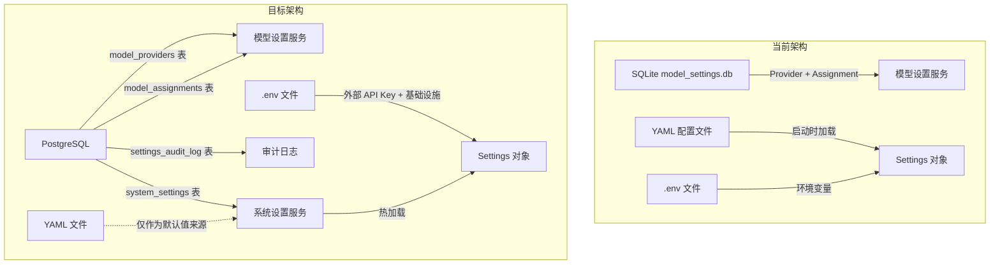
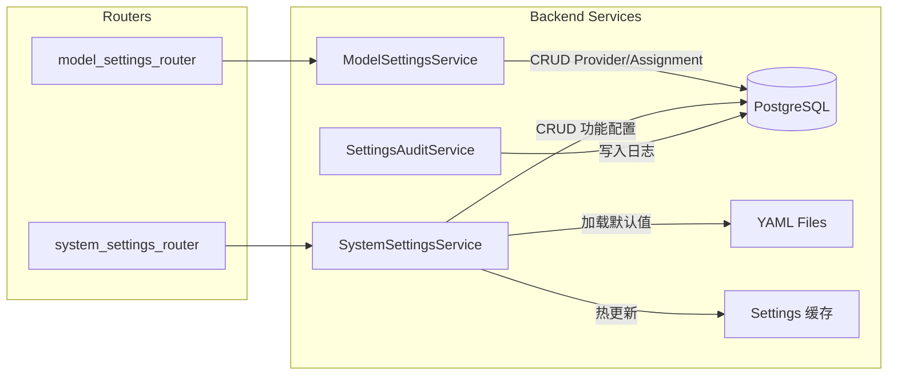

# 设置持久化 - Master Plan

## 概述

将 Ecliptrix 项目中所有运行时可配置的设置（模型设置、功能配置、运行参数）从当前分散的存储方式（SQLite + YAML 文件）统一迁移到 PostgreSQL 数据库，确保 `git pull + 重启` 更新部署后，之前配置的内容不受影响。

## 目标

1. **持久化保障**：所有设置存入 PostgreSQL，git pull 更新代码不会覆盖用户配置
2. **统一管理**：消除 SQLite + YAML 双重存储的碎片化问题
3. **可视化编辑**：扩展 AdminSettings 面板，为每类配置提供表单式编辑 UI
4. **即时生效**：设置保存后立即应用，无需重启服务
5. **版本兼容**：新版本新增设置项自动填充默认值，旧设置不丢失
6. **审计追踪**：简单记录配置修改人和修改时间

## 范围

### 纳入范围（In Scope）

| 配置类型 | 当前存储 | 迁移目标 |
|---------|---------|---------|
| 模型 Provider（名称、API URL、API Key） | SQLite `model_settings.db` | PostgreSQL `model_providers` 表 |
| 模型 Assignment（功能→模型映射） | SQLite `model_settings.db` | PostgreSQL `model_assignments` 表 |
| TTS 配置（并发、重试、声音列表100+） | `config/batch_tts_config.yaml` | PostgreSQL `system_settings` 表 |
| YouTube 配置（下载/上传/质量） | `config/youtube.yaml` | PostgreSQL `system_settings` 表 |
| 上传配置（并发、大小限制、缩略图） | `config/upload-config.yaml` | PostgreSQL `system_settings` 表 |
| 水印移除配置（并发、批处理） | `config/watermark_removal_config.yaml` | PostgreSQL `system_settings` 表 |
| 视频分析配置（队列、帧提取） | `config/video-analysis-config.yaml` | PostgreSQL `system_settings` 表 |

### 排除范围（Out of Scope）

- `.env` 中的外部 API 密钥（Pexels、Tavily、ARK、Volcano TTS、OSS 等）—— 保持 `.env` 管理
- `.env` 中的数据库连接字符串、服务器端口等基础设施配置
- 前端 localStorage 中的认证 token 和语言偏好
- 用户级别的个人偏好设置（当前方案为全局统一设置）

## 架构设计

### 数据层

### 数据库表设计

**新增表：**

1. **`model_providers`** — 从 SQLite 迁移，结构基本不变
   - `id` (UUID), `name`, `provider_type`, `api_url`, `api_key`, `created_at`, `updated_at`

2. **`model_assignments`** — 从 SQLite 迁移
   - `id` (UUID), `function_type`, `provider_id` (FK), `model_name`, `temperature`, `max_tokens`, `updated_at`

3. **`system_settings`** — 统一存储所有功能配置
   - `id` (UUID), `category` (e.g., 'tts', 'youtube', 'upload'), `key`, `value` (JSONB), `description`, `default_value` (JSONB), `value_type` (schema hint), `updated_at`, `updated_by`
   - 复合唯一约束: `(category, key)`

4. **`settings_audit_log`** — 审计日志
   - `id` (UUID), `category`, `key`, `changed_by`, `changed_at`, `action` ('create'|'update'|'delete'|'reset')

### 服务层

- **SystemSettingsService**：核心服务，管理所有功能配置的 CRUD，维护内存缓存，提供热重载
- **ModelSettingsService**：重构现有服务，从 SQLite 切换到 PostgreSQL（使用 async SQLAlchemy）
- **SettingsAuditService**：轻量审计，记录修改人和时间

### 热重载机制

1. 设置保存到数据库后，同步更新内存中的 Settings 缓存
2. 各 service 通过 `SystemSettingsService.get(category, key)` 获取最新值
3. 不需要消息队列或事件系统 —— 单实例部署，直接更新内存即可

### 默认值管理

- YAML 配置文件保留在代码库中，作为 **默认值定义来源**
- 首次启动或 `alembic upgrade head` 时，将 YAML 默认值写入 `system_settings` 表的 `default_value` 列
- 新版本新增的设置项：Alembic 迁移自动插入新行，`value` = `default_value`
- "恢复默认值" 功能：将 `value` 重置为 `default_value`

### 前端界面

扩展 `AdminSettingsPage` 侧边栏，新增面板：

| 面板名称 | 对应配置 |
|---------|---------|
| 模型设置 | （已有）Provider + Assignment |
| TTS 设置 | 并发/重试参数 + 声音列表管理 |
| YouTube 设置 | 下载/上传/质量/文件管理 |
| 上传设置 | 并发/大小限制/缩略图/临时文件 |
| 水印移除设置 | 并发/批处理参数 |
| 视频分析设置 | 队列/VLM/帧提取策略 |

每个面板提供：表单编辑 + 保存 + 恢复默认值按钮

## 设计决策

| 决策 | 选择 | 理由 |
|------|------|------|
| 功能配置存储格式 | JSONB `value` 列 | 灵活存储复杂嵌套结构（如声音列表），无需频繁改表 |
| 配置粒度 | category + key 二级结构 | 平衡查询效率和管理灵活性，例如 `tts.concurrency` 或 `tts.voices` |
| 缓存策略 | 内存字典 + 写时更新 | 单实例部署，无需 Redis；写操作时直接刷新缓存 |
| 默认值来源 | YAML 文件（只读） | 代码库中的 YAML 作为 "出厂设置" 定义，数据库中存实际值 |
| API Key 存储 | 保持 .env | 敏感密钥不入库，运维人员直接管理 .env 更安全 |
| 模型设置迁移 | 重写 service 层 | 从 aiosqlite 切换到 async SQLAlchemy，与主数据库统一 |

## 依赖与风险

### 依赖

- PostgreSQL 已部署并通过 `database.py` 连接
- Alembic 已配置并可运行
- AdminSettingsPage 组件已存在

### 风险

| 风险 | 影响 | 缓解措施 |
|------|------|---------|
| YAML→DB 默认值同步遗漏 | 新设置项缺失 | Alembic 迁移中显式列出所有默认值 |
| 模型设置服务重写影响现有功能 | 模型配置不可用 | 保持 API 接口不变，只改内部实现 |
| JSONB 复杂数据（如声音列表）编辑复杂 | UI 开发工作量大 | 表单式 UI + 声音列表专用组件 |
| 热重载未覆盖所有消费点 | 部分服务使用旧值 | 统一通过 SystemSettingsService 获取，禁止直接读 settings 对象 |

## 规格文档目录

| 编号 | 文件 | 内容 |
|------|------|------|
| 01 | `specs/01-database-schema.md` | 数据库表设计 + Alembic 迁移 |
| 02 | `specs/02-backend-services.md` | SystemSettingsService + ModelSettingsService 重构 + 热重载 |
| 03 | `specs/03-backend-api.md` | REST API 端点设计 |
| 04 | `specs/04-default-values.md` | YAML 默认值定义 + 初始化逻辑 + 恢复默认 |
| 05 | `specs/05-frontend-panels.md` | AdminSettings 扩展 + 各配置面板 UI |
| 06 | `specs/06-frontend-api-routes.md` | Next.js API proxy 路由 |
| 07 | `specs/07-migration-cleanup.md` | SQLite 移除 + 旧代码清理 + 向后兼容 |
