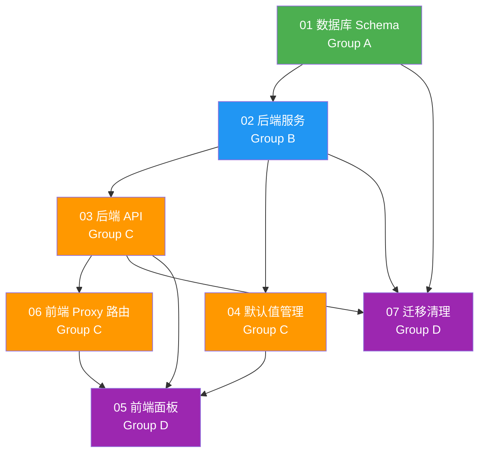

# Task Orchestration - 设置持久化

## 1. 依赖关系图



## 2. 执行阶段

### Phase 1 — 数据基础 (无依赖)

| 任务 | Agent | 预估复杂度 |
|------|-------|-----------|
| 01 数据库 Schema | Agent 1 | 中 |

### Phase 2 — 服务层 (依赖 Phase 1)

| 任务 | Agent | 预估复杂度 |
|------|-------|-----------|
| 02 后端服务 | Agent 2 | 高 |

### Phase 3 — API + 默认值 + Proxy (依赖 Phase 2, 可并行)

| 任务 | Agent | 预估复杂度 |
|------|-------|-----------|
| 03 后端 API | Agent 3 | 中 |
| 04 默认值管理 | Agent 4 | 中 |

等待 03 完成后:
| 任务 | Agent | 预估复杂度 |
|------|-------|-----------|
| 06 前端 Proxy 路由 | Agent 5 | 低 |

### Phase 4 — 前端面板 + 清理 (依赖 Phase 3, 可并行)

| 任务 | Agent | 预估复杂度 |
|------|-------|-----------|
| 05 前端面板 | Agent 6 | 高 |
| 07 迁移清理 | Agent 7 | 中 |

## 3. 关键路径

```
01 数据库 Schema → 02 后端服务 → 03 后端 API → 06 前端 Proxy → 05 前端面板
```

**瓶颈任务：**
- **02 后端服务** — 工作量最大（ModelSettingsService 重构 + SystemSettingsService 新建 + 缓存机制），阻塞所有下游
- **05 前端面板** — 5 个面板 + VoiceListEditor 专用组件，工作量大

## 4. Agent 分配

**推荐 Agent 数量：** 4 个（考虑依赖关系，实际最大并行度为 3）

| Agent | 负责任务 | 专长要求 |
|-------|---------|---------|
| Backend-DB Agent | 01 + 02 | SQLAlchemy ORM, Alembic, async Python |
| Backend-API Agent | 03 + 04 | FastAPI router, Pydantic models, YAML parsing |
| Frontend-Route Agent | 06 + 07 | Next.js API routes, TypeScript, cleanup |
| Frontend-UI Agent | 05 | React, shadcn/ui, Tailwind, 表单设计 |

### 协调要点

- **01→02 交接：** Agent 完成 ORM 模型后，下一 Agent 需要确认模型字段和关系
- **02→03 交接：** Service 方法签名确定后，API Agent 按签名实现路由
- **03→06 交接：** 后端端点 URL 和请求/响应格式确定后，Proxy Agent 按格式实现
- **04+06→05 交接：** 前端 UI Agent 需要确认 API client 接口和数据库中已有默认值

### Agent 出错处理

- 如果 Agent 无法完成任务（环境问题/依赖缺失），暂停并报告
- 如果某个 Agent 的代码导致其他 Agent 的代码不兼容，优先修复上游 Agent 的代码

## 5. Context Files（每个 Agent 必读）

### 所有 Agent 共读

- `docs/plans/settings-persistence/master-plan.md`
- `docs/plans/settings-persistence/task-orchestration.md`
- `CLAUDE.md`

### Backend-DB Agent (01 + 02)

- `backend-services/basic-service/app/models/db_models.py` — 现有 ORM 模型参考
- `backend-services/basic-service/app/database.py` — 数据库连接与 session 管理
- `backend-services/basic-service/app/services/model_settings_service.py` — 重构目标
- `backend-services/basic-service/app/models/model_settings_models.py` — Pydantic 模型
- `backend-services/basic-service/app/config.py` — Settings 对象结构
- `docs/plans/settings-persistence/specs/01-database-schema.md`
- `docs/plans/settings-persistence/specs/02-backend-services.md`
- `docs/plans/settings-persistence/todos/01-database-schema.md`
- `docs/plans/settings-persistence/todos/02-backend-services.md`

### Backend-API Agent (03 + 04)

- `backend-services/basic-service/app/routers/model_settings_router.py` — 现有 router 参考
- `backend-services/basic-service/app/services/model_settings_service.py` — service 接口
- `backend-services/basic-service/config/*.yaml` — 全部 5 个 YAML 配置文件
- `docs/plans/settings-persistence/specs/03-backend-api.md`
- `docs/plans/settings-persistence/specs/04-default-values.md`
- `docs/plans/settings-persistence/todos/03-backend-api.md`
- `docs/plans/settings-persistence/todos/04-default-values.md`

### Frontend-Route Agent (06 + 07)

- `src/app/api/model-settings/` — 现有 proxy 路由参考
- `src/lib/api/config.ts` — 现有 API client 参考
- `src/components/AdminSettings/ModelSettingsPanel.tsx` — 了解 provider_id 使用情况
- `backend-services/basic-service/app/main.py` — 了解 router 注册和 lifespan
- `docs/plans/settings-persistence/specs/06-frontend-api-routes.md`
- `docs/plans/settings-persistence/specs/07-migration-cleanup.md`
- `docs/plans/settings-persistence/todos/06-frontend-api-routes.md`
- `docs/plans/settings-persistence/todos/07-migration-cleanup.md`

### Frontend-UI Agent (05)

- `src/components/AdminSettings/AdminSettingsPage.tsx` — 现有设置页面
- `src/components/AdminSettings/ModelSettingsPanel.tsx` — UI 风格参考
- `src/components/AdminSettings/SettingsSidebar.tsx` — 侧边栏结构
- `src/lib/i18n.ts` — 国际化文件
- `src/components/ui/` — shadcn/ui 组件库
- `docs/plans/settings-persistence/specs/05-frontend-panels.md`
- `docs/plans/settings-persistence/todos/05-frontend-panels.md`
