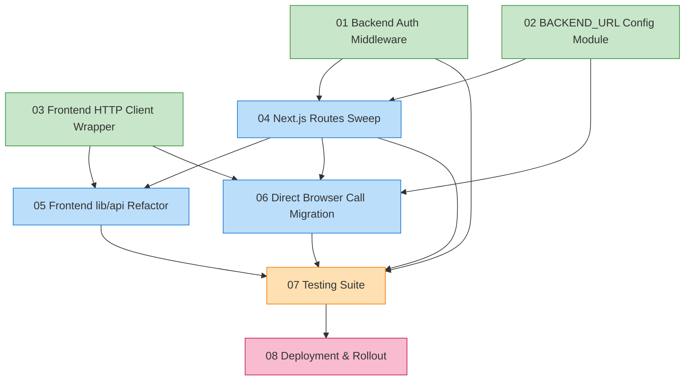

# Master Plan: Unified API & Auth Refactor

> **Topic:** `unified-api-auth-refactor`
> **Created:** 2026-04-07
> **Mode:** Full Process (full-auto) · Three-Powers Governance + Token Economy
> **Production target:** Singapore-01 (47.245.126.128, frontend :3088, backend :8088)

---

## 1. Overview

Ecliptrix 当前的内部接口调用层（前端 → Next.js API 路由 → FastAPI 后端）经过多人长期演进，已经陷入"碎片化、不一致、缺乏鉴权"的困境。本次重构的目标是把整条链路改造成**统一规格、端口可适配、强制登录**的可信调用层，并通过自动化测试 + 生产烟雾验证锁住质量基线。

重构动机来自一次真实事故：2026-04-07 把后端从 :8000 改到 :8088 部署到生产环境时，由于代码中存在 3 个不同的 backend URL 环境变量名（`BACKEND_URL` / `BACKEND_SERVICE_URL` / `PYTHON_BACKEND_URL`）且都硬编码 `localhost:8000` 兜底，只设置了其中一个变量就导致 80% 的接口落到失效的 fallback 上，全站 503/500。这次重构要彻底根治这一类碎片化问题，而不仅仅是打补丁。

---

## 2. Goals

| # | 目标 | 验收信号 |
|---|---|---|
| G1 | **接口调用统一规格** | 全栈只剩一种 backend URL 读取方式 + 一种前端 HTTP 调用方式 + 一种后端鉴权拦截方式 |
| G2 | **端口/环境完全可适配** | 切换 dev (3000/8000) ↔ 生产 (3088/8088) 仅修改 `.env` 一处，无需改任何代码 |
| G3 | **未登录无法调用任何业务接口** | 未携带有效 session token 的请求一律返回 401，包括目前裸奔的 video/chat/llm/intent-detection 等 |
| G4 | **消除浏览器直调后端** | 浏览器侧不再出现任何后端 URL，全部经 Next.js BFF 代理 |
| G5 | **建立质量回归基线** | 单元 + 集成 + 生产烟雾三层测试齐备，未来回归任何一条规则会立即报警 |

---

## 3. Non-Goals (Out of Scope)

明确**不**做的事，避免范围爬坡：

- ❌ 不重写任何业务逻辑（视频处理、AI 生成、TTS 等），只动接口层
- ❌ 不改变数据库 schema 或迁移数据
- ❌ 不引入 JWT / OAuth — 继续沿用现有 session token + 单设备登录模型
- ❌ 不引入 React Query / SWR / axios — 继续用原生 fetch + 轻量包装器
- ❌ 不动 OpenAPI / 自动代码生成工具链 — 保留人工维护的 typed client
- ❌ 不重构 Next.js 之外的 chat 直连 LLM 路由（`process.env.LLM_API_URL`），那是直连第三方而非内部接口
- ❌ 不调整前端 UI / 用户体验（除登录态过期跳转登录页这一处必要变更）
- ❌ 不实现 CSRF token / refresh token / token rotation — 留给后续独立工作
- ❌ 不动后端的多 LLM 配置体系（`AGENT_LLM_API_XX_*`）

---

## 4. Current State Summary（要根治的痛点）

基于 Phase 0 的代码探索，明确以下问题：

### 4.1 后端 URL 碎片化
- **3 个不同的环境变量名**（数据来自 Phase 0 grep，截至 2026-04-07）：
  - `BACKEND_URL` — 67 处，分布在 `src/app/api/**/route.ts`
  - `BACKEND_SERVICE_URL` — 13 处
  - `PYTHON_BACKEND_URL` — 4 处
  - 合计 84 个 callsite 需要在本次重构中收敛到统一入口
- **每处都硬编码 `|| 'http://localhost:8000'` 兜底**：生产环境 fallback 直接打到不存在的 :8000
- **没有统一读取层**：每个 route handler 自己 `process.env.X || 'http://localhost:8000'`

### 4.2 浏览器直调后端
- 3 个文件用 `NEXT_PUBLIC_*` 把后端地址暴露到浏览器：
  - `src/lib/intent-detection-service.ts` → 调 `/api/intent-detection/detect`
  - `src/lib/api/llm.ts` → 调 `/api/llm/models`
  - `src/lib/api/audioTranscription.ts` → 调 `/api/audio/transcribe-local`
- 安全风险：浏览器侧任何人都能直接构造请求绕过 BFF

### 4.3 鉴权碎片化
- 后端有完善的 `get_current_user` / `require_admin` / `require_root` dependencies (`app/dependencies/auth.py`)
- 但**只有 ~20% 的路由使用了**：仅 user/admin/system_settings 类
- **~80% 的路由完全裸奔**：video/compose, audio/transcribe, llm/models, chat, intent-detection, image, workflow, youtube ……
- Next.js 路由中**只有约一半转发 `Authorization` header**，另一半丢失

### 4.4 前端 HTTP 调用碎片化
- `src/lib/api/` 下 14 个 service 文件，**每个独立实现 fetch 调用**
- 仅 `userManagement.ts` / `systemSettings.ts` 用 `getAuthHeaders()` helper
- 没有统一的 401 处理、错误格式、超时、重试

---

## 5. Target Architecture

```
┌─────────────── Browser ───────────────┐
│                                       │
│   React Components / Hooks            │
│            ↓                          │
│   src/lib/api/<feature>.ts            │
│   (typed clients, no auth logic)      │
│            ↓                          │
│   src/lib/api/http-client.ts          │
│   • injects Authorization from        │
│     localStorage('ecliptrix-          │
│     session-token')                   │
│   • 401 → AuthContext.logout() +      │
│     redirect to login                 │
│   • unified error format              │
│   • timeout / retry / abort           │
│            ↓                          │
└────────────┼──────────────────────────┘
             ↓ HTTPS
┌────────── Next.js BFF ────────────────┐
│                                       │
│   src/app/api/**/route.ts             │
│   (THIN proxies, no business logic)   │
│            ↓                          │
│   src/lib/config/backend.ts           │
│   • single source of truth            │
│   • reads BACKEND_URL once            │
│   • throws at boot if missing         │
│   • validates URL format              │
│            ↓                          │
│   internal helper:                    │
│     proxy(request, '/api/path')       │
│   • forwards Authorization header     │
│   • forwards method/body              │
│   • normalizes error responses        │
│            ↓                          │
└────────────┼──────────────────────────┘
             ↓ localhost
┌──────── FastAPI Backend ──────────────┐
│                                       │
│   AuthMiddleware (NEW)                │
│   • intercepts ALL requests           │
│   • allowlist: /api/auth/login,       │
│     /register, /validate-session,     │
│     /api/health, /docs, /openapi.json │
│   • everything else → must have       │
│     valid session token in            │
│     Authorization header              │
│   • populates request.state.user      │
│            ↓                          │
│   Routers (existing)                  │
│   • role checks via require_admin /   │
│     require_root dependencies         │
│   • per-route Depends(get_current_    │
│     user) becomes redundant — middle  │
│     ware already validates            │
│            ↓                          │
│   Services (unchanged)                │
└───────────────────────────────────────┘
```

### 5.1 Layer responsibilities

| Layer | Responsibility | Forbidden |
|---|---|---|
| React component | Trigger user actions, render data | Direct fetch, hardcoded URLs |
| `src/lib/api/<feature>.ts` | Typed function signatures, request shaping | Read env vars, call fetch directly, manage auth |
| `src/lib/api/http-client.ts` | Inject auth, handle 401, format errors, retry | Know about specific endpoints |
| Next.js `route.ts` | Forward request to backend, never mutate body | Read business data, run logic, hardcode URLs |
| `src/lib/config/backend.ts` | Read & validate `BACKEND_URL` once at module load | Be re-imported with different values |
| FastAPI `AuthMiddleware` | Validate session token for non-allowlisted paths | Apply role checks (left to dependencies) |
| FastAPI router | Business logic, role checks via existing deps | Auth presence checks (middleware handles) |

---

## 6. Key Design Decisions

### D1 — Single `BACKEND_URL` env var
**Decision:** Deprecate `BACKEND_SERVICE_URL` and `PYTHON_BACKEND_URL`. Keep only `BACKEND_URL`.
**Rationale:** Three env var names served zero purpose and caused a real production outage.
**Migration:** Sweep all 17 references to the deprecated names → switch to `BACKEND_URL`. The deprecated names are removed from code in the same PR (atomic). The deploy `.env` files (`backend-services/basic-service/env.template`, root `env.template`, Singapore-01 `/root/ecliptrix/.env`) are updated to set only `BACKEND_URL`.
**Stale env vars on machines:** If a developer or operator leaves `BACKEND_SERVICE_URL` / `PYTHON_BACKEND_URL` defined in their local `.env`, those variables become **no-ops** the moment this PR merges — nothing in the codebase reads them anymore. They will not cause failures, but they also will not help if `BACKEND_URL` is missing. The PR description and `env.template` diff make this explicit.

### D2 — Centralized config module `src/lib/config/backend.ts`
**Decision:** Create a single Server-Side TypeScript module that reads `process.env.BACKEND_URL`, validates the format, and exports a typed object. Routes import from it; never read env directly.
**Rationale:** Eliminates ~84 scattered `process.env.* || 'http://localhost:8000'` fallback strings. Forces a single failure point — if `BACKEND_URL` is missing or malformed, the Next.js server fails fast at boot, not at request time.
**No fallback in production code:** The module **must throw** at module load if `BACKEND_URL` is unset whenever `NODE_ENV !== 'test'`. The literal string `'http://localhost:8000'` MUST NOT appear anywhere under `src/`. Test setups inject `BACKEND_URL` via the test runner's environment (e.g., `vitest`/`jest` setup files or `process.env.BACKEND_URL = ...` in a test bootstrap), not via a code-level fallback. This keeps Success Criterion #3 enforceable.

### D3 — Lightweight fetch wrapper, no React Query
**Decision:** Build `src/lib/api/http-client.ts` as a thin function-based wrapper. No class hierarchy, no SWR.
**Rationale:** The repo has no existing React Query usage. Adding it would touch 14+ client files unnecessarily. A 100-line fetch wrapper hits all our requirements without dependency creep.
**Wrapper API (pseudocode):**
```ts
http.get<TResponse>(path, options?)   // GET, no body
http.post<TResponse>(path, body, options?)   // JSON body
http.put<TResponse>(path, body, options?)
http.del<TResponse>(path, options?)
http.upload<TResponse>(path, formData, options?)   // multipart, no auto JSON
```
Options include: `requireAuth: boolean = true`, `signal?: AbortSignal`, `timeoutMs?: number`, `headers?: Record<string,string>`. Auth is opt-out (default ON) so forgetting to set `requireAuth` keeps you secure by default.

### D4 — FastAPI middleware + minimal allowlist
**Decision:** Implement `AuthMiddleware` registered in `app/main.py`. Allowlist contains only authentication entry points and infrastructure endpoints.
**Allowlist (final, post Phase 3.7):**
```
/api/auth/login
/api/auth/register
/api/auth/validate-session
/api/health
/api/health/                    (trailing slash)
/docs
/redoc
/openapi.json
/static/                        (prefix match — frontend assets + /static/timeline_exports/)
/api/storage/files/             (prefix match — user-uploaded media, see note)
/api/audio/generated/           (prefix match — Phase 3.7 — TTS-generated audio mount)
/api/audio/subtitles/           (prefix match — Phase 3.7 — generated subtitle files mount)
```
**Note on the 4 static-mount prefixes (`/static/`, `/api/storage/files/`, `/api/audio/generated/`, `/api/audio/subtitles/`):** Each corresponds to an `app.mount(...)` call in `app/main.py` serving binary media via FastAPI `StaticFiles`. The browser requests these files via `<audio src=>` / `<video src=>` / `` tags which **cannot** send custom Authorization headers — therefore middleware-level auth is structurally impossible without rewriting every consumer to fetch the bytes via JS first. Locking these down requires **signed URLs** (Risk R3, deferred to a separate ticket).

**Phase 3.7 (2026-04-07) note:** The original D4 allowlist only enumerated `/api/storage/files/`. The dev-server test on 2026-04-07 served a 401 on a TTS audio file (`/api/audio/generated/agent-segment-0_concatenated_*.mp3`), revealing that the spec missed 2 of the 4 static mounts documented in CLAUDE.md. Added in Phase 3.7 along with regression tests T16-T18 in `tests/test_auth_middleware.py`. **The new rule: every `app.mount(...)` call in `app/main.py` MUST have a corresponding entry in `ALLOWLIST_PREFIX` until signed-URL gating ships.**

**Rationale:** Middleware wins over per-route dependencies because:
1. New routes are secure by default (developer cannot forget `Depends`)
2. The audit becomes a single point check rather than 90+ per-endpoint
3. Middleware can populate `request.state.user` once, eliminating duplicate DB lookups

### D5 — Atomic single-PR migration
**Decision:** All changes ship in one branch + one PR + one deploy.
**Rationale:** The blast radius of a half-migrated state (e.g., backend enforcing auth before frontend sends headers) is much worse than the risk of a large PR. The work is inherently coupled.
**Risk mitigation:** Heavy automated testing + production smoke check + a documented rollback (revert the merge commit).

### D6 — Three-tier testing
**Decision:** Add tests at three layers, each catching a different class of regression:
- **Unit tests** (backend pytest + new Next.js handler unit tests with mocked fetch) — verify the *contract* of middleware, dependency, wrapper
- **Integration tests** (existing pytest suite + new end-to-end auth flow test using a real Next.js test server) — verify the *interaction* across layers
- **Production smoke** (`scripts/smoke-api-auth.sh`) — verifies *deployment correctness* by curling every public/protected endpoint and asserting expected status codes (401 vs 200)
**Rationale:** Each layer catches what the others miss. The smoke script doubles as a regression detector for future deploys.

### D7 — 401 = client logout + redirect
**Decision:** When the HTTP client receives a 401, it MUST call `AuthContext.logout()` and redirect to `/login` (unless already there). It MUST NOT silently retry.
**Rationale:** A 401 means the session is genuinely invalid. Retrying or hiding the error leaves the user in a confused state. This decision is intentional UX overhead that we accept.

### D8 — Header forwarding standard
**Decision:** Next.js routes forward exactly **one** auth header to the backend: `Authorization: Bearer <token>`. The backend recognizes both `Authorization: Bearer` and the legacy `x-session-token` (already supported in `dependencies/auth.py`), but the frontend only sends the canonical form.
**Rationale:** Reduces test surface and avoids the trap of adding new header names later.

### D9 — Direct browser calls → migrate, do not patch
**Decision:** The 3 files using `NEXT_PUBLIC_BACKEND_URL` / `NEXT_PUBLIC_API_BASE_URL` are refactored to call new Next.js proxy routes. The two `NEXT_PUBLIC_*` env vars are deleted.
**Rationale:** Patching them with auth headers would still leak the backend URL into the browser, violating G4. Migration is the only way to truly enforce BFF.

---

## 7. Spec Breakdown (Table of Contents)

| # | Spec | Owner role | Spec file |
|---|---|---|---|
| 01 | Backend Auth Middleware + Allowlist | dev (backend) | [specs/01-backend-auth-middleware.md](specs/01-backend-auth-middleware.md) |
| 02 | Backend URL Config Module (frontend side) | dev (frontend) | [specs/02-backend-url-config-module.md](specs/02-backend-url-config-module.md) |
| 03 | Frontend HTTP Client Wrapper | dev (frontend) | [specs/03-frontend-http-client-wrapper.md](specs/03-frontend-http-client-wrapper.md) |
| 04 | Next.js Routes Layer Sweep | dev (frontend) | [specs/04-nextjs-routes-sweep.md](specs/04-nextjs-routes-sweep.md) |
| 05 | Frontend lib/api Modules Refactor | dev (frontend) | [specs/05-frontend-lib-api-refactor.md](specs/05-frontend-lib-api-refactor.md) |
| 06 | Direct Browser Call Migration | dev (frontend) | [specs/06-direct-browser-call-migration.md](specs/06-direct-browser-call-migration.md) |
| 07 | Testing Suite (Unit + Integration + Smoke) | dev (full-stack) | [specs/07-testing-suite.md](specs/07-testing-suite.md) |
| 08 | Deployment & Rollout Playbook | dev (devops) | [specs/08-deployment-rollout.md](specs/08-deployment-rollout.md) |

---

## 8. Cross-Spec Dependencies



**Edge legend:**
- S02 → S04 / S06: route handlers (existing and newly created proxies) need the centralized backend URL config
- S03 → S05 / S06: typed lib/api clients (and migrated direct-call modules) consume the http-client wrapper
- S01 → S04: routes layer must forward `Authorization` headers consistently because the backend middleware now enforces auth on every protected path
- S04 → S05 / S06: the Next.js route contract (path shape, error envelope) must be settled before client-side modules bind to it
- S0{1..6} → S07: testing exercises the union of all changes
- S07 → S08: deployment is gated by passing the test suite

**Critical path:** S02 → S04 → S05 → S07 → S08 (URL config module → routes sweep → client refactor → testing → deploy)

---

## 9. Risks & Mitigations

| # | Risk | Likelihood | Impact | Mitigation |
|---|---|---|---|---|
| R1 | Atomic migration breaks production on deploy | M | High | Three-tier testing + production smoke script + documented revert procedure |
| R2 | Allowlist too narrow → legitimate flow returns 401 | M | Med | Integration test exercises every page/feature; smoke script validates key flows |
| R3 | All 4 FastAPI `StaticFiles` mounts (`/api/storage/files/`, `/api/audio/generated/`, `/api/audio/subtitles/`, `/static/timeline_exports/` via `/static/`) remain publicly readable. The browser requests these via `<audio>` / `<video>` / `` tags which cannot send Authorization headers, so middleware-level auth is structurally impossible without signed URLs. **Phase 3.7 expanded the allowlist to cover all 4 mounts** (the original spec only listed 2). | Certain (accepted) | Low | Explicitly allowlisted, documented as known gap in S01 §4 + D4 above, signed-URL work tracked as a separate follow-up ticket. **Going forward: any new `app.mount(...)` call in `app/main.py` MUST add a matching `ALLOWLIST_PREFIX` entry, enforced by the drift sentinel test in `test_auth_middleware.py`.** |
| R4 | Long-running tasks (video compose) lose token before completion | L | Med | Token never expires server-side; session validation is per-request, not per-task |
| R5 | Middleware DB lookup adds latency to every request | M | Low | Cache user lookup per-request via `request.state.user`; consider in-memory LRU later |
| R6 | Old `.env` files on developer machines still set 3 vars | H | Low | Update `env.template`, document in PR. Stale vars become no-ops after merge |
| R7 | Background workers / cron jobs without session token break | L | Med | Audit `app/services/` for any in-process self-call to API endpoints. None expected (services use direct DB / function calls), but this must be explicitly verified during S01 implementation |
| R8 | The 3 NEXT_PUBLIC files are referenced from non-React code | L | Low | S06 must grep for all usages before deleting the env vars |
| R9 | Atomic PR is too large to review | M | Low | Three-Powers Governance ensures multi-agent review; spec breakdown keeps each task <500 LoC |

---

## 10. Success Criteria (Definition of Done)

The refactor is complete when ALL of the following are true:

1. ✅ `grep -r "BACKEND_SERVICE_URL\|PYTHON_BACKEND_URL\|NEXT_PUBLIC_BACKEND_URL\|NEXT_PUBLIC_API_BASE_URL" src/` returns ZERO matches
2. ✅ `grep -r "process.env.BACKEND_URL" src/app/api/` returns ZERO matches (all routes now import the config module)
3. ✅ `grep -r "'http://localhost:8000'" src/` returns ZERO matches (no fallback strings)
4. ✅ **(Hardened in Phase 3.6)** No raw `fetch('/api/...')` call sites anywhere in `src/` outside the wrapper itself. The original criterion only checked `src/lib/api/*.ts`, which left `src/components/**` unaudited — the dev-server test on 2026-04-07 caught 31 unmigrated component files. The hardened guard is:
   ```bash
   grep -rE "fetch\(['\"]/api/" src/ --include='*.ts' --include='*.tsx' \
     | grep -v 'src/lib/api/http-client.ts' \
     | grep -v 'src/lib/api/server/backend-proxy.ts' \
     | grep -v '__tests__'
   ```
   This guard MUST return zero matches and is enforced by `scripts/preflight.sh` G5. **Phase 3.6 also added `http.stream(path, body?, opts?)` to `http-client.ts`** to support 6 SSE/chunked streaming endpoints (`/api/chat`, `/api/video-editing-chat`, `/api/content-polish-multiple`, `/api/creative-brainstorming`) that the JSON-only `http.{get,post,put,del,upload}` couldn't handle.
5. ✅ FastAPI `AuthMiddleware` is registered in `main.py` and unit-tested
6. ✅ All backend pytest tests pass
7. ✅ New integration test exercises: anonymous → 401, login → 200, logout → 401
8. ✅ New `scripts/smoke-api-auth.sh` runs against Singapore-01 and reports all endpoints in expected status
9. ✅ Production deployment succeeds, frontend `:3088` serves, backend `:8088` responds
10. ✅ Manual flow check: open ecliptrix.com, login, navigate to video editor, verify all features load
11. ✅ Token Economy: no agent eliminated for Conservatism Kills (no half-finished migrations) — the Inspector confirms full coverage at settlement

---

## 11. Rollout Plan

### 11.1 Pre-deployment
- Code freeze on `main` for the duration of the merge
- Confirm Singapore-01 currently healthy (`curl https://ecliptrix.com/api/health`)
- Backup `.env` on Singapore-01

### 11.2 Deployment sequence
1. Merge PR to `main`
2. SSH to Singapore-01: `cd /root/ecliptrix && git pull`
3. Update `.env`: set `BACKEND_URL=http://localhost:8088`. Remove `BACKEND_SERVICE_URL` and `PYTHON_BACKEND_URL` for cleanliness — leaving them defined is harmless (they are no-ops post-merge) but removing them prevents future confusion.
4. `bash ops/deploy.sh` (existing deploy script)
5. Wait for systemd `ecliptrix-frontend` and `ecliptrix-backend` to be `active`
6. Run `scripts/smoke-api-auth.sh https://ecliptrix.com` from local
7. Manual check: login flow works, video editor loads, no 401s in browser console

### 11.3 Rollback
- If smoke fails at step 6: `git revert <merge-commit>`, redeploy. The atomic nature means revert is clean.
- If only one feature breaks: hot-fix forward (faster than full revert)

### 11.4 Post-deployment
- Monitor watchdog logs for 24h
- Document the refactor in the project wiki
- Create follow-up tickets for: signed-URL storage, CSRF, refresh tokens

---

## 12. Glossary

- **BFF (Backend For Frontend):** Architectural pattern where a server-side proxy (Next.js routes) sits between browser and the real backend, handling auth, request shaping, etc.
- **Allowlist:** The set of paths exempt from auth middleware enforcement
- **Session token:** Opaque random string stored in `User.active_session_token` (single-device login)
- **Atomic migration:** Single PR changing both producer and consumer simultaneously, no intermediate broken state
- **Three-Powers Governance:** Execution mode in which work is carried out by three independent agents — Executor (writes code), Reviewer (challenges design and correctness), Inspector (verifies completeness against the spec at settlement)
- **Token Economy:** Settlement model that rewards/penalizes agents based on outcomes; "Conservatism Kills" is one of its rules
- **Conservatism Kills:** Token Economy rule — incomplete/cautious work is penalized more than ambitious failure
