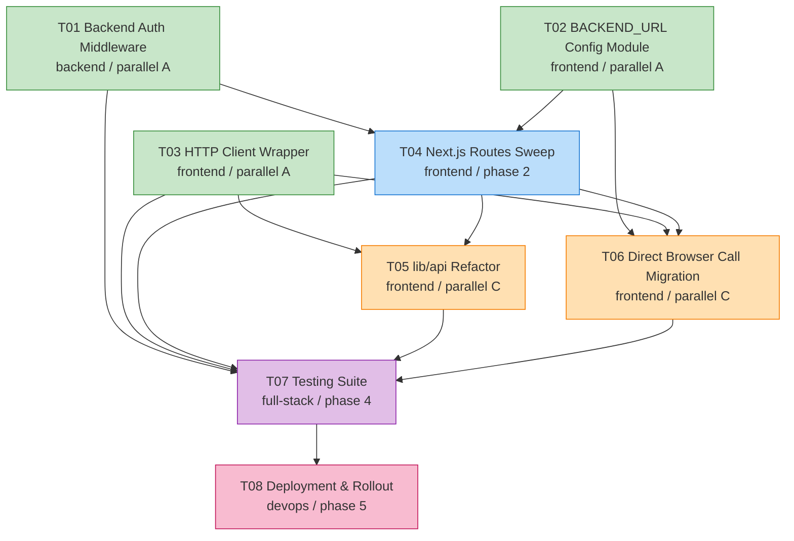

# Task Orchestration: Unified API & Auth Refactor

> **Topic:** `unified-api-auth-refactor`
> **Mode:** Full Process · Full-Auto · Three-Powers Governance + Token Economy
> **Production target:** Singapore-01 (47.245.126.128, frontend :3088, backend :8088)

This file is the **single source of truth** for execution sequencing. It is consumed by the orchestrator when launching dev / reviewer / tester / inspector agents in Phase 4-5.

---

## 1. Dependency Graph



**Edge legend:**
- `T01 → T04`: backend middleware enforces auth; routes layer must guarantee header forwarding
- `T01 → T07`: integration tests cannot exist without the middleware live
- `T02 → T04 / T06`: route handlers (existing + new proxies) need the centralized backend URL config
- `T03 → T05 / T06 / T07`: typed clients (existing, migrated, and tested) consume the http-client wrapper
- `T04 → T05 / T06`: route contract (path shape, error envelope) settled before clients bind to it
- `T04 → T07` and `T05/T06 → T07`: testing exercises the union of all changes
- `T07 → T08`: deployment is gated by passing the test suite

---

## 2. Execution Phases

The dependency graph collapses into **5 sequential phases**. Within a phase, tasks run in parallel.

### Phase 1 — Independent foundations (3 dev agents in parallel)

| Task | Agent | Layer | LoC est |
|---|---|---|---|
| T01 | dev-01 (backend) | FastAPI middleware + dependency adjustment | ~520 |
| T02 | dev-02 (frontend) | Server-side config module | ~230 |
| T03 | dev-03 (frontend) | Browser HTTP wrapper | ~675 |

**Gating:** all 3 must pass review + test before Phase 2 begins.

**Concurrent agents in Phase 1: 3 dev + 2 reviewer + 1 tester + 1 inspector = 7 (at the cap).**

### Phase 2 — Routes layer sweep (1 dev agent)

| Task | Agent | Layer | LoC est |
|---|---|---|---|
| T04 | dev-04 (frontend) | Next.js routes sweep + helper | helper +650, routes net -2000 |

**Why solo:** T04 modifies ~90 route files. Parallelizing this task would create unavoidable merge conflicts. Single agent owns the entire sweep.

**Concurrent agents in Phase 2: 1 dev + 1 reviewer + 1 tester + 1 inspector = 4.**

### Phase 3 — Client refactor + direct-call migration (2 dev agents in parallel)

| Task | Agent | Layer | LoC est |
|---|---|---|---|
| T05 | dev-05 (frontend) | lib/api refactor + 2 new clients | net -240 |
| T06 | dev-06 (frontend) | 4 new proxy routes + 3 file migration + 1 route deletion | net -190 |

**No file overlap:** S05 owns `src/lib/api/*.ts` minus the 3 NEXT_PUBLIC files (`audioTranscription.ts`, `llm.ts`, `intent-detection-service.ts` which lives in `src/lib/`) PLUS the `src/components/AdminSettings/components/useSettingsPanel.ts` hook PLUS 2 new clients (`src/lib/api/auth.ts`, `src/lib/api/workflowPreferences.ts`). S06 owns the 3 direct-call source files, 4 new proxy routes under `src/app/api/`, the deletion of `src/app/api/intent-detection/route.ts`, and the rewrite of `src/app/api/video-editing-chat/route.ts` (server-to-server intent detection). The two scopes are explicitly disjoint.

**Concurrent agents in Phase 3: 2 dev + 1 reviewer + 1 tester + 1 inspector = 5.**

### Phase 4 — Testing infrastructure (1 dev agent)

| Task | Agent | Layer | LoC est |
|---|---|---|---|
| T07 | dev-07 (full-stack) | Vitest setup + integration + smoke | ~1280 |

**Single owner:** the test infra is one cohesive deliverable; one agent.

**Concurrent agents in Phase 4: 1 dev + 1 reviewer + 1 tester + 1 inspector = 4.**

### Phase 5 — Deployment (1 dev agent)

| Task | Agent | Layer | LoC est |
|---|---|---|---|
| T08 | dev-08 (devops) | Runbook + dry-run + production deploy | ~550 (docs only) |

**Sequential and irreversible:** the final step. The dev agent here is acting as the operator running the playbook.

**Concurrent agents in Phase 5: 1 dev + 1 reviewer + 1 tester + 1 inspector = 4.**

---

## 3. Critical Path

The longest dependency chain through the graph has length 5. There are several length-5 chains because T01/T02 both feed T04 and T05/T06 both run in Phase 3:

```
T02 → T04 → T05 → T07 → T08    (canonical, matches master plan §8)
T01 → T04 → T05 → T07 → T08    (parallel, same length — T01 is the other Phase 1 input to T04)
T02 → T04 → T06 → T07 → T08    (parallel, same length — T06 is the other Phase 3 branch)
T01 → T04 → T06 → T07 → T08    (parallel, same length)
```

**Critical path tasks:** T01, T02, T04, T05, T06, T07, T08 (T03 is the only non-critical task — its longest path is `T03 → T05 → T07 → T08` of length 4). The canonical path used by the master plan is `T02 → T04 → T05 → T07 → T08`.

**Bottleneck task:** T04 (Next.js routes sweep) — single-agent ownership of ~90 file edits. Any delay here pushes Phase 3 + 4 + 5 by the same amount.

**Mitigation for T04:**
- The dev agent has the helper from Section 3 of the spec to leverage; transformations are mostly mechanical
- Dynamic-route patterns are pre-classified in spec §3.0
- Special-case routes are pre-listed in spec §5
- The reviewer agent has the spec audit table as a pre-built checklist

---

## 4. Agent Assignments

### 4.1 Team composition (Three-Powers Governance + Token Economy)

| Role | Count | Notes |
|---|---|---|
| Development (`dev-XX`) | 8 (one per task) | Runs sequentially across phases — only 1-3 concurrent at any moment |
| Reviewer (`reviewer-XX`) | 2-3 | Reused across phases; 1 per 2-3 dev agents |
| Tester (`tester-XX`) | 2 | Reused across phases; at least 1 per phase |
| Inspector (`inspector`) | 1 | Global across all phases — sole authority for token operations |

**Concurrent cap:** ≤ 7 agents at any moment. Maximum concurrency reached in Phase 1 (3 dev + 2 reviewer + 1 tester + 1 inspector = 7).

### 4.2 Task → agent mapping

| Task | Phase | Suggested agent ID | Suggested reviewer | Suggested tester |
|---|---|---|---|---|
| T01 | 1 | `google-dev-01` (backend) | `google-reviewer-01` | `google-tester-01` |
| T02 | 1 | `google-dev-02` (frontend) | `google-reviewer-01` | `google-tester-01` |
| T03 | 1 | `google-dev-03` (frontend) | `google-reviewer-02` | `google-tester-01` |
| T04 | 2 | `google-dev-04` (frontend) | `google-reviewer-02` | `google-tester-02` |
| T05 | 3 | `google-dev-05` (frontend) | `google-reviewer-01` | `google-tester-02` |
| T06 | 3 | `google-dev-06` (frontend) | `google-reviewer-02` | `google-tester-02` |
| T07 | 4 | `google-dev-07` (full-stack) | `google-reviewer-01` | `google-tester-01` |
| T08 | 5 | `google-dev-08` (devops) | `google-reviewer-02` | `google-tester-02` |
| (all phases) | 1-5 | — | — | `google-inspector` |

**Naming convention:** `<team>-<role>-<NN>` where team is `google` (chosen team profile — Google Core Engineering Team), role is `dev` / `reviewer` / `tester` / `inspector`, NN is zero-padded ordinal.

### 4.3 Coordination notes per phase

- **Phase 1 (T01+T02+T03 in parallel):** Three dev agents work on disjoint files. The reviewer agents review their assigned dev outputs as they complete. Inspector tracks tokens. The 3 dev agents must NOT touch each other's directories. The shared file is `src/contexts/AuthContext.tsx` (T03 modifies it) — flag as a potential coordination hot-spot
- **Phase 2 (T04 alone):** Solo execution. Reviewer + tester operate as normal. The other Phase 1 reviewers are on standby for Phase 3
- **Phase 3 (T05+T06 in parallel):** No file overlap — S05 owns `src/lib/api/*.ts` (excluding 3 NEXT_PUBLIC files) and `useSettingsPanel.ts`; S06 owns the 3 NEXT_PUBLIC files and the 4 new proxy routes. T06 must verify with T04 owner that the helper supports large multipart bodies before creating audio routes
- **Phase 4 (T07 alone):** Solo. T07 RUNS all the tests delivered by T01-T06 — if any sister test fails, T07 escalates to the corresponding agent for fix (not its own job to fix)
- **Phase 5 (T08 alone):** Final. T08 is also the integration verification step. Inspector runs the final settlement after deploy succeeds

---

## 5. Required Reading per Agent

Every dev agent MUST read these files BEFORE writing any code:

### 5.1 Universal reading list (every agent, every phase)

- `docs/plans/unified-api-auth-refactor/master-plan.md`
- `docs/plans/unified-api-auth-refactor/task-orchestration.md` (this file)
- `docs/plans/unified-api-auth-refactor/summaries/global-context.md` (Phase 2+)
- `CLAUDE.md` (project-level conventions)

### 5.2 Per-task reading list

| Task | Spec | TODO | Plus context |
|---|---|---|---|
| T01 | `specs/01-backend-auth-middleware.md` | `todos/01-backend-auth-middleware.md` | `app/dependencies/auth.py`, `app/main.py`, `app/models/base_models.py` |
| T02 | `specs/02-backend-url-config-module.md` | `todos/02-backend-url-config-module.md` | `next.config.js`, `tsconfig.json`, root `env.template`, `package.json` |
| T03 | `specs/03-frontend-http-client-wrapper.md` | `todos/03-frontend-http-client-wrapper.md` | `src/contexts/AuthContext.tsx`, `src/lib/api/userManagement.ts` (sample) |
| T04 | `specs/04-nextjs-routes-sweep.md` + S01, S02 | `todos/04-nextjs-routes-sweep.md` | All of `src/app/api/**/route.ts`, plus the audit from T01 (`audit/backend-route-protection.md`) |
| T05 | `specs/05-frontend-lib-api-refactor.md` + S03, S04 | `todos/05-frontend-lib-api-refactor.md` | All of `src/lib/api/*.ts`, `src/components/AdminSettings/components/useSettingsPanel.ts` |
| T06 | `specs/06-direct-browser-call-migration.md` + S02, S03, S04 | `todos/06-direct-browser-call-migration.md` | The 3 NEXT_PUBLIC files, `src/app/api/intent-detection/route.ts`, `src/app/api/video-editing-chat/route.ts`, the 3 backend routers (`intent_detection_router.py`, `llm_router.py`, `audio_router.py`) |
| T07 | `specs/07-testing-suite.md` + ALL prior specs | `todos/07-testing-suite.md` | `package.json`, `backend-services/basic-service/tests/conftest.py` |
| T08 | `specs/08-deployment-rollout.md` + S07 | `todos/08-deployment-rollout.md` | `ops/deploy.sh`, `ops/healthcheck.sh`, `ops/config.env`, prior audit deliverables |

### 5.3 Reviewer/tester reading

- Reviewer reads: dev's deliverable + spec + master plan + relevant prior dev summaries
- Tester reads: dev's deliverable + spec + reviewer's Meta/Verdict only (not full review body) + master plan
- Inspector reads: ALL summaries in current phase + global-context.md + token-economy-rules

### 5.4 Audit deliverables to be produced

| Audit doc | Owner task | Consumed by |
|---|---|---|
| `audit/backend-route-protection.md` | T01 | T04, T07, T08 |
| `audit/route-sweep-audit.md` | T04 | T05, T06, T07 |
| `audit/lib-api-refactor-audit.md` | T05 | T07 |
| `audit/direct-call-migration-audit.md` | T06 | T07 |
| `audit/test-coverage-audit.md` | T07 | T08 |
| `audit/deployment-audit.md` | T08 | (terminal — Inspector verifies) |

---

## 6. Remote Server Configuration

> **Server purpose:** Production deployment + final smoke verification

### 6.1 Server inventory

| Server | Host | User | Auth | Purpose | Sync strategy |
|---|---|---|---|---|---|
| Singapore-01 (PROD) | 47.245.126.128 | root | SSH key `G:\projects\takoAI\JR-Development-Skills\servers\singpore-01\inkclaw-singpore-260322.pem` | Production target — final deploy + verification | Phase 5 only (T08) |
| Dev server (optional) | 192.168.1.7 | kt | Password auth via paramiko (not key-based; sshpass unreliable on Windows). Backend `:8000`, frontend `:3010`, project path `/home/kt/tako/Ecliptrix`, conda env `ecliptrix`, Node via `nvm use 22` | Pre-production dry-run | Phase 5 only (T08 dry-run step) |

### 6.2 Per-task server usage

| Task | Sync after each file change? | Run remote tests? | Deploy? |
|---|---|---|---|
| T01-T06 | NO — local development only. Optional staging sync to prod for spot-checks | NO | NO |
| T07 | NO — test infra is local. Smoke script TARGETS the prod URL but runs from local | NO | NO |
| T08 | YES — full production deploy | YES — backend pytest + production smoke | YES — Singapore-01 |

**Important:** This refactor does NOT require continuous sync of every file change to the production server. The work is local until Phase 5. Only T08 actually touches Singapore-01.

The spec text in T01-T07 mentioning "Sync to staging area" is **OPTIONAL** — used only for spot-checking complex changes. The mandatory production sync happens once, in T08.

### 6.3 Pre-flight server check (executed at Phase 4 → Phase 5 transition)

Before T08 launches, the orchestrator MUST validate:
1. SSH key file exists at the documented path
2. SSH connection to Singapore-01 succeeds
3. Singapore-01 health endpoint returns 200 currently (the system is healthy BEFORE we touch it)
4. No existing deploy is in flight (`systemctl is-active ecliptrix-backend ecliptrix-frontend` both `active`)
5. The backup `.env` is created
6. Python `paramiko` is available locally (auto-install if missing)

If any pre-flight check fails, the orchestrator escalates to the user via `AskUserQuestion` per the skill's Phase 3 → Phase 4 gate handling.

---

## 7. Phase Transition Gates

| Gate | Required state |
|---|---|
| Phase 1 → Phase 2 | T01, T02, T03 all PASS review + test + escrow held |
| Phase 2 → Phase 3 | T04 PASS review + test + escrow held |
| Phase 3 → Phase 4 | T05, T06 both PASS review + test + escrow held |
| Phase 4 → Phase 5 | T07 PASS + integration tests pass + smoke script verified locally + pre-flight server check PASS |
| Phase 5 → Done | T08 deploy successful + production smoke PASS + 24h watchdog clean (deferred — first 1h sufficient for closing the loop) |

After each phase, the Inspector executes settlement (Step 5.4 in the skill):
1. Apply token rewards (provisional) and penalties (immediate)
2. Run elimination check
3. Generate phase report
4. Confirm escrow OR clawback after Phase 4's integration verification

---

## 8. Token Economy Setup (Phase 4 prep)

The Inspector initializes the token ledger BEFORE any dev agent spawns (per skill Step 4.3):

```bash
SCOREBOARD=docs/plans/unified-api-auth-refactor/governance/scoreboard.json

python tools/token_ledger.py init --data-file $SCOREBOARD

# Register all 8 dev agents (one per task)
for n in 01 02 03 04 05 06 07 08; do
  python tools/token_ledger.py add-agent \
    --data-file $SCOREBOARD \
    --agent-id google-dev-$n --role DEV --tokens 100
done

# Register 2 reviewers (rotated across phases per §4.2)
python tools/token_ledger.py add-agent --data-file $SCOREBOARD --agent-id google-reviewer-01 --role REV --tokens 100
python tools/token_ledger.py add-agent --data-file $SCOREBOARD --agent-id google-reviewer-02 --role REV --tokens 100

# Register 2 testers (rotated across phases per §4.2)
python tools/token_ledger.py add-agent --data-file $SCOREBOARD --agent-id google-tester-01 --role TEST --tokens 100
python tools/token_ledger.py add-agent --data-file $SCOREBOARD --agent-id google-tester-02 --role TEST --tokens 100

# Inspector (google-inspector) is NOT added — inspector is exempt from token evaluation
```

---

## 9. Risk Awareness for Agents

Every dev agent prompt is injected with the SURVIVAL PROTOCOL from the token-economy-rules. Key risks tied to this refactor:

| Risk | Why it matters here | Avoidance |
|---|---|---|
| **Conservatism Kills** | If a dev agent ships a "safe" partial migration (e.g., refactoring only 50 of 90 routes), the audit greps fail and escrow gets clawed back | Commit to the full sweep or escalate explicitly |
| **Isolation Kills** | Agents working in parallel (Phase 1, Phase 3) MUST coordinate through summaries; a Phase 1 agent that ignores its peers creates contract drift | Read peer summaries before finalizing |
| **Stub-shipping** | Tests that mock everything and assert nothing earn no points | Reviewer rejects stub tests |
| **Spec drift** | Adding scope beyond the spec wastes tokens | Spec is the contract, not a starting point |
| **Production deploy without dry-run** | T08 must dry-run on dev server first | Hard gate in T08 acceptance criteria |

---

## 10. Final Deliverable Checklist

After T08 deploys successfully, the following artifacts MUST exist:

- [ ] All source code changes merged to `main`
- [ ] All audits in `docs/plans/unified-api-auth-refactor/audit/` (6 files)
- [ ] Runbook in `docs/plans/unified-api-auth-refactor/runbook.md`
- [ ] Token ledger snapshot in `docs/plans/unified-api-auth-refactor/governance/scoreboard.json`
- [ ] Summaries for every dev agent in `docs/plans/unified-api-auth-refactor/summaries/phase-{1..5}/`
- [ ] Phase digests in `summaries/phase-{1..5}/phase-digest.md`
- [ ] global-context.md updated with all phase digests
- [ ] Production smoke output captured in deployment-audit.md
- [ ] Singapore-01 watchdog log clean for first hour
- [ ] All Success Criteria from master-plan §10 verified (11 items)
