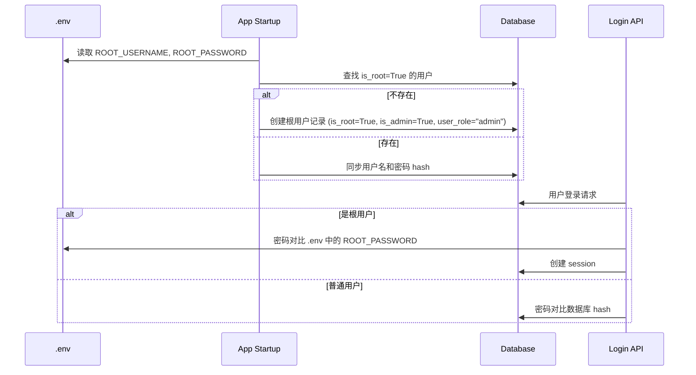
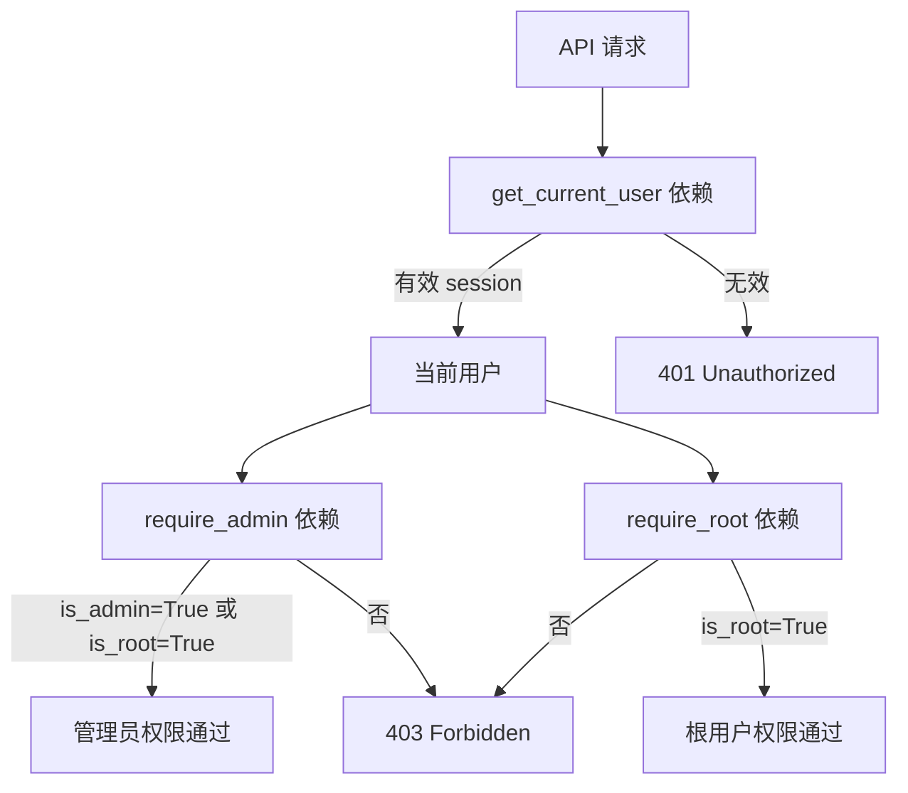

# 用户管理系统 — Master Plan

## 1. 概述

为 Ecliptrix 平台实现完整的用户管理系统，包括：
- 基于 .env 的根用户（超级管理员）机制
- 四级角色体系（Root > Admin > Premium > Regular）
- 基于邀请码的注册控制
- 完整的用户 CRUD、会话管理、强制下线等功能
- 设置页中的用户管理界面

## 2. 目标

- **安全性**：根用户凭证由 .env 控制，不可通过界面篡改；API 端点有严格的权限校验
- **可管理性**：根用户和管理员可在 UI 中高效管理用户
- **最小侵入**：复用现有 User 模型和认证流程，不破坏现有功能
- **渐进式权限**：本次仅控制管理功能可见性，主功能不做角色区分

## 3. 范围

### 在范围内
- 后端：根用户机制、权限依赖注入、用户 CRUD 增强、邀请码验证、会话管理增强
- 前端：设置页用户管理标签页、根用户视觉标识、管理功能权限控制
- 数据库：User 模型增加 `is_root` 字段、登录历史表

### 不在范围内
- 主功能（视频编辑、工作流等）的角色权限区分
- 前端完整 RBAC 矩阵
- OAuth/第三方登录
- 密码强度策略、验证码
- 登录页面修改

## 4. 架构设计

### 4.1 角色体系

```
Root (超级管理员)
├── 来源：.env 中 ROOT_USERNAME / ROOT_PASSWORD
├── 数据库中有记录（混合方式），每次启动同步凭证
├── 权限：所有操作，包括管理管理员、修改系统配置
│
├── Admin (管理员)
│   ├── 来源：根用户在 UI 中创建
│   ├── 权限：管理 regular/premium 用户、查看非管理员会话
│   ├── 限制：不能管理管理员、不能查看管理员会话、不能修改系统配置
│   │
│   ├── Premium (高级用户)
│   │   ├── 来源：管理员/根用户创建，或邀请码注册后升级
│   │   └── 权限：使用所有主功能（本次不做区分）
│   │
│   └── Regular (普通用户)
│       ├── 来源：管理员/根用户创建，或邀请码自助注册
│       └── 权限：使用基础功能（本次不做区分）
```

### 4.2 根用户机制



### 4.3 邀请码机制

- .env 中配置 `INVITE_CODE=<string>`
- 注册接口校验邀请码，正确则创建 regular 用户
- 邀请码为空或未设置时，注册接口关闭

### 4.4 权限校验架构



### 4.5 前端用户管理 UI

```
设置页
├── 现有标签页...
└── 用户管理 (仅 root/admin 可见)
    ├── 统计卡片 (总用户数、各角色数量、在线用户)
    ├── 筛选栏 (角色筛选、状态筛选、搜索)
    ├── 用户列表表格 (分页、排序)
    │   ├── 用户名、邮箱、角色、状态、最后登录、操作
    │   └── 操作：编辑、重置密码、启用/禁用、强制下线、删除
    ├── 创建用户对话框
    └── 编辑用户对话框
```

## 5. 技术决策

| 决策 | 选择 | 理由 |
|------|------|------|
| 根用户存储 | 混合（DB 记录 + .env 同步） | 复用现有会话机制，同时确保 .env 是凭证真实来源 |
| 权限校验 | FastAPI Depends() | 符合 FastAPI 最佳实践，可组合、可测试 |
| 邀请码 | .env 全局单一码 | 简单可控，满足当前需求 |
| 前端权限 | 仅管理功能可见性控制 | 最小实现，避免过度工程化 |
| 登录历史 | 新建 login_history 表 | 独立追踪，不污染 User 表 |

## 6. 依赖与风险

### 依赖
- 现有 User 模型需新增 `is_root` 字段
- 现有 auth_service 需修改登录逻辑以支持根用户 .env 校验
- 现有 session_service 可复用

### 风险
| 风险 | 缓解措施 |
|------|----------|
| 根用户 .env 密码明文存储 | 启动时 hash 后存入 DB，不在内存中长期持有明文 |
| 强制下线时用户正在编辑 | 前端 session 验证间隔为 5 分钟，用户会在下次验证时被登出 |
| 数据库迁移 | 新增字段使用 nullable 或 default，不影响现有数据 |

## 7. Spec 文件目录

| # | Spec 文件 | 内容 |
|---|----------|------|
| 01 | 根用户与角色体系 | User 模型修改、根用户同步机制、角色定义 |
| 02 | 权限校验中间件 | FastAPI 依赖注入、权限层级、错误处理 |
| 03 | 用户管理 API | CRUD 增强、邀请码注册、会话管理、登录历史 |
| 04 | 前端用户管理 UI | 设置页标签页、用户列表、CRUD 对话框、统计卡片 |
| 05 | 前端权限与视觉标识 | 角色标签、管理功能可见性控制、AuthContext 增强 |
