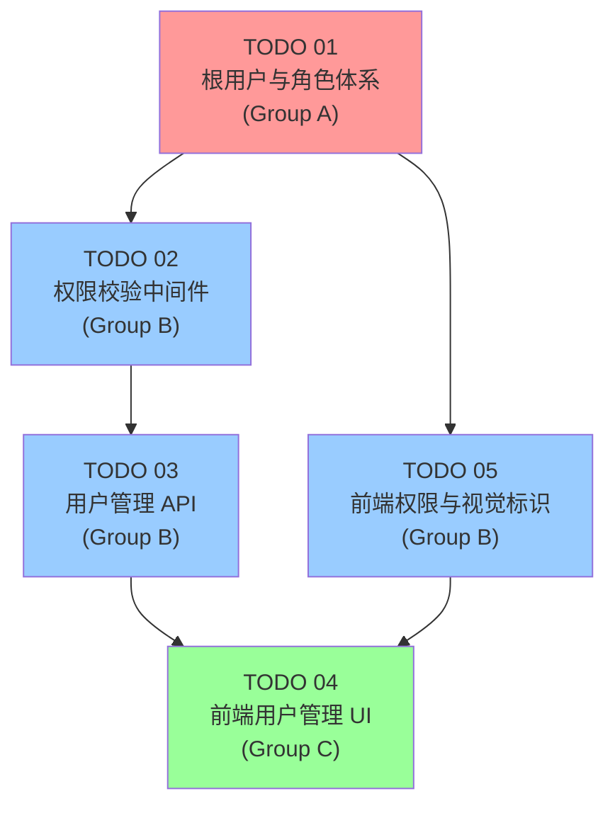

# 任务编排 — 用户管理系统

## 1. 依赖关系图



## 2. 执行阶段

### Phase 1: 基础层（无依赖）
| 任务 | Agent | 并行组 | 预估复杂度 |
|------|-------|--------|-----------|
| TODO 01: 根用户与角色体系 | Agent-Backend-1 | A | 中 |

### Phase 2: 中间层（依赖 Phase 1）
| 任务 | Agent | 并行组 | 预估复杂度 |
|------|-------|--------|-----------|
| TODO 02: 权限校验中间件 | Agent-Backend-2 | B | 中 |
| TODO 05: 前端权限与视觉标识 | Agent-Frontend-1 | B | 低-中 |

> TODO 02 和 TODO 05 可并行执行（一个后端，一个前端）

### Phase 3: API 层（依赖 Phase 2 的 TODO 02）
| 任务 | Agent | 并行组 | 预估复杂度 |
|------|-------|--------|-----------|
| TODO 03: 用户管理 API | Agent-Backend-3 | B | 高 |

### Phase 4: UI 层（依赖 Phase 3 的 TODO 03 和 Phase 2 的 TODO 05）
| 任务 | Agent | 并行组 | 预估复杂度 |
|------|-------|--------|-----------|
| TODO 04: 前端用户管理 UI | Agent-Frontend-2 | C | 高 |

## 3. 关键路径

```
TODO 01 → TODO 02 → TODO 03 → TODO 04
```

- **瓶颈任务**: TODO 03（用户管理 API）— 端点最多、逻辑最复杂
- TODO 05 不在关键路径上，但必须在 TODO 04 之前完成

## 4. Agent 分配

### 推荐 Agent 数量: 4

| Agent | 角色 | 负责任务 |
|-------|------|---------|
| Agent-Backend-1 | 后端基础 | TODO 01: 模型、配置、启动同步 |
| Agent-Backend-2 | 后端中间件 | TODO 02: 权限依赖注入 |
| Agent-Backend-3 | 后端 API | TODO 03: 全部新增/修改端点 + Next.js 代理 |
| Agent-Frontend-1 | 前端权限 | TODO 05: AuthContext、RoleBadge、类型定义 |
| Agent-Frontend-2 | 前端 UI | TODO 04: 用户管理完整 UI |

### 协调说明

- Agent-Backend-1 完成后，Agent-Backend-2 和 Agent-Frontend-1 同时启动
- Agent-Backend-2 完成后，Agent-Backend-3 启动
- Agent-Backend-3 和 Agent-Frontend-1 都完成后，Agent-Frontend-2 启动
- 实际执行时 Agent-Backend-2 和 Agent-Backend-3 可由同一 Agent 串行执行

## 5. 各 Agent 所需上下文文件

### 所有 Agent 共需
- `docs/plans/user-management-system/master-plan.md`
- `docs/plans/user-management-system/task-orchestration.md`
- `CLAUDE.md`

### Agent-Backend-1 (TODO 01)
- `docs/plans/user-management-system/specs/01-root-user-and-role-system.md`
- `docs/plans/user-management-system/todos/01-root-user-and-role-system.md`
- `backend-services/basic-service/app/models/db_models.py`
- `backend-services/basic-service/app/models/auth_models.py`
- `backend-services/basic-service/app/config.py`
- `backend-services/basic-service/app/database.py`
- `backend-services/basic-service/app/services/auth_service.py`
- `backend-services/basic-service/env.template`

### Agent-Backend-2 (TODO 02)
- `docs/plans/user-management-system/specs/02-permission-middleware.md`
- `docs/plans/user-management-system/todos/02-permission-middleware.md`
- `backend-services/basic-service/app/services/session_service.py`
- `backend-services/basic-service/app/routers/user_router.py`
- `backend-services/basic-service/app/routers/auth_router.py`
- Agent-Backend-1 修改的所有文件

### Agent-Backend-3 (TODO 03)
- `docs/plans/user-management-system/specs/03-user-management-api.md`
- `docs/plans/user-management-system/todos/03-user-management-api.md`
- `backend-services/basic-service/app/services/user_service.py`
- `backend-services/basic-service/app/routers/user_router.py`
- `src/app/api/admin/` (现有代理路由参考)
- Agent-Backend-1 和 Agent-Backend-2 修改的所有文件

### Agent-Frontend-1 (TODO 05)
- `docs/plans/user-management-system/specs/05-frontend-permissions-and-visual-identity.md`
- `docs/plans/user-management-system/todos/05-frontend-permissions-and-visual-identity.md`
- `src/contexts/AuthContext.tsx`
- `src/types/index.ts` 或 `src/types/auth.ts`
- `src/lib/i18n.ts`

### Agent-Frontend-2 (TODO 04)
- `docs/plans/user-management-system/specs/04-frontend-user-management-ui.md`
- `docs/plans/user-management-system/todos/04-frontend-user-management-ui.md`
- `src/components/AdminSettings/UserManagement.tsx` (现有组件参考)
- `src/app/settings/` (设置页结构)
- `src/lib/api/` (现有 API 客户端参考)
- `src/components/ui/` (现有 UI 组件参考)
- Agent-Frontend-1 创建的类型和组件
