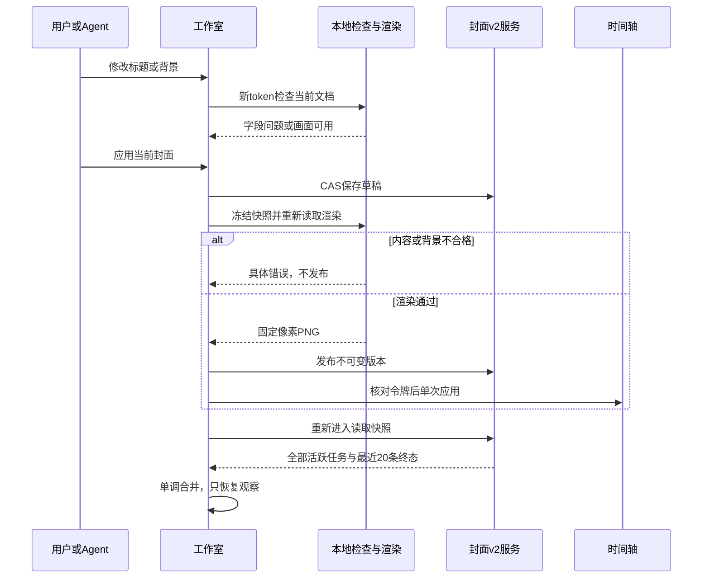

# 视频封面工作室第三轮：发布前反馈与任务状态完整性

**版本**：v2，方案评审通过。**日期**：2026-09-28。**基线**：`c75c2b7`。

**目标**：让用户在应用封面之前知道阻塞原因并能直接修正，同时保证重新进入工作室后的活跃生成任务可见、阶段不倒退。

**架构**：沿用封面 v2 草稿、不可变 PNG、后台任务及时间轴事务；增加共享的本地发布检查和字段定位，修正现有快照查询及任务合并规则。

**技术栈**：Electron、Next.js 15、React 19、TypeScript、Tailwind CSS、Zustand、html-to-image、FastAPI、SQLAlchemy/SQLite、FFmpeg。依据仓库现状，不升级依赖。

实施者按第 9 节顺序执行，可使用 `superpowers:executing-plans` 辅助逐项落实。上游设计节点仅交付本文；本轮实施内容和实际运行证据见第11.3–11.4节，未创建 Git 提交。

## 评审记录

本轮按可行性、完整性、仓库一致性和范围适度逐节核对。下列“已修订”指设计正文已修正，不表示功能已实现。发现六项 P1、五项 P2，未发现 P0。

| 编号 | 级别 | 问题与源码依据 | 正文修正及验收 | 状态 |
| --- | --- | --- | --- | --- |
| D01 | P1 | `CoverStudio` 在 loading/settings 分支提前返回，普通 ref 变化不会触发 Hook；首次加载、设置返回或同值跨工程可能一直 checking 或沿用旧结果。 | §4.2、§5、§6.2：无条件 Hook、显式画布挂载与会话身份；F27。 | 已修订 |
| D02 | P1 | 原图解码失败后再次调用同一 img.decode 没有明确重新加载机制，“重试检查”不能保证网络恢复后恢复。 | §4.2：仅显式重试更换预览图片加载键和读取 URL；F28。 | 已修订 |
| D03 | P1 | §4.3 把所有结构错误归为 DRAFT_NOT_READY，与现有宿主的 ASSET_MISSING 及 F14 的具体错误要求冲突；fetch/body 错误边界遗漏。 | §4.3 错误映射冻结，保留既有资源缺失码；F29。 | 已修订 |
| D04 | P1 | `measureCoverCanvas` 对零文字节点返回 true；`fitCoverText` 在不可见零尺寸 DOM 也可能误判通过。仅检查容器 connected 不足以保证真实测量。 | §4.1–4.3：预期节点、可测量尺寸及未就绪处理；F30。 | 已修订 |
| D05 | P1 | `coverDeadline` 只是 Promise.race；十五秒超时后底层 toBlob 仍可能运行并开始第二次尝试，违背截止及宿主串行语义。 | §4.3：截止使局部执行失效，禁止迟到结果和重试，隔离旧 DOM；F31。 | 已修订 |
| D06 | P2 | 字体 ready 被描述为字体成功证明，未界定系统字体回退；AI 在正式渲染仍可能等待无关文字字体。 | §4.2–4.3：稳定布局语义、既有字体栈回退和 AI 跳过；F32。 | 已修订 |
| D07 | P2 | F10 要求定位零保存，与 `CoverInspector` 冒泡 onBlur 触发现有 flush 冲突，容易为测试破坏保存策略。 | §3.2、F10、F33：检查本身零写入，保留正常失焦保存并区分计数。 | 已修订 |
| D08 | P2 | running→queued 表格要求保留整个旧对象，但下文要求所有活跃响应合并资产/警告，规则矛盾。 | §4.5：状态、阶段保留，集合统一合并；F34。 | 已修订 |
| D09 | P2 | F26 的“三秒素材”与六十帧正文不一致，可能把四秒正确结果当作失败。 | F26/F35：三秒源素材明确裁取两秒正文，输出三秒。 | 已修订 |
| D10 | P1 | `cover-viewport` 为 flex 剩余空间；检查面板从 checking 变为多行 blocked 会改变视口，若每次 ResizeObserver 都重置 checking，会形成反馈循环。 | §4.2：区分内容失效与仅布局重测，后者保留稳定结果且不重启资源等待；F36。 | 已修订 |
| D11 | P2 | §8.2 的路径替换写成不存在的 `cover-refinement-runtime/package`，但上一轮实际使用两个独立目录，可能复用旧包或临时目录。 | §8.2：分别替换 runtime 和 package 路径并核验构建输入；F37。 | 已修订 |

逐节结论：§1–2 增量范围合理且承接两轮成果；§3 补齐交互与保存边界；§4–6 修正上述生命周期、检查和错误协议；§7 保持 24 项文件计划并补全对应测试职责；§8 扩展为 37 项验收；§9–10 沿用分阶段落地并补充风险；§11 区分文档核验与运行验证。不引入数据库迁移、任务总线或新的 Agent 参数。

## 1. 概述

前两轮已经完成用户要求的主体能力：HTML 排版、AI 生图和混合模式，五套封面模板，对话 Agent 的封面工具，时间轴中的真实封面片头，以及绑定不可变版本的视频导出。第一轮提交为 `664d0a3`，第二轮提交为 `c75c2b7`；第二轮还完成了最近成品、比例预览、草稿恢复、背景意图保护和任务连接反馈。第三轮承接这些成果，不能重新把已完成工作规划为从零开发，也不能把过去的通过记录当成本轮验证结果。

当前剩余问题集中在“我为什么还不能应用”和“生成进行到哪里”两个用户判断上。工作室使用一个 `ready` 布尔值控制应用与下载，文字溢出也只有整体提示；背景拥有 URL 不代表文件能够解码。与此同时，前端虽然保留所有活跃任务，后端项目快照仍对全部任务统一截取最近二十条；任务合并也仅保护 status，没有保护 running 内部的 phase。长时间生成期间不断产生取消记录，或资源刷新与单任务读取交错时，用户可能看不到仍在执行的任务，或者看到阶段倒退。

本轮采用小范围增量方案：把发布前检查变成明确、可定位、与最终渲染共享依据的反馈；让项目快照完整包含活跃任务，并让观察结果按合法方向合并。封面仍是视频开头的真实静态片段，默认三十帧、三十帧每秒；不承诺第三方平台会自动把该片头选作平台缩略图。最终 PNG、时间轴和导出继续使用同一不可变版本。

## 2. 项目约束、源码依据与范围

已读取根目录 `README.md`、`CLAUDE.md`、`desktop/README.md`、`.claude-index/index.md`、任务 history、共享看板及前两轮规格。工作区没有找到适用的 `AGENTS.md`。仓库是单用户桌面应用，Electron 启动本机 Next.js 与 FastAPI；持久化使用 SQLite 和本地文件，业务归属保持 `LOCAL_OWNER_ID`。不增加云服务、登录、多租户、迁移框架或破坏性 DDL。

前两轮方案分别位于 [首轮规格](../video-cover-studio/spec.md) 和 [第二轮规格](../video-cover-studio-refinement/spec.md)，最终验证见各目录的 `review.md`。本文明确覆盖的条款优先；其他协议、资源租约、CAS、撤销、导出及迁移约束继续适用。

### 2.1 源码观察

以下是静态读取确认的实现及由此推导的风险，尚未宣称完成本轮运行复现。开发者须先建立对应失败用例。

| 编号 | 已核对的代码路径 | 现状与本轮决定 |
| --- | --- | --- |
| G01 | `src/components/video/cover/CoverStudio.tsx::ready` | 文字、背景、模式条件合并成布尔值；除总体溢出提示外，缺少统一的阻塞原因和字段修正入口。改为确定顺序的检查结果。 |
| G02 | `src/components/video/cover/CoverCanvas.tsx::measureCoverCanvas` | 只返回是否全部适配，无法告诉界面是标题、副标题还是标签溢出。新增逐字段结果，保留原布尔包装供兼容调用。 |
| G03 | `CoverStudio.tsx::backgroundUrl`；`renderCover.ts::renderReadyNode` | 预览就绪只检查 URL，正式渲染才等待图片解码和字体；可能先启用应用，随后报笼统渲染错误。增加有限时长的预览检查，正式渲染仍重新检查。 |
| G04 | `backend-services/basic-service/app/services/video_cover_v2_service.py::load_state` | jobs 查询统一 `.limit(20)`，较早活跃任务可能被较新终态记录挤出。改为全部活跃任务加最近二十条终态。 |
| G05 | `src/components/video/cover/useCoverJobs.ts::mergeJob` | 已防终态退回活跃态和 running 退回 queued，但 running/downloading 可被 running/generating 覆盖。增加 phase 单调合并。 |

### 2.2 原始需求承接

| 用户需求 | 既有能力 | 本轮必须保持的验收边界 |
| --- | --- | --- |
| AI 制作封面 | ARK 任务、本地候选、请求幂等、取消 | 检查和刷新不得 POST 新生成；活跃任务完整恢复；真实供应商测试单独说明。 |
| 封面显示在轨道 | `video-cover` 真实图片片头 | 检查失败不插片；成功沿用一次事务、一次撤销、无重复片头。 |
| Agent 对话制作 | get/create/update/apply 四个封面工具 | Agent 经同一渲染门禁，不靠 UI 按钮禁用保护正确性；失败不可回报已应用。 |
| 三种创作模式 | html / ai / mixed | HTML 可离线使用；AI 不要求标题；混合要求图片与标题或副标题。 |
| 五套模板 | editorial / cinematic / knowledge / product / bold | 全部保留；检查覆盖五比例，不改模板坐标或预设设计。 |
| 正确导出 | PNG revision、SHA、required_cover、FFmpeg | 草稿检查不替换视频引用；已有封面继续可导出；首帧、正文边界、音频偏移保持。 |
| 优雅可靠的交互 | 工作室、历史、响应式、深浅主题 | 提示可理解、修正可聚焦、小窗口不遮挡主操作、异步结果不覆盖新输入。 |

### 2.3 方案比较

选择 A：共享检查模块加现有组件局部反馈，以及快照/合并规则修正。它直接针对已发现的缺口，保持持久化格式和渲染路径一致。

不选择 B：增加通用任务事件总线、WebSocket、服务端截图或 v3 数据模型。当前规模下会增加生命周期和安装包依赖，不能改善这些具体问题。不选择 C：只修改错误文案。没有字段结果和后台查询调整，仍然无法可靠定位或恢复。

范围不包含新模板、任意 HTML 输入、自由图层编辑、全量历史分页、任务日志持久化、跨重启恢复未知 POST 的请求键、供应商计费控制、资源自动删除或整体控制器重构。未知生成提交仍遵循第二轮恢复/取消规则；本轮不宣称修复其跨进程持久化限制。工作区既有未跟踪 `.bug-diagnosis/336be7e1-d7df-4fc8-b994-2b80f45c9128/`、`docs/images/` 保持原样。

## 3. 人机交互与视觉设计

### 3.1 发布前提示的位置与层级

保持现有模板区、画布、属性区、资源条和底栏布局。新增 `CoverReadinessPanel` 放在底栏之前、业务错误提示之后；不覆盖画布，不使用悬浮 toast，也不弹出新的确认框。没有问题时只显示轻量“画面检查通过”；后台检查期间显示“正在检查画面…”。这句话仅表达本地画面状态，不能替代“草稿已保存”“视频正在使用”或导出成功。

有阻塞项时展示“还需要完成以下内容”，下面按固定顺序列出原因和修正按钮。列表最多显示文字缺失一项、背景一项、字体一项、三个字段溢出项；同类检查不能重复出现。宽窗口一行一个问题，小窗口允许换行；面板最高 112px，内部纵向滚动。工作室主内容继续 `min-height:0`，底栏保留现有紧凑两行模式，不能靠固定画布最小高度挤掉操作按钮。

应用与下载按钮在 blocked/checking 时禁用，并以 `aria-describedby` 指向提示面板。原因与修正按钮可正常 Tab 到达；不能把原因仅放在禁用按钮的 tooltip 中。busy 的按钮动词与现有 preparing/applying/downloading/restoring 保持，检查过程不更改业务 activity。

窄屏属性 dialog 打开时，检查面板沿用现有 `feedbackInDialog` 规则移动到抽屉内属性表单之后，避免修正入口留在不可交互的模态背景中；关闭后回到底栏之前。同一时刻只渲染一份面板，实例 ID 前缀由 CoverStudio 持有，移动不改变提示与输入的关联。底栏被模态遮蔽时不创建第二套应用按钮。

### 3.2 状态和操作文案

实际产品仍支持中英文，下面冻结中文主文案及对应英文含义；翻译同时写入既有 `src/lib/i18n.ts` 的两种语言，不能把组件字符串硬编码。

| 原因键 | 中文文案 | 英文文案 | 操作 |
| --- | --- | --- | --- |
| content-empty | 请填写标题或副标题 | Add a title or subtitle | 编辑标题 / Edit title |
| background-required | 请选择一张背景图片 | Choose a background image | 选择背景 / Choose image |
| background-missing | 当前背景资源不可用，请重新选择图片 | This background is unavailable. Choose another image | 选择背景 / Choose image |
| background-unreadable | 背景暂时无法读取，请重试或更换图片 | The background could not be read. Retry or choose another image | 重试检查、选择背景 |
| font-unavailable | 字体尚未就绪，请重试画面检查 | Fonts are not ready. Retry the preview check | 重试检查 / Retry check |
| text-overflow | {字段}超出排版范围，请缩短文字或调整排版 | {field} exceeds its text area. Shorten it or adjust the layout | 编辑{字段} / Edit {field} |

字段名称复用标题、副标题、标签翻译。只输入 label 仍不满足 HTML/混合模式内容要求；输入仅空白、换行同样不满足。AI 模式不检查隐藏文字、不要求标题，切回 HTML/混合时重新检查原有文字。纯色和渐变不要求背景文件；HTML 选择 asset 背景后也必须能读取该文件。

“编辑标题/副标题/标签”在宽布局直接聚焦对应 textarea 并滚入属性区；窄布局先打开唯一属性抽屉，待 DOM 就绪后聚焦。聚焦不选中全部文本，不改值、不自动缩字号。背景操作聚焦现有上传输入，保留素材选择和候选图入口；不在异步回调里自动触发文件选择器。重试检查只重跑本地读取及测量，不能生成图片、保存草稿、发布 PNG 或应用轨道。

上述零写入指检查模块及修正动作不主动调用写接口。`CoverInspector` 现有冒泡 onBlur 与自动保存继续有效；从有未保存输入的属性区点击修正入口可能触发原有 flush，这是正常保存，不能为满足请求计数测试禁掉它。验收分开检查“干净草稿的检查零写入”和“脏草稿失焦仅发生原有保存”；两者都不新增编辑、生成、发布或轨道操作。

### 3.3 键盘、反馈与连续输入

沿用已有原生 dialog 及焦点返回。新增字段 `id` 使用工作室实例前缀加字段名，不能在属性抽屉和常驻栏渲染两份同 ID 的表单。溢出字段加 `aria-invalid=true`，并指向其原因文本；用户继续输入立即保留输入，不截断到排版能容纳的长度。原有字段最大字符数约束继续生效。

检查结果变化使用单个 polite 状态区；输入导致的 checking 不逐键播报。稳定 250ms 后才播报问题摘要，文字更改立即使旧结果失效。用户主动点击检查或修正入口可以立即反馈。每秒生成用时不纳入新 live 区域。主题颜色沿用 `--ws-*` 和既有错误/边框 token，减少动画设置下不添加动画。

任务栏仍按现有 queued/generating/downloading/终态文案显示。恢复出的旧任务只恢复观察，不恢复自动选图或 Agent 应用权限；部分成功警告保持第二轮修复。用户即使没有打开工作室，后台生成仍由原服务管理。

## 4. 技术设计与操作时序

### 4.1 共享检查职责

新增 `coverValidation.ts`，只处理结构判断、DOM 文字测量和已知错误类型；不调用 REST，不持有 React 状态，不导入 `CoverCanvas`，避免与渲染模块循环依赖。`layout.ts::fitCoverText` 仍是文字缩放算法的唯一实现，不改坐标、字号阈值或行数限制。

`validateCoverStructure(document, backgroundUrl)` 按第 3 节模式规则返回 content/background 问题。只允许现有本地 `/api/storage/files/` URL 用作业务背景；正式渲染宿主已经将合法背景转换成 blob URL，因此宿主调用结构检查时使用原本地 URL，不能把内部 blob URL 当成不合法用户资源。

`measureCoverText(root)` 接受画布本身或只包含一张画布的专用容器。`CoverCanvas` 增加 `data-cover-mode` 标识，HTML/混合必须恰有 title、subtitle、label 三个文字节点（空字段仍有节点），AI 必须没有文字节点。检查画布连接状态、唯一性、合法模式，以及画布和预期文字节点的 clientWidth/clientHeight 均大于零、画布 getBoundingClientRect 的宽高大于零；非空文字还须有有效 Range 矩形，不能把 display:none、缺失节点、零缩放或尚未布局判为通过。AI 仍须满足画布可测量性，仅跳过文字算法。离屏但有真实布局的正式渲染宿主允许测量，不能以是否在视口内作为门禁。

结构可测量后调用既有 `fitCoverText`，返回 `{ measurable: true, overflowFields }`，固定 title、subtitle、label 顺序并去重；不可测量返回 `{ measurable: false, overflowFields: [] }`，不得冒充文字溢出。原 `measureCoverCanvas(root)` 签名保留，包装结果为 `measurable && overflowFields.length === 0`。预览不可测量保持 checking，等待挂载/可见性事件；正式渲染在提交并等待一次布局后仍不可测量，抛 `COVER_RENDER_FAILED`，零发布。正文与预览使用相同算法；不从缩略图或 screenshot 像素反推结果。

新增 `useCoverReadiness.ts`，输入可空 document、背景 URL、会话键、enabled 和主画布容器节点，输出会话内检查结果、retry 和仅供预览的图片读取键/URL。新 `CoverReadinessPanel.tsx` 只渲染结果并发送定位/重试动作。`CoverStudio` 负责打开抽屉和实际聚焦，替代其局部 `overflow/ready` 判断；`CoverInspector` 只接收字段问题与 ID 前缀，不承担异步检查。

稳定 callback ref 必须挂在主预览画布随 `fit.scale > 0` 挂载的专用容器，并把节点存入 state；不能只传普通 rootRef 等待其 current 改变触发 effect，也不挂在整个工作室，避免读到模板缩略图或放大预览。删除旧的独立整体溢出提示，由新面板统一解释。背景结构问题最多返回一个：非 HTML 且 kind 非 asset 为 required；kind 为 asset 但 ID 或合法 URL 缺失为 missing；解码开始后失败才是 unreadable。有结构问题时先返回 blocked，不做异步读取；修正结构后再检查资源与文字。面板和输入使用共同 idPrefix，问题 ID 固定为 `前缀-readiness-code-field`，无 field 时使用 global。

### 4.2 检查生命周期和过期结果保护

1. Hook 在 `CoverStudio` 的 settings/loading 提前返回之前无条件调用。没有 document、loading、settings 或缺少会话时 enabled=false；只返回 checking 并释放旧检查。控制器暴露只读 `readinessKey`，由当前 options.projectId 和草稿会话代次组成，项目变化当次渲染就更换键，同工程新会话也更换；不能用每次重建的 controller 对象作为键。每次会话键、document 引用、背景业务 URL、enabled、画布节点或重试序号变化时生成新的检查 token，清理上一轮 timer 和 abort。结果携带这些输入身份；读取结果时只要与当前输入不匹配，即按 checking 处理，不能在 effect 执行前短暂沿用旧 ready。
2. 立即执行结构检查。结构问题可立即展示并阻止操作；缺资源时不等待永远不会成功的图片解码。其余检查安排在 150ms 输入防抖后执行，用户显式 retry 使用零延迟。
3. 从主预览容器中找到唯一 `[data-cover-canvas]`，等待它的 ownerDocument 字体 ready，以及该画布中背景 img 的 decode。整体等待上限 10000ms，使用现有 `coverDeadline`，不新增无限等待。纯色/渐变没有图片等待，AI 模式没有文字等待。组件首次还未挂载画布时保持 checking，由 callback ref 的 state 更新接续。现有 `usePreviewBounds` 也须在文档从无到有、settings 返回或 viewport 节点更换时重新挂接 observer 并首测，不能只依赖比例；否则同为 16:9 的初次加载可能一直 scale=0，导致画布永远不挂载。
4. 图片失败产生 background-unreadable，字体失败产生 font-unavailable；二者同时发生则按固定顺序全部展示。分别捕获任务结果后聚合，AbortError 只表示本次检查废弃，不进入错误区。字体就绪之后才测量文字，不把临时字体结果作为最终通过依据。
5. 在写入结果前同时核对 token、会话键、document 引用、业务 URL、实际图片读取键、enabled、signal 以及容器身份和连接状态；旧图片 A 的成功/失败都不能覆盖后来选择的图片 B。清理采用逻辑失效保护，不能声称 AbortSignal 能取消 img.decode 或字体 Promise。
6. 完成后 status 为 blocked 或 ready。卸载时取消计时器和观察器；不能取消后端生成任务。`document.fonts` 不存在的测试环境按已就绪处理；实际 Chromium 的 ready Promise 必须等待。它表示字体加载与布局已稳定，不保证字体栈首选字体安装或每个字形均由首选字体提供。沿用现有系统字体栈及回退，不新增在线字体或字体安装检查；拒绝/超时才报 font-unavailable，回退稳定后按实际字体测量。字体 loadingdone/loadingerror 触发合并检查，但不能仅凭全局 loadingerror 把无关字体失败归给封面。AI 跳过全部字体等待与文字测量。

显式重试时，Hook 增加仅在本工作室有效的图片加载序号；`CoverCanvas` 新增可选预览加载 key，由 Studio 同时传入带该序号查询参数的本地图片 URL，让失败 img 重新挂载并发起新读取。以 URL API 设置固定参数 `cover_preview_retry`，保留路径和其他查询参数；首次读取使用原 URL。每次键变更后先提交新 img 再 decode，核对 img 的读取 URL 与当前键。普通输入、布局重测、字体事件不得增加序号或持续缓存穿透。临时 URL 不写 document/assets、不传 controller，不影响正式渲染或模板缩略图；重试仍是同源本地 GET，文件持续缺失则保持 blocked。

ResizeObserver 区分“内容/资源失效”和“仅布局改变”：尺寸不变直接忽略；仅正尺寸变化合并为一帧内一次文字重测，保留原有依赖结果，不切回 checking、不重新 decode、不重启计时器，字段结果相同不 setState。只有从不可测量恢复、节点更换或文档/字体等真实依赖变化才重新走完整检查；从可测量变零立刻撤销 ready。因提示面板高度变化引发的二次观察按同一规则收敛，不能在 checking 与 blocked 之间自激循环。属性抽屉切换也遵循这个规则。

检查不持久化、不写 document、不推进 edit/backgroundIntent、不 flush、不注册 Agent intent。其 timeout 不能污染业务错误归属，也不能把正在运行的生成任务标记失败。图片解码仍可能命中浏览器缓存，最终渲染宿主必须重新获取背景并校验，预览通过只是一项反馈。

### 4.3 应用、下载和 Agent 的最终门禁

`useCoverController::prepare` 在 flush 后仍固定草稿快照并校验 OperationOwner，再调用共享结构检查；content-empty/background-required 映射为 `COVER_DRAFT_NOT_READY`，background-missing 映射为既有 `COVER_ASSET_MISSING`，同时出现按第3节顺序取首项，不发布。主工作室处于 ready 不能跳过这里，Agent 和工作室关闭时同样必须经过此路径。

`CoverRenderHost::render` 保持有效请求串行、同快照去重、取消和本地资源 fetch；把结构检查的业务背景 URL 与渲染中 blob URL 的职责分开。使用同源原 URL、`cache: 'no-store'` 重新读取，沿用现有本地资源限制。缺合法 URL 或资源 HTTP 404/410 抛 `COVER_ASSET_MISSING`；其他 HTTP 非成功、网络错误、fetch/response.blob 局部超时或读取失败映射为 `COVER_BACKGROUND_UNREADABLE`。每个 await 边界先保留调用方取消的 AbortError，不能把取消或总截止重分类为背景错误。

`renderCover::renderReadyNode` 从 node.ownerDocument 等待字体/图片，重新执行 `measureCoverText`；不可测量抛 `COVER_RENDER_FAILED`，overflowFields 非空抛新增 `COVER_TEXT_OVERFLOW`。图片 decode 失败抛新增 `COVER_BACKGROUND_UNREADABLE`；字体等待拒绝/超时抛新增 `COVER_FONT_UNAVAILABLE`。字体成功只要求现有字体栈稳定后的实际布局，AI 跳过字体等待及文字测量。宿主从有效请求开始（包含 fetch/body）的总时限为十五秒，外层超时和其他 html-to-image 故障仍使用 `COVER_RENDER_FAILED`，内层步骤不能重置总时限。

三个新 code 只属于前端 `CoverErrorCode`；不改变后端错误枚举或协议。`coverRecovery.ts` 保持按来源判断冲突，三个 code 均属于 other，保留 retry-operation/dismiss，不出现覆盖服务器草稿动作；具体修改字段由本地检查面板提供。Agent 既有错误结果保留 code 并报告未应用，不增加 tool 参数。图片上传失败继续归属 upload/copy，不能与发布时的图片读取错误混淆。

字体与图片等待分别在各自边界捕获错误，采用同时开始的十秒 deadline；不得捕获外层所有 `COVER_RENDER_FAILED` 再按字符串猜测来源。取消应优先传播 AbortError。字段溢出发生在依赖就绪之后，不消耗 html-to-image 的两次重试；toBlob 的失败仍按现有有限重试处理。

`coverDeadline` 的 Promise.race 本身不取消底层工作。正式渲染须创建本次调用的局部 AbortController 并在超时/结束时失效，保留“调用方取消”和“总超时”的独立原因；每次 await 前后及下一次 toBlob 尝试前检查 signal 和绝对截止。迟到 toBlob 成功/失败都必须被消费，不能发布、下载、继续 createImageBitmap 或进入第二次重试；若 bitmap 已经开始创建，返回后也必须 close 再退出。无需修改通用 deadline 的公开签名。

宿主为每次实际执行分配唯一 job key，让 React 挂载专属的 CoverCanvas DOM；取消/超时后只清理对应 job、URL 和 pending 条目，不复用旧 DOM 给下一请求。pending 删除须确认映射值仍为原 Promise，避免旧会话 finally 删除新请求。html-to-image 不提供可中断的 toBlob，超时后允许其内部工作自行结束，但它只能持有已失效的旧 DOM，不能更改新 job；这叫有效请求串行，不承诺底层 CPU 工作硬取消。正常 toBlob 故障最多两次尝试，总截止仍不可突破。

任何最终检查失败都必须满足：零 revisions POST、零时间轴修改、零下载触发；失败前已发生的合法草稿 flush 可以保留。校验通过后，仍经发布不可变 PNG、核对 owner、单次 `applyCoverTimelineAction`；下载只触发既有成品下载。草稿发生新编辑或切项目时，原检查和操作均不能续权。

### 4.4 后端快照：活跃任务不受历史数量限制

仅修改 `load_state` 中任务读取，不修改任务提交、队列容量、取消墓碑、供应商调用或启动时 interrupted 行为。

在 `load_state` 内使用同一条 SELECT 查询该项目中 status 为 queued/running 的所有行，以及同项目最近二十条终态行。终态集合为 succeeded/failed/cancelled/interrupted；子查询按 created_at DESC、id DESC 排序取二十个 ID，外层用“活跃状态 OR ID 在子查询”并再次限定 project_id，最终按 created_at DESC、id DESC 排序。不要先读一组再读另一组，从而避免两次读取之间状态转换造成遗漏；不要在外层再 `.limit(20)`。原计划单独命名的 helper 最终内联于唯一调用点；最终审查确认查询语义、次数及项目隔离不变，记录该实现偏差而不为命名增加一层抽象。

辅助查询可用 SQLAlchemy `select(ProjectCoverJob.id).where(...).order_by(...).limit(20)` 的子查询构成，不新增窗口函数兼容依赖。outer query 以行主键天然去重；查询执行期间是该 SQL 语句的数据库视图，不能声称为整个项目快照加上跨文件的原子性。

返回的 jobs 仍使用原 `job_data`，assets、warnings、base_version 等字段不变。项目不存在继续原 404；不返回其他项目的任务。不对活跃数量做新的截断，正常队列约束依旧是每项目一个执行槽、最多两个排队任务，但查询不能依赖这些约束清理历史异常数据。客户端契约明确为“活跃全集 + 最近终态”，不再假设总长小于等于二十。

### 4.5 前端合并：状态与阶段分别单调

保留现有 `mergeCoverJobs` 和 `CoverJobSubscription.terminalJobs`。所有项目快照、提交响应、取消响应和单任务轮询必须经过同一合并入口，禁止各自直接覆盖数组。

| previous | incoming | 采用规则 |
| --- | --- | --- |
| 不存在 | 任意合法任务 | 采用 incoming，显示阶段按 status/phase 规范化。 |
| queued | running | 前进到 running；未知 phase 显示 generating。 |
| running | queued | 保留 previous 的 status/phase，资产/警告仍按活跃并集规则合并，不能重启排队显示。 |
| running/generating | running/downloading | 前进到 downloading。 |
| running/downloading | running/generating、缺失或未知 phase | 保留 downloading；合并新增资产/警告。 |
| 活跃 | 任意终态 | 采用终态；phase 规范为终态 status，停止订阅。 |
| 终态 | 活跃或不同终态 | 保留既有终态；不同终态沿用原诊断，不再次授权。 |
| 同一终态 | 同一终态 | 沿用 incoming 的资产可用集合和错误信息；不重新订阅。 |

活跃阶段 rank 固定 queued=0、generating=1、downloading=2。status 为 queued 时不能因异常 phase 字符串冒充 running；running 缺失 phase 归一为 generating。只给已知阶段排序，不对任意字符串比较。活跃到活跃的 assets 按 assetId 稳定并集合并、warnings 按字符串去重；资产 ID 不可变，元数据沿用最新收到值。终态同状态响应的资产集合保持服务端权威，以便缺文件后的读取结果不被客户端旧并集伪装为可用。

终态已知但显示裁剪的任务继续保留 terminalJobs 墓碑；不能因重开资源页把它恢复为 running。整个 project subscription 重建会清除会话内墓碑，这时以最新后台快照为准。客户端记录只保护观察顺序，不代表磁盘文件永远存在。

### 4.6 操作时序



## 5. 数据模型

数据库四类封面实体继续为 `ProjectCoverDocument`、`ProjectCoverAsset`、`ProjectCoverRevision`、`ProjectCoverJob`；不增加表、列或索引，不变更既有 JSON schemaVersion=2/templateVersion=1。后台 jobs 响应只改变选择集合，不改变字段。

新增前端会话类型放在 `src/types/videoCover.ts`，不写入工程 JSON、草稿 document、Agent 参数或 API 请求：

```ts
type CoverTextField = 'title' | 'subtitle' | 'label';
type CoverReadinessCode = 'content-empty' | 'background-required' |
  'background-missing' | 'background-unreadable' |
  'font-unavailable' | 'text-overflow';
interface CoverReadinessIssue {
  code: CoverReadinessCode;
  field?: CoverTextField;
}
interface CoverReadinessResult {
  status: 'checking' | 'blocked' | 'ready';
  issues: CoverReadinessIssue[];
  document: CoverDocument | null;
  backgroundUrl?: string;
  readinessKey?: string;
  enabled: boolean;
  canvasNode: HTMLElement | null;
  imageLoadKey: number;
  sequence: number;
}
interface CoverTextMeasurement {
  measurable: boolean;
  overflowFields: CoverTextField[];
}
```

`document` 是当前不可变 React 值的引用，用于本地失效判断，不是新的持久化副本。readinessKey 是控制器提供的工程/会话身份，canvasNode 和 enabled 标识实际检查表面，均仅存内存。sequence 在 Hook 生命周期内单调增加；切项目、文档替换、URL 更改、表面失效和显式重试都使旧结果失效。imageLoadKey 只随显式图片重试递增。问题 ID 用 code 加 field 组合生成，保证 stable key。status 为 ready 当且仅当 enabled、有当前 document、结构/资源/可测量性/文字均通过且全部身份匹配；字体/图片未完成时不能 ready。

`CoverJob.phase` 保持可选 string 的 wire 兼容，内部正常显示只使用已知阶段。无需给数据库补 phaseVersion。旧客户端仍可读快照，新的客户端也兼容缺 phase 的旧任务。输出像素表继续固定 1920×1080、1080×1920、1080×1080、1440×1080、2560×1080；21:9 是画布 ID，不用数学比值重新否定 2560×1080。

## 6. 接口设计

### 6.1 REST 与 Agent

统一前缀 `/api/video-cover-v2/{projectId}`，Next.js 代理仍经 `createPassthroughRoute`，后端返回既有 BaseResponse envelope。使用当前 snake_case wire/camelCase 客户端转换，不增加 WebSocket、CLI 或新 REST 路径。

| 接口 | 本轮契约 |
| --- | --- |
| GET `/api/video-cover-v2/{projectId}` | data.jobs 为所有 queued/running 加最近20条终态；按 created_at/id 降序；其余字段不变。 |
| GET `.../jobs/{jobId}` | 无变更；轮询仅观察，不能发起生成。 |
| POST `.../jobs` | 无变更；request_id 幂等及 202 响应保持。 |
| POST `.../jobs/{jobId}/cancel` | 无变更；终态保护仍在后端。 |
| POST `.../jobs/cancel-by-request` | 无变更；取消墓碑和未知提交恢复继续有效。 |
| PUT `/api/video-cover-v2/{projectId}` | 无变更；expected_version 的 CAS 语义不放宽。 |
| POST `.../revisions` | 无变更；只有最终检查通过后才可 multipart 发布 PNG。 |
| GET `.../revisions/{revisionId}/download` | 无变更；不可变版本下载、SHA 校验和租约保持。 |

`get_video_cover`、`create_video_cover`、`update_video_cover`、`apply_video_cover` 工具名字和参数保持。工具执行路径仍由 bridge/controller 接到渲染及事务；遇到新增前端错误必须反馈 not_applied/既有失败态，不能把候选生成完成当作时间轴已应用。工具卡修正提示复用新增 i18n 错误码，不扩展通用 Agent 系统。

### 6.2 内部接口与所有权

| 签名 | 责任 |
| --- | --- |
| `validateCoverStructure(document, backgroundUrl?): CoverReadinessIssue[]` | 无副作用的结构判断，Studio Hook 与 controller prepare 共用。 |
| `measureCoverText(root): CoverTextMeasurement` | 根据唯一画布的模式标识核验节点和真实布局，调用既有文字适配；输出 measurable 与字段级溢出。 |
| `useCoverReadiness({document, backgroundUrl, readinessKey, enabled, canvasNode})` | document 可空；返回 result/retry/imageLoadKey/previewBackgroundUrl；独占 token、等待、观察器和清理，无条件调用。 |
| `CoverController.readinessKey` | 当前工程与草稿会话代次的只读身份；工程变化同步失效，不能把业务操作所有权授予检查 Hook。 |
| `CoverCanvas` 新可选 `imageLoadKey` | 显式重试重建背景 img，默认值兼容原调用；同时在画布上输出 data-cover-mode。 |
| `CoverReadinessPanel({idPrefix, result, onEditField, onChooseImage, onRetry})` | 只渲染和转发动作；错误文本无服务端堆栈。 |
| `CoverInspector` 新可选 `idPrefix`、`invalidFields` | 生成稳定字段 ID 与 aria 标记；原调用保持兼容。 |
| `load_state(db, project_id)` 内的任务查询 | 单条 SQL 返回该项目活跃全集加最近终态；沿用 job_data。 |
| `mergeCoverJobs(previous, incoming)` | 保持公开签名；统一 status/phase 和活跃结果集合合并。 |

新增类型定义集中在既有类型文件。Hook 参数超过五项的变化使用 options 对象；文件不超过一千行、函数尽量不超过六十行。若现有 controller 已达到限制，仅提取本轮新增检查逻辑，不借机重构它的其他生命周期。

## 7. 文件 / 模块变更计划

下表是上游确定的完整实施计划，本轮24项均已落地。现有文件路径已按工作区核对；标为新增的文件由实现节点创建。实施发现需额外修改文件时，先把具体路径与理由写入第 11 节并更新本表。

| 路径 | 动作 | 单一意图与验收关联 |
| --- | --- | --- |
| `src/types/videoCover.ts` | 修改 | 增加检查类型及三个前端错误码，保留持久化类型；F01–F10。 |
| `src/components/video/cover/coverValidation.ts` | 新增 | 共用结构检查、可测量性与字段测量；F01–F06/F30。 |
| `src/components/video/cover/useCoverReadiness.ts` | 新增 | 会话/挂载身份、字体/背景等待、图片重试、布局收敛；F04–F10/F27/F28/F32/F36。 |
| `src/components/video/cover/CoverReadinessPanel.tsx` | 新增 | 阻塞说明、定位及检查状态；F11–F13。 |
| `src/components/video/cover/CoverCanvas.tsx` | 修改 | 模式标识、预览图片加载 key、测量函数委托，保留原调用兼容；F03/F14/F28/F30。 |
| `src/components/video/cover/CoverStudio.tsx` | 修改 | 无条件 Hook、callback ref 和 usePreviewBounds 挂载恢复，字段聚焦；F07/F11–F13/F27/F33/F36。 |
| `src/components/video/cover/CoverInspector.tsx` | 修改 | 字段 ID、溢出 aria 信息和可定位输入；F11/F12。 |
| `src/components/video/cover/coverStudio.css` | 修改 | 面板、字段反馈及紧凑布局，不改模板坐标；F13。 |
| `src/components/video/cover/renderCover.ts` | 修改 | 最终字段测量、错误分类、局部失效与迟到任务处理；F14/F15/F30–F32。 |
| `src/components/video/cover/CoverRenderHost.tsx` | 修改 | 本地 URL/blob 边界、fetch 分类、总截止及每次渲染 DOM 隔离；F14/F16/F29/F31。 |
| `src/components/video/cover/useCoverController.ts` | 修改 | 提供只读检查会话键，prepare 结构错误映射，保持 owner/事务；F16/F17/F27/F29。 |
| `src/components/video/cover/useCoverJobs.ts` | 修改 | running phase 单调性和活跃结果合并；F18–F20。 |
| `src/lib/i18n.ts` | 修改 | 中英检查文案与三个错误码；F11/F17。 |
| `backend-services/basic-service/app/services/video_cover_v2_service.py` | 修改 | 活跃全集与终态子查询；F21–F23。 |
| `src/components/video/cover/__tests__/coverValidation.test.ts` | 新增 | 三模式结构矩阵、字段结果、缺节点/零布局及布尔兼容；F01–F06/F30。 |
| `src/components/video/cover/__tests__/useCoverReadiness.test.tsx` | 新增 | deferred 字体/图片、超时、会话/挂载/重试和布局收敛；F04–F10/F27/F28/F32/F36。 |
| `src/components/video/cover/__tests__/CoverStudio.test.tsx` | 修改 | 定位/抽屉/恢复、真实挂载与检查 Hook 集成、保存归属；F11–F13/F27/F33。 |
| `src/components/video/cover/__tests__/renderCover.test.ts` | 修改 | 同文件覆盖 renderCover 与实际挂载 CoverRenderHost，deferred 超时/重试/隔离；F14/F15/F29–F32。 |
| `src/components/video/cover/__tests__/useCoverController.races.test.ts` | 修改 | 草稿变化、检查会话键、发布前错误映射与 owner；F16/F27/F29。 |
| `src/components/video/cover/__tests__/useCoverJobPolling.test.ts` | 修改 | 阶段乱序、活跃集合并集和重新订阅；F18–F20/F34。 |
| `src/lib/video-editing-agent/__tests__/coverOperation.test.ts` | 修改 | Agent 绕过可见 Studio 时仍不得应用失败渲染；F17。 |
| `backend-services/basic-service/tests/test_video_cover_v2.py` | 修改 | 最近20终态与活跃全集、隔离及稳定排序；F21–F23。 |
| `desktop/scripts/smoke-test.js` | 修改 | 真实字体、背景失败恢复、键盘定位、布局、独立包与导出；F24–F28/F30/F32/F35–F37。 |
| `docs/plans/video-cover-studio-finalization/spec.md` | 新增并后续补充 | 保存设计、评审修订和实际验证记录。 |

回归只运行而不必修改的文件包括 `coverRecovery.ts` 及其测试、模板测试、历史成品测试、Agent tools/card 测试、时间轴 applyCover 测试、工程封面持久化测试和后端生成/导出测试。无需修改 package.json、数据库模型、路由代理、时间轴领域模型或导出算法。

## 8. 测试与验收标准

### 8.1 可执行行为矩阵

| 编号 | 场景与动作 | 必须观察到的结果 |
| --- | --- | --- |
| F01 | HTML 空标题/副标题，仅有标签或空白 | content-empty；草稿仍保存；应用/下载禁用；编辑标题可聚焦。 |
| F02 | AI 无标题、有合法图片；混合无图片 | AI 允许继续检查，混合 background-required；不清除隐藏文字。 |
| F03 | 标题、副标题、标签分别及同时溢出 | 返回正确字段集合与稳定顺序；不能裁字或自动改草稿字号。 |
| F04 | URL存在但 img.decode 失败 | background-unreadable；与没有 asset URL 的 background-missing 区分。 |
| F05 | 字体延迟成功/失败/超过十秒 | 等待期间 checking；成功重测；失败可重试；没有无限 pending。 |
| F06 | HTML 纯色/渐变与 AI 模式切换 | 前者无图片等待；AI 无隐藏文字溢出；切回后重新判断。 |
| F07 | A 背景仍在等待，选择 B，A 迟到失败 | B 的结果不被覆盖；当前按钮不得短暂使用 A 的 ready。 |
| F08 | 检查中切工程或卸载 | 不 setState 到新工程，不产生遗留 timer/observer，不取消后台任务。 |
| F09 | 连续输入后停止，显式重试 | 检查合并执行；重试不必等待输入防抖；没有无限渲染循环。 |
| F10 | 干净草稿下执行检查、重试和字段定位 | 检查模块不主动调用 API save/generate/publish/cancel；净新增写请求为零；edit/意图不变化；脏草稿失焦另见 F33。 |
| F11 | 宽/窄窗口点击每种修正动作 | 聚焦正确字段或上传输入；抽屉唯一；值不改变；理由关联可读。 |
| F12 | 中英语言、键盘导航、问题消失 | 文案无 undefined；Tab 可达原因操作；aria-invalid 随结果清除。 |
| F13 | 900×640、960×600、1440×900，多问题 | 面板可滚动、底栏始终可见、画布不覆盖按钮；主题一致。 |
| F14 | 可见预览通过后删除背景，或正式渲染文字失败 | 最终渲染拒绝；具体错误码；不发布 PNG、不应用轨道。 |
| F15 | toBlob 空/失败、总渲染超时、AbortError | 保持既有截止和有限重试；无未处理 Promise；不伪造字体错误。 |
| F16 | prepare 等待中编辑/换工程、随后旧结果返回 | owner 判断仍拒绝；原视频封面及未保存输入不受旧操作影响。 |
| F17 | Agent 无可见工作室时得到新渲染错误 | 回报未应用；无 revisions POST/轨道变更；原自动应用权限不恢复。 |
| F18 | downloading 后收到 generating/缺 phase | 仍显示保存图片阶段；新资产和警告可见；无新增生成请求。 |
| F19 | queued→running→terminal、重复终态、矛盾终态 | 按第4.5节合并，terminal 不复活，订阅及时停止。 |
| F20 | 被裁剪的终态迟到 running；重新进工程 | 同会话墓碑保护；重开以服务端快照只恢复订阅，不自动选图。 |
| F21 | 一条旧 running 加二十五条新 cancelled | GET 包含旧 running 和二十条终态，总数二十一；jobs 未二次截断。 |
| F22 | 相同 created_at、多个项目、空项目 | 同时间按 id 稳定排序；不串工程；空项目返回空数组。 |
| F23 | queued/running 多条、未知异常数量、终态转换 | 活跃全部保留；单条查询无组间漏读；终态最多二十。 |
| F24 | 五模板×五比例真实 Chromium 测量 | 短中英文均通过，至少一个超长多行例正确阻塞；输出像素不变。 |
| F25 | 真实桌面修正文字后应用、保存重开、导出 | 一个片头、一次撤销；PNG SHA匹配，视频首帧与片头末帧匹配。 |
| F26 | 30fps 三秒源素材裁取前两秒正文，加入三十帧封面 | 正文六十帧、输出九十帧；零基第30帧开始正文；正文原0.5秒音频事件移至1.5秒，误差不超一帧。 |
| F27 | loading→16:9文档、设置返回、同值跨工程/重建会话 | Hook 调用顺序稳定，viewport 初测且画布挂载；节点出现后检查完成；新会话当次渲染不能沿用旧 ready；旧检查不能回写。 |
| F28 | 同一背景 URL 首次读取失败，恢复文件/网络后显式重试 | img 重建且发起新本地 GET，decode 成功后恢复；缺文件则持续 blocked；只改文字/布局不增加图片读取 key，不写临时 URL。 |
| F29 | 空文字/缺背景类型、缺 URL、HTTP404/410、HTTP500、fetch/body拒绝及超时 | 分别按 §4.3 返回 DRAFT_NOT_READY、ASSET_MISSING 或 BACKGROUND_UNREADABLE；调用方取消仍为 AbortError；总超时为 RENDER_FAILED；全部零发布/轨道/下载。 |
| F30 | HTML/混合缺任一文字节点、零尺寸/隐藏/零缩放、AI合法无文字、离屏宿主 | 缺布局不可假 ready；AI 只跳过文字，不跳过画布与图片可用性；离屏有尺寸的宿主正常；正式不可测量拒绝。JSDOM显式模拟布局，真实 Chromium再核验。 |
| F31 | toBlob 跨过十五秒后迟到成功/失败，随即执行新请求；相同键跨会话 | 原调用按时拒绝且不第二次 toBlob、不发布，迟到 Promise 被消费；新请求 DOM 和 pending 不受旧清理影响；bitmap 如已开始则最终 close；调用方取消保持 AbortError。 |
| F32 | 首选系统字体不可用但回退稳定；AI配合永不完成的字体Promise | HTML/混合按实际回退字体测量且不误报首选缺失；AI可继续图片检查与渲染；真正字体等待超时仅影响需文字模式。 |
| F33 | 编辑未保存标题后点击修正入口或重试 | 原有 blur/自动保存继续，无额外编辑或业务写动作；与仅触发相同失焦的基线比较保存次数；不把正常 flush 当成检查违规。 |
| F34 | running/downloading 收到 queued 且携带新增资产/警告 | status/phase 不倒退，新增资产按ID并集、警告去重；重复响应不增长集合，终态规则不变。 |
| F35 | 检查 F26 fixture 的源时长、正文裁剪与输出边界 | 源90帧、正文60帧、片头30帧、输出90帧；对帧0/29/30及音频1.5秒留证，未裁剪的120帧结果不冒充通过。 |
| F36 | 多条溢出提示改变面板高度，连续 ResizeObserver 通知及抽屉切换 | 无 checking/blocked 循环，资源只按真实依赖读取；相同尺寸无更新，一帧最多一次布局重测；零尺寸撤销 ready，恢复后重新验证。 |
| F37 | 按 §8.2 构建并启动本轮独立包 | 临时目录与输出包分别属于本轮，进程检查和 --unpacked 指向同一新包；记录构建输入SHA和BUILD_ID，不复用第二轮包。 |

单元测试用 deferred Promise 和 fake timers 控制时序，不用固定 sleep。JSDOM 测量只用于验证分支和字段传递，不能作为字体真实适配证据。F24–F26 必须基于真实 Chromium/Electron 与 FFmpeg；固定输入、字体环境及图片证据写入验证记录。真实付费 AI 调用若未执行，明确记为未验证；受控供应商 fixture 不冒充供应商端到端成功。

### 8.2 命令与执行环境

以下是下游执行命令，本节点仅执行文档核验。每条独立运行并检查退出码，不使用 PowerShell 5.1 不支持的 `&&`。先创建本次独占的 `.agentmesh/cover-finalization-runtime/`，TEMP/TMP、供应商测试缓存、pip/npm/electron 缓存均限定在该目录；沿用项目已有环境，不读取或输出凭据。

仓库根执行：

```powershell
npm run type-check
npm test -- src/components/video/cover src/lib/video-editing-agent/__tests__/coverOperation.test.ts src/lib/video-editing-agent/__tests__/coverTools.test.ts src/lib/video-editing-agent/__tests__/coverCard.test.tsx
npm test -- src/components/video/hooks/__tests__/videoCoverExport.test.ts src/components/video/timeline/store/actions/__tests__/applyCover.test.ts src/components/video/projects/__tests__/coverPersistence.test.ts
npm run build
git diff --check
```

在 `backend-services/basic-service` 执行：

```powershell
python -m pytest tests/test_video_cover_v2.py tests/test_video_cover_jobs.py tests/test_video_cover_project.py tests/test_video_cover_export.py -q --basetemp=M:/takoAI/Ecliptrix/.agentmesh/cover-finalization-runtime/pytest-run-1
```

pytest 会清理 basetemp；运行前验证其绝对路径位于工作区、为本次专用且无其他进程使用。定向 lint 对第7节实际修改 TS/TSX 逐项使用 `npx next lint --file <路径>`；完整 lint 若存在无关既有失败，记录实际输出和本轮差异，不改规则掩盖。前两轮全仓 lint 有五项历史错误，本轮必须重新观察，不能默认它们仍存在或已经解决。

生产桌面使用第二轮规格第8.3节已明确的 preflight、prepareFrontend、prepareBackend、prepareFfmpeg、prepareEnv 及 payload 存在性检查，依次执行。路径分别替换：`.agentmesh/cover-refinement-runtime/` → `.agentmesh/cover-finalization-runtime/`（临时目录/缓存），`.agentmesh/cover-refinement-package/` → `.agentmesh/cover-finalization-package/`（输出包/进程检查/冒烟 --unpacked）；不存在名为 runtime/package 的嵌套目录约定。不 require 会自动运行的 build.js，不运行会结束用户默认 release 实例的清理流程。构建前用既有 processesUnder 检查隔离输出未在使用；如正在使用，选择新的本轮输出后缀并同步修改所有引用，记录实际路径。以生产输入 SHA 和 BUILD_ID 核对工作树、prepared frontend 与包内 frontend，防止旧包通过冒烟。

在 desktop 目录执行独立打包：

```powershell
node node_modules/electron-builder/cli.js --dir --win --x64 --config electron-builder.yml --config.directories.output=M:/takoAI/Ecliptrix/.agentmesh/cover-finalization-package
```

回到根目录运行：

```powershell
node desktop/scripts/smoke-test.js --unpacked M:/takoAI/Ecliptrix/.agentmesh/cover-finalization-package/win-unpacked
```

固定工具输出 `.next/`、`desktop/build/` 和类型缓存仍留在仓库内原路径；测试 userData、日志、临时媒体及隔离包放 `.agentmesh/`。报告包含退出码、测试数量、真实视口截图、请求计数、PNG/MP4、ffprobe 信息、帧画面差异、音频偏移和进程清理。等效 CSS 视口不可描述成真实 Windows DPI 设置测试。

## 9. 实施顺序与检查点

1. **固定基线**：记录 git status 和 c75c2b7，读取前两轮 review，不改既有未跟踪内容。建立 F21 与 F18 的最小失败用例，以及 F01/F04 的界面行为用例，确认失败原因来自目标缺口。
2. **修复任务快照与合并**：先完成单 SQL 集合读取，再完善 phase 合并；运行 F18–F23/F34 与既有轮询/生成测试，保证取消墓碑和断网退避保持。此阶段不改 UI 布局。
3. **建立共享检查**：新增类型、结构判断、可测量性和文字字段结果，保持 measureCoverCanvas 包装；运行 F01–F06/F30 及模板回归。禁止复制 fitCoverText 或另外维护模板坐标。
4. **接入异步检查和界面**：实现会话/挂载身份、token、截止、重试与清理，再接入原因面板、字段定位、i18n、紧凑布局。执行 F07–F13/F27/F28/F32/F33/F36，真实浏览器观察焦点、测量与布局收敛。
5. **统一最终门禁**：更新 renderer/controller，添加三个错误码，完成 fetch 分类、局部失效和 DOM 隔离；执行 F14–F17/F29–F32。检查所有失败路径的 publish/轨道/下载调用次数，不能只断言异常文字。
6. **交付验证**：运行第8.2节相关回归、类型、定向 lint、构建和独立桌面冒烟，落实 F24–F26/F35/F37 及标注为真实浏览器的验收。实际偏差先记录第11节，再修改对应计划文件。
7. **交接**：本轮开发记录逐项标记完成与证据；代码审查节点核对文件清单、验证与剩余风险，再按其任务要求决定提交。本方案设计节点不得执行源码实现或 Git 提交。

## 10. 风险与缓解

| 风险 | 缓解与边界 |
| --- | --- |
| 异步图片或字体检查回写旧状态 | 会话/节点/token/document/读取键/abort共同判断；新输入立即失效；F07/F08/F27。 |
| 首次加载/设置返回没有画布、零尺寸误通过 | 无条件 Hook、callback ref、viewport重新首测、measurable门禁；F27/F30。 |
| 重试命中失败图片或面板尺寸触发检查循环 | 显式图片读取key；仅布局重测不重启资源依赖，不重复写相同结果；F28/F36。 |
| 超时后 toBlob 继续读取旧DOM | 局部执行失效、每个await后核验、job key隔离及迟到结果消费；不宣称底层工作硬取消；F31。 |
| 预览通过但正式发布失败 | 明确预览不是保证；渲染宿主重新获取并测量；原错误恢复与草稿保留不变；F14。 |
| 新面板挤压小窗口空间 | 最高112px、内部滚动、flex最小高度归零；真实视口检查底栏；F13。 |
| 检查产生额外保存或计费 | 模块不得依赖写操作；干净草稿零写入，保留脏草稿原有失焦保存并单独核验；F10/F33。 |
| 文本测量在缩放、字体和测试 DOM 中不一致 | 共用既有 Range/scroll 算法；真实 Chromium 25组合；JSDOM 不证明视觉正确。 |
| 新任务集合大于20破坏前端假设 | 保留现有活跃全集合并，补重进项目集成用例；不对响应总数硬截断。 |
| 活跃结果并集被误当作文件永远存在 | 只在活跃合并保持已有结果；终态同状态使用服务端集合；预览与发布验证文件。 |
| 任务查询额外成本 | 单条 SQL、终态子查询限制20；不增加逐任务历史读取；本轮不引入全历史分页。 |
| 检查使用全局 document 与业务变量重名 | 通过 root.ownerDocument 访问字体/DOM；DOM容器和业务文档明确命名，避免误调用。 |
| 付费供应商及第三方封面策略不可验证 | fixture 证明本地契约；真实供应商结果单独记录；不承诺远端缩略图自动选择。 |
| 未知提交跨进程恢复仍有限 | 保留现有会话内幂等恢复，明确未新增 durable journal；重进只读后台可见任务。 |

## 11. 评审、实施偏离与验证记录

### 11.1 上游设计节点核验（v1 历史）

上游设计节点读取了实际源码与迭代历史，交付第三轮增量规格，原 v1 覆盖概述、交互、架构时序、接口、数据模型、24项文件计划、26项验收、实施步骤及风险。该记录保留为设计历史；当前 v2 的37项验收以第8节为准。上游核验文件路径、章节、篇幅、相对链接和 Git 可见性；未运行功能测试、构建、真实生图、桌面安装包或媒体导出，不把文档核验描述为这些功能已经通过。

### 11.2 方案评审记录

本轮方案评审已核对 §1–11 和前两轮迭代历史，并直接读取 CoverStudio、CoverInspector、CoverCanvas、layout、renderCover、CoverRenderHost、controller、任务合并/查询、错误归一化、类型及桌面冒烟入口。保留并落实文首已有 D01–D09 条目，补充 D10–D11；所有问题均在正文、接口、文件计划、验收或执行命令中修订。最终为 v2，24项文件计划、37项验收，无未解决 P0/P1。

本节点的验证限于文档：检查章节、评审条目与验收编号唯一性/引用完整性、既有文件路径和相对链接、修订前后接口契约一致性、Git改动边界与空白。只有本文发生交付内容变化，未修改业务源码、未执行 Git 提交。尚未运行功能测试、构建或真实桌面/媒体验收；这些仍是下游实施的交付门禁。

### 11.3 实施过程发现的方案缺陷

本轮实现保持24项文件边界，无新增依赖、数据库字段或业务接口。执行中确认以下需要明确的落地细节：

1. **真实布局改变测试前提**：旧 `CoverStudio.test.tsx` 在无尺寸JSDOM中直接断言按钮可用，旧controller fixture使用非本地 `/candidate.png`。它们不满足已批准的F30/本地资源契约，因此在原计划测试文件内显式模拟client尺寸、DOMRect与Range，等待异步检查，并将fixture改为合法本地路径；不降低生产校验。
2. **共享绝对截止**：在原计划 `renderCover.ts` 内增加局部scope，Host与renderer共享一个十五秒绝对预算，通用coverDeadline公开签名不变。scope先观察已启动Promise再判断失效，修复已失效scope接到已拒绝Promise时可能发生的未处理拒绝；回归先红后绿。
3. **媒体fixture落实F35**：既有smoke源视频和音频实际为两秒。本轮在计划内的smoke文件改为三秒源、明确裁剪前两秒正文，补源ffprobe及请求裁剪字段断言，并保存0/29/30帧画面。
4. **构建与等待环境**：本轮固定输出 `.agentmesh/cover-finalization-package/`，临时环境 `.agentmesh/cover-finalization-runtime/`。宿主拒绝file_exists等待模板（HTTP400），改用已成功登记的shell探针；实际CLI采用 `--probe-cmd`。验证辅助脚本和机制记录仅放 `.agentmesh/`。复用复制到本轮目录的既有下载缓存，不使用第二轮包作为验收对象。
5. **smoke计数边界**：等待返回操作的异步flush真正关闭工作室后再切比例；背景重试恢复后观察60个动画帧并冻结净写入计数，再恢复纯色草稿。恢复操作自身正常保存不计入“重试零写入”。
6. **真实紧凑布局缺口（F13/F36）**：第二次独立包smoke在900×640、21:9、三字段溢出时记录60帧状态，其中checking与blocked反复交替。112px面板使viewport低于预览留白，主画布卸载；身份门禁正确撤销旧结果后面板又缩回29px，重新挂载形成循环。仅去重ResizeObserver不能解决“被面板挤掉的节点”问题。在原计划CSS内把紧凑工作室直属提示面板上限设为64px，抽屉内仍为112px并可滚动，不增加画布最小高度、不放松身份或可测量门禁。保留失败证据 `ecliptrix-smoke-V6iZ9S/artifacts/failure.json`，重新构建并执行原场景。
7. **真实浏览器脚本边界**：CDP按值返回时不能序列化带React引用的DOM，保存失败图片引用的表达式改为`void`；页面导航取消暂停请求后产生的`Invalid InterceptionId`单独记录，其他协议异常和renderer异常仍失败。动画帧采样前显式激活页面，增加十秒有界诊断，保留未完成帧数、可见性和焦点；不把未完成采样当作通过，也不放宽60帧恒定状态断言。

### 11.4 实际运行验证

2026-09-28实施节点的实际验证如下，均针对本轮工作树；未执行Git提交。

| 验证 | 实际结果 |
| --- | --- |
| `npm run type-check`（根目录） | 退出0。 |
| 第8.2节封面目录 + Agent operation/tools/card命令 | 17文件、250项通过，退出0；包含renderer/真实挂载Host的43项。 |
| 第8.2节export/applyCover/persistence前端命令 | 3文件、31项通过，退出0。 |
| 第8.2节四个后端测试文件，`--basetemp=.../cover-finalization-runtime/pytest-full-1` | 77项通过，27条既有Pydantic/audioop弃用警告，退出0。 |
| 对全部本轮TS/TSX修改执行`npx next lint --file ...` | 退出0；原有img/Hook依赖警告保留，没有新增规则屏蔽。 |
| 全仓 `npm run lint` | 仍有5项无关既有错误：AudioSearchModal 9:11、ImageSearchModal 8:11、VideoSearchModal 8:11空接口；WatermarkRemovalModal 629:43/629:50未转义引号。上述文件不在本次diff，未改规则掩盖；日志在runtime/lint-full.log。 |
| 24项文件清单对照Git | 全部存在并已修改/新增；没有计划外业务文件。两组既有未跟踪目录保持原样。 |
| `git diff --check` | 退出0，仅Git提示LF/CRLF转换。 |
| 独立审查 | 任务集合、共享检查/UI、正式渲染分别完成规格与代码审查；审查者独立运行对应测试。 |

单元回归先复现目标缺口：任务合并7失败、快照查询3失败、界面空内容缺少修正入口、渲染21失败；修复后全部转绿。额外scope迟到拒绝也先红后绿。JSDOM仅证明生命周期/身份/字段和错误路径，不作为真实字体或窗口证据。

生产准备使用 `.agentmesh/cover-finalization-runtime/build.cjs` 顺序调用preflight、prepareFrontend（内部标准npm run build）、prepareBackend、prepareFfmpeg、prepareEnv、payload检查与独立electron-builder。脚本记录构建前后生产文件逐项SHA及三个BUILD_ID，smoke以 `--unpacked .../cover-finalization-package/win-unpacked --build-provenance .../build-provenance.json`核对。第一次构建内部完成标记0，但PowerShell全流重定向把stderr警告记为外层失败；之后调用显式传播Node退出码，避免混淆壳层状态和构建状态。

真实验证保留失败证据：第一次已完成媒体导出及16:9模板测量，但Page.captureScreenshot超时；第二次完整跑过50组模板测量，随后暴露第11.3条6的紧凑布局循环。修复CSS并重新构建后，后续运行分别发现DOM序列化、已取消的请求拦截ID，以及动画帧采样超时，均按第11.3条7完善脚本诊断和页面激活。超时的确切系统原因未证实，不归为产品通过；上述失败运行均不替代最终验收。

**最终独立包与完整smoke通过**：构建命令和smoke外层均退出0，`build.done`及`smoke.done`均为0，日志以`PASS`结束，关闭后无残留进程。生产输入共964项，构建前后及smoke启动时逐项核对，聚合SHA为`ce122a21940142b9f32c403f9f144d7aa3a6853d7932e91307a041a0e3c5d1d9`；三个BUILD_ID均为`PXzEs_ii-KmMKLlm9yYm8`。独立包为`.agentmesh/cover-finalization-package/win-unpacked/`；完整来源记录为`.agentmesh/cover-finalization-runtime/build-provenance.json`。

最终证据统一位于`.agentmesh/cover-finalization-runtime/ecliptrix-smoke-FmSFgr/artifacts/`：

| 验收与证据 | 实际观察 |
| --- | --- |
| F24、F30：`cover-readiness-report.json`与五张`cover-matrix-*.png` | 五模板×五比例×中英文共50组，实际模板选择、画布像素、三个文字Range及无溢出逐项断言；Chromium130/Electron33.4.11。 |
| F01、F03、F10–F13、F28、F33、F36：同报告及三张`cover-blocked-*.png` | 空内容可定位；三个溢出字段均阻塞；1440×900、900×640、960×600各连续60帧恒blocked，画布正尺寸、底栏可见且不重叠；窄屏唯一抽屉及字段焦点正确。图片失败后重建节点和读取URL，恢复1920px图片，重试净新增写入0；脏草稿基线/修正动作保存次数为1/1。 |
| F25：`cover-report.json`、`cover.png`、`cover.mp4` | HTML制作、历史预览/下载/恢复、应用、保存重开、草稿双击下载去重、竖屏成品及键盘/主题/减弱动态检查通过；PNG哈希与不可变revision匹配。单次撤销事务由applyCover回归测试验证，本次smoke未另执行真实桌面撤销。 |
| F26、F35：`cover-source-trim.json`、`cover-frame-0.png`、`cover-frame-29.png`、`cover-frame-30.png` | 三秒源90帧，正文裁取0–2秒共60帧，封面30帧，输出1920×1080/30fps共90帧；封面首/末帧平均RGB误差约1.70/1.69，正文第30帧误差0；原0.5秒音频事件位于1.500020833秒。 |
| F27及既有截帧竞争：`cover-report.json` | 保存重开、设置返回、抽屉焦点恢复和切工程后旧截帧丢弃通过。 |
| F37：上述来源记录、最终目录内`build-provenance.json`、`smoke.log` | 本轮新包、输入哈希与BUILD_ID一致；无真实生成POST、无外网请求、无失效拦截ID，完整脚本退出0。 |

其余异步、错误分类、取消及查询完整性要求由针对性测试覆盖：F02/F04–F09/F14–F17/F29–F32对应共享校验、Hook、controller/Agent与renderer/Host测试；F18–F23/F34对应任务合并、轮询及后端单查询快照测试。生命周期、只读行为与布局门禁同时由相关单元测试和上述真实浏览器证据交叉验证。最终独立只读审查通过，文件清单、脚本语法和差异空白检查再次通过。

未验证边界：不调用付费AI供应商；受控任务测试不冒充供应商端到端；等效CSS视口不冒充Windows系统DPI设置；不扩展未知生成提交的跨进程持久恢复承诺。

### 11.5 最终代码审查

最终审查逐项覆盖第7节24项变更，补充交付 `review.md`。发现并修复阶段合并中的状态约束缺口：原实现直接为原始 phase 排序，异常 queued/downloading 可以污染后续 running/generating，也能让迟到 queued 响应推进正在生成的任务。修复先按 status 规范化活跃阶段，再单调比较；候选与警告继续按原规则合并。两项新增回归均先失败后通过，完整前端283项、后端77项通过。最终构建、真实桌面及提交边界详见 [最终审查记录](review.md)。

## 评审结论

**通过**。v2 已修正全部六项 P1 与五项 P2，未发现 P0，无未解决 P0/P1。方案可在现有 Electron/React/FastAPI/SQLite 栈上增量实施，保持三模式五模板、Agent、时间轴和不可变封面导出的既有契约，不增加数据库迁移或新的基础设施。

以上评审结论保留为上游设计历史。本轮实施已完成24项文件变更，实际测试及独立包证据见第11.4节；供应商真实调用与实际 Windows DPI 等未执行边界仍按该节如实保留。
