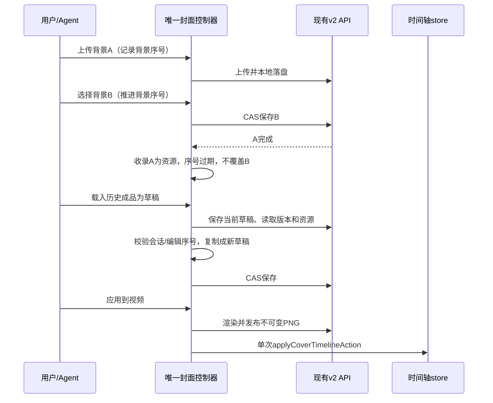

# 视频封面工作室第二轮：创作反馈、版本取回与异步操作收敛

**版本**：v2，已完成本轮设计评审与修订。**日期**：2026-09-28。**基线提交**：`664d0a3`。**当前节点**：方案评审与修复，仅修改本规格。

**目标**：在已经交付的封面工作室上，补齐有证据的交互和状态恢复缺口，保留三种创作模式、五套模板、Agent 制作、真实片头轨道及严格视频导出。

**架构**：继续使用现有封面 v2 服务、不可变 PNG 版本、CAS 草稿和时间轴事务；本轮改动集中在 React 工作室及其控制器，不引入新的持久化模型或生成供应商。

**最终审查状态（2026-09-28）**：实现已完成并通过代码审查。最新修复、27项逐文件覆盖检查及最终构建/桌面证据见 [最终代码审查](./review.md)。下文“本节点仅设计/尚未实现”等表述保留为设计阶段历史，实际实施证据见第11节，最终节点的独立验证以审查记录为准。

**技术栈**：Electron、Next.js 15、React 19、TypeScript、Zustand、Tailwind/CSS、html-to-image、FastAPI、SQLAlchemy/SQLite、ARK、FFmpeg；版本依据当前 `package.json` 和仓库实现，不进行依赖升级。

实施者按第 9 节执行，可使用 `superpowers:executing-plans` 辅助实施。本文为第二轮增量规格，原规格 [video-cover-studio/spec.md](../video-cover-studio/spec.md) 和 [最终审查记录](../video-cover-studio/review.md) 保留历史原貌。相同主题以本文明确覆盖的条款为准；没有覆盖的存储、生成、导出和迁移约束继续适用。本文的计划项尚未实现，历史通过记录不代表本轮验收通过。

## 评审记录

逐节对照 `CLAUDE.md`、第一轮 history、现有控制器、API 客户端、后端版本/任务服务及桌面脚本核查。以下均为设计问题与正文修正，不代表实现已修复或测试已通过。未发现 P0；8 项 P1、3 项 P2 均已在正文闭合。

| 编号 | 级别 | 问题、源码依据与影响 | 正文修正 / 验收 | 状态 |
| --- | --- | --- | --- | --- |
| D01 | P1 | §4.2/4.5 未固定异步动作开始时的令牌；只检查 edit 无法发现“开始上传但尚未返回”，载入途中仍可能采用过期背景。`generate` 也在 POST 后登记人工任务基线。 | 在首个 await 前占用背景意图，捕获 edit/背景序号；每次 await 校验；§4.2/4.5，R25。 | 已修订 |
| D02 | P1 | §4.3 恢复只校验 edit，未防重入或阻止自动保存穿过 GET；`flushSession` 持续处理保存队列，可使 GET 的版本落后于本地新 PUT。 | 会话恢复屏障、单一恢复令牌、GET 前后版本校验、释放后继续保存；§4.3，R26。 | 已修订 |
| D03 | P1 | §3.4/4.3 的“确认冲突”缺判定；`prepare/importLegacy` 本地编辑失效也抛 `CoverError('COVER_VERSION_CONFLICT')`，直接按 code 分类会再次显示错误的草稿覆盖按钮。 | 区分服务端草稿 CAS 与本地操作失效，保留来源；§3.4/4.3/5.1，R27。 | 已修订 |
| D04 | P1 | §4.6 宣称 Agent 保护不变，但 `bridge.handleCoverOperation` 通过 `runtime.reload()` 采用服务端草稿；复用人工恢复会使自身令牌失效，不改则 GET 期间新背景意图仍可被覆盖。Agent `runIntent` 也未使用人工 operations 锁。 | 单独受保护的 Agent 快照采用；所有发布/应用/载入共用操作所有者；§4.6，R28。 | 已修订 |
| D05 | P1 | §4.4 规定无任务停轮询，却未规定新任务如何唤醒；`putJob/setJobs` 直接覆盖并截取20条，取消终态可能被迟到 running 回退，活跃任务也可能被挤出。 | 统一单调合并、活跃任务唤醒、活跃集合不截断、404独立停查；§4.4，R29。 | 已修订 |
| D06 | P1 | §4.4 沿用 `generationRetry` 的 version/hash 键，网络未知后编辑会换新 requestId，可能重复计费；客户端解析失败也不能证明 POST 未落库。 | 冻结原请求及令牌，恢复未知提交重放原负载；显式取消或结果明确后才允许新操作；§4.4/5.1，R30。 | 已修订 |
| D07 | P1 | §3.3/4.4 假定缺 PNG 仍返回完整版本；后端 `load_state` 会跳过 `revision_data` 失败项，`getRevision` 也可能404。仅凭 revisionId 不能构造完整卡片。 | 已知版本独立不可用态、实时轨道引用占位、未知损坏历史不虚构；下载/背景校验边界；§3.3/5.2/6.2，R31。 | 已修订 |
| D08 | P1 | §4.3/4.4 只按 session 过滤请求，无法防同会话旧资源 GET 回写能力、旧操作错误遮盖新操作；GET和缺失版本补取也缺可重试入口。 | 资源请求序号、按动作所有者清理错误、当前引用独立补取、明确刷新恢复；§4.3/4.4/6.2，R32。 | 已修订 |
| D09 | P2 | §3.5 候选选中即置顶时按数组索引移动焦点会跳到其他卡；属性抽屉移动表单可能丢焦点，时区无后缀时间也会误显。 | 按稳定ID恢复焦点、明确抽屉关闭后进入设置、UTC时间规则；§3.3/3.5，R33。 | 已修订 |
| D10 | P2 | §8.3 声称所有新增产物均在 `.agentmesh/`，与现有 `.next/`、`desktop/build/` 固定输出不符；pytest默认临时目录也未限定。 | 区分仓库内固定构建输出和验证临时目录，明确 pytest basetemp；§8.3，R34。 | 已修订 |
| D11 | P2 | §3.4/6.2 恢复动作遗漏资源刷新和历史下载错误；浏览器 anchor 只能证明开始下载，不能证明文件落盘。 | 增加资源刷新动作，历史下载保持原生下载责任边界，不展示虚假完成；§3.3/3.4/6.2，R31/R32。 | 已修订 |

覆盖结论：§1–2 的增量范围与现有桌面架构一致；§3 的可访问性依据已核对原文链接；§4–6 的并发、错误和接口缺口按上表修正；§7–9 保持前端实现范围并补充对应测试；§10–11 明确风险与实际验证边界。不新增数据库、后端协议或通用框架。

## 1. 概述

上一轮已把旧封面弹窗替换为完整工作室，并在提交 `664d0a3` 中实现 HTML 排版、AI 生图、混合模式、五模板、四个 Agent 工具、封面轨道、工程保存和视频导出。本轮已读取任务 history、`README.md`、`CLAUDE.md`、上一轮规格和审查记录，再核对实际代码；不能重复把这些能力列为待从零开发的功能，也不能继续沿用旧规格开头“history 为空”的历史描述。

当前缺口集中在用户能否理解并控制创作过程：模板缩略图没有跟随工程比例，竖版放大预览仅按宽度缩放；成品已保存在服务端，但工作室没有版本取回入口；所有错误都提供相同的重新载入和覆盖操作，网络恢复与草稿冲突混在一起；上传背景和选择候选之间缺少同项目意图顺序保护，任务轮询错误也没有进入工作室反馈。这些问题使已经可靠的基础链路仍有丢失编辑意图或误导操作的风险。

本轮采用“沿用数据链路，完善创作闭环”的方案。用户可以准确预览五种比例、取回最近成品、区分草稿保存和视频已应用状态，并从具体错误中恢复。封面仍是默认一秒的真实静态片头，PNG 与视频来自同一成品；第三方平台选择哪个缩略图不属于承诺。本节点只写此文档，不修改实现代码，不运行 Git 提交。

## 2. 现状、证据与范围

### 2.1 已核查的差距

下表是源码观察及其可推导风险，不冒充本轮已执行的 UI 复现。开发应先用第 8 节用例建立失败证据。

| 编号 | 源码位置 | 当前行为与本轮决定 |
| --- | --- | --- |
| G01 | `src/components/video/cover/CoverTemplatePicker.tsx::CoverTemplatePicker` | `createCoverDocument` 未传项目比例，CSS 缩略图固定 160×90。改为传当前比例并按宽高共同适配；25 种模板/比例组合可见。 |
| G02 | `src/components/video/cover/CoverStudio.tsx` 放大 dialog | 缩放为 `min(.6,800/width)`，未考虑视口高度；竖图可能在小窗口需要额外滚动才能看全。改为基于实际可用矩形适配，关闭按钮始终可见。 |
| G03 | 同文件错误区及 `useCoverController.ts::reload` | 所有错误均显示 reload/overwrite；`reload(false)` 可以替换当前输入。只在确认的 CAS 冲突中提供明确的两种草稿决议，其余错误重试原动作。 |
| G04 | `useCoverController.ts::upload/copyAsset/selectAsset` | 上传完成只检查项目会话，没有检查该项目后来是否已选其他背景。引入背景选择序号；迟到图片可留在资源区，不能覆盖最新背景。 |
| G05 | `useCoverJobs.ts`；`CoverCandidates.tsx` | Hook 保存轮询 error，但控制器未向 UI 暴露；候选来自 jobs，所有 radio 默认都可 Tab 聚焦。新增连接恢复提示及单入口键盘导航。 |
| G06 | `useCoverController.ts::revisions/applyExisting`；后端 `load_state` | 已有最近 20 个版本、单版本读取和复用应用能力，UI 只有短 ID。新增最近成品面板，复用接口与控制器。 |
| G07 | `CoverStudio.tsx` 设置返回、模板撤销 | 设置关闭直接 `reload()`；模板撤销持有整个旧文档快照，之后继续编辑仍能撤销到旧文字。设置返回仅刷新资源/能力；模板撤销只在其操作后没有新编辑时有效。 |
| G08 | `VideoEditingInterface.tsx::openCover` | 取当前帧最多等待 1500ms 后再打开，没有对截帧期间项目切换作入口级失效判断。新增项目与入口序号检查，避免把旧项目帧传给新项目。 |

`app/` 在后文专指 `backend-services/basic-service/app/`。本仓库为单用户桌面应用，服务只在本机运行，业务归属继续使用 `LOCAL_OWNER_ID`。SQLite 的 `create_all` 和非破坏式演进约束不变。工作区原有未跟踪 `.bug-diagnosis/336be7e1-d7df-4fc8-b994-2b80f45c9128/` 与 `docs/images/` 不属于本功能，保持原样。

### 2.2 用户需求承接矩阵

| 原始需求 | 已有能力 | 第二轮工作及回归门槛 |
| --- | --- | --- |
| AI 制作视频封面 | ARK 生成任务、本地候选、取消与幂等 | 反馈任务连接状态；候选选择及上传不得覆盖后续意图；不增加供应商。 |
| 封面在轨道显示 | `video-cover` 元数据、专用图片轨道、单次撤销 | 历史版本应用必须走同一命令，一次替换、一次撤销，不能叠出第二片头。 |
| Agent 对话制作 | get/create/update/apply 四工具与操作卡 | 人工恢复草稿或背景选择后，迟到 Agent 自动应用仍须失效；工具协议保持兼容。 |
| HTML / AI / 混合 | 共用 CoverDocument 和 DOM→PNG 渲染 | 切模式继续保留文字；能力刷新不能重置草稿；离线 HTML 始终可用。 |
| 五套模板 | editorial/cinematic/knowledge/product/bold | 维持五套设计，只修正缩略图的项目比例与可见文字区，不重新设计模板坐标。 |
| 带封面导出 | required_cover 严格校验和真实 FFmpeg | 取回或应用历史版本后，导出的 revision/hash 与轨道一致，草稿不能偷换导出版本。 |
| 优雅、可靠的交互 | 工作区式编辑、深浅主题、局部布局 | 完成视口适配、版本入口、错误恢复、焦点与任务状态，给出真实 Electron 证据。 |

### 2.3 方案取舍

选择 A：在既有 v2 控制器上增加会话内意图保护、明确恢复动作和版本面板。它复用经过上一轮验证的 PNG、时间轴和导出契约，能逐项测试用户可见行为。

不选 B：再建 v3 后端、历史数据库或通用任务框架。现有版本和任务已经持久化，重做会增加迁移风险。也不选 C：只调整 CSS 和按钮文案。它无法阻止迟到上传覆盖新背景、设置返回重载草稿等行为。

本轮不做任意 HTML 源码输入、自由绘图、全量历史分页、云同步、历史删除/自动 GC、新模板、新模型、完整草稿多步撤销系统。版本面板明确叫“最近成品”，不承诺无限历史浏览。既有字段内原生撤销和时间轴撤销保持各自作用域。

## 3. 人机交互与视觉设计

### 3.1 信息层级与布局

沿用编辑器的克制视觉：背景、文字、边框和主操作使用现有 `--ws-*` 及主题变量；系统字体满足离线和中文排版，不加载网络字体。模板设计可使用现有衬线字体族，但不改变应用品牌。主操作始终是“应用到视频”，生成图片、取回版本与下载都是次级操作。

```text
返回剪辑  封面工作室  [HTML 排版 | AI 生图 | 混合]  草稿已保存
┌──────────────┬─────────────────────────────────┬──────────────┐
│ 五套模板      │ 1080 × 1920 · 9:16   安全区 放大 │ 内容 / 背景  │
│ 当前工程比例  │                                 │ 提示词 / 生成│
│              │         完整比例画布             │ 时长         │
│              │                                 │              │
├──────────────┴─────────────────────────────────┴──────────────┤
│ 图片 [候选缩略图…]   /   最近成品 [日期、模板、已应用标记…]     │
│ 任务：生图中 32秒   或 连接中断 · 正在重试 [立即刷新]           │
├──────────────────────────────────────────────────────────────┤
│ 视频使用：编辑精选 · 1.0秒   草稿有更新   下载 PNG  应用到视频   │
└──────────────────────────────────────────────────────────────┘
底部继续显示真实时间轴；进入工作室暂停播放。
```

宽度 >=1280px 沿用模板 208px、属性 288px；1024–1279px 使用模板横条和 256px 属性栏；小于 1024px 使用属性抽屉。新增资源区放在原候选区位置，高度上限为工作室内容高度的 30%，并且不超过 176px；最小化时允许资源区折叠为一行标签，画布与底部操作栏不能相互覆盖。两类列表各自水平滚动，滚动不改变选择。900×640、960×600 下底栏允许两行，状态文字不被隐藏。

空“图片”区显示“上传背景，或生成第一张图片”；HTML 模式可继续使用纯色，不诱导配置模型。“最近成品”为空显示“应用或下载封面后，成品会保存在这里”。首次展示默认图片页；用户在同一打开会话内选择的资源页不因任务轮询切换。新生成就绪仅在图片标签显示数量提示。

### 3.2 三模式与五模板

| 模式 | 画面与说明 | 无凭据、失败或断网时 |
| --- | --- | --- |
| HTML 排版 | DOM/CSS 文字叠加纯色、渐变或已有本地背景；不执行用户 HTML | 全部本地创作、应用、下载可用。 |
| AI 生图 | 生成图作为完整画面；隐藏文字编辑但不删除已输入字段 | 保留已有图并允许上传；生成按钮提示设置模型，不能宣称图中文字可精确编辑。 |
| 混合 | AI 背景配合 DOM 精确文字；背景提示保留构图留白约束 | 已有背景继续可编辑、应用；未有背景时展示具体缺项。 |

五模板视觉、默认配色和标题坐标沿用 `templates.ts` 与 `layout.ts` 的当前代码，包括上一轮修正过的 cinematic、product、bold 位置。模板卡的 `aspectRatio` 必须来自当前草稿；卡片容器横版最大 160×96，竖版在同一矩形中居中完整显示，留白使用中性底色而非拉伸。每卡标注名称和当前比例，选中同时具有轮廓与勾选。

固定输出像素表保持为：16:9 → 1920×1080；9:16 → 1080×1920；1:1 → 1080×1080；4:3 → 1440×1080；21:9 → 2560×1080。21:9 是产品画布 ID，不能用数学比值 21/9 重新判断 2560×1080 无效。

放大预览采用原生 `dialog.showModal()`；以 CSS 网格分离标题/关闭栏和画布区域。`ResizeObserver` 测量画布区域实际宽高，扣除 16px 四边留白后计算 `scale=max(0,min(1,availableWidth/outputWidth,availableHeight/outputHeight))`。区域尚为零时显示占位，不沿用旧 scale。主预览、模板缩略图、版本预览共用纯函数 `fitCoverPreview`，禁止只按宽度缩放或设置会导致溢出的 0.05 下限。仅预览缩放；发布渲染仍是完整固定像素。

### 3.3 最近成品与草稿

成品卡展示本地 PNG 缩略图、模板名、模式、比例、创建时间；版本 UUID 仅在详情中作为辅助信息。列表是当前项目会话已加载的最近 20 个版本，加上当前实际轨道引用的版本去重并置顶。排序按 `createdAt` 降序，同时间按 id；置顶版本即便不在最近 20 个中也保留。标记“视频正在使用”以实时 store 为准，不能仅以服务器最近一次工程保存快照决定。

点击卡片只预览，不保存草稿、不渲染新 PNG、不更改轨道；再点明确的“载入为草稿”才修改编辑内容，下载历史 PNG 直接使用既有版本下载 URL，不重新发布。底部仍由“应用到视频”完成最终应用，避免一个卡片 click 同时触发多个含义。

载入流程先保存当前草稿，保存失败则保留原输入并终止载入。取得版本详情和可解析的背景资产后复制 document，比例适配当前工程，时长取版本值；与当前工程比例不同时提示“已按当前画布重新排版，应用时将生成新成品”。这是一次草稿编辑，走同一 CAS 保存。提供一次“撤销载入”，恢复载入前文档；发生任何后续草稿编辑或 Agent 接管即隐藏该动作，不允许旧整文档快照抹掉新文字。撤销载入也只改草稿，不撤销时间轴。

历史版本背景丢失时，原 PNG 仍可预览和下载；“载入为草稿”不可用并显示“原背景已丢失，可下载成品后重新上传”。PNG自身加载失败时卡片显示“成品文件不可读取”，禁用预览/下载；仅当单版本GET仍成功且原背景可解码时，允许载入草稿重新生成PNG。单版本GET返回404时不能仅凭旧缓存解锁载入，需重试读取成功。不得静默把缺失的混合背景替换为纯色。

现有服务会从快照中跳过缺 PNG 的成品，单版本 GET 也可能返回404。面板只承诺展示 API 返回或本会话曾读到的元数据；不能凭未知 ID 伪造 document、时间或缩略图。实时轨道引用查不到详情时，保留带 revisionId 的“视频引用的成品不可读取”占位和“重试读取”，继续显示该轨道确实正在引用它，草稿有更新状态改为“暂时无法比较”。没有被返回、没有被本会话缓存、也没有被轨道引用的损坏历史不展示；本轮不扩展后端历史接口。缺失/不可读状态独立于不可变版本元数据存储，刷新并集不能把旧资产记录自动当成文件仍存在的证据。

历史下载动作由控制器在当前会话校验版本 GET 成功后触发现有 downloadUrl 的浏览器下载，不 flush 草稿、不 publish。GET错误进入对应卡片恢复；下载端点继续负责 SHA 校验和文件租约。原生下载触发后由 Electron/浏览器报告最终下载结果，工作室不显示“下载完成”或保证磁盘文件已写入；开始校验时可显示“准备下载”。预检之后文件仍可能被删除，端点失败不得被解释为成功。图片decode必须有有限超时（沿用渲染器既有超时常量；无可复用值则10秒），超时显示“暂时无法读取，重试”，不等同永久丢失，也不永久占住载入锁。

创建时间沿用候选任务的规则：无时区后缀按UTC解析，再按当前 locale 显示本地时间；排序比较有效时间戳，再按id固定排序。无效时间显示“时间未知”并排在有效时间之后，不影响读取或应用。

### 3.4 状态、错误与恢复文案

底栏分开表达“草稿已保存”“当前视频使用的成品”“草稿有更新”。导出成功仍由既有导出流程报告；本轮不增加第二套工程保存成功状态。`busy` 细分为 preparing/applying/downloading/restoring，仅相应按钮显示操作动词，下载不能显示“正在应用”。

| 情况 | 展示与动作 | 禁止行为 |
| --- | --- | --- |
| 草稿保存网络失败 | “草稿尚未保存，输入仍保留”＋重试保存 | 不读取服务器草稿覆盖输入。 |
| 确认的 `COVER_VERSION_CONFLICT` | “草稿已被另一项操作更新”＋保留我的草稿 / 使用已保存草稿 | 不把其他 409（如草稿未就绪）当作 CAS 冲突。 |
| 渲染/载入等待中发生本地编辑 | “封面已更新，请按当前内容重试”＋重试原动作 | 不当作服务端草稿冲突，不提供覆盖/载入服务器草稿。 |
| 最近成品/模型能力读取失败 | “暂时无法刷新”＋刷新资源；单版本失败在该卡重试读取 | 不重载草稿，不清除仍可用的本地资源。 |
| 生成提交结果未知 | “尚未确认是否已提交”＋恢复此次提交 / 取消此次提交 | 不把修改提示词后的普通点击默认为新付费请求。 |
| 轮询失败 | “暂时无法获取生成进度，正在重试”＋立即刷新；显示最近已知阶段 | 不将任务标成 failed，不自动重新 POST 生成。 |
| 生成已失败/超时/中断 | 显示对应原因；按钮“按当前设置重新生成”，旁边注明可能再次消耗额度 | 不复用旧任务状态伪装为继续，不自动计费重试。 |
| 上传/复制失败 | “背景未导入，当前封面未改变”＋重新选择图片 | 不提供无关的覆盖草稿按钮。 |
| 字体/背景渲染失败 | 保留草稿，重试原下载或应用；错误说明定位到背景或排版 | 不修改已应用版本。 |
| 时间轴冲突 | 提供既有重建片头说明；用户明确选择后走 rebuild | 不把普通重试强制变成 rebuild。 |
| 未知错误 | “操作未完成，草稿仍保留”＋关闭提示；保留原错误供日志定位 | 不向界面输出任意服务器堆栈、路径或凭据。 |

“使用已保存草稿”在冲突提示内明确注明将替换当前本地输入，按钮本身就是用户选择，不额外叠加模态确认。保留本地方案使用新的服务器版本执行一次 CAS，若再次冲突就停留当前草稿，不循环强写。设置返回只更新能力和资源，不能用该动作隐式解决冲突。

### 3.5 焦点、键盘与可访问性

工作室主体仍是非模态区，进入时聚焦标题（`tabIndex=-1`），返回焦点由现有 `closeCover` 恢复到入口。放大预览与版本详情共用一个 dialog，具有可读标题、内部焦点、可见关闭按钮，Esc 只关闭该层并回到触发按钮。遵循 [WAI 模态对话框交互模式](https://www.w3.org/WAI/ARIA/apg/patterns/dialog-modal/)。

模板及图片候选为单选组：有选中项时只让它进入 Tab 序列，否则第一项可进入；四方向键循环移动并选择，Space 选择，Tab 离开组。版本列表是普通列表及按钮，不冒用会立即改变草稿的 radio 语义。遵循 [WAI 单选组交互模式](https://www.w3.org/WAI/ARIA/apg/patterns/radio/)。

候选选中后会置顶：方向键先按事件发生时的列表计算目标assetId，选择并在渲染后通过该ID的ref聚焦，不能继续用旧数组索引找DOM。异步资源刷新不得主动抢焦点；原触发节点消失时回到所在资源页的可见标题/入口。单选组无可用项时不生成虚假的Tab入口。属性抽屉内进入模型设置必须先关闭dialog，再打开设置；返回后保持草稿并恢复到可见设置入口或属性按钮，避免隐藏模态层使设置不可交互。

窄屏属性抽屉使用独立原生 dialog，与上述预览互斥；关闭后恢复“属性”按钮，不能让焦点停留在隐藏元素。中宽屏属性栏仍是普通 aside，不设置虚假的 aria-modal。屏幕宽度变化导致抽屉布局切换时先关闭 dialog、再把焦点放到可见属性字段或开关；不渲染两份有重复 ID 的表单。模式 tab 补齐稳定 ID、aria-controls 与对应 tabpanel，切换只改变可见字段，不清空文档。

每秒用时不在 live 区域反复播报；任务阶段和错误变化才作 polite 提示。输入框的 Ctrl/Cmd+Z 使用原生字段撤销，工作室的其他快捷键不传播为时间轴撤销或播放。减少动画设置继续关闭过渡。

## 4. 技术设计与操作时序

### 4.1 职责分配

`CoverStudio` 只编排可见区域和动作，不直接发 REST。`useCoverController` 保有唯一 DraftSession、CAS 保存队列、Agent bridge 和素材/版本集合；加入恢复动作、背景意图序号及资源刷新。`useCoverJobs` 只订阅读取任务，显式暴露连接状态与刷新方法；它永远不发起生成。新 `coverRecovery.ts` 是错误归一化和动作选择的纯模块，新 `coverResources.ts` 负责同项目资源去重、排序和当前版本合并。UI 新增资源区、最近成品、预览对话框和错误面板四个组件，均依赖控制器接口。



### 4.2 背景选择：后发意图优先

在 DraftSession 增加 `backgroundIntent:number`，初始化为 0。显式选择已有候选、开始上传、开始复制素材、使用截帧、改变背景种类/焦点/颜色、载入版本、恢复草稿，以及模式/模板切换都推进该序号；纯文字、字号、生成提示词和时长变化不推进。整个会话失活使全部令牌失效。

推进发生在用户动作同步入口、首个await之前，包括载入/冲突恢复取得操作锁之后。操作随后失败也不回退序号，不能重新授权更早的后台结果。生成按钮同样表示新的背景意图：开始时推进序号并记录edit，flush完成必须确认二者仍未变化才POST；等待保存时发生了编辑则提示重新生成，不提交混合了新旧意图的请求。POST已发出后沿用其开始令牌登记manualJobs，不能收到响应时再取最新序号为旧任务续权。一次人工操作最多推进一次；update可按前后文档的背景/mode/templateId/aspectRatio差异识别同步编辑，已有令牌的内部adopt路径不得再当作新人工动作。

上传或复制开始时记录 `{session, backgroundIntent}`，完成后先检查该 session 仍是当前且 active，再把 asset 按 assetId 合并进资源集合。仅当序号一致时才将背景字段合并到**完成当下**的 document，保留中途编辑的标题等字段。序号过期仅展示“图片已导入，可在图片区选择”，不得自动选中。后台自动选入生成首图继续满足原有 version/edit/intent 条件，并额外使用同一序号，不得绕过它。

内部区分 `chooseAsset(asset)`（用户显式意图，先加序号）与 `adoptAsset(asset, token)`（已存在意图的完成，不再加序号）。禁止公共 `selectAsset` 内不加区分地连加两次使自身过期。维护单一 `mergeAssets` 同时更新 `assetsRef` 与 React state，防止同一 tick 选图后 renderer 查不到 URL。旧项目的成功或失败都不得写入新项目的资源或错误；旧项目资产已在后端落盘，重开项目可以获取，不需要删除。

生成开始时 manualJobs 同时记录 `backgroundIntent`；Agent 的 Intent 增加 `backgroundSequence`，在 beginOperation 捕获，validIntent 同时比较该值。这样“开始上传但上传尚未完成”也撤销早先 Agent 对背景的自动采用权限。Agent 合法自动采用自己的生成首图时，沿原流程更新 edit 基线，并同步更新它自己的 backgroundSequence；其他 intent 不能一并刷新权限。令牌一致只决定背景采用，不放宽原本的草稿版本、未保存编辑、时间轴摘要和取消条件。

图片区是 `snapshot.assets` 与 `job.assets` 的并集，按 assetId 去重；当前使用的资产置顶，其余保持稳定的首次出现顺序。现有 API 的背景资产没有创建时间，不能臆造按时间排序。这样迟到上传有可见回收入口，不只是留在不可访问的内存中。仅展示本项目 `/api/storage/files/` 地址，不允许来自工具结果的任意远程图片 URL。

### 4.3 错误与 CAS 恢复

恢复错误带有操作来源：load/save/generate/poll/upload/copy/render/apply/restore/resources。控制器以 `reportError(error, operation, session)` 记录，仅当前会话可展示。保留底层 code、HTTP status 和原 error 用于日志，UI 只选国际化文案。模板及字段内纯校验仍在局部展示。

`flushSession` 的 blocked 条件改为明确来自保存PUT的 `ApiError`、status=409且code=`COVER_VERSION_CONFLICT`，不以所有 status 409 判断。重试保存只调用 `flushSession`，成功清除本次保存错误。没有草稿的首次 load 失败可用 `reload`；已存在本地草稿时，普通重试不执行 whole-document reload。

错误归一化同时看异常类型、操作阶段和code：服务端保存/发布/生成返回的409版本冲突才有草稿CAS决议入口；本地 `prepare` 检测到edit变化、旧导入失效或旧会话失效属于操作失效，即便现有代码也使用同名 `CoverError`，都不设blocked、不提供local/server操作。可增加仅前端的 `kind:'draft-conflict'|'operation-stale'|'other'` 分类，不改变后端错误码。本地编辑失效只重试用户原本的动作；旧会话失效静默结束且不写新会话错误。

冲突恢复顺序：同步取得唯一恢复/操作令牌，推进背景意图并捕获当前session/edit/backgroundIntent；等待已有PUT结束，再记录稳定version并GET最新快照。恢复期间设置会话保存屏障：300ms自动保存、onBlur、退出flush及其他发布操作不得启动新PUT，已在途PUT允许结算。等待恢复的保存调用必须可恢复或明确拒绝，不能谎报saved。恢复自身使用唯一所有者绕过屏障，避免等待自己的死锁；连点local/server不产生第二个恢复请求。

每个await之后核对当前会话、edit、backgroundIntent及令牌；GET返回还核对version没有改变。任一变化则退出恢复，保留输入、恢复前的blocked和保存基线，提示再次选择。选择local时，以GET的version/hash更新保存基线、解除blocked，完整保留本地document，然后增加edit并执行一次恢复CAS；再次冲突立即停止，不循环取GET强写。期间继续输入产生的新edit属于后续普通保存队列，不属于恢复重试。选择server时采用GET的document/version/hash，推进edit后令saved=edit，清除一次性撤销；决议本身不发PUT。若该文档比例与当前工程不同，再作为独立的比例适配编辑递增edit并正常CAS保存，UI如实标记未保存，不能把重排后的本地文档当作GET哈希对应的已保存稿。若服务器document为空且已有本地草稿，不按server分支清空输入，显示不可恢复并保留local选项。

所有出口在finally中仅释放自己的令牌与屏障；仍有未保存输入且未blocked时重新安排普通自动保存。失败或项目切换都不能让屏障永久保留。恢复屏障只是本控制器的短期协调，不替代服务端CAS；外部Agent在GET之后写入仍由恢复PUT的409保护。

错误也有 `{session, operationId, edit, backgroundSequence}` 上下文。异步动作失败先检查归属；A上传过期后失败不得用“当前封面未改变”覆盖B的成功或错误，只在资源任务中保留A的可读失败提示。成功只清理自己对应的问题，资源GET成功不能清除草稿保存失败，轮询连接错误独立于草稿issue。外层 `run().catch(setError)` 不得丢失上下文重新上报旧异常；内部已处理异常由兼容入口识别，或者该入口改为调用捕获上下文的控制器动作。日志保留受控的code/阶段，避免直接打印含服务器路径或凭据的原响应。

处理 PUT 返回丢失的特殊情况：一次保存可能已落库但客户端收到网络失败；用户重试可能得到 CAS 冲突。保持上述显式恢复路径，不私自假定旧文档可以覆盖新文档，也不无限递增版本重试。

### 4.4 资源刷新与任务连接

新增 `refreshResources()` 调现有 GET，合并 assets、最近 revisions、服务端 appliedRevision 和 generationConfigured；**不写 document/version/hash/edit/saved/blocked**。GET 开始记录会话，结束再次核对。同一次请求期间客户端新增的资源不能因返回旧列表被移除。已应用版本始终再从实时 store 解析；缺少详情则 `getRevision` 单独补取，失败仅让对应版本卡不可用，不把轨道标记成另一版本。

同会话资源GET采用单调 `resourceRequestSequence`：只有最新发起请求可提交能力值、可用性状态和请求错误，较旧完成结果全部丢弃；本地新增资源仍按ID并集合并。最新刷新失败将generationConfigured标记unknown（不得沿用旧true宣称已配置），保留文档与已有资源。unknown时只允许刷新配置，生成POST仅在能力确认为true时启用。后台订阅实时appliedRevisionId变化：撤销/重做若引用集合外版本，按 `{session, revisionId}` 去重补取；晚到详情可以缓存，但不能改变当前标记。缺失请求结束后不由每次render无限重试，用户点击卡片“重试读取”或再次刷新才重试。

从设置返回、主动打开最近成品时使用该方法。它不更新 jobs，避免覆盖轮询已到达的任务终态；任务仅由初始快照、提交返回和专属 GET 更新。若需要发现其他操作创建的任务，必须逐个按 ID 合并且终态不被 queued/running 回退，不通过 `setJobs(snapshot.jobs)` 清空现有列表。刷新失败仍在所选页展示重试入口，不清空已有列表或切回图片区。

轮询保留既有前台 1s、后台 3s 间隔，异常退避 2/4/8/10s。`refreshNow` 清除排定计时器，在没有 inFlight 时立即轮询；有 inFlight 时设置一次 pending 标记，结束后最多再跑一轮，不创建第二并发循环。每个任务 GET 独立 try/catch，单个失败不阻塞其他任务。返回的错误按 jobId 记录，任一仍失败则显示连接恢复状态；全部成功后清除。会话切换取消 timer、abort 并递增 generation token，即便请求不遵守 abort，迟到结果也被丢弃。只出现 queued/running 才安排轮询，无活跃任务则停止定时器。

停止后，初始化、提交、Agent订阅等任一入口合并进新的活动任务必须唤醒同一个调度器；effect不能只依赖projectId。所有入口（包含取消响应和轮询响应）共用单调合并：已有终态不接受queued/running，running不接受queued；无服务端版本号时不猜测冲突终态的先后，保留已知终态并记录诊断。所有已知活动任务保留订阅，20条限制只用于已结束任务的展示，不能直接把整个jobs数组slice后漏掉运行任务。job 404作为单独的“任务不可读取”观察状态保留已知业务状态、停自动查该ID并提供手动重试；不篡改为failed、不永久以10秒重试404。网络/5xx退避继续，已取消或结束任务的连接错误同步清除。

用户明确重新生成使用当前草稿flush后的参数。新操作分配新requestId；将现有generationRetry扩为会话内冻结记录，保存完整CoverSavedDraft、referenceAssetIds、requestId、开始时edit/backgroundIntent和提交状态。网络错误、5xx或成功响应解析失败均属结果未知，不能因status<500或草稿version变化丢弃记录。“恢复此次提交”重放相同ID及完全相同负载，不先flush并替换为当前草稿；后端submit在校验当前draft之前查requestId，可返回既有job，已核对该顺序。若首次请求确实未落库且草稿后来变更，旧负载得到明确版本冲突后才结束未知状态，让用户按当前草稿发起新操作。

未知状态下可继续编辑，普通新生成入口禁用并说明原因；用户可调用已有cancel-by-request取消此次提交，只有取消响应确认后才清除未知记录。取消失败保留记录，不自动发新POST；取消可能无法退回已发生供应商消耗，文案沿用现有取消说明。已知job返回后使用原始人工令牌决定是否自动采用，不能给重试操作续权。只有明确拒绝/确认取消/取得既有job之后，新的用户生成动作才可分配新ID；本轮不持久化客户端待提交记录，跨重启沿用服务端任务恢复且不自动重新提交。

增加可见submittingGeneration，从开始flush到收到提交响应/错误都为true；按钮禁用并显示“正在提交”，finally仅清理所属会话状态。未知提交结束loading但保留恢复提示。所有重放都必须由用户触发，零自动付费POST重试；Agent的既有requestId契约不变。

### 4.5 历史载入与一次性撤销

`restoreRevision(id)` 顺序固定：取得互斥operations锁；同步推进背景意图并记录会话、开始edit和backgroundIntent；flush；读取getRevision与refreshResources；核验所有await期间edit和backgroundIntent均未变化，版本projectId与当前一致；若document.background.kind为asset，必须解析对应背景并在有限时间内完成本地image decode。解码失败不能改文档。取得锁不禁用文字输入及背景新意图，因此每次await后两种序号都要检查；后一上传即使尚未完成，也应使前一载入停止。

复制版本文档，保持 schemaVersion=2/templateVersion=1，aspectRatio 覆盖为最新工程比例；调用 update 一次并 flush；操作前文档以深复制记录为 restoreUndo。与图片操作共用背景序号，不让更早上传随后覆盖取回的背景。保存失败保留已载入的本地草稿并显示未保存，不伪装成功；撤销令牌仍可使用，走同一保存流程。

restoreUndo在同步替换文档时即记录resultEdit和backgroundSequence，不能等flush返回再捕获当时edit；否则等待保存期间新输入会被错误算成可撤销内容。真正撤销须同时匹配两个序号，再作为一次新的人工背景意图修改并保存。模板撤销使用同一规则。用户开始上传等仅推进backgroundIntent的操作也立即使旧整文档撤销失效。

`undoRestore()` 仅在token.session为当前且token.resultEdit、token.backgroundSequence分别等于当前edit、backgroundIntent时有效；自动保存完成不改变这些序号，所以不清除撤销。任一新用户编辑、Agent改写、server冲突恢复都会清除令牌。模板的现有undoTemplate使用相同的有效性判定，不再长期保存可覆盖其他编辑的快照。本轮只支持这一操作级单步回退，不构建第二套完整历史栈。

`applyExisting` 保留为 Agent/既有卡片入口；新历史面板不直接调用它，用户先载入草稿再应用。新交互因此不会绕过渲染、比例检查或 CAS。已有 applyExisting 的跨项目和比例防护继续回归。

### 4.6 入口、Agent、时间轴和导出不变量

`VideoEditingInterface::openCover` 在开始取帧前记录 `{projectId, entrySequence}`；切项目和卸载时使 entrySequence 失效，返回后必须核对项目及序号才 setCoverFrame/setCoverOpen。一次重复点击只允许最新入口结果；设置状态的代码不得引用旧项目的 ref。保留既有 1500ms 截帧超时、失败仍可打开、返回恢复焦点的行为。

关闭、定位片头并离开工作室也递增entrySequence，切项目同步清空frame；否则关闭动作可能被未结束的截帧重新打开。入口立即暂停播放，超时后底层截帧迟到也不得第二次提交结果。

四个 Agent 工具协议不变。所有新的人工作用必须递增 DraftSession.edit 或背景序号，仍经过原有开始基线、operationId、时间轴摘要和 session 检查。已经取消的操作不得因为资源刷新、版本载入或轮询重试重新取得自动应用权限。read-only 浏览历史不算编辑，不制造 Agent 冲突。

Agent快照采用不得复用人工resolveConflict，也不能继续无守卫调用whole-document reload。保留内部 `adoptAgentSnapshot(intent)`：捕获当前DraftSession对象和intent；等已有PUT结束，要求edit=saved且intent仍有效，记录此刻version再GET；提交响应前重查session、edit、backgroundIntent、version、digest、cancelled和操作所有者，之后才允许更新document/version/hash。GET等待期间开始上传会使采用被拒绝，不能先写草稿再在runIntent检查。成功采用Agent自身草稿时推进edit、令saved=edit并清除一次性人工撤销，仅为该intent更新sequence和backgroundSequence；其他intent仍保留旧基线而失效，不调用会把自身视作人工动作的通用恢复分支。资源仍可按受保护的合并入口收录，权限失效的任务仅显示候选。

所有会改变文档整体、发布或写时间轴的动作——restore/resolveConflict/act/applyExisting/Agent runIntent及其快照采用——共用 `{session, operationId, kind}` 操作所有者，不仅存session。人工操作忙时新人工重复点击不入队；Agent不得绕过锁，报告not_applied并保留结果供后续显式应用。本次Agent自身的采用和应用可在同一所有者下调用内部步骤，不重复取锁造成死锁。finally只能释放同一operationId，避免旧回调清掉新操作的busy；文件解码/请求超时或取消均必须到达释放路径。普通文字输入和上传仍可发生，通过序号令当前操作失效；发布前及写时间轴前必须重新核对开始时edit/backgroundIntent，已经发布的过期PNG只收录为历史、不应用。浏览历史不占写锁、不改变edit。旧公开reload只允许首次加载重试与已有受保护legacy入口，所有已有调用者须逐一检查，不能把它留作新UI的通用重试。

操作锁不跨越供应商任务的整个运行期：watch_job完成快照采用后立即释放，保留的是可失效intent。任务终态到来时runIntent重新取得操作所有者并校验原权限，不能长时间锁住人工创作。任务首图自动采用也必须检查当前没有另一个写操作所有者；冲突时只合并候选，不绕锁修改草稿。

时间轴唯一事实来源仍是 `metadata.role='video-cover'` 的片段。发布成品不等于应用；应用继续通过 `applyCoverTimelineAction`，正文所有轨道按时长 delta 平移、源裁切不变、锁轨冲突不提交、一次撤销恢复。导出必须冻结快照并核对 required_cover 的 project/revision/asset/hash，损坏封面仍是硬错误，不能作为普通图片 degradation 后继续成功。新 UI 不能直接改 `VideoProject.cover_url`，也不能替换这些领域命令。

## 5. 数据模型

### 5.1 持久化模型保持兼容

不新增或修改 ORM 表，不变更 `CoverDocument.schemaVersion=2`，不用 DDL 修复旧数据。已有 ProjectCoverDocument、ProjectCoverRevision、ProjectCoverAsset、ProjectCoverJob 与旧 ProjectCover 原样保留。document 的 mode、templateId、aspectRatio、fields、typography、background、generation、durationFrames 继续使用当前约束；版本是不可变 PNG 加文档快照；jobs 继续持久化服务端状态。

仅新增 TypeScript 会话内形状（下面是接口规格，不是本节点实现代码）：

```ts
type CoverOperationSource = 'load' | 'save' | 'generate' | 'poll' |
  'upload' | 'copy' | 'render' | 'apply' | 'restore' | 'resources';
type CoverRecoveryAction = 'retry-save' | 'use-local' | 'use-server' |
  'refresh-status' | 'regenerate' | 'choose-image' | 'retry-operation' |
  'refresh-resources' | 'retry-revision' | 'resume-submission' |
  'cancel-submission' | 'rebuild' | 'reload-initial' | 'dismiss';
interface CoverIssue {
  id: string;
  kind: 'draft-conflict' | 'operation-stale' | 'other';
  code: string;
  operation: CoverOperationSource;
  projectId: string;
  revisionId?: string;
  retryAction?: 'apply' | 'download' | 'rebuild';
  actions: CoverRecoveryAction[];
}
interface BackgroundIntentToken {
  session: object; // 实现中是 DraftSession 引用，不能只存项目字符串
  sequence: number;
}
interface CoverRestoreUndo {
  document: CoverDocument;
  resultEdit: number;
  backgroundSequence: number;
  session: object;
}
interface CoverPendingSubmission {
  session: object;
  requestId: string;
  draft: CoverSavedDraft;
  referenceAssetIds: string[];
  edit: number;
  backgroundSequence: number;
  state: 'submitting' | 'unknown';
}
type CoverRevisionAvailability = 'unknown' | 'checking' | 'readable' |
  'unavailable';
interface CoverRevisionEntry {
  id: string;
  revision?: CoverRevision; // 仅轨道引用占位时没有元数据
  metadataStatus: CoverRevisionAvailability;
  pngStatus: CoverRevisionAvailability;
  backgroundStatus: CoverRevisionAvailability;
}
type CoverResourceTab = 'images' | 'revisions';
type CoverActivity = 'idle' | 'preparing' | 'applying' |
  'downloading' | 'restoring';
```

`backgroundIntent`、activity、submittingGeneration、issue、undo、资源请求序号、保存屏障、操作所有者、待提交记录、可读性状态和dialog状态都不写DB或工程JSON。原始异常及session上下文只在控制器保存，UI拿到的是已归一化issue。重启只恢复已保存草稿、成品与任务，不能恢复上一进程的自动应用权限。保持导入/导出JSON原有metadata往返和跨项目版本复制契约。

### 5.2 数据合并规则

assets 以 assetId 唯一，revisions 以 id 唯一，jobs 以 jobId 唯一；禁止以 URL、数组索引或显示时间当主键。同 ID asset 的 SHA 和尺寸冲突视为数据错误，保留已知不可变记录并显示资源刷新失败，不在 UI 层自行信任新路径。新会话清空旧项目集合；同会话资源刷新做并集，版本展示截取 20 个并额外保留当前轨道版本。

合并的不可变元数据和文件可用性分开：文件decode/GET失败只更新对应可用性，不能删除或篡改已知hash，也不能因并集合并旧记录而重置为readable。当前引用的缺详情占位不占最近20条额度；不制造满足不了CoverRevision字段的类型断言。已有详情的背景缺失、PNG缺失和网络暂不可读分别呈现，明确重试读取允许unknown/unavailable重新检查。历史PNG可下载不代表其源背景可重新编辑。

能力 `generationConfigured` 三态：true/false/unknown。首次加载未配置或unknown且无已有草稿时默认HTML；设置返回false只禁用生成，不切换mode或删除背景；unknown展示“暂时无法确认模型配置”并允许刷新，HTML编辑照常。新生成POST仅在能力为true时允许；恢复既有未知提交按原requestId执行，不把能力刷新当作丢弃其记录的理由。

## 6. 接口设计

### 6.1 REST：全部复用已有路径

前端代理前缀及后端挂载后路径都为 `/api/video-cover-v2/{projectId}`，projectId 与 revisionId 使用现有 UUID。传输用 snake_case，`videoCoverV2::convertCoverKeys` 转为 camelCase；不要在 UI 自行拼后端 URL。

| 动作 | HTTP 签名 | 请求/返回与语义 |
| --- | --- | --- |
| 获取快照/刷新资源 | `GET /api/video-cover-v2/{projectId}` | `{success:true,data:{document,version,document_hash,assets,revisions,jobs,applied_revision,generation_configured,legacy_available}}`；初始化可采用 document，资源刷新不能采用。 |
| 保存草稿 | `PUT /api/video-cover-v2/{projectId}` | `{expected_version,document}` → `{version,document,document_hash}`；冲突沿用 409/COVER_VERSION_CONFLICT。 |
| 上传背景 | `POST /api/video-cover-v2/{projectId}/assets` | multipart 单字段 file，或 JSON `{source_asset_url}`；返回 asset，是否自动选入由客户端令牌决定。 |
| 读取历史版本 | `GET /api/video-cover-v2/{projectId}/revisions/{revisionId}` | 返回不可变 document、asset、url、hash、尺寸、created_at；不产生新版本或修改草稿。 |
| 历史 PNG 下载 | `GET /api/video-cover-v2/{projectId}/revisions/{revisionId}/download` | 继续使用服务器校验和下载租约；不先 publish。 |
| 生成 | `POST /api/video-cover-v2/{projectId}/jobs` | 保持 request_id/base_version/mode/template_id/prompt/count/aspect_ratio/reference_asset_ids；202 接受后轮询。 |
| 查询/取消 | `GET .../jobs/{jobId}`；`POST .../jobs/{jobId}/cancel` | 轮询失败是连接状态，不改变服务端 job.status。 |
| 发布成品 | `POST /api/video-cover-v2/{projectId}/revisions` | multipart 保留 file/request_id/expected_version/document_hash，201 成功；本轮不新增元数据字段。 |

生成终态仍是 succeeded/failed/cancelled/interrupted，活动态 queued/running。400/404/409/422/429 及供应商错误继续使用现有错误响应，归一化模块以 code 优先而不是根据中文 message 猜测。未知响应不做强行成功转换。

没有新增 WebSocket、SSE 事件、IPC、CLI 或 REST 路由。现有 `jobs/cancel-by-request`、legacy-import、import-revision 不变。API 客户端无需为版本面板发明平行缓存或引入新依赖。

### 6.2 内部接口

`CoverTemplatePicker` 新增必传 `aspectRatio:CoverAspectRatio`。`CoverPreviewDialog` 接收 `{open,title,document?,backgroundUrl?,imageUrl?,onClose}`；document 与 imageUrl 二选一，历史图用 imageUrl，当前草稿用 CoverCanvas；均用相同可用矩形测量。

`fitCoverPreview(output:{width:number;height:number}, viewport:{width:number;height:number}, padding=16):{scale:number;width:number;height:number}`：任一输入非有限数、输出尺寸<=0或可用尺寸<=0时返回全0；否则按第3.2节公式计算scale，返回width/height分别为输出尺寸乘scale。该函数不读DOM；调用者负责ResizeObserver和解除订阅。模板卡使用padding=0，其余使用16。

控制器新增 `activity`、`submittingGeneration`、`issue`、`jobConnection`、`refreshResources():Promise<void>`、`refreshJobs():void`、`retrySave():Promise<void>`、`resolveConflict('local'|'server'):Promise<void>`、`restoreRevision(id):Promise<void>`、`undoRestore():Promise<void>`、`canUndoRestore:boolean`。保留现有 flush/act/bridge/applyExisting 供相邻模块使用；`busy` 从 activity 派生，避免无关消费者被迫重构。

补齐 `revisionEntries:CoverRevisionEntry[]`、`retryRevision(id):Promise<void>`、`downloadRevision(id):Promise<void>`、`resumeSubmission():Promise<void>`、`cancelSubmission():Promise<void>`、`hasUnknownSubmission:boolean`。历史downloadRevision只调用getRevision和downloadUrl；它不复用会发布当前草稿的act('download')。下载初始校验不占草稿写锁，但用自己的请求令牌阻止同一卡片重复启动，保留跨项目失效检查。

现有 `error/setError` 对相邻调用保持可用，但内部动作先登记来源和失败动作，再由兼容入口映射为issue；外层catch不得用未知来源覆盖已归一化的同一错误。`jobConnection` 是 `{status:'idle'|'connected'|'retrying', failedJobIds:string[], unavailableJobIds:string[]}`，任务业务状态仍在jobs数组；unavailable用于404等不能靠定时轮询恢复的观察错误，独立提供重试。`canUndoRestore` 和模板撤销有效性都使用控制器当前edit/backgroundIntent生成，组件不能另存一份永不过期的快照。

`CoverResources` 接收本项目assets/jobs/revisionEntries、selectedAssetId、appliedRevisionId、tab和回调；分组与去重由纯函数完成，不在组件内调用service。`CoverErrorPanel` 接收已归一化issue和 `onAction(action)`，不接受可随意执行的服务端动作字符串。每个action映射控制器明确函数；资源刷新用refreshResources，单卡重试用retryRevision，原动作重试保留apply/download/rebuild来源，dismiss只清对应issue。`CoverCandidates` 改为接收去重后的assets和连接状态；现有job阶段/等待时间保留。

Agent `get_video_cover`、`create_video_cover`、`update_video_cover`、`apply_video_cover` 的名称、参数和 cover_action 消息均保持不变；增加的回归只验证新的人工作用不会绕开原 bridge 保护。

## 7. 文件 / 模块变更计划

下表是本轮开发清单，不是本设计节点的改动清单。禁止照搬第一轮大量已完成文件再次重建。标记“新增”的文件在基线中不存在；“修改”的路径已经核对。

| 操作 | 完整路径 | 单一职责 / 变更目的 |
| --- | --- | --- |
| 修改 | `src/types/videoCover.ts` | 增加恢复动作、错误来源、活动状态等前端类型；持久化形状不变。 |
| 新增 | `src/components/video/cover/coverRecovery.ts` | 纯错误归一化与按来源选择恢复动作。 |
| 新增 | `src/components/video/cover/coverResourceUtils.ts` | 资产/版本去重与稳定排序、当前版本保留；Windows 模块解析修正见 I01。 |
| 修改 | `src/components/video/cover/useCoverController.ts` | 背景意图、CAS屏障、操作所有者、Agent受保护采用、未知提交恢复、资源可用性、版本载入/撤销与下载。 |
| 修改 | `src/components/video/cover/useCoverJobs.ts` | 独立任务错误、单调合并、活动任务唤醒、无并发刷新与停止空轮询。 |
| 修改 | `src/components/video/cover/CoverStudio.tsx` | 接入资源区、错误面板、预览和属性 dialog；设置返回刷新资源。 |
| 修改 | `src/components/video/cover/CoverTemplatePicker.tsx` | 传递项目比例，缩略图按可用矩形适配。 |
| 修改 | `src/components/video/cover/CoverCandidates.tsx` | 复用全部背景资源、任务连接反馈、单选组单入口键盘行为。 |
| 新增 | `src/components/video/cover/CoverResources.tsx` | 图片/最近成品切换及资源区布局。 |
| 新增 | `src/components/video/cover/CoverRevisionHistory.tsx` | 最近成品列表、当前应用标记和明确的预览/载入/下载。 |
| 新增 | `src/components/video/cover/CoverPreviewDialog.tsx` | 当前草稿或成品的自适应、可访问预览。 |
| 新增 | `src/components/video/cover/CoverErrorPanel.tsx` | 按问题呈现文案与可执行恢复动作。 |
| 修改 | `src/components/video/cover/layout.ts` | 增加纯函数 fitCoverPreview，不变更已有模板几何或文字测量。 |
| 修改 | `src/components/video/cover/coverStudio.css` | 缩略图、资源区、预览、抽屉和窄屏底栏布局。 |
| 修改 | `src/components/video/VideoEditingInterface.tsx` | 截帧入口的项目/序号失效检查；保留返回焦点机制。 |
| 修改 | `src/lib/i18n.ts` | 中英文新增版本、连接、恢复、载入撤销与活动状态文案。 |
| 新增 | `src/components/video/cover/__tests__/coverRecovery.test.ts` | 异常类型/code/source→动作矩阵，真实CAS与本地失效分类，错误归属与动作映射。 |
| 新增 | `src/components/video/cover/__tests__/coverResources.test.ts` | 去重、当前版本置顶、20条上限、不可变资产冲突。 |
| 新增 | `src/components/video/cover/__tests__/coverPreview.test.tsx` | 缩放纯函数、比例卡片、dialog 标签及焦点恢复。 |
| 新增 | `src/components/video/cover/__tests__/CoverRevisionHistory.test.tsx` | 浏览不写入、载入/下载分离、缺图禁用及空态。 |
| 修改 | `src/components/video/cover/__tests__/useCoverController.races.test.ts` | 上传/载入/Agent乱序、CAS屏障、未知提交原负载重放、资源刷新顺序、缺图恢复。 |
| 新增 | `src/components/video/cover/__tests__/useCoverJobPolling.test.ts` | 实测hook计时器、空闲唤醒、终态单调、单任务错误隔离、404停查及取消失效。 |
| 修改 | `src/components/video/cover/__tests__/CoverStudio.test.tsx` | 操作提示、错误按钮、资源区与模式内容语义。 |
| 修改 | `src/components/video/cover/__tests__/CoverCandidates.test.tsx` | 键盘单入口、连接提示、已知阶段及候选稳定性。 |
| 修改 | `src/lib/video-editing-agent/__tests__/coverOperation.test.ts` | 新的人工作用使旧自动应用权限失效；只读浏览不影响权限。 |
| 修改 | `desktop/scripts/smoke-test.js` | 扩展真实竖版预览、版本取回和应用/导出一致性检查。 |
| 新增 | `docs/plans/video-cover-studio-refinement/spec.md` | 本规格；开发记录偏离、实际命令结果与已知边界。 |

无需修改后端、代理、ORM、通用 HTTP 客户端、Agent 工具生产协议或依赖文件。本轮对这些模块做回归验证。若测试证明存在不能在本清单内修复的问题，先在第 11 节记录精确入口、证据和必要新增文件，由设计评审明确修订，不静默扩大改动范围。

## 8. 测试与验收标准

### 8.1 新增行为验收矩阵

| ID | 操作 / 故障注入 | 必须观察到的结果 |
| --- | --- | --- |
| R01 | 五模板 × 五比例 | 每张卡传递真实比例、完整显示；已有输出尺寸和模板几何不变。 |
| R02 | 9:16 放大预览，900×640 与 960×600 | 画布四边完整、关闭按钮可见、无页面横向溢出；resize 后重新适配。 |
| R03 | 仅浏览最近成品、预览、下载 | 没有 PUT、生成 POST、发布 POST 或时间轴变更；下载使用已有 URL。 |
| R04 | 载入历史成品 | 原草稿先 flush；一次新草稿编辑；轨道不变，应用后只替换唯一片头。 |
| R05 | 当前已应用版本不在最近20个 | 当前版本仍置顶且仅出现一次，撤销应用后标记跟随实时 store。 |
| R06 | 历史背景缺失 / PNG缺失 | 分别禁用载入 / 图像相关动作，原草稿保持；不会生成伪造背景。 |
| R07 | 跨比例载入，含21:9 | 用当前画布重排草稿，提示重新渲染；新成品尺寸正确；旧 PNG 不变。 |
| R08 | 上传A悬挂，用户选择B，再让A返回 | B仍是背景，A可在图片区手选；不额外调用生成。 |
| R09 | 上传A、上传B，按B后A顺序返回 | B胜出；两张资产各出现一次；A的迟到错误不清除B。 |
| R10 | 上传期间改标题 / 改背景焦点 | 改标题时允许A合并且文字保留；改焦点/背景时A不自动覆盖。 |
| R11 | 上传、恢复、截帧期间切项目 | 新项目 document/assets/error/open/frame 均不接受旧回调；旧文件可在旧项目重开找到。 |
| R12 | 保存网络失败点击重试保存 | 仅重试PUT，原输入保留；未调用GET替换文档。 |
| R13 | 409/COVER_DRAFT_NOT_READY | 不设置 CAS blocked，不显示覆盖草稿选项。 |
| R14 | 真 CAS 冲突分别选择local/server | local只基于最新version写一次，server不PUT；等待期间新输入使恢复退出；再冲突不无限重试。 |
| R15 | 带未保存输入进入/退出模型设置 | 能力更新，文档/版本/edit不被资源刷新替换；生成状态不倒退。 |
| R16 | 任务一GET失败、任务二成功 | 二照常更新；一保留已知阶段并显示连接中断；没有新的生成POST。 |
| R17 | 刷新连点、退避中刷新、请求未结束刷新 | 最大一个轮询循环；有inFlight最多补一轮；无活动任务停止定时器。 |
| R18 | 网络不确定的生成提交 / 明确重新生成 | 前者复用requestId且显示提交中；后者用户点击后新requestId；零自动计费重试。 |
| R19 | 载入/模板切换后撤销，再有后续编辑 | 没有后续编辑时可撤销；有编辑时旧整文档撤销失效，不能抹掉新标题。 |
| R20 | Agent生图挂起，人工载入版本或选择背景，再返回结果 | 只新增候选，不能自动应用；停止操作依然无法复活。 |
| R21 | Agent运行中只读浏览最近成品 | 不增加edit，不无故撤销其自动应用权限；其他保护仍成立。 |
| R22 | 纯键盘候选/模板/模式/抽屉/预览 | 单选组仅1个Tab入口；四方向和Space可用；dialog焦点不逃逸，Esc恢复触发点。 |
| R23 | 深浅主题、中文、英文、减少动画、窄屏 | 状态可读，按钮不互相覆盖，文案无硬编码遗漏；用时不每秒播报。 |
| R24 | 下载当前草稿与应用当前草稿 | 分别显示下载/应用文案；重复点击单操作；下载不触碰时间轴。 |
| R25 | 载入A期间开始上传B；生成flush期间改背景；载入flush期间编辑后撤销 | 新开始意图使A失效，B完成可选入；过期生成不POST；撤销令牌取替换时序号，不能抹掉等待期间新输入。 |
| R26 | 连点local/server；恢复GET期间触发onBlur/自动保存/关闭；GET后外部Agent写入 | 单一恢复拥有保存屏障，无旧GET覆盖新PUT；只一次恢复CAS，409停止；所有出口释放屏障。server比例适配作为单独编辑保存。 |
| R27 | prepare在render期间检测本地编辑，抛同名CoverError；另注入服务端409版本冲突 | 前者仅重试原动作，后者才提供local/server；非CAS409不blocked；旧外层catch不重报已失效异常。 |
| R28 | Agent采用GET等待时开始上传；人工restore持锁时Agent就绪；取消后GET返回 | GET不得先改文档再拒绝应用；Agent不越过操作所有者，候选仍可见；单次发布/时间轴动作，旧finally不清新busy。 |
| R29 | 无任务停计时器后加入job；GET running晚于cancelled；超过20个已结束任务；job404 | 活动任务唤醒且不被截断；终态不倒退；404只标观察不可用并停自动查；用户刷新可重新读取。 |
| R30 | POST实际接受但响应丢失/解析失败，随后改提示词并恢复提交；取消响应也丢失 | 重放原ID及原全部负载，服务器仅一个job；采用仍用原令牌；取消未确认不能清未知记录/发新ID。 |
| R31 | 新会话加载过滤了坏PNG的快照；轨道引用版本404；背景完整但PNG失效；下载预检后文件删除 | 缺详情引用保留占位且可重试，不伪造历史卡；GET元数据可读且背景可解码才可载入重建，404不载入；原生下载不虚报完成；decode超时释放锁。 |
| R32 | 刷新A挂起，设置返回刷新B先完成；A再返回/失败；轨道撤销到集合外版本 | 旧A不改能力或新错误；自动补取当前引用且晚到不改标记；刷新错误提供正确动作，不清草稿保存错误。 |
| R33 | 候选方向键选择后置顶；属性抽屉进入设置；无时区时间 | 焦点跟随assetId而非旧索引；无隐藏dialog阻塞设置；UTC转本地显示与排序一致。 |
| R34 | 执行隔离测试/构建/冒烟前检查输出目录和命令 | pytest及系统临时目录留在工作区；固定构建输出如实记录；未操作工作区外目录或用户运行实例。 |

异步测试用可控制 resolve/reject 的 Promise 和 fake timers 强制指定乱序，不靠 sleep 猜测时序。除 UI 层外，控制器测试必须断言传出的 REST 次数、CAS version、文档内容和时间轴动作次数；不能只检查源码含有某个字符串。R11 的截帧入口检查放在桌面冒烟中，通过 CDP 在取帧未返回时切换工程，确认没有错误打开工作室或混入旧帧。

### 8.2 必须保留的端到端能力

离线真实桌面制作 HTML 封面、保存、重开并导出，必须继续通过上一轮冒烟。扩展脚本使用真实用户控件创建第二份成品，取回第一份、修改后应用，再从导出请求和实际 MP4 验证当前轨道版本一致。至少一个竖版工程检查完整放大预览和对应尺寸；至少一个有正文视频/音频的工程检查片头后移与边界，不以仅封面视频替代正文回归。

真实 FFmpeg 断言沿用既有测试：默认片头 30 帧/1 秒，第0和29帧对应封面，第30帧开始正文；音频标记随片头平移。破坏封面 PNG 或 SHA 后，预检/合成必须失败且不能提供伪成功成品。既有时间轴锁、单次撤销、JSON往返、跨项目复制、取消导出和21:9回归都必须继续通过。

付费供应商端到端验证仍是上一轮未完成的证据项。无真实凭据时使用已有受控 provider fixture 验证 AI/mixed，记录“供应商fixture通过，真实供应商未执行”，不得声称已验证云端出图效果。若执行真实请求，使用用户既有配置、记录模型与张数、实际耗时和输出尺寸，日志不写key；不为追求覆盖无限重试。系统125%/150%缩放与等效CSS视口分开报告。

### 8.3 开发节点执行命令

以下命令为下游计划，本设计节点不运行构建、测试或打包。每条独立执行、检查退出码；PowerShell不使用 `&&`。所有写入限制在本工作区；测试临时数据、验证日志、运行userData和最终隔离包放 `.agentmesh/`，现有构建工具的固定输出 `.next/`、`desktop/build/` 与类型检查缓存保持原工具路径，不宣称它们位于 `.agentmesh/`。执行任何测试前先建立工作区runtime/temp并设置该进程TEMP/TMP（见本节打包环境要求）；后端沿用隔离fixture并显式指定pytest临时目录。

```powershell
npm run type-check
npm test -- src/components/video/cover src/lib/video-editing-agent/__tests__/coverOperation.test.ts src/lib/video-editing-agent/__tests__/coverTools.test.ts src/lib/video-editing-agent/__tests__/coverCard.test.tsx
npm test -- src/components/video/hooks/__tests__/videoCoverExport.test.ts src/components/video/timeline/store/actions/__tests__/applyCover.test.ts src/components/video/projects/__tests__/coverPersistence.test.ts
```

后端命令工作目录为 `backend-services/basic-service`，使用该项目已有Python环境：

```powershell
python -m pytest tests/test_video_cover_v2.py tests/test_video_cover_jobs.py tests/test_video_cover_project.py tests/test_video_cover_export.py -q --basetemp=M:/takoAI/Ecliptrix/.agentmesh/cover-refinement-runtime/pytest-review
```

根目录执行生产构建与差异检查：

pytest会清理basetemp：运行前确认该绝对路径位于本工作区、没有用户文件或其他测试进程占用；多次或并行验证改用独立后缀并记录。不得把basetemp设置为工作区根目录或已有通用临时目录。

```powershell
npm run build
git diff --check
```

定向 lint 对第7节实际修改的 TS/TSX 文件逐个列出执行 `npx next lint --file <具体路径>`；可以在一次命令重复 `--file`，不得用修改规则屏蔽失败。完整 `npm run lint` 如仍受既有5项无关错误影响，记录文件、行号和本轮差异证明；不能把“定向通过”写为“全仓通过”。

桌面验证复用上一轮的独立包流程：标准 prepareFrontend/prepareBackend/prepareFfmpeg/prepareEnv 之后，用 electron-builder 输出 `.agentmesh/cover-refinement-package/win-unpacked`。`build.js` 自身没有导出且会调用main，不能直接require它；以下调用的是其引用的、确实导出函数的prepare模块，不执行默认release进程清理。先把TEMP/TMP、PIP_CACHE_DIR、npm_config_cache、ELECTRON_CACHE和ELECTRON_BUILDER_CACHE分别设为工作区 `.agentmesh/cover-refinement-runtime/` 下temp/pip/npm/electron/builder目录，并用 `New-Item -ItemType Directory -Force` 建好目录；仅影响本次验证进程环境，不写用户永久配置。按顺序在仓库根执行：

```powershell
node -e "require('./desktop/scripts/preflight').runPreflight({cnMirror:false})"
node -e "require('./desktop/scripts/prepare-frontend').prepareFrontend()"
node -e "require('./desktop/scripts/prepare-backend').prepareBackend(require('./desktop/scripts/preflight').resolveUrls(false)).catch(e=>{console.error(e);process.exitCode=1})"
node -e "require('./desktop/scripts/prepare-ffmpeg').prepareFfmpeg(require('./desktop/scripts/preflight').resolveUrls(false)).catch(e=>{console.error(e);process.exitCode=1})"
node -e "require('./desktop/scripts/prepare-env').prepareEnv()"
node -e "const fs=require('fs');const files=['frontend/server.js','frontend/.next/static','frontend/node_modules/@mariozechner','backend/run.py','backend/app/main.py','python/python.exe','python/Lib/site-packages/fastapi','ffmpeg/ffmpeg.exe','ffmpeg/ffprobe.exe','env.template.desktop'];const missing=files.filter(f=>!fs.existsSync('desktop/build/'+f));if(missing.length)throw new Error(missing.join(','));console.log('payloads: PASS')"
node -e "const path=require('path');const root=path.resolve('.agentmesh/cover-refinement-package');const pids=require('./desktop/scripts/lib/process-cleanup').processesUnder(root);if(pids.length)throw new Error('Isolated package is running');console.log('isolated output available')"
```

若输出目录已有运行实例，本次构建失败退出，不能结束用户进程；改用尚未占用的工作区隔离输出目录并同步记录命令。接着在 `desktop` 目录执行：

```powershell
node node_modules/electron-builder/cli.js --dir --win --x64 --config electron-builder.yml --config.directories.output=M:/takoAI/Ecliptrix/.agentmesh/cover-refinement-package
```

生成新包后回到仓库根运行：

```powershell
node desktop/scripts/smoke-test.js --unpacked M:/takoAI/Ecliptrix/.agentmesh/cover-refinement-package/win-unpacked
```

报告需包含新包与当前工作树对应关系、隔离端口/userData、PNG/MP4、视口截图、请求计数、实际帧和音频检查及退出后的进程清理。旧 `.agentmesh/cover-package` 的历史产物不能作为本轮新实现的证明。

## 9. 实施顺序与检查点

1. **先固定失败场景**：在控制器测试加入上传乱序、设置返回、非CAS的409、轮询单任务失败；确认断言确实暴露基线行为。视觉问题用900×640竖版预览建立截图和边界记录。
2. **实现纯逻辑**：增加恢复动作分类、资源去重和fitCoverPreview，完成R01/R02/R05/R13的单测；不改持久化字段。
3. **修复控制器状态**：加入背景令牌、CAS恢复、资源刷新和activity；完成R08–R15/R18/R24，确认初始加载和原Agent桥接仍兼容。
4. **收敛轮询与候选**：新增显式刷新，按任务隔离错误；资源区展示迟到上传；完成R16/R17及键盘候选测试。生成POST次数必须为预期，不能以自动重发隐藏失败。
5. **接入成品取回**：增加最近成品组件和restore/undo；完成R03–R07/R19，保留原时间轴应用命令。浏览、下载、载入三个动作不能互相替代。
6. **完成响应式交互**：预览dialog、窄屏属性dialog、比例模板卡、错误面板、焦点以及中英文；修复入口截帧会话保护。执行R01/R02/R11/R22/R23真实界面检查。
7. **回归与交付**：执行第8.3节测试、构建和新独立包冒烟；对Agent人工操作冲突及真实视频检查逐项留证；将偏离和结果写入本规格第11节。不能复制上一轮的通过数字作为本轮结果。

每一步先运行相应有意义的行为测试再实现；检查通过后进入下一步。若后续改动影响已经验证的边界，重跑对应集合。本节点不执行这些步骤，不写实现代码或提交Git。

## 10. 风险与缓解

| 风险 | 必须采用的缓解 |
| --- | --- |
| GET资源刷新意外回写草稿 | 独立入口，字段白名单；测试断言document/version/hash/edit/saved不变。 |
| 用projectId比较无法区分同项目重入 | 令牌持有DraftSession对象引用及active；重挂载后的同ID仍属于新会话。 |
| 双重意图递增导致自己的上传永远失效 | choose/adopt明确分离；用乱序Promise测试最后一次背景选择。 |
| 缩略图DOM渲染开销 | 模板只有5个；历史成品使用现成PNG和lazy图片，不重新渲染20份DOM。 |
| 老成品缺原图但PNG可下载 | 区分可预览和可继续编辑两种能力，不静默丢背景。 |
| 最近20条被误认为全量历史 | 固定“最近成品”文案；当前轨道版本额外置顶；本轮不删除旧版本。 |
| 轮询重试被误认成生成重试 | 两类按钮与内部函数分开；测试拦截生成POST数量。 |
| 原生dialog跨断点和Esc事件重入 | 互斥dialog、受控open/onClose、关闭事件只处理当前层；真实Electron键盘验收。 |
| 草稿取回后旧Agent自动应用 | 人工更改推进edit/背景序号；保留operationId、digest、session全部守卫。 |
| 新UI破坏已通过的导出链路 | 不改存储/合成契约；仍验实际视频画面、音频、错误下载与一次撤销。 |
| 大工程资源快照较大 | 当前后端返回所有背景资产，前端只渲染可见缩略图并lazy加载；全量分页另立任务，不假称内存有固定上限。 |
| 误用历史验证报告 | 每次结果附命令、时间、基线/工作树及产物；fixture和真实供应商、等效视口和实际DPI分别记录。 |
| 恢复或Agent复用reload造成权限自失效/过期采用 | 人工恢复与Agent采用分开；共享操作所有者，采用前检查全部令牌。 |
| 生成结果未知时编辑导致重复计费 | 冻结requestId和完整负载；明确恢复/取消，禁止自动换键重发。 |
| 停止空轮询后新任务永不更新或取消终态倒退 | 新活动任务唤醒同一调度器，所有数据入口单调合并。 |
| 服务端跳过损坏历史导致UI虚构可用版本 | 已知元数据与可读性分开；当前轨道引用保留不可用占位，其他未知历史不承诺列出。 |

## 11. 评审、实施偏离与验证记录

### 11.1 本节点设计核验范围

已读取第一轮history与提交、README/CLAUDE及表中关键实现。本文仅提出第二轮改进；新增接口、组件和测试均为计划。应在提交本节点完成报告前检查所有必需章节、文件清单路径、篇幅、Git可见性和仅文档修改范围，并登记无源码变更的logic记录。

### 11.2 实施过程发现的方案缺陷

实施发现 I01：原清单同时要求纯模块 `coverResources.ts` 和组件 `CoverResources.tsx`。Windows 文件系统上无扩展名 `./CoverResources` 被 Vite 优先解析为纯 `.ts` 模块，组件为 undefined，6 项 UI 测试渲染失败。修正为纯模块 `src/components/video/cover/coverResourceUtils.ts`，组件仍为 `CoverResources.tsx`；相关测试/控制器/组件导入统一使用新纯模块名。只有路径改名，不新增功能或依赖。影响 R03/R05/R08/R32，集成测试结果见 11.3。

实施环境记录 I02：任务要求的 `wait_async --probe-kind file_exists` 返回 HTTP 400 / `probe_template_not_supported_on_host`。长命令使用工具会话和日志持续检查；没有将未执行或未完成命令记为成功。验证临时目录均在工作区 `.agentmesh/cover-refinement-runtime`，构建工具原有 `.next/`、`desktop/build/`、`desktop/cache/` 保持其固定工作区内路径。

实施发现 I03：第8.3节 `-c.directories.output=...` 在当前 PowerShell/ electron-builder 25.1.8 组合被解析为配置路径 `.directories.output=M:...`，打包报 ENOENT。修正命令使用 `--config.directories.output=M:/takoAI/Ecliptrix/.agentmesh/cover-refinement-package`；仍沿用同一个 electron-builder.yml 与隔离目标，不修改生产打包配置。

实施环境记录 I04：独立缓存首次展开 winCodeSign-2.6.0 时，主机无权限创建其中 macOS 的 darwin 符号链接，打包返回失败。对已下载归档使用 7za 解压到工作区缓存 `.agentmesh/cover-refinement-runtime/builder/winCodeSign/winCodeSign-2.6.0`，排除 Windows 打包不使用的 `darwin/*`，然后重新运行原打包命令。`win.signAndEditExecutable: true`、图标编辑及生产配置均保留；没有提升权限或更改系统设置。

实施发现 I05：900×640的真实编辑器中，工作室上半区只有约322px，原横向模板、预览工具条、历史资源与底栏固定高度耗尽，导致 `fit.scale=0`。`CoverStudio` 改为通过 ResizeObserver 测量自身高度，低于440px启用紧凑布局：模板保留名称和比例，资源区保留一行入口，主动打开时在 `CoverResources` 原生dialog中显示同一份列表；预览/载入先关闭资源dialog，关闭后恢复焦点。继续使用现有计划文件，不增加依赖、不改变时间轴高度。已有完整模板缩略图布局用于空间足够的工作室；小窗口完整画面由主预览及放大预览呈现。

实施验证记录 I06：第二次独立包启动时，冒烟自己的HTTP探测先于桌面监督器下一轮健康探测/日志落盘，原脚本立即断言缺少healthy日志，产生误失败。计划内 `desktop/scripts/smoke-test.js` 改为最多15秒等待四类日志非空且两个healthy标记齐备，保留原检查条件；随后复用同一最终包重跑，不修改桌面生产启动逻辑。

追加的窄屏设置检查首次使用了错误选择器：设置仍复用 `.cover-studio` 外层，脚本误要求它卸载。该次执行已完成MP4和竖版预览检查，但在设置检查超时；修正为检查工作室header及所有open dialog退出，再执行完整重跑。失败证据保留为 `smoke-final-2.log`，不计为完整通过。

### 11.3 本轮运行验证

本轮实施基线为 `664d0a3`，所有实现保留在工作树，未执行 Git 提交。第7节27项文件计划均已落地；没有后端、数据库、API协议或依赖变更。实现与运行记录均为本轮实际结果，第一轮报告仅作回归基线。

已执行的回归命令与证据（临时目录为工作区 `.agentmesh/cover-refinement-runtime`）：

- `npm test -- src/components/video/cover src/lib/video-editing-agent/__tests__/coverOperation.test.ts src/lib/video-editing-agent/__tests__/coverTools.test.ts src/lib/video-editing-agent/__tests__/coverCard.test.tsx`：15个文件172项通过，含51项控制器竞态和Agent桥接集成；完整日志 `tests-final.log`（2026-09-28 05:14 EDT）。
- 时间轴、导出与工程持久化回归：3个测试文件31项通过，日志 `timeline-tests.log`。
- 在 `backend-services/basic-service` 执行 `python -m pytest tests/test_video_cover_v2.py tests/test_video_cover_jobs.py tests/test_video_cover_project.py tests/test_video_cover_export.py -q --basetemp=M:/takoAI/Ecliptrix/.agentmesh/cover-refinement-runtime/pytest-review-1`：74项通过、27条依赖弃用等警告；日志 `backend.log`。含供应商fixture、幂等/取消、实际FFmpeg帧边界、音频延后及损坏PNG硬失败。
- 变更TS/TSX使用仓库 `.eslintrc.json` 执行ESLint：0错误；原生img、既有接口与hooks等警告保留。全仓库lint仍有5处既有错误：AudioSearchModal/ImageSearchModal/VideoSearchModal空接口各1处、WatermarkRemovalModal第629行未转义引号2处；这些文件未修改，日志 `lint-full.log`，不能称全仓库lint通过。
- Next生产构建包含类型检查；最终前端与独立桌面包构建退出码均为0。最终完整日志 `build-compact-final.log`，输入hash记录 `build-source.json`。打包沿用 `win.signAndEditExecutable: true`，未生成安装器或提交代码。

首次新包冒烟 `.agentmesh/ecliptrix-smoke-qaJPKx` 已通过启动、历史浏览下载零写入、取回仅改草稿与再次应用；在900×640布局检查时发现主预览被挤至零，失败截图和日志已保留，不能作为完整通过证据。修复与最终重跑结果继续记录在本节。

最终桌面验收（2026-09-28 05:20 EDT）：第8.3节隔离包命令完整执行通过，日志 `.agentmesh/cover-refinement-runtime/smoke-final-3.log`，退出码0、无残留进程。包路径 `.agentmesh/cover-refinement-package/win-unpacked`；24份生产输入SHA-256全部匹配最终工作树，仓库、prepared frontend与包内frontend的BUILD_ID一致为 `Y0qRYJzj7SObhRT0nycAg`。独立userData `.agentmesh/ecliptrix-smoke-XB1JKN`，前端56651、后端56652，不占用原桌面用户目录或已有实例。

实际产物与结果位于 `.agentmesh/ecliptrix-smoke-XB1JKN/artifacts/`：

- `cover-report.json`、`cover.png`、`cover.mp4`、`cover-portrait.png`及7张界面截图。MP4为1920×1080、30fps、90帧、3秒；第0/29帧对已发布PNG的平均RGB误差分别1.6954/1.6931，第30帧对正文源视频的误差0。音频标记在1.500021秒，正确相对正文延后1秒；PNG摘要匹配时间轴metadata。
- 历史浏览/预览/下载期间草稿与发布写请求0；载入历史只改草稿，再应用生成唯一新片头。当前草稿下载双击只启动1次下载/1次发布，时间轴版本不变。总计2次原生下载启动、生成POST为0、没有外部请求或renderer异常。
- 900×640和960×600竖版dialog四边完整，比例9:16，关闭按钮可见、页面无横向溢出；实际应用得到1080×1920 PNG。原生Tab/Shift+Tab焦点、Esc恢复、属性抽屉进入设置再返回焦点均通过。1440×900、900×640、1152×720、960×600主预览/底栏检查通过，已实际查看窄屏、浅色和竖版截图；深浅主题、减少动画、模式/模板方向键与标题保留通过。
- 截帧请求挂起后切到另一工程，再释放旧帧并越过1500ms期限，旧回调未打开新工程工作室。冒烟finally确认退出后没有独立包残留进程。

验收证据范围：R01–R34的主要实现路径由新增纯函数/组件/控制器/轮询/Agent测试、既有后端回归与上述桌面检查共同覆盖。补充15项专项控制器测试直接覆盖跨比例历史载入（含21:9双方向）、双上传反序、标题/焦点意图区分、当前草稿下载连点、生成flush失效、恢复再CAS冲突停止、202解析失败原负载重放、10秒decode超时释放锁、旧资源刷新失败归属。测试通过不代表所有矩阵子场景都已在真实桌面逐一操作。

明确未执行：真实付费供应商出图；实际Windows系统DPI切换（125%/150%为等效CSS视口）；下载预检后由外部进程删除同一PNG的原生下载失败注入。候选完整四方向/Space依赖组件测试，桌面键盘检查覆盖模板/模式和原生dialog。真实供应商、系统DPI及上述外部删除场景不记为通过。未改变后端协议、持久化schema或用户现有工作区外文件。

### 11.4 本次设计评审核验

评审读取并核对了控制器的flush/reload/prepare/generate/bridge、轮询hook、工作室/候选/属性组件、截帧入口、前端API类型与客户端、后端load_state/revision_data/submit/_replay和打包模块导出。本次修订不改变REST/ORM/Agent工具协议，不修改源码或提交Git。可访问性参考已核对第3.5节所链接的W3C原文；其余判断来自本仓库实际实现。

文档交付检查包括：v2版本标识；评审记录与结论各一处；D01–D11均有正文修正和验收映射；R01–R34连续且唯一；第7节27项文件计划的已有/新增路径属性；Markdown代码围栏与相对链接；Git差异与工作区既有未跟踪目录范围。此检查只证明规格自洽与变更范围，不证明计划中的功能测试已通过。

## 评审结论

**通过**。

本轮发现的8项P1和3项P2均已直接修订正文，没有未解决的P0/P1设计问题。现有Electron/React控制器、v2接口及不可变PNG机制可以承载本轮增量，范围维持前端交互和会话协调，不引入后端迁移或新增供应商。

设计通过允许进入实现节点。实现仍须完成第8节34项验收、既有端到端能力回归及当前工作树生成的新独立包验证；实际供应商与真实DPI验证未执行时必须如实标注，不能用本评审或上一轮报告替代运行证据。
