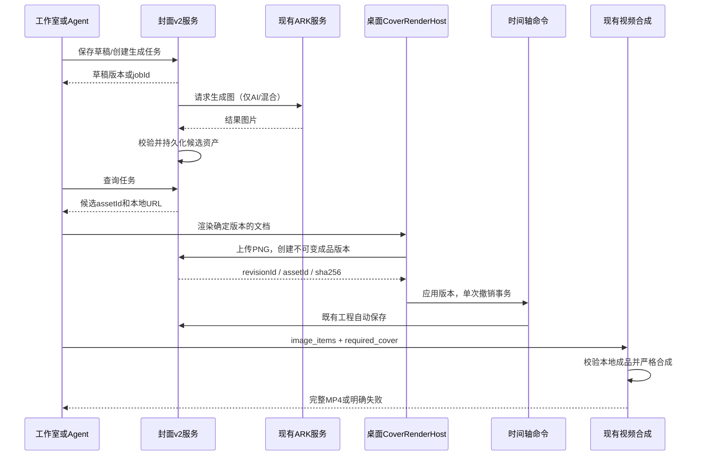

# 视频封面工作室：交互设计与实施规格

版本：v2；日期：2026-09-28；状态：设计评审与修复完成，进入实现。

## 评审记录

评审范围为本规格全部章节；以 `CLAUDE.md` 和本地源码为依据，分别检查可行性、完整性、一致性及范围。以下“已修复”指设计正文已修正，不代表代码已经实现或通过功能测试。本轮没有发现 P0；发现的 10 项 P1、2 项 P2 均已在正文处理。

| 编号 | 级别 | 问题及依据 | 正文修正 / 验收 | 状态 |
| --- | --- | --- | --- | --- |
| R01 | P1 | `ark_image_service._generate_legacy_images` 在返回前用 `get().content` 整体下载，并自动跟随重定向；返回后再限流无法兑现下载上限。原方案还缺少 21:9 到 `ArkImageGenerateRequest` 有效枚举的映射。 | §4.3 增加仅封面启用的延迟下载选项、受限下载和明确比例/参考图映射；§8.2、C17。 | 已修复 |
| R02 | P1 | 任务以 base_version 发起，选中结果必然更新草稿版本；原文继续用旧版本渲染/自动应用会冲突。单一 document 也无法兑现三份独立模式草稿，且 ai/mixed 就绪条件不明确。 | §3.2、§4.3、§5.1、§6.2 明确共享草稿、选图 CAS、就绪校验及受控版本推进；C18。 | 已修复 |
| R03 | P1 | 只有前端停止旧 PUT、提交前读版本不能保证并发安全；发布成功响应丢失后重试还会被新草稿版本错误拒绝。 | §4.5、§5.2、§6.1 定义数据库 CAS/唯一约束、请求幂等校验顺序、冲突保留输入及渲染发布边界；C19。 | 已修复 |
| R04 | P1 | 取消逻辑状态后立即释放额度可绕过运行并发上限；任务创建成功但 SSE 尚未送达时，“停止 Agent”无法获知 jobId。 | §4.3、§6.1–6.2 定义执行槽生命周期、按 request_id 取消与取消先到的持久终态；C20。 | 已修复 |
| R05 | P1 | `TimelineRepository.regularizeClipInvariant` 会按 clipEnd-clipStart 重算 duration；改封面时长只改 duration 会在导入后回退。复用隐藏空封面轨道和手势期间提交也未定义。 | §4.4 补齐静态片段时间字段、保留轨道标志、拒绝活动手势及异常封面的显式修复；C21。 | 已修复 |
| R06 | P1 | 当前工程轨道实际位于 `project_data.uiState.currentTimelineState`；原文未锁定保存提取路径、旧 cover_url 写入及草稿关闭 flush，容易出现“已保存”但状态丢失。 | §4.5、§5.3 明确保存入口、单向标志、旧写保护与独立草稿 flush；C22。 | 已修复 |
| R07 | P1 | JSON append 清除封面标记后若仍引用源项目 PNG，删除源项目会破坏目标；缺失封面转普通图片又与严格导出策略矛盾。 | §7.2 要求 replace/append 都先复制资产，失败原子拒绝；§8 补类型入口；C23。 | 已修复 |
| R08 | P1 | 删除项目只保护运行导出，未保护正在发布、下载或导入的资产；旧 `delete_for_project` 还在提交前删文件。 | §4.5 定义项目操作锁、删除事务与提交后清理，明确修补旧服务；C24。 | 已修复 |
| R09 | P1 | 现有 `ExportPreflightSheet` 有 `skipAdvisories` 继续路径；硬错误若作为普通建议可被绕过。图片合成还存在多层降级分支。 | §7 明确不可绕过校验、导出快照、30fps 限定及严格成品提交；C25。 | 已修复 |
| R10 | P1 | server-side `ToolContext.timelineState` 是请求快照，不能代表执行时编辑器状态；“当前摘要”若到 SSE 才采集，会漏掉提交期间的用户编辑。 | §6.2 区分服务器快照与实时客户端状态，以工具开始时记录基线；C26。 | 已修复 |
| R11 | P2 | 无凭据仍默认 mixed、截帧失败可能阻塞入口，与空项目离线三步应用矛盾。 | §3.2、§4.2 明确无凭据默认 HTML，截图为可失败的附加能力；C01/C13。 | 已修复 |
| R12 | P2 | 文档多处仍指向下一次 v2 评审，且新文件计划未覆盖实际改动入口。 | §8、§10、§12–13 与结论统一交接边界；按模块补充必要文件和测试。 | 已修复 |

逐节结论：§1–3 保留三模式、五模板和现有工作台视觉方案；§4–7 修复状态、持久化、时间轴及导出契约；§8–10 补足实现入口和失败用例；§11–13 明确风险及设计/实现验收边界。继续采用已有单进程 FastAPI、SQLite、Electron 渲染器和时间轴领域模型，无需 Redis、新浏览器运行时或业务 IPC。

**目标**：重建桌面视频编辑器的封面制作流程，提供 HTML 排版、AI 生图、混合创作、五套模板、Agent 工具、真实时间轴片段及可靠视频导出。

**架构**：React 工作室和 Agent 共用封面文档、异步生成任务及应用命令。HTML 在桌面渲染器内栅格化为不可变 PNG，作为普通图片素材进入专用图片轨道；预览和导出复用既有图片合成能力。

**技术栈**：Electron、Next.js 15、React 19、TypeScript、Zustand、html-to-image、FastAPI、异步 SQLAlchemy、SQLite、Pillow、ARK Seedream、FFmpeg。沿用仓库已经安装和封装的能力，不新增浏览器自动化运行时或业务 IPC。

实施者按本文第 10 节逐项执行，可使用 `superpowers:executing-plans` 技能辅助实施；本评审节点只修改本设计文档，不执行开发、不提交 Git。本文的“新增”“修改”“删除”均是下一开发节点的计划。

## 1. 概述

现有封面功能位于播放器的独立弹窗中，支持四套文字模板、截帧或上传背景，并把渲染后的 PNG 写到项目的固定缓存位置。它没有建立“创作草稿—成品版本—时间轴片段—最终导出”的完整关系。用户很难判断封面是否已进入视频，Agent 也没有专用封面工具。此次重建以清晰的创作状态和一致的成品为中心，让用户在编辑器上下文内完成设计、比较、应用和修改。

新工作室提供三种同等可见的模式：HTML 模式用可编辑文字和图形排版；AI 生图模式把生成图作为完整画面；混合模式用 AI 背景加精确可编辑的 HTML 标题。默认选择混合模式；未配置生图凭据时展示明确说明，HTML 模式始终可用。五套模板都可以离线打开；每套同时提供 HTML 布局与生图构图提示。Agent 通过结构化工具操作同一套能力，不另外维护一份封面状态。

本版把“带封面的视频”明确定义为**视频开头真实存在的一段静态封面画面**，默认 1 秒；应用时正文整体后移，音频、字幕和所有轨道保持同步。项目列表缩略图使用同一成品 PNG，用户也可单独下载 PNG。文件管理器和发布平台如何选择视频缩略图不属于本版保证范围，不把容器封面元数据当作交付标准。封面生成成功、渲染成功、应用到时间轴、工程保存成功是四个不同状态，界面必须分别反馈。

## 2. 仓库现状与约束

### 2.1 已核查的实现

| 现有路径 / 符号 | 已有行为与本次接入点 |
| --- | --- |
| `README.md`、`CLAUDE.md`、`.claude-index/index.md` | 单用户 Electron 产品，本地 FastAPI / Next.js，SQLite 增量建表，没有登录系统；索引仅用于定位，以下结论以源码为准。 |
| `src/components/video/components/VideoPlayerPanel/VideoPlayerPanel.tsx` | 直接挂载旧 `CoverButton` 和 `VideoCoverModal`；替换为新入口回调。 |
| `src/components/video/components/VideoCoverModal/` | 四模板 `title/tutorial/click/minimal`、DOM 渲染、截帧、旧封面持久化；旧 UI 整体退役。 |
| `src/lib/api/videoCover.ts`；`app/routers/video_cover.py` | 旧 GET/PUT/DELETE 及 `png-cache` 接口；新功能采用独立 v2 路由，旧数据保留兼容读取。 |
| `app/services/video_cover_service.py` | 写 `projects/<id>/cover.png` 并更新 `VideoProject.cover_url`；固定路径不适合历史版本、并发导出。 |
| `app/models/db_models.py::ProjectCover` | 旧封面 JSON 配置，数据库必须保留，不做破坏性 DDL。 |
| `src/lib/video-editing-agent/tools/generateAiImage.ts` | 通用生图工具请求同步接口后记录异步任务；专用封面工具不能照搬该模式重复提交生图。 |
| `app/services/ark_image_service.py::generate_images_with_pack` | 现有图片 API 返回结果，不是视频式远端 task/poll API；返回字段为 `image_url/local_url`。 |
| `src/components/video/timeline/store/actions/replaceTimeline.ts` | `replaceTimelineAction` 一次替换形成一个撤销步骤，保留视图标志及历史；复用为封面插入事务。 |
| `src/components/video/timeline/domain/services/ItemPlacementService.ts` | 图片素材到片段的元数据传递；素材是 `image`，内部轨道/片段类型实际为 `video`，配合 `originalMaterialType=image` 和 `image-track` 前缀，不新增 TrackType。 |
| `src/components/video/timeline/infrastructure/TimelineRepository.ts` | 活跃 JSON 导入/导出在前端执行，现有逐字段映射未保留片段 metadata；必须在此修改，不能只改后端旧接口。 |
| `src/components/video/hooks/videoExportItems.ts` | `buildExportCompositionItems` / `planVideoExport` 与可渲染轨道规则一致；图片依赖素材库，不能只存缩略图 URL。 |
| `src/components/video/hooks/useVideoExport.ts` | 真正的视频导出走 `VideoCompositionRequest`，当前 30 fps；`timeline_export_service.py` 是 JSON 导出，不能当作 MP4 导出入口。 |
| `app/models/video_models.py::VideoCompositionRequest` | 已支持 `image_items`、绝对时间和五种画布比例。 |
| `app/services/video_composition_service.py` | 图片失败可能记录 degradation 后仍 completed；封面必须增加严格失败处理。 |
| `src/components/video/projects/hooks/useProjectAutosave.ts` | 800ms 防抖、10s 最大刷新、卸载保存和关闭窗口 flush；不得再建竞争的工程自动保存机制。 |

表内 `app/` 均相对于 `backend-services/basic-service/`。本轮 history 返回空，没有需要复用的封面重建成果；共享黑板中的品牌图标事项属于此前任务，本次不改动。初始工作区已有 `.bug-diagnosis/...` 和 `docs/images/` 未跟踪内容，保持原样。

### 2.2 确定的范围

- 五种比例沿用视频项目：16:9、9:16、1:1、4:3、21:9。封面比例跟随项目，不再独立选择不一致的比例。
- 一个项目只有一个当前封面片段，可以保存多个草稿成品版本和生成候选。
- 不开发任意 HTML 编辑器、远程网页截图、JS 执行、自由矢量绘图、多人协作、发布平台上传或新的生图供应商。
- HTML 模式允许纯色、渐变、上传图片、项目素材或当前合成帧作背景；“HTML”指真实 DOM/CSS 模板排版，不是给图片加一个模式标签。
- 保持单用户本地存储，不增加登录、鉴权、云对象存储；凭据仅由后端现有设置读取。

## 3. 人机交互与视觉规格

### 3.1 入口与布局

播放器工具区保留一个文字明确的“封面”按钮；无封面显示“制作封面”，有封面显示 24px 缩略图和“编辑封面”。双击时间轴封面片段进入同一工作室。Agent 结果卡提供“编辑”和“定位到轨道”，不打开第二套编辑器。

工作室使用编辑区内的展开视图：替换上半区的内容，保留项目顶栏、底部时间轴和助手入口。返回后恢复原工作台的布局、选中片段与播放头位置；进入时暂停播放。工作室不设置模态焦点陷阱，只有放大预览使用对话框。全局播放快捷键在表单、模板选择及工作室画布编辑期间不触发。

```text
项目顶栏：项目名 · 保存状态                                      导出
返回剪辑  /  封面工作室   [HTML 排版 | AI 生图 | 混合]   已保存草稿
┌────────────────┬──────────────────────────┬────────────────────┐
│ 模板            │                          │ 内容 / 画面 / 输出 │
│ 五个预览卡       │      真实比例画布         │ 标题、副标题、标签 │
│                 │      安全区开关           │ 背景 / 构图提示    │
│ 当前模式说明     │                          │ 生成 / 取消        │
│                 │ [原始图] [候选1] [候选2]  │ 封面时长 1.0 秒    │
└────────────────┴──────────────────────────┴────────────────────┘
版本：当前草稿 · 已应用 v3          下载 PNG        [应用到视频]
时间轴：封面 [缩略图 0–1s] / 正文轨道 / 音频轨道 / 字幕轨道
```

宽度 >=1280px 时三栏：模板 208px、属性 288px，中间自适应；宽度 1024–1279px 时模板改为上方横向卡条，属性 256px；宽度 <1024px 时属性以可关闭的侧面抽屉呈现，预览仍完整可见。900×640 下不产生页面横向滚动，底栏固定在工作室区域内，内容区单独滚动。时间轴的尺寸和折叠策略继续由 `useWorkbenchLayout` 管理。

使用现有 `editor-workbench.css` 的背景、文字、边框和强调色变量，深浅主题均适配；不另设紫色渐变品牌。8px 间距系统，容器间距 16/24px，卡片圆角 8px，边框 1px。标题 18px/600，区块标题 13px/600，正文 13px，辅助文案 12px。主操作只有“应用到视频”；生成使用次级强调按钮，删除为菜单动作。候选卡选中状态同时具有边框、勾选标识和可读文字。

### 3.2 默认流程与交互细节

1. 点击入口，加载草稿、最新任务和应用版本；加载期间显示结构占位，不先展示默认模板再闪切。
2. 新项目默认 `editorial` 模板、混合模式、当前比例、1 秒；已确认未配置生图凭据时默认 HTML，并保留模式切换。标题取项目名，空项目取“输入标题”。纯 HTML 初始背景取模板默认颜色，无素材也能制作；模型能力加载失败不阻止手动切到 HTML。
3. 选择模板保留标题/副标题/标签、已选背景，重置布局和模板颜色；若存在用户调整的布局，显示轻量可撤销提示，单次本地撤销可恢复。三模式共用一份持久草稿和背景/生成参数，不维护三份独立文档；切模式只改变 mode 和字段可见性，AI 模式隐藏但不清空 HTML 文字。
4. 文本输入实时 DOM 预览，300ms 后保存草稿，失焦立即保存；只同步最新版本，保存失败保留本地输入并给“重试”。渲染成品只在下载、应用或明确生成预览时执行，不能每个按键上传 PNG。
5. 生成默认 1 张，可选 1/2/4 张。状态为排队、生图中、保存图片、就绪；没有可证明的进度时显示阶段和已用时间，不编造百分比或“15 秒必完成”。生成期间可继续改文字，已有应用封面保持可用。
6. 生成完成后，只有草稿版本与发起时一致且没有本地未保存编辑，才能按 §4.3 的 CAS 流程自动选入第一张；若用户已修改草稿，仅加入候选条，并提示“新图片已就绪”。重试为新的明确生成操作，可能再次消耗供应商额度，不能无限自动重试。
7. 点击应用：等待当前草稿保存，准备精确尺寸 PNG，校验素材已落盘，生成不可变版本，然后执行一次时间轴命令。按钮期间显示“正在应用”，重复点击不创建新片段。成功后保持工作室打开，底栏显示“已应用，视频增加 1.0 秒”，并提供返回剪辑。
8. 下载 PNG 只生成/下载当前草稿成品，不改变时间轴；修改草稿后显示“草稿有更新 · 视频仍使用 v3”。工程保存失败时明确显示“已应用到当前编辑器，工程尚未保存”，不得冒充已持久化。

### 3.3 模式行为

| 模式 | 画面来源 | 文字行为 | Agent 参数要求 |
| --- | --- | --- | --- |
| `html` / HTML 排版 | 内置 DOM 模板 + 纯色/渐变/已有本地背景 | 标题、副标题、标签均可编辑，确定性排版 | templateId、fields；prompt 可省略，不调用 ARK |
| `ai` / AI 生图 | 生成图整体裁切为目标画布 | 不叠加 HTML 字体；生成图中的字作为像素，不能承诺精确拼写 | 非空 prompt；需要精确标题时建议 mixed |
| `mixed` / 混合 | ARK 背景 + 相同 DOM 模板 | 中文/数字由 HTML 渲染；背景提示追加不生成文字、为标题区域留白 | 非空 prompt、templateId、fields |

HTML/混合模式的属性面板提供标题、副标题、标签、字体大小、颜色、左/中/右对齐、背景裁切焦点。仅提供系统字体族 `sans/serif/mono`，Windows 的默认无衬线使用 Segoe UI / Microsoft YaHei 回退；不得依赖网络字体。输入内容均作为 React 文本节点，不使用 `dangerouslySetInnerHTML`。高级 HTML 源码粘贴不在范围内。

### 3.4 五套模板的确定规格

下列坐标以画布宽高归一化，文字尺寸以 `s=min(width,height)` 为基准；安全区为四边各 6%，标题最多 3 行、副标题最多 2 行、标签 1 行。每套均实现横向、竖向和方形三种布局；4:3 使用横向，21:9 使用宽横向（主文字区域宽度最多 55%）。不允许把横版整图缩小塞入竖版。

| ID / 展示名 | 布局与初始视觉 | 默认模式 / AI 构图提示 |
| --- | --- | --- |
| `editorial` / 编辑精选 | 暖白 `#F4F1EA`，墨色 `#242320`，陶土强调 `#B66B50`；标题框横版 `(0.07,0.24,0.50,0.48)`、竖版 `(0.08,0.12,0.84,0.30)`；右侧/下部主体 | mixed；自然光、主体靠右，左部安静留白 |
| `cinematic` / 电影叙事 | 深炭色 `#151719`，米白文字，底部线性暗渐变；横版标题 `(0.07,0.64,0.80,0.25)`、竖版 `(0.08,0.67,0.84,0.21)` | mixed；宽景、光影层次、下方可读留白 |
| `knowledge` / 知识课堂 | 米白底、深蓝 `#233C58` 文字、黄 `#E7BE61` 编号标签；横版文字左侧 50%、图片右侧 40%；竖版标题上方 30%、图片中下方 50% | html；主体清晰、背景简洁、信息图式构图 |
| `product` / 产品聚焦 | 浅灰 `#ECEDEA`、深灰文字、墨绿 `#315C4B` 强调；主体居中，标题横版顶部 `(0.12,0.08,0.76,0.23)`、竖版 `(0.08,0.10,0.84,0.25)` | mixed；单主体、柔和工作室光、顶部留白 |
| `bold` / 大字观点 | 黑 `#171717`、白、橙 `#DC8354`；标题横版 `(0.08,0.18,0.78,0.62)`、竖版 `(0.08,0.18,0.84,0.52)`，重点标签独立色块 | html；强烈明暗、低复杂度、不生成字母或水印 |

默认标题字号依次为 `0.092s/0.086s/0.090s/0.082s/0.125s`，副标题为 `0.034s`，标签为 `0.026s`。方形采用对应竖版的 x/width，标题 y 取 0.12、主体居下；cinematic 方形仍底部排字。副标题放标题框下方 0.03h，标签放安全区左上角；cinematic 标签移到上方，避免与底部标题冲突。模板卡使用同一渲染组件的固定示例文字和纯色/渐变背景生成缩略图，不需要网络图片或本节点额外生图。

文本采用 `white-space:pre-wrap; overflow-wrap:anywhere; line-height:1.12`。从模板字号向下以 1px 递减，直到文字宽高均进入框，最低标题 `0.040s`、副标题 `0.025s`；仍溢出时画布标出该框，应用/下载禁用，给出“缩短标题或减小字号”。不截断、不默默删字。安全区只作为设计辅助，不对特定发布平台作合规保证。

### 3.5 键盘、异常与状态

- 模式用 tablist，候选/模板用带标签的单选组；方向键切换，Enter 选中；工具按钮可 Tab 到达且具有可见 focus ring。
- 编辑字段内 Ctrl+Z 使用字段/工作室草稿历史，时间轴区 Ctrl+Z 使用时间轴历史；Esc 先关闭属性抽屉/放大预览，再退出工作室。返回后焦点回原入口。
- 生成结果使用 `aria-live=polite`，不每秒播报用时；错误与状态不只靠颜色；支持系统减少动画设置，过渡 120–180ms。
- 生图缺凭据：在生成按钮附近提供现有模型设置入口，保留 HTML 功能；断网/429/超时：保留草稿、已应用封面和候选，提供明确重试。
- 图片丢失：占位和“重新选择背景”；项目切换：终止该编辑器的渲染/轮询订阅，新项目绝不能接收旧项目的应用回调。
- 比例变化：现有成品不自动换图；显示“封面比例与项目不同”，要求重新渲染并应用后才能带封面导出。

## 4. 技术设计

### 4.1 数据流与职责



封面草稿服务不直接写编辑器时间轴；时间轴是当前应用版本的权威来源。后端成品版本不可变，导出永远绑定 revisionId 和哈希，不读取可变 `cover.png`。任务结果不直接改工程；只有活动编辑器的应用命令能修改轨道。

### 4.2 渲染器

`CoverRenderHost` 挂载在 `VideoEditingInterface` 的项目作用域，工作室关闭时仍存在，供 Agent 应用封面使用。渲染节点置于屏幕外但参与布局，不能 `display:none`；单实例串行队列，卸载时拒绝未完成任务。任务键为 `(projectId, documentHash)`，只共享纯 PNG 渲染 Promise；发布版本另以 `(projectId, expectedVersion, requestId)` 管理，不能把不同保存版本的上传错误地去重。画布内部始终使用最终像素尺寸，编辑视图仅从外层等比缩放，不根据可见面板宽度重新排字。

渲染顺序：冻结输入深拷贝 → 以最终像素尺寸挂载 `CoverCanvas` → 等待 `document.fonts.ready` 及每张图片 `decode()` → 完成文本测量和溢出检查 → `html-to-image.toBlob({width,height,canvasWidth:width,canvasHeight:height,pixelRatio:1})` → 解码验证尺寸 → 上传。总等待上限 15 秒；资源加载上限 10 秒。失败最多在相同尺寸重试一次，禁止旧版的静默降到 720p。

最终尺寸与后端视频画布一致：16:9=1920×1080，9:16=1080×1920，1:1=1080×1080，4:3=1440×1080，21:9=2560×1080。AI 模式也经相同画布输出，按焦点裁切铺满，禁止拉伸。编辑态 DOM 与栅格化节点共用 `CoverCanvas`，应用后的播放器展示保存的 PNG，保证预览和视频使用相同像素来源。

所有背景只能引用本项目已验证的本地 `assetId`；渲染前取得 Blob URL 并在完成后回收，成品文档不存 Blob URL。资源 URL 由后端生成，客户端/Agent 不可提交任意网络 CSS、HTML、脚本或绝对文件路径。

截帧接口固定为 `VideoPlayerPanelRef.captureCoverFrame():Promise<Blob>`，由 `useCompositionTransport` 的 imperative handle 转发 `useCompositionPlayback` 新增的同名方法。实现暂停播放后读取 `engineRef.current.compositor.captureFrame()`，把 PNG data URL 转成 Blob；返回 null、画布尚未就绪或跨域污染时明确失败。该截图是当前预览实际可见帧，不能标成源视频原始分辨率。进入工作室前捕获一次，工作室内“使用进入时画面”引用此快照；播放器上半区被替换卸载后不调用失效 ref。若需要另一帧，返回剪辑定位后再进入，不新增原始视频虚拟时间轴截帧器。截图通过 assets 上传成功后才成为可保存背景。

入口截帧必须有界且可失败：空时间轴、未就绪画布或读取错误仅禁用“使用进入时画面”并显示原因，照常打开工作室，不把截图成功设为模板创作或 Agent 应用的前置条件。自动截帧不自动上传、也不替换当前草稿背景。

### 4.3 AI 生成任务

新增项目级本地任务服务。POST 提交后立即返回 202，服务使用独立数据库会话运行任务，不能把请求会话传入后台协程。状态 `queued → running → succeeded | failed | cancelled | interrupted`，各状态持久化；全局至多 2 个运行任务、每项目至多 1 个运行任务和 2 个排队任务，多余请求返回 429。工作进程就是已有单 FastAPI 进程，不引入 Redis/Celery。

任务执行调用现有 `generate_images_with_pack`，固定 `mode=basic, grid_mode=false`，watermark 沿用请求模型默认值 true，不擅自调整供应商策略。映射请求尺寸：横向=1280x720，竖向=720x1280，方形=2048x2048；4:3/21:9 先用横向图，再按目标比例裁切。适配器 `aspect_ratio` 对 21:9 传 16:9，其他四种传对应枚举；目标 21:9 保留在封面文档及构图提示中，不能直接传入不支持该值的 ArkImageGenerateRequest。reference_asset_ids 逐一验证本项目归属后映射为服务产生的本地 `reference_images`，count 原样传 1/2/4。明确提示生成背景可能低于最终排版分辨率，不把放大称为原生高分辨率。模板提示、用户提示、比例构图提示按固定顺序拼接；mixed 最后追加“无文字，标题区域留白”。

现有 basic 路径在返回前会无上限整体下载，不能称为已满足封面下载限制。为 `generate_images_with_pack` 及其 basic 内部路径增加仅 Python 内部可用的 keyword-only `defer_download=False`；旧调用默认行为不变，封面传 true，使适配器完成一次生成请求后只返回供应商图片 URL，由 `video_cover_asset_service` 流式下载。该选项不加入公共 ARK 请求 Schema，不改变 grid pack 行为。下载按解码后的实际传输字节累计上限，逐跳检查 URL 和重定向目标，不访问非 HTTP(S) 或回环/私网地址；从已验证本地资产读取则直接使用存储解析器，不通过 HTTP 绕行。20MiB 字节限制在完整读入内存前生效，32 百万像素限制在 Pillow 解码前检查，再做完整解码。图像处理放到有界工作线程，不阻塞 FastAPI 事件循环。

生成结果如存在真实 `local_url`，先验证路径并限量读取，否则由上述封面下载器取回 `image_url`；二者均须最终复制/转码为项目专属不可变 PNG。最大单图 20 MiB、解码后最多 32 百万像素，下载限制 60 秒，运行期总限制 240 秒，排队时间单独显示。所有返回结果均处理完毕后统一进入终态：至少一张落盘且数据库提交成功即 succeeded，部分失败附 `warnings` 和实际张数，零张成功才 failed。候选使用 assets 表和 job.result_asset_ids 表达，不另建候选表。生成阶段超时为 failed；下载阶段达到总期限时保留已经提交的候选，按上述部分成功规则结束，后台不得继续追加结果。供应商的响应字段不做猜测，不构造虚假远端 taskId。

相同 `requestId` 和相同规范化 body 返回已有任务；相同 requestId 不同 body 返回 409。服务不自动重试供应商生成请求；前端轮询 1 秒起，后台/失焦 3 秒，网络失败退避至 10 秒，页面卸载停止订阅。重启将运行/排队任务标为 interrupted，不能自动重发可能计费的请求；用户重试生成新 requestId。

新 job 准入还需核对 base_version 等于当前已保存草稿版本，mode/template_id/prompt/count/aspect_ratio 与该草稿快照一致，reference_asset_ids 已验证；冲突返回 409，不能先调用供应商再发现版本过期。已有幂等键先返回旧任务，不因当前草稿变更重新提交或失败。reference_asset_ids 是显式生图输入，不把普通背景自动发送给供应商。

取消立即 CAS 持久化 cancelled 并取消本地等待；远端请求可能仍在执行，迟到结果必须检查任务状态，不能应用或更新草稿。调度额度以尚未退出的本地执行协程计数，不能只统计 status=running；网络关闭、下载及有界解码实际结束后才在 finally 释放全局/项目执行槽。远端是否仍在计费无法由本地槽保证，界面明确提示。任务准入、幂等查找及 queued 插入在同一个项目调度临界区中进行，防止并发 POST 穿透队列额度；只有数据库提交成功后才唤醒 worker。关闭工作室不中止生成，切项目允许服务继续生成但撤销自动应用意图；重新进入只显示结果待选，不自动改时间轴。

候选选入与自动应用的版本链固定为：提交前 flush 草稿取得版本 v 和本地 editSequence → job 保存 base_version=v → 结果就绪后确认版本仍 v、editSequence 未变化及自动意图有效 → PUT expected_version=v，仅设置 background 为已选 asset → 成功返回 v+1 和 canonical document/hash → 仅本次受控选图允许把意图期望版本推进至 v+1 → 渲染并发布 v+1。用户输入即递增 editSequence，不能等 300ms 自动保存后才发现变化。任一 CAS 失败只保留候选，不回写旧草稿；手动选择候选以当时最新草稿版本保存。后台任务本身从不执行 PUT，也不直接改变草稿或轨道。

### 4.4 时间轴与撤销

使用现有图片轨道约定：内部 `track.type='video'`、`item.type='video'`、素材 `type='image'`、片段 `originalMaterialType='image'`，轨道 id 为 `image-track-cover:<projectId>`。JSON 对外序列化的轨道 type 才是 image。默认名称“封面”，height=56，order 取当前最小 order 减 1，单片段 id 为 `cover-clip:<projectId>`。片段 `startTime=0`，duration 默认 1，范围 0.1–5 秒，按当前导出 30fps 转为整数帧 `max(3,min(150,round(seconds*30)))`；记录秒值为 frames/30。片段 `opacity=1`、`imagePosition={x:0,y:0,width:1,height:1,zIndex:100}`，无淡入淡出、无运动、无声音。轨道保持可见，不能经封面入口静默解锁任何轨道。`image-track` 前缀保证兼容既有素材约束与自动整理规则，禁止创建域模型不认识的 image TrackType。

新建和重新应用静态封面时必须同时赋值 `clipStart=0`、`clipEnd=duration`、`originalDuration=duration`，以符合现有静态图片片段规则和 Repository 的 INV-3 校验；改时长不能仅修改 duration。素材和片段均保存真实本地 URL、serverUrl、缩略图及 metadata，不能仅靠缩略图播放。

“保持可见”只描述新轨道默认值。复用现有轨道时遵循 `carryViewFlags`，不自动改变其锁、静音或可见状态；已有隐藏封面轨道（包括删除片段后留下的空轨道）要求用户先显示，再应用。若固定封面轨道内混入普通正文，或保留 ID 被其他对象占用，返回冲突，不覆盖对象、不借全快照替换绕过轨道锁。

新增 `planCoverTimelineChange` 纯函数和 `applyCoverTimelineAction` 命令，参数采用 options 对象。应用步骤固定：

1. 获取**执行时**的实时工程 id、轨道和素材快照，检查编辑锁、目标轨道锁与可读成品；等待渲染期间不能先插入占位片段。有 `isInteracting` 手势时返回冲突并提示完成拖动后重试，不调用会取消手势的 replaceTimelineAction。所有异步资源准备完成后再次验锁、验项目并同步计划/提交，中间不 await。
2. 查找 metadata.role=`video-cover` 的片段，必须为 0 或 1 个；多个为 `COVER_TIMELINE_CONFLICT`，拒绝自动修复。旧片段不在 t=0 或尺寸/透明度被通用编辑改变时，UI 明确“封面片段已调整”，不暗中重排。
3. 无旧封面，令 oldDuration=0；有规范旧封面则取其真实 duration。delta=newDuration-oldDuration。先校验所有将被移动的正文轨道：有内容的锁定轨道阻止 delta≠0 的操作；delta=0 时只需封面轨道未锁定。
4. 所有非封面片段的 startTime += delta，包括隐藏轨道、静音音频、字幕、其他图片；clipStart/clipEnd、句子相对时间、cameraMotion 片段内时间不改。若旧封面存在且有正文开始于 oldDuration 之前，时长变更/收拢删除返回冲突，不做负时间钳制。替换同长度图片仍可执行。
5. 新成品先幂等加入素材库，id=`cover-material:<revisionId>`，再构建完整轨道快照，用 `replaceTimelineAction` 一次提交；失败时可以保留未使用素材，不能保留半段移位。reason 增加 `cover`；Agent 执行通过已有 `agent` 通道，不能把所有 cover 操作都设为锁豁免。
6. 应用后从时间轴派生当前版本，触发既有 `onUpdateContent` / 自动保存；播放头定位 0 并选中封面。重复同版本同长度应用返回 noop，无额外历史。同长度新版本应用不移动正文；改 1s 为 2s 只移动 1s。

封面是实际可播放、可定位的图片片段，最小可视宽度只影响命中区，不改变时长。双击进入工作室，右键提供编辑、设置时长、移除。移除菜单明确分为“移除并收拢正文”（执行 delta=-oldDuration，先验锁/冲突）和“仅移除，保留正文时间”（delta=0）。通用 Delete 使用后者，避免把普通删除偷换成全轨道移位。片段经通用拖动/裁切成为不规范封面时仍可预览，但带封面导出预检指出其位置不符合片头要求。普通应用不猜测历史移位量；用户可撤销，或点击“重建片头”，明确展示“移除当前封面，保持现有正文位置，再整体后移新封面时长”的预览。该修复在同一次 replaceTimelineAction 中完成，先移除异常封面，再按无旧封面的插入规则执行，验所有相关锁；禁止静默强制置回 0。多个带 role 标记的片段需先手动移除多余者，不提供猜测式修复。

应用/收拢删除均是一次 Ctrl+Z 可逆操作；撤销不删除成品素材文件，重做仍可恢复。应用状态和项目缩略图从实际封面片段的 revisionId 派生，不另存需要跨系统撤销的 activeRevisionId。工作室草稿独立保留，撤销时间轴不会抹掉草稿输入。

### 4.5 工程持久化与并发

工程继续把完整轨道和素材序列化到 `VideoProject.project_data`。实际轨道读取路径为 `project_data.uiState.currentTimelineState.tracks`，素材为 `project_data.materials`；后端派生与前端 hydration 必须使用此路径，不能新造 `project_data.tracks`。`MaterialItem.metadata.cover` 与片段 metadata 均携带 projectId/revisionId/assetId/sha256，域模型、JSON 导入导出和清洗逻辑必须保留这些字段。后端 `update_project` 在接受完整 project_data 时，从唯一合法封面片段派生 cover_url，且从该项目成品版本表解析 URL，不能信任任意请求 URL。合法性分层：保存允许保留已移动/隐藏/损坏的编辑现场，唯一且可解析的本项目版本可作缩略图；没有可解析的唯一引用时 cover_url=null，工程仍可保存并显示恢复警告，不能因导出校验失败拒绝保存用户的其他编辑。

工程顶层新增可选 `coverSchemaVersion:2`，表示已经进入新版封面工作流；字段由现有 autosave 保存。v2 工程有封面片段时派生成品 cover_url，无片段时清空 cover_url；尚未进入新版的旧项目维持原 cover_url。不要把此标志放在会过滤未知字段的 uiState。

该标志只在首次成功应用或导入新版时间轴时置 2，单纯打开/保存草稿不清除旧项目缩略图。一旦工程已有标志 2，后端保存时保留，撤销最后一个封面也不退回旧封面工作流；同项目收到遗漏标志的旧 payload 不能降低它。已进入 v2 的工程，任何 cover_url-only 更新也不能覆盖派生值。JSON 导出 envelope 的 `metadata.coverSchemaVersion` 与工程顶层字段是两个序列化位置，导入时明确映射，不混用。

界面应用回调以 `(projectId,mountGeneration,operationId)` 去重；相同 operationId 只能提交一次。发布 PNG 成功但轨道应用失败的成品留为候选，不回滚用户最新编辑。工程保存与封面草稿保存使用不同队列，互不替代；草稿通过 expectedVersion 防止旧 PUT 覆盖新内容，工程沿用已有串行自动保存。退出编辑器仍执行现有关闭 flush。

草稿队列每项目至多一个 PUT 在途，输入更新只合并最新待保存快照；收到 409 立即停止自动重试，保留本地内容，并提供“加载服务端版本”和“用本地内容覆盖最新版本”。后者先读取最新版本后再次 CAS，不能无条件写入。草稿控制器也使用现有 `autosaveRegistry.registerPendingFlush` 注册不同 key 的关闭 flush，退出/切项目前提交已捕获的旧项目草稿，失败留在关闭保存错误流程；不另建工程 autosave。UI 的“已保存草稿”只在最新 editSequence 已得到持久化回执时展示，不能用工程保存成功代替。

项目删除、资产发布、成品发布和跨项目复制共用进程内按项目的生命周期锁；复制涉及两个项目时按项目 UUID 排序获取，避免死锁。请求完成外部下载后，在短临界区内重新验证项目存在及任务非取消状态，再原子落盘/提交，防止删除后复活目录。数据库外键启用与否都不能替代显式存在性检查和按引用顺序删除。

项目删除时先在数据库事务中使任务失效，按 jobs/revisions/documents/assets 的依赖顺序删除新版行及旧 ProjectCover，最后删项目；提交成功才清理旧封面和 covers 文件。必须把旧 `video_cover_service.delete_for_project` 的文件删除拆为提交后清理，事务回滚不允许旧 PNG 丢失。运行导出在项目锁内完成版本解析、取得不可变文件租约及所需快照，然后释放锁；下载在响应流结束/断开时释放租约。删除遇到租约只延迟文件删除，不撤销导出，最后一个租约结束执行待清理动作。重启后无活跃内存租约，按数据库已不存在的 UUID 项目清理遗留 covers，保留仍存在项目的全部完成 PNG；同时清理超过 24 小时的 `.part`。本版不回收正常项目的版本，避免撤销/重做引用失效。

## 5. 数据模型

### 5.1 共享业务类型

新增 `src/types/videoCover.ts` 为前端唯一封面类型入口；JSON wire 字段统一 snake_case，由 `videoCoverV2.ts` 集中转换。后端相应 Pydantic 模型 `extra='forbid'`，非有限数、未知字段、超限数组直接 422。

```ts
type CoverMode = 'html' | 'ai' | 'mixed';
type CoverTemplateId = 'editorial' | 'cinematic' | 'knowledge'
  | 'product' | 'bold';
type CoverAspectRatio = '16:9' | '9:16' | '1:1' | '4:3' | '21:9';

interface CoverDocument {
  schemaVersion: 2;
  mode: CoverMode;
  templateId: CoverTemplateId;
  templateVersion: 1;
  aspectRatio: CoverAspectRatio;
  fields: { title: string; subtitle: string; label: string };
  typography: {
    family: 'sans' | 'serif' | 'mono';
    titleScale: number; // 0.5–1.5，乘模板默认字号
    align: 'left' | 'center' | 'right';
    textColor: string; // #RRGGBB
    accentColor: string;
  };
  background: {
    kind: 'solid' | 'gradient' | 'asset';
    color: string;
    assetId: string | null;
    focusX: number; // 0..1，按object-fit:cover裁切
    focusY: number;
  };
  generation: { prompt: string; count: 1 | 2 | 4 };
  durationFrames: number; // 3..150，30fps
}

interface CoverRevision {
  id: string;
  projectId: string;
  document: CoverDocument;
  documentHash: string;
  assetId: string;
  url: string; // 相对同源路径
  sha256: string;
  width: number;
  height: number;
  createdAt: string;
}

interface CoverClipMetadata {
  role: 'video-cover';
  cover: {
    schemaVersion: 2;
    projectId: string;
    revisionId: string;
    assetId: string;
    sha256: string;
  };
}
```

标题最多 80 个 Unicode 字符、副标题 160、标签 24、prompt 2000；空标题在 ai 模式允许，html/mixed 至少标题/副标题之一非空。纯色/渐变不携带 assetId，asset 必须存在于同项目且已校验。gradient 采用模板确定的两色和角度，不接受自由 CSS。durationFrames 是输出偏好，实际应用状态仍以片段 duration 为准。

草稿保存允许暂时清空文字、无背景资产和空 prompt，便于新建、切换模式及编辑过程持续保存；上一段的非空文字约束在发布/应用/下载时执行。生成仅对 jobs 的 ai/mixed 请求要求非空 prompt；ai 成品必须具有可读背景资产，mixed 成品必须同时有背景资产和非空文字，HTML 成品可用纯色/渐变。已有/导入图即使 prompt 为空也可发布，无须为使用已有图发起计费请求。长度按 Unicode 码点统计，前端不能用 UTF-16 length 与后端产生不同限制；数值范围和 asset 归属在任何写请求中都校验。

### 5.2 新增数据库表

只新增表，不向旧表加必需列，不依赖 `create_all` 修改既存表。各表 `id`/project_id 类型与 `VideoProject.id` 的 UUID 存储一致，user_id 恒为 LOCAL_OWNER_ID。

| 表 / 唯一键 | 字段 | 规则 |
| --- | --- | --- |
| `project_cover_documents` / project_id | project_id PK/FK、user_id、version int、document JSON、legacy_import JSON nullable、created_at、updated_at | 无记录视为 version=0；PUT expected=0 创建 version=1，后续 CAS 更新 version+1。 |
| `project_cover_assets` / id | id PK、project_id FK、user_id、kind background/render、relative_path、sha256、width、height、byte_size、created_at | relative_path 由服务生成；同项目哈希可复用，文件完成后才能插行。 |
| `project_cover_revisions` / id；(project_id,request_id) | id PK、project_id FK、user_id、request_id、document JSON、document_hash、asset_id FK、created_at | 发布记录只插入不覆盖；同 request_id 的 body 不同为冲突。 |
| `project_cover_jobs` / id；(project_id,request_id) | id PK、project_id FK、user_id、request_id、input_hash、base_version、request_json、status、phase、result_asset_ids JSON、warnings JSON、error_code nullable、created_at、updated_at | status/phase 更新需按前态 CAS，取消后的任务不能回写成功。 |

jobs 为“取消先到”允许 input_hash/base_version/request_json 暂为空，且仅能出现在 status=cancelled 的取消占位记录中；这些记录不会被 worker 调度。首次同键创建请求在校验 body 后补齐其 hash 和快照，但保持 cancelled，之后同键不同 body 仍 409。无取消占位时，创建与 request_id 去重由数据库唯一键兜底；唯一键冲突读取已有行返回，不能把 IntegrityError 当作可重新生成的失败。

草稿 CAS 必须是 `UPDATE ... WHERE project_id=? AND version=?` 并检查影响行数；expected_version=0 使用主键约束 INSERT，不采用先 SELECT 后无条件 UPDATE。发布在生命周期锁及短数据库事务内复核 expected_version/hash，再插入不可变 revision；所有草稿写入也遵守同一项目锁，上传/解码耗时不占数据库事务。

document_hash 使用递归键排序、紧凑 UTF-8 JSON 的 SHA-256；包含文档所有字段，数值规范化由后端返回的 canonical document 决定，前端以返回值渲染。PNG sha256 计算实际字节，不使用 URL 的时间戳。存储路径为 `STORAGE_ROOT/projects/<uuid>/covers/assets/<asset_uuid>.png`；文件先写同目录随机 `.part`、校验后原子 rename，再插行；数据库失败留下的未引用文件不成为可应用资产。所有读写都验证 canonical path 位于该项目 covers 目录内。

### 5.3 旧数据兼容

首次 GET v2 只读检查旧 ProjectCover，不自动把旧封面插入视频。响应带 `legacy_available=true` 和旧 PNG 预览；UI 显示“发现旧封面，可作为图片继续编辑”。首次选择导入：服务解码旧 PNG、复制为新版背景资产，生成 ai 模式文档（表示完整像素画面，generation.prompt 为空且不触发生图），在 legacy_import 保存原始旧配置、URL、时间戳。若没有可读 PNG，只提供旧文字字段到 editorial 的映射：`title→title`、其余非空文字按原序拼入 subtitle；明确显示旧布局无法精确恢复，等待用户应用，不自行替换。

旧表、旧文件及旧 GET 保留；新客户端不再写旧 PUT/png-cache。对已有 v2 document 或工程标志 2 的项目，旧 PUT/png-cache/DELETE 和背景上传等所有修改封面的接口返回 409 `COVER_V2_ACTIVE`，避免旧客户端覆盖新版缩略图。工程整体删除走内部删除服务，不受旧路由写保护阻挡。删除工程继续清理旧封面和新封面。无需启动时批量迁移、DROP TABLE 或数据库重建。

## 6. 接口设计

### 6.1 REST 与 BFF

后端前缀 `/api/video-cover-v2`，Next BFF 同路径，通过现有 backend-proxy 和 http-client；不写 localhost 固定端口，不向渲染器暴露 ARK key。所有成功使用 `{success:true,message,timestamp,data}`，失败使用现有 ErrorResponse 的 error_code/error_details；不存在项目返回 404，不能与“无草稿 data=null”混淆。

| 方法与路径（前缀后） | 请求 | 响应 data / 状态 |
| --- | --- | --- |
| GET `/{project_id}` | 无 | `{document:null|CoverDocument,version,document_hash:null|string,applied_revision:null|CoverRevision,legacy_available,jobs:Job[],revisions:CoverRevision[]}`；最多最近 20 个版本/任务。document 为服务端 canonical document，applied 从已保存工程推导。 |
| PUT `/{project_id}` | `{expected_version,document}` | `{version,document,document_hash}`，CAS 失败 409 `COVER_VERSION_CONFLICT`，包含当前 version。 |
| POST `/{project_id}/assets` | multipart file，或 JSON `{source_asset_url}` 二选一 | `{asset_id,url,width,height,sha256}`；JSON 仅允许现有同源素材存储路径且验证本地文件，不允许任意 URL/磁盘路径。 |
| POST `/{project_id}/legacy-import` | `{request_id}` | 新草稿及版本；重复导入返回已导入草稿，不覆盖修改。 |
| POST `/{project_id}/import-revision` | `{request_id,source_project_id,source_revision_id}` | 验证源本地项目版本后复制成品及文档背景资产，返回目标项目的新 CoverRevision；幂等，不修改目标草稿或轨道。 |
| POST `/{project_id}/jobs` | `{request_id,base_version,mode:'ai'|'mixed',template_id,prompt,count,aspect_ratio,reference_asset_ids:[]}` | 新建 202 `{job_id,status:'queued',base_version}`；幂等命中返回已有任务真实状态（包括 cancelled），reference 最多 4 个本项目背景资产。 |
| POST `/{project_id}/jobs/cancel-by-request` | `{request_id}` | 200 当前终态；任务未到达时建立 cancelled 占位，后到的同键创建不执行生图。 |
| GET `/{project_id}/jobs/{job_id}` | 无 | `{job_id,status,phase,base_version,assets:Asset[],warnings,error_code}`。 |
| POST `/{project_id}/jobs/{job_id}/cancel` | 无 | 最终当前状态；已完成返回原终态，重复取消幂等。 |
| POST `/{project_id}/revisions` | multipart `file` PNG、`request_id`、`expected_version`、`document_hash` | 201 CoverRevision；按草稿当前规范文档校验，过期 409；上限 20MiB，解码尺寸必须精确匹配。 |
| GET `/{project_id}/revisions/{revision_id}` | 无 | CoverRevision；项目不匹配 404。 |
| GET `/{project_id}/revisions/{revision_id}/download` | 无 | PNG FileResponse，Content-Disposition 文件名由项目名安全净化。 |

发布请求先验证项目和上传限额/PNG，再查 `(project_id,request_id)`：已存在且 document_hash、规范化 PNG 像素与尺寸匹配时返回原 revision，即使当前草稿已变；不同内容返回 409。只有新 request_id 才检查当前 expected_version/hash 及成品就绪条件，过期不能发布。渲染和上传共享固定的规范文档快照；上传成功后如果本地 editSequence/模式/比例变化，保留该成品但不自动应用，显式指定已有 revision 的应用除外。请求超时后重试使用同一 request_id，不能用新 ID 把未知结果当作新操作。

legacy-import 以目标文档的存在/导入记录做原子幂等判定：若已有普通 v2 草稿，不覆盖而返回冲突；同次迁移重试返回已有导入结果。`COVER_VERSION_CONFLICT` 带当前 version 供重新 GET，前端保留本地输入；请求幂等键内容冲突统一为 `COVER_REQUEST_CONFLICT`。

上传采用分块读取、累积限额；解码而非只查 PNG magic，丢弃元数据并转换 RGB/RGBA 后再编码。拒绝 SVG、GIF 动图、HTML 和压缩炸弹，背景接受 PNG/JPEG/WebP 静态图，经 EXIF 方向纠正后转 PNG。Blob 字节不进入 JSON。

语义错误代码固定：`COVER_VERSION_CONFLICT`、`COVER_REQUEST_CONFLICT`、`COVER_DRAFT_NOT_READY`、`COVER_ASSET_MISSING`、`COVER_INVALID_ASSET`、`COVER_RENDER_FAILED`、`COVER_GENERATION_FAILED`、`COVER_GENERATION_TIMEOUT`、`COVER_GENERATION_INTERRUPTED`、`COVER_QUEUE_FULL`、`COVER_TIMELINE_CONFLICT`、`COVER_PROJECT_CHANGED`、`COVER_ASPECT_MISMATCH`、`COVER_EXPORT_FAILED`、`COVER_V2_ACTIVE`。其中渲染/时间轴错误也用于前端 typed result，不伪造为后端已有异常。

本版不新增 WebSocket；生成任务用 REST 查询，Agent 沿用现有 SSE。没有新增 CLI 或 Electron 业务 IPC。

### 6.2 Agent 工具

新增按需分类 `cover_tools`，在系统提示和 explore_tools 描述中列出。项目 id 只取 `ToolContext.projectId`，不向模型暴露可随意指定的 projectId 参数；无项目返回结构化错误。工具 JSON Schema 与后端相同范围，unknown key 拒绝。

| 工具 | 参数 | 语义与结果 |
| --- | --- | --- |
| `get_video_cover` | `{}` | 返回草稿、最近任务、模板列表、context.timelineState 中的封面片段摘要，并标记为本轮请求快照；不能宣称是实时编辑器，也不能只读可能落后的服务端工程。 |
| `create_video_cover` | `{mode,templateId,fields?,prompt?,count?:1|2|4,durationSeconds?:number,applyWhenReady?:boolean}` | 创建/更新草稿；HTML 立即发准备操作，AI/混合提交一个持久任务。默认 applyWhenReady=true，只有用户说“方案/候选/不要应用”时 false。返回 queued 或 draft_ready，不宣称已写入视频。 |
| `update_video_cover` | `{expectedVersion,fields?,typography?,backgroundAssetId?,prompt?,durationSeconds?}` | 编辑允许字段、保存新版草稿，不隐式再次生图；需新背景显式调用 create_video_cover。返回新文档版本。 |
| `apply_video_cover` | `{revisionId?:string,expectedVersion?:number,durationSeconds?:number}` | 指定已有版本或渲染指定草稿版本，发客户端应用操作；未就绪则结构化拒绝，不重复提交生成。 |

新增 AgentOperation：`{type:'cover_action',projectId,operationId,action:'watch_job'|'prepare_draft'|'apply_revision',jobId?,draftVersion?,revisionId?,durationFrames,applyWhenReady}`，每种 action 用判别联合约束必需字段。operationId 取本轮 toolCallId；服务器只记录一次，不把封面伪装为通用 `start_async_task:ai_image`，避免已有轮询器重复生图。

`AgentEventRouter` 对 cover_action 调用注入的 `handleCoverOperation`；watch_job 仅登记订阅，不阻塞 SSE 到生成结束。工作室控制器在任务就绪后准备成品和执行命令；操作卡保留 jobId，显示“已提交/图片就绪/正在应用/已应用/未应用”独立业务状态，不把现有 tool status=completed 等同于已应用。应用失败写入可见客户端错误。Agent 提示词强制描述实际状态，首次 queued 的自然语言为“已开始制作，完成后会显示结果”，不得回答“已完成”。

自动应用需要同时满足：当前挂载 projectId 未改变、操作未取消、草稿版本仍匹配、任务发起时的时间轴内容摘要与当前相同。摘要包含轨道 id/type/order、片段内容字段及锁/可见性，不包含缩放/滚动/播放头。任何条件变化只展示“已就绪，应用”，让用户在当前上下文点击；不能把数十秒前的结果覆盖最新编辑。Agent 结束后全局编辑锁释放，异步应用按普通 `cover` 命令再次验锁，不借旧 Agent 权限绕过锁。

ToolContext 在 Next 服务端，是本轮请求快照。工具获取最新后端草稿再以 CAS 更新，create 的 expectedVersion 从该 GET 得到；已有输入不能无条件覆盖。服务器记录操作只能通过 SSE 交给当前客户端；`get_video_cover` 的快照与 UI 的实时选择器必须区分。客户端收到对应 tool_call 就按 `(projectId,mountGeneration,toolCallId)` 记录时间轴摘要和本地 editSequence，不能等到 tool_result 才记录；没有开始记录（例如只收到重放 result）则只显示候选，禁止自动应用。生成结果自动选图的 v→v+1 是 §4.3 唯一允许的受控推进，其他版本变化取消意图。HTML 的 prepare_draft 也走同样检查，不享有无条件覆盖权限。

“停止 Agent”同时取消本轮仍运行封面任务和自动应用意图；用户单独在工作室启动的任务不受影响。取消、网络断开与项目切换后迟到 SSE 均不得重新注册自动应用。恢复聊天历史时 cover_action 不重放变更，只重新查询任务显示结果。

计费 job 的 request_id 固定为 `agent:<toolCallId>`，不让模型提供，手动生成则在第一次点击时产生并保持 UUID。客户端在 tool_call 记录取消意图，停止时即使尚无 jobId，也用 cancel-by-request 提交；服务器封面工具在 abort 后使用独立、最多 5 秒的清理请求补发同一取消，不能复用已 aborted 的 toolFetch 信号。取消先于创建同样有效，旧终态不被覆盖。清理网络失败展示“取消尚未确认”，客户端仍永久禁止本次自动应用，并在恢复连接后按原键重试取消。普通项目切换只撤销客户端意图，允许已接收任务完成；窗口/网络断开导致服务器 abort 时可以取消对应 Agent 任务，重新进入仅查询结果。手动工作室任务没有 agent 前缀，不被本轮清理选中。

## 7. 视频导出与一致性

### 7.1 前端契约

当前封面来自时间轴，而非尚未应用的工作室草稿。导出预检列出缩略图、模式、版本、时长；草稿有更新时显示“视频使用已应用版本”，提供“应用草稿”和“导出当前版本”，不替用户自动选择另一版本。未应用任何封面时明确“未设置封面”，保持无封面视频导出可用。

扩展 `VideoCompositionRequest` 为可选：

```ts
interface RequiredCover {
  project_id: string;
  revision_id: string;
  image_item_id: string;
  sha256: string;
}
// required_cover?: RequiredCover
// image_items 中的封面仍使用原结构，url 是相对本地存储 URL。
```

`buildExportCompositionItems` 已输出唯一封面 ImageCompositionItem，不能再 prepend 第二次。带封面的总时长是已经移动过的时间轴 renderEnd，不能加第二次 duration。导出前校验封面可见、t=0、全画幅、不透明、无运动、比例一致、资产可读，且有效渲染区间至少 3 帧；失效时阻止带封面导出并定位问题，不悄悄降级成无封面。用户隐藏封面轨道时预检明确“封面轨道已隐藏，不包含封面”，需显式选择导出当前可见内容，随后请求省略 required_cover；锁定但可见的封面照常导出。

封面硬错误与既有 advisory 分开建模，不能由 `skipAdvisories` / “仍然导出”绕过。全画幅、引用有效、片头无侵入、唯一封面和比例等验证放在 `useVideoExport` 真正提交请求前的必经路径；导出预检只展示相同验证结果。用户对隐藏封面的确认绑定当时的工程/轨道摘要，确认后时间轴变化须重新预检。通过后深拷贝轨道、素材、比例、时长及 required_cover，后续导出只使用这一份快照，不能从变化中的 store 重建部分请求。文档里的“未设置封面”仅适用于没有 role 标记的片段；损坏/重复 role 不能伪装成无封面兼容请求。

### 7.2 后端严格处理

新增 `composition/cover_contract.py`：请求进入服务时验证 required_cover 对应 revision 属于项目、PNG 哈希/尺寸正确、image_item_id 唯一存在且符合首帧片段约束，url 必须解析到该版本 asset；不信任前端声明的 hash 或任意本地路径。开始导出时把该版本登记为运行引用，整个导出使用同一个不可变文件。

同时检查其他可渲染图片/字幕不侵入封面区间 `[0,duration)`，以及其他有声/视频内容不从封面区间内开始。此规则保持“独立片头”语义；用户后续把正文拖入片头区会在 UI 和服务端收到冲突，而不是导出遮挡内容或提前播放旁白。无 required_cover 的老请求继续走既有行为。

在现有合成链中增加 strict item id 集合，仅包含 required_cover.image_item_id。`_record_skipped_images`、图片叠加失败、合并处理回退失败、文件替换失败如涉及该 id，抛出专用 CoverCompositionError。顶层将任务置 failed/error_code=COVER_EXPORT_FAILED，不能在下面继续置 completed；已有 broad except 回退必须先重新抛出此错误。普通图片仍保留既有 degradation 语义，不能借此改变其他素材的兼容行为。

合成允许 `video_items=[]` 且有封面 image_items 的项目；复用黑色基础画布和图片叠加，输出封面长度的 MP4。片头无声音，正文音轨的时间移动保持开头静音；边界使用 `[start,end)`、按输出 fps 的帧时间判定，杜绝封面多盖一帧或第一帧黑屏。导出过程中换封面、编辑草稿或切项目均不改变已启动导出的 revision。

本版 required_cover 请求限定 output_fps=30，duration×30 必须为 3–150 的整数（浮点比较容差 1e-6），其他 fps 明确拒绝；无封面请求保留现有 15–60fps 能力。版本尺寸以服务端解析的最终 output_resolution 为准。严格封面错误必须贯穿合并图片/字幕、独立图片回退、跳过图片、文件替换和顶层 catch；工作输出仅在所有阶段成功后公开下载，失败/取消的临时或半成品不可被下载接口返回。释放租约放在所有终态的 finally，不能只放在成功分支。

导出 JSON 时保留封面 metadata、不可变素材引用及 `metadata.coverSchemaVersion=2`。活跃链路是 `TimelineRepository.exportToJSON/importFromFile`，不是仅靠后端 timeline_export/import 服务。Repository 只解析和校验；`TimelinePanel.handleImportJSON` 在写入 store 前调用 `importCoverReferences`：同项目验证 revision，可读则复用；跨项目调用 `import-revision` 复制成品及文档使用的背景资产，再修正轨道/片段/素材 id 与 metadata；最后才一次提交导入。目标 projectId 从当前编辑器传入，不使用 JSON 的 taskId 代替。

跨项目 replace 导入使用目标的 `image-track-cover:<projectId>` / `cover-clip:<projectId>`。append 也必须先通过 import-revision 把源成品和背景复制到目标项目，再将导入封面作为普通图片片段追加：使用新普通片段/轨道 ID、目标本地 URL，清除片段及素材的 role/cover 特殊标记，目标当前封面不变，UI 提示“导入封面已作为普通图片加入正文”。不能先清除标记再跳过资产复制。同项目 append 复用本地资产，但也分配普通 ID。

源版本/图片不可读或任一封面重绑失败，整个导入在写 store 前明确失败，保持原工程不变，保留原 JSON 供用户重新选择；不把严格封面降为普通缺失图片。目标已落盘但尚未应用的副本可以保留，不能部分写轨道。JSON 仅引用本机版本，并非包含资产的可移植工程包；来自其他电脑且没有源版本时明确提示缺少资产。后端保留的旧 JSON 接口同步支持相同字段，调用方提供新增可选 project_id 才允许跨项目重绑；没有 project_id 的老请求不接受需要重绑的 v2 封面，返回明确错误。

## 8. 文件 / 模块变更计划

路径清单列出预计需要改动的全部实现和验证入口；新增模块均保持单文件 <1000 行，单函数优先 <60 行，避免继续扩大主编排组件。下表中的 `B/` = `backend-services/basic-service/`，`C/` = `src/components/video/cover/`，`A/` = `src/lib/video-editing-agent/`。这些缩写仅用于文档，实际文件按完整展开路径创建。

### 8.1 前端与时间轴

| 动作 | 文件 | 意图 |
| --- | --- | --- |
| 新增 | `src/types/videoCover.ts` | 文档、版本、任务、错误和片段 metadata 的类型契约。 |
| 修改 | `src/types/index.ts` | metadata.cover、coverSchemaVersion 及封面客户端操作错误类型。 |
| 新增 | `src/lib/api/videoCoverV2.ts` | REST 客户端、camel/snake 转换、上传与取消。 |
| 修改 | `src/lib/api/videoCover.ts` | 旧响应类型与退役 UI 解耦，仅保留兼容接口。 |
| 新增 | `C/CoverStudio.tsx` | 工作室布局、模式与入口状态编排。 |
| 新增 | `C/CoverCanvas.tsx` | 预览及离屏渲染共享的确定性 DOM。 |
| 新增 | `C/CoverInspector.tsx` | 文字、背景、提示词、时长和输出设置。 |
| 新增 | `C/CoverTemplatePicker.tsx` | 五套模板卡与键盘单选。 |
| 新增 | `C/CoverCandidates.tsx` | 生成候选、取消、选入、失败重试。 |
| 新增 | `C/CoverRenderHost.tsx` | 项目作用域离屏渲染队列。 |
| 新增 | `C/CoverEntryButton.tsx` | 播放器与工作室共享封面入口。 |
| 新增 | `C/templates.ts` | 五模板完整配置、三类比例布局及固定提示片段。 |
| 新增 | `C/layout.ts` | 比例尺寸、焦点裁切、文字框及自动字号纯算法。 |
| 新增 | `C/renderCover.ts` | 资源就绪、html-to-image、精确像素及 abort。 |
| 新增 | `C/useCoverController.ts` | 草稿保存、版本冲突、手动/Agent 公用应用入口。 |
| 新增 | `C/useCoverJobs.ts` | 查询任务、项目隔离、自动应用意图和迟到结果防护。 |
| 新增 | `C/coverTimeline.ts` | 当前封面选择器、计划变更、完整性校验、摘要。 |
| 新增 | `C/coverStudio.css` | 响应式布局与主题变量；由 CoverStudio 引入。 |
| 修改 | `src/components/video/VideoEditingInterface.tsx` | 挂载控制器和渲染宿主，切换工作室内容槽，向 Agent 注入桥接。 |
| 修改 | `src/components/video/components/VideoPlayerPanel/VideoPlayerPanel.tsx` | 移除旧弹窗，封面入口回调向上交给工作室。 |
| 修改 | `src/components/video/components/VideoPlayerPanel/useCompositionTransport.ts` | imperative handle 暴露 captureCoverFrame，保持既有播放暂停语义。 |
| 修改 | `src/components/video/hooks/useCompositionPlayback.ts` | 从当前合成器捕获实际预览 PNG Blob。 |
| 修改 | `src/components/video/timeline/TimelineItem.tsx` | 封面缩略图、标识、双击及右键动作。 |
| 修改 | `src/components/video/timeline/TimelinePanel.tsx` | 透传封面编辑/移除动作，处理封面键盘删除说明。 |
| 新增 | `src/components/video/timeline/store/actions/applyCover.ts` | 单步插入/替换/收拢删除，真实验锁及去重。 |
| 修改 | `src/components/video/timeline/store/actions/replaceTimeline.ts` | 增加 cover reason，维持原锁边界。 |
| 修改 | `src/components/video/timeline/store/useTimelineStore.ts` | 导出封面命令的 typed store action。 |
| 修改 | `src/components/video/hooks/videoExportItems.ts` | 构建 required_cover 及首帧、侵入区间验证。 |
| 修改 | `src/components/video/hooks/useVideoExport.ts` | 导出快照固定当前封面契约。 |
| 修改 | `src/components/video/workbench/useEditorExportWiring.ts` | 将封面预检内容接入既有导出流程。 |
| 修改 | `src/components/video/workbench/ExportPreflightSheet.tsx` | 展示应用版本/时长、隐藏/未应用状态和明确行动。 |
| 修改 | `src/lib/api/videoComposition.ts` | 可选 required_cover 请求及封面失败代码。 |
| 修改 | `src/lib/api/videoProjects.ts` | 工程清洗保留新顶层标志和素材 metadata。 |
| 修改 | `src/components/video/projects/VideoEditorContainer.tsx` | 工程切换时重置封面上下文并保留保存回执。 |
| 修改 | `src/components/video/hooks/useTimelineExport.ts` | JSON 导出保留封面引用。 |
| 修改 | `src/components/video/timeline/infrastructure/TimelineRepository.ts` | 序列化/反序列化保留片段metadata、素材metadata/serverUrl和封面schema标志。 |
| 修改 | `src/components/video/timeline/domain/ports.ts` | ExportMetadata 增加可选 coverSchemaVersion，贯通 JSON envelope；沿用既有领域模型。 |
| 新增 | `C/importCoverReferences.ts` | 写入时间轴前验证/复制封面版本，处理replace/append与目标工程重绑。 |
| 修改 | `src/components/video/projects/hydrateTimeline.ts` | 旧工程兼容，非法/丢失封面保留恢复提示。 |
| 修改 | `src/lib/i18n.ts` | 中英双语全部封面文案，不在 JSX 散落硬编码。 |

JSON 导入需同时覆盖活跃前端 Repository 和保留的后端接口；不得把跨项目 revisionId 原样带入新工程。既有 `TimelineItemData.metadata` 已存在，复用该通道；新增回归测试，明确修补 Repository 的逐字段映射，不新建平行时间轴模型。

### 8.2 BFF、Agent 与后端

| 动作 | 文件 | 意图 |
| --- | --- | --- |
| 新增 | `src/app/api/video-cover-v2/[projectId]/route.ts` | GET/PUT 代理。 |
| 新增 | `src/app/api/video-cover-v2/[projectId]/assets/route.ts` | 上传/复制背景代理。 |
| 新增 | `src/app/api/video-cover-v2/[projectId]/legacy-import/route.ts` | 旧封面迁移代理。 |
| 新增 | `src/app/api/video-cover-v2/[projectId]/import-revision/route.ts` | 项目间复制不可变成品及背景代理。 |
| 新增 | `src/app/api/video-cover-v2/[projectId]/jobs/route.ts` | 提交任务代理。 |
| 新增 | `src/app/api/video-cover-v2/[projectId]/jobs/[jobId]/route.ts` | 任务状态代理。 |
| 新增 | `src/app/api/video-cover-v2/[projectId]/jobs/[jobId]/cancel/route.ts` | 取消代理。 |
| 新增 | `src/app/api/video-cover-v2/[projectId]/jobs/cancel-by-request/route.ts` | 按稳定 request_id 取消，支持请求尚未返回 jobId 的竞态。 |
| 新增 | `src/app/api/video-cover-v2/[projectId]/revisions/route.ts` | 发布 PNG 成品代理。 |
| 新增 | `src/app/api/video-cover-v2/[projectId]/revisions/[revisionId]/route.ts` | 成品读取代理。 |
| 新增 | `src/app/api/video-cover-v2/[projectId]/revisions/[revisionId]/download/route.ts` | 成品下载代理。 |
| 新增 | `A/tools/coverTools.ts` | 四个工具工厂、Schema、项目校验及 typed 操作。 |
| 修改 | `A/tools/index.ts` | 注册工具。 |
| 修改 | `A/registry/categories.ts` | cover_tools 分类。 |
| 修改 | `A/types.ts` | CoverOperation 和工具上下文/返回类型。 |
| 修改 | `A/systemPrompt.ts`、`A/promptParts.ts` | 模式选择、真实异步状态、精确文字规则。 |
| 修改 | `A/AgentEventRouter.ts` | 分派封面操作、应用错误及取消处理。 |
| 修改 | `src/components/video/hooks/useAgentExecution.ts` | 注入控制器，传递停止和项目卸载信号。 |
| 修改 | `src/components/video/components/VideoChatWindow/AgentToolCallCard.tsx` | 封面任务状态、缩略图及应用/编辑入口。 |
| 新增 | `B/app/models/video_cover_v2_models.py` | Pydantic 校验、响应与错误结构。 |
| 修改 | `B/app/models/db_models.py` | 四张新表和索引，不破坏旧 schema。 |
| 新增 | `B/app/routers/video_cover_v2.py` | REST 路由、边界校验、统一异常映射。 |
| 新增 | `B/app/services/video_cover_v2_service.py` | 草稿 CAS、版本发布、旧数据导入、工程引用解析。 |
| 新增 | `B/app/services/video_cover_asset_service.py` | 路径边界、图片解码、原子文件落盘、引用租约。 |
| 新增 | `B/app/services/video_cover_job_service.py` | 本地队列、持久状态、ARK 调用、取消/中断恢复。 |
| 修改 | `B/app/services/ark_image_service.py` | 仅封面启用的 defer_download 内部选项，旧默认下载/grid 行为不变。 |
| 新增 | `B/app/services/composition/cover_contract.py` | 成品校验和严格合成错误。 |
| 修改 | `B/app/main.py` | 注册路由及任务服务 startup/shutdown。 |
| 修改 | `B/app/routers/video_cover.py` | v2 工程拒绝旧写入口。 |
| 修改 | `B/app/services/video_cover_service.py` | 旧封面数据库删除与文件清理分离；工程删除提交后才清理文件。 |
| 修改 | `B/app/services/video_project_service.py` | 保存工程时派生缩略图、项目删除后清理新版资源。 |
| 修改 | `B/app/models/video_models.py` | RequiredCover 字段与导出状态错误码。 |
| 修改 | `B/app/services/video_composition_service.py` | 合成前检查、严格封面失败、生命周期租约。 |
| 修改 | `B/app/models/timeline_export_models.py`、`B/app/models/timeline_import_models.py` | 封面 metadata / schema 标志的 JSON 往返契约。 |
| 修改 | `B/app/services/timeline_export_service.py`、`B/app/services/timeline_import_service.py` | 导出保留引用，导入复制资产并重绑目标项目。 |
| 修改 | `B/app/routers/timeline_import_router.py` | 将可选目标project_id及封面重绑错误交给导入服务。 |

### 8.3 旧 UI 退役与测试

删除 `src/components/video/components/VideoCoverModal/` 下的旧 UI 源文件，旧数据库和后端接口不删除。具体源文件为：`VideoCoverModal.tsx`、`CoverButton.tsx`、`index.tsx`、`types.ts`、`utils/aspectRatioToSize.ts`、`utils/applyTemplate.ts`、`templates/index.ts`、`templates/titleTemplate.ts`、`templates/tutorialTemplate.ts`、`templates/clickTemplate.ts`、`templates/minimalTemplate.ts`、`hooks/useFrameExtraction.ts`、`hooks/useCoverRender.ts`、`hooks/useCoverPersistence.ts`、`components/DecorationLayer.tsx`、`components/CoverPreview.tsx`、`components/EditableTextLayer.tsx`、`components/FrameScrubber.tsx`、`components/ImageUploadInput.tsx`、`components/SourceToggle.tsx`、`components/TemplatePicker.tsx`、`components/TextStyleToolbar.tsx`。删除前必须迁移截帧能力至工作室：通过当前合成 canvas 的 captureFrame，而非拼接原始素材虚拟时间轴，保证上传的是含所有可见层的当前画面。

旧子目录 `__tests__/` 的八项测试 `videoCoverModal.test.tsx`、`textStyleToolbar.test.tsx`、`sourceToggle.test.tsx`、`frameScrubber.test.tsx`、`coverPreview.test.tsx`、`buildVirtualSegments.test.ts`、`aspectRatioToSize.test.ts`、`applyTemplate.test.ts` 随旧实现删除，必要行为由下面的新测试覆盖；不能仅删失败测试而省略替代验收。

| 动作 | 文件 | 验证主题 |
| --- | --- | --- |
| 新增 | `C/__tests__/templates.test.ts` | 恰好五模板、15 种布局、文字保留及溢出。 |
| 新增 | `C/__tests__/CoverStudio.test.tsx` | 三模式、无凭据、键盘、取消、草稿/应用状态。 |
| 新增 | `C/__tests__/renderCover.test.ts` | 图片/字体等待、尺寸、取消、拒绝空 Blob。 |
| 新增 | `C/__tests__/coverTimeline.test.ts` | 全轨道平移、差量替换、拒锁、幂等、冲突。 |
| 新增 | `C/__tests__/useCoverJobs.test.ts` | 不重复请求、迟到结果、切项目、重启结果待选。 |
| 新增 | `src/components/video/timeline/store/actions/__tests__/applyCover.test.ts` | 真正 store 上一次撤销/重做、metadata 和素材引用。 |
| 新增 | `src/components/video/hooks/__tests__/videoCoverExport.test.ts` | 单封面、隐藏封面、首帧区间、无封面兼容。 |
| 新增 | `src/components/video/projects/__tests__/coverPersistence.test.ts` | 关闭/重开、旧工程、工程序列化与缩略图。 |
| 新增 | `A/__tests__/coverTools.test.ts` | 工具真实结果字段、项目约束、queued 状态。 |
| 新增 | `A/__tests__/coverOperation.test.ts` | SSE 去重、取消、不重放、应用失败卡片。 |
| 修改 | `src/components/video/components/VideoPlayerPanel/__tests__/VideoPlayerPanel.time.test.tsx` | mock 改为新版入口，继续保护播放时间。 |
| 修改 | `src/components/video/components/VideoPlayerPanel/__tests__/playerConsole.layout.test.tsx` | 按新版入口验证布局，不引用删除文件。 |
| 新增 | `B/tests/test_video_cover_v2.py` | API/CAS/旧数据/项目不存在/解码限制。 |
| 新增 | `B/tests/test_video_cover_jobs.py` | 计费请求幂等、取消、重启、并发与429。 |
| 新增 | `B/tests/test_video_cover_export.py` | 使用真实 FFmpeg 验证首帧、边界、音频及失败。 |
| 新增 | `B/tests/test_video_cover_project.py` | 新表创建、缩略图派生、删除清理、JSON 跨项目导入。 |
| 修改 | `B/tests/test_video_cover.py` | 旧 API 可读、v2 工程旧写被拒。 |
| 修改 | `desktop/scripts/smoke-test.js` | 安装包内 HTML 封面离线渲染、保存重开、带封面导出。 |

职责补充：`useCoverController` 直接复用 `projects/autosaveRegistry.ts` 的注册函数，不修改工程保存调度；`coverTools.ts` 管理请求键、abort 清理和 ToolContext 快照说明；`useAgentExecution` 在 tool_call 处捕获客户端基线并传递停止事件；`video_cover_asset_service` 统一提供项目生命周期锁和租约；`test_video_cover_jobs.py` 同时覆盖 ARK 新选项与旧默认兼容，避免为已有适配器建立平行实现。

## 9. 测试与验收标准

以下为开发节点必须执行的验收，不代表设计节点已经实现或测过功能。单元测试 mock 外部供应商，集成测试必须实际运行渲染/FFmpeg；不能把源码字符串包含判断当作端到端成功。

### 9.1 自动验证矩阵

| 编号 | 输入 / 操作 | 必须观察到的结果 |
| --- | --- | --- |
| C01 | 三模式分别制作相同中文标题 | HTML 无 ARK 请求；AI 图像铺满；mixed 中文文字可编辑且输出一致。 |
| C02 | 5 模板 × 5 比例 × 中英混排 | 坐标自适应、无溢出、尺寸精确；缺字体不阻止系统字体回退。 |
| C03 | 草稿生成中继续改标题，旧任务完成 | 新标题保留；候选出现，旧版本不自动覆盖/应用。 |
| C04 | requestId 重试和双击生成 | 只产生一次供应商生成；不同 body 同键返回409。 |
| C05 | 20MiB+、畸形PNG、超像素图、路径穿越、远程URL | 明确拒绝；没有生成可应用版本或写入项目外路径。 |
| C06 | 音视频/字幕/图片起点分别0/2/3/5秒，插入1秒封面 | 新起点1/3/4/6，源裁切和相对字幕时间不变；封面0–1。 |
| C07 | 替换封面1秒→1秒→2秒→移除收拢 | 第一次不移位，第二次仅+1秒，最后-2秒；没有累积多余空隙。 |
| C08 | 锁轨、拖动中、正文进入片头区间 | 动作全有或全无，明确原因；不损坏手势状态。 |
| C09 | 应用后 Ctrl+Z / Ctrl+Shift+Z | 封面、正文位置一次还原/恢复；后续草稿文字仍保留。 |
| C10 | Agent 四工具及 SSE 重放/停止/切项目 | 使用同一渲染器和命令；无重复片段、无跨项目写入；queued不称完成。 |
| C11 | 应用v1，开始导出，再应用v2 | 当前播放器v2，已启动导出仍v1。 |
| C12 | 删除、破坏封面PNG或模拟叠加失败 | 导出状态failed，明确COVER_EXPORT_FAILED；无“完成但缺封面”的文件。 |
| C13 | 只含封面，无视频无音频 | 生成duration一致的可播放MP4，第一帧是封面。 |
| C14 | 旧数据库启动、旧封面导入、v2再启动 | create_all仅建新表，旧记录不丢；迁移幂等、不自动改轨道。 |
| C15 | JSON导出/导入同项目与跨项目 | 引用不丢；跨项目replace有新资产、新revision，源项目删除不破坏目标；append转普通图片且不替换当前封面。 |
| C16 | 后端重启，任务还在running | 标为interrupted，无自动重发；已有成品正常可用。 |
| C17 | 封面调用 ARK basic、21:9、四参考图、超限下载及重定向 | 只生成一次；适配器无提前下载，参数合法、参考图归属正确，超过限额中止；旧 ARK 调用保持原默认行为。 |
| C18 | v=5 生图完成、自动选图；另一次在未保存输入期间完成 | 前者 CAS 为6并渲染/应用6；后者仅加候选，文字不丢；无图 ai/mixed 草稿可保存但不可发布。 |
| C19 | 两个同版本 PUT；发布成功响应丢失后草稿又变更，再重试发布 | 只有一个 PUT 成功；原发布键返回原 revision，不新建或报过期；同键不同内容409，失败不清空本地输入。 |
| C20 | POST 接收前/后停止 Agent，任务取消后本地下载尚未退出 | 取消先到也无计费生成，晚结果不应用；执行槽直到协程退出才释放，不能突破并发配额。 |
| C21 | 改封面1→2秒后JSON往返；复用隐藏空轨道、ID冲突或拖动中应用 | duration=clipEnd-clipStart=2；隐藏/锁定不被绕过；拒绝冲突且不取消活动手势。 |
| C22 | 最后输入不足300ms就关闭；先应用再撤销；用旧cover_url更新 | 草稿flush保留最后输入，保存失败可见；工程标志保持2、无片段则清缩略图，旧URL不能覆盖。 |
| C23 | 跨项目append后删除源项目；源revision丢失再导入 | 目标普通图片仍可读；缺源时整体拒绝导入，目标轨道和素材不部分更新。 |
| C24 | 删除与生成/发布/跨项目复制/导出竞争；模拟删除事务回滚 | 无外键孤儿或删除后复活；运行导出继续，最后租约退出后清理；回滚时旧PNG仍在。 |
| C25 | 硬错误时调用skipAdvisories，隐藏确认后改时间轴；严格合成任一步失败 | 硬错误始终拒绝，变更须重检；失败文件不能下载，租约释放，封面请求非30fps明确拒绝。 |
| C26 | tool_call后修改轨道，tool_result才到；只重放tool_result | 原开始摘要不匹配/不存在时只显示待应用候选；服务器请求快照不冒充实时状态。 |

### 9.2 真实媒体验收

后端测试在临时目录用 FFmpeg 生成 2 秒正文（蓝色画面、0.5 秒开始的合成音频标记），使用红色带大块黑白几何图案的封面 1 秒。导出后 ffprobe 检查视频长度为 3 秒（误差 <=1 帧）、分辨率正确、帧率30；提取帧0、第29帧为封面，第30帧为正文。压缩后用大色块区域均值和可容忍阈值比对，不要求 PNG/MP4 字节相同。解码音频检测标记移到1.5秒，误差 <=1帧，片头静音。再分别覆盖竖版、图像唯一轨道、多图片、字幕及被隐藏封面。

真实 Electron 或浏览器测试使用系统字体渲染中文/英文/emoji，和保存 PNG 并排人工核对。HTML 渲染不依赖网络；AI 测试先用受控 fixture 覆盖端到端行为，有现成已配置凭据时再执行一次真实服务冒烟，未配置则记录该项未验证，不能假称实测通过。

### 9.3 运行命令与产品验收

根目录运行：

```powershell
npm run type-check
npm run lint
npm test -- src/components/video/cover src/components/video/timeline/store/actions/__tests__/applyCover.test.ts src/components/video/hooks/__tests__/videoCoverExport.test.ts src/lib/video-editing-agent/__tests__/coverTools.test.ts src/lib/video-editing-agent/__tests__/coverOperation.test.ts
npm test -- src/components/video/projects/__tests__/coverPersistence.test.ts src/components/video/components/VideoPlayerPanel/__tests__
npm run build
```

后端工作目录 `backend-services/basic-service/`（使用现有虚拟环境）：

```powershell
python -m pytest tests/test_video_cover.py tests/test_video_cover_v2.py tests/test_video_cover_jobs.py tests/test_video_cover_export.py tests/test_video_cover_project.py -v
```

桌面工作目录 `desktop/`：

```powershell
npm run build:dir
node scripts/smoke-test.js
```

命令逐条运行并检查退出码；构建忽略 ESLint 的现有配置不能代替 type-check/lint。若仓库既有 lint 脚本或无关测试存在基线失败，必须把原始失败和本次新增失败分开报告，不通过改脚本掩盖。

手工验收必须覆盖：1440×900 与900×640、125%/150%缩放、深浅主题、纯键盘；从空项目完成模板→标题→应用可在三个主要动作内完成；长中文标题有明确溢出处理；切模式不丢字；生成失败仍能编辑；关闭重开成品与轨道一致；停止Agent不回写迟到结果；导出进度、取消和文件下载继续沿用现有行为。离线HTML准备成品目标为普通开发机上5秒以内，记录硬件与样例；该目标不是未经测量的现状结论。

## 10. 实施顺序与检查点

1. **固定契约和视觉骨架**：先落共享类型、五模板、工作室布局与静态预览，使用fixture验证三模式/五比例/键盘；保留旧入口直至新链路能应用，防止中间提交使用户失去功能。检查点：交互截图与本规格一致，无占位主按钮。
2. **持久化与成品**：新增四表、v2 API、资产解码、CAS、迁移适配和BFF；写 API/路径/旧库回归测试。检查点：本地无网保存草稿、发布版本、下载PNG，重启可读。
3. **真实渲染**：实现共享DOM、离屏宿主、精确像素和截取当前合成帧；完成浏览器/桌面实测。检查点：没有外部资源、没有静默降分辨率、中文文字一致。
4. **时间轴闭环**：实现纯计划函数、store命令、素材注册、撤销、工程缩略图派生。检查点：插入/替换/改时长/移除/撤销/重启全部通过C06–C09。
5. **生图任务**：实现幂等提交、调用既有ARK、候选落盘、取消/超时/重启策略；UI接入。检查点：1次点击只有1次计费请求，取消结果不应用。
6. **Agent闭环**：注册四工具和cover_tools、注入控制器、任务卡真实状态、跨项目保护。检查点：用户对话能完成三模式生成与应用，无需手动打开工作室才能渲染。
7. **导出闭环**：接 required_cover、严格失败、首帧/音频边界测试与JSON迁移。检查点：真实MP4验证通过，不能仅检查payload。
8. **移除旧UI并集成回归**：替换所有旧引用，删除第8.3节旧UI与对应过期测试，保留旧服务兼容；执行构建、完整相关测试及安装包冒烟。检查点：无旧弹窗、无失效入口、无新TODO、文档记录实测结果及未通过项。

v2 已完成设计评审；开发节点按本文实现，后续代码评审优先检查时序、草稿/成品分离、真实导出错误传播及 C17–C26 的回归证据。开发中如必须偏离本文，写入“实施过程发现的方案缺陷”，说明证据、修正方案、受影响验收条目；不得通过静默删掉功能缩减任务。

## 11. 风险与缓解

| 风险 | 缓解与交付门槛 |
| --- | --- |
| HTML截图与可见预览字体/图片加载不同步 | 共用组件、fonts.ready/image.decode、固定最终尺寸；对系统字体和中文做真实Electron验收。 |
| 后台渲染在窗口最小化时变慢 | 不使用无限requestAnimationFrame等待；超时保留草稿，恢复窗口可重试；不把未渲染当成应用成功。 |
| 生图供应商能力/尺寸限制变化 | 本次仅复用仓库现有适配器与size枚举；不宣称最新模型能力；后端保留具体供应商错误供诊断，UI不暴露key。 |
| 旧版通用生图异步约定不适合封面 | 封面自建明确的本地任务状态，调用同步ARK方法一次；不修改无关工具或复用其重复任务模式。 |
| 用户编辑与迟到结果竞争 | expectedVersion、project/mount代际、operationId、时间轴摘要四层校验；冲突只交付候选。 |
| 全轨道平移导致音画错位/锁轨被移动 | 所有轨道按同delta、源时间不变、先验锁、单步提交，真实音频标记验收。 |
| 导出降级吞掉封面失败 | strict封面id传播到每个图片失败点，专用异常绕过broad catch；破坏PNG和模拟FFmpeg失败测试为阻断项。 |
| 版本文件增长 | 20MiB单图限额与任务配额，本版明确不自动GC成品；项目删除时按引用租约清理，后续可加用户可见的版本管理。 |
| 数据库/文件系统无法同一事务 | 文件先完成再入库，失败不创建可应用版本；不可变资产可安全留下未引用副本，禁止先删后写。 |
| 老工程/JSON字段被清洗丢失 | 新表不改旧表，顶层schema标志与metadata往返测试，迁移不自动修改轨道。 |
| 首帧正确但第三方缩略图不同 | 产品只承诺视频真实片头与独立PNG；文案说明发布平台可使用下载PNG，不做无法验证的封面元数据承诺。 |

## 12. 设计与评审节点交付检查

- 本文覆盖概述、交互设计、架构、操作顺序、数据模型、REST/SSE/Agent契约、逐文件计划、测试验收、风险和实施顺序。
- 设计基于工作区实际源码，明确现状与拟实现行为；没有把旧品牌任务或文档中的过期接口当作本轮完成情况。
- 本节点只交付 `docs/plans/video-cover-studio/spec.md`；功能开发、真实生图、媒体导出和安装包验收由后续开发节点执行。

## 13. 实施过程发现的方案缺陷

实施过程中按真实调用路径确认以下修正，范围仍限于封面工作室：

- `AgentToolCallCard.tsx` 已退役，用户实际看见的是 `src/components/video/components/VideoChatWindow/timeline/AgentExecutionNode.tsx`；将后者加入变更清单，共用封面业务状态卡。`tools/exploreTools.ts` 的分类说明为硬编码，加入同步修改以展示 `cover_tools`。增加 `A/__tests__/coverCard.test.tsx` 验证项目限定的编辑、应用、定位事件和本地缩略图。
- 服务端 ToolContext 的时间轴快照原先不含画布比例；`useAgentExecution` 增加 `coverAspectRatio`，请求快照携带该字段，首次 Agent 制作竖版封面不会落入横版默认值。
- GET 项目封面的原契约没有背景 assetId 到 URL 的解析入口，也缺生图能力标志；增加 `assets:CoverAsset[]` 和 `generation_configured:boolean`，用于本地渲染与无凭据默认 HTML，绝不返回密钥。
- 新建 revisions 表增加可空 `import_source` JSON，保存来源工程与版本。跨项目复制幂等重试先核对来源，源工程后来删除仍能返回已复制的目标版本；不改变既存表。
- 实际 JSON 导入入口仍为 TimelinePanel 调后端旧接口；改为 Repository 解析、importCoverReferences 复制和验证、一次提交。`timeline/domain/types.ts::MaterialData` 增补 width/height，避免 JSON 往返后封面比例校验丢失依据。
- `app/routers/video_router.py` 为同步合成线程的异步入口，将其加入清单，在启动线程前于主事件循环取得项目锁、核对 required_cover 并申请租约。
- 现有 Vitest 使用 Vite 8，继承 Next 的 `jsx:preserve` 导致真实 TSX 测试在 import analysis 阶段失败；将 `vitest.config.ts` 加入变更清单，仅明确 OXC JSX automatic 转换，不改变测试断言或跳过失败。
- 浏览器真实字形的包围框可能高于 CSS line-height，预览还带缩放；文字测量改为统计 Range 的实际行位置并检查容器 scroll 尺寸，避免短中文标签被误判溢出。横版 cinematic 标题框 y 调整至 0.60、bold 标题框高度调整至 0.55，为副标题保留安全区。900×640 下采用紧凑模板选项，取消预览最小高度，防止预览覆盖底部操作栏。
- 默认 `desktop/scripts/build.js` 在打包前会关闭默认 release 下的运行实例，现场存在用户正在运行的实例。验证改为调用同一 prepareFrontend/prepareBackend/prepareFfmpeg/prepareEnv 和输出检查，再直接 electron-builder 输出到工作区 `.agentmesh/cover-package`；不运行该清理逻辑、不修改标准构建脚本。打包 smoke 使用独立端口、工作区内 userData/TEMP/TMP，并拒绝覆盖正在运行的目标包。

## 评审结论

**通过**。

本轮逐节核对了现有栈、接口、时间轴和保存约定，发现的 10 项 P1、2 项 P2 均已直接修入正文及文件计划；没有未解决的 P0/P1 设计问题。三模式、五模板、Agent 制作、真实时间轴封面和带封面视频导出的范围完整保留，v2 可交给代码开发节点执行。

本结论是设计通过，功能尚未实现或验收。开发交付仍须执行 §9 的 C01–C26、真实媒体和桌面安装包检查，并报告供应商实测条件；不能把本轮文档核验当作运行测试结果。本评审仅修改 spec.md，未修改实现代码，未提交 Git。

## 14. 开发节点验证记录（2026-09-28）

本节为实现后的运行证据，区别于上一节的历史设计评审结论。实现覆盖三模式、五模板、独立草稿与成品、四个 Agent 工具、真实封面轨道、保存/JSON 导入和严格视频导出；旧封面弹窗源码及其过期测试已退役。未增加依赖声明，未创建 Git 提交。

- `npm run type-check`：退出0。
- §9.3 前端两组相关测试及新增 `coverCard.test.tsx` 合并执行：28个文件、196项通过。覆盖真实 store 单次撤销、JSON往返、导出硬校验、Agent重放/取消/脏输入/时间轴变更/切项目迟到响应和卡片交互。
- §9.3 后端五个测试文件：83项通过，包含真实 FFmpeg 横竖版、仅封面、多图片、字幕、首帧与第29/30帧边界、音频标记平移，以及损坏文件和合成失败不可下载。供应商调用使用受控 fixture。
- 生产前端由标准 `prepareFrontend` 执行 `npm run build`：两次退出0；第二次确保纳入最终小窗口样式，完成 standalone 输出和类型检查。
- `npm run lint`：退出1，5项错误均来自未修改的既有文件：AudioSearchModal、ImageSearchModal、VideoSearchModal 的空 interface 各1项，WatermarkRemovalModal 第629行的未转义引号2项。上述四文件 `git diff --numstat` 为空。本次变更未通过修改 lint 配置或屏蔽规则掩盖这些错误。
- 源码真实 Edge 浏览器：离线凭据环境中打开工作室、输入中文和英文、切换五模板、生成PNG、应用真实1秒片段均成功，页面异常列表为空。验证1440×900、900×640以及125%/150%对应的有效CSS视口。等效视口验证不冒充系统DPI设置实测。
- 渲染真实测量揭示的短标签溢出误判和小窗口预览越入页脚均已修正，分别有行数回归和真实桌面边界检查。
- 验证机器为 Windows 11、Intel Core Ultra 5 125H、约32GB内存。真实付费AI服务调用未执行；不宣称供应商端到端实测完成，也不承诺不同机器字体完全一致。
- 独立 Windows `win-unpacked` 构建退出0，位于 `.agentmesh/cover-package/win-unpacked`。`node desktop/scripts/smoke-test.js --unpacked <该绝对目录>` 首轮退出0：独立用户目录、空凭据、禁止渲染器外网；从界面制作封面、工程保存、页面重载并从项目列表重开、实际导出预检和下载全部通过；没有生成任务POST，退出后没有残留进程。
- 首轮桌面PNG为1920×1080；视频30fps、30帧、1.000000秒。第0/29帧与PNG缩小解码对照平均RGB误差分别1.695/1.692（0–255量程），均在阈值内。制作并保存1630ms、重载1033ms、导出5486ms。1440×900和900×640的预览均严格位于页脚上方。证据为 `.agentmesh/ecliptrix-smoke-Jqygjm/artifacts/cover-report.json`、同目录PNG/MP4和两张桌面截图。
- 最终扩展桌面冒烟再次通过，证据为 `.agentmesh/ecliptrix-smoke-yT8UpJ/artifacts/cover-report.json`：额外验证1152×720/960×600等效缩放视口、真实深浅主题（背景RGB37与RGB255）、键盘模板/模式箭头切换、文字保留、输入提示词后无凭据生成按钮仍禁用。制作并保存1329ms、重载1005ms、导出3505ms，PNG哈希与首轮相同，视频帧数/画面检查再次通过。五张最终桌面截图、PNG和MP4保存在同目录，退出无残留测试进程，用户原有18320实例未关闭。

源码浏览器截图和构建/lint日志位于工作区 `.agentmesh/`。三份机制说明已通过任务工具登记，覆盖草稿/成品与自动应用权限、幂等生图及资源生命周期、时间轴与严格导出。

## 15. 最终代码审查补充（2026-09-28）

完整审查结果与证据见 [review.md](./review.md)。本节点已修复草稿跨项目竞态、导出预检取消、21:9尺寸误判、Agent模板默认样式、调度丢唤醒和JSON导入资源完整性问题。产品聚焦模板标题顶部统一改为0.14h，避免与顶部标签重叠；生图候选区补齐保存图片阶段与真实等待时间。

最终专项前端218项、相邻前端529项、后端245项测试通过（各集合有交集）；生产构建、独立Windows打包及真实界面保存重开/视频导出冒烟通过。全仓lint的5项既有无关错误仍明确记录，本次修复文件定向lint退出0。付费生图供应商端到端调用仍未执行。
